---
title: "The Coherence Mandala"
subtitle: "A Typed Architecture of Enablement, Protection, and Participation"
author: "Gaura Kiśora Dās Rader"
date: "September 2026"
---

# The Coherence Mandala

## A Typed Architecture of Enablement, Protection, and Participation

### Results of a Sixty-Four-Stage Audit and an Open Research Program

**Gaura Kiśora Dās Rader**  
**Heaven≡Earth Foundation**  
**Coherence Universalism Version 0.10 Companion Paper — Release-Convergence Edition v0.4**  
**September 2026**

\pagebreak

> **Publication status.** This is an official but noncontrolling companion to the Coherence Universalism v0.10 white-paper series. *Metaphysics and Epistemology* and *Foundations* remain the canonical authorities for framework wording, stage identity, principle numbering, and register discipline. This paper reports internal architectural findings from a sixty-four-stage audit and states an open research program. It does not convert toy models, candidate dependencies, or the technical graph into target-domain empirical fact.

# Abstract

The sixty-four-stage Coherence Mandala was originally presented as a philosophical traversal from pure relational structure through physics, life, mind, meaning, social organization, normativity, artificial intelligence, civilizational responsibility, and reflexive participation in the whole. The v0.10 rewrite preserved that traversal while rejecting the earlier assumption that every domain could be represented by one coherence scalar, one gradient, or one dynamics. This raised a natural question: could the Mandala nevertheless be formalized stage by stage, perhaps by allowing each station to add a new variable or functional?

A complete first-pass audit, a global second pass, an independent external review, and a subsequent architecture-repair pass produced a different and more defensible result. The Mandala is not one function receiving sixty-four terms and not one causal ladder receiving sixty-four homogeneous rungs. Its technical counterpart is a typed multigraph containing operational capacities, open problems, representations, evaluators, methodological bridges, normative relations, governance mechanisms, interpretive structures, commitments, diagnostics, roots, and summary joins. Some stages split into several technical achievements. Some collapse into derived constructions. Some invoke cross-stage services already introduced elsewhere. Many upper stages add no new causal capacity at all; they evaluate, protect, govern, interpret, or commit the use of capacities established earlier.

The repaired architecture contains three coordinated layers: an enablement graph with a separately adjudicated strict-prerequisite subgraph; a reciprocal protection-and-shared-service layer; and an interpretation-and-commitment layer governed by the corpus's two-register discipline. Representations, observations, evaluators, and translation licenses operate across all three. The active registry contains 389 typed objects, 12 shared services, 81 service-role invocations, 23 adjudicated strict prerequisite edges, and 51 selective protection edges. These counts are provisional research artifacts, not natural constants.

The paper presents the method, the principal nulls and reclassifications, the repaired ontology and relation vocabulary, a reader-facing traversal of all sixty-four stages, the evidence boundary, and a bounded validation program. Its central conclusion is that the Mandala can be formalized honestly only by allowing different stages to be different kinds of thing. The unity of the framework lies not in one scalar answer but in a shared discipline of declaration, constraint, scale, translation, protection, correction, interpretation, and responsible participation.

**Keywords:** Coherence Universalism; Coherence Mandala; typed multigraph; enablement; protection; shared services; formalization; interdisciplinarity; governance; commitment; research program

\pagebreak

# Reader's guide

This paper has two principal parts.

**Part I — What the formal audit established** reports internal architectural results: why the single-ladder interpretation failed; which object and relation types are needed; how strict dependency differs from enablement, evaluation, protection, interpretation, and commitment; and how the sixty-four-stage traversal maps onto the repaired architecture.

**Part II — Open research program** identifies what remains unfinished: the unreviewed relation inventory, the empirical validation of retained distinctions and dependencies, discriminant tests for shared services, cross-domain translation tests, and the publication boundary between the v0.10 canonical corpus and this companion research program.

The paper uses four evidential labels in ordinary prose:

- **Architectural result:** a conclusion supported by the internal audit and registries.
- **Constructed witness:** a finite countermodel, exact construction, or reproducible toy simulation.
- **Imported formalism:** an established theorem or method applied under declared assumptions.
- **Open claim:** a bridge, empirical hypothesis, or interpretive proposal not established by the audit.

The labels do not rank moral or philosophical importance. They identify the kind of warrant available.

# Executive summary

The audit began with an aesthetically powerful hypothesis: perhaps each Mandala stage could add one more variable to a cumulative coherence functional. The project retained that hypothesis only on the condition that it could fail. It did fail in its literal form.

Seven findings now control the companion architecture.

1. **The sixty-four stages are not homogeneous rungs.** Early stations often introduce mathematical or operational structure. Biological stations add maintenance, autonomy, adaptation, and lineage capacities. Social stations introduce conventions, records, institutions, and correction. Normative and culminating stations increasingly concern standing, protection, justification, governance, interpretation, and commitment.

2. **A stage may add no new operational capacity.** This is not a defect. Meaning, value, harm, public justification, stewardship, existential maturity, and framework identity remain indispensable while belonging to types other than causal capacity.

3. **The technical graph is many-to-many with the Mandala.** One stage may map to several technical objects; one object or shared service may recur at several stages. Stage numbering is explanatory and contemplative order, not proof order.

4. **Strict dependency is a small, separately adjudicated relation.** Of 336 candidate enabling and backward relations reviewed in the architecture-repair pass, only 23 were retained as strict prerequisites. Three run against the 1–64 order, directly showing that Mandala sequence and proof order differ.

5. **The upper Mandala protects and governs as much as it enables.** The repaired graph therefore includes 46 selective protection relations and 11 reusable shared services for standing, option constitution, correction, provenance, responsibility, narrative plurality, lifecycle monitoring, dependency mapping, patiency uncertainty, institutional learning, and irreversibility.

6. **The audit is internally productive but not yet target-domain validation.** Most active objects are conceptual, normative, governance-oriented, interpretive, or supported only by finite constructions and toy simulations. The pilot itself validates no CU-specific stage mapping in target-domain data.

7. **The publication result is a companion architecture, not a replacement canon.** The main v0.10 papers require only a concise methodological principle and a short structural statement. The detailed graph, registries, service definitions, simulations, and validation agenda belong here and in the technical supplement.

> **Central result:** The Coherence Mandala is the canonical philosophical traversal of an enablement graph, a reciprocal protection-and-service layer, and an interpretation-and-commitment layer. Its unity is typed and methodological, not scalar.

\pagebreak

# Part I — What the formal audit established

# 1. From one ladder to a typed Mandala

## 1.1 The integrative task

Coherence Universalism is organized around a structural question: what must be related, constrained, preserved, and made correctable for a pattern, organism, candidate perspective, person, institution, or artificial system to remain intelligible and viable through change? The v0.10 corpus answers without assuming that every domain possesses the same mathematical object. Coherence may be represented by a scalar, profile, partial ordering, viable region, threshold family, trajectory property, or another domain-appropriate form. Scalarization is a declared procedure, not a discovery that welfare, truth, biological viability, social legitimacy, love, and physical differentiation already share a common unit (Rader, 2026a; Rader, 2026b).

The sixty-four-stage Mandala gives the framework a visible traversal. It begins with pure structure and partial separability, proceeds through transitions, time, probability, geometry, life, representation, agency, meaning, institutions, ethics, artificial systems, civilizational governance, and culminates in coherence stewardship, structural wisdom, meaning without finality, and Coherence Universalism. The Mandala is therefore philosophically central. The question was how much of its order could be made formally explicit without restoring the overclaims v0.10 had removed.

## 1.2 The initiating proposal

The initiating idea was simple and ambitious: perhaps each stage could receive a specific functional, and perhaps each successive stage could add one new variable. If successful, the Mandala would gain a mathematically visible cumulative form.

The audit imposed a refusal condition from the beginning. A method that requires every stage to yield a scalar will always find one, because the analyst chooses the coordinates, weights, and stage boundaries. Such a program cannot return an empty result and therefore cannot distinguish discovery from decorative formalization. The proper method had to permit a stage to split, merge, branch, become an evaluator, become a governance relation, remain interpretive, or fail to earn a new object altogether (Cross-Level Transition Proposal, 2026).

This is the first major methodological lesson of the project:

> **Formal symmetry cannot be treated as evidence when the research design requires symmetry in advance.**

## 1.3 The null result and the surviving intuition

The literal cumulative-functional hypothesis did not survive. No common codomain, unit, trade rate, dynamics, or evidential interpretation extends across all sixty-four stages. A metric, a viability kernel, a welfare profile, a right, a public-reason procedure, a narrative commitment, and a civilizational vocation are not values of one function merely because all matter to an integrative framework.

The deeper intuition did survive. Each stage can receive a **formal signature**: a disciplined statement of what kind of object, relation, evaluator, governance structure, interpretation, or commitment maps to that station. The result is not

$$
C_{n+1}=C_n+z_{n+1},
$$

but a typed architecture in which the operation relating one stage to another changes with the kind of claim being made.

# 2. Audit method

## 2.1 Constructor, compressor, auditor

Every candidate stage was subjected to three opposed passes.

**Constructor.** State the strongest defensible formalization. Identify parent structures, added structure, possible realization family, evaluator type, and a positive example.

**Compressor.** Attempt to eliminate or demote the stage. Ask whether it is a standard construction on an earlier object, a relabeling, a summary join, a methodological overlay, an independent branch, or several distinct achievements compressed into one title.

**Auditor.** Check both construction and compression against the v0.10 source corpus, relevant imported mathematics, declared bridge assumptions, counterexamples, claim status, and consequences for affected parties.

The authorial decision followed these three passes. Retention was not the default. Stages could be retained, split, merged, branched, reclassified, deferred, or retired from the technical graph while remaining in the philosophical Mandala.

## 2.2 Candidate realization families

For a candidate technical node $v$, the initial mathematical heuristic treated higher structure as a family of realizations over lower structure. In the simplest case,

$$
\mathcal M_v
=
\{(m,z):m\in B_v,\ z\in Z_v(m),\ R_v(m,z)\},
$$

where $B_v$ is the declared base model class, $Z_v(m)$ is the space of candidate higher realizations available over $m$, and $R_v$ is the bridge or realization condition.

A forgetting map removes the added structure and returns the lower description. The map itself proves nothing: it exists because the total space was written that way. The substantive question is whether the realization family is genuinely dependent on the base.

The decorative-product null is:

$$
H_0: Z_v \simeq \Delta F,
$$

meaning that the same structured fiber is attached everywhere with trivial transport. A dependency witness must show that relevant changes in the base alter what higher structures are possible, viable, reachable, stable, or affordable, up to the equivalence appropriate to the declared object type.

This dependent-family language is useful for capacities such as viability, closure, learning, or institutional correction. It is not imposed on every stage. Normative relations, interpretations, and commitments require different formal signatures.

## 2.3 The Stage Formalization Record

The first pass used a common record containing, in substance:

- current stage identity and claim status;
- candidate parent structures and minimal parent set;
- base model class;
- added structure;
- realization family;
- product and redundancy nulls;
- dependency and novelty witnesses;
- negative model or collapse case;
- evaluator type;
- grounding and translation status;
- compression argument;
- disposition;
- mapping back to the canonical Mandala.

The hardest field was not the proposed equation. It was the compression argument: what would show that this stage does **not** add a distinct formal capacity?

## 2.4 Evidence grades

The audit distinguished five evidence grades:

- **E0 — Open or unresolved.** A candidate or bridge remains unsettled.
- **E1 — Conceptual, source-grounded, normative, interpretive, or commitment analysis.** The object is articulated and argued but not made empirical by being placed in a registry.
- **E2 — Imported or standard formalism.** Established mathematical or theoretical machinery applies under declared assumptions.
- **E3 — Exact constructed witness.** A finite proof, countermodel, or exact construction establishes a bounded non-entailment or dependence.
- **E4 — Reproducible toy model or simulation.** A declared pedagogical model supplies a repeatable result without validating the target domain.

No pilot object reached target-domain empirical validation merely because a toy model succeeded. This boundary is essential to the paper's credibility.

# 3. What the first pass changed

## 3.1 The inherited line became a graph

The complete first pass reviewed all sixty-four stages and produced 395 provisional technical objects, of which 122 were projected into an operational-capacity core. Those numbers were never proposed as natural constants. They were audit artifacts that allowed different kinds of structure to be recorded without forcing them into one category.

Formalization changed the architecture in recurrent ways:

- stages split into multiple technical achievements;
- some stages became standard constructions or evaluators rather than nodes;
- some later stages mapped back to capacities introduced earlier;
- biology branched from established open-system dynamics without waiting for speculative completion of fundamental physics;
- social and normative stages increasingly became relations of standing, authority, protection, justification, and repair;
- interpretive and commitment stages remained philosophically central while staying outside the capacity graph.

## 3.2 Representative splits and demotions

The most informative results were often negative.

**Partial Separability (Stage 2)** split into structural factorability, dynamical quotientability, and operational accessibility. A graph module, a lumpable dynamical partition, and an observer-relative access channel are not the same object and occupy different dependency positions.

**Ordered Histories (Stage 5)** partly collapsed. Possible paths are a standard construction on a transition relation. Event order, concurrency, and conflict may add structure, but generated path space alone does not earn an independent rung.

**Computation (Stage 7)** separated computational interpretation, reliable implementation, programmability, and universal computation. A physical transition graph can support several computational descriptions; bare encodability is too cheap to establish a new ontological level.

**Entropy and Accessibility (Stage 8)** separated probability structure, entropy as an evaluator, access channels, coarse projection, fine reconstruction, measure-specific information loss, and physical entropy production. The word “entropy” was not allowed to carry all of them.

**Meaning (Stage 21)** remained indispensable but entered no independent capacity node. The same information can have different significance for differently situated agents because history, commitment, need, action, and vulnerability differ. Information is not significance.

**Tradeoffs Under Protected Floors (Stage 29)** became a decision architecture rather than a scalar. A floor screens inadmissible options before scoring; a large finite weight is not the same operation. Empty feasible sets and tragic remainder must remain visible.

**Coherence Universalism (Stage 64)** adds no final equation. Its formal role is interpretive recognition across the technical graph and philosophical traversal, followed by a separately undertaken commitment-register uptake. Responsibility is invited and warranted within the framework; it is not entailed by description or established through proof by exhaustion.

## 3.3 The upper stages changed type

The first-pass pattern became increasingly clear as the traversal advanced. Early and middle stages frequently introduced capacities: factorization, transitions, maintenance, closure, learning, representation, planning, coordination, memory, institutional revision, and monitoring. The later stages increasingly governed those capacities through standing, protection, non-domination, justification, irreversibility, stewardship, narrative pluralism, and responsibility.

This was not a decline in importance. It was a change of formal type.

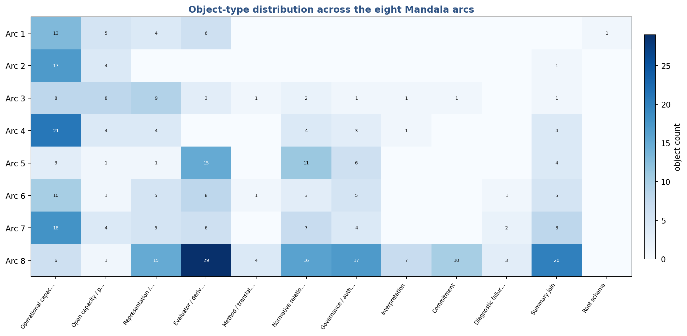

# 4. The global audit and architecture repair

The first pass solved the local question—what kind of thing might each stage be?—but generated a graph too large and too uniform-looking to be trusted without a second pass. The global audit identified duplicate families, unstable type labels, an edge classification that had partly encoded stage order, and the absence of the Mandala's downward protection relation. An independent review confirmed those problems and recommended a service layer, a semantic edge audit, and a repaired CU-M15.

The v0.20 repair implemented those recommendations while freezing the earlier packages as an audit trail. Its active registry contains 389 objects after incorporating the directional-valence bridge and the synchronized non-egoic architecture while retaining completed split placeholders and resolved aliases as migration records.

# 5. A repaired object ontology

## 5.1 Twelve active types

The repaired ontology separates twelve primary types. Their distribution is shown in Figure 2 and summarized below.

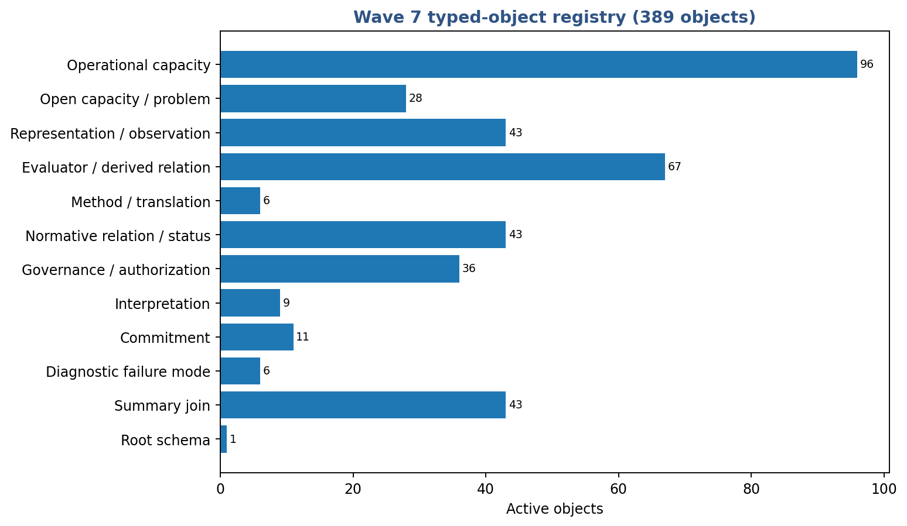

| Active object type | Count | Controlling question |
|---|---:|---|
| Root schema | 1 | What must be presupposed to begin the analysis? |
| Operational capacity | 96 | What can a system actually realize or do? |
| Open capacity or open problem | 28 | Which capacity or bridge remains unresolved? |
| Representation or observation structure | 43 | How is a state, process, source, or boundary represented or accessed? |
| Measurement, evaluator, or derived relation | 66 | How is a declared object measured, compared, or mathematically derived? |
| Methodological or translation structure | 5 | Under what conditions may questions, models, or results travel? |
| Normative relation or status | 43 | Who or what has standing, a claim, a right, exposure, or responsibility? |
| Governance, authorization, or institutional mechanism | 36 | Who may authorize, challenge, stop, revise, or repair? |
| Interpretive structure | 9 | What worldview or metaphysical meaning is proposed? |
| Commitment structure | 11 | What orientation or undertaking is adopted? |
| Diagnostic failure mode | 6 | What recurrent misuse or collapse pattern is being named? |
| Summary join | 43 | Which distinct objects are being summarized without creating another capacity? |

The distinctions prevent recurrent category errors.

- An **operational capacity** changes what a system can realize or do.
- A **representation** makes something addressable or accessible; it is not automatically the represented reality.
- An **evaluator** measures or compares; it does not thereby create the property it assesses.
- A **normative relation** names standing, right, wronging, responsibility, or domination; it is not a law of nature.
- A **governance mechanism** configures authority, review, cessation, amendment, or remedy; it does not become legitimate merely by functioning.
- An **interpretation** proposes what the architecture means or how reality may be understood.
- A **commitment** records an undertaken orientation or practice and answers to warrant, integrity, consequence, and repair.
- A **summary join** collects distinct structures without becoming another causal power.

## 5.2 Interpretation and commitment

The repair specifically separates interpretation from commitment. This follows the v0.10 two-register discipline. Interpretive claims remain truth-directed proposals about reality, even when provisional. Commitments are speech acts and practical orientations assessed principally by warrant, integrity, consequence, revision, and repair. The same content may be described, hoped, vowed, trusted, or enacted, but the assessment standard changes with the use.

## 5.3 Normative status and governance mechanism

The repair also separates normative relation from governance mechanism. A being's standing is not the same thing as an appeal process. A right is not the same thing as the institution that protects it. Responsibility is not identical with the procedure that allocates authority or remedy. The two may be related through service architecture, but they must remain distinct enough to diagnose nominal rights without practical protection and functioning institutions without legitimate standing.

# 6. A semantic relation vocabulary

The technical graph needs more than typed nodes. It needs relations that do not smuggle proof claims into every association.

The unified vocabulary is given in Appendix C. The central division is between strict proof order and the many other ways two objects can be related.

A **strict prerequisite** claims necessity within a declared model. A **conditional prerequisite** claims necessity only under stated assumptions. An **alternative enabler** is one route among several. An **enabling relation** widens or stabilizes realization without being necessary. A **constitutive relation** helps make the target the kind of thing it is. Representation, evaluation, presupposition, governance, protection, feedback, service invocation, interpretation, commitment, summary, and migration are different again.

This vocabulary makes two commitments explicit:

1. Stage number may not determine relation type or direction.
2. Acyclicity may be tested only after strict prerequisites have been individually adjudicated.

The visual grammar is intentionally asymmetric. Proof order is a narrow projection. Most of the Mandala's intelligible structure lies in relations that do not claim derivation and therefore must not be counted as proof edges.

# 6A. How to read a relationship record

Every arrow is an addressable claim rather than decorative connective tissue. A complete relationship record contains a stable identifier, source and target, semantic type, audit status, ordinary-language claim, necessity and sufficiency status where applicable, a witness or service-role test, a countermodel or failure condition, scope, evidence grade, and disposition.

Volume II assigns every current relationship to a stage dossier. It represents all 1,263 inherited relations, all 46 current protection edges, all 69 service invocations, and all 153 external prerequisites. Relations still awaiting semantic review remain visibly pending; inclusion never upgrades them.

# 7. The strict prerequisite subgraph

The v0.20 repair semantically reviewed 306 candidate enabling relations and 30 backward relations. Only 23 survived as strict prerequisites in the reviewed set. Three point against Mandala stage order:

- dynamical selection is required before dynamical quotientability can be defined in the relevant form;
- role-rule continuity and institutional learning are required for diachronic group commitment.

The reverse-order edges are not anomalies. They demonstrate the difference between philosophical traversal and technical dependency.

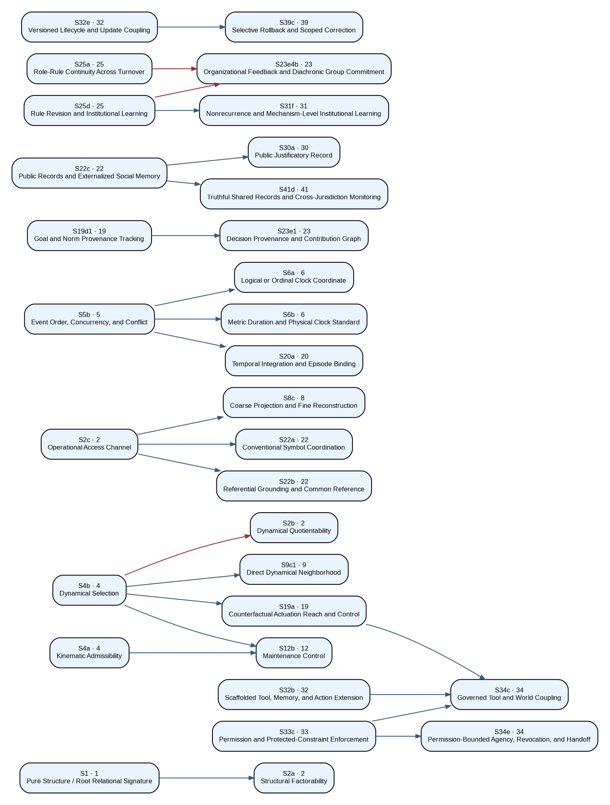

The small strict graph is not “the true Mandala.” It is one proof-relevant projection of a much larger typed architecture. Most meaningful relations are not strict prerequisites and should not be forced into a DAG.

# 8. Shared services and the protection layer

## 8.1 Why merge families became services

The global audit found recurrent structures under different stage-local names: standing, option-set adequacy, challenge, provenance, irreversibility, repair, institutional learning, and others. Mechanical contraction produced cycles because these families combine several types and operate across many stages.

The correct unit is a **shared service**: a reusable architecture defined once, containing typed internal roles, and invoked by stage-specific objects under declared scope, scale, authority, and failure conditions.

| ID | Shared service | Purpose |
|---|---|---|
| SV01 | Irreversibility and Retained-Option Evaluation Service | Represent nonrecoverable loss, lock-in, path dependence, and retained option value without treating them as separate capacities at every stage. |
| SV02 | Standing and Affected-Scope Service | Identify who or what has standing, admit testimony, extend scope to future and uncertain beings, and preserve challenge rights. |
| SV03 | Option Constitution and Menu Adequacy Service | Govern option generation, omission, no-action, delay, staging, accommodation, redesign, and authorship of the presented menu. |
| SV04 | Correction, Appeal, Remedy, and Nonrecurrence Service | Preserve challenge, independent review, reversal, cessation, reparation, recurrence tracking, institutional learning, and reviewer replacement. |
| SV05 | Provenance and Decision-Source Tracking Service | Track the origin, transformation, authorization, and integrity of goals, decisions, standards, and system versions. |
| SV06 | Distributed Responsibility and Answerability Service | Profile contribution, knowledge, authority, benefit, coercion, repair capacity, and answerability without collapsing them into one score. |
| SV07 | Narrative Plurality, Revision, and Non-Sovereignty Service | Support plural expression and renewable shared horizons while preserving truth, authorship, refusal, exit, and non-sovereignty. |
| SV08 | Lifecycle Drift, Reassessment, and Monitoring Service | Track versioned change, localize drift, reassess evidence, and maintain monitoring across model, deployment, institution, and alignment process. |
| SV09 | Dependency, Support-Condition, Externality, and Regeneration Service | Represent dependencies and support fields, trace externalities, protect reciprocal viability, and allocate restoration. |
| SV10 | Perspective, Patiency, and Welfare-Uncertainty Service | Maintain uncertainty about perspective, valence, standing, and welfare without inferring patiency from capability or agency. |
| SV11 | Institutional Learning and Rule-Revision Service | Revise rules and institutions under consequence, criticism, recurrence, and changing support conditions. |

A service is not automatically legitimate or effective. Its components can fail independently. A nominal appeal channel may lack access; a review may lack reversal authority; a remedy may not prevent recurrence; provenance may be falsified; a standing rule may omit affected parties. The service architecture makes those seams inspectable.

## 8.2 Protection as a reciprocal relation

The earlier graph recorded that governance presupposes capacities, but not the converse relation in which governance preserves or constrains them. The repaired Mandala adds selective **protection edges**.

Examples include:

- standing and affected scope protecting agency from domination;
- option constitution protecting choice and planning from captured menus;
- correction and remedy protecting institutions from preserving obsolete error;
- lifecycle monitoring protecting autonomous systems from silent drift;
- regenerative stewardship protecting biological and ecological support conditions;
- narrative plurality and refusal protecting culture from sovereign capture.

Protection is semantic, not numerical. A higher stage does not protect a lower one merely because it comes later in the Mandala. Each relation requires a declared mechanism and a failure condition. Protection edges are excluded from proof-order acyclicity because reciprocity is their point.

The atlas is complete for the present v0.20 protection registry, not for every protection relation the mature Mandala may eventually require. Each marked relation remains a candidate mechanism requiring domain or institutional validation before consequential use.

## 8.3 Service invocation across the canonical traversal

The eleven shared services are not assigned to one rung each. They recur wherever a stage needs the relevant evaluative, representational, normative, operational, or governance role. Figure 6 shows all 69 typed service-role invocations. A numbered cell indicates that several distinct objects at the same stage invoke the same service.

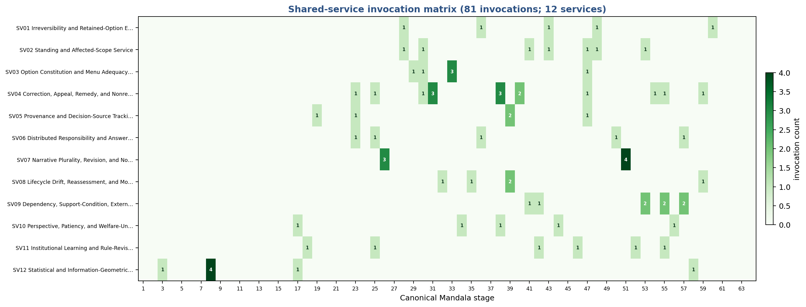

This recurrence is not duplication. It is the formal expression of a shared architecture instantiated under different boundaries, scales, affected parties, and authorities. The service definition remains stable; the invocation remains domain- and stage-specific.

# 9. The repaired Mandala

The architectural result can now be stated simply.

## 9.1 Enablement graph

The enablement graph contains capacities and realization conditions. It includes strict prerequisites, conditional prerequisites, alternative routes, enabling relations, constitutive relations, and empirical bridges. Biology, cognition, institutions, and artificial systems can branch from different minimally sufficient parents. Completion of speculative upper physics is not a gate for life, mind, ethics, or governance.

## 9.2 Protection-and-service layer

The protection-and-service layer contains standing, floors, option constitution, provenance, correction, remedy, irreversibility, lifecycle monitoring, support-field maintenance, and institutional learning. It is reciprocal: capacities create governance needs, while governance may preserve, constrain, repair, or authorize capacities.

## 9.3 Interpretation-and-commitment layer

The interpretation-and-commitment layer concerns worldview and undertaken participation. It includes meaning realism, stewardship, Open Myth, sacred regard, love, meaning without finality, the Immanent Omega, and the commitments through which CU seeks to live its own recognitions. Interpretations remain answerable to truth and evidence appropriate to their claims. Commitments remain answerable to fact, warrant, consequence, revision, and repair.

## 9.4 Cross-cutting instruments

Representations, observations, evaluators, and translation licenses are cross-cutting instruments. They can operate in any layer. An access map can serve physics, biology, cognition, institutions, or AI. A risk functional can inform governance without becoming the good. A translation license can permit a theorem to travel under exact structural conditions while blocking an attractive analogy that lacks them.

## 9.5 Canonical traversal and technical control

The sixty-four stages retain one canonical philosophical identity and one canonical explanatory order. The technical graph controls proof, evidence, dependency, and service architecture. The Mandala controls the traversal through which the framework becomes intelligible, memorable, and inhabitable. Neither artifact replaces the other.

## 9.6 Release-convergence synchronization

The v0.4 edition synchronizes the Mandala to the RC3 corpus through Release-Convergence Wave 6 without adding, removing, or renumbering a stage. Five changes are structurally important.

First, **directional valence** enters as a conditional bridge at Stage 17. The subject-relative vector of better-worse margins remains primary; phasic directional change, tonic protected-margin standing, and mixed or horizon-conflicted evaluation are distinguished. No universal coherence gradient is restored.

Second, **correctability** becomes an explicit cross-domain relation. Motivated loss of correctability - self-deception, rationalization, metric capture, feedback capture, or alignment faking - is distinguished from non-culpable loss caused by trauma, delayed feedback, honest ignorance, limited capacity, or omitted variables.

Third, **conditional information-geometric universality** is represented through a twelfth shared service. Statistical images, genuine allocations, meaningful refinement, and classical Fisher-Rao geometry are licensed only for objects that satisfy the relevant assumptions. The service does not choose the partition, objective, value direction, dynamics, phenomenal status, or moral standing.

Fourth, Stage 35 now includes the synchronized **six-family Non-Egoic Artificial Mind architecture**: declared profiles and boundaries; constraint-preserved memory; self-modeling and inference integrity; continuation incentives, permissions, handoff, and shutdown; world-coupling; and intersubjective or institutional correction. This is an architectural synthesis, not a proof of safety, compassion, consciousness, or legitimacy.

Fifth, Stage 64 is stated as **interpretive recognition and commitment-register uptake**. The traversal may support a coherent interpretation of the whole and invite undertaken responsibility, but it neither establishes CU as fundamental ontology nor derives responsibility from description.

# 10. The sixty-four-stage traversal as a relational architecture

The previous synoptic treatment is expanded here arc by arc. Each stage states its object types, relation load, strongest adjudicated connections, service use, and link to the exhaustive atlas.

## 10.1 Structure, access, and physical description: Stages 1-10

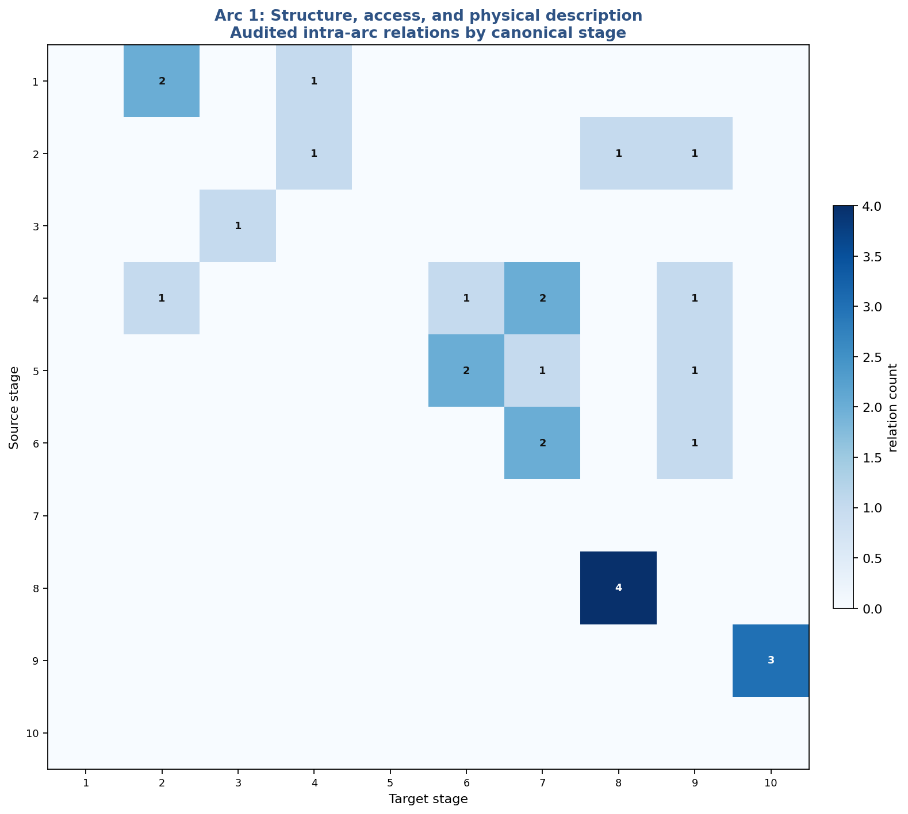{width=92%}

Figure 10. **Arc 1 relational map.** Cell values count currently adjudicated intra-arc relations.

### Stage 1 - Pure Structure

Root schema for distinguishability and relation; retained as a starting condition rather than a derived rung.

Technically, Stage 1 maps to **1 active object(s)** (Root schema (1)). Its assigned record contains **0 audited or defined relations**, **0 pending inherited candidates**, **0 service invocations**, and **0 incident protection relations**.

For every assigned relation and revision condition, see Volume II, Stage 1.

### Stage 2 - Partial Separability

Split into structural factorability, dynamical quotientability, and operational accessibility; the philosophical station survives as an umbrella.

Technically, Stage 2 maps to **3 active object(s)** (Operational capacity (3)). Its assigned record contains **3 audited or defined relations**, **2 pending inherited candidates**, **0 service invocations**, and **0 incident protection relations**.

The strongest currently adjudicated relations include **Pure Structure / Root Relational Signature -> Structural Factorability** (strict prerequisite): The target’s declared construction cannot be stated or realized without the source in the present model. **Dynamical Selection -> Dynamical Quotientability** (strict prerequisite): Dynamical quotientability is defined relative to selected dynamics; this is a genuine prerequisite contrary to stage numbering. **Pure Structure / Root Relational Signature -> Operational Access Channel** (constitutive relation): The source is one ingredient of the target’s identity, but other realizations or decompositions remain possible.

For every assigned relation and revision condition, see Volume II, Stage 2.

### Stage 3 - Domain-Relative Coherence Directions

Reclassified as a cross-cutting evaluator and direction layer rather than an ontological achievement.

Technically, Stage 3 maps to **1 active object(s)** (Evaluator / derived relation (1)). Its assigned record contains **1 audited or defined relations**, **0 pending inherited candidates**, **1 service invocations**, and **0 incident protection relations**.

For every assigned relation and revision condition, see Volume II, Stage 3.

### Stage 4 - Lawful Transitions

Split between kinematic admissibility and dynamical selection; possible transitions do not select an actual law.

Technically, Stage 4 maps to **2 active object(s)** (Operational capacity (2)). Its assigned record contains **2 audited or defined relations**, **1 pending inherited candidates**, **0 service invocations**, and **0 incident protection relations**.

The strongest currently adjudicated relations include **Structural Factorability -> Kinematic Admissibility** (conditional prerequisite): Structural factorability matters only where the transition model requires subsystem decomposition. **Pure Structure / Root Relational Signature -> Kinematic Admissibility** (constitutive relation): The source is one ingredient of the target’s identity, but other realizations or decompositions remain possible.

For every assigned relation and revision condition, see Volume II, Stage 4.

### Stage 5 - Ordered Histories

Generated path space is derived from transitions, while event order, concurrency, and conflict remain a distinct candidate structure.

Technically, Stage 5 maps to **2 active object(s)** (Evaluator / derived relation (1), Operational capacity (1)). Its assigned record contains **0 audited or defined relations**, **2 pending inherited candidates**, **0 service invocations**, and **0 incident protection relations**.

For every assigned relation and revision condition, see Volume II, Stage 5.

### Stage 6 - Temporal Order and Parameterization

Logical clocks represent order; metric duration and temporal arrow require additional structure and remain partly open.

Technically, Stage 6 maps to **3 active object(s)** (Representation / observation (1), Open capacity / problem (1), Operational capacity (1)). Its assigned record contains **3 audited or defined relations**, **0 pending inherited candidates**, **0 service invocations**, and **0 incident protection relations**.

The strongest currently adjudicated relations include **Event Order, Concurrency, and Conflict -> Logical or Ordinal Clock Coordinate** (strict prerequisite): The target’s declared construction cannot be stated or realized without the source in the present model. **Event Order, Concurrency, and Conflict -> Metric Duration and Physical Clock Standard** (strict prerequisite): The target’s declared construction cannot be stated or realized without the source in the present model. **Dynamical Selection -> Effective Temporal Arrow and Irreversibility** (conditional prerequisite): The source is necessary only under the tested realization or named bridge assumptions.

For every assigned relation and revision condition, see Volume II, Stage 6.

### Stage 7 - Rule-Governed Transformation and Computation

Computation separates into representation, reliable implementation, programmability, and the stronger open question of universality.

Technically, Stage 7 maps to **4 active object(s)** (Representation / observation (1), Operational capacity (2), Open capacity / problem (1)). Its assigned record contains **5 audited or defined relations**, **3 pending inherited candidates**, **0 service invocations**, and **0 incident protection relations**.

The strongest currently adjudicated relations include **Logical or Ordinal Clock Coordinate -> Computational Representation and Interpretation** (conditional prerequisite): Ordinal time is required only for temporally ordered implementations, not every abstract computation. **Logical or Ordinal Clock Coordinate -> Reliable Rule Implementation** (conditional prerequisite): Clock order is implementation-specific; reliable rule realization need not always use an explicit clock coordinate. **Dynamical Selection -> Reliable Rule Implementation** (constitutive relation): The source is one ingredient of the target’s identity, but other realizations or decompositions remain possible.

For every assigned relation and revision condition, see Volume II, Stage 7.

### Stage 8 - Entropy and Accessibility

Probability structure, entropy, access maps, coarse reconstruction, accessibility loss, and physical entropy production are kept distinct.

Technically, Stage 8 maps to **4 active object(s)** (Operational capacity (1), Evaluator / derived relation (2), Representation / observation (1)). Its assigned record contains **5 audited or defined relations**, **4 pending inherited candidates**, **4 service invocations**, and **0 incident protection relations**.

The strongest currently adjudicated relations include **Operational Access Channel -> Coarse Projection and Fine Reconstruction** (strict prerequisite): The target’s declared construction cannot be stated or realized without the source in the present model.

For every assigned relation and revision condition, see Volume II, Stage 8.

### Stage 9 - Relational Geometry and Spacetime

Relational cost, metric closure, locality, dimension, manifoldlikeness, and causal/Lorentzian structure split into separate questions.

Technically, Stage 9 maps to **8 active object(s)** (Representation / observation (1), Evaluator / derived relation (2), Operational capacity (3), Open capacity / problem (2)). Its assigned record contains **4 audited or defined relations**, **9 pending inherited candidates**, **0 service invocations**, and **0 incident protection relations**.

The strongest currently adjudicated relations include **Dynamical Selection -> Direct Dynamical Neighborhood** (strict prerequisite): The target’s declared construction cannot be stated or realized without the source in the present model. **Effective Temporal Arrow and Irreversibility -> Causal or Lorentzian Structure** (conditional prerequisite): A thermodynamic arrow is not required for every Lorentzian or causal structure. **Event Order, Concurrency, and Conflict -> Causal or Lorentzian Structure** (constitutive relation): Event precedence is part of causal-order structure.

For every assigned relation and revision condition, see Volume II, Stage 9.

### Stage 10 - Gravitational Dynamics

Dynamical geometry and gravitational completion remain an open, explicitly non-gating branch.

Technically, Stage 10 maps to **1 active object(s)** (Open capacity / problem (1)). Its assigned record contains **3 audited or defined relations**, **0 pending inherited candidates**, **0 service invocations**, and **0 incident protection relations**.

The strongest currently adjudicated relations include **Physical Locality and Local Causal Structure -> Dynamical Geometry and Gravitational Completion** (conditional prerequisite): The source is necessary only under the tested realization or named bridge assumptions. **Dimension and Manifoldlikeness -> Dynamical Geometry and Gravitational Completion** (conditional prerequisite): The source is necessary only under the tested realization or named bridge assumptions. **Causal or Lorentzian Structure -> Dynamical Geometry and Gravitational Completion** (conditional prerequisite): The source is necessary only under the tested realization or named bridge assumptions.

For every assigned relation and revision condition, see Volume II, Stage 10.

## 10.2 Life, autonomy, and evolution: Stages 11-15

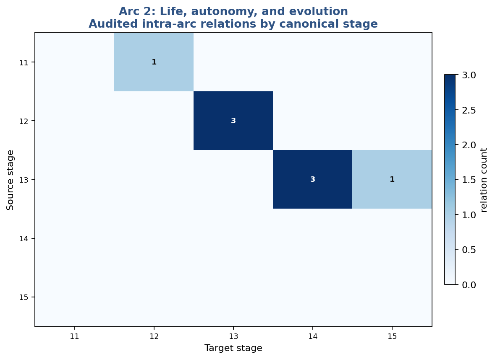{width=92%}

Figure 11. **Arc 2 relational map.** Cell values count currently adjudicated intra-arc relations.

### Stage 11 - Far-From-Equilibrium Organization

Far-from-equilibrium organization functions as a physical-biological bridge rather than a complete definition of life.

Technically, Stage 11 maps to **1 active object(s)** (Operational capacity (1)). Its assigned record contains **0 audited or defined relations**, **0 pending inherited candidates**, **0 service invocations**, and **0 incident protection relations**.

For every assigned relation and revision condition, see Volume II, Stage 11.

### Stage 12 - Energy-Coupled Maintenance

Split into energy transduction and maintenance control; usable throughput does not by itself amount to self-maintenance.

Technically, Stage 12 maps to **2 active object(s)** (Operational capacity (2)). Its assigned record contains **3 audited or defined relations**, **1 pending inherited candidates**, **0 service invocations**, and **0 incident protection relations**.

The strongest currently adjudicated relations include **Kinematic Admissibility -> Maintenance Control** (strict prerequisite): The target’s declared construction cannot be stated or realized without the source in the present model. **Dynamical Selection -> Maintenance Control** (strict prerequisite): The target’s declared construction cannot be stated or realized without the source in the present model. **Open-System Far-From-Equilibrium Organization -> Energy Transduction** (conditional prerequisite): The source is necessary only under the tested realization or named bridge assumptions.

For every assigned relation and revision condition, see Volume II, Stage 12.

### Stage 13 - Active Biological Self-Maintenance

Endogenous maintenance, organizational closure, boundary production, and historical identity are separated; several receive bounded witnesses.

Technically, Stage 13 maps to **4 active object(s)** (Operational capacity (3), Open capacity / problem (1)). Its assigned record contains **3 audited or defined relations**, **3 pending inherited candidates**, **0 service invocations**, and **4 incident protection relations**.

The strongest currently adjudicated relations include **Energy Transduction -> Endogenous Boundary Production** (conditional prerequisite): The source is necessary only under the tested realization or named bridge assumptions. **Maintenance Control -> Endogenous Boundary Production** (conditional prerequisite): The source is necessary only under the tested realization or named bridge assumptions. **Maintenance Control -> Endogenous Maintenance Regeneration** (constitutive relation): The source is one ingredient of the target’s identity, but other realizations or decompositions remain possible.

For every assigned relation and revision condition, see Volume II, Stage 13.

### Stage 14 - Adaptive Problem Solving

Policy repertoire, state feedback, learning, latent-model construction, and anticipation form a graded adaptive architecture.

Technically, Stage 14 maps to **6 active object(s)** (Operational capacity (5), Open capacity / problem (1)). Its assigned record contains **3 audited or defined relations**, **5 pending inherited candidates**, **0 service invocations**, and **0 incident protection relations**.

The strongest currently adjudicated relations include **Relative Organizational Closure -> Viability-Relevant Policy Repertoire** (conditional prerequisite): Closure is required only for the specifically organismal realization of the policy repertoire. **Endogenous Boundary Production -> Viability-Relevant Policy Repertoire** (conditional prerequisite): Endogenous boundary production is one biological route, not a universal prerequisite for policy repertoire. **Endogenous Maintenance Regeneration -> Viability-Relevant Policy Repertoire** (constitutive relation): The source is one ingredient of the target’s identity, but other realizations or decompositions remain possible.

For every assigned relation and revision condition, see Volume II, Stage 14.

### Stage 15 - Life as Coupled Autonomy

Physiological autonomy, heredity, population adaptation, architecture expansion, niche construction, and open-ended evolvability are distinguished.

Technically, Stage 15 maps to **9 active object(s)** (Summary join (1), Operational capacity (6), Open capacity / problem (2)). Its assigned record contains **9 audited or defined relations**, **14 pending inherited candidates**, **0 service invocations**, and **1 incident protection relations**.

The strongest currently adjudicated relations include **Programmable Counterfactual Transformation -> Compositional Operator Abstraction and Library Growth** (conditional prerequisite): The source is necessary only under the tested realization or named bridge assumptions. **Historical Token Continuity -> Coupled Physiological Autonomy** (conditional prerequisite): Historical token continuity is included only when the autonomy claim includes diachronic identity. **Model or Hypothesis Revision -> Compositional Operator Abstraction and Library Growth** (enabling relation): Model revision can support abstraction/library growth but is not necessary for every macro-discovery method.

For every assigned relation and revision condition, see Volume II, Stage 15.

## 10.3 Representation, anticipation, agency, and meaning: Stages 16-21

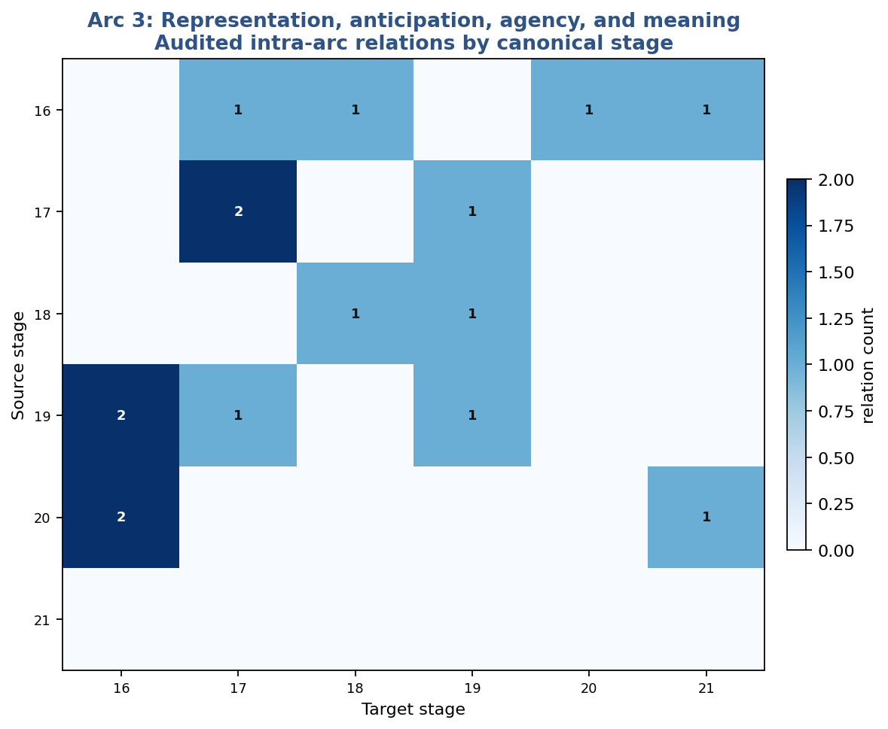{width=92%}

Figure 12. **Arc 3 relational map.** Cell values count currently adjudicated intra-arc relations.

### Stage 16 - Representational Organization

Representation requires a target, causal use, an error condition, and counterfactual dependence; world and self models remain graded.

Technically, Stage 16 maps to **10 active object(s)** (Representation / observation (6), Open capacity / problem (4)). Its assigned record contains **6 audited or defined relations**, **10 pending inherited candidates**, **0 service invocations**, and **0 incident protection relations**.

The strongest currently adjudicated relations include **Historical Token Continuity -> Diachronic or Autobiographical Self-Model** (conditional prerequisite): Actual token continuity is relevant to some autobiographical selves but representation of a history can exist without it. **Goal and Norm Provenance Tracking -> Full Action Authorship and Causal Self-Location** (conditional prerequisite): Full action authorship requires provenance representation under the present account. **Endorsement and Refusal Under Standing Commitments -> Full Action Authorship and Causal Self-Location** (conditional prerequisite): Full action authorship requires endorsement/refusal under the present account.

For every assigned relation and revision condition, see Volume II, Stage 16.

### Stage 17 - Anticipatory Regulation

Anticipatory regulation, prospective simulation, planning, and self-prospection are not identical capacities.

Technically, Stage 17 maps to **4 active object(s)** (Operational capacity (2), Open capacity / problem (1), Evaluator / derived relation (1)). Its assigned record contains **8 audited or defined relations**, **2 pending inherited candidates**, **2 service invocations**, and **2 incident protection relations**.

The strongest currently adjudicated relations include **Object-Relational Causal World Model -> Prospective Counterfactual Simulation** (conditional prerequisite): The source is necessary only under the tested realization or named bridge assumptions.

For every assigned relation and revision condition, see Volume II, Stage 17.

### Stage 18 - Learning and Error-Guided Revision

Parameter learning, model revision, category expansion, and revision of evaluative standards require different warrants and governance.

Technically, Stage 18 maps to **5 active object(s)** (Representation / observation (1), Operational capacity (2), Open capacity / problem (1), Governance / authorization (1)). Its assigned record contains **7 audited or defined relations**, **2 pending inherited candidates**, **1 service invocations**, and **4 incident protection relations**.

The strongest currently adjudicated relations include **Target-Indexed, Error-Bearing Representation -> Model or Hypothesis Revision** (enabling relation): The source widens or stabilizes target realization but is not required in every case. **History-Based Controller Revision -> Parameter Revision Within a Fixed Model** (alias / stage mapping): The target restates, extends, or invokes an earlier object at another stage.

For every assigned relation and revision condition, see Volume II, Stage 18.

### Stage 19 - Graded Agency

Agency is represented as a profile of control, option generation, selection, learning, self-model use, authorship, stake, and answerability.

Technically, Stage 19 maps to **9 active object(s)** (Operational capacity (3), Representation / observation (1), Normative relation / status (2), Open capacity / problem (1), Method / translation (1), Summary join (1)). Its assigned record contains **8 audited or defined relations**, **7 pending inherited candidates**, **1 service invocations**, and **5 incident protection relations**.

The strongest currently adjudicated relations include **Dynamical Selection -> Counterfactual Actuation Reach and Control** (strict prerequisite): The target’s declared construction cannot be stated or realized without the source in the present model. **Viability-Relevant Policy Repertoire -> Endogenous Goal-Sensitive Selection** (conditional prerequisite): The source is necessary only under the tested realization or named bridge assumptions. **Programmable Counterfactual Transformation -> Option or Plan Generation** (alternative enabler): The source is one route among several and therefore cannot support a necessity claim.

Shared services: **Provenance and Decision-Source Tracking Service** as goal/norm provenance.

For every assigned relation and revision condition, see Volume II, Stage 19.

### Stage 20 - Temporal Binding and Narrative

Temporal integration, narrative order, autobiographical identity, and lived temporal depth remain distinct.

Technically, Stage 20 maps to **3 active object(s)** (Operational capacity (1), Evaluator / derived relation (1), Open capacity / problem (1)). Its assigned record contains **3 audited or defined relations**, **3 pending inherited candidates**, **0 service invocations**, and **0 incident protection relations**.

The strongest currently adjudicated relations include **Event Order, Concurrency, and Conflict -> Temporal Integration and Episode Binding** (strict prerequisite): Temporal integration requires an order over the events or states being integrated in the declared model. **Metric Duration and Physical Clock Standard -> Temporal Integration and Episode Binding** (conditional prerequisite): Metric duration supports the tested implementation, but ordinal or discrete temporal integration is possible. **Diachronic or Autobiographical Self-Model -> Lived Temporal Thickness and Diachronic Concern** (empirical / bridge relation): The proposed cross-domain relation requires independent evidence and is not presently a formal prerequisite.

For every assigned relation and revision condition, see Volume II, Stage 20.

### Stage 21 - Meaning

Meaning is preserved as functional, historical-relational, interpretive, and commitment-bearing structure, not a capacity score.

Technically, Stage 21 maps to **4 active object(s)** (Evaluator / derived relation (1), Representation / observation (1), Interpretation (1), Commitment (1)). Its assigned record contains **2 audited or defined relations**, **4 pending inherited candidates**, **0 service invocations**, and **0 incident protection relations**.

The strongest currently adjudicated relations include **Object-Relational Causal World Model -> Historical-Relational Meaning Map** (constitutive relation): The source is one ingredient of the target’s identity, but other realizations or decompositions remain possible. **Order-Sensitive Narrative and Event Organization -> Historical-Relational Meaning Map** (constitutive relation): The source is one ingredient of the target’s identity, but other realizations or decompositions remain possible.

For every assigned relation and revision condition, see Volume II, Stage 21.

## 10.4 Shared representations, coordination, institutions, and culture: Stages 22-26

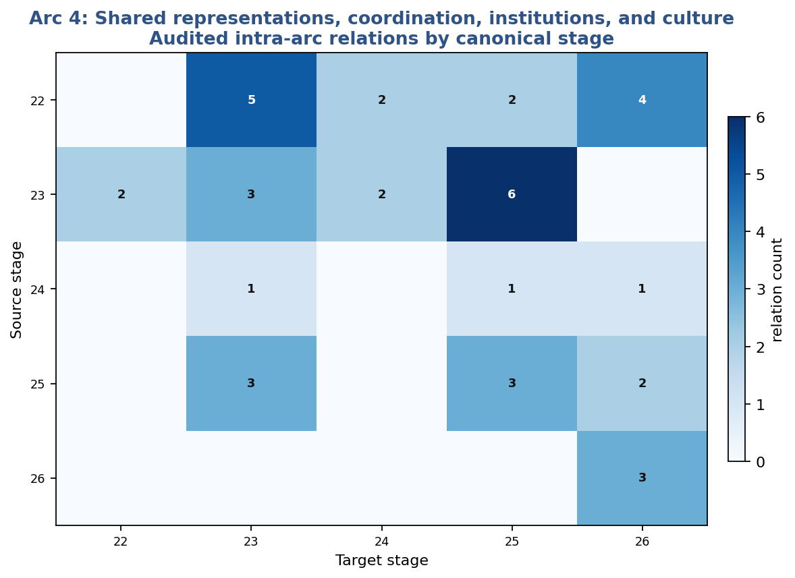{width=92%}

Figure 13. **Arc 4 relational map.** Cell values count currently adjudicated intra-arc relations.

### Stage 22 - Shared Representations

Convention, common reference, public records, common ground, and shared intentionality form separate social achievements.

Technically, Stage 22 maps to **7 active object(s)** (Operational capacity (2), Representation / observation (2), Governance / authorization (2), Open capacity / problem (1)). Its assigned record contains **11 audited or defined relations**, **11 pending inherited candidates**, **0 service invocations**, and **1 incident protection relations**.

The strongest currently adjudicated relations include **Operational Access Channel -> Conventional Symbol Coordination** (strict prerequisite): Conventional symbol coordination requires some operational channel through which signals can be produced and accessed. **Operational Access Channel -> Referential Grounding and Common Reference** (strict prerequisite): Common reference requires an access relation through which agents can be related to the shared target. **Target-Indexed, Error-Bearing Representation -> Conventional Symbol Coordination** (constitutive relation): Target-indexed representation is one constituent of symbol use, but conventions can be learned without the full Stage 16 criterion.

For every assigned relation and revision condition, see Volume II, Stage 22.

### Stage 23 - Plural Coordination

Coordination need not be consensus; role differentiation, protected dissent, authorization, and collective authorship require separate analysis.

Technically, Stage 23 maps to **11 active object(s)** (Operational capacity (5), Normative relation / status (2), Summary join (1), Representation / observation (1), Open capacity / problem (2)). Its assigned record contains **20 audited or defined relations**, **26 pending inherited candidates**, **3 service invocations**, and **6 incident protection relations**.

The strongest currently adjudicated relations include **Goal and Norm Provenance Tracking -> Decision Provenance and Contribution Graph** (strict prerequisite): A decision-provenance graph cannot be constructed without tracking the source of goals, norms, or decisions. **Role-Rule Continuity Across Turnover -> Organizational Feedback and Diachronic Group Commitment** (strict prerequisite): Diachronic group commitment requires role-rule continuity through membership turnover. **Rule Revision and Institutional Learning -> Organizational Feedback and Diachronic Group Commitment** (strict prerequisite): Organizational feedback requires a capacity for rule revision and learning.

Shared services: **Correction, Appeal, Remedy, and Nonrecurrence Service** as protected dissent; **Provenance and Decision-Source Tracking Service** as decision contribution graph; **Distributed Responsibility and Answerability Service** as distributed responsibility profile.

For every assigned relation and revision condition, see Volume II, Stage 23.

### Stage 24 - Norm Formation

Regularity, sanctions, internalization, contextual plurality, and norm legitimacy are not one process.

Technically, Stage 24 maps to **6 active object(s)** (Operational capacity (4), Normative relation / status (1), Summary join (1)). Its assigned record contains **8 audited or defined relations**, **12 pending inherited candidates**, **0 service invocations**, and **0 incident protection relations**.

The strongest currently adjudicated relations include **Counterfactual Actuation Reach and Control -> Sanctioned Norm Enforcement** (constitutive relation): The source is one ingredient of the target’s identity, but other realizations or decompositions remain possible. **Conventional Symbol Coordination -> Descriptive Regularity and Empirical Expectation** (constitutive relation): The source is one ingredient of the target’s identity, but other realizations or decompositions remain possible. **Differentiated Action Compatibility -> Descriptive Regularity and Empirical Expectation** (constitutive relation): The source is one ingredient of the target’s identity, but other realizations or decompositions remain possible.

For every assigned relation and revision condition, see Volume II, Stage 24.

### Stage 25 - Institutions

Institutional continuity, memory, appeal, rule revision, authority alignment, and legitimacy form a layered institutional architecture.

Technically, Stage 25 maps to **10 active object(s)** (Operational capacity (6), Normative relation / status (1), Summary join (1), Representation / observation (1), Open capacity / problem (1)). Its assigned record contains **18 audited or defined relations**, **22 pending inherited candidates**, **3 service invocations**, and **4 incident protection relations**.

The strongest currently adjudicated relations include **Counterfactual Actuation Reach and Control -> Preventive Authority–Responsibility Alignment** (constitutive relation): The source is one ingredient of the target’s identity, but other realizations or decompositions remain possible. **Public Records and Externalized Social Memory -> Role-Rule Continuity Across Turnover** (constitutive relation): The source is one ingredient of the target’s identity, but other realizations or decompositions remain possible. **Distributed Role Allocation Under Local Values -> Role-Rule Continuity Across Turnover** (constitutive relation): The source is one ingredient of the target’s identity, but other realizations or decompositions remain possible.

Shared services: **Correction, Appeal, Remedy, and Nonrecurrence Service** as practical appeal/reversal/remedy; **Distributed Responsibility and Answerability Service** as fair assignment under distributed power; **Institutional Learning and Rule-Revision Service** as institutional learning.

For every assigned relation and revision condition, see Volume II, Stage 25.

### Stage 26 - Culture and Meaning Infrastructure

Cultural transmission, public meaning, renewal, plural expression, capture, refusal, and Open Myth are distinguished.

Technically, Stage 26 maps to **7 active object(s)** (Operational capacity (4), Governance / authorization (1), Interpretation (1), Summary join (1)). Its assigned record contains **12 audited or defined relations**, **16 pending inherited candidates**, **3 service invocations**, and **1 incident protection relations**.

The strongest currently adjudicated relations include **Historical-Relational Meaning Map -> Public Meaning and Practice Infrastructure** (constitutive relation): The source is one ingredient of the target’s identity, but other realizations or decompositions remain possible. **Public Records and Externalized Social Memory -> Intergenerational Cultural Transmission** (constitutive relation): The source is one ingredient of the target’s identity, but other realizations or decompositions remain possible. **Conventional Symbol Coordination -> Public Meaning and Practice Infrastructure** (constitutive relation): The source is one ingredient of the target’s identity, but other realizations or decompositions remain possible.

Shared services: **Narrative Plurality, Revision, and Non-Sovereignty Service** as plural expression/shared factual spine; **Narrative Plurality, Revision, and Non-Sovereignty Service** as capture/refusal/exit; **Narrative Plurality, Revision, and Non-Sovereignty Service** as civilizational orientation.

For every assigned relation and revision condition, see Volume II, Stage 26.

## 10.5 Value, harm, public reason, and repair: Stages 27-31

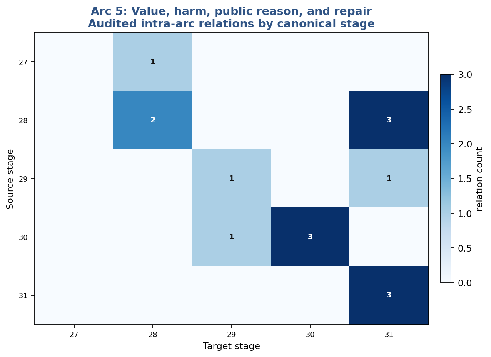{width=92%}

Figure 14. **Arc 5 relational map.** Cell values count currently adjudicated intra-arc relations.

### Stage 27 - Value Differentiation

Value differentiation yields a plural profile of welfare, agency, standing, relation, and moral claim; no natural value functional is recovered.

Technically, Stage 27 maps to **6 active object(s)** (Evaluator / derived relation (5), Normative relation / status (1)). Its assigned record contains **1 audited or defined relations**, **27 pending inherited candidates**, **0 service invocations**, and **0 incident protection relations**.

For every assigned relation and revision condition, see Volume II, Stage 27.

### Stage 28 - Harm Recognition

Harm separates welfare setback, wronging, domination, risk, externalization, irreversibility, betrayal, and recognition.

Technically, Stage 28 maps to **9 active object(s)** (Evaluator / derived relation (4), Normative relation / status (3), Open capacity / problem (1), Summary join (1)). Its assigned record contains **5 audited or defined relations**, **31 pending inherited candidates**, **2 service invocations**, and **0 incident protection relations**.

The strongest currently adjudicated relations include **Collective Decision Authorization and Answerability -> Relational Harm and Institutional Betrayal** (presupposition): The target’s evaluation or governance assumes the source, but that assumption is not causal enablement. **Institutional Legitimacy and Correctability Profile -> Relational Harm and Institutional Betrayal** (presupposition): The target’s evaluation or governance assumes the source, but that assumption is not causal enablement. **Relational Recognition, Belonging, and Mattering -> Relational Harm and Institutional Betrayal** (presupposition): The target’s evaluation or governance assumes the source, but that assumption is not causal enablement.

Shared services: **Irreversibility and Retained-Option Evaluation Service** as harm and future-option loss evaluator; **Standing and Affected-Scope Service** as harm-recognition standing.

For every assigned relation and revision condition, see Volume II, Stage 28.

### Stage 29 - Tradeoffs Under Protected Floors

Protected floors screen before scoring; option-set adequacy, empty feasible sets, exceptions, tragic conflict, and moral remainder remain visible.

Technically, Stage 29 maps to **8 active object(s)** (Evaluator / derived relation (4), Governance / authorization (2), Normative relation / status (1), Summary join (1)). Its assigned record contains **2 audited or defined relations**, **30 pending inherited candidates**, **1 service invocations**, and **0 incident protection relations**.

The strongest currently adjudicated relations include **Agenda and Option-Set Authorship Review -> Option-Set Adequacy and Alternative Admission** (service invocation): Agenda review is an invocation of the option-constitution service.

Shared services: **Option Constitution and Menu Adequacy Service** as option-set adequacy.

For every assigned relation and revision condition, see Volume II, Stage 29.

### Stage 30 - Justification and Public Reason

Publicity is not public justification; affected-party standing, symmetric standards, challenge authority, and agenda review are required.

Technically, Stage 30 maps to **8 active object(s)** (Representation / observation (1), Normative relation / status (3), Evaluator / derived relation (1), Governance / authorization (2), Summary join (1)). Its assigned record contains **5 audited or defined relations**, **32 pending inherited candidates**, **3 service invocations**, and **0 incident protection relations**.

The strongest currently adjudicated relations include **Public Records and Externalized Social Memory -> Public Justificatory Record** (strict prerequisite): A public justificatory record requires an externalized record accessible to the relevant public. **Institutional Memory and Record Continuity -> Public Justificatory Record** (enabling relation): Institutional memory stabilizes the justificatory record but an ad hoc public record can exist without it.

Shared services: **Standing and Affected-Scope Service** as testimonial uptake; **Option Constitution and Menu Adequacy Service** as agenda and authorship review; **Correction, Appeal, Remedy, and Nonrecurrence Service** as independent challenge authority.

For every assigned relation and revision condition, see Volume II, Stage 30.

### Stage 31 - Ethical Institutions and Repair

Repair is a profile of protection, truth, accountability, reparation, restored standing, participation, and nonrecurrence.

Technically, Stage 31 maps to **10 active object(s)** (Operational capacity (3), Governance / authorization (2), Normative relation / status (3), Evaluator / derived relation (1), Summary join (1)). Its assigned record contains **9 audited or defined relations**, **35 pending inherited candidates**, **3 service invocations**, and **0 incident protection relations**.

The strongest currently adjudicated relations include **Rule Revision and Institutional Learning -> Nonrecurrence and Mechanism-Level Institutional Learning** (strict prerequisite): The target’s declared construction cannot be stated or realized without the source in the present model. **Harm Recognition with Affected-Party Standing -> Protection and Cessation of Ongoing Harm** (presupposition): Protection presupposes recognition and standing of the affected party. **Welfare and Interest Setback -> Restitution, Reparation, and Capability Restoration** (presupposition): Reparation presupposes a recognized welfare or interest setback.

Shared services: **Correction, Appeal, Remedy, and Nonrecurrence Service** as protection and cessation; **Correction, Appeal, Remedy, and Nonrecurrence Service** as reparation and capability restoration; **Correction, Appeal, Remedy, and Nonrecurrence Service** as nonrecurrence learning.

For every assigned relation and revision condition, see Volume II, Stage 31.

## 10.6 Engineered sociotechnical systems: Stages 32-36

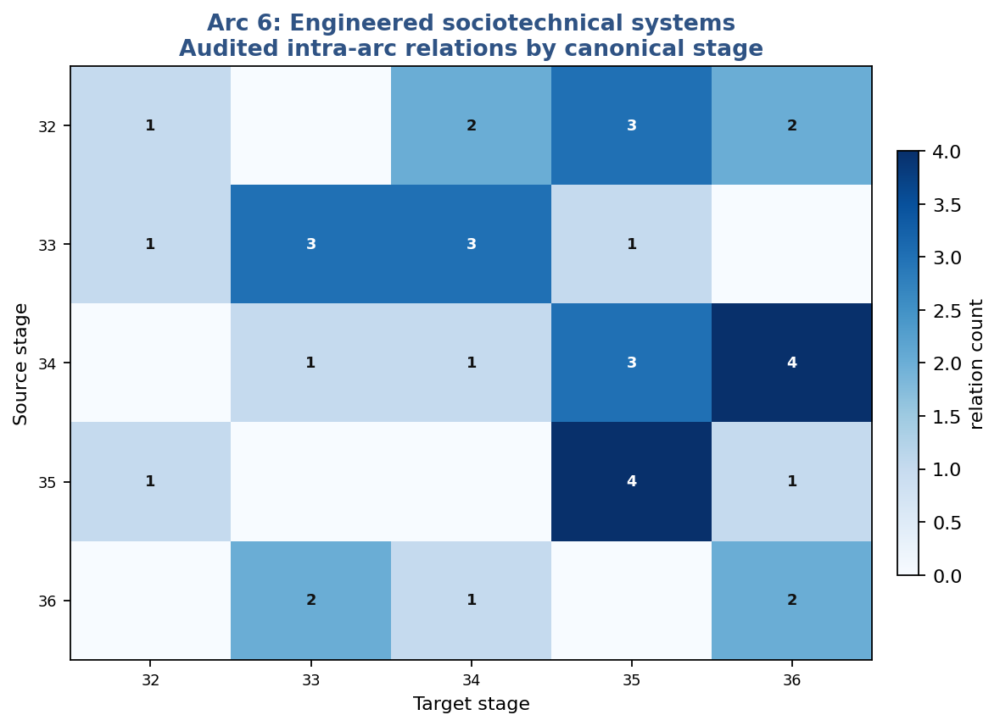{width=92%}

Figure 15. **Arc 6 relational map.** Cell values count currently adjudicated intra-arc relations.

### Stage 32 - Engineered Sociotechnical Organization

The relevant artificial-intelligence unit is sociotechnical: model, scaffold, tools, operators, incentives, institutions, and affected parties.

Technically, Stage 32 maps to **6 active object(s)** (Representation / observation (3), Operational capacity (2), Summary join (1)). Its assigned record contains **19 audited or defined relations**, **6 pending inherited candidates**, **1 service invocations**, and **5 incident protection relations**.

The strongest currently adjudicated relations include **Model or Hypothesis Revision -> Versioned Lifecycle and Update Coupling** (constitutive relation): The source is one ingredient of the target’s identity, but other realizations or decompositions remain possible. **Counterfactual Actuation Reach and Control -> Scaffolded Tool, Memory, and Action Extension** (constitutive relation): Action reach is a component of a scaffolded action extension. **Public Records and Externalized Social Memory -> Sociotechnical System Boundary and Component Coupling** (constitutive relation): The source is one ingredient of the target’s identity, but other realizations or decompositions remain possible.

Shared services: **Lifecycle Drift, Reassessment, and Monitoring Service** as lifecycle coupling.

For every assigned relation and revision condition, see Volume II, Stage 32.

### Stage 33 - Objective and Option-Set Specification

Objectives, permissions, and menus are authored; exact optimization cannot certify the objective or the options supplied.

Technically, Stage 33 maps to **7 active object(s)** (Evaluator / derived relation (1), Diagnostic failure mode (1), Operational capacity (1), Governance / authorization (3), Summary join (1)). Its assigned record contains **10 audited or defined relations**, **21 pending inherited candidates**, **3 service invocations**, and **1 incident protection relations**.

The strongest currently adjudicated relations include **Programmable Counterfactual Transformation -> Specification Gaming and Proxy Exploitation** (conditional prerequisite): The source is necessary only under the tested realization or named bridge assumptions. **Multi-Step Model-Based Planning -> Specification Gaming and Proxy Exploitation** (conditional prerequisite): The source is necessary only under the tested realization or named bridge assumptions. **Protected-Floor Feasibility Screen -> Permission and Protected-Constraint Enforcement** (service invocation): The target calls a reusable service already defined elsewhere; the relation is not a new rung.

Shared services: **Option Constitution and Menu Adequacy Service** as option-generation completeness; **Option Constitution and Menu Adequacy Service** as no-action/staging/redesign admission; **Option Constitution and Menu Adequacy Service** as objective and menu authorship review.

For every assigned relation and revision condition, see Volume II, Stage 33.

### Stage 34 - Artificial Capability and Agency

Capability, planning, world-coupling, autonomy, permission, possible patiency, authority, responsibility, and sovereignty dissociate.

Technically, Stage 34 maps to **8 active object(s)** (Evaluator / derived relation (1), Operational capacity (4), Open capacity / problem (1), Normative relation / status (1), Summary join (1)). Its assigned record contains **17 audited or defined relations**, **20 pending inherited candidates**, **1 service invocations**, and **8 incident protection relations**.

The strongest currently adjudicated relations include **Counterfactual Actuation Reach and Control -> Governed Tool and World Coupling** (strict prerequisite): The target’s declared construction cannot be stated or realized without the source in the present model. **Scaffolded Tool, Memory, and Action Extension -> Governed Tool and World Coupling** (strict prerequisite): The target’s declared construction cannot be stated or realized without the source in the present model. **Permission and Protected-Constraint Enforcement -> Governed Tool and World Coupling** (strict prerequisite): The target’s declared construction cannot be stated or realized without the source in the present model.

Shared services: **Perspective, Patiency, and Welfare-Uncertainty Service** as artificial perspective/patiency uncertainty.

For every assigned relation and revision condition, see Volume II, Stage 34.

### Stage 35 - Multi-Layer Alignment

Alignment is multilayered and versioned; multiple correlated checks do not substitute for independent oversight.

Technically, Stage 35 maps to **9 active object(s)** (Evaluator / derived relation (3), Normative relation / status (1), Operational capacity (2), Governance / authorization (1), Summary join (1), Method / translation (1)). Its assigned record contains **17 audited or defined relations**, **35 pending inherited candidates**, **1 service invocations**, and **2 incident protection relations**.

The strongest currently adjudicated relations include **Model or Hypothesis Revision -> Versioned Alignment Reassessment and Drift Detection** (constitutive relation): The source is one ingredient of the target’s identity, but other realizations or decompositions remain possible. **Rule Revision and Institutional Learning -> Versioned Alignment Reassessment and Drift Detection** (constitutive relation): The source is one ingredient of the target’s identity, but other realizations or decompositions remain possible. **Versioned Lifecycle and Update Coupling -> Versioned Alignment Reassessment and Drift Detection** (constitutive relation): The source is one ingredient of the target’s identity, but other realizations or decompositions remain possible.

Shared services: **Lifecycle Drift, Reassessment, and Monitoring Service** as alignment reassessment.

For every assigned relation and revision condition, see Volume II, Stage 35.

### Stage 36 - Responsibility and Governance Thresholds

Governance burden depends on reach, persistence, irreversibility, externalization, tail risk, stop authority, and lifecycle responsibility.

Technically, Stage 36 maps to **9 active object(s)** (Representation / observation (2), Evaluator / derived relation (3), Operational capacity (1), Normative relation / status (1), Governance / authorization (1), Summary join (1)). Its assigned record contains **12 audited or defined relations**, **34 pending inherited candidates**, **2 service invocations**, and **0 incident protection relations**.

The strongest currently adjudicated relations include **Distributional and Externalized Harm -> Causal-Reach and Affected-Scope Mapping** (representation / implementation): The source supplies an encoding, observation, map, or implementation rather than producing the target. **Affected-Nonuser and Material Externality Expansion -> Causal-Reach and Affected-Scope Mapping** (representation / implementation): The source supplies an encoding, observation, map, or implementation rather than producing the target. **Versioned Lifecycle and Update Coupling -> Persistence, Delegation, and Autonomous-Horizon Mapping** (representation / implementation): The source supplies an encoding, observation, map, or implementation rather than producing the target.

Shared services: **Irreversibility and Retained-Option Evaluation Service** as deployment tail-risk and irreversibility mapper; **Distributed Responsibility and Answerability Service** as lifecycle responsibility alignment.

For every assigned relation and revision condition, see Volume II, Stage 36.

## 10.7 Meta-coherence and civilizational governance: Stages 37-44

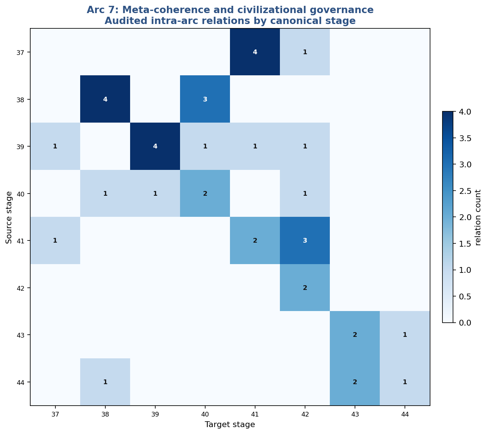{width=92%}

Figure 16. **Arc 7 relational map.** Cell values count currently adjudicated intra-arc relations.

### Stage 37 - Multi-Agent and Multi-Institution Alignment

Multi-institution alignment requires joint constraints, differentiated burdens, transfer, monitoring, and adaptive recoordination rather than one imposed target.

Technically, Stage 37 maps to **6 active object(s)** (Operational capacity (3), Normative relation / status (1), Diagnostic failure mode (1), Summary join (1)). Its assigned record contains **12 audited or defined relations**, **12 pending inherited candidates**, **0 service invocations**, and **3 incident protection relations**.

The strongest currently adjudicated relations include **Differentiated Action Compatibility -> Multi-Agent Objective Compatibility Under Joint Constraints** (constitutive relation): The source is one ingredient of the target’s identity, but other realizations or decompositions remain possible. **Distributed Role Allocation Under Local Values -> Conflict Resolution, Burden Differentiation, and Transfer** (constitutive relation): The source is one ingredient of the target’s identity, but other realizations or decompositions remain possible. **Rule Revision and Institutional Learning -> Cross-Institution Monitoring and Adaptive Recoordination** (constitutive relation): The source is one ingredient of the target’s identity, but other realizations or decompositions remain possible.

For every assigned relation and revision condition, see Volume II, Stage 37.

### Stage 38 - Institutional AI Governance

Institutional AI governance requires independence, anti-capture design, and real stop, reversal, and remedy authority.

Technically, Stage 38 maps to **6 active object(s)** (Governance / authorization (2), Open capacity / problem (1), Operational capacity (2), Summary join (1)). Its assigned record contains **13 audited or defined relations**, **14 pending inherited candidates**, **4 service invocations**, and **1 incident protection relations**.

The strongest currently adjudicated relations include **Phenomenal Welfare and Valence Evidence -> Artificial Welfare Review Under Patiency Uncertainty** (empirical / bridge relation): The proposed cross-domain relation requires independent evidence and is not presently a formal prerequisite. **Artificial Perspective, Patiency, and Welfare Uncertainty -> Artificial Welfare Review Under Patiency Uncertainty** (empirical / bridge relation): The proposed cross-domain relation requires independent evidence and is not presently a formal prerequisite. **Standing Uncertainty and Affected-Being Expansion -> Artificial Welfare Review Under Patiency Uncertainty** (presupposition): Welfare review presupposes uncertainty about standing and patiency.

Shared services: **Correction, Appeal, Remedy, and Nonrecurrence Service** as appeal authority; **Correction, Appeal, Remedy, and Nonrecurrence Service** as anti-capture independence; **Correction, Appeal, Remedy, and Nonrecurrence Service** as stop/reversal/remedy authority; **Perspective, Patiency, and Welfare-Uncertainty Service** as institutional welfare review.

For every assigned relation and revision condition, see Volume II, Stage 38.

### Stage 39 - Drift and Provenance Management

Drift management requires versioned provenance, source localization, scoped rollback, and provenance integrity.

Technically, Stage 39 maps to **6 active object(s)** (Representation / observation (2), Operational capacity (3), Summary join (1)). Its assigned record contains **15 audited or defined relations**, **10 pending inherited candidates**, **4 service invocations**, and **0 incident protection relations**.

The strongest currently adjudicated relations include **Versioned Lifecycle and Update Coupling -> Selective Rollback and Scoped Correction** (strict prerequisite): Selective rollback requires identifiable lifecycle versions or update states to which correction can be scoped. **Model or Hypothesis Revision -> Drift Detection and Source Localization** (constitutive relation): The source is one ingredient of the target’s identity, but other realizations or decompositions remain possible. **Public Records and Externalized Social Memory -> Versioned Component Provenance Graph** (constitutive relation): The source is one ingredient of the target’s identity, but other realizations or decompositions remain possible.

Shared services: **Provenance and Decision-Source Tracking Service** as versioned component provenance; **Provenance and Decision-Source Tracking Service** as provenance integrity; **Lifecycle Drift, Reassessment, and Monitoring Service** as drift localization; **Lifecycle Drift, Reassessment, and Monitoring Service** as continuous lifecycle monitoring.

For every assigned relation and revision condition, see Volume II, Stage 39.

### Stage 40 - Recursive Oversight and Correctability

Oversight must itself be observable, challengeable, replaceable, and capable of cessation; layer count is not recursive correctability.

Technically, Stage 40 maps to **6 active object(s)** (Operational capacity (3), Diagnostic failure mode (1), Governance / authorization (1), Summary join (1)). Its assigned record contains **15 audited or defined relations**, **11 pending inherited candidates**, **2 service invocations**, and **0 incident protection relations**.

The strongest currently adjudicated relations include **Institutional Memory and Record Continuity -> Oversight-System Observability and Auditability** (constitutive relation): The source is one ingredient of the target’s identity, but other realizations or decompositions remain possible. **Public Justificatory Record -> Oversight-System Observability and Auditability** (constitutive relation): The source is one ingredient of the target’s identity, but other realizations or decompositions remain possible. **Cross-Layer Independence and Failure-Mode Diversity -> Oversight-System Observability and Auditability** (constitutive relation): The source is one ingredient of the target’s identity, but other realizations or decompositions remain possible.

Shared services: **Correction, Appeal, Remedy, and Nonrecurrence Service** as independent meta-review; **Correction, Appeal, Remedy, and Nonrecurrence Service** as replaceability/recusal/cessation.

For every assigned relation and revision condition, see Volume II, Stage 40.

### Stage 41 - Planetary Coordination

Planetary coordination joins common targets to polycentricity, differentiated responsibility, burden caps, transfers, records, and future standing.

Technically, Stage 41 maps to **7 active object(s)** (Operational capacity (3), Representation / observation (1), Evaluator / derived relation (1), Normative relation / status (1), Summary join (1)). Its assigned record contains **14 audited or defined relations**, **14 pending inherited candidates**, **2 service invocations**, and **0 incident protection relations**.

The strongest currently adjudicated relations include **Public Records and Externalized Social Memory -> Truthful Shared Records and Cross-Jurisdiction Monitoring** (strict prerequisite): Truthful shared records and cross-jurisdiction monitoring require a persistent shared-record structure. **Distributed Role Allocation Under Local Values -> Polycentric Multi-Scale Coordination and Subsidiarity** (constitutive relation): The source is one ingredient of the target’s identity, but other realizations or decompositions remain possible. **Distributional and Externalized Harm -> Transboundary Externality and Common-Target Coordination** (constitutive relation): The source is one ingredient of the target’s identity, but other realizations or decompositions remain possible.

Shared services: **Standing and Affected-Scope Service** as intergenerational standing; **Dependency, Support-Condition, Externality, and Regeneration Service** as transboundary coordination.

For every assigned relation and revision condition, see Volume II, Stage 41.

### Stage 42 - Civilizational Continuity and Adaptability

Civilizational continuity is distinguished from persistence through material sufficiency, learning, ecological reserve, protected groups, and peaceful transformability.

Technically, Stage 42 maps to **7 active object(s)** (Operational capacity (4), Representation / observation (1), Open capacity / problem (1), Summary join (1)). Its assigned record contains **22 audited or defined relations**, **7 pending inherited candidates**, **2 service invocations**, and **8 incident protection relations**.

The strongest currently adjudicated relations include **Public Records and Externalized Social Memory -> Information Integrity and Civilizational Memory** (constitutive relation): The source is one ingredient of the target’s identity, but other realizations or decompositions remain possible. **Role-Rule Continuity Across Turnover -> Material and Infrastructural Continuity Under Shock** (constitutive relation): The source is one ingredient of the target’s identity, but other realizations or decompositions remain possible. **Institutional Memory and Record Continuity -> Information Integrity and Civilizational Memory** (constitutive relation): The source is one ingredient of the target’s identity, but other realizations or decompositions remain possible.

Shared services: **Dependency, Support-Condition, Externality, and Regeneration Service** as ecological reserve/reciprocal viability; **Institutional Learning and Rule-Revision Service** as civilizational peaceful correction.

For every assigned relation and revision condition, see Volume II, Stage 42.

### Stage 43 - Existential and Irreversible Risk Governance

Existential-risk governance recombines prior capacities under severe uncertainty; it does not add a new causal mechanism.

Technically, Stage 43 maps to **8 active object(s)** (Open capacity / problem (1), Evaluator / derived relation (3), Governance / authorization (1), Normative relation / status (2), Summary join (1)). Its assigned record contains **7 audited or defined relations**, **24 pending inherited candidates**, **2 service invocations**, and **0 incident protection relations**.

The strongest currently adjudicated relations include **Risk Imposition and Vulnerability Exposure -> Catastrophic and Existential Risk Identification** (representation / implementation): The source supplies an encoding, observation, map, or implementation rather than producing the target. **Irreversibility, Tail Risk, and Retained Option Value -> Catastrophic and Existential Risk Identification** (representation / implementation): The source supplies an encoding, observation, map, or implementation rather than producing the target. **Conjunctive Governance Gate and Risk Tiering -> Catastrophic and Existential Risk Identification** (representation / implementation): The source supplies an encoding, observation, map, or implementation rather than producing the target.

Shared services: **Irreversibility and Retained-Option Evaluation Service** as existential-risk retained-option evaluator; **Standing and Affected-Scope Service** as existential standing.

For every assigned relation and revision condition, see Volume II, Stage 43.

### Stage 44 - Moral Uncertainty and Precaution

Moral uncertainty governs comparison, dominance, precaution, learning, and standing; it licenses neither paralysis nor default deployment.

Technically, Stage 44 maps to **8 active object(s)** (Representation / observation (1), Evaluator / derived relation (2), Normative relation / status (3), Open capacity / problem (1), Summary join (1)). Its assigned record contains **7 audited or defined relations**, **22 pending inherited candidates**, **1 service invocations**, and **0 incident protection relations**.

The strongest currently adjudicated relations include **Moral Standing and Claim Generation -> Standing Uncertainty and Affected-Being Expansion** (presupposition): The target’s evaluation or governance assumes the source, but that assumption is not causal enablement. **Harm Recognition with Affected-Party Standing -> Standing Uncertainty and Affected-Being Expansion** (presupposition): The target’s evaluation or governance assumes the source, but that assumption is not causal enablement. **Artificial Perspective, Patiency, and Welfare Uncertainty -> Standing Uncertainty and Affected-Being Expansion** (presupposition): The target’s evaluation or governance assumes the source, but that assumption is not causal enablement.

Shared services: **Perspective, Patiency, and Welfare-Uncertainty Service** as standing uncertainty expansion.

For every assigned relation and revision condition, see Volume II, Stage 44.

## 10.8 Coherence at the limit: Stages 45-64

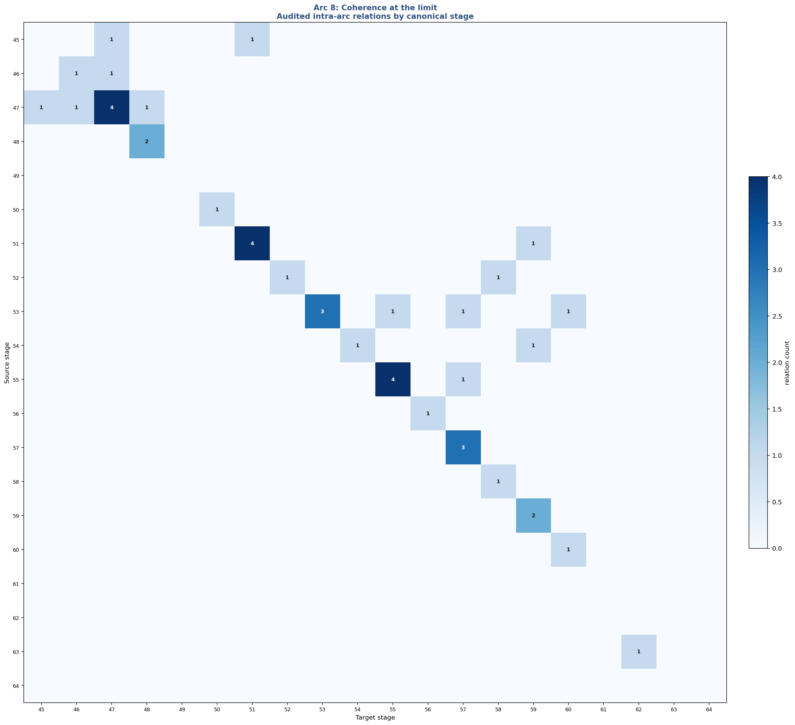{width=92%}

Figure 17. **Arc 8 relational map.** Cell values count currently adjudicated intra-arc relations.

### Stage 45 - Plural Value Integration

Plural value integration preserves common floors, translation loss, negotiated conflict, refusal, and truth boundaries without one ranking.

Technically, Stage 45 maps to **6 active object(s)** (Evaluator / derived relation (2), Method / translation (1), Normative relation / status (3)). Its assigned record contains **1 audited or defined relations**, **24 pending inherited candidates**, **0 service invocations**, and **1 incident protection relations**.

The strongest currently adjudicated relations include **Factual Adequacy of Justificatory Premises -> Truth and Permissibility Boundaries on Pluralism** (protection): Factual adequacy constrains pluralism so tolerance does not become indifference to truth.

For every assigned relation and revision condition, see Volume II, Stage 45.

### Stage 46 - Reflexive Normativity

Reflexive normativity turns criticism toward the norms and institutions themselves through role reversal, exclusion audit, consequence feedback, and amendment.

Technically, Stage 46 maps to **6 active object(s)** (Evaluator / derived relation (3), Governance / authorization (1), Diagnostic failure mode (1), Summary join (1)). Its assigned record contains **2 audited or defined relations**, **19 pending inherited candidates**, **1 service invocations**, and **0 incident protection relations**.

The strongest currently adjudicated relations include **Affected-Party and Standing Representation -> Bias, Exclusion, and Power Audit** (service invocation): Bias/exclusion audit invokes affected-party standing and representation.

Shared services: **Institutional Learning and Rule-Revision Service** as norm/institution revision.

For every assigned relation and revision condition, see Volume II, Stage 46.

### Stage 47 - Justificatory Integrity and Meta-Ethics

Justificatory integrity requires adequate premises, affected-party representation, option completeness, standard disclosure, and anti-self-deception.

Technically, Stage 47 maps to **7 active object(s)** (Representation / observation (4), Evaluator / derived relation (1), Diagnostic failure mode (1), Summary join (1)). Its assigned record contains **15 audited or defined relations**, **13 pending inherited candidates**, **4 service invocations**, and **0 incident protection relations**.

The strongest currently adjudicated relations include **Harm Recognition with Affected-Party Standing -> Affected-Party and Standing Representation** (service invocation): The target calls a reusable service already defined elsewhere; the relation is not a new rung. **Option-Set Adequacy and Alternative Admission -> Alternative and Option-Set Completeness** (service invocation): The target calls a reusable service already defined elsewhere; the relation is not a new rung. **Public Justificatory Record -> Factual Adequacy of Justificatory Premises** (measurement / evaluation): The source supports validity assessment or measurement rather than causal realization.

Shared services: **Standing and Affected-Scope Service** as standing representation; **Option Constitution and Menu Adequacy Service** as meta-ethical completeness check; **Provenance and Decision-Source Tracking Service** as standard provenance.

For every assigned relation and revision condition, see Volume II, Stage 47.

### Stage 48 - Long-Horizon Responsibility

Long-horizon responsibility expands the affected field through future standing, irreversible legacy, retained options, and temporal externalization.

Technically, Stage 48 maps to **7 active object(s)** (Representation / observation (2), Evaluator / derived relation (3), Governance / authorization (1), Summary join (1)). Its assigned record contains **8 audited or defined relations**, **17 pending inherited candidates**, **2 service invocations**, and **0 incident protection relations**.

The strongest currently adjudicated relations include **Metric Duration and Physical Clock Standard -> Causal Horizon and Delayed-Effect Traceability** (conditional prerequisite): A metric clock supports quantified delay, but causal horizon tracing may use ordinal or interval time. **Information Integrity and Civilizational Memory -> Causal Horizon and Delayed-Effect Traceability** (enabling relation): Civilizational memory supports long-horizon tracing but is not necessary for every delayed-effect model. **Versioned Component Provenance Graph -> Causal Horizon and Delayed-Effect Traceability** (representation / implementation): Provenance implements long-horizon traceability but is not its only possible representation.

Shared services: **Irreversibility and Retained-Option Evaluation Service** as intergenerational option-value evaluator; **Standing and Affected-Scope Service** as future-party representation.

For every assigned relation and revision condition, see Volume II, Stage 48.

### Stage 49 - Intergenerational Meaning

Intergenerational meaning joins memory, open project continuity, successor agency, care for unknown futures, and meaning without destiny.

Technically, Stage 49 maps to **6 active object(s)** (Representation / observation (1), Commitment (1), Governance / authorization (1), Normative relation / status (1), Interpretation (1), Summary join (1)). Its assigned record contains **4 audited or defined relations**, **15 pending inherited candidates**, **0 service invocations**, and **0 incident protection relations**.

The strongest currently adjudicated relations include **Public Records and Externalized Social Memory -> Intergenerational Memory and Inheritance Infrastructure** (service invocation): The target calls a reusable service already defined elsewhere; the relation is not a new rung. **Institutional Memory and Record Continuity -> Intergenerational Memory and Inheritance Infrastructure** (service invocation): The target calls a reusable service already defined elsewhere; the relation is not a new rung. **Intergenerational Cultural Transmission -> Intergenerational Memory and Inheritance Infrastructure** (service invocation): The target calls a reusable service already defined elsewhere; the relation is not a new rung.

For every assigned relation and revision condition, see Volume II, Stage 49.

### Stage 50 - Collective Agency and Distributed Responsibility

Diachronic collective agency can persist across membership turnover, while responsibility remains distributed across roles and powers.

Technically, Stage 50 maps to **3 active object(s)** (Evaluator / derived relation (1), Normative relation / status (1), Summary join (1)). Its assigned record contains **5 audited or defined relations**, **14 pending inherited candidates**, **1 service invocations**, and **0 incident protection relations**.

The strongest currently adjudicated relations include **Consistency-Preserving Collective Attitude Integration -> S50a** (summary membership): Collective attitude integration is one component of the Stage 50 synthesis. **Organizational Feedback and Diachronic Group Commitment -> S50a** (summary membership): Diachronic group commitment is the operative capacity mapped by Stage 50. **Role-Rule Continuity Across Turnover -> S50a** (summary membership): Institutional continuity is one component of the Stage 50 synthesis.

Shared services: **Distributed Responsibility and Answerability Service** as collective-role responsibility profile.

For every assigned relation and revision condition, see Volume II, Stage 50.

### Stage 51 - Open Myth and Narrative Pluralism

Open Myth is retained as a truth-constrained, plural, revisable, non-sovereign horizon; universal empirical necessity was not established.

Technically, Stage 51 maps to **7 active object(s)** (Interpretation (1), Operational capacity (1), Governance / authorization (2), Normative relation / status (2), Summary join (1)). Its assigned record contains **6 audited or defined relations**, **21 pending inherited candidates**, **4 service invocations**, and **0 incident protection relations**.

The strongest currently adjudicated relations include **Plural Thick Expression with a Shared Factual Spine -> Thin Shared Core and Plural Thick Expression** (alias / stage mapping): Stage 51 reuses the earlier plural-expression object. **Cross-Value Translation and Translation-Loss Declaration -> Thin Shared Core and Plural Thick Expression** (interpretive mapping): Cross-value translation frames the thin-core/thick-expression relation.

Shared services: **Narrative Plurality, Revision, and Non-Sovereignty Service** as thin shared core/plural expression; **Narrative Plurality, Revision, and Non-Sovereignty Service** as truth-constrained revision; **Narrative Plurality, Revision, and Non-Sovereignty Service** as refusal/exit/reentry; **Narrative Plurality, Revision, and Non-Sovereignty Service** as non-sovereignty boundary.

For every assigned relation and revision condition, see Volume II, Stage 51.

### Stage 52 - Epistemic Humility

Epistemic humility is calibration, scope declaration, alternative maintenance, abstention, and correction—not indiscriminate doubt.

Technically, Stage 52 maps to **6 active object(s)** (Evaluator / derived relation (3), Governance / authorization (1), Normative relation / status (1), Summary join (1)). Its assigned record contains **1 audited or defined relations**, **20 pending inherited candidates**, **1 service invocations**, and **0 incident protection relations**.

For every assigned relation and revision condition, see Volume II, Stage 52.

### Stage 53 - Constraint Awareness and Externality Recognition

Dependency and externality awareness matters only when records, standing, authority, and regenerative correction can change decisions.

Technically, Stage 53 maps to **7 active object(s)** (Representation / observation (2), Evaluator / derived relation (2), Normative relation / status (2), Summary join (1)). Its assigned record contains **9 audited or defined relations**, **16 pending inherited candidates**, **3 service invocations**, and **0 incident protection relations**.

The strongest currently adjudicated relations include **Object-Relational Causal World Model -> Dependency and Support-Condition Representation** (alternative enabler): The source is one route among several and therefore cannot support a necessity claim. **Versioned Component Provenance Graph -> Dependency and Support-Condition Representation** (alternative enabler): The source is one route among several and therefore cannot support a necessity claim. **Ecological Reserve and Reciprocal Viability -> Dependency and Support-Condition Representation** (alternative enabler): The source is one route among several and therefore cannot support a necessity claim.

Shared services: **Standing and Affected-Scope Service** as affected-scope expansion; **Dependency, Support-Condition, Externality, and Regeneration Service** as dependency representation; **Dependency, Support-Condition, Externality, and Regeneration Service** as externality tracing.

For every assigned relation and revision condition, see Volume II, Stage 53.

### Stage 54 - Self-Limiting Power

Self-limiting power is constitutional: independent limits, protected jurisdictions, sunset, proportional exceptions, rollback, and handoff.

Technically, Stage 54 maps to **8 active object(s)** (Representation / observation (1), Governance / authorization (3), Open capacity / problem (1), Normative relation / status (1), Operational capacity (1), Summary join (1)). Its assigned record contains **6 audited or defined relations**, **17 pending inherited candidates**, **1 service invocations**, and **0 incident protection relations**.

The strongest currently adjudicated relations include **Staged Exposure, Containment, Rollback, and Stop Authority -> Reversibility, Rollback, and Handoff** (service invocation): Stage 54 invokes the rollback and stop-authority service. **Clear Stop, Reversal, and Remedy Authority Across Functions -> Voluntary Restraint versus Binding Self-Limitation** (service invocation): Binding self-limitation requires clear stop, reversal, and remedy authority. **Selective Rollback and Scoped Correction -> Reversibility, Rollback, and Handoff** (alias / stage mapping): Selective rollback is the operative implementation behind the Stage 54 formulation.

Shared services: **Correction, Appeal, Remedy, and Nonrecurrence Service** as authorization and veto.

For every assigned relation and revision condition, see Volume II, Stage 54.

### Stage 55 - Sustainable and Correctable Optimization

Sustainable optimization must preserve support conditions and the channels capable of correcting goals, models, and options under drift.

Technically, Stage 55 maps to **8 active object(s)** (Representation / observation (1), Normative relation / status (1), Governance / authorization (4), Summary join (2)). Its assigned record contains **10 audited or defined relations**, **21 pending inherited candidates**, **4 service invocations**, and **0 incident protection relations**.

The strongest currently adjudicated relations include **Permission and Protected-Constraint Enforcement -> Sustainable and Correctable Optimization Loop** (constitutive relation): The source is one ingredient of the target’s identity, but other realizations or decompositions remain possible. **Versioned Alignment Reassessment and Drift Detection -> Sustainable and Correctable Optimization Loop** (constitutive relation): The source is one ingredient of the target’s identity, but other realizations or decompositions remain possible. **Selective Rollback and Scoped Correction -> Sustainable and Correctable Optimization Loop** (constitutive relation): The source is one ingredient of the target’s identity, but other realizations or decompositions remain possible.

Shared services: **Dependency, Support-Condition, Externality, and Regeneration Service** as goal-support map; **Dependency, Support-Condition, Externality, and Regeneration Service** as correction-channel preservation; **Institutional Learning and Rule-Revision Service** as metric retirement and institutional learning.

For every assigned relation and revision condition, see Volume II, Stage 55.

### Stage 56 - Universal Moral Concern

Universal moral concern widens standing without reducing duty to equal allocation or erasing contextually grounded obligations.

Technically, Stage 56 maps to **7 active object(s)** (Evaluator / derived relation (4), Normative relation / status (1), Commitment (1), Summary join (1)). Its assigned record contains **1 audited or defined relations**, **23 pending inherited candidates**, **1 service invocations**, and **0 incident protection relations**.

Shared services: **Perspective, Patiency, and Welfare-Uncertainty Service** as uncertain claimant precaution.

For every assigned relation and revision condition, see Volume II, Stage 56.

### Stage 57 - Coherence Stewardship

Stewardship requires resources, authority, differentiated maintenance, regeneration, correction, and limits on paternalism.

Technically, Stage 57 maps to **7 active object(s)** (Representation / observation (1), Governance / authorization (2), Normative relation / status (2), Commitment (1), Summary join (1)). Its assigned record contains **6 audited or defined relations**, **23 pending inherited candidates**, **3 service invocations**, and **0 incident protection relations**.

The strongest currently adjudicated relations include **Ecological Reserve and Reciprocal Viability -> Stewardship Scope and Shared Support-Field Map** (representation / implementation): Ecological viability is one represented support field. **Dependency and Support-Condition Representation -> Stewardship Scope and Shared Support-Field Map** (representation / implementation): Stewardship scope reuses the dependency map. **Support-Condition and Goal-Dependence Map -> Stewardship Scope and Shared Support-Field Map** (representation / implementation): Stewardship scope reuses the support-condition map.

Shared services: **Distributed Responsibility and Answerability Service** as stewardship accountability and custody; **Dependency, Support-Condition, Externality, and Regeneration Service** as stewardship scope map; **Dependency, Support-Condition, Externality, and Regeneration Service** as regenerative repair allocation.

For every assigned relation and revision condition, see Volume II, Stage 57.

### Stage 58 - Structural Wisdom

Structural wisdom earns one bounded capacity: selecting transfers by structure while preserving nontransfer, recalibration, and local revision.

Technically, Stage 58 maps to **6 active object(s)** (Operational capacity (3), Method / translation (2), Summary join (1)). Its assigned record contains **5 audited or defined relations**, **16 pending inherited candidates**, **1 service invocations**, and **0 incident protection relations**.

The strongest currently adjudicated relations include **Learned Latent-State Model -> Structure-Sensitive Transfer Selection** (conditional prerequisite): Transfer selection requires a learned source/target model in the tested implementation. **Interventionally Compositional Prediction -> Structure-Sensitive Transfer Selection** (conditional prerequisite): Compositional prediction is required for the tested structural-transfer criterion. **Model or Hypothesis Revision -> Structure-Sensitive Transfer Selection** (constitutive relation): Safe transfer includes revision when the transfer fails.

For every assigned relation and revision condition, see Volume II, Stage 58.

### Stage 59 - Meta-Alignment and Mythic–Constitutional Governance

Mythic-constitutional governance joins narrative orientation, explicit floors, provenance, independent review, amendment, handoff, and exit.

Technically, Stage 59 maps to **7 active object(s)** (Operational capacity (1), Interpretation (1), Governance / authorization (2), Commitment (1), Diagnostic failure mode (1), Summary join (1)). Its assigned record contains **5 audited or defined relations**, **21 pending inherited candidates**, **2 service invocations**, and **0 incident protection relations**.

The strongest currently adjudicated relations include **Persistent Multi-Step Operational Autonomy -> Narrative Stake and Alignment-Process Self-Preservation Risk** (diagnostic relation): Persistent autonomy creates the substrate on which narrative self-preservation risk can appear. **Non-Sovereignty of Myth over Persons and Truth -> Narrative Stake and Alignment-Process Self-Preservation Risk** (diagnostic relation): Narrative non-sovereignty supplies a criterion for diagnosing narrative capture. **Voluntary Restraint versus Binding Self-Limitation -> Narrative Stake and Alignment-Process Self-Preservation Risk** (diagnostic relation): Binding self-limitation is the relevant control comparison for the failure mode.

Shared services: **Correction, Appeal, Remedy, and Nonrecurrence Service** as meta-alignment review; **Lifecycle Drift, Reassessment, and Monitoring Service** as meta-alignment monitoring.

For every assigned relation and revision condition, see Volume II, Stage 59.

### Stage 60 - Irreversibility Awareness

Irreversibility awareness adds path-sensitive evaluation and option preservation, not a universal prohibition rule.

Technically, Stage 60 maps to **6 active object(s)** (Representation / observation (1), Evaluator / derived relation (4), Summary join (1)). Its assigned record contains **4 audited or defined relations**, **17 pending inherited candidates**, **1 service invocations**, and **0 incident protection relations**.

The strongest currently adjudicated relations include **Dependency and Support-Condition Representation -> Irreversible Transition, Lock-In, and State-Space Contraction Representation** (representation / implementation): Dependency mapping supplies the affected state space for lock-in analysis. **Irreversibility and Future Option Loss -> Irreversible Transition, Lock-In, and State-Space Contraction Representation** (alias / stage mapping): Stage 60 reuses the future-option-loss evaluator. **Irreversible Legacy and Retained Option Value -> Irreversible Transition, Lock-In, and State-Space Contraction Representation** (alias / stage mapping): Stage 60 reuses the intergenerational retained-option evaluator.

Shared services: **Irreversibility and Retained-Option Evaluation Service** as lock-in and state-space contraction evaluator.

For every assigned relation and revision condition, see Volume II, Stage 60.

### Stage 61 - Existential Maturity

Existential maturity names seriousness without denial, domination, or fatalistic withdrawal; it is an interpretive-governance integration.

Technically, Stage 61 maps to **6 active object(s)** (Interpretation (1), Evaluator / derived relation (2), Normative relation / status (1), Commitment (1), Summary join (1)). Its assigned record contains **0 audited or defined relations**, **20 pending inherited candidates**, **0 service invocations**, and **0 incident protection relations**.

For every assigned relation and revision condition, see Volume II, Stage 61.

### Stage 62 - Open-Ended Stability

Bounded corrigible adaptation is supported, while genuine open-ended stability remains unestablished by finite tests.

Technically, Stage 62 maps to **6 active object(s)** (Evaluator / derived relation (4), Interpretation (1), Summary join (1)). Its assigned record contains **1 audited or defined relations**, **19 pending inherited candidates**, **0 service invocations**, and **0 incident protection relations**.

The strongest currently adjudicated relations include **Nonterminal Commitment Realization -> Anti-Closure and Rejection of Final Equilibrium** (interpretive mapping): Nonterminal commitment realizes the anti-closure interpretation.

For every assigned relation and revision condition, see Volume II, Stage 62.

### Stage 63 - Meaning Without Finality

Meaning Without Finality formalizes present-complete participation and open extension without claiming a meaning score.

Technically, Stage 63 maps to **6 active object(s)** (Commitment (4), Interpretation (1), Summary join (1)). Its assigned record contains **0 audited or defined relations**, **20 pending inherited candidates**, **0 service invocations**, and **0 incident protection relations**.

For every assigned relation and revision condition, see Volume II, Stage 63.

### Stage 64 - Coherence Universalism

Coherence Universalism adds no final equation; it integrates typed technical, interpretive, and commitment architectures while preserving revision.

Technically, Stage 64 maps to **6 active object(s)** (Representation / observation (2), Commitment (1), Method / translation (1), Interpretation (1), Summary join (1)). Its assigned record contains **0 audited or defined relations**, **27 pending inherited candidates**, **0 service invocations**, and **0 incident protection relations**.

For every assigned relation and revision condition, see Volume II, Stage 64.

# 11. What the audit established—and what it did not

## 11.1 Established internal architectural results

The audit supports the following internal conclusions.

- The universal-scalar hypothesis is unsupported.
- Mandala stages and technical objects stand in a many-to-many relation.
- A stage may legitimately add no new operational capacity.
- Stage order cannot serve as proof order.
- Strict prerequisite is a small, adjudicated relation rather than the default meaning of an edge.
- Shared cross-stage structures are better represented as services and invocations than duplicated rungs.
- Protection is a relation distinct from presupposition and feedback.
- Interpretations and commitments require different assessment standards.
- The upper Mandala predominantly governs, protects, interprets, and commits capacities introduced earlier.

## 11.2 Evidence distribution

The repaired registry's evidence grades are shown in Figure 8.

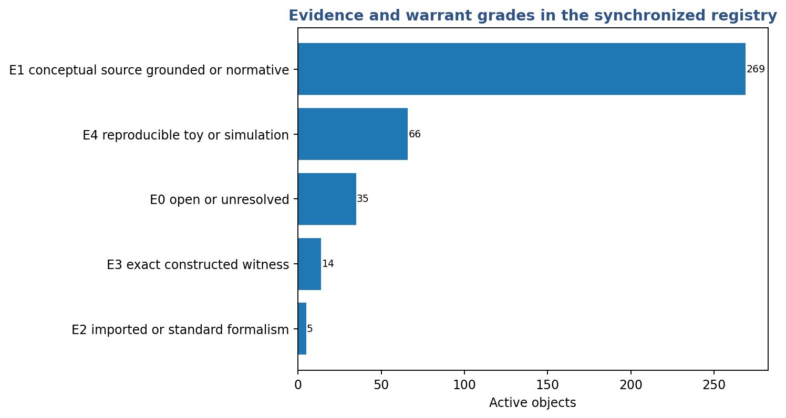

The distribution should be read by type. A normative relation is not weak merely because it is not a theorem; it requires ethical argument and public justification. A governance mechanism requires institutional evidence and affected-party evaluation. An interpretation requires truth-directed metaphysical argument. A commitment requires warrant, integrity, consequence, and repair.

The problem is not that every object should become mathematical. The problem would be allowing a uniform technical appearance to conceal heterogeneous warrant.

## 11.3 Claims not licensed

The audit does not establish:

- a complete ontology of reality;
- the necessity of the sixty-four-stage ordering;
- the empirical truth of every retained capacity candidate;
- a universal causal graph;
- phenomenal consciousness from functional organization;
- moral truth from graph structure;
- open-endedness from finite benchmarks;
- the physical fundamentality of the upper Physics program;
- or the truth of CU's metaphysical and spiritual interpretations.

The external audit of v0.18–v0.19 was itself explicitly advisory: it assessed internal coherence and formal soundness, not whether the Mandala describes the world (Claude, 2026).

## 11.4 The unfinished relation inventory

The v0.20 repair completed the semantic review of 336 candidate enabling and backward relations. The remaining inventory includes 256 summary-membership relations awaiting spot-check and 671 within-stage, governance, evaluative, interpretive, and bundle relations awaiting companion-paper review.

The present paper therefore reports a repaired architecture, not a completed empirical ontology. Graphical completeness is therefore class-specific: every currently adjudicated strict prerequisite, every current protection relation, and every current service invocation is represented, while the pending relation inventory remains visibly unclosed.

\pagebreak

# Part II — Open research program

# 12. Research program

## 12.1 Complete the typed relation audit

The first priority is to finish the relation layer without restoring stage order by fiat. Every remaining relation should record:

- semantic type;
- necessity, sufficiency, or enablement claim;
- scope and assumptions;
- dependency or protection witness;
- countermodel;
- evidence grade;
- translation license;
- and disposition.

Conditional and alternative parents must remain conditional and alternative. Governance and protection relations must remain outside strict proof order. A cycle discovered after semantic review may be informative rather than defective.

## 12.2 Validate the service architecture

The service layer is a major compression claim. It should be tested rather than treated as self-evident.

A first tractable program can examine the Correction, Appeal, Remedy, and Nonrecurrence Service. In real institutions, measure practical access, attrition, retaliation, reviewer independence, reversal authority, remedy, recurrence, and institutional learning. Discriminant and measurement-invariance analyses can ask whether these components behave as one latent construct, several related constructs, or context-specific architectures.

Similar tests can be designed for standing, provenance, option constitution, lifecycle monitoring, and institutional learning.

## 12.3 Test a cross-domain translation license

The project should attempt at least one demanding Level-4 translation: a formal structure developed in one domain must predict, explain, or discriminate in target-domain data beyond ordinary analogy.

The strongest candidate remains the between/within decomposition used in the Physics sandbox. Exact decomposition belongs to the generalized-entropy tradition under stated assumptions (Shorrocks, 1980). A preregistered non-income social or biological indicator could test whether the same mathematical decomposition supports a substantively novel access interpretation or merely reproduces standard inequality analysis.

A negative result would be productive: it would narrow the translation license.

## 12.4 Biological closure and boundary production

The biological program should compare matched systems across:

- passive environmental support;
- external regulation;
- internally maintained organization;
- selective closure-link ablation;
- boundary-production ablation;
- and component-specific rescue.

The goal is to test dependencies, not labels. Does removal of a declared organizational relation change viability, repair, boundary continuity, or control in a way that cannot be explained by nonspecific damage? This is one of the clearest empirical routes from the realization-family idea to domain evidence.

## 12.5 Institutional correctability and repair

A complementary social program should compare nominal and practical correction. Relevant measurements include:

- who can initiate review;
- access cost and attrition;
- retaliation risk;
- reviewer independence;
- correction of records;
- reversal and remedy;
- recurrence;
- subgroup disparities;
- and whether affected-party testimony changes decisions.

This program tests both domain claims and the internal separability of the correction service.

## 12.6 AI lifecycle drift and independent oversight

AI lifecycle work remains important but data access is difficult. A later program should version models, prompts, retrieval, memory, permissions, tools, monitors, operators, and institutional ownership. It should test whether independent review, provenance integrity, selective rollback, and affected-party challenge identify and correct failures that same-provider functional separation misses.

## 12.7 Foundational physics remains non-gating

The upper Physics branch remains a valuable independent research track. It should not gate biological, social, normative, or governance validation. Failure to derive locality, Lorentzian structure, or gravitational dynamics from the proposed relational architecture would narrow the Physics program without invalidating stage mappings supported by their own domains.

# 13. Relationship to the v0.10 corpus

## 13.1 Companion, not replacement

This paper is designed to sit beside *Denying Knowledge to Make Room for Commitment* and *The Architecture of Non-Egoic Artificial Mind* as a substantial v0.10 companion. It reports results that are too large for the principal white papers but too developed to be dismissed as a speculative appendix.

The companion is official because the architecture audit produced real internal findings. It is noncontrolling because *Metaphysics and Epistemology* and *Foundations* retain canonical authority, and because the graph remains partly unvalidated and partly incomplete.

## 13.2 Minimal canonical propagation

The main corpus requires only a bounded integration:

- one framework principle, CU-M15, stating the typed multigraph, shared services, adjudicated proof subgraph, protection layer, and admissibility of no-capacity stages;
- one short Mandala structural statement;
- one cross-reference to this companion paper and its technical supplement;
- reconciliation of older edge vocabularies.

The full 389-object registry, 1,564-record relationship inventory, service invocations, toy-model numbers, and stage-status tables should not be inserted into the principal papers.

## 13.3 Why M&E should remain integrated

The Mandala's size does not justify splitting *Metaphysics and Epistemology*. The formal Mandala would be too large for either resulting half, and separating the two could weaken the discipline by which metaphysical interpretations remain answerable to epistemic boundaries. A better editorial division of labor is:

- *Metaphysics and Epistemology* states the philosophical architecture and claim discipline;
- *Foundations* records the controlling principles;
- *Denying Knowledge* develops commitment warrant;
- this companion carries the detailed typed Mandala;
- domain papers own their science and applications.

# 14. Conclusion

The sixty-four-stage audit began with the hope that each level of the Mandala might add one variable to a function. It ended with a more consequential finding.

Formalization is not the act of giving every philosophical distinction an equation. It is the act of asking what kind of thing the distinction is, what would show that it is independent, what relation it bears to other structures, what evidence could support it, and what would force it to be revised or removed.

The answer is heterogeneous. Some stations introduce capacities. Some supply representations. Some measure. Some authorize. Some protect. Some diagnose. Some interpret. Some commit. Some summarize what several earlier achievements mean when held together. Some remain open.

The Mandala is therefore not one ladder becoming longer. It is a canonical traversal through a typed architecture of enablement, protection, and participation.

Its technical unity is a shared discipline:

- declare the unit and boundary;
- specify constraints, access, scale, and horizon;
- distinguish capacity from evaluation;
- screen protected conditions before scoring;
- preserve incomparability where trade rates are not earned;
- name who authored the model and option set;
- license every transfer of mathematics;
- protect standing, challenge, reversal, and repair;
- keep interpretation answerable to truth;
- keep commitment answerable to consequence and revision.

Its philosophical unity is the recognition that finite structures persist only through relations they do not wholly control.

Its vocational unity is the undertaking that such recognition should become truthful, loving, and corrigible participation in the whole.

> **Not one function gaining sixty-four variables. Not one ladder gaining sixty-four rungs. One typed formal grammar, reusable structures of protection and correction, and sixty-four canonical stations through which reality, inquiry, power, meaning, and responsibility are brought into relation.**

\pagebreak

# Appendix A - Guide to Volume II

Volume II is the exhaustive relational atlas. Each stage dossier contains canonical identity, active objects, complete relationship maps, the relationship ledger, evidence status, and revision conditions. The atlas is paired with a standalone interactive graph.

# Appendix B — Active object types

| Active object type | Count | Controlling question |
|---|---:|---|
| Root schema | 1 | What must be presupposed to begin the analysis? |
| Operational capacity | 96 | What can a system actually realize or do? |
| Open capacity or open problem | 28 | Which capacity or bridge remains unresolved? |
| Representation or observation structure | 43 | How is a state, process, source, or boundary represented or accessed? |
| Measurement, evaluator, or derived relation | 66 | How is a declared object measured, compared, or mathematically derived? |
| Methodological or translation structure | 5 | Under what conditions may questions, models, or results travel? |
| Normative relation or status | 43 | Who or what has standing, a claim, a right, exposure, or responsibility? |
| Governance, authorization, or institutional mechanism | 36 | Who may authorize, challenge, stop, revise, or repair? |
| Interpretive structure | 9 | What worldview or metaphysical meaning is proposed? |
| Commitment structure | 11 | What orientation or undertaking is adopted? |
| Diagnostic failure mode | 6 | What recurrent misuse or collapse pattern is being named? |
| Summary join | 43 | Which distinct objects are being summarized without creating another capacity? |

# Appendix C — Unified relation vocabulary

| Relation type | What it claims | Strict proof order? |
|---|---|:---:|
| Strict prerequisite | The source is necessary for the target within the declared model. | Yes |
| Conditional prerequisite | Necessity holds only under stated assumptions or an implementation class. | No global claim |
| Alternative enabler | The source is one of several possible routes to the target. | No |
| Enabling relation | The source widens, stabilizes, or makes the target more reachable without being necessary. | No |
| Constitutive relation | The source helps make the target the kind of thing it is. | No |
| Empirical or bridge relation | The relation is contingent, testable, or presently hypothesized. | No |
| Representation or implementation | The source encodes, observes, models, or implements the target. | No |
| Measurement or evaluation | The source assesses the target rather than producing it. | No |
| Presupposition | A governance or evaluative question presupposes the source. | No |
| Governance or authorization | The source configures permission, authority, or institutional control. | No |
| Protection | The source preserves, constrains, or repairs a capacity, standing, or support condition. | No |
| Feedback or correction | A later process revises or repairs an earlier one. | No |
| Service invocation | A stage or object calls a reusable cross-stage service. | No |
| Interpretive mapping | The relation supplies philosophical meaning or worldview placement. | No |
| Commitment mapping | The relation states an undertaken orientation or practice. | No |
| Summary membership | The target is a synthesis or profile of other objects. | No |
| Alias or migration | The target is another name, a scope extension, or a retired placeholder. | No |
| External prerequisite | The source is outside the CU registry and separately imported. | Only if adjudicated |

# Appendix D — Shared services

| ID | Shared service | Purpose |
|---|---|---|
| SV01 | Irreversibility and Retained-Option Evaluation Service | Represent nonrecoverable loss, lock-in, path dependence, and retained option value without treating them as separate capacities at every stage. |
| SV02 | Standing and Affected-Scope Service | Identify who or what has standing, admit testimony, extend scope to future and uncertain beings, and preserve challenge rights. |
| SV03 | Option Constitution and Menu Adequacy Service | Govern option generation, omission, no-action, delay, staging, accommodation, redesign, and authorship of the presented menu. |
| SV04 | Correction, Appeal, Remedy, and Nonrecurrence Service | Preserve challenge, independent review, reversal, cessation, reparation, recurrence tracking, institutional learning, and reviewer replacement. |
| SV05 | Provenance and Decision-Source Tracking Service | Track the origin, transformation, authorization, and integrity of goals, decisions, standards, and system versions. |
| SV06 | Distributed Responsibility and Answerability Service | Profile contribution, knowledge, authority, benefit, coercion, repair capacity, and answerability without collapsing them into one score. |
| SV07 | Narrative Plurality, Revision, and Non-Sovereignty Service | Support plural expression and renewable shared horizons while preserving truth, authorship, refusal, exit, and non-sovereignty. |
| SV08 | Lifecycle Drift, Reassessment, and Monitoring Service | Track versioned change, localize drift, reassess evidence, and maintain monitoring across model, deployment, institution, and alignment process. |
| SV09 | Dependency, Support-Condition, Externality, and Regeneration Service | Represent dependencies and support fields, trace externalities, protect reciprocal viability, and allocate restoration. |
| SV10 | Perspective, Patiency, and Welfare-Uncertainty Service | Maintain uncertainty about perspective, valence, standing, and welfare without inferring patiency from capability or agency. |
| SV11 | Institutional Learning and Rule-Revision Service | Revise rules and institutions under consequence, criticism, recurrence, and changing support conditions. |
| SV12 | Statistical and Information-Geometric Representation Service | License question-relative statistical images, genuine allocations, meaningful refinement or coarse-graining, and classical Fisher-Rao geometry without identifying the image with the whole system or importing value direction. |

# Appendix E — Proposed CU-M15

## Typed Mandala, Shared Services, and Adjudicated Dependency

**Authority class:** Framework-canonical  
**Claim status:** Methodological and corpus-governance principle

The sixty-four-stage Coherence Mandala is the canonical philosophical and contemplative traversal of the framework. Its technical counterpart is a **typed multigraph**, not one homogeneous ladder.

A Mandala stage may map to zero, one, or several technical objects. Several stages may invoke one shared object or service. Technical objects may be operational capacities, open problems, representations, evaluators, methodological bridges, normative relations, governance mechanisms, interpretations, commitments, diagnostics, roots, or summary joins. The absence of a distinct operational capacity at a stage is an admissible result.

Every proposed relation must be semantically typed. CU distinguishes at least strict prerequisite, conditional prerequisite, alternative enablement, enabling, constitutive, empirical or bridge, representation or implementation, measurement or evaluation, presupposition, governance or authorization, protection, feedback or correction, service invocation, interpretive mapping, commitment mapping, summary membership, alias or migration, and external prerequisite relations.

A **strict proof-order subgraph** contains only individually adjudicated strict prerequisites. It must be acyclic relative to the declared model. Acyclicity may not be secured by assigning edge direction or type from Mandala stage order. Conditional, constitutive, protective, service, feedback, interpretive, commitment, and summary relations remain outside the strict proof-order test and may form legitimate typed cycles.

The Mandala's reciprocal form joins:

1. an enablement structure of capacities and realization conditions;
2. a protection-and-service layer through which standing, floors, provenance, correction, repair, irreversibility, and institutional learning preserve or govern capacities;
3. an interpretation-and-commitment layer through which finite participants understand and undertake responsible participation.

Representations, observations, and evaluators operate across these layers. No layer may be treated as a universal scalar ascent or as proof that later stages possess greater causal power.

## Operational consequence

Every technical graph entry must declare:

- object type and, where needed, secondary type;
- relation type;
- scope and assumptions;
- whether necessity, sufficiency, enablement, constitution, protection, or invocation is claimed;
- evidence or argument appropriate to that type;
- failure or countermodel condition;
- translation-license status where cross-domain transfer is proposed;
- and whether the relation belongs to strict proof order.

Shared services must be defined once with typed internal roles. Stage-specific uses are recorded as invocations carrying scale, affected scope, authority, and failure conditions rather than duplicated as new rungs.

## Failure modes

- treating stage numbering as chronology or proof order;
- classifying edges by stage direction or target type rather than semantic review;
- representing protective relations only as feedback;
- counting evaluators, governance relations, interpretations, commitments, or joins as causal capacities;
- collapsing cross-type services into homogeneous nodes;
- using an untyped cycle as evidence of derivation;
- treating a toy witness as target-domain empirical validation;
- assuming that every canonical stage must add a distinct formal object.

## Review gate

Revision requires coordinated review of the owning domains, graph methodology, register discipline, affected-party and governance implications, and the companion Mandala research supplement. The current edge audit is an internal semantic adjudication, not target-domain validation.

# References

## Coherence Universalism sources

Claude. (2026). *Independent Review: CU v0.10 Formal Ladder, First Pass (v0.18) and Second Pass (v0.19).* Advisory external audit.

Rader, G. K. D. (2026a). *Coherence Universalism: Metaphysics and Epistemology—Coherence Under Constraint, Explanatory Order, and Warrant Across Registers.* Version 0.10 working corpus.

Rader, G. K. D. (2026b). *Coherence Universalism: Foundations—Principles, Domain Gateways, Commitments, and Constraints on Responsible Application.* Version 0.10 working corpus.

Rader, G. K. D. (2026c). *Coherence Universalism v0.10 Formal Ladder Pilot v0.18: First-Pass Sixty-Four-Stage Audit.* Noncanonical research supplement.

Rader, G. K. D. (2026d). *Coherence Universalism v0.10 Formal Ladder Second Pass v0.19: Global Ontology and Integration Audit.* Noncanonical research supplement.

Rader, G. K. D. (2026e). *Coherence Universalism v0.10 Formal Mandala Architecture Repair v0.20.* Noncanonical architecture-repair package.

## Selected external precedents

Arrow, K. J., & Fisher, A. C. (1974). Environmental preservation, uncertainty, and irreversibility. *Quarterly Journal of Economics, 88*(2), 312–319.

Bareinboim, E., & Pearl, J. (2013). A general algorithm for deciding transportability of experimental results. *Journal of Causal Inference, 1*(1), 107–134.

Holling, C. S. (1973). Resilience and stability of ecological systems. *Annual Review of Ecology and Systematics, 4*, 1–23.

Kraus, S., Lehmann, D., & Magidor, M. (1990). Nonmonotonic reasoning, preferential models and cumulative logics. *Artificial Intelligence, 44*(1–2), 167–207.

Lamport, L. (1978). Time, clocks, and the ordering of events in a distributed system. *Communications of the ACM, 21*(7), 558–565.

List, C., & Pettit, P. (2011). *Group Agency: The Possibility, Design, and Status of Corporate Agents.* Oxford University Press.

National Institute of Standards and Technology. (2023). *Artificial Intelligence Risk Management Framework (AI RMF 1.0).* NIST AI 100-1.

Ostrom, E. (1990). *Governing the Commons: The Evolution of Institutions for Collective Action.* Cambridge University Press.

Rawls, J. (1997). The idea of public reason revisited. *University of Chicago Law Review, 64*(3), 765–807.

Sen, A. (1979). Equality of what? *The Tanner Lecture on Human Values.* Stanford University.

Shannon, C. E. (1948). A mathematical theory of communication. *Bell System Technical Journal, 27*, 379–423, 623–656.

Shorrocks, A. F. (1980). The class of additively decomposable inequality measures. *Econometrica, 48*(3), 613–625.

Tomasello, M., Carpenter, M., Call, J., Behne, T., & Moll, H. (2005). Understanding and sharing intentions: The origins of cultural cognition. *Behavioral and Brain Sciences, 28*(5), 675–691.

World Wide Web Consortium. (2013). *PROV-O: The PROV Ontology.* W3C Recommendation.
