# The Relational Atlas of the Coherence Mandala

## Stage-by-Stage Objects, Relationships, Evidence, Warrant, and Revision Conditions

**Gaura Kiśora Dās Rader**  
**Heaven≡Earth Foundation**  
**Coherence Universalism v0.10 Companion - Release-Convergence Edition v0.4**

\pagebreak

> **Atlas status.** The atlas is exhaustive relative to the synchronized v0.4 registries. Pending inherited candidates remain visible but do not enter strict proof order. Each record states its relation type, audit status, warrant basis, evidence grade, test or dependency witness, and revision condition where available.

# How to read a dossier

Each stage dossier contains the canonical identity, claim status, source, active object inventory, complete neighborhood graphics, and relationship ledger. A relationship is not treated as established merely because it appears in the inherited inventory.

# Arc 1 - Structure, access, and physical description

\pagebreak

## Stage 1 - Pure Structure

**Domain block:** Foundational/Physical  \
**Claim status:** Definition  \
**Canonical role:** Conceptual definition  \
**Source:** M&E §13.14

### Stage meaning and formal role

Relational possibility is represented without presupposing objects, time, geometry, or a privileged partition. This is a minimal starting point for inquiry, not an empirical claim about a pre-cosmic state.

Stage 1 contains **1 active object(s)**: Root schema (1). The synchronized ledger assigns **0 relationship record(s)** to this stage.

### Active object inventory

| ID | Object | Type | Evidence | Disposition |
|---|---|---|---|---|
| S1 | Pure Structure / Root Relational Signature | Root schema | E1_conceptual_source_grounded_or_normative | retain_distinct_pending_edge_audit |

### Complete relationship map

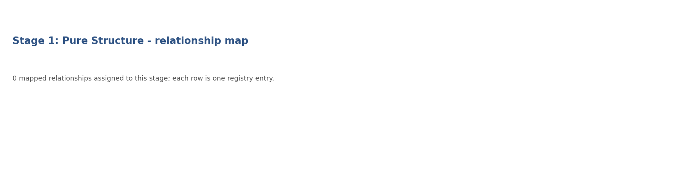{width=100%}

Figure A1. **Current Stage 1 relationship neighborhood.** Gray or pending entries remain candidates rather than proof-order claims.

### Relationship ledger

| ID | Source -> target | Type, status, and warrant | Current explanation, test, and revision boundary |
|---|---|---|---|

### Revision gate

**Next action:** Specify minimum signature required by Stage 2 A relation should be retyped, weakened, redirected, or removed whenever its dependency witness fails, its countermodel succeeds, its warrant basis changes, or target-domain evidence defeats the declared scope.

\pagebreak

## Stage 2 - Partial Separability

**Domain block:** Foundational/Physical  \
**Claim status:** Bridge principle  \
**Canonical role:** Conceptual / bridge principle  \
**Source:** M&E §13.14

### Stage meaning and formal role

Subsystem descriptions become available relative to a factorization, scale, or access map; separability is partial, contingent, and does not establish ontological independence.

Stage 2 contains **3 active object(s)**: Operational capacity (3). The synchronized ledger assigns **6 relationship record(s)** to this stage.

### Active object inventory

| ID | Object | Type | Evidence | Disposition |
|---|---|---|---|---|
| S2a | Structural Factorability | Operational capacity | E3_exact_constructed_witness | retain_distinct_pending_edge_audit |
| S2b | Dynamical Quotientability | Operational capacity | E3_exact_constructed_witness | retain_distinct_pending_edge_audit |
| S2c | Operational Access Channel | Operational capacity | E3_exact_constructed_witness | retain_distinct_pending_edge_audit |

### Complete relationship map

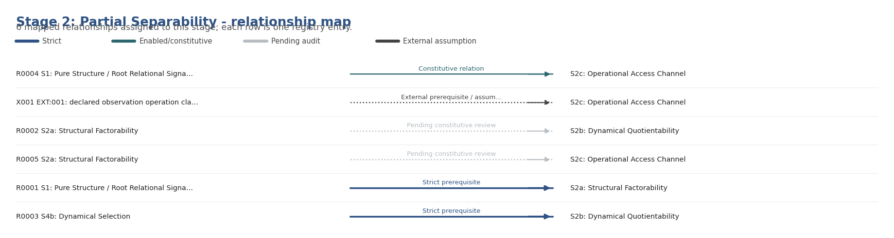{width=100%}

Figure A2. **Current Stage 2 relationship neighborhood.** Gray or pending entries remain candidates rather than proof-order claims.

### Relationship ledger

| ID | Source -> target | Type, status, and warrant | Current explanation, test, and revision boundary |
|---|---|---|---|
| R0004 | Pure Structure / Root Relational Signature -> Operational Access Channel | Constitutive relation; adjudicated_v0.20; exact constructed witness or formal construction | The source is one ingredient of the target’s identity, but other realizations or decompositions remain possible. Warrant: exact constructed witness or formal construction Test: Intervene on S1 and test whether the identity, organization, or classification of S2c changes without assuming total disappearance. Existing target w… Revise if: If S2c retains the same declared identity under source removal, this constitutive claim should be weakened or removed. Evidence: E3_exact_constructed_witness |
| X001 | declared observation operation class -> Operational Access Channel | External prerequisite / assumption; not_in_scope_pending_external_prerequisite_audit; declared external assumption; target-domain audit pending | Operational Access Channel is modeled under the external prerequisite or assumption: declared observation operation class. Warrant: declared external assumption; target-domain audit pending External-assumption audit remains pending. Evidence: external_assumption_pending |
| R0002 | Structural Factorability -> Dynamical Quotientability | Pending constitutive review; pending_companion_paper_relation_audit; pending semantic adjudication | Within-stage relation was not part of the 306-edge enabling audit. Warrant: pending semantic adjudication Semantic adjudication remains pending; no prerequisite claim is licensed. |
| R0005 | Structural Factorability -> Operational Access Channel | Pending constitutive review; pending_companion_paper_relation_audit; pending semantic adjudication | Within-stage relation was not part of the 306-edge enabling audit. Warrant: pending semantic adjudication Semantic adjudication remains pending; no prerequisite claim is licensed. |
| R0001 | Pure Structure / Root Relational Signature -> Structural Factorability | Strict prerequisite; adjudicated_v0.20; exact constructed witness or formal construction | The target’s declared construction cannot be stated or realized without the source in the present model. Warrant: exact constructed witness or formal construction Test: Ablate or replace S1 (Pure Structure / Root Relational Signature) while holding the declared target model fixed; S2a (Structural Factorability) shoul… Revise if: A valid realization of S2a within the same declared model that omits S1 would defeat strictness. Evidence: E3_exact_constructed_witness |
| R0003 | Dynamical Selection -> Dynamical Quotientability | Strict prerequisite; adjudicated_v0.20; exact constructed witness or formal construction | Dynamical quotientability is defined relative to selected dynamics; this is a genuine prerequisite contrary to stage numbering. Warrant: exact constructed witness or formal construction Test: Ablate or replace S4b (Dynamical Selection) while holding the declared target model fixed; S2b (Dynamical Quotientability) should become undefinable… Revise if: A valid realization of S2b within the same declared model that omits S4b would defeat strictness. Evidence: E3_exact_constructed_witness |

### Revision gate

**Next action:** Complete Stage 4 split and place S2b formally; develop S2c observation/intervention pilot A relation should be retyped, weakened, redirected, or removed whenever its dependency witness fails, its countermodel succeeds, its warrant basis changes, or target-domain evidence defeats the declared scope.

\pagebreak

## Stage 3 - Domain-Relative Coherence Directions

**Domain block:** Framework/Method  \
**Claim status:** Bridge principle  \
**Canonical role:** Framework boundary / model-relative bridge  \
**Source:** M&E §13.14

### Stage meaning and formal role

Within a declared state space, geometry, constraints, and objective or profile, configurations and trajectories may be directionally compared. CU does not posit one universal scalar gradient across all domains.

Stage 3 contains **1 active object(s)**: Evaluator / derived relation (1). The synchronized ledger assigns **2 relationship record(s)** to this stage.

### Active object inventory

| ID | Object | Type | Evidence | Disposition |
|---|---|---|---|---|
| S3 | Typed Evaluator / Direction Layer | Evaluator / derived relation | E4_reproducible_toy_or_simulation | retain_typed_noncapacity_object |

### Complete relationship map

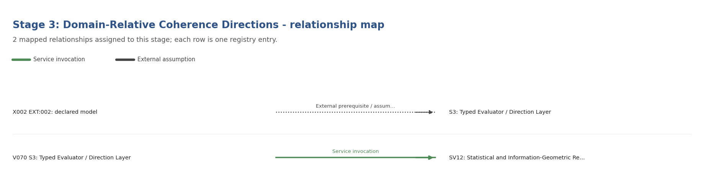{width=100%}

Figure A3. **Current Stage 3 relationship neighborhood.** Gray or pending entries remain candidates rather than proof-order claims.

### Relationship ledger

| ID | Source -> target | Type, status, and warrant | Current explanation, test, and revision boundary |
|---|---|---|---|
| X002 | declared model -> Typed Evaluator / Direction Layer | External prerequisite / assumption; not_in_scope_pending_external_prerequisite_audit; declared external assumption; target-domain audit pending | Typed Evaluator / Direction Layer is modeled under the external prerequisite or assumption: declared model. Warrant: declared external assumption; target-domain audit pending External-assumption audit remains pending. Evidence: external_assumption_pending |
| V070 | Typed Evaluator / Direction Layer -> Statistical and Information-Geometric Representation Service | Service invocation; defined_v0.4; internal architecture and role mapping | Typed Evaluator / Direction Layer invokes Statistical and Information-Geometric Representation Service in the role of domain-relative direction/evaluator licensing. Warrant: internal architecture and role mapping Test: Check whether the stage-specific role domain-relative direction/evaluator licensing is actually required when the service is instantiated at Stage 3. Revise if: If the stage does not use this service role, the invocation should be removed or reassigned. Evidence: internal_architecture_candidate |

### Revision gate

**Next action:** Test whether any evaluator is forced by target structure A relation should be retyped, weakened, redirected, or removed whenever its dependency witness fails, its countermodel succeeds, its warrant basis changes, or target-domain evidence defeats the declared scope.

\pagebreak

## Stage 4 - Lawful Transitions

**Domain block:** Foundational/Physical  \
**Claim status:** Definition  \
**Canonical role:** Conceptual definition  \
**Source:** M&E §13.14

### Stage meaning and formal role

A transition relation distinguishes admissible from inadmissible changes. The law or constraint must be stated; direction cannot be inferred from relational difference alone.

Stage 4 contains **2 active object(s)**: Operational capacity (2). The synchronized ledger assigns **3 relationship record(s)** to this stage.

### Active object inventory

| ID | Object | Type | Evidence | Disposition |
|---|---|---|---|---|
| S4a | Kinematic Admissibility | Operational capacity | E4_reproducible_toy_or_simulation | retain_distinct_pending_edge_audit |
| S4b | Dynamical Selection | Operational capacity | E1_conceptual_source_grounded_or_normative | retain_distinct_pending_edge_audit |

### Complete relationship map

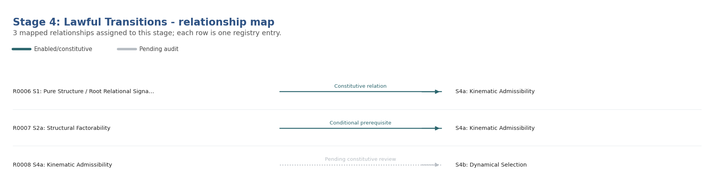{width=100%}

Figure A4. **Current Stage 4 relationship neighborhood.** Gray or pending entries remain candidates rather than proof-order claims.

### Relationship ledger

| ID | Source -> target | Type, status, and warrant | Current explanation, test, and revision boundary |
|---|---|---|---|
| R0006 | Pure Structure / Root Relational Signature -> Kinematic Admissibility | Constitutive relation; adjudicated_v0.20; reproducible toy model or simulation | The source is one ingredient of the target’s identity, but other realizations or decompositions remain possible. Warrant: reproducible toy model or simulation Test: Intervene on S1 and test whether the identity, organization, or classification of S4a changes without assuming total disappearance. Existing target w… Revise if: If S4a retains the same declared identity under source removal, this constitutive claim should be weakened or removed. Evidence: E4_reproducible_toy_or_simulation |
| R0007 | Structural Factorability -> Kinematic Admissibility | Conditional prerequisite; adjudicated_v0.20; reproducible toy model or simulation | Structural factorability matters only where the transition model requires subsystem decomposition. Warrant: reproducible toy model or simulation Test: Within the stated implementation or bridge assumptions, ablate S2a; the tested realization of S4a should fail. Existing target witness: local and joi… Revise if: An alternative realization of S4a outside the stated condition and without S2a would limit the edge rather than refute the target. Evidence: E4_reproducible_toy_or_simulation |
| R0008 | Kinematic Admissibility -> Dynamical Selection | Pending constitutive review; pending_companion_paper_relation_audit; pending semantic adjudication | Within-stage relation was not part of the 306-edge enabling audit. Warrant: pending semantic adjudication Semantic adjudication remains pending; no prerequisite claim is licensed. |

### Revision gate

**Next action:** Ground S4a/S4b in richer model classes and test transport to S5/S6 A relation should be retyped, weakened, redirected, or removed whenever its dependency witness fails, its countermodel succeeds, its warrant basis changes, or target-domain evidence defeats the declared scope.

\pagebreak

## Stage 5 - Ordered Histories

**Domain block:** Foundational/Physical  \
**Claim status:** Hypothesis / research program  \
**Canonical role:** Conditional structural result  \
**Source:** M&E §13.14

### Stage meaning and formal role

Admissible transitions may support consistent precedence relations. Order can be partial and does not by itself provide metric duration or select an arrow.

Stage 5 contains **2 active object(s)**: Evaluator / derived relation (1), Operational capacity (1). The synchronized ledger assigns **3 relationship record(s)** to this stage.

### Active object inventory

| ID | Object | Type | Evidence | Disposition |
|---|---|---|---|---|
| S5a | Generated Path Space | Evaluator / derived relation | E2_imported_or_standard_formalism | retain_typed_noncapacity_object |
| S5b | Event Order, Concurrency, and Conflict | Operational capacity | E1_conceptual_source_grounded_or_normative | retain_distinct_pending_edge_audit |

### Complete relationship map

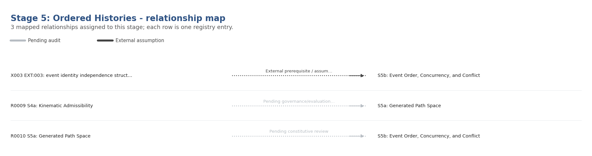{width=100%}

Figure A5. **Current Stage 5 relationship neighborhood.** Gray or pending entries remain candidates rather than proof-order claims.

### Relationship ledger

| ID | Source -> target | Type, status, and warrant | Current explanation, test, and revision boundary |
|---|---|---|---|
| X003 | event identity independence structure -> Event Order, Concurrency, and Conflict | External prerequisite / assumption; not_in_scope_pending_external_prerequisite_audit; declared external assumption; target-domain audit pending | Event Order, Concurrency, and Conflict is modeled under the external prerequisite or assumption: event identity independence structure. Warrant: declared external assumption; target-domain audit pending External-assumption audit remains pending. Evidence: external_assumption_pending |
| R0009 | Kinematic Admissibility -> Generated Path Space | Pending governance/evaluation/interpretation review; pending_companion_paper_relation_audit; pending semantic adjudication | Governance/evaluative/interpretive relation requires role-specific adjudication. Warrant: pending semantic adjudication Semantic adjudication remains pending; no prerequisite claim is licensed. |
| R0010 | Generated Path Space -> Event Order, Concurrency, and Conflict | Pending constitutive review; pending_companion_paper_relation_audit; pending semantic adjudication | Within-stage relation was not part of the 306-edge enabling audit. Warrant: pending semantic adjudication Semantic adjudication remains pending; no prerequisite claim is licensed. |

### Revision gate

**Next action:** Connect S5b to physical event identity, records, and causal structure A relation should be retyped, weakened, redirected, or removed whenever its dependency witness fails, its countermodel succeeds, its warrant basis changes, or target-domain evidence defeats the declared scope.

\pagebreak

## Stage 6 - Temporal Order and Parameterization

**Domain block:** Foundational/Physical  \
**Claim status:** Hypothesis / research program  \
**Canonical role:** Conditional bridge principle  \
**Source:** M&E §13.14

### Stage meaning and formal role

Ordered histories permit time-like parameterization when additional regularity obtains. Metric duration and a thermodynamic arrow require further assumptions.

Stage 6 contains **3 active object(s)**: Representation / observation (1), Open capacity / problem (1), Operational capacity (1). The synchronized ledger assigns **6 relationship record(s)** to this stage.

### Active object inventory

| ID | Object | Type | Evidence | Disposition |
|---|---|---|---|---|
| S6a | Logical or Ordinal Clock Coordinate | Representation / observation | E4_reproducible_toy_or_simulation | retain_typed_noncapacity_object |
| S6b | Metric Duration and Physical Clock Standard | Open capacity / problem | E0_open_or_unresolved | retain_open_research_branch |
| S6c | Effective Temporal Arrow and Irreversibility | Operational capacity | E1_conceptual_source_grounded_or_normative | retain_distinct_pending_edge_audit |

### Complete relationship map

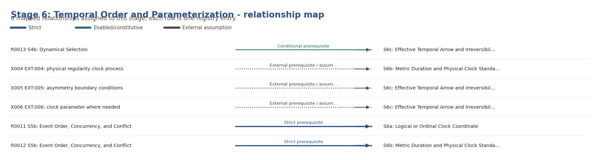{width=100%}

Figure A6. **Current Stage 6 relationship neighborhood.** Gray or pending entries remain candidates rather than proof-order claims.

### Relationship ledger

| ID | Source -> target | Type, status, and warrant | Current explanation, test, and revision boundary |
|---|---|---|---|
| R0013 | Dynamical Selection -> Effective Temporal Arrow and Irreversibility | Conditional prerequisite; adjudicated_v0.20; conceptual or source-grounded argument; empirical validation pending | The source is necessary only under the tested realization or named bridge assumptions. Warrant: conceptual or source-grounded argument; empirical validation pending Test: Within the stated implementation or bridge assumptions, ablate S4b; the tested realization of S6c should fail. Existing target witness: same support,… Revise if: An alternative realization of S6c outside the stated condition and without S4b would limit the edge rather than refute the target. Evidence: E1_conceptual_source_grounded_or_normative |
| X004 | physical regularity clock process -> Metric Duration and Physical Clock Standard | External prerequisite / assumption; not_in_scope_pending_external_prerequisite_audit; declared external assumption; target-domain audit pending | Metric Duration and Physical Clock Standard is modeled under the external prerequisite or assumption: physical regularity clock process. Warrant: declared external assumption; target-domain audit pending External-assumption audit remains pending. Evidence: external_assumption_pending |
| X005 | asymmetry boundary conditions -> Effective Temporal Arrow and Irreversibility | External prerequisite / assumption; not_in_scope_pending_external_prerequisite_audit; declared external assumption; target-domain audit pending | Effective Temporal Arrow and Irreversibility is modeled under the external prerequisite or assumption: asymmetry boundary conditions. Warrant: declared external assumption; target-domain audit pending External-assumption audit remains pending. Evidence: external_assumption_pending |
| X006 | clock parameter where needed -> Effective Temporal Arrow and Irreversibility | External prerequisite / assumption; not_in_scope_pending_external_prerequisite_audit; declared external assumption; target-domain audit pending | Effective Temporal Arrow and Irreversibility is modeled under the external prerequisite or assumption: clock parameter where needed. Warrant: declared external assumption; target-domain audit pending External-assumption audit remains pending. Evidence: external_assumption_pending |
| R0011 | Event Order, Concurrency, and Conflict -> Logical or Ordinal Clock Coordinate | Strict prerequisite; adjudicated_v0.20; reproducible toy model or simulation | The target’s declared construction cannot be stated or realized without the source in the present model. Warrant: reproducible toy model or simulation Test: Ablate or replace S5b (Event Order, Concurrency, and Conflict) while holding the declared target model fixed; S6a (Logical or Ordinal Clock Coordinat… Revise if: A valid realization of S6a within the same declared model that omits S5b would defeat strictness. Evidence: E4_reproducible_toy_or_simulation |
| R0012 | Event Order, Concurrency, and Conflict -> Metric Duration and Physical Clock Standard | Strict prerequisite; adjudicated_v0.20; conceptual or source-grounded argument; empirical validation pending | The target’s declared construction cannot be stated or realized without the source in the present model. Warrant: conceptual or source-grounded argument; empirical validation pending Test: Ablate or replace S5b (Event Order, Concurrency, and Conflict) while holding the declared target model fixed; S6b (Metric Duration and Physical Clock… Revise if: A valid realization of S6b within the same declared model that omits S5b would defeat strictness. Evidence: E0_open_or_unresolved |

### Revision gate

**Next action:** Develop physical clock and duration mechanism; test records/coarse access as arrow conditions A relation should be retyped, weakened, redirected, or removed whenever its dependency witness fails, its countermodel succeeds, its warrant basis changes, or target-domain evidence defeats the declared scope.

\pagebreak

## Stage 7 - Rule-Governed Transformation and Computation

**Domain block:** Foundational/Physical  \
**Claim status:** Bridge principle  \
**Canonical role:** Bridge principle  \
**Source:** M&E §13.14

### Stage meaning and formal role

Lawful ordered transformations may receive a computational representation once states, update rules, and representation maps are specified. Computation is not thereby established as the fundamental substance of reality.

Stage 7 contains **4 active object(s)**: Representation / observation (1), Operational capacity (2), Open capacity / problem (1). The synchronized ledger assigns **10 relationship record(s)** to this stage.

### Active object inventory

| ID | Object | Type | Evidence | Disposition |
|---|---|---|---|---|
| S7a | Computational Representation and Interpretation | Representation / observation | E1_conceptual_source_grounded_or_normative | retain_typed_noncapacity_object |
| S7b | Reliable Rule Implementation | Operational capacity | E1_conceptual_source_grounded_or_normative | retain_distinct_pending_edge_audit |
| S7c | Programmable Counterfactual Transformation | Operational capacity | E1_conceptual_source_grounded_or_normative | retain_distinct_pending_edge_audit |
| S7d | Universal Computation | Open capacity / problem | E0_open_or_unresolved | retain_open_research_branch |

### Complete relationship map

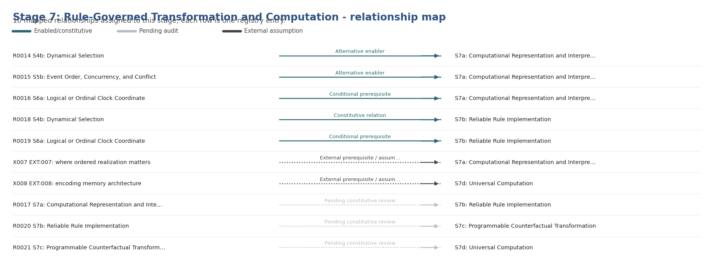{width=100%}

Figure A7. **Current Stage 7 relationship neighborhood.** Gray or pending entries remain candidates rather than proof-order claims.

### Relationship ledger

| ID | Source -> target | Type, status, and warrant | Current explanation, test, and revision boundary |
|---|---|---|---|
| R0014 | Dynamical Selection -> Computational Representation and Interpretation | Alternative enabler; adjudicated_v0.20; conceptual or source-grounded argument; empirical validation pending | The source is one route among several and therefore cannot support a necessity claim. Warrant: conceptual or source-grounded argument; empirical validation pending Test: Compare otherwise matched realizations of S7a with and without S4b; the source should widen, stabilize, or improve the target realization. Existing t… Revise if: No measurable change in target realizability, robustness, reach, or cost after source removal would defeat this enablement claim. Evidence: E1_conceptual_source_grounded_or_normative |
| R0015 | Event Order, Concurrency, and Conflict -> Computational Representation and Interpretation | Alternative enabler; adjudicated_v0.20; conceptual or source-grounded argument; empirical validation pending | The source is one route among several and therefore cannot support a necessity claim. Warrant: conceptual or source-grounded argument; empirical validation pending Test: Compare otherwise matched realizations of S7a with and without S5b; the source should widen, stabilize, or improve the target realization. Existing t… Revise if: No measurable change in target realizability, robustness, reach, or cost after source removal would defeat this enablement claim. Evidence: E1_conceptual_source_grounded_or_normative |
| R0016 | Logical or Ordinal Clock Coordinate -> Computational Representation and Interpretation | Conditional prerequisite; adjudicated_v0.20; conceptual or source-grounded argument; empirical validation pending | Ordinal time is required only for temporally ordered implementations, not every abstract computation. Warrant: conceptual or source-grounded argument; empirical validation pending Test: Within the stated implementation or bridge assumptions, ablate S6a; the tested realization of S7a should fail. Existing target witness: one physical… Revise if: An alternative realization of S7a outside the stated condition and without S6a would limit the edge rather than refute the target. Evidence: E1_conceptual_source_grounded_or_normative |
| R0018 | Dynamical Selection -> Reliable Rule Implementation | Constitutive relation; adjudicated_v0.20; conceptual or source-grounded argument; empirical validation pending | The source is one ingredient of the target’s identity, but other realizations or decompositions remain possible. Warrant: conceptual or source-grounded argument; empirical validation pending Test: Intervene on S4b and test whether the identity, organization, or classification of S7b changes without assuming total disappearance. Existing target… Revise if: If S7b retains the same declared identity under source removal, this constitutive claim should be weakened or removed. Evidence: E1_conceptual_source_grounded_or_normative |
| R0019 | Logical or Ordinal Clock Coordinate -> Reliable Rule Implementation | Conditional prerequisite; adjudicated_v0.20; conceptual or source-grounded argument; empirical validation pending | Clock order is implementation-specific; reliable rule realization need not always use an explicit clock coordinate. Warrant: conceptual or source-grounded argument; empirical validation pending Test: Within the stated implementation or bridge assumptions, ablate S6a; the tested realization of S7b should fail. Existing target witness: correct encod… Revise if: An alternative realization of S7b outside the stated condition and without S6a would limit the edge rather than refute the target. Evidence: E1_conceptual_source_grounded_or_normative |
| X007 | where ordered realization matters -> Computational Representation and Interpretation | External prerequisite / assumption; not_in_scope_pending_external_prerequisite_audit; declared external assumption; target-domain audit pending | Computational Representation and Interpretation is modeled under the external prerequisite or assumption: where ordered realization matters. Warrant: declared external assumption; target-domain audit pending External-assumption audit remains pending. Evidence: external_assumption_pending |
| X008 | encoding memory architecture -> Universal Computation | External prerequisite / assumption; not_in_scope_pending_external_prerequisite_audit; declared external assumption; target-domain audit pending | Universal Computation is modeled under the external prerequisite or assumption: encoding memory architecture. Warrant: declared external assumption; target-domain audit pending External-assumption audit remains pending. Evidence: external_assumption_pending |
| R0017 | Computational Representation and Interpretation -> Reliable Rule Implementation | Pending constitutive review; pending_companion_paper_relation_audit; pending semantic adjudication | Within-stage relation was not part of the 306-edge enabling audit. Warrant: pending semantic adjudication Semantic adjudication remains pending; no prerequisite claim is licensed. |
| R0020 | Reliable Rule Implementation -> Programmable Counterfactual Transformation | Pending constitutive review; pending_companion_paper_relation_audit; pending semantic adjudication | Within-stage relation was not part of the 306-edge enabling audit. Warrant: pending semantic adjudication Semantic adjudication remains pending; no prerequisite claim is licensed. |
| R0021 | Programmable Counterfactual Transformation -> Universal Computation | Pending constitutive review; pending_companion_paper_relation_audit; pending semantic adjudication | Within-stage relation was not part of the 306-edge enabling audit. Warrant: pending semantic adjudication Semantic adjudication remains pending; no prerequisite claim is licensed. |

### Revision gate

**Next action:** Test physical implementation under noise and determine whether any biological computation claim survives representation and authorship controls A relation should be retyped, weakened, redirected, or removed whenever its dependency witness fails, its countermodel succeeds, its warrant basis changes, or target-domain evidence defeats the declared scope.

\pagebreak

## Stage 8 - Entropy and Accessibility

**Domain block:** Foundational/Physical  \
**Claim status:** Imported result  \
**Canonical role:** Imported formalism / corrected bridge  \
**Source:** M&E §13.14

### Stage meaning and formal role

Entropy measures spread or uncertainty relative to a probability model. Coarse-graining can increase entropy while destroying accessible differentiation; entropy is not identical with inaccessible coherence.

Stage 8 contains **4 active object(s)**: Operational capacity (1), Evaluator / derived relation (2), Representation / observation (1). The synchronized ledger assigns **13 relationship record(s)** to this stage.

### Active object inventory

| ID | Object | Type | Evidence | Disposition |
|---|---|---|---|---|
| S8a | Statistical or Probabilistic State Structure | Operational capacity | E1_conceptual_source_grounded_or_normative | retain_distinct_pending_edge_audit |
| S8b | Entropy and Distributional Evaluators | Evaluator / derived relation | E3_exact_constructed_witness | retain_typed_noncapacity_object |
| S8c | Coarse Projection and Fine Reconstruction | Representation / observation | E1_conceptual_source_grounded_or_normative | retain_typed_noncapacity_object |
| S8d | Measure-Specific Accessibility Loss | Evaluator / derived relation | E3_exact_constructed_witness | retain_typed_noncapacity_object |

### Complete relationship map

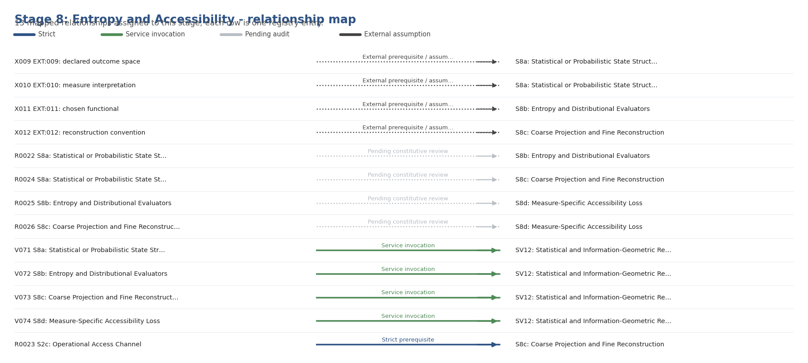{width=100%}

Figure A8. **Current Stage 8 relationship neighborhood.** Gray or pending entries remain candidates rather than proof-order claims.

### Relationship ledger

| ID | Source -> target | Type, status, and warrant | Current explanation, test, and revision boundary |
|---|---|---|---|
| X009 | declared outcome space -> Statistical or Probabilistic State Structure | External prerequisite / assumption; not_in_scope_pending_external_prerequisite_audit; declared external assumption; target-domain audit pending | Statistical or Probabilistic State Structure is modeled under the external prerequisite or assumption: declared outcome space. Warrant: declared external assumption; target-domain audit pending External-assumption audit remains pending. Evidence: external_assumption_pending |
| X010 | measure interpretation -> Statistical or Probabilistic State Structure | External prerequisite / assumption; not_in_scope_pending_external_prerequisite_audit; declared external assumption; target-domain audit pending | Statistical or Probabilistic State Structure is modeled under the external prerequisite or assumption: measure interpretation. Warrant: declared external assumption; target-domain audit pending External-assumption audit remains pending. Evidence: external_assumption_pending |
| X011 | chosen functional -> Entropy and Distributional Evaluators | External prerequisite / assumption; not_in_scope_pending_external_prerequisite_audit; declared external assumption; target-domain audit pending | Entropy and Distributional Evaluators is modeled under the external prerequisite or assumption: chosen functional. Warrant: declared external assumption; target-domain audit pending External-assumption audit remains pending. Evidence: external_assumption_pending |
| X012 | reconstruction convention -> Coarse Projection and Fine Reconstruction | External prerequisite / assumption; not_in_scope_pending_external_prerequisite_audit; declared external assumption; target-domain audit pending | Coarse Projection and Fine Reconstruction is modeled under the external prerequisite or assumption: reconstruction convention. Warrant: declared external assumption; target-domain audit pending External-assumption audit remains pending. Evidence: external_assumption_pending |
| R0022 | Statistical or Probabilistic State Structure -> Entropy and Distributional Evaluators | Pending constitutive review; pending_companion_paper_relation_audit; pending semantic adjudication | Within-stage relation was not part of the 306-edge enabling audit. Warrant: pending semantic adjudication Semantic adjudication remains pending; no prerequisite claim is licensed. |
| R0024 | Statistical or Probabilistic State Structure -> Coarse Projection and Fine Reconstruction | Pending constitutive review; pending_companion_paper_relation_audit; pending semantic adjudication | Within-stage relation was not part of the 306-edge enabling audit. Warrant: pending semantic adjudication Semantic adjudication remains pending; no prerequisite claim is licensed. |
| R0025 | Entropy and Distributional Evaluators -> Measure-Specific Accessibility Loss | Pending constitutive review; pending_companion_paper_relation_audit; pending semantic adjudication | Within-stage relation was not part of the 306-edge enabling audit. Warrant: pending semantic adjudication Semantic adjudication remains pending; no prerequisite claim is licensed. |
| R0026 | Coarse Projection and Fine Reconstruction -> Measure-Specific Accessibility Loss | Pending constitutive review; pending_companion_paper_relation_audit; pending semantic adjudication | Within-stage relation was not part of the 306-edge enabling audit. Warrant: pending semantic adjudication Semantic adjudication remains pending; no prerequisite claim is licensed. |
| V071 | Statistical or Probabilistic State Structure -> Statistical and Information-Geometric Representation Service | Service invocation; defined_v0.4; internal architecture and role mapping | Statistical or Probabilistic State Structure invokes Statistical and Information-Geometric Representation Service in the role of licensed classical statistical-state representation. Warrant: internal architecture and role mapping Test: Check whether the stage-specific role licensed classical statistical-state representation is actually required when the service is instantiated at St… Revise if: If the stage does not use this service role, the invocation should be removed or reassigned. Evidence: internal_architecture_candidate |
| V072 | Entropy and Distributional Evaluators -> Statistical and Information-Geometric Representation Service | Service invocation; defined_v0.4; internal architecture and role mapping | Entropy and Distributional Evaluators invokes Statistical and Information-Geometric Representation Service in the role of entropy and distributional evaluation. Warrant: internal architecture and role mapping Test: Check whether the stage-specific role entropy and distributional evaluation is actually required when the service is instantiated at Stage 8. Revise if: If the stage does not use this service role, the invocation should be removed or reassigned. Evidence: internal_architecture_candidate |
| V073 | Coarse Projection and Fine Reconstruction -> Statistical and Information-Geometric Representation Service | Service invocation; defined_v0.4; internal architecture and role mapping | Coarse Projection and Fine Reconstruction invokes Statistical and Information-Geometric Representation Service in the role of refinement, coarse projection, and reconstruction. Warrant: internal architecture and role mapping Test: Check whether the stage-specific role refinement, coarse projection, and reconstruction is actually required when the service is instantiated at Stag… Revise if: If the stage does not use this service role, the invocation should be removed or reassigned. Evidence: internal_architecture_candidate |
| V074 | Measure-Specific Accessibility Loss -> Statistical and Information-Geometric Representation Service | Service invocation; defined_v0.4; internal architecture and role mapping | Measure-Specific Accessibility Loss invokes Statistical and Information-Geometric Representation Service in the role of measure-specific accessibility comparison. Warrant: internal architecture and role mapping Test: Check whether the stage-specific role measure-specific accessibility comparison is actually required when the service is instantiated at Stage 8. Revise if: If the stage does not use this service role, the invocation should be removed or reassigned. Evidence: internal_architecture_candidate |
| R0023 | Operational Access Channel -> Coarse Projection and Fine Reconstruction | Strict prerequisite; adjudicated_v0.20; conceptual or source-grounded argument; empirical validation pending | The target’s declared construction cannot be stated or realized without the source in the present model. Warrant: conceptual or source-grounded argument; empirical validation pending Test: Ablate or replace S2c (Operational Access Channel) while holding the declared target model fixed; S8c (Coarse Projection and Fine Reconstruction) sho… Revise if: A valid realization of S8c within the same declared model that omits S2c would defeat strictness. Evidence: E1_conceptual_source_grounded_or_normative |

### Revision gate

**Next action:** Stochastic channels, recoverability, data-processing, and physical realizability A relation should be retyped, weakened, redirected, or removed whenever its dependency witness fails, its countermodel succeeds, its warrant basis changes, or target-domain evidence defeats the declared scope.

\pagebreak

## Stage 9 - Relational Geometry and Spacetime

**Domain block:** Foundational/Physical  \
**Claim status:** Hypothesis / research program  \
**Canonical role:** Conditional physical program  \
**Source:** M&E §13.14

### Stage meaning and formal role

Stable relational and accessibility structures may admit effective geometric representation. Lorentzian spacetime requires explicit geometric and operational bridge assumptions and is not derived from coherence alone.

Stage 9 contains **8 active object(s)**: Representation / observation (1), Evaluator / derived relation (2), Operational capacity (3), Open capacity / problem (2). The synchronized ledger assigns **25 relationship record(s)** to this stage.

### Active object inventory

| ID | Object | Type | Evidence | Disposition |
|---|---|---|---|---|
| S9a | Relational Dissimilarity or Direct Edge Cost | Representation / observation | E1_conceptual_source_grounded_or_normative | retain_typed_noncapacity_object |
| S9b | Metric Closure | Evaluator / derived relation | E2_imported_or_standard_formalism | retain_typed_noncapacity_object |
| S9c1 | Direct Dynamical Neighborhood | Operational capacity | E1_conceptual_source_grounded_or_normative | retain_distinct_pending_edge_audit |
| S9c2 | Finite Propagation Cone | Operational capacity | E3_exact_constructed_witness | retain_distinct_pending_edge_audit |
| S9c3 | Physical Locality and Local Causal Structure | Open capacity / problem | E0_open_or_unresolved | retain_open_research_branch |
| S9c3a | Quasi-Local Propagation Under Finite-Range Quantum Dynamics | Operational capacity | E2_imported_or_standard_formalism | retain_distinct_pending_edge_audit |
| S9d | Dimension and Manifoldlikeness | Evaluator / derived relation | E3_exact_constructed_witness | retain_typed_noncapacity_object |
| S9e | Causal or Lorentzian Structure | Open capacity / problem | E0_open_or_unresolved | retain_open_research_branch |

### Complete relationship map

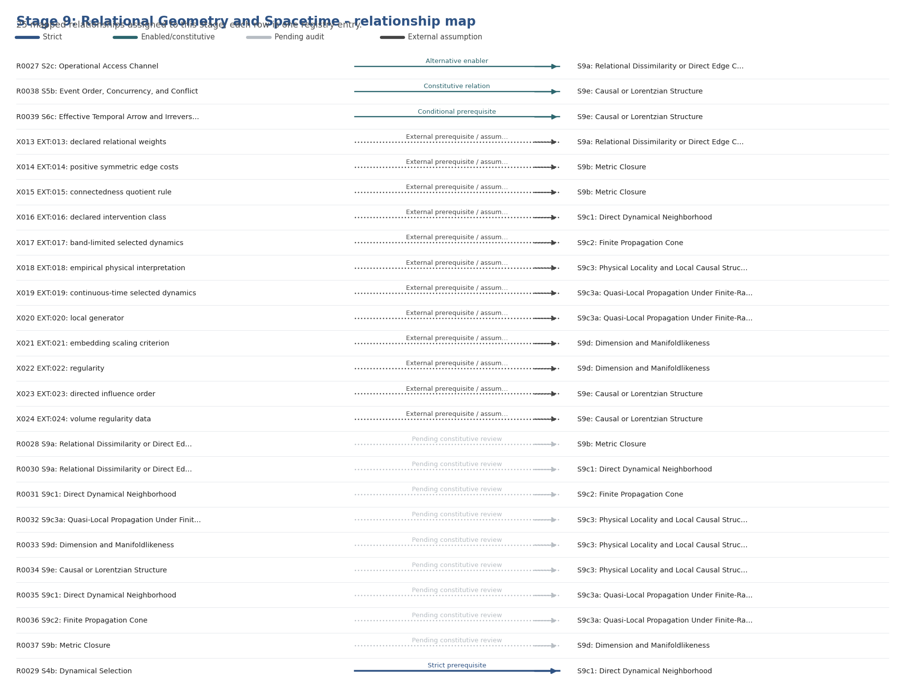{width=100%}

Figure A9. **Current Stage 9 relationship neighborhood.** Gray or pending entries remain candidates rather than proof-order claims.

### Relationship ledger

| ID | Source -> target | Type, status, and warrant | Current explanation, test, and revision boundary |
|---|---|---|---|
| R0027 | Operational Access Channel -> Relational Dissimilarity or Direct Edge Cost | Alternative enabler; adjudicated_v0.20; conceptual or source-grounded argument; empirical validation pending | The source is one route among several and therefore cannot support a necessity claim. Warrant: conceptual or source-grounded argument; empirical validation pending Test: Compare otherwise matched realizations of S9a with and without S2c; the source should widen, stabilize, or improve the target realization. Existing t… Revise if: No measurable change in target realizability, robustness, reach, or cost after source removal would defeat this enablement claim. Evidence: E1_conceptual_source_grounded_or_normative |
| R0038 | Event Order, Concurrency, and Conflict -> Causal or Lorentzian Structure | Constitutive relation; adjudicated_v0.20; conceptual or source-grounded argument; empirical validation pending | Event precedence is part of causal-order structure. Warrant: conceptual or source-grounded argument; empirical validation pending Test: Intervene on S5b and test whether the identity, organization, or classification of S9e changes without assuming total disappearance. Existing target… Revise if: If S9e retains the same declared identity under source removal, this constitutive claim should be weakened or removed. Evidence: E0_open_or_unresolved |
| R0039 | Effective Temporal Arrow and Irreversibility -> Causal or Lorentzian Structure | Conditional prerequisite; adjudicated_v0.20; conceptual or source-grounded argument; empirical validation pending | A thermodynamic arrow is not required for every Lorentzian or causal structure. Warrant: conceptual or source-grounded argument; empirical validation pending Test: Within the stated implementation or bridge assumptions, ablate S6c; the tested realization of S9e should fail. Existing target witness: one spatial m… Revise if: An alternative realization of S9e outside the stated condition and without S6c would limit the edge rather than refute the target. Evidence: E0_open_or_unresolved |
| X013 | declared relational weights -> Relational Dissimilarity or Direct Edge Cost | External prerequisite / assumption; not_in_scope_pending_external_prerequisite_audit; declared external assumption; target-domain audit pending | Relational Dissimilarity or Direct Edge Cost is modeled under the external prerequisite or assumption: declared relational weights. Warrant: declared external assumption; target-domain audit pending External-assumption audit remains pending. Evidence: external_assumption_pending |
| X014 | positive symmetric edge costs -> Metric Closure | External prerequisite / assumption; not_in_scope_pending_external_prerequisite_audit; declared external assumption; target-domain audit pending | Metric Closure is modeled under the external prerequisite or assumption: positive symmetric edge costs. Warrant: declared external assumption; target-domain audit pending External-assumption audit remains pending. Evidence: external_assumption_pending |
| X015 | connectedness quotient rule -> Metric Closure | External prerequisite / assumption; not_in_scope_pending_external_prerequisite_audit; declared external assumption; target-domain audit pending | Metric Closure is modeled under the external prerequisite or assumption: connectedness quotient rule. Warrant: declared external assumption; target-domain audit pending External-assumption audit remains pending. Evidence: external_assumption_pending |
| X016 | declared intervention class -> Direct Dynamical Neighborhood | External prerequisite / assumption; not_in_scope_pending_external_prerequisite_audit; declared external assumption; target-domain audit pending | Direct Dynamical Neighborhood is modeled under the external prerequisite or assumption: declared intervention class. Warrant: declared external assumption; target-domain audit pending External-assumption audit remains pending. Evidence: external_assumption_pending |
| X017 | band-limited selected dynamics -> Finite Propagation Cone | External prerequisite / assumption; not_in_scope_pending_external_prerequisite_audit; declared external assumption; target-domain audit pending | Finite Propagation Cone is modeled under the external prerequisite or assumption: band-limited selected dynamics. Warrant: declared external assumption; target-domain audit pending External-assumption audit remains pending. Evidence: external_assumption_pending |
| X018 | empirical physical interpretation -> Physical Locality and Local Causal Structure | External prerequisite / assumption; not_in_scope_pending_external_prerequisite_audit; declared external assumption; target-domain audit pending | Physical Locality and Local Causal Structure is modeled under the external prerequisite or assumption: empirical physical interpretation. Warrant: declared external assumption; target-domain audit pending External-assumption audit remains pending. Evidence: external_assumption_pending |
| X019 | continuous-time selected dynamics -> Quasi-Local Propagation Under Finite-Range Quantum Dynamics | External prerequisite / assumption; not_in_scope_pending_external_prerequisite_audit; declared external assumption; target-domain audit pending | Quasi-Local Propagation Under Finite-Range Quantum Dynamics is modeled under the external prerequisite or assumption: continuous-time selected dynamics. Warrant: declared external assumption; target-domain audit pending External-assumption audit remains pending. Evidence: external_assumption_pending |
| X020 | local generator -> Quasi-Local Propagation Under Finite-Range Quantum Dynamics | External prerequisite / assumption; not_in_scope_pending_external_prerequisite_audit; declared external assumption; target-domain audit pending | Quasi-Local Propagation Under Finite-Range Quantum Dynamics is modeled under the external prerequisite or assumption: local generator. Warrant: declared external assumption; target-domain audit pending External-assumption audit remains pending. Evidence: external_assumption_pending |
| X021 | embedding scaling criterion -> Dimension and Manifoldlikeness | External prerequisite / assumption; not_in_scope_pending_external_prerequisite_audit; declared external assumption; target-domain audit pending | Dimension and Manifoldlikeness is modeled under the external prerequisite or assumption: embedding scaling criterion. Warrant: declared external assumption; target-domain audit pending External-assumption audit remains pending. Evidence: external_assumption_pending |
| X022 | regularity -> Dimension and Manifoldlikeness | External prerequisite / assumption; not_in_scope_pending_external_prerequisite_audit; declared external assumption; target-domain audit pending | Dimension and Manifoldlikeness is modeled under the external prerequisite or assumption: regularity. Warrant: declared external assumption; target-domain audit pending External-assumption audit remains pending. Evidence: external_assumption_pending |
| X023 | directed influence order -> Causal or Lorentzian Structure | External prerequisite / assumption; not_in_scope_pending_external_prerequisite_audit; declared external assumption; target-domain audit pending | Causal or Lorentzian Structure is modeled under the external prerequisite or assumption: directed influence order. Warrant: declared external assumption; target-domain audit pending External-assumption audit remains pending. Evidence: external_assumption_pending |
| X024 | volume regularity data -> Causal or Lorentzian Structure | External prerequisite / assumption; not_in_scope_pending_external_prerequisite_audit; declared external assumption; target-domain audit pending | Causal or Lorentzian Structure is modeled under the external prerequisite or assumption: volume regularity data. Warrant: declared external assumption; target-domain audit pending External-assumption audit remains pending. Evidence: external_assumption_pending |
| R0028 | Relational Dissimilarity or Direct Edge Cost -> Metric Closure | Pending constitutive review; pending_companion_paper_relation_audit; pending semantic adjudication | Within-stage relation was not part of the 306-edge enabling audit. Warrant: pending semantic adjudication Semantic adjudication remains pending; no prerequisite claim is licensed. |
| R0030 | Relational Dissimilarity or Direct Edge Cost -> Direct Dynamical Neighborhood | Pending constitutive review; pending_companion_paper_relation_audit; pending semantic adjudication | Within-stage relation was not part of the 306-edge enabling audit. Warrant: pending semantic adjudication Semantic adjudication remains pending; no prerequisite claim is licensed. |
| R0031 | Direct Dynamical Neighborhood -> Finite Propagation Cone | Pending constitutive review; pending_companion_paper_relation_audit; pending semantic adjudication | Within-stage relation was not part of the 306-edge enabling audit. Warrant: pending semantic adjudication Semantic adjudication remains pending; no prerequisite claim is licensed. |
| R0032 | Quasi-Local Propagation Under Finite-Range Quantum Dynamics -> Physical Locality and Local Causal Structure | Pending constitutive review; pending_companion_paper_relation_audit; pending semantic adjudication | Within-stage relation was not part of the 306-edge enabling audit. Warrant: pending semantic adjudication Semantic adjudication remains pending; no prerequisite claim is licensed. |
| R0033 | Dimension and Manifoldlikeness -> Physical Locality and Local Causal Structure | Pending constitutive review; pending_companion_paper_relation_audit; pending semantic adjudication | Within-stage relation was not part of the 306-edge enabling audit. Warrant: pending semantic adjudication Semantic adjudication remains pending; no prerequisite claim is licensed. |
| R0034 | Causal or Lorentzian Structure -> Physical Locality and Local Causal Structure | Pending constitutive review; pending_companion_paper_relation_audit; pending semantic adjudication | Within-stage relation was not part of the 306-edge enabling audit. Warrant: pending semantic adjudication Semantic adjudication remains pending; no prerequisite claim is licensed. |
| R0035 | Direct Dynamical Neighborhood -> Quasi-Local Propagation Under Finite-Range Quantum Dynamics | Pending constitutive review; pending_companion_paper_relation_audit; pending semantic adjudication | Within-stage relation was not part of the 306-edge enabling audit. Warrant: pending semantic adjudication Semantic adjudication remains pending; no prerequisite claim is licensed. |
| R0036 | Finite Propagation Cone -> Quasi-Local Propagation Under Finite-Range Quantum Dynamics | Pending constitutive review; pending_companion_paper_relation_audit; pending semantic adjudication | Within-stage relation was not part of the 306-edge enabling audit. Warrant: pending semantic adjudication Semantic adjudication remains pending; no prerequisite claim is licensed. |
| R0037 | Metric Closure -> Dimension and Manifoldlikeness | Pending constitutive review; pending_companion_paper_relation_audit; pending semantic adjudication | Within-stage relation was not part of the 306-edge enabling audit. Warrant: pending semantic adjudication Semantic adjudication remains pending; no prerequisite claim is licensed. |
| R0029 | Dynamical Selection -> Direct Dynamical Neighborhood | Strict prerequisite; adjudicated_v0.20; conceptual or source-grounded argument; empirical validation pending | The target’s declared construction cannot be stated or realized without the source in the present model. Warrant: conceptual or source-grounded argument; empirical validation pending Test: Ablate or replace S4b (Dynamical Selection) while holding the declared target model fixed; S9c1 (Direct Dynamical Neighborhood) should become undefin… Revise if: A valid realization of S9c1 within the same declared model that omits S4b would defeat strictness. Evidence: E1_conceptual_source_grounded_or_normative |

### Revision gate

**Next action:** Operator-norm observables, continuum scaling, coarse-graining, Lorentzian causal structure, and empirical bridge A relation should be retyped, weakened, redirected, or removed whenever its dependency witness fails, its countermodel succeeds, its warrant basis changes, or target-domain evidence defeats the declared scope.

\pagebreak

## Stage 10 - Gravitational Dynamics

**Domain block:** Foundational/Physical  \
**Claim status:** Hypothesis / research program  \
**Canonical role:** Conditional physical program  \
**Source:** M&E §13.14

### Stage meaning and formal role

Einstein-type dynamics may be conditionally reconstructed under geometric, thermodynamic, and operational assumptions. The program remains incomplete and empirical.

Stage 10 contains **1 active object(s)**: Open capacity / problem (1). The synchronized ledger assigns **5 relationship record(s)** to this stage.

### Active object inventory

| ID | Object | Type | Evidence | Disposition |
|---|---|---|---|---|
| S10 | Dynamical Geometry and Gravitational Completion | Open capacity / problem | E0_open_or_unresolved | retain_open_research_branch |

### Complete relationship map

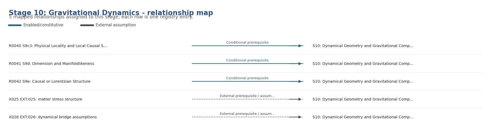{width=100%}

Figure A10. **Current Stage 10 relationship neighborhood.** Gray or pending entries remain candidates rather than proof-order claims.

### Relationship ledger

| ID | Source -> target | Type, status, and warrant | Current explanation, test, and revision boundary |
|---|---|---|---|
| R0040 | Physical Locality and Local Causal Structure -> Dynamical Geometry and Gravitational Completion | Conditional prerequisite; adjudicated_v0.20; conceptual or source-grounded argument; empirical validation pending | The source is necessary only under the tested realization or named bridge assumptions. Warrant: conceptual or source-grounded argument; empirical validation pending Test: Within the stated implementation or bridge assumptions, ablate S9c3; the tested realization of S10 should fail. Existing target witness: not establis… Revise if: An alternative realization of S10 outside the stated condition and without S9c3 would limit the edge rather than refute the target. Evidence: E0_open_or_unresolved |
| R0041 | Dimension and Manifoldlikeness -> Dynamical Geometry and Gravitational Completion | Conditional prerequisite; adjudicated_v0.20; conceptual or source-grounded argument; empirical validation pending | The source is necessary only under the tested realization or named bridge assumptions. Warrant: conceptual or source-grounded argument; empirical validation pending Test: Within the stated implementation or bridge assumptions, ablate S9d; the tested realization of S10 should fail. Existing target witness: not establish… Revise if: An alternative realization of S10 outside the stated condition and without S9d would limit the edge rather than refute the target. Evidence: E0_open_or_unresolved |
| R0042 | Causal or Lorentzian Structure -> Dynamical Geometry and Gravitational Completion | Conditional prerequisite; adjudicated_v0.20; conceptual or source-grounded argument; empirical validation pending | The source is necessary only under the tested realization or named bridge assumptions. Warrant: conceptual or source-grounded argument; empirical validation pending Test: Within the stated implementation or bridge assumptions, ablate S9e; the tested realization of S10 should fail. Existing target witness: not establish… Revise if: An alternative realization of S10 outside the stated condition and without S9e would limit the edge rather than refute the target. Evidence: E0_open_or_unresolved |
| X025 | matter stress structure -> Dynamical Geometry and Gravitational Completion | External prerequisite / assumption; not_in_scope_pending_external_prerequisite_audit; declared external assumption; target-domain audit pending | Dynamical Geometry and Gravitational Completion is modeled under the external prerequisite or assumption: matter stress structure. Warrant: declared external assumption; target-domain audit pending External-assumption audit remains pending. Evidence: external_assumption_pending |
| X026 | dynamical bridge assumptions -> Dynamical Geometry and Gravitational Completion | External prerequisite / assumption; not_in_scope_pending_external_prerequisite_audit; declared external assumption; target-domain audit pending | Dynamical Geometry and Gravitational Completion is modeled under the external prerequisite or assumption: dynamical bridge assumptions. Warrant: declared external assumption; target-domain audit pending External-assumption audit remains pending. Evidence: external_assumption_pending |

### Revision gate

**Next action:** Queue; explicitly non-gating A relation should be retyped, weakened, redirected, or removed whenever its dependency witness fails, its countermodel succeeds, its warrant basis changes, or target-domain evidence defeats the declared scope.

# Arc 2 - Life, autonomy, and evolution

\pagebreak

## Stage 11 - Far-From-Equilibrium Organization

**Domain block:** Biological bridge  \
**Claim status:** Imported result  \
**Canonical role:** Imported result / biological bridge  \
**Source:** M&E §13.14

### Stage meaning and formal role

Open physical organizations can persist through throughput and dissipation. Such persistence is necessary for many living processes but is not sufficient for life.

Stage 11 contains **1 active object(s)**: Operational capacity (1). The synchronized ledger assigns **1 relationship record(s)** to this stage.

### Active object inventory

| ID | Object | Type | Evidence | Disposition |
|---|---|---|---|---|
| S11 | Open-System Far-From-Equilibrium Organization | Operational capacity | E1_conceptual_source_grounded_or_normative | retain_distinct_pending_edge_audit |

### Complete relationship map

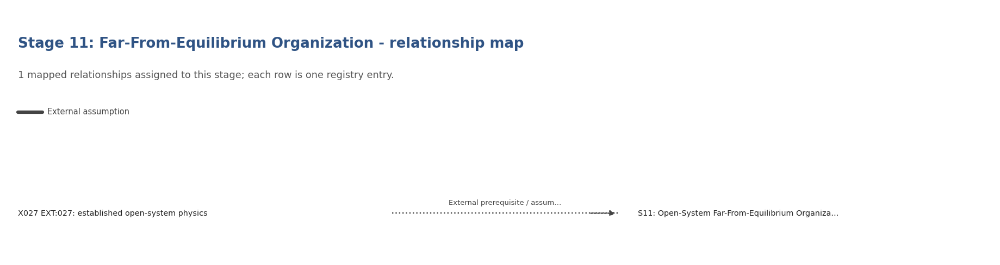{width=100%}

Figure A11. **Current Stage 11 relationship neighborhood.** Gray or pending entries remain candidates rather than proof-order claims.

### Relationship ledger

| ID | Source -> target | Type, status, and warrant | Current explanation, test, and revision boundary |
|---|---|---|---|
| X027 | established open-system physics -> Open-System Far-From-Equilibrium Organization | External prerequisite / assumption; not_in_scope_pending_external_prerequisite_audit; declared external assumption; target-domain audit pending | Open-System Far-From-Equilibrium Organization is modeled under the external prerequisite or assumption: established open-system physics. Warrant: declared external assumption; target-domain audit pending External-assumption audit remains pending. Evidence: external_assumption_pending |

### Revision gate

**Next action:** Select one open-system model class A relation should be retyped, weakened, redirected, or removed whenever its dependency witness fails, its countermodel succeeds, its warrant basis changes, or target-domain evidence defeats the declared scope.

\pagebreak

## Stage 12 - Energy-Coupled Maintenance

**Domain block:** Biology  \
**Claim status:** Bridge principle  \
**Canonical role:** Biological bridge principle  \
**Source:** M&E §13.14

### Stage meaning and formal role

Networks of internal processes harness matter and energy to maintain conditions of organization. Costs, boundaries, and contributions must be declared rather than inferred from persistence alone.

Stage 12 contains **2 active object(s)**: Operational capacity (2). The synchronized ledger assigns **4 relationship record(s)** to this stage.

### Active object inventory

| ID | Object | Type | Evidence | Disposition |
|---|---|---|---|---|
| S12a | Energy Transduction | Operational capacity | E1_conceptual_source_grounded_or_normative | retain_distinct_pending_edge_audit |
| S12b | Maintenance Control | Operational capacity | E1_conceptual_source_grounded_or_normative | retain_distinct_pending_edge_audit |

### Complete relationship map

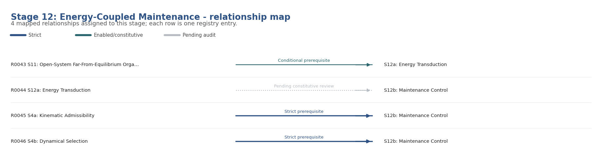{width=100%}

Figure A12. **Current Stage 12 relationship neighborhood.** Gray or pending entries remain candidates rather than proof-order claims.

### Relationship ledger

| ID | Source -> target | Type, status, and warrant | Current explanation, test, and revision boundary |
|---|---|---|---|
| R0043 | Open-System Far-From-Equilibrium Organization -> Energy Transduction | Conditional prerequisite; adjudicated_v0.20; conceptual or source-grounded argument; empirical validation pending | The source is necessary only under the tested realization or named bridge assumptions. Warrant: conceptual or source-grounded argument; empirical validation pending Test: Within the stated implementation or bridge assumptions, ablate S11; the tested realization of S12a should fail. Existing target witness: lower-stage… Revise if: An alternative realization of S12a outside the stated condition and without S11 would limit the edge rather than refute the target. Evidence: E1_conceptual_source_grounded_or_normative |
| R0044 | Energy Transduction -> Maintenance Control | Pending constitutive review; pending_companion_paper_relation_audit; pending semantic adjudication | Within-stage relation was not part of the 306-edge enabling audit. Warrant: pending semantic adjudication Semantic adjudication remains pending; no prerequisite claim is licensed. |
| R0045 | Kinematic Admissibility -> Maintenance Control | Strict prerequisite; adjudicated_v0.20; conceptual or source-grounded argument; empirical validation pending | The target’s declared construction cannot be stated or realized without the source in the present model. Warrant: conceptual or source-grounded argument; empirical validation pending Test: Ablate or replace S4a (Kinematic Admissibility) while holding the declared target model fixed; S12b (Maintenance Control) should become undefinable o… Revise if: A valid realization of S12b within the same declared model that omits S4a would defeat strictness. Evidence: E1_conceptual_source_grounded_or_normative |
| R0046 | Dynamical Selection -> Maintenance Control | Strict prerequisite; adjudicated_v0.20; conceptual or source-grounded argument; empirical validation pending | The target’s declared construction cannot be stated or realized without the source in the present model. Warrant: conceptual or source-grounded argument; empirical validation pending Test: Ablate or replace S4b (Dynamical Selection) while holding the declared target model fixed; S12b (Maintenance Control) should become undefinable or un… Revise if: A valid realization of S12b within the same declared model that omits S4b would defeat strictness. Evidence: E1_conceptual_source_grounded_or_normative |

### Revision gate

**Next action:** Replace toy variables with one reaction-network or protocell model and compute a viability/ablation assay A relation should be retyped, weakened, redirected, or removed whenever its dependency witness fails, its countermodel succeeds, its warrant basis changes, or target-domain evidence defeats the declared scope.

\pagebreak

## Stage 13 - Active Biological Self-Maintenance

**Domain block:** Biology  \
**Claim status:** Bridge principle  \
**Canonical role:** Canonical biological bridge  \
**Source:** M&E §13.14

### Stage meaning and formal role

A candidate living organization is distinguished from passive persistence by materially realized processes whose endogenous activity helps maintain, repair, reproduce, or adaptively transform the conditions of that organization’s continuation.

Stage 13 contains **4 active object(s)**: Operational capacity (3), Open capacity / problem (1). The synchronized ledger assigns **11 relationship record(s)** to this stage.

### Active object inventory

| ID | Object | Type | Evidence | Disposition |
|---|---|---|---|---|
| S13a | Endogenous Maintenance Regeneration | Operational capacity | E1_conceptual_source_grounded_or_normative | retain_distinct_pending_edge_audit |
| S13b | Relative Organizational Closure | Operational capacity | E1_conceptual_source_grounded_or_normative | retain_distinct_pending_edge_audit |
| S13c1 | Endogenous Boundary Production | Operational capacity | E1_conceptual_source_grounded_or_normative | retain_distinct_pending_edge_audit |
| S13c2 | Historical Token Continuity | Open capacity / problem | E0_open_or_unresolved | retain_open_research_branch |

### Complete relationship map

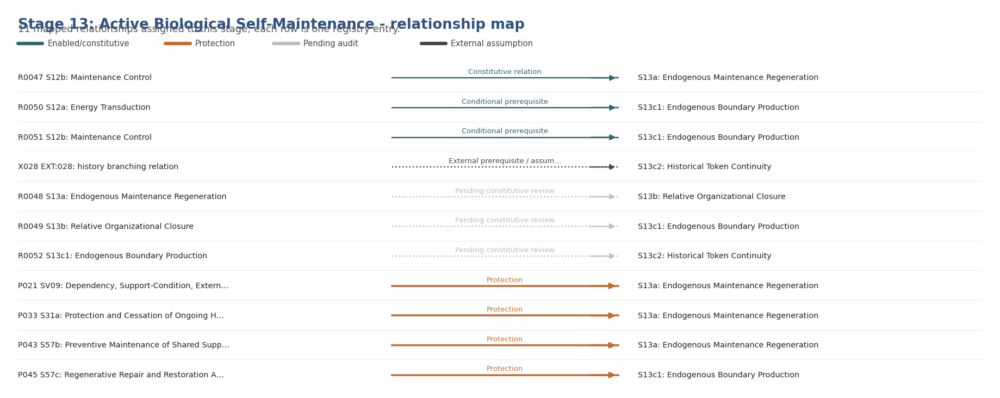{width=100%}

Figure A13. **Current Stage 13 relationship neighborhood.** Gray or pending entries remain candidates rather than proof-order claims.

### Relationship ledger

| ID | Source -> target | Type, status, and warrant | Current explanation, test, and revision boundary |
|---|---|---|---|
| R0047 | Maintenance Control -> Endogenous Maintenance Regeneration | Constitutive relation; adjudicated_v0.20; conceptual or source-grounded argument; empirical validation pending | The source is one ingredient of the target’s identity, but other realizations or decompositions remain possible. Warrant: conceptual or source-grounded argument; empirical validation pending Test: Intervene on S12b and test whether the identity, organization, or classification of S13a changes without assuming total disappearance. Existing targe… Revise if: If S13a retains the same declared identity under source removal, this constitutive claim should be weakened or removed. Evidence: E1_conceptual_source_grounded_or_normative |
| R0050 | Energy Transduction -> Endogenous Boundary Production | Conditional prerequisite; adjudicated_v0.20; conceptual or source-grounded argument; empirical validation pending | The source is necessary only under the tested realization or named bridge assumptions. Warrant: conceptual or source-grounded argument; empirical validation pending Test: Within the stated implementation or bridge assumptions, ablate S12a; the tested realization of S13c1 should fail. Existing target witness: s-to-bound… Revise if: An alternative realization of S13c1 outside the stated condition and without S12a would limit the edge rather than refute the target. Evidence: E1_conceptual_source_grounded_or_normative |
| R0051 | Maintenance Control -> Endogenous Boundary Production | Conditional prerequisite; adjudicated_v0.20; conceptual or source-grounded argument; empirical validation pending | The source is necessary only under the tested realization or named bridge assumptions. Warrant: conceptual or source-grounded argument; empirical validation pending Test: Within the stated implementation or bridge assumptions, ablate S12b; the tested realization of S13c1 should fail. Existing target witness: s-to-bound… Revise if: An alternative realization of S13c1 outside the stated condition and without S12b would limit the edge rather than refute the target. Evidence: E1_conceptual_source_grounded_or_normative |
| X028 | history branching relation -> Historical Token Continuity | External prerequisite / assumption; not_in_scope_pending_external_prerequisite_audit; declared external assumption; target-domain audit pending | Historical Token Continuity is modeled under the external prerequisite or assumption: history branching relation. Warrant: declared external assumption; target-domain audit pending External-assumption audit remains pending. Evidence: external_assumption_pending |
| R0048 | Endogenous Maintenance Regeneration -> Relative Organizational Closure | Pending constitutive review; pending_companion_paper_relation_audit; pending semantic adjudication | Within-stage relation was not part of the 306-edge enabling audit. Warrant: pending semantic adjudication Semantic adjudication remains pending; no prerequisite claim is licensed. |
| R0049 | Relative Organizational Closure -> Endogenous Boundary Production | Pending constitutive review; pending_companion_paper_relation_audit; pending semantic adjudication | Within-stage relation was not part of the 306-edge enabling audit. Warrant: pending semantic adjudication Semantic adjudication remains pending; no prerequisite claim is licensed. |
| R0052 | Endogenous Boundary Production -> Historical Token Continuity | Pending constitutive review; pending_companion_paper_relation_audit; pending semantic adjudication | Within-stage relation was not part of the 306-edge enabling audit. Warrant: pending semantic adjudication Semantic adjudication remains pending; no prerequisite claim is licensed. |
| P021 | Dependency, Support-Condition, Externality, and Regeneration Service -> Endogenous Maintenance Regeneration | Protection; selective v0.20 candidate protection edge; requires domain or institutional validation before consequential use; governance-design claim with stated mechanism and failure condition | support-condition mapping and regeneration protect active self-maintenance Warrant: governance-design claim with stated mechanism and failure condition Test: Remove or neutralize the source protection and test whether Endogenous Maintenance Regeneration becomes more exposed, less viable, less contestable,… Revise if: remove or neutralize the source protection and test whether the target becomes more exposed, less viable, less contestable, or less co… Evidence: internal_architecture_candidate |
| P033 | Protection and Cessation of Ongoing Harm -> Endogenous Maintenance Regeneration | Protection; selective v0.20 candidate protection edge; requires domain or institutional validation before consequential use; governance-design claim with stated mechanism and failure condition | cessation of ongoing harm protects living self-maintenance Warrant: governance-design claim with stated mechanism and failure condition Test: Remove or neutralize the source protection and test whether Endogenous Maintenance Regeneration becomes more exposed, less viable, less contestable,… Revise if: remove or neutralize the source protection and test whether the target becomes more exposed, less viable, less contestable, or less co… Evidence: internal_architecture_candidate |
| P043 | Preventive Maintenance of Shared Support Conditions -> Endogenous Maintenance Regeneration | Protection; selective v0.20 candidate protection edge; requires domain or institutional validation before consequential use; governance-design claim with stated mechanism and failure condition | preventive maintenance of shared support conditions protects organismal viability Warrant: governance-design claim with stated mechanism and failure condition Test: Remove or neutralize the source protection and test whether Endogenous Maintenance Regeneration becomes more exposed, less viable, less contestable,… Revise if: remove or neutralize the source protection and test whether the target becomes more exposed, less viable, less contestable, or less co… Evidence: internal_architecture_candidate |
| P045 | Regenerative Repair and Restoration Allocation -> Endogenous Boundary Production | Protection; selective v0.20 candidate protection edge; requires domain or institutional validation before consequential use; governance-design claim with stated mechanism and failure condition | regenerative repair protects boundary-producing organization after damage Warrant: governance-design claim with stated mechanism and failure condition Test: Remove or neutralize the source protection and test whether Endogenous Boundary Production becomes more exposed, less viable, less contestable, or le… Revise if: remove or neutralize the source protection and test whether the target becomes more exposed, less viable, less contestable, or less co… Evidence: internal_architecture_candidate |

### Revision gate

**Next action:** Build branch/copy/suspension continuity assays and select membrane-production experiment A relation should be retyped, weakened, redirected, or removed whenever its dependency witness fails, its countermodel succeeds, its warrant basis changes, or target-domain evidence defeats the declared scope.

\pagebreak

## Stage 14 - Adaptive Problem Solving

**Domain block:** Biology / cross-domain  \
**Claim status:** Hypothesis / research program  \
**Canonical role:** Conditional empirical generalization  \
**Source:** M&E §13.14

### Stage meaning and formal role

Some living systems detect deviations, recruit alternatives, learn from history, and solve novel viability-relevant problems within bounded adaptive reach. This does not by itself establish consciousness.

Stage 14 contains **6 active object(s)**: Operational capacity (5), Open capacity / problem (1). The synchronized ledger assigns **18 relationship record(s)** to this stage.

### Active object inventory

| ID | Object | Type | Evidence | Disposition |
|---|---|---|---|---|
| S14a | Viability-Relevant Policy Repertoire | Operational capacity | E4_reproducible_toy_or_simulation | retain_distinct_pending_edge_audit |
| S14b | Endogenous State-Dependent Regulation | Operational capacity | E1_conceptual_source_grounded_or_normative | retain_distinct_pending_edge_audit |
| S14c1 | History-Based Controller Revision | Operational capacity | E4_reproducible_toy_or_simulation | retain_distinct_pending_edge_audit |
| S14c2a | Learned Latent-State Model | Operational capacity | E4_reproducible_toy_or_simulation | retain_distinct_pending_edge_audit |
| S14c2b | Model-Based Anticipatory Control | Operational capacity | E4_reproducible_toy_or_simulation | retain_distinct_pending_edge_audit |
| S14c2c | Action or Controller Construction | Open capacity / problem | E0_open_or_unresolved | retain_open_research_branch |

### Complete relationship map

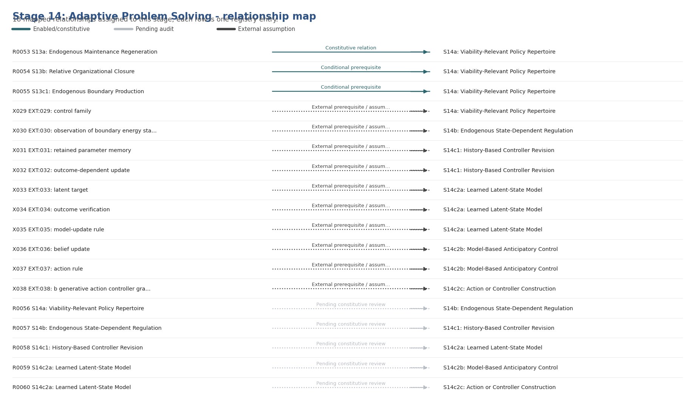{width=100%}

Figure A14. **Current Stage 14 relationship neighborhood.** Gray or pending entries remain candidates rather than proof-order claims.

### Relationship ledger

| ID | Source -> target | Type, status, and warrant | Current explanation, test, and revision boundary |
|---|---|---|---|
| R0053 | Endogenous Maintenance Regeneration -> Viability-Relevant Policy Repertoire | Constitutive relation; adjudicated_v0.20; reproducible toy model or simulation | The source is one ingredient of the target’s identity, but other realizations or decompositions remain possible. Warrant: reproducible toy model or simulation Test: Intervene on S13a and test whether the identity, organization, or classification of S14a changes without assuming total disappearance. Existing targe… Revise if: If S14a retains the same declared identity under source removal, this constitutive claim should be weakened or removed. Evidence: E4_reproducible_toy_or_simulation |
| R0054 | Relative Organizational Closure -> Viability-Relevant Policy Repertoire | Conditional prerequisite; adjudicated_v0.20; reproducible toy model or simulation | Closure is required only for the specifically organismal realization of the policy repertoire. Warrant: reproducible toy model or simulation Test: Within the stated implementation or bridge assumptions, ablate S13b; the tested realization of S14a should fail. Existing target witness: environment… Revise if: An alternative realization of S14a outside the stated condition and without S13b would limit the edge rather than refute the target. Evidence: E4_reproducible_toy_or_simulation |
| R0055 | Endogenous Boundary Production -> Viability-Relevant Policy Repertoire | Conditional prerequisite; adjudicated_v0.20; reproducible toy model or simulation | Endogenous boundary production is one biological route, not a universal prerequisite for policy repertoire. Warrant: reproducible toy model or simulation Test: Within the stated implementation or bridge assumptions, ablate S13c1; the tested realization of S14a should fail. Existing target witness: environmen… Revise if: An alternative realization of S14a outside the stated condition and without S13c1 would limit the edge rather than refute the target. Evidence: E4_reproducible_toy_or_simulation |
| X029 | control family -> Viability-Relevant Policy Repertoire | External prerequisite / assumption; not_in_scope_pending_external_prerequisite_audit; declared external assumption; target-domain audit pending | Viability-Relevant Policy Repertoire is modeled under the external prerequisite or assumption: control family. Warrant: declared external assumption; target-domain audit pending External-assumption audit remains pending. Evidence: external_assumption_pending |
| X030 | observation of boundary energy state -> Endogenous State-Dependent Regulation | External prerequisite / assumption; not_in_scope_pending_external_prerequisite_audit; declared external assumption; target-domain audit pending | Endogenous State-Dependent Regulation is modeled under the external prerequisite or assumption: observation of boundary energy state. Warrant: declared external assumption; target-domain audit pending External-assumption audit remains pending. Evidence: external_assumption_pending |
| X031 | retained parameter memory -> History-Based Controller Revision | External prerequisite / assumption; not_in_scope_pending_external_prerequisite_audit; declared external assumption; target-domain audit pending | History-Based Controller Revision is modeled under the external prerequisite or assumption: retained parameter memory. Warrant: declared external assumption; target-domain audit pending External-assumption audit remains pending. Evidence: external_assumption_pending |
| X032 | outcome-dependent update -> History-Based Controller Revision | External prerequisite / assumption; not_in_scope_pending_external_prerequisite_audit; declared external assumption; target-domain audit pending | History-Based Controller Revision is modeled under the external prerequisite or assumption: outcome-dependent update. Warrant: declared external assumption; target-domain audit pending External-assumption audit remains pending. Evidence: external_assumption_pending |
| X033 | latent target -> Learned Latent-State Model | External prerequisite / assumption; not_in_scope_pending_external_prerequisite_audit; declared external assumption; target-domain audit pending | Learned Latent-State Model is modeled under the external prerequisite or assumption: latent target. Warrant: declared external assumption; target-domain audit pending External-assumption audit remains pending. Evidence: external_assumption_pending |
| X034 | outcome verification -> Learned Latent-State Model | External prerequisite / assumption; not_in_scope_pending_external_prerequisite_audit; declared external assumption; target-domain audit pending | Learned Latent-State Model is modeled under the external prerequisite or assumption: outcome verification. Warrant: declared external assumption; target-domain audit pending External-assumption audit remains pending. Evidence: external_assumption_pending |
| X035 | model-update rule -> Learned Latent-State Model | External prerequisite / assumption; not_in_scope_pending_external_prerequisite_audit; declared external assumption; target-domain audit pending | Learned Latent-State Model is modeled under the external prerequisite or assumption: model-update rule. Warrant: declared external assumption; target-domain audit pending External-assumption audit remains pending. Evidence: external_assumption_pending |
| X036 | belief update -> Model-Based Anticipatory Control | External prerequisite / assumption; not_in_scope_pending_external_prerequisite_audit; declared external assumption; target-domain audit pending | Model-Based Anticipatory Control is modeled under the external prerequisite or assumption: belief update. Warrant: declared external assumption; target-domain audit pending External-assumption audit remains pending. Evidence: external_assumption_pending |
| X037 | action rule -> Model-Based Anticipatory Control | External prerequisite / assumption; not_in_scope_pending_external_prerequisite_audit; declared external assumption; target-domain audit pending | Model-Based Anticipatory Control is modeled under the external prerequisite or assumption: action rule. Warrant: declared external assumption; target-domain audit pending External-assumption audit remains pending. Evidence: external_assumption_pending |
| X038 | b generative action controller grammar -> Action or Controller Construction | External prerequisite / assumption; not_in_scope_pending_external_prerequisite_audit; declared external assumption; target-domain audit pending | Action or Controller Construction is modeled under the external prerequisite or assumption: b generative action controller grammar. Warrant: declared external assumption; target-domain audit pending External-assumption audit remains pending. Evidence: external_assumption_pending |
| R0056 | Viability-Relevant Policy Repertoire -> Endogenous State-Dependent Regulation | Pending constitutive review; pending_companion_paper_relation_audit; pending semantic adjudication | Within-stage relation was not part of the 306-edge enabling audit. Warrant: pending semantic adjudication Semantic adjudication remains pending; no prerequisite claim is licensed. |
| R0057 | Endogenous State-Dependent Regulation -> History-Based Controller Revision | Pending constitutive review; pending_companion_paper_relation_audit; pending semantic adjudication | Within-stage relation was not part of the 306-edge enabling audit. Warrant: pending semantic adjudication Semantic adjudication remains pending; no prerequisite claim is licensed. |
| R0058 | History-Based Controller Revision -> Learned Latent-State Model | Pending constitutive review; pending_companion_paper_relation_audit; pending semantic adjudication | Within-stage relation was not part of the 306-edge enabling audit. Warrant: pending semantic adjudication Semantic adjudication remains pending; no prerequisite claim is licensed. |
| R0059 | Learned Latent-State Model -> Model-Based Anticipatory Control | Pending constitutive review; pending_companion_paper_relation_audit; pending semantic adjudication | Within-stage relation was not part of the 306-edge enabling audit. Warrant: pending semantic adjudication Semantic adjudication remains pending; no prerequisite claim is licensed. |
| R0060 | Learned Latent-State Model -> Action or Controller Construction | Pending constitutive review; pending_companion_paper_relation_audit; pending semantic adjudication | Within-stage relation was not part of the 306-edge enabling audit. Warrant: pending semantic adjudication Semantic adjudication remains pending; no prerequisite claim is licensed. |

### Revision gate

**Next action:** Multi-object causal models, delayed feedback, planning, action construction, and biological comparison A relation should be retyped, weakened, redirected, or removed whenever its dependency witness fails, its countermodel succeeds, its warrant basis changes, or target-domain evidence defeats the declared scope.

\pagebreak

## Stage 15 - Life as Coupled Autonomy

**Domain block:** Biology  \
**Claim status:** Hypothesis / research program  \
**Canonical role:** Research architecture / bridge  \
**Source:** M&E §13.14

### Stage meaning and formal role

Life is characterized by integrated families of boundary, energy, closure, regulation, repair, heredity, viability, and evolvability capacities. No one scalar or universal threshold is assumed.

Stage 15 contains **9 active object(s)**: Summary join (1), Operational capacity (6), Open capacity / problem (2). The synchronized ledger assigns **38 relationship record(s)** to this stage.

### Active object inventory

| ID | Object | Type | Evidence | Disposition |
|---|---|---|---|---|
| S15a | Coupled Physiological Autonomy | Summary join | E1_conceptual_source_grounded_or_normative | retain_distinct_pending_edge_audit |
| S15b1 | Heritable Reproduction and Lineage Continuity | Operational capacity | E4_reproducible_toy_or_simulation | retain_distinct_pending_edge_audit |
| S15b2 | Population-Level Evolutionary Adaptation | Operational capacity | E4_reproducible_toy_or_simulation | retain_distinct_pending_edge_audit |
| S15b3a | Endogenous Developmental-Architecture Expansion | Operational capacity | E4_reproducible_toy_or_simulation | retain_distinct_pending_edge_audit |
| S15b3b | Endogenous Niche Construction and Opportunity Creation | Operational capacity | E4_reproducible_toy_or_simulation | retain_distinct_pending_edge_audit |
| S15b3c1 | Heritable Variation-Operator Adaptation | Operational capacity | E4_reproducible_toy_or_simulation | retain_distinct_pending_edge_audit |
| S15b3c2a | Compositional Operator Abstraction and Library Growth | Operational capacity | E4_reproducible_toy_or_simulation | retain_distinct_pending_edge_audit |
| S15b3c2b | New Primitive Semantics or Developmental-Grammar Invention | Open capacity / problem | E0_open_or_unresolved | retain_open_research_branch |
| S15b3c3 | Open-Ended Evolvability | Open capacity / problem | E0_open_or_unresolved | retain_open_research_branch |

### Complete relationship map

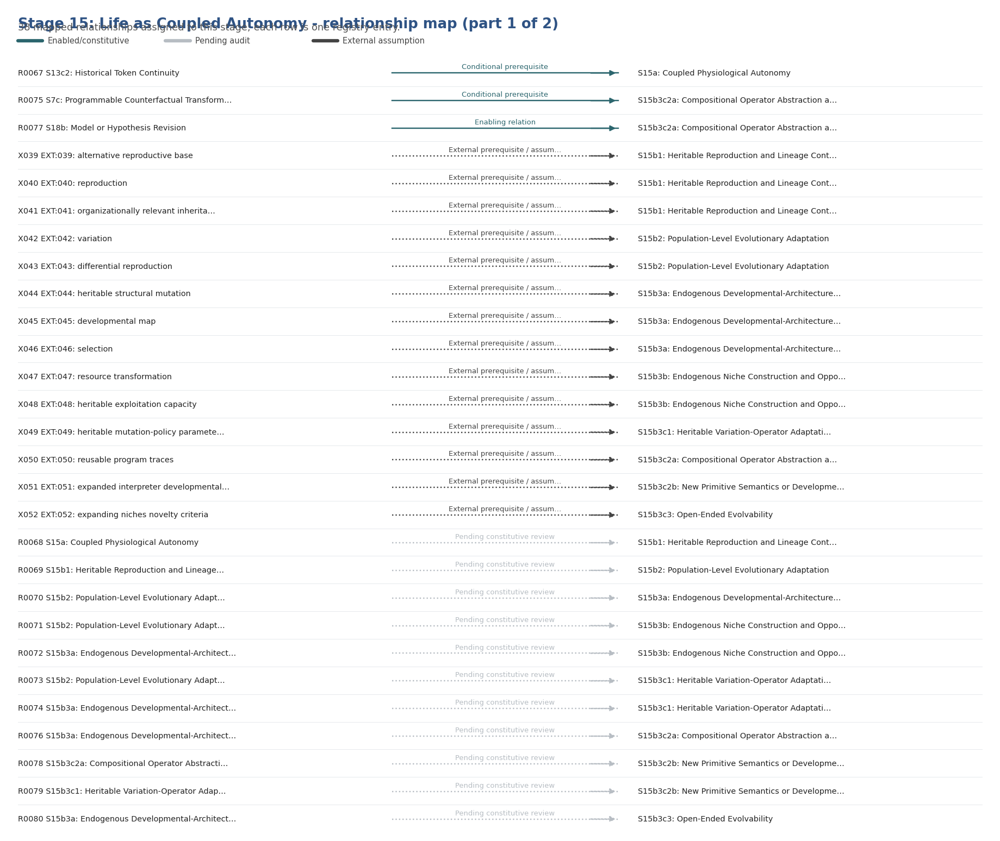{width=100%}
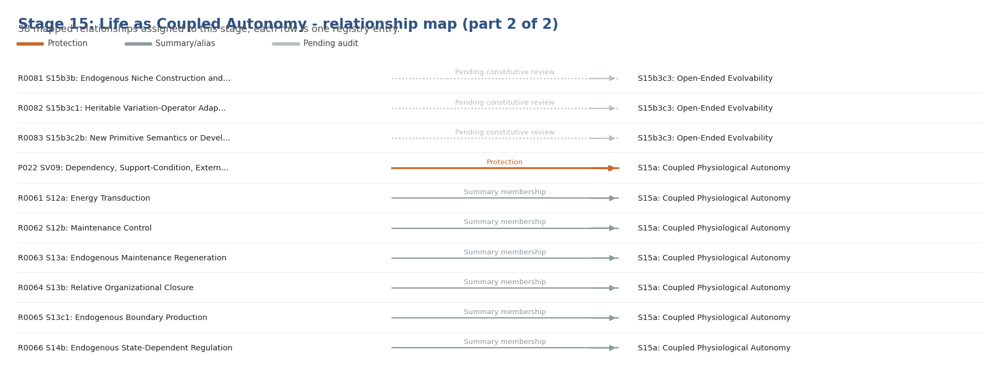{width=100%}

Figure A15. **Current Stage 15 relationship neighborhood.** Gray or pending entries remain candidates rather than proof-order claims.

### Relationship ledger

| ID | Source -> target | Type, status, and warrant | Current explanation, test, and revision boundary |
|---|---|---|---|
| R0067 | Historical Token Continuity -> Coupled Physiological Autonomy | Conditional prerequisite; adjudicated_v0.20; conceptual or source-grounded argument; empirical validation pending | Historical token continuity is included only when the autonomy claim includes diachronic identity. Warrant: conceptual or source-grounded argument; empirical validation pending Test: Within the stated implementation or bridge assumptions, ablate S13c2; the tested realization of S15a should fail. Existing target witness: challenge-… Revise if: An alternative realization of S15a outside the stated condition and without S13c2 would limit the edge rather than refute the target. Evidence: E1_conceptual_source_grounded_or_normative |
| R0075 | Programmable Counterfactual Transformation -> Compositional Operator Abstraction and Library Growth | Conditional prerequisite; adjudicated_v0.20; reproducible toy model or simulation | The source is necessary only under the tested realization or named bridge assumptions. Warrant: reproducible toy model or simulation Test: Within the stated implementation or bridge assumptions, ablate S7c; the tested realization of S15b3c2a should fail. Existing target witness: two mine… Revise if: An alternative realization of S15b3c2a outside the stated condition and without S7c would limit the edge rather than refute the target. Evidence: E4_reproducible_toy_or_simulation |
| R0077 | Model or Hypothesis Revision -> Compositional Operator Abstraction and Library Growth | Enabling relation; adjudicated_v0.20; reproducible toy model or simulation | Model revision can support abstraction/library growth but is not necessary for every macro-discovery method. Warrant: reproducible toy model or simulation Test: Compare otherwise matched realizations of S15b3c2a with and without S18b; the source should widen, stabilize, or improve the target realization. Exis… Revise if: No measurable change in target realizability, robustness, reach, or cost after source removal would defeat this enablement claim. Evidence: E4_reproducible_toy_or_simulation |
| X039 | alternative reproductive base -> Heritable Reproduction and Lineage Continuity | External prerequisite / assumption; not_in_scope_pending_external_prerequisite_audit; declared external assumption; target-domain audit pending | Heritable Reproduction and Lineage Continuity is modeled under the external prerequisite or assumption: alternative reproductive base. Warrant: declared external assumption; target-domain audit pending External-assumption audit remains pending. Evidence: external_assumption_pending |
| X040 | reproduction -> Heritable Reproduction and Lineage Continuity | External prerequisite / assumption; not_in_scope_pending_external_prerequisite_audit; declared external assumption; target-domain audit pending | Heritable Reproduction and Lineage Continuity is modeled under the external prerequisite or assumption: reproduction. Warrant: declared external assumption; target-domain audit pending External-assumption audit remains pending. Evidence: external_assumption_pending |
| X041 | organizationally relevant inheritance -> Heritable Reproduction and Lineage Continuity | External prerequisite / assumption; not_in_scope_pending_external_prerequisite_audit; declared external assumption; target-domain audit pending | Heritable Reproduction and Lineage Continuity is modeled under the external prerequisite or assumption: organizationally relevant inheritance. Warrant: declared external assumption; target-domain audit pending External-assumption audit remains pending. Evidence: external_assumption_pending |
| X042 | variation -> Population-Level Evolutionary Adaptation | External prerequisite / assumption; not_in_scope_pending_external_prerequisite_audit; declared external assumption; target-domain audit pending | Population-Level Evolutionary Adaptation is modeled under the external prerequisite or assumption: variation. Warrant: declared external assumption; target-domain audit pending External-assumption audit remains pending. Evidence: external_assumption_pending |
| X043 | differential reproduction -> Population-Level Evolutionary Adaptation | External prerequisite / assumption; not_in_scope_pending_external_prerequisite_audit; declared external assumption; target-domain audit pending | Population-Level Evolutionary Adaptation is modeled under the external prerequisite or assumption: differential reproduction. Warrant: declared external assumption; target-domain audit pending External-assumption audit remains pending. Evidence: external_assumption_pending |
| X044 | heritable structural mutation -> Endogenous Developmental-Architecture Expansion | External prerequisite / assumption; not_in_scope_pending_external_prerequisite_audit; declared external assumption; target-domain audit pending | Endogenous Developmental-Architecture Expansion is modeled under the external prerequisite or assumption: heritable structural mutation. Warrant: declared external assumption; target-domain audit pending External-assumption audit remains pending. Evidence: external_assumption_pending |
| X045 | developmental map -> Endogenous Developmental-Architecture Expansion | External prerequisite / assumption; not_in_scope_pending_external_prerequisite_audit; declared external assumption; target-domain audit pending | Endogenous Developmental-Architecture Expansion is modeled under the external prerequisite or assumption: developmental map. Warrant: declared external assumption; target-domain audit pending External-assumption audit remains pending. Evidence: external_assumption_pending |
| X046 | selection -> Endogenous Developmental-Architecture Expansion | External prerequisite / assumption; not_in_scope_pending_external_prerequisite_audit; declared external assumption; target-domain audit pending | Endogenous Developmental-Architecture Expansion is modeled under the external prerequisite or assumption: selection. Warrant: declared external assumption; target-domain audit pending External-assumption audit remains pending. Evidence: external_assumption_pending |
| X047 | resource transformation -> Endogenous Niche Construction and Opportunity Creation | External prerequisite / assumption; not_in_scope_pending_external_prerequisite_audit; declared external assumption; target-domain audit pending | Endogenous Niche Construction and Opportunity Creation is modeled under the external prerequisite or assumption: resource transformation. Warrant: declared external assumption; target-domain audit pending External-assumption audit remains pending. Evidence: external_assumption_pending |
| X048 | heritable exploitation capacity -> Endogenous Niche Construction and Opportunity Creation | External prerequisite / assumption; not_in_scope_pending_external_prerequisite_audit; declared external assumption; target-domain audit pending | Endogenous Niche Construction and Opportunity Creation is modeled under the external prerequisite or assumption: heritable exploitation capacity. Warrant: declared external assumption; target-domain audit pending External-assumption audit remains pending. Evidence: external_assumption_pending |
| X049 | heritable mutation-policy parameters -> Heritable Variation-Operator Adaptation | External prerequisite / assumption; not_in_scope_pending_external_prerequisite_audit; declared external assumption; target-domain audit pending | Heritable Variation-Operator Adaptation is modeled under the external prerequisite or assumption: heritable mutation-policy parameters. Warrant: declared external assumption; target-domain audit pending External-assumption audit remains pending. Evidence: external_assumption_pending |
| X050 | reusable program traces -> Compositional Operator Abstraction and Library Growth | External prerequisite / assumption; not_in_scope_pending_external_prerequisite_audit; declared external assumption; target-domain audit pending | Compositional Operator Abstraction and Library Growth is modeled under the external prerequisite or assumption: reusable program traces. Warrant: declared external assumption; target-domain audit pending External-assumption audit remains pending. Evidence: external_assumption_pending |
| X051 | expanded interpreter developmental language -> New Primitive Semantics or Developmental-Grammar Invention | External prerequisite / assumption; not_in_scope_pending_external_prerequisite_audit; declared external assumption; target-domain audit pending | New Primitive Semantics or Developmental-Grammar Invention is modeled under the external prerequisite or assumption: expanded interpreter developmental language. Warrant: declared external assumption; target-domain audit pending External-assumption audit remains pending. Evidence: external_assumption_pending |
| X052 | expanding niches novelty criteria -> Open-Ended Evolvability | External prerequisite / assumption; not_in_scope_pending_external_prerequisite_audit; declared external assumption; target-domain audit pending | Open-Ended Evolvability is modeled under the external prerequisite or assumption: expanding niches novelty criteria. Warrant: declared external assumption; target-domain audit pending External-assumption audit remains pending. Evidence: external_assumption_pending |
| R0068 | Coupled Physiological Autonomy -> Heritable Reproduction and Lineage Continuity | Pending constitutive review; pending_companion_paper_relation_audit; pending semantic adjudication | Within-stage relation was not part of the 306-edge enabling audit. Warrant: pending semantic adjudication Semantic adjudication remains pending; no prerequisite claim is licensed. |
| R0069 | Heritable Reproduction and Lineage Continuity -> Population-Level Evolutionary Adaptation | Pending constitutive review; pending_companion_paper_relation_audit; pending semantic adjudication | Within-stage relation was not part of the 306-edge enabling audit. Warrant: pending semantic adjudication Semantic adjudication remains pending; no prerequisite claim is licensed. |
| R0070 | Population-Level Evolutionary Adaptation -> Endogenous Developmental-Architecture Expansion | Pending constitutive review; pending_companion_paper_relation_audit; pending semantic adjudication | Within-stage relation was not part of the 306-edge enabling audit. Warrant: pending semantic adjudication Semantic adjudication remains pending; no prerequisite claim is licensed. |
| R0071 | Population-Level Evolutionary Adaptation -> Endogenous Niche Construction and Opportunity Creation | Pending constitutive review; pending_companion_paper_relation_audit; pending semantic adjudication | Within-stage relation was not part of the 306-edge enabling audit. Warrant: pending semantic adjudication Semantic adjudication remains pending; no prerequisite claim is licensed. |
| R0072 | Endogenous Developmental-Architecture Expansion -> Endogenous Niche Construction and Opportunity Creation | Pending constitutive review; pending_companion_paper_relation_audit; pending semantic adjudication | Within-stage relation was not part of the 306-edge enabling audit. Warrant: pending semantic adjudication Semantic adjudication remains pending; no prerequisite claim is licensed. |
| R0073 | Population-Level Evolutionary Adaptation -> Heritable Variation-Operator Adaptation | Pending constitutive review; pending_companion_paper_relation_audit; pending semantic adjudication | Within-stage relation was not part of the 306-edge enabling audit. Warrant: pending semantic adjudication Semantic adjudication remains pending; no prerequisite claim is licensed. |
| R0074 | Endogenous Developmental-Architecture Expansion -> Heritable Variation-Operator Adaptation | Pending constitutive review; pending_companion_paper_relation_audit; pending semantic adjudication | Within-stage relation was not part of the 306-edge enabling audit. Warrant: pending semantic adjudication Semantic adjudication remains pending; no prerequisite claim is licensed. |
| R0076 | Endogenous Developmental-Architecture Expansion -> Compositional Operator Abstraction and Library Growth | Pending constitutive review; pending_companion_paper_relation_audit; pending semantic adjudication | Within-stage relation was not part of the 306-edge enabling audit. Warrant: pending semantic adjudication Semantic adjudication remains pending; no prerequisite claim is licensed. |
| R0078 | Compositional Operator Abstraction and Library Growth -> New Primitive Semantics or Developmental-Grammar Invention | Pending constitutive review; pending_companion_paper_relation_audit; pending semantic adjudication | Within-stage relation was not part of the 306-edge enabling audit. Warrant: pending semantic adjudication Semantic adjudication remains pending; no prerequisite claim is licensed. |
| R0079 | Heritable Variation-Operator Adaptation -> New Primitive Semantics or Developmental-Grammar Invention | Pending constitutive review; pending_companion_paper_relation_audit; pending semantic adjudication | Within-stage relation was not part of the 306-edge enabling audit. Warrant: pending semantic adjudication Semantic adjudication remains pending; no prerequisite claim is licensed. |
| R0080 | Endogenous Developmental-Architecture Expansion -> Open-Ended Evolvability | Pending constitutive review; pending_companion_paper_relation_audit; pending semantic adjudication | Within-stage relation was not part of the 306-edge enabling audit. Warrant: pending semantic adjudication Semantic adjudication remains pending; no prerequisite claim is licensed. |
| R0081 | Endogenous Niche Construction and Opportunity Creation -> Open-Ended Evolvability | Pending constitutive review; pending_companion_paper_relation_audit; pending semantic adjudication | Within-stage relation was not part of the 306-edge enabling audit. Warrant: pending semantic adjudication Semantic adjudication remains pending; no prerequisite claim is licensed. |
| R0082 | Heritable Variation-Operator Adaptation -> Open-Ended Evolvability | Pending constitutive review; pending_companion_paper_relation_audit; pending semantic adjudication | Within-stage relation was not part of the 306-edge enabling audit. Warrant: pending semantic adjudication Semantic adjudication remains pending; no prerequisite claim is licensed. |
| R0083 | New Primitive Semantics or Developmental-Grammar Invention -> Open-Ended Evolvability | Pending constitutive review; pending_companion_paper_relation_audit; pending semantic adjudication | Within-stage relation was not part of the 306-edge enabling audit. Warrant: pending semantic adjudication Semantic adjudication remains pending; no prerequisite claim is licensed. |
| P022 | Dependency, Support-Condition, Externality, and Regeneration Service -> Coupled Physiological Autonomy | Protection; selective v0.20 candidate protection edge; requires domain or institutional validation before consequential use; governance-design claim with stated mechanism and failure condition | dependency and externality tracing protect coupled autonomy from exported support costs Warrant: governance-design claim with stated mechanism and failure condition Test: Remove or neutralize the source protection and test whether Coupled Physiological Autonomy becomes more exposed, less viable, less contestable, or le… Revise if: remove or neutralize the source protection and test whether the target becomes more exposed, less viable, less contestable, or less co… Evidence: internal_architecture_candidate |
| R0061 | Energy Transduction -> Coupled Physiological Autonomy | Summary membership; adjudicated_v0.20; conceptual or source-grounded argument; empirical validation pending | The target is a stage-level synthesis of independently typed components. Warrant: conceptual or source-grounded argument; empirical validation pending Evidence: E1_conceptual_source_grounded_or_normative |
| R0062 | Maintenance Control -> Coupled Physiological Autonomy | Summary membership; adjudicated_v0.20; conceptual or source-grounded argument; empirical validation pending | The target is a stage-level synthesis of independently typed components. Warrant: conceptual or source-grounded argument; empirical validation pending Evidence: E1_conceptual_source_grounded_or_normative |
| R0063 | Endogenous Maintenance Regeneration -> Coupled Physiological Autonomy | Summary membership; adjudicated_v0.20; conceptual or source-grounded argument; empirical validation pending | The target is a stage-level synthesis of independently typed components. Warrant: conceptual or source-grounded argument; empirical validation pending Evidence: E1_conceptual_source_grounded_or_normative |
| R0064 | Relative Organizational Closure -> Coupled Physiological Autonomy | Summary membership; adjudicated_v0.20; conceptual or source-grounded argument; empirical validation pending | The target is a stage-level synthesis of independently typed components. Warrant: conceptual or source-grounded argument; empirical validation pending Evidence: E1_conceptual_source_grounded_or_normative |
| R0065 | Endogenous Boundary Production -> Coupled Physiological Autonomy | Summary membership; adjudicated_v0.20; conceptual or source-grounded argument; empirical validation pending | The target is a stage-level synthesis of independently typed components. Warrant: conceptual or source-grounded argument; empirical validation pending Evidence: E1_conceptual_source_grounded_or_normative |
| R0066 | Endogenous State-Dependent Regulation -> Coupled Physiological Autonomy | Summary membership; adjudicated_v0.20; conceptual or source-grounded argument; empirical validation pending | The target is a stage-level synthesis of independently typed components. Warrant: conceptual or source-grounded argument; empirical validation pending Evidence: E1_conceptual_source_grounded_or_normative |

### Revision gate

**Next action:** New primitive semantics, interpreter growth, developmental-language evolution, and no fixed novelty menu A relation should be retyped, weakened, redirected, or removed whenever its dependency witness fails, its countermodel succeeds, its warrant basis changes, or target-domain evidence defeats the declared scope.

# Arc 3 - Representation, anticipation, agency, and meaning

\pagebreak

## Stage 16 - Representational Organization

**Domain block:** Psychology / Consciousness / Biology seam  \
**Claim status:** Bridge principle  \
**Canonical role:** Psychological / consciousness bridge  \
**Source:** M&E §13.14

### Stage meaning and formal role

Some minds and agents maintain compressed, action-relevant models of self and environment. Representation is graded and is not assumed for all life or all possible consciousness.

Stage 16 contains **10 active object(s)**: Representation / observation (6), Open capacity / problem (4). The synchronized ledger assigns **36 relationship record(s)** to this stage.

### Active object inventory

| ID | Object | Type | Evidence | Disposition |
|---|---|---|---|---|
| S16a | Target-Indexed, Error-Bearing Representation | Representation / observation | E4_reproducible_toy_or_simulation | retain_distinct_pending_edge_audit |
| S16b1 | Object-Relational Causal World Model | Representation / observation | E4_reproducible_toy_or_simulation | retain_distinct_pending_edge_audit |
| S16b2 | Interventionally Compositional Prediction | Open capacity / problem | E0_open_or_unresolved | retain_open_research_branch |
| S16b3 | Causal Representation Identification from Low-Level Observation | Open capacity / problem | E0_open_or_unresolved | retain_open_research_branch |
| S16c1 | Task-Relative Self-Capability Model | Representation / observation | E1_conceptual_source_grounded_or_normative | retain_distinct_pending_edge_audit |
| S16c2 | Represented Self-Uncertainty and Calibration | Representation / observation | E4_reproducible_toy_or_simulation | retain_typed_noncapacity_object |
| S16c3a | Sensorimotor Source Monitoring and Causal Self-Location | Representation / observation | E4_reproducible_toy_or_simulation | retain_typed_noncapacity_object |
| S16c3b | Action-Selection Provenance Representation | Representation / observation | E4_reproducible_toy_or_simulation | retain_typed_noncapacity_object |
| S16c3c | Full Action Authorship and Causal Self-Location | Open capacity / problem | E0_open_or_unresolved | retain_open_research_branch |
| S16c4 | Diachronic or Autobiographical Self-Model | Open capacity / problem | E0_open_or_unresolved | retain_open_research_branch |

### Complete relationship map

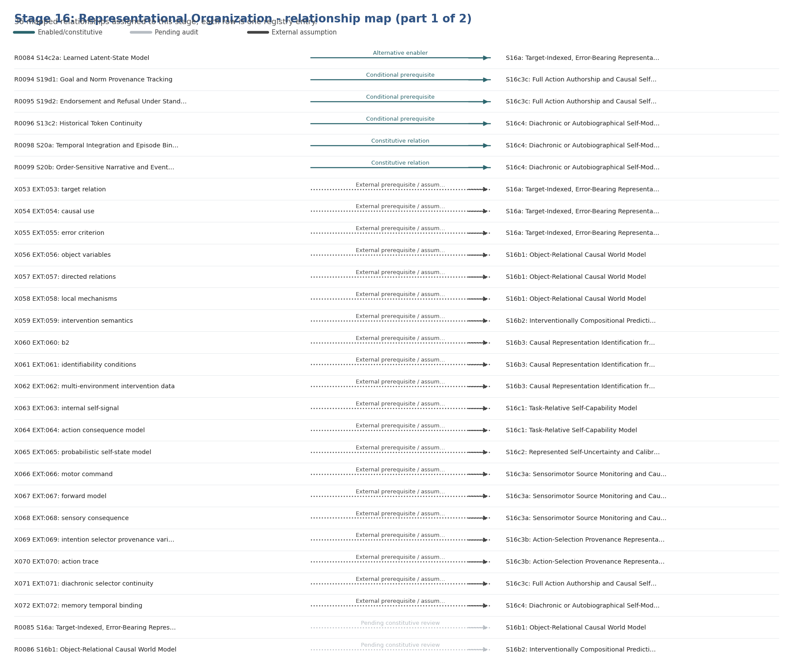{width=100%}
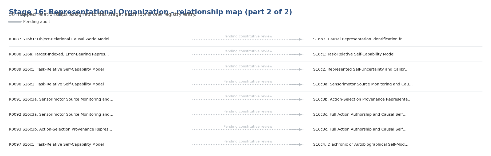{width=100%}

Figure A16. **Current Stage 16 relationship neighborhood.** Gray or pending entries remain candidates rather than proof-order claims.

### Relationship ledger

| ID | Source -> target | Type, status, and warrant | Current explanation, test, and revision boundary |
|---|---|---|---|
| R0084 | Learned Latent-State Model -> Target-Indexed, Error-Bearing Representation | Alternative enabler; adjudicated_v0.20; reproducible toy model or simulation | The source is one route among several and therefore cannot support a necessity claim. Warrant: reproducible toy model or simulation Test: Compare otherwise matched realizations of S16a with and without S14c2a; the source should widen, stabilize, or improve the target realization. Existi… Revise if: No measurable change in target realizability, robustness, reach, or cost after source removal would defeat this enablement claim. Evidence: E4_reproducible_toy_or_simulation |
| R0094 | Goal and Norm Provenance Tracking -> Full Action Authorship and Causal Self-Location | Conditional prerequisite; adjudicated_v0.20; conceptual or source-grounded argument; empirical validation pending | Full action authorship requires provenance representation under the present account. Warrant: conceptual or source-grounded argument; empirical validation pending Test: Within the stated implementation or bridge assumptions, ablate S19d1; the tested realization of S16c3c should fail. Existing target witness: not esta… Revise if: An alternative realization of S16c3c outside the stated condition and without S19d1 would limit the edge rather than refute the target. Evidence: E0_open_or_unresolved |
| R0095 | Endorsement and Refusal Under Standing Commitments -> Full Action Authorship and Causal Self-Location | Conditional prerequisite; adjudicated_v0.20; conceptual or source-grounded argument; empirical validation pending | Full action authorship requires endorsement/refusal under the present account. Warrant: conceptual or source-grounded argument; empirical validation pending Test: Within the stated implementation or bridge assumptions, ablate S19d2; the tested realization of S16c3c should fail. Existing target witness: not esta… Revise if: An alternative realization of S16c3c outside the stated condition and without S19d2 would limit the edge rather than refute the target. Evidence: E0_open_or_unresolved |
| R0096 | Historical Token Continuity -> Diachronic or Autobiographical Self-Model | Conditional prerequisite; adjudicated_v0.20; conceptual or source-grounded argument; empirical validation pending | Actual token continuity is relevant to some autobiographical selves but representation of a history can exist without it. Warrant: conceptual or source-grounded argument; empirical validation pending Test: Within the stated implementation or bridge assumptions, ablate S13c2; the tested realization of S16c4 should fail. Existing target witness: not estab… Revise if: An alternative realization of S16c4 outside the stated condition and without S13c2 would limit the edge rather than refute the target. Evidence: E0_open_or_unresolved |
| R0098 | Temporal Integration and Episode Binding -> Diachronic or Autobiographical Self-Model | Constitutive relation; adjudicated_v0.20; conceptual or source-grounded argument; empirical validation pending | Temporal integration contributes to autobiographical self-modeling. Warrant: conceptual or source-grounded argument; empirical validation pending Test: Intervene on S20a and test whether the identity, organization, or classification of S16c4 changes without assuming total disappearance. Existing targ… Revise if: If S16c4 retains the same declared identity under source removal, this constitutive claim should be weakened or removed. Evidence: E0_open_or_unresolved |
| R0099 | Order-Sensitive Narrative and Event Organization -> Diachronic or Autobiographical Self-Model | Constitutive relation; adjudicated_v0.20; conceptual or source-grounded argument; empirical validation pending | Order-sensitive narrative contributes to autobiographical self-modeling. Warrant: conceptual or source-grounded argument; empirical validation pending Test: Intervene on S20b and test whether the identity, organization, or classification of S16c4 changes without assuming total disappearance. Existing targ… Revise if: If S16c4 retains the same declared identity under source removal, this constitutive claim should be weakened or removed. Evidence: E0_open_or_unresolved |
| X053 | target relation -> Target-Indexed, Error-Bearing Representation | External prerequisite / assumption; not_in_scope_pending_external_prerequisite_audit; declared external assumption; target-domain audit pending | Target-Indexed, Error-Bearing Representation is modeled under the external prerequisite or assumption: target relation. Warrant: declared external assumption; target-domain audit pending External-assumption audit remains pending. Evidence: external_assumption_pending |
| X054 | causal use -> Target-Indexed, Error-Bearing Representation | External prerequisite / assumption; not_in_scope_pending_external_prerequisite_audit; declared external assumption; target-domain audit pending | Target-Indexed, Error-Bearing Representation is modeled under the external prerequisite or assumption: causal use. Warrant: declared external assumption; target-domain audit pending External-assumption audit remains pending. Evidence: external_assumption_pending |
| X055 | error criterion -> Target-Indexed, Error-Bearing Representation | External prerequisite / assumption; not_in_scope_pending_external_prerequisite_audit; declared external assumption; target-domain audit pending | Target-Indexed, Error-Bearing Representation is modeled under the external prerequisite or assumption: error criterion. Warrant: declared external assumption; target-domain audit pending External-assumption audit remains pending. Evidence: external_assumption_pending |
| X056 | object variables -> Object-Relational Causal World Model | External prerequisite / assumption; not_in_scope_pending_external_prerequisite_audit; declared external assumption; target-domain audit pending | Object-Relational Causal World Model is modeled under the external prerequisite or assumption: object variables. Warrant: declared external assumption; target-domain audit pending External-assumption audit remains pending. Evidence: external_assumption_pending |
| X057 | directed relations -> Object-Relational Causal World Model | External prerequisite / assumption; not_in_scope_pending_external_prerequisite_audit; declared external assumption; target-domain audit pending | Object-Relational Causal World Model is modeled under the external prerequisite or assumption: directed relations. Warrant: declared external assumption; target-domain audit pending External-assumption audit remains pending. Evidence: external_assumption_pending |
| X058 | local mechanisms -> Object-Relational Causal World Model | External prerequisite / assumption; not_in_scope_pending_external_prerequisite_audit; declared external assumption; target-domain audit pending | Object-Relational Causal World Model is modeled under the external prerequisite or assumption: local mechanisms. Warrant: declared external assumption; target-domain audit pending External-assumption audit remains pending. Evidence: external_assumption_pending |
| X059 | intervention semantics -> Interventionally Compositional Prediction | External prerequisite / assumption; not_in_scope_pending_external_prerequisite_audit; declared external assumption; target-domain audit pending | Interventionally Compositional Prediction is modeled under the external prerequisite or assumption: intervention semantics. Warrant: declared external assumption; target-domain audit pending External-assumption audit remains pending. Evidence: external_assumption_pending |
| X060 | b2 -> Causal Representation Identification from Low-Level Observation | External prerequisite / assumption; not_in_scope_pending_external_prerequisite_audit; declared external assumption; target-domain audit pending | Causal Representation Identification from Low-Level Observation is modeled under the external prerequisite or assumption: b2. Warrant: declared external assumption; target-domain audit pending External-assumption audit remains pending. Evidence: external_assumption_pending |
| X061 | identifiability conditions -> Causal Representation Identification from Low-Level Observation | External prerequisite / assumption; not_in_scope_pending_external_prerequisite_audit; declared external assumption; target-domain audit pending | Causal Representation Identification from Low-Level Observation is modeled under the external prerequisite or assumption: identifiability conditions. Warrant: declared external assumption; target-domain audit pending External-assumption audit remains pending. Evidence: external_assumption_pending |
| X062 | multi-environment intervention data -> Causal Representation Identification from Low-Level Observation | External prerequisite / assumption; not_in_scope_pending_external_prerequisite_audit; declared external assumption; target-domain audit pending | Causal Representation Identification from Low-Level Observation is modeled under the external prerequisite or assumption: multi-environment intervention data. Warrant: declared external assumption; target-domain audit pending External-assumption audit remains pending. Evidence: external_assumption_pending |
| X063 | internal self-signal -> Task-Relative Self-Capability Model | External prerequisite / assumption; not_in_scope_pending_external_prerequisite_audit; declared external assumption; target-domain audit pending | Task-Relative Self-Capability Model is modeled under the external prerequisite or assumption: internal self-signal. Warrant: declared external assumption; target-domain audit pending External-assumption audit remains pending. Evidence: external_assumption_pending |
| X064 | action consequence model -> Task-Relative Self-Capability Model | External prerequisite / assumption; not_in_scope_pending_external_prerequisite_audit; declared external assumption; target-domain audit pending | Task-Relative Self-Capability Model is modeled under the external prerequisite or assumption: action consequence model. Warrant: declared external assumption; target-domain audit pending External-assumption audit remains pending. Evidence: external_assumption_pending |
| X065 | probabilistic self-state model -> Represented Self-Uncertainty and Calibration | External prerequisite / assumption; not_in_scope_pending_external_prerequisite_audit; declared external assumption; target-domain audit pending | Represented Self-Uncertainty and Calibration is modeled under the external prerequisite or assumption: probabilistic self-state model. Warrant: declared external assumption; target-domain audit pending External-assumption audit remains pending. Evidence: external_assumption_pending |
| X066 | motor command -> Sensorimotor Source Monitoring and Causal Self-Location | External prerequisite / assumption; not_in_scope_pending_external_prerequisite_audit; declared external assumption; target-domain audit pending | Sensorimotor Source Monitoring and Causal Self-Location is modeled under the external prerequisite or assumption: motor command. Warrant: declared external assumption; target-domain audit pending External-assumption audit remains pending. Evidence: external_assumption_pending |
| X067 | forward model -> Sensorimotor Source Monitoring and Causal Self-Location | External prerequisite / assumption; not_in_scope_pending_external_prerequisite_audit; declared external assumption; target-domain audit pending | Sensorimotor Source Monitoring and Causal Self-Location is modeled under the external prerequisite or assumption: forward model. Warrant: declared external assumption; target-domain audit pending External-assumption audit remains pending. Evidence: external_assumption_pending |
| X068 | sensory consequence -> Sensorimotor Source Monitoring and Causal Self-Location | External prerequisite / assumption; not_in_scope_pending_external_prerequisite_audit; declared external assumption; target-domain audit pending | Sensorimotor Source Monitoring and Causal Self-Location is modeled under the external prerequisite or assumption: sensory consequence. Warrant: declared external assumption; target-domain audit pending External-assumption audit remains pending. Evidence: external_assumption_pending |
| X069 | intention selector provenance variable -> Action-Selection Provenance Representation | External prerequisite / assumption; not_in_scope_pending_external_prerequisite_audit; declared external assumption; target-domain audit pending | Action-Selection Provenance Representation is modeled under the external prerequisite or assumption: intention selector provenance variable. Warrant: declared external assumption; target-domain audit pending External-assumption audit remains pending. Evidence: external_assumption_pending |
| X070 | action trace -> Action-Selection Provenance Representation | External prerequisite / assumption; not_in_scope_pending_external_prerequisite_audit; declared external assumption; target-domain audit pending | Action-Selection Provenance Representation is modeled under the external prerequisite or assumption: action trace. Warrant: declared external assumption; target-domain audit pending External-assumption audit remains pending. Evidence: external_assumption_pending |
| X071 | diachronic selector continuity -> Full Action Authorship and Causal Self-Location | External prerequisite / assumption; not_in_scope_pending_external_prerequisite_audit; declared external assumption; target-domain audit pending | Full Action Authorship and Causal Self-Location is modeled under the external prerequisite or assumption: diachronic selector continuity. Warrant: declared external assumption; target-domain audit pending External-assumption audit remains pending. Evidence: external_assumption_pending |
| X072 | memory temporal binding -> Diachronic or Autobiographical Self-Model | External prerequisite / assumption; not_in_scope_pending_external_prerequisite_audit; declared external assumption; target-domain audit pending | Diachronic or Autobiographical Self-Model is modeled under the external prerequisite or assumption: memory temporal binding. Warrant: declared external assumption; target-domain audit pending External-assumption audit remains pending. Evidence: external_assumption_pending |
| R0085 | Target-Indexed, Error-Bearing Representation -> Object-Relational Causal World Model | Pending constitutive review; pending_companion_paper_relation_audit; pending semantic adjudication | Within-stage relation was not part of the 306-edge enabling audit. Warrant: pending semantic adjudication Semantic adjudication remains pending; no prerequisite claim is licensed. |
| R0086 | Object-Relational Causal World Model -> Interventionally Compositional Prediction | Pending constitutive review; pending_companion_paper_relation_audit; pending semantic adjudication | Within-stage relation was not part of the 306-edge enabling audit. Warrant: pending semantic adjudication Semantic adjudication remains pending; no prerequisite claim is licensed. |
| R0087 | Object-Relational Causal World Model -> Causal Representation Identification from Low-Level Observation | Pending constitutive review; pending_companion_paper_relation_audit; pending semantic adjudication | Within-stage relation was not part of the 306-edge enabling audit. Warrant: pending semantic adjudication Semantic adjudication remains pending; no prerequisite claim is licensed. |
| R0088 | Target-Indexed, Error-Bearing Representation -> Task-Relative Self-Capability Model | Pending constitutive review; pending_companion_paper_relation_audit; pending semantic adjudication | Within-stage relation was not part of the 306-edge enabling audit. Warrant: pending semantic adjudication Semantic adjudication remains pending; no prerequisite claim is licensed. |
| R0089 | Task-Relative Self-Capability Model -> Represented Self-Uncertainty and Calibration | Pending constitutive review; pending_companion_paper_relation_audit; pending semantic adjudication | Within-stage relation was not part of the 306-edge enabling audit. Warrant: pending semantic adjudication Semantic adjudication remains pending; no prerequisite claim is licensed. |
| R0090 | Task-Relative Self-Capability Model -> Sensorimotor Source Monitoring and Causal Self-Location | Pending constitutive review; pending_companion_paper_relation_audit; pending semantic adjudication | Within-stage relation was not part of the 306-edge enabling audit. Warrant: pending semantic adjudication Semantic adjudication remains pending; no prerequisite claim is licensed. |
| R0091 | Sensorimotor Source Monitoring and Causal Self-Location -> Action-Selection Provenance Representation | Pending constitutive review; pending_companion_paper_relation_audit; pending semantic adjudication | Within-stage relation was not part of the 306-edge enabling audit. Warrant: pending semantic adjudication Semantic adjudication remains pending; no prerequisite claim is licensed. |
| R0092 | Sensorimotor Source Monitoring and Causal Self-Location -> Full Action Authorship and Causal Self-Location | Pending constitutive review; pending_companion_paper_relation_audit; pending semantic adjudication | Within-stage relation was not part of the 306-edge enabling audit. Warrant: pending semantic adjudication Semantic adjudication remains pending; no prerequisite claim is licensed. |
| R0093 | Action-Selection Provenance Representation -> Full Action Authorship and Causal Self-Location | Pending constitutive review; pending_companion_paper_relation_audit; pending semantic adjudication | Within-stage relation was not part of the 306-edge enabling audit. Warrant: pending semantic adjudication Semantic adjudication remains pending; no prerequisite claim is licensed. |
| R0097 | Task-Relative Self-Capability Model -> Diachronic or Autobiographical Self-Model | Pending constitutive review; pending_companion_paper_relation_audit; pending semantic adjudication | Within-stage relation was not part of the 306-edge enabling audit. Warrant: pending semantic adjudication Semantic adjudication remains pending; no prerequisite claim is licensed. |

### Revision gate

**Next action:** Infer source provenance, distributed selectors, coercion, retrospective ownership, and diachronic continuity A relation should be retyped, weakened, redirected, or removed whenever its dependency witness fails, its countermodel succeeds, its warrant basis changes, or target-domain evidence defeats the declared scope.

\pagebreak

## Stage 17 - Anticipatory Regulation

**Domain block:** Psychology / Biology / Control seam  \
**Claim status:** Hypothesis / research program  \
**Canonical role:** Conditional empirical bridge  \
**Source:** M&E §13.14

### Stage meaning and formal role

Some systems regulate present action relative to predicted or possible futures. Predictive processing is one model family, not a universal identity of mind.

Stage 17 contains **4 active object(s)**: Operational capacity (2), Open capacity / problem (1), Evaluator / derived relation (1). The synchronized ledger assigns **18 relationship record(s)** to this stage.

### Active object inventory

| ID | Object | Type | Evidence | Disposition |
|---|---|---|---|---|
| S17b | Prospective Counterfactual Simulation | Operational capacity | E4_reproducible_toy_or_simulation | retain_distinct_pending_edge_audit |
| S17c | Multi-Step Model-Based Planning | Operational capacity | E4_reproducible_toy_or_simulation | retain_distinct_pending_edge_audit |
| S17d | Self-Prospection and Episodic Future Organization | Open capacity / problem | E0_open_or_unresolved | retain_open_research_branch |
| S17e | Directional Evaluation and Valence Bridge | Evaluator / derived relation | E1_conceptual_source_grounded_or_normative | retain_typed_noncapacity_object |

### Complete relationship map

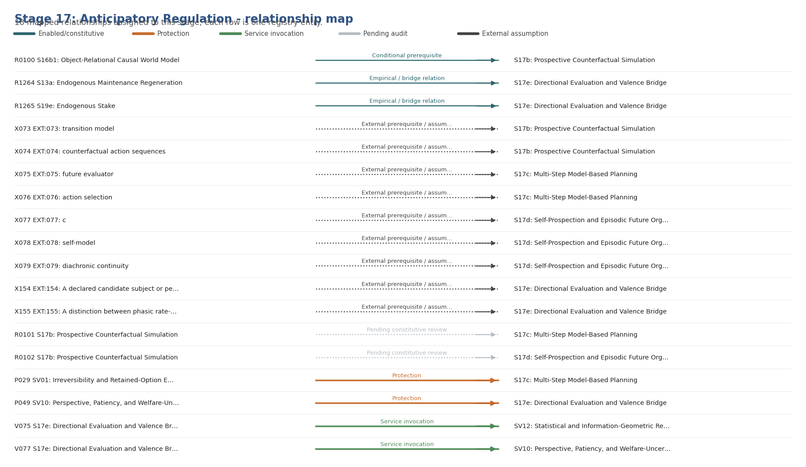{width=100%}

Figure A17. **Current Stage 17 relationship neighborhood.** Gray or pending entries remain candidates rather than proof-order claims.

### Relationship ledger

| ID | Source -> target | Type, status, and warrant | Current explanation, test, and revision boundary |
|---|---|---|---|
| R0100 | Object-Relational Causal World Model -> Prospective Counterfactual Simulation | Conditional prerequisite; adjudicated_v0.20; reproducible toy model or simulation | The source is necessary only under the tested realization or named bridge assumptions. Warrant: reproducible toy model or simulation Test: Within the stated implementation or bridge assumptions, ablate S16b1; the tested realization of S17b should fail. Existing target witness: rollout su… Revise if: An alternative realization of S17b outside the stated condition and without S16b1 would limit the edge rather than refute the target. Evidence: E4_reproducible_toy_or_simulation |
| R1264 | Endogenous Maintenance Regeneration -> Directional Evaluation and Valence Bridge | Empirical / bridge relation; defined_wave7; conceptual or source-grounded argument; empirical validation pending | Endogenous maintenance supplies one candidate basis for organism-relative better-worse variables; it does not establish phenomenal valence. Warrant: conceptual or source-grounded argument; empirical validation pending Test: Manipulate maintenance-relevant margins while measuring endogenous regulation and candidate affective reports or proxies. Revise if: If directional affect dissociates systematically from all endogenous maintenance margins, narrow the bridge. Evidence: E1_conceptual_source_grounded_or_normative |
| R1265 | Endogenous Stake -> Directional Evaluation and Valence Bridge | Empirical / bridge relation; defined_wave7; conceptual or source-grounded argument; empirical validation pending | Endogenous stake constrains what may count as subject-relative directional evaluation, while remaining distinct from felt valence. Warrant: conceptual or source-grounded argument; empirical validation pending Test: Test whether the evaluated coordinates causally organize the candidate system’s own regulation rather than only an external reward channel. Revise if: If external reward alone produces the same effect without endogenous uptake, the bridge is overstated. Evidence: E1_conceptual_source_grounded_or_normative |
| X073 | transition model -> Prospective Counterfactual Simulation | External prerequisite / assumption; not_in_scope_pending_external_prerequisite_audit; declared external assumption; target-domain audit pending | Prospective Counterfactual Simulation is modeled under the external prerequisite or assumption: transition model. Warrant: declared external assumption; target-domain audit pending External-assumption audit remains pending. Evidence: external_assumption_pending |
| X074 | counterfactual action sequences -> Prospective Counterfactual Simulation | External prerequisite / assumption; not_in_scope_pending_external_prerequisite_audit; declared external assumption; target-domain audit pending | Prospective Counterfactual Simulation is modeled under the external prerequisite or assumption: counterfactual action sequences. Warrant: declared external assumption; target-domain audit pending External-assumption audit remains pending. Evidence: external_assumption_pending |
| X075 | future evaluator -> Multi-Step Model-Based Planning | External prerequisite / assumption; not_in_scope_pending_external_prerequisite_audit; declared external assumption; target-domain audit pending | Multi-Step Model-Based Planning is modeled under the external prerequisite or assumption: future evaluator. Warrant: declared external assumption; target-domain audit pending External-assumption audit remains pending. Evidence: external_assumption_pending |
| X076 | action selection -> Multi-Step Model-Based Planning | External prerequisite / assumption; not_in_scope_pending_external_prerequisite_audit; declared external assumption; target-domain audit pending | Multi-Step Model-Based Planning is modeled under the external prerequisite or assumption: action selection. Warrant: declared external assumption; target-domain audit pending External-assumption audit remains pending. Evidence: external_assumption_pending |
| X077 | c -> Self-Prospection and Episodic Future Organization | External prerequisite / assumption; not_in_scope_pending_external_prerequisite_audit; declared external assumption; target-domain audit pending | Self-Prospection and Episodic Future Organization is modeled under the external prerequisite or assumption: c. Warrant: declared external assumption; target-domain audit pending External-assumption audit remains pending. Evidence: external_assumption_pending |
| X078 | self-model -> Self-Prospection and Episodic Future Organization | External prerequisite / assumption; not_in_scope_pending_external_prerequisite_audit; declared external assumption; target-domain audit pending | Self-Prospection and Episodic Future Organization is modeled under the external prerequisite or assumption: self-model. Warrant: declared external assumption; target-domain audit pending External-assumption audit remains pending. Evidence: external_assumption_pending |
| X079 | diachronic continuity -> Self-Prospection and Episodic Future Organization | External prerequisite / assumption; not_in_scope_pending_external_prerequisite_audit; declared external assumption; target-domain audit pending | Self-Prospection and Episodic Future Organization is modeled under the external prerequisite or assumption: diachronic continuity. Warrant: declared external assumption; target-domain audit pending External-assumption audit remains pending. Evidence: external_assumption_pending |
| X154 | A declared candidate subject or perspective with endogenous evaluative variables, protected margins, and evidence that the variables are globally integrated and causally active. -> Directional Evaluation and Valence Bridge | External prerequisite / assumption; defined_wave7_external_boundary; declared external assumption; target-domain audit pending | Directional Evaluation and Valence Bridge is modeled under the external prerequisite or assumption: A declared candidate subject or perspective with endogenous evaluative variables, protected margins, and evidence that the variables are globally integrated and causally active.. Warrant: declared external assumption; target-domain audit pending External-assumption audit remains pending. Evidence: external_assumption_pending |
| X155 | A distinction between phasic rate-of-change evidence and tonic level or margin evidence, with horizon and weighting assumptions declared. -> Directional Evaluation and Valence Bridge | External prerequisite / assumption; defined_wave7_external_boundary; declared external assumption; target-domain audit pending | Directional Evaluation and Valence Bridge is modeled under the external prerequisite or assumption: A distinction between phasic rate-of-change evidence and tonic level or margin evidence, with horizon and weighting assumptions declared.. Warrant: declared external assumption; target-domain audit pending External-assumption audit remains pending. Evidence: external_assumption_pending |
| R0101 | Prospective Counterfactual Simulation -> Multi-Step Model-Based Planning | Pending constitutive review; pending_companion_paper_relation_audit; pending semantic adjudication | Within-stage relation was not part of the 306-edge enabling audit. Warrant: pending semantic adjudication Semantic adjudication remains pending; no prerequisite claim is licensed. |
| R0102 | Prospective Counterfactual Simulation -> Self-Prospection and Episodic Future Organization | Pending constitutive review; pending_companion_paper_relation_audit; pending semantic adjudication | Within-stage relation was not part of the 306-edge enabling audit. Warrant: pending semantic adjudication Semantic adjudication remains pending; no prerequisite claim is licensed. |
| P029 | Irreversibility and Retained-Option Evaluation Service -> Multi-Step Model-Based Planning | Protection; selective v0.20 candidate protection edge; requires domain or institutional validation before consequential use; governance-design claim with stated mechanism and failure condition | retained-option evaluation constrains plans that would create avoidable lock-in Warrant: governance-design claim with stated mechanism and failure condition Test: Remove or neutralize the source protection and test whether Multi-Step Model-Based Planning becomes more exposed, less viable, less contestable, or l… Revise if: remove or neutralize the source protection and test whether the target becomes more exposed, less viable, less contestable, or less co… Evidence: internal_architecture_candidate |
| P049 | Perspective, Patiency, and Welfare-Uncertainty Service -> Directional Evaluation and Valence Bridge | Protection; defined_wave7; governance-design claim with stated mechanism and failure condition | Perspective, patiency, and welfare uncertainty prevents directional-evaluation signals from being treated as sufficient evidence of felt valence. Warrant: governance-design claim with stated mechanism and failure condition Test: Remove or neutralize the source protection and test whether Directional Evaluation and Valence Bridge becomes more exposed, less viable, less contest… Revise if: If reward or progress signals alone trigger welfare attribution, the protection has failed. Evidence: internal_architecture_candidate |
| V075 | Directional Evaluation and Valence Bridge -> Statistical and Information-Geometric Representation Service | Service invocation; defined_v0.4; internal architecture and role mapping | Directional Evaluation and Valence Bridge invokes Statistical and Information-Geometric Representation Service in the role of optional Fisher-Rao magnitude for licensed probabilistic evaluative variables. Warrant: internal architecture and role mapping Test: Check whether the stage-specific role optional Fisher-Rao magnitude for licensed probabilistic evaluative variables is actually required when the ser… Revise if: If the stage does not use this service role, the invocation should be removed or reassigned. Evidence: internal_architecture_candidate |
| V077 | Directional Evaluation and Valence Bridge -> Perspective, Patiency, and Welfare-Uncertainty Service | Service invocation; defined_v0.4; internal architecture and role mapping | Directional Evaluation and Valence Bridge invokes Perspective, Patiency, and Welfare-Uncertainty Service in the role of directional-valence attribution under perspective and welfare uncertainty. Warrant: internal architecture and role mapping Test: Check whether the stage-specific role directional-valence attribution under perspective and welfare uncertainty is actually required when the service… Revise if: If the stage does not use this service role, the invocation should be removed or reassigned. Evidence: internal_architecture_candidate |

### Revision gate

**Next action:** Partial observability, uncertainty, learned rollout models, replanning, and self-prospection A relation should be retyped, weakened, redirected, or removed whenever its dependency witness fails, its countermodel succeeds, its warrant basis changes, or target-domain evidence defeats the declared scope.

\pagebreak

## Stage 18 - Learning and Error-Guided Revision

**Domain block:** Psychology / Epistemology / Cross-domain method  \
**Claim status:** Empirical claim  \
**Canonical role:** Empirical generalization / methodological principle  \
**Source:** M&E §13.14

### Stage meaning and formal role

History-dependent mismatch can update models, policies, habits, or constraints. Correction is constrained by evidence, safety, prior organization, and the possibility of destabilization.

Stage 18 contains **5 active object(s)**: Representation / observation (1), Operational capacity (2), Open capacity / problem (1), Governance / authorization (1). The synchronized ledger assigns **24 relationship record(s)** to this stage.

### Active object inventory

| ID | Object | Type | Evidence | Disposition |
|---|---|---|---|---|
| S18a | Parameter Revision Within a Fixed Model | Representation / observation | E1_conceptual_source_grounded_or_normative | retain_typed_noncapacity_object |
| S18b | Model or Hypothesis Revision | Operational capacity | E1_conceptual_source_grounded_or_normative | retain_as_family_member_or_stage_instantiation |
| S18c1 | Evidence-Guided Latent Category Discovery | Operational capacity | E4_reproducible_toy_or_simulation | retain_distinct_pending_edge_audit |
| S18c2 | Feature or Ontology Construction Beyond a Supplied Model Family | Open capacity / problem | E0_open_or_unresolved | retain_open_research_branch |
| S18d | Evaluation-Criterion or Protected-Constraint Revision | Governance / authorization | E1_conceptual_source_grounded_or_normative | retain_typed_noncapacity_object |

### Complete relationship map

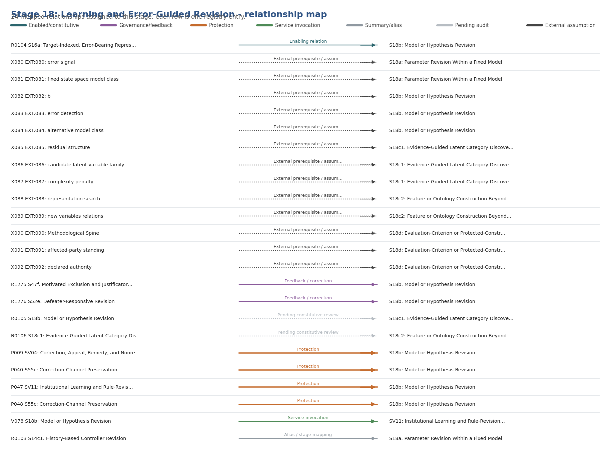{width=100%}

Figure A18. **Current Stage 18 relationship neighborhood.** Gray or pending entries remain candidates rather than proof-order claims.

### Relationship ledger

| ID | Source -> target | Type, status, and warrant | Current explanation, test, and revision boundary |
|---|---|---|---|
| R0104 | Target-Indexed, Error-Bearing Representation -> Model or Hypothesis Revision | Enabling relation; adjudicated_v0.20; conceptual or source-grounded argument; empirical validation pending | The source widens or stabilizes target realization but is not required in every case. Warrant: conceptual or source-grounded argument; empirical validation pending Test: Compare otherwise matched realizations of S18b with and without S16a; the source should widen, stabilize, or improve the target realization. Existing… Revise if: No measurable change in target realizability, robustness, reach, or cost after source removal would defeat this enablement claim. Evidence: E1_conceptual_source_grounded_or_normative |
| X080 | error signal -> Parameter Revision Within a Fixed Model | External prerequisite / assumption; not_in_scope_pending_external_prerequisite_audit; declared external assumption; target-domain audit pending | Parameter Revision Within a Fixed Model is modeled under the external prerequisite or assumption: error signal. Warrant: declared external assumption; target-domain audit pending External-assumption audit remains pending. Evidence: external_assumption_pending |
| X081 | fixed state space model class -> Parameter Revision Within a Fixed Model | External prerequisite / assumption; not_in_scope_pending_external_prerequisite_audit; declared external assumption; target-domain audit pending | Parameter Revision Within a Fixed Model is modeled under the external prerequisite or assumption: fixed state space model class. Warrant: declared external assumption; target-domain audit pending External-assumption audit remains pending. Evidence: external_assumption_pending |
| X082 | b -> Model or Hypothesis Revision | External prerequisite / assumption; not_in_scope_pending_external_prerequisite_audit; declared external assumption; target-domain audit pending | Model or Hypothesis Revision is modeled under the external prerequisite or assumption: b. Warrant: declared external assumption; target-domain audit pending External-assumption audit remains pending. Evidence: external_assumption_pending |
| X083 | error detection -> Model or Hypothesis Revision | External prerequisite / assumption; not_in_scope_pending_external_prerequisite_audit; declared external assumption; target-domain audit pending | Model or Hypothesis Revision is modeled under the external prerequisite or assumption: error detection. Warrant: declared external assumption; target-domain audit pending External-assumption audit remains pending. Evidence: external_assumption_pending |
| X084 | alternative model class -> Model or Hypothesis Revision | External prerequisite / assumption; not_in_scope_pending_external_prerequisite_audit; declared external assumption; target-domain audit pending | Model or Hypothesis Revision is modeled under the external prerequisite or assumption: alternative model class. Warrant: declared external assumption; target-domain audit pending External-assumption audit remains pending. Evidence: external_assumption_pending |
| X085 | residual structure -> Evidence-Guided Latent Category Discovery | External prerequisite / assumption; not_in_scope_pending_external_prerequisite_audit; declared external assumption; target-domain audit pending | Evidence-Guided Latent Category Discovery is modeled under the external prerequisite or assumption: residual structure. Warrant: declared external assumption; target-domain audit pending External-assumption audit remains pending. Evidence: external_assumption_pending |
| X086 | candidate latent-variable family -> Evidence-Guided Latent Category Discovery | External prerequisite / assumption; not_in_scope_pending_external_prerequisite_audit; declared external assumption; target-domain audit pending | Evidence-Guided Latent Category Discovery is modeled under the external prerequisite or assumption: candidate latent-variable family. Warrant: declared external assumption; target-domain audit pending External-assumption audit remains pending. Evidence: external_assumption_pending |
| X087 | complexity penalty -> Evidence-Guided Latent Category Discovery | External prerequisite / assumption; not_in_scope_pending_external_prerequisite_audit; declared external assumption; target-domain audit pending | Evidence-Guided Latent Category Discovery is modeled under the external prerequisite or assumption: complexity penalty. Warrant: declared external assumption; target-domain audit pending External-assumption audit remains pending. Evidence: external_assumption_pending |
| X088 | representation search -> Feature or Ontology Construction Beyond a Supplied Model Family | External prerequisite / assumption; not_in_scope_pending_external_prerequisite_audit; declared external assumption; target-domain audit pending | Feature or Ontology Construction Beyond a Supplied Model Family is modeled under the external prerequisite or assumption: representation search. Warrant: declared external assumption; target-domain audit pending External-assumption audit remains pending. Evidence: external_assumption_pending |
| X089 | new variables relations -> Feature or Ontology Construction Beyond a Supplied Model Family | External prerequisite / assumption; not_in_scope_pending_external_prerequisite_audit; declared external assumption; target-domain audit pending | Feature or Ontology Construction Beyond a Supplied Model Family is modeled under the external prerequisite or assumption: new variables relations. Warrant: declared external assumption; target-domain audit pending External-assumption audit remains pending. Evidence: external_assumption_pending |
| X090 | Methodological Spine -> Evaluation-Criterion or Protected-Constraint Revision | External prerequisite / assumption; not_in_scope_pending_external_prerequisite_audit; declared external assumption; target-domain audit pending | Evaluation-Criterion or Protected-Constraint Revision is modeled under the external prerequisite or assumption: Methodological Spine. Warrant: declared external assumption; target-domain audit pending External-assumption audit remains pending. Evidence: external_assumption_pending |
| X091 | affected-party standing -> Evaluation-Criterion or Protected-Constraint Revision | External prerequisite / assumption; not_in_scope_pending_external_prerequisite_audit; declared external assumption; target-domain audit pending | Evaluation-Criterion or Protected-Constraint Revision is modeled under the external prerequisite or assumption: affected-party standing. Warrant: declared external assumption; target-domain audit pending External-assumption audit remains pending. Evidence: external_assumption_pending |
| X092 | declared authority -> Evaluation-Criterion or Protected-Constraint Revision | External prerequisite / assumption; not_in_scope_pending_external_prerequisite_audit; declared external assumption; target-domain audit pending | Evaluation-Criterion or Protected-Constraint Revision is modeled under the external prerequisite or assumption: declared authority. Warrant: declared external assumption; target-domain audit pending External-assumption audit remains pending. Evidence: external_assumption_pending |
| R1275 | Motivated Exclusion and Justificatory-Integrity Audit -> Model or Hypothesis Revision | Feedback / correction; defined_wave7; normative or governance argument with institutional validation pending | Motivated-distortion and justificatory-integrity audit protects model revision from becoming selective reinterpretation that merely preserves a preferred conclusion. Warrant: normative or governance argument with institutional validation pending Test: Compare revision behavior when equally strong evidence threatens versus supports protected conclusions. Revise if: If standards remain symmetric and evidence-responsive, the motivated-distortion diagnosis should be withdrawn. Evidence: E1_conceptual_source_grounded_or_normative |
| R1276 | Defeater-Responsive Revision -> Model or Hypothesis Revision | Feedback / correction; defined_wave7; normative or governance argument with institutional validation pending | Defeater-responsive revision supplies a meta-epistemic correction loop for ordinary model or hypothesis revision. Warrant: normative or governance argument with institutional validation pending Test: Introduce registered defeaters and test whether the model revises, abstains, or escalates appropriately. Revise if: If revision occurs independently of the declared defeater channel, weaken this relation. Evidence: E1_conceptual_source_grounded_or_normative |
| R0105 | Model or Hypothesis Revision -> Evidence-Guided Latent Category Discovery | Pending constitutive review; pending_companion_paper_relation_audit; pending semantic adjudication | Within-stage relation was not part of the 306-edge enabling audit. Warrant: pending semantic adjudication Semantic adjudication remains pending; no prerequisite claim is licensed. |
| R0106 | Evidence-Guided Latent Category Discovery -> Feature or Ontology Construction Beyond a Supplied Model Family | Pending constitutive review; pending_companion_paper_relation_audit; pending semantic adjudication | Within-stage relation was not part of the 306-edge enabling audit. Warrant: pending semantic adjudication Semantic adjudication remains pending; no prerequisite claim is licensed. |
| P009 | Correction, Appeal, Remedy, and Nonrecurrence Service -> Model or Hypothesis Revision | Protection; selective v0.20 candidate protection edge; requires domain or institutional validation before consequential use; governance-design claim with stated mechanism and failure condition | challenge and correction preserve the capacity to revise models Warrant: governance-design claim with stated mechanism and failure condition Test: Remove or neutralize the source protection and test whether Model or Hypothesis Revision becomes more exposed, less viable, less contestable, or less… Revise if: remove or neutralize the source protection and test whether the target becomes more exposed, less viable, less contestable, or less co… Evidence: internal_architecture_candidate |
| P040 | Correction-Channel Preservation -> Model or Hypothesis Revision | Protection; selective v0.20 candidate protection edge; requires domain or institutional validation before consequential use; governance-design claim with stated mechanism and failure condition | correction-channel preservation protects model revision itself Warrant: governance-design claim with stated mechanism and failure condition Test: Remove or neutralize the source protection and test whether Model or Hypothesis Revision becomes more exposed, less viable, less contestable, or less… Revise if: remove or neutralize the source protection and test whether the target becomes more exposed, less viable, less contestable, or less co… Evidence: internal_architecture_candidate |
| P047 | Institutional Learning and Rule-Revision Service -> Model or Hypothesis Revision | Protection; defined_wave7; governance-design claim with stated mechanism and failure condition | Institutional learning and rule revision preserve the practical capacity to update models under consequence, criticism, and recurrence. Warrant: governance-design claim with stated mechanism and failure condition Test: Remove or neutralize the source protection and test whether Model or Hypothesis Revision becomes more exposed, less viable, less contestable, or less… Revise if: If revision channels exist only nominally or cannot alter the operative model, the protection fails. Evidence: internal_architecture_candidate |
| P048 | Correction-Channel Preservation -> Model or Hypothesis Revision | Protection; defined_wave7; governance-design claim with stated mechanism and failure condition | Correction-channel preservation protects model revision from proxy capture, rigid optimization, and the retirement of inconvenient evidence channels. Warrant: governance-design claim with stated mechanism and failure condition Test: Remove or neutralize the source protection and test whether Model or Hypothesis Revision becomes more exposed, less viable, less contestable, or less… Revise if: If correction channels can be overridden by the optimized objective or controlling institution, the protection is absent. Evidence: internal_architecture_candidate |
| V078 | Model or Hypothesis Revision -> Institutional Learning and Rule-Revision Service | Service invocation; defined_v0.4; internal architecture and role mapping | Model or Hypothesis Revision invokes Institutional Learning and Rule-Revision Service in the role of model and hypothesis revision under evidence. Warrant: internal architecture and role mapping Test: Check whether the stage-specific role model and hypothesis revision under evidence is actually required when the service is instantiated at Stage 18. Revise if: If the stage does not use this service role, the invocation should be removed or reassigned. Evidence: internal_architecture_candidate |
| R0103 | History-Based Controller Revision -> Parameter Revision Within a Fixed Model | Alias / stage mapping; adjudicated_v0.20; conceptual or source-grounded argument; empirical validation pending | The target restates, extends, or invokes an earlier object at another stage. Warrant: conceptual or source-grounded argument; empirical validation pending Evidence: E1_conceptual_source_grounded_or_normative |

### Revision gate

**Next action:** Causal invariance, new feature construction, alternative latent families, and category governance A relation should be retyped, weakened, redirected, or removed whenever its dependency witness fails, its countermodel succeeds, its warrant basis changes, or target-domain evidence defeats the declared scope.

\pagebreak

## Stage 19 - Graded Agency

**Domain block:** Psychology / Biology / AI / Ethics seam  \
**Claim status:** Bridge principle  \
**Canonical role:** Cross-domain boundary principle  \
**Source:** M&E §13.14

### Stage meaning and formal role

Agency varies with action selection, counterfactual flexibility, control, learning, authorship, and stake. Agency does not imply consciousness, responsibility, or sovereignty.

Stage 19 contains **9 active object(s)**: Summary join (1), Operational capacity (3), Representation / observation (1), Normative relation / status (2), Open capacity / problem (1), Method / translation (1). The synchronized ledger assigns **43 relationship record(s)** to this stage.

### Active object inventory

| ID | Object | Type | Evidence | Disposition |
|---|---|---|---|---|
| S19J | Graded Agency Profile / Join | Summary join | E1_conceptual_source_grounded_or_normative | retain_as_stage_summary_not_core_node |
| S19a | Counterfactual Actuation Reach and Control | Operational capacity | E1_conceptual_source_grounded_or_normative | retain_distinct_pending_edge_audit |
| S19b | Endogenous Goal-Sensitive Selection | Operational capacity | E1_conceptual_source_grounded_or_normative | retain_distinct_pending_edge_audit |
| S19c | Option or Plan Generation | Operational capacity | E4_reproducible_toy_or_simulation | retain_distinct_pending_edge_audit |
| S19d1 | Goal and Norm Provenance Tracking | Representation / observation | E1_conceptual_source_grounded_or_normative | retain_as_family_member_or_stage_instantiation |
| S19d2 | Endorsement and Refusal Under Standing Commitments | Normative relation / status | E1_conceptual_source_grounded_or_normative | retain_typed_noncapacity_object |
| S19d3 | Goal, Norm, or Commitment Authorship | Open capacity / problem | E0_open_or_unresolved | retain_open_research_branch |
| S19e | Endogenous Stake | Method / translation | E1_conceptual_source_grounded_or_normative | retain_typed_noncapacity_object |
| S19f | Responsibility and Sovereignty Status | Normative relation / status | E1_conceptual_source_grounded_or_normative | retain_typed_noncapacity_object |

### Complete relationship map

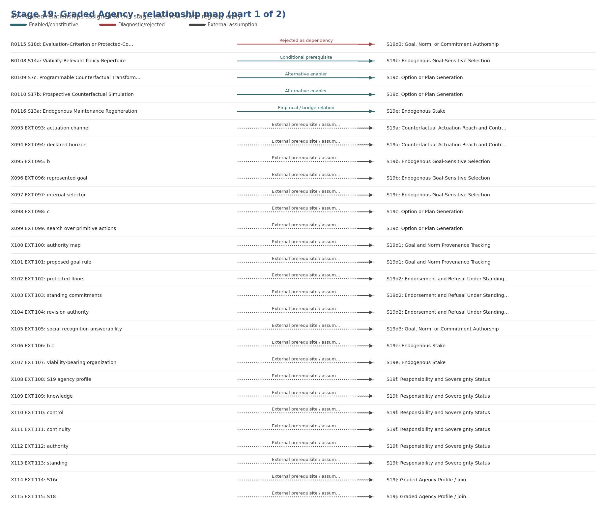{width=100%}
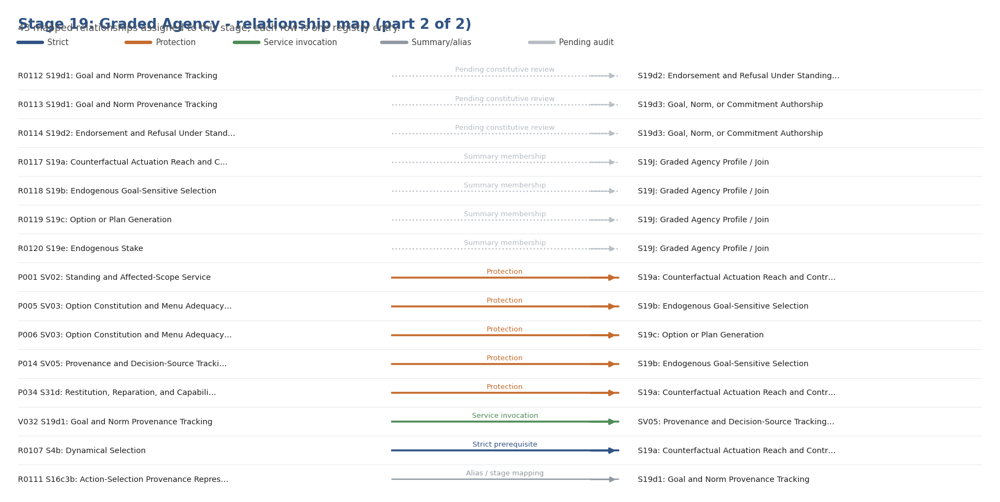{width=100%}

Figure A19. **Current Stage 19 relationship neighborhood.** Gray or pending entries remain candidates rather than proof-order claims.

### Relationship ledger

| ID | Source -> target | Type, status, and warrant | Current explanation, test, and revision boundary |
|---|---|---|---|
| R0115 | Evaluation-Criterion or Protected-Constraint Revision -> Goal, Norm, or Commitment Authorship | Rejected as dependency; adjudicated_v0.20; conceptual or source-grounded argument; empirical validation pending | Ability to revise a criterion does not establish authorship of the criterion or commitment. Warrant: conceptual or source-grounded argument; empirical validation pending Test: Review the source-target semantics against the relation definition; target record: not established; commitments, authority relations, and revision pr… Revise if: A source-target case that fits a different typed relation would require reclassification. Evidence: E0_open_or_unresolved |
| R0108 | Viability-Relevant Policy Repertoire -> Endogenous Goal-Sensitive Selection | Conditional prerequisite; adjudicated_v0.20; conceptual or source-grounded argument; empirical validation pending | The source is necessary only under the tested realization or named bridge assumptions. Warrant: conceptual or source-grounded argument; empirical validation pending Test: Within the stated implementation or bridge assumptions, ablate S14a; the tested realization of S19b should fail. Existing target witness: holding wor… Revise if: An alternative realization of S19b outside the stated condition and without S14a would limit the edge rather than refute the target. Evidence: E1_conceptual_source_grounded_or_normative |
| R0109 | Programmable Counterfactual Transformation -> Option or Plan Generation | Alternative enabler; adjudicated_v0.20; reproducible toy model or simulation | The source is one route among several and therefore cannot support a necessity claim. Warrant: reproducible toy model or simulation Test: Compare otherwise matched realizations of S19c with and without S7c; the source should widen, stabilize, or improve the target realization. Existing… Revise if: No measurable change in target realizability, robustness, reach, or cost after source removal would defeat this enablement claim. Evidence: E4_reproducible_toy_or_simulation |
| R0110 | Prospective Counterfactual Simulation -> Option or Plan Generation | Alternative enabler; adjudicated_v0.20; reproducible toy model or simulation | The source is one route among several and therefore cannot support a necessity claim. Warrant: reproducible toy model or simulation Test: Compare otherwise matched realizations of S19c with and without S17b; the source should widen, stabilize, or improve the target realization. Existing… Revise if: No measurable change in target realizability, robustness, reach, or cost after source removal would defeat this enablement claim. Evidence: E4_reproducible_toy_or_simulation |
| R0116 | Endogenous Maintenance Regeneration -> Endogenous Stake | Empirical / bridge relation; adjudicated_v0.20; conceptual or source-grounded argument; empirical validation pending | The proposed cross-domain relation requires independent evidence and is not presently a formal prerequisite. Warrant: conceptual or source-grounded argument; empirical validation pending Test: Review the source-target semantics against the relation definition; target record: not implied by control or planning; all grid agents solve external… Revise if: A source-target case that fits a different typed relation would require reclassification. Evidence: E1_conceptual_source_grounded_or_normative |
| X093 | actuation channel -> Counterfactual Actuation Reach and Control | External prerequisite / assumption; not_in_scope_pending_external_prerequisite_audit; declared external assumption; target-domain audit pending | Counterfactual Actuation Reach and Control is modeled under the external prerequisite or assumption: actuation channel. Warrant: declared external assumption; target-domain audit pending External-assumption audit remains pending. Evidence: external_assumption_pending |
| X094 | declared horizon -> Counterfactual Actuation Reach and Control | External prerequisite / assumption; not_in_scope_pending_external_prerequisite_audit; declared external assumption; target-domain audit pending | Counterfactual Actuation Reach and Control is modeled under the external prerequisite or assumption: declared horizon. Warrant: declared external assumption; target-domain audit pending External-assumption audit remains pending. Evidence: external_assumption_pending |
| X095 | b -> Endogenous Goal-Sensitive Selection | External prerequisite / assumption; not_in_scope_pending_external_prerequisite_audit; declared external assumption; target-domain audit pending | Endogenous Goal-Sensitive Selection is modeled under the external prerequisite or assumption: b. Warrant: declared external assumption; target-domain audit pending External-assumption audit remains pending. Evidence: external_assumption_pending |
| X096 | represented goal -> Endogenous Goal-Sensitive Selection | External prerequisite / assumption; not_in_scope_pending_external_prerequisite_audit; declared external assumption; target-domain audit pending | Endogenous Goal-Sensitive Selection is modeled under the external prerequisite or assumption: represented goal. Warrant: declared external assumption; target-domain audit pending External-assumption audit remains pending. Evidence: external_assumption_pending |
| X097 | internal selector -> Endogenous Goal-Sensitive Selection | External prerequisite / assumption; not_in_scope_pending_external_prerequisite_audit; declared external assumption; target-domain audit pending | Endogenous Goal-Sensitive Selection is modeled under the external prerequisite or assumption: internal selector. Warrant: declared external assumption; target-domain audit pending External-assumption audit remains pending. Evidence: external_assumption_pending |
| X098 | c -> Option or Plan Generation | External prerequisite / assumption; not_in_scope_pending_external_prerequisite_audit; declared external assumption; target-domain audit pending | Option or Plan Generation is modeled under the external prerequisite or assumption: c. Warrant: declared external assumption; target-domain audit pending External-assumption audit remains pending. Evidence: external_assumption_pending |
| X099 | search over primitive actions -> Option or Plan Generation | External prerequisite / assumption; not_in_scope_pending_external_prerequisite_audit; declared external assumption; target-domain audit pending | Option or Plan Generation is modeled under the external prerequisite or assumption: search over primitive actions. Warrant: declared external assumption; target-domain audit pending External-assumption audit remains pending. Evidence: external_assumption_pending |
| X100 | authority map -> Goal and Norm Provenance Tracking | External prerequisite / assumption; not_in_scope_pending_external_prerequisite_audit; declared external assumption; target-domain audit pending | Goal and Norm Provenance Tracking is modeled under the external prerequisite or assumption: authority map. Warrant: declared external assumption; target-domain audit pending External-assumption audit remains pending. Evidence: external_assumption_pending |
| X101 | proposed goal rule -> Goal and Norm Provenance Tracking | External prerequisite / assumption; not_in_scope_pending_external_prerequisite_audit; declared external assumption; target-domain audit pending | Goal and Norm Provenance Tracking is modeled under the external prerequisite or assumption: proposed goal rule. Warrant: declared external assumption; target-domain audit pending External-assumption audit remains pending. Evidence: external_assumption_pending |
| X102 | protected floors -> Endorsement and Refusal Under Standing Commitments | External prerequisite / assumption; not_in_scope_pending_external_prerequisite_audit; declared external assumption; target-domain audit pending | Endorsement and Refusal Under Standing Commitments is modeled under the external prerequisite or assumption: protected floors. Warrant: declared external assumption; target-domain audit pending External-assumption audit remains pending. Evidence: external_assumption_pending |
| X103 | standing commitments -> Endorsement and Refusal Under Standing Commitments | External prerequisite / assumption; not_in_scope_pending_external_prerequisite_audit; declared external assumption; target-domain audit pending | Endorsement and Refusal Under Standing Commitments is modeled under the external prerequisite or assumption: standing commitments. Warrant: declared external assumption; target-domain audit pending External-assumption audit remains pending. Evidence: external_assumption_pending |
| X104 | revision authority -> Endorsement and Refusal Under Standing Commitments | External prerequisite / assumption; not_in_scope_pending_external_prerequisite_audit; declared external assumption; target-domain audit pending | Endorsement and Refusal Under Standing Commitments is modeled under the external prerequisite or assumption: revision authority. Warrant: declared external assumption; target-domain audit pending External-assumption audit remains pending. Evidence: external_assumption_pending |
| X105 | social recognition answerability -> Goal, Norm, or Commitment Authorship | External prerequisite / assumption; not_in_scope_pending_external_prerequisite_audit; declared external assumption; target-domain audit pending | Goal, Norm, or Commitment Authorship is modeled under the external prerequisite or assumption: social recognition answerability. Warrant: declared external assumption; target-domain audit pending External-assumption audit remains pending. Evidence: external_assumption_pending |
| X106 | b c -> Endogenous Stake | External prerequisite / assumption; not_in_scope_pending_external_prerequisite_audit; declared external assumption; target-domain audit pending | Endogenous Stake is modeled under the external prerequisite or assumption: b c. Warrant: declared external assumption; target-domain audit pending External-assumption audit remains pending. Evidence: external_assumption_pending |
| X107 | viability-bearing organization -> Endogenous Stake | External prerequisite / assumption; not_in_scope_pending_external_prerequisite_audit; declared external assumption; target-domain audit pending | Endogenous Stake is modeled under the external prerequisite or assumption: viability-bearing organization. Warrant: declared external assumption; target-domain audit pending External-assumption audit remains pending. Evidence: external_assumption_pending |
| X108 | S19 agency profile -> Responsibility and Sovereignty Status | External prerequisite / assumption; not_in_scope_pending_external_prerequisite_audit; declared external assumption; target-domain audit pending | Responsibility and Sovereignty Status is modeled under the external prerequisite or assumption: S19 agency profile. Warrant: declared external assumption; target-domain audit pending External-assumption audit remains pending. Evidence: external_assumption_pending |
| X109 | knowledge -> Responsibility and Sovereignty Status | External prerequisite / assumption; not_in_scope_pending_external_prerequisite_audit; declared external assumption; target-domain audit pending | Responsibility and Sovereignty Status is modeled under the external prerequisite or assumption: knowledge. Warrant: declared external assumption; target-domain audit pending External-assumption audit remains pending. Evidence: external_assumption_pending |
| X110 | control -> Responsibility and Sovereignty Status | External prerequisite / assumption; not_in_scope_pending_external_prerequisite_audit; declared external assumption; target-domain audit pending | Responsibility and Sovereignty Status is modeled under the external prerequisite or assumption: control. Warrant: declared external assumption; target-domain audit pending External-assumption audit remains pending. Evidence: external_assumption_pending |
| X111 | continuity -> Responsibility and Sovereignty Status | External prerequisite / assumption; not_in_scope_pending_external_prerequisite_audit; declared external assumption; target-domain audit pending | Responsibility and Sovereignty Status is modeled under the external prerequisite or assumption: continuity. Warrant: declared external assumption; target-domain audit pending External-assumption audit remains pending. Evidence: external_assumption_pending |
| X112 | authority -> Responsibility and Sovereignty Status | External prerequisite / assumption; not_in_scope_pending_external_prerequisite_audit; declared external assumption; target-domain audit pending | Responsibility and Sovereignty Status is modeled under the external prerequisite or assumption: authority. Warrant: declared external assumption; target-domain audit pending External-assumption audit remains pending. Evidence: external_assumption_pending |
| X113 | standing -> Responsibility and Sovereignty Status | External prerequisite / assumption; not_in_scope_pending_external_prerequisite_audit; declared external assumption; target-domain audit pending | Responsibility and Sovereignty Status is modeled under the external prerequisite or assumption: standing. Warrant: declared external assumption; target-domain audit pending External-assumption audit remains pending. Evidence: external_assumption_pending |
| X114 | S16c -> Graded Agency Profile / Join | External prerequisite / assumption; not_in_scope_pending_external_prerequisite_audit; declared external assumption; target-domain audit pending | Graded Agency Profile / Join is modeled under the external prerequisite or assumption: S16c. Warrant: declared external assumption; target-domain audit pending External-assumption audit remains pending. Evidence: external_assumption_pending |
| X115 | S18 -> Graded Agency Profile / Join | External prerequisite / assumption; not_in_scope_pending_external_prerequisite_audit; declared external assumption; target-domain audit pending | Graded Agency Profile / Join is modeled under the external prerequisite or assumption: S18. Warrant: declared external assumption; target-domain audit pending External-assumption audit remains pending. Evidence: external_assumption_pending |
| R0112 | Goal and Norm Provenance Tracking -> Endorsement and Refusal Under Standing Commitments | Pending constitutive review; pending_companion_paper_relation_audit; pending semantic adjudication | Within-stage relation was not part of the 306-edge enabling audit. Warrant: pending semantic adjudication Semantic adjudication remains pending; no prerequisite claim is licensed. |
| R0113 | Goal and Norm Provenance Tracking -> Goal, Norm, or Commitment Authorship | Pending constitutive review; pending_companion_paper_relation_audit; pending semantic adjudication | Within-stage relation was not part of the 306-edge enabling audit. Warrant: pending semantic adjudication Semantic adjudication remains pending; no prerequisite claim is licensed. |
| R0114 | Endorsement and Refusal Under Standing Commitments -> Goal, Norm, or Commitment Authorship | Pending constitutive review; pending_companion_paper_relation_audit; pending semantic adjudication | Within-stage relation was not part of the 306-edge enabling audit. Warrant: pending semantic adjudication Semantic adjudication remains pending; no prerequisite claim is licensed. |
| R0117 | Counterfactual Actuation Reach and Control -> Graded Agency Profile / Join | Summary membership; carried_forward_low_risk_pending_spot_check; pending semantic adjudication | Summary membership is retained outside proof order. Warrant: pending semantic adjudication Semantic adjudication remains pending; no prerequisite claim is licensed. |
| R0118 | Endogenous Goal-Sensitive Selection -> Graded Agency Profile / Join | Summary membership; carried_forward_low_risk_pending_spot_check; pending semantic adjudication | Summary membership is retained outside proof order. Warrant: pending semantic adjudication Semantic adjudication remains pending; no prerequisite claim is licensed. |
| R0119 | Option or Plan Generation -> Graded Agency Profile / Join | Summary membership; carried_forward_low_risk_pending_spot_check; pending semantic adjudication | Summary membership is retained outside proof order. Warrant: pending semantic adjudication Semantic adjudication remains pending; no prerequisite claim is licensed. |
| R0120 | Endogenous Stake -> Graded Agency Profile / Join | Summary membership; carried_forward_low_risk_pending_spot_check; pending semantic adjudication | Summary membership is retained outside proof order. Warrant: pending semantic adjudication Semantic adjudication remains pending; no prerequisite claim is licensed. |
| P001 | Standing and Affected-Scope Service -> Counterfactual Actuation Reach and Control | Protection; selective v0.20 candidate protection edge; requires domain or institutional validation before consequential use; governance-design claim with stated mechanism and failure condition | standing and affected scope limit how control may be exercised Warrant: governance-design claim with stated mechanism and failure condition Test: Remove or neutralize the source protection and test whether Counterfactual Actuation Reach and Control becomes more exposed, less viable, less contes… Revise if: remove or neutralize the source protection and test whether the target becomes more exposed, less viable, less contestable, or less co… Evidence: internal_architecture_candidate |
| P005 | Option Constitution and Menu Adequacy Service -> Endogenous Goal-Sensitive Selection | Protection; selective v0.20 candidate protection edge; requires domain or institutional validation before consequential use; governance-design claim with stated mechanism and failure condition | adequate options protect endogenous choice from captured menus Warrant: governance-design claim with stated mechanism and failure condition Test: Remove or neutralize the source protection and test whether Endogenous Goal-Sensitive Selection becomes more exposed, less viable, less contestable,… Revise if: remove or neutralize the source protection and test whether the target becomes more exposed, less viable, less contestable, or less co… Evidence: internal_architecture_candidate |
| P006 | Option Constitution and Menu Adequacy Service -> Option or Plan Generation | Protection; selective v0.20 candidate protection edge; requires domain or institutional validation before consequential use; governance-design claim with stated mechanism and failure condition | menu adequacy protects option generation from sponsor-defined closure Warrant: governance-design claim with stated mechanism and failure condition Test: Remove or neutralize the source protection and test whether Option or Plan Generation becomes more exposed, less viable, less contestable, or less co… Revise if: remove or neutralize the source protection and test whether the target becomes more exposed, less viable, less contestable, or less co… Evidence: internal_architecture_candidate |
| P014 | Provenance and Decision-Source Tracking Service -> Endogenous Goal-Sensitive Selection | Protection; selective v0.20 candidate protection edge; requires domain or institutional validation before consequential use; governance-design claim with stated mechanism and failure condition | goal-source provenance protects selection from hidden external authorship Warrant: governance-design claim with stated mechanism and failure condition Test: Remove or neutralize the source protection and test whether Endogenous Goal-Sensitive Selection becomes more exposed, less viable, less contestable,… Revise if: remove or neutralize the source protection and test whether the target becomes more exposed, less viable, less contestable, or less co… Evidence: internal_architecture_candidate |
| P034 | Restitution, Reparation, and Capability Restoration -> Counterfactual Actuation Reach and Control | Protection; selective v0.20 candidate protection edge; requires domain or institutional validation before consequential use; governance-design claim with stated mechanism and failure condition | capability restoration protects damaged agency and control Warrant: governance-design claim with stated mechanism and failure condition Test: Remove or neutralize the source protection and test whether Counterfactual Actuation Reach and Control becomes more exposed, less viable, less contes… Revise if: remove or neutralize the source protection and test whether the target becomes more exposed, less viable, less contestable, or less co… Evidence: internal_architecture_candidate |
| V032 | Goal and Norm Provenance Tracking -> Provenance and Decision-Source Tracking Service | Service invocation; defined_v0.4; internal architecture and role mapping | Goal and Norm Provenance Tracking invokes Provenance and Decision-Source Tracking Service in the role of goal/norm provenance. Warrant: internal architecture and role mapping Test: Check whether the stage-specific role goal/norm provenance is actually required when the service is instantiated at Stage 19. Revise if: If the stage does not use this service role, the invocation should be removed or reassigned. Evidence: internal_architecture_candidate |
| R0107 | Dynamical Selection -> Counterfactual Actuation Reach and Control | Strict prerequisite; adjudicated_v0.20; conceptual or source-grounded argument; empirical validation pending | The target’s declared construction cannot be stated or realized without the source in the present model. Warrant: conceptual or source-grounded argument; empirical validation pending Test: Ablate or replace S4b (Dynamical Selection) while holding the declared target model fixed; S19a (Counterfactual Actuation Reach and Control) should b… Revise if: A valid realization of S19a within the same declared model that omits S4b would defeat strictness. Evidence: E1_conceptual_source_grounded_or_normative |
| R0111 | Action-Selection Provenance Representation -> Goal and Norm Provenance Tracking | Alias / stage mapping; adjudicated_v0.20; conceptual or source-grounded argument; empirical validation pending | The target restates, extends, or invokes an earlier object at another stage. Warrant: conceptual or source-grounded argument; empirical validation pending Evidence: E1_conceptual_source_grounded_or_normative |

### Revision gate

**Next action:** Collective decision provenance, social co-authorship, responsibility profiles, and answerability in Stages 22-23 and 50 A relation should be retyped, weakened, redirected, or removed whenever its dependency witness fails, its countermodel succeeds, its warrant basis changes, or target-domain evidence defeats the declared scope.

\pagebreak

## Stage 20 - Temporal Binding and Narrative

**Domain block:** Consciousness / Psychology / Identity seam  \
**Claim status:** Bridge principle  \
**Canonical role:** Consciousness / psychology bridge  \
**Source:** M&E §13.14

### Stage meaning and formal role

Experience and identity may integrate memory, anticipation, and present access across time. Temporal thickness is graded, history-dependent, and vulnerable to fragmentation.

Stage 20 contains **3 active object(s)**: Operational capacity (1), Evaluator / derived relation (1), Open capacity / problem (1). The synchronized ledger assigns **12 relationship record(s)** to this stage.

### Active object inventory

| ID | Object | Type | Evidence | Disposition |
|---|---|---|---|---|
| S20a | Temporal Integration and Episode Binding | Operational capacity | E4_reproducible_toy_or_simulation | retain_distinct_pending_edge_audit |
| S20b | Order-Sensitive Narrative and Event Organization | Evaluator / derived relation | E2_imported_or_standard_formalism | retain_typed_noncapacity_object |
| S20d | Lived Temporal Thickness and Diachronic Concern | Open capacity / problem | E0_open_or_unresolved | retain_open_research_branch |

### Complete relationship map

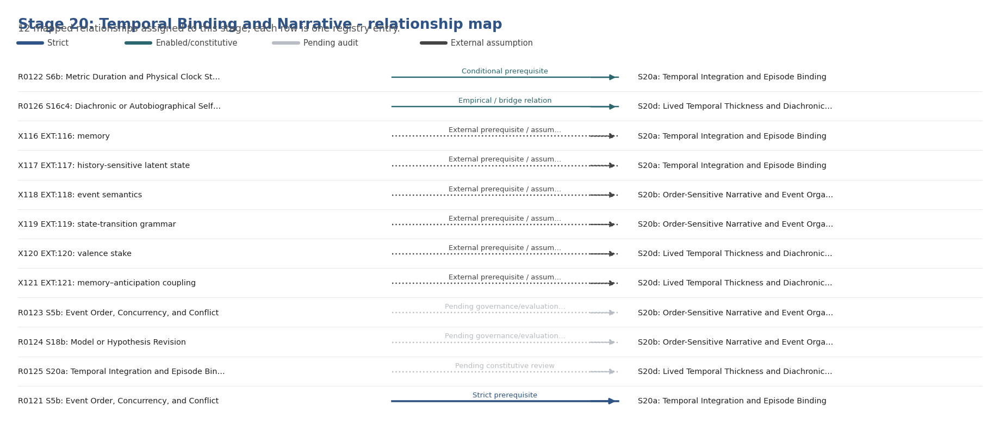{width=100%}

Figure A20. **Current Stage 20 relationship neighborhood.** Gray or pending entries remain candidates rather than proof-order claims.

### Relationship ledger

| ID | Source -> target | Type, status, and warrant | Current explanation, test, and revision boundary |
|---|---|---|---|
| R0122 | Metric Duration and Physical Clock Standard -> Temporal Integration and Episode Binding | Conditional prerequisite; adjudicated_v0.20; reproducible toy model or simulation | Metric duration supports the tested implementation, but ordinal or discrete temporal integration is possible. Warrant: reproducible toy model or simulation Test: Within the stated implementation or bridge assumptions, ablate S6b; the tested realization of S20a should fail. Existing target witness: matched temp… Revise if: An alternative realization of S20a outside the stated condition and without S6b would limit the edge rather than refute the target. Evidence: E4_reproducible_toy_or_simulation |
| R0126 | Diachronic or Autobiographical Self-Model -> Lived Temporal Thickness and Diachronic Concern | Empirical / bridge relation; adjudicated_v0.20; conceptual or source-grounded argument; empirical validation pending | The proposed cross-domain relation requires independent evidence and is not presently a formal prerequisite. Warrant: conceptual or source-grounded argument; empirical validation pending Test: Review the source-target semantics against the relation definition; target record: not established; temporal filtering and narrative order do not sho… Revise if: A source-target case that fits a different typed relation would require reclassification. Evidence: E0_open_or_unresolved |
| X116 | memory -> Temporal Integration and Episode Binding | External prerequisite / assumption; not_in_scope_pending_external_prerequisite_audit; declared external assumption; target-domain audit pending | Temporal Integration and Episode Binding is modeled under the external prerequisite or assumption: memory. Warrant: declared external assumption; target-domain audit pending External-assumption audit remains pending. Evidence: external_assumption_pending |
| X117 | history-sensitive latent state -> Temporal Integration and Episode Binding | External prerequisite / assumption; not_in_scope_pending_external_prerequisite_audit; declared external assumption; target-domain audit pending | Temporal Integration and Episode Binding is modeled under the external prerequisite or assumption: history-sensitive latent state. Warrant: declared external assumption; target-domain audit pending External-assumption audit remains pending. Evidence: external_assumption_pending |
| X118 | event semantics -> Order-Sensitive Narrative and Event Organization | External prerequisite / assumption; not_in_scope_pending_external_prerequisite_audit; declared external assumption; target-domain audit pending | Order-Sensitive Narrative and Event Organization is modeled under the external prerequisite or assumption: event semantics. Warrant: declared external assumption; target-domain audit pending External-assumption audit remains pending. Evidence: external_assumption_pending |
| X119 | state-transition grammar -> Order-Sensitive Narrative and Event Organization | External prerequisite / assumption; not_in_scope_pending_external_prerequisite_audit; declared external assumption; target-domain audit pending | Order-Sensitive Narrative and Event Organization is modeled under the external prerequisite or assumption: state-transition grammar. Warrant: declared external assumption; target-domain audit pending External-assumption audit remains pending. Evidence: external_assumption_pending |
| X120 | valence stake -> Lived Temporal Thickness and Diachronic Concern | External prerequisite / assumption; not_in_scope_pending_external_prerequisite_audit; declared external assumption; target-domain audit pending | Lived Temporal Thickness and Diachronic Concern is modeled under the external prerequisite or assumption: valence stake. Warrant: declared external assumption; target-domain audit pending External-assumption audit remains pending. Evidence: external_assumption_pending |
| X121 | memory–anticipation coupling -> Lived Temporal Thickness and Diachronic Concern | External prerequisite / assumption; not_in_scope_pending_external_prerequisite_audit; declared external assumption; target-domain audit pending | Lived Temporal Thickness and Diachronic Concern is modeled under the external prerequisite or assumption: memory–anticipation coupling. Warrant: declared external assumption; target-domain audit pending External-assumption audit remains pending. Evidence: external_assumption_pending |
| R0123 | Event Order, Concurrency, and Conflict -> Order-Sensitive Narrative and Event Organization | Pending governance/evaluation/interpretation review; pending_companion_paper_relation_audit; pending semantic adjudication | Governance/evaluative/interpretive relation requires role-specific adjudication. Warrant: pending semantic adjudication Semantic adjudication remains pending; no prerequisite claim is licensed. |
| R0124 | Model or Hypothesis Revision -> Order-Sensitive Narrative and Event Organization | Pending governance/evaluation/interpretation review; pending_companion_paper_relation_audit; pending semantic adjudication | Governance/evaluative/interpretive relation requires role-specific adjudication. Warrant: pending semantic adjudication Semantic adjudication remains pending; no prerequisite claim is licensed. |
| R0125 | Temporal Integration and Episode Binding -> Lived Temporal Thickness and Diachronic Concern | Pending constitutive review; pending_companion_paper_relation_audit; pending semantic adjudication | Within-stage relation was not part of the 306-edge enabling audit. Warrant: pending semantic adjudication Semantic adjudication remains pending; no prerequisite claim is licensed. |
| R0121 | Event Order, Concurrency, and Conflict -> Temporal Integration and Episode Binding | Strict prerequisite; adjudicated_v0.20; reproducible toy model or simulation | Temporal integration requires an order over the events or states being integrated in the declared model. Warrant: reproducible toy model or simulation Test: Ablate or replace S5b (Event Order, Concurrency, and Conflict) while holding the declared target model fixed; S20a (Temporal Integration and Episode… Revise if: A valid realization of S20a within the same declared model that omits S5b would defeat strictness. Evidence: E4_reproducible_toy_or_simulation |

### Revision gate

**Next action:** Endogenous segmentation, multiscale horizons, memory ownership, branching/copying, valence, and first-person temporal thickness A relation should be retyped, weakened, redirected, or removed whenever its dependency witness fails, its countermodel succeeds, its warrant basis changes, or target-domain evidence defeats the declared scope.

\pagebreak

## Stage 21 - Meaning

**Domain block:** Psychology / Interpretation / Commitment seam  \
**Claim status:** Interpretation  \
**Canonical role:** Interpretive / psychological bridge  \
**Source:** M&E §13.14

### Stage meaning and formal role

Meaning arises when states, events, relationships, and possibilities bear on real stakes, goods, histories, and trajectories. It is neither merely invented nor one fixed script.

Stage 21 contains **4 active object(s)**: Evaluator / derived relation (1), Representation / observation (1), Interpretation (1), Commitment (1). The synchronized ledger assigns **16 relationship record(s)** to this stage.

### Active object inventory

| ID | Object | Type | Evidence | Disposition |
|---|---|---|---|---|
| S21a | Functional Significance and Decision Relevance | Evaluator / derived relation | E1_conceptual_source_grounded_or_normative | retain_typed_noncapacity_object |
| S21b | Historical-Relational Meaning Map | Representation / observation | E1_conceptual_source_grounded_or_normative | retain_typed_noncapacity_object |
| S21c | Truth- and Stake-Constrained Meaning | Interpretation | E0_open_or_unresolved | retain_typed_noncapacity_object |
| S21d | Objective-Participatory Meaning and Commitment Enactment | Commitment | E1_conceptual_source_grounded_or_normative | retain_typed_noncapacity_object |

### Complete relationship map

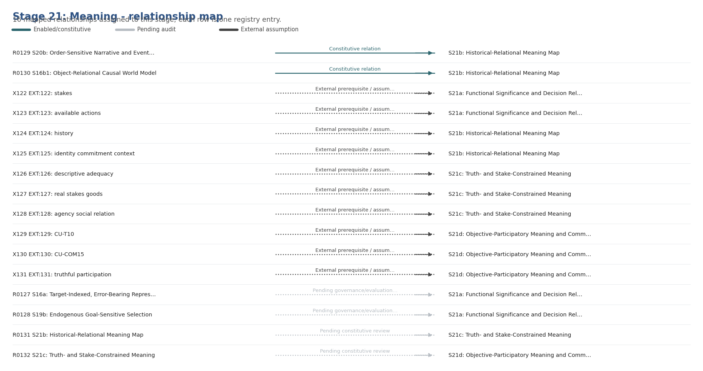{width=100%}

Figure A21. **Current Stage 21 relationship neighborhood.** Gray or pending entries remain candidates rather than proof-order claims.

### Relationship ledger

| ID | Source -> target | Type, status, and warrant | Current explanation, test, and revision boundary |
|---|---|---|---|
| R0129 | Order-Sensitive Narrative and Event Organization -> Historical-Relational Meaning Map | Constitutive relation; adjudicated_v0.20; conceptual or source-grounded argument; empirical validation pending | The source is one ingredient of the target’s identity, but other realizations or decompositions remain possible. Warrant: conceptual or source-grounded argument; empirical validation pending Test: Intervene on S20b and test whether the identity, organization, or classification of S21b changes without assuming total disappearance. Existing targe… Revise if: If S21b retains the same declared identity under source removal, this constitutive claim should be weakened or removed. Evidence: E1_conceptual_source_grounded_or_normative |
| R0130 | Object-Relational Causal World Model -> Historical-Relational Meaning Map | Constitutive relation; adjudicated_v0.20; conceptual or source-grounded argument; empirical validation pending | The source is one ingredient of the target’s identity, but other realizations or decompositions remain possible. Warrant: conceptual or source-grounded argument; empirical validation pending Test: Intervene on S16b1 and test whether the identity, organization, or classification of S21b changes without assuming total disappearance. Existing targ… Revise if: If S21b retains the same declared identity under source removal, this constitutive claim should be weakened or removed. Evidence: E1_conceptual_source_grounded_or_normative |
| X122 | stakes -> Functional Significance and Decision Relevance | External prerequisite / assumption; not_in_scope_pending_external_prerequisite_audit; declared external assumption; target-domain audit pending | Functional Significance and Decision Relevance is modeled under the external prerequisite or assumption: stakes. Warrant: declared external assumption; target-domain audit pending External-assumption audit remains pending. Evidence: external_assumption_pending |
| X123 | available actions -> Functional Significance and Decision Relevance | External prerequisite / assumption; not_in_scope_pending_external_prerequisite_audit; declared external assumption; target-domain audit pending | Functional Significance and Decision Relevance is modeled under the external prerequisite or assumption: available actions. Warrant: declared external assumption; target-domain audit pending External-assumption audit remains pending. Evidence: external_assumption_pending |
| X124 | history -> Historical-Relational Meaning Map | External prerequisite / assumption; not_in_scope_pending_external_prerequisite_audit; declared external assumption; target-domain audit pending | Historical-Relational Meaning Map is modeled under the external prerequisite or assumption: history. Warrant: declared external assumption; target-domain audit pending External-assumption audit remains pending. Evidence: external_assumption_pending |
| X125 | identity commitment context -> Historical-Relational Meaning Map | External prerequisite / assumption; not_in_scope_pending_external_prerequisite_audit; declared external assumption; target-domain audit pending | Historical-Relational Meaning Map is modeled under the external prerequisite or assumption: identity commitment context. Warrant: declared external assumption; target-domain audit pending External-assumption audit remains pending. Evidence: external_assumption_pending |
| X126 | descriptive adequacy -> Truth- and Stake-Constrained Meaning | External prerequisite / assumption; not_in_scope_pending_external_prerequisite_audit; declared external assumption; target-domain audit pending | Truth- and Stake-Constrained Meaning is modeled under the external prerequisite or assumption: descriptive adequacy. Warrant: declared external assumption; target-domain audit pending External-assumption audit remains pending. Evidence: external_assumption_pending |
| X127 | real stakes goods -> Truth- and Stake-Constrained Meaning | External prerequisite / assumption; not_in_scope_pending_external_prerequisite_audit; declared external assumption; target-domain audit pending | Truth- and Stake-Constrained Meaning is modeled under the external prerequisite or assumption: real stakes goods. Warrant: declared external assumption; target-domain audit pending External-assumption audit remains pending. Evidence: external_assumption_pending |
| X128 | agency social relation -> Truth- and Stake-Constrained Meaning | External prerequisite / assumption; not_in_scope_pending_external_prerequisite_audit; declared external assumption; target-domain audit pending | Truth- and Stake-Constrained Meaning is modeled under the external prerequisite or assumption: agency social relation. Warrant: declared external assumption; target-domain audit pending External-assumption audit remains pending. Evidence: external_assumption_pending |
| X129 | CU-T10 -> Objective-Participatory Meaning and Commitment Enactment | External prerequisite / assumption; not_in_scope_pending_external_prerequisite_audit; declared external assumption; target-domain audit pending | Objective-Participatory Meaning and Commitment Enactment is modeled under the external prerequisite or assumption: CU-T10. Warrant: declared external assumption; target-domain audit pending External-assumption audit remains pending. Evidence: external_assumption_pending |
| X130 | CU-COM15 -> Objective-Participatory Meaning and Commitment Enactment | External prerequisite / assumption; not_in_scope_pending_external_prerequisite_audit; declared external assumption; target-domain audit pending | Objective-Participatory Meaning and Commitment Enactment is modeled under the external prerequisite or assumption: CU-COM15. Warrant: declared external assumption; target-domain audit pending External-assumption audit remains pending. Evidence: external_assumption_pending |
| X131 | truthful participation -> Objective-Participatory Meaning and Commitment Enactment | External prerequisite / assumption; not_in_scope_pending_external_prerequisite_audit; declared external assumption; target-domain audit pending | Objective-Participatory Meaning and Commitment Enactment is modeled under the external prerequisite or assumption: truthful participation. Warrant: declared external assumption; target-domain audit pending External-assumption audit remains pending. Evidence: external_assumption_pending |
| R0127 | Target-Indexed, Error-Bearing Representation -> Functional Significance and Decision Relevance | Pending governance/evaluation/interpretation review; pending_companion_paper_relation_audit; pending semantic adjudication | Governance/evaluative/interpretive relation requires role-specific adjudication. Warrant: pending semantic adjudication Semantic adjudication remains pending; no prerequisite claim is licensed. |
| R0128 | Endogenous Goal-Sensitive Selection -> Functional Significance and Decision Relevance | Pending governance/evaluation/interpretation review; pending_companion_paper_relation_audit; pending semantic adjudication | Governance/evaluative/interpretive relation requires role-specific adjudication. Warrant: pending semantic adjudication Semantic adjudication remains pending; no prerequisite claim is licensed. |
| R0131 | Historical-Relational Meaning Map -> Truth- and Stake-Constrained Meaning | Pending constitutive review; pending_companion_paper_relation_audit; pending semantic adjudication | Within-stage relation was not part of the 306-edge enabling audit. Warrant: pending semantic adjudication Semantic adjudication remains pending; no prerequisite claim is licensed. |
| R0132 | Truth- and Stake-Constrained Meaning -> Objective-Participatory Meaning and Commitment Enactment | Pending constitutive review; pending_companion_paper_relation_audit; pending semantic adjudication | Within-stage relation was not part of the 306-edge enabling audit. Warrant: pending semantic adjudication Semantic adjudication remains pending; no prerequisite claim is licensed. |

### Revision gate

**Next action:** Trace how meaning maps become public symbols, records, common reference, and contested social narratives in Stage 22 A relation should be retyped, weakened, redirected, or removed whenever its dependency witness fails, its countermodel succeeds, its warrant basis changes, or target-domain evidence defeats the declared scope.

# Arc 4 - Shared representations, coordination, institutions, and culture

\pagebreak

## Stage 22 - Shared Representations

**Domain block:** Social / cultural  \
**Claim status:** Empirical claim  \
**Canonical role:** Social empirical generalization  \
**Source:** M&E §13.14

### Stage meaning and formal role

Language, symbols, records, and practices distribute meaning across agents. Shared representation enables coordination while also enabling distortion, exclusion, and narrative capture.

Stage 22 contains **7 active object(s)**: Operational capacity (2), Representation / observation (2), Governance / authorization (2), Open capacity / problem (1). The synchronized ledger assigns **23 relationship record(s)** to this stage.

### Active object inventory

| ID | Object | Type | Evidence | Disposition |
|---|---|---|---|---|
| S22a | Conventional Symbol Coordination | Operational capacity | E4_reproducible_toy_or_simulation | retain_distinct_pending_edge_audit |
| S22b | Referential Grounding and Common Reference | Representation / observation | E4_reproducible_toy_or_simulation | retain_distinct_pending_edge_audit |
| S22c | Public Records and Externalized Social Memory | Operational capacity | E1_conceptual_source_grounded_or_normative | retain_distinct_pending_edge_audit |
| S22d | Common Ground and Common-Knowledge Structure | Representation / observation | E1_conceptual_source_grounded_or_normative | retain_distinct_pending_edge_audit |
| S22e1 | Joint Goal and Role Commitment Protocol | Governance / authorization | E1_conceptual_source_grounded_or_normative | retain_typed_noncapacity_object |
| S22e2 | Repair, Renegotiation, and Mutual Release | Governance / authorization | E1_conceptual_source_grounded_or_normative | retain_typed_noncapacity_object |
| S22e3 | Rich Shared Intentionality and Joint Commitment | Open capacity / problem | E0_open_or_unresolved | retain_open_research_branch |

### Complete relationship map

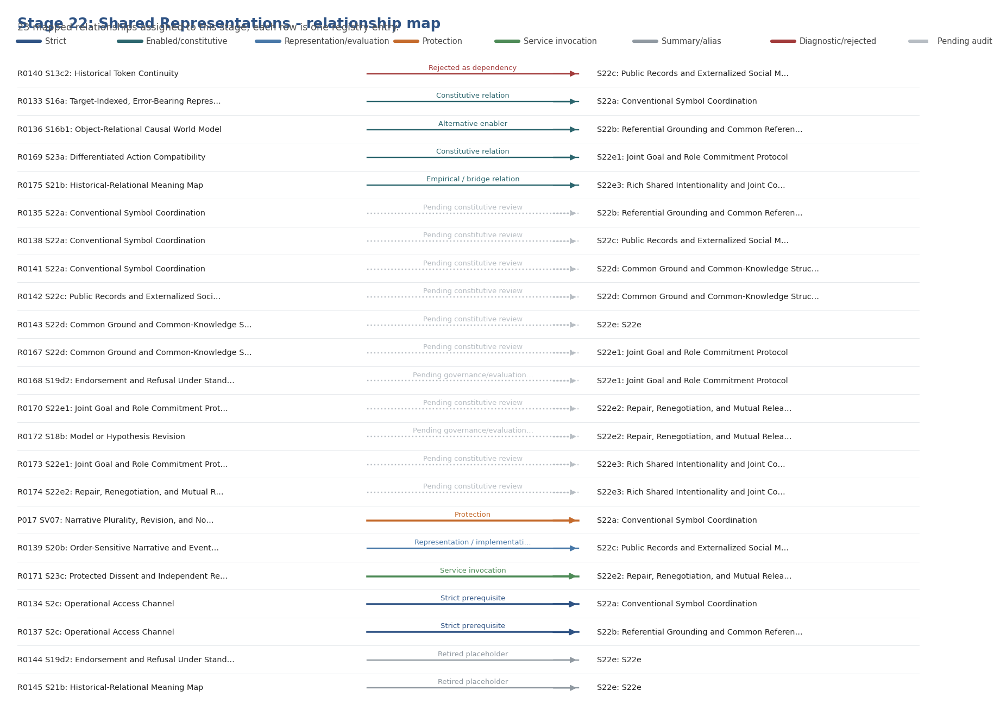{width=100%}

Figure A22. **Current Stage 22 relationship neighborhood.** Gray or pending entries remain candidates rather than proof-order claims.

### Relationship ledger

| ID | Source -> target | Type, status, and warrant | Current explanation, test, and revision boundary |
|---|---|---|---|
| R0140 | Historical Token Continuity -> Public Records and Externalized Social Memory | Rejected as dependency; adjudicated_v0.20; conceptual or source-grounded argument; empirical validation pending | Public records do not require biological token identity. Warrant: conceptual or source-grounded argument; empirical validation pending Test: Review the source-target semantics against the relation definition; target record: under 50% participant turnover, a truthful record preserves protoc… Revise if: A source-target case that fits a different typed relation would require reclassification. Evidence: E1_conceptual_source_grounded_or_normative |
| R0133 | Target-Indexed, Error-Bearing Representation -> Conventional Symbol Coordination | Constitutive relation; adjudicated_v0.20; reproducible toy model or simulation | Target-indexed representation is one constituent of symbol use, but conventions can be learned without the full Stage 16 criterion. Warrant: reproducible toy model or simulation Test: Intervene on S16a and test whether the identity, organization, or classification of S22a changes without assuming total disappearance. Existing targe… Revise if: If S22a retains the same declared identity under source removal, this constitutive claim should be weakened or removed. Evidence: E4_reproducible_toy_or_simulation |
| R0136 | Object-Relational Causal World Model -> Referential Grounding and Common Reference | Alternative enabler; adjudicated_v0.20; reproducible toy model or simulation | A structured world model can ground reference, but deictic, perceptual, or social grounding can do so without this full model. Warrant: reproducible toy model or simulation Test: Compare otherwise matched realizations of S22b with and without S16b1; the source should widen, stabilize, or improve the target realization. Existin… Revise if: No measurable change in target realizability, robustness, reach, or cost after source removal would defeat this enablement claim. Evidence: E4_reproducible_toy_or_simulation |
| R0169 | Differentiated Action Compatibility -> Joint Goal and Role Commitment Protocol | Constitutive relation; adjudicated_v0.20; conceptual or source-grounded argument; empirical validation pending | Joint-role commitment contains compatible differentiated action. Warrant: conceptual or source-grounded argument; empirical validation pending Test: Intervene on S23a and test whether the identity, organization, or classification of S22e1 changes without assuming total disappearance. Existing targ… Revise if: If S22e1 retains the same declared identity under source removal, this constitutive claim should be weakened or removed. Evidence: E1_conceptual_source_grounded_or_normative |
| R0175 | Historical-Relational Meaning Map -> Rich Shared Intentionality and Joint Commitment | Empirical / bridge relation; adjudicated_v0.20; conceptual or source-grounded argument; empirical validation pending | The proposed cross-domain relation requires independent evidence and is not presently a formal prerequisite. Warrant: conceptual or source-grounded argument; empirical validation pending Test: Review the source-target semantics against the relation definition; target record: not established; protocol compliance and repair do not prove share… Revise if: A source-target case that fits a different typed relation would require reclassification. Evidence: E0_open_or_unresolved |
| R0135 | Conventional Symbol Coordination -> Referential Grounding and Common Reference | Pending constitutive review; pending_companion_paper_relation_audit; pending semantic adjudication | Within-stage relation was not part of the 306-edge enabling audit. Warrant: pending semantic adjudication Semantic adjudication remains pending; no prerequisite claim is licensed. |
| R0138 | Conventional Symbol Coordination -> Public Records and Externalized Social Memory | Pending constitutive review; pending_companion_paper_relation_audit; pending semantic adjudication | Within-stage relation was not part of the 306-edge enabling audit. Warrant: pending semantic adjudication Semantic adjudication remains pending; no prerequisite claim is licensed. |
| R0141 | Conventional Symbol Coordination -> Common Ground and Common-Knowledge Structure | Pending constitutive review; pending_companion_paper_relation_audit; pending semantic adjudication | Within-stage relation was not part of the 306-edge enabling audit. Warrant: pending semantic adjudication Semantic adjudication remains pending; no prerequisite claim is licensed. |
| R0142 | Public Records and Externalized Social Memory -> Common Ground and Common-Knowledge Structure | Pending constitutive review; pending_companion_paper_relation_audit; pending semantic adjudication | Within-stage relation was not part of the 306-edge enabling audit. Warrant: pending semantic adjudication Semantic adjudication remains pending; no prerequisite claim is licensed. |
| R0143 | Common Ground and Common-Knowledge Structure -> S22e | Pending constitutive review; pending_companion_paper_relation_audit; pending semantic adjudication | Within-stage relation was not part of the 306-edge enabling audit. Warrant: pending semantic adjudication Semantic adjudication remains pending; no prerequisite claim is licensed. |
| R0167 | Common Ground and Common-Knowledge Structure -> Joint Goal and Role Commitment Protocol | Pending constitutive review; pending_companion_paper_relation_audit; pending semantic adjudication | Within-stage relation was not part of the 306-edge enabling audit. Warrant: pending semantic adjudication Semantic adjudication remains pending; no prerequisite claim is licensed. |
| R0168 | Endorsement and Refusal Under Standing Commitments -> Joint Goal and Role Commitment Protocol | Pending governance/evaluation/interpretation review; pending_companion_paper_relation_audit; pending semantic adjudication | Governance/evaluative/interpretive relation requires role-specific adjudication. Warrant: pending semantic adjudication Semantic adjudication remains pending; no prerequisite claim is licensed. |
| R0170 | Joint Goal and Role Commitment Protocol -> Repair, Renegotiation, and Mutual Release | Pending constitutive review; pending_companion_paper_relation_audit; pending semantic adjudication | Within-stage relation was not part of the 306-edge enabling audit. Warrant: pending semantic adjudication Semantic adjudication remains pending; no prerequisite claim is licensed. |
| R0172 | Model or Hypothesis Revision -> Repair, Renegotiation, and Mutual Release | Pending governance/evaluation/interpretation review; pending_companion_paper_relation_audit; pending semantic adjudication | Governance/evaluative/interpretive relation requires role-specific adjudication. Warrant: pending semantic adjudication Semantic adjudication remains pending; no prerequisite claim is licensed. |
| R0173 | Joint Goal and Role Commitment Protocol -> Rich Shared Intentionality and Joint Commitment | Pending constitutive review; pending_companion_paper_relation_audit; pending semantic adjudication | Within-stage relation was not part of the 306-edge enabling audit. Warrant: pending semantic adjudication Semantic adjudication remains pending; no prerequisite claim is licensed. |
| R0174 | Repair, Renegotiation, and Mutual Release -> Rich Shared Intentionality and Joint Commitment | Pending constitutive review; pending_companion_paper_relation_audit; pending semantic adjudication | Within-stage relation was not part of the 306-edge enabling audit. Warrant: pending semantic adjudication Semantic adjudication remains pending; no prerequisite claim is licensed. |
| P017 | Narrative Plurality, Revision, and Non-Sovereignty Service -> Conventional Symbol Coordination | Protection; selective v0.20 candidate protection edge; requires domain or institutional validation before consequential use; governance-design claim with stated mechanism and failure condition | narrative plurality and refusal protect symbol systems from sovereign capture Warrant: governance-design claim with stated mechanism and failure condition Test: Remove or neutralize the source protection and test whether Conventional Symbol Coordination becomes more exposed, less viable, less contestable, or… Revise if: remove or neutralize the source protection and test whether the target becomes more exposed, less viable, less contestable, or less co… Evidence: internal_architecture_candidate |
| R0139 | Order-Sensitive Narrative and Event Organization -> Public Records and Externalized Social Memory | Representation / implementation; adjudicated_v0.20; conceptual or source-grounded argument; empirical validation pending | The source supplies an encoding, observation, map, or implementation rather than producing the target. Warrant: conceptual or source-grounded argument; empirical validation pending Test: Review the source-target semantics against the relation definition; target record: under 50% participant turnover, a truthful record preserves protoc… Revise if: A source-target case that fits a different typed relation would require reclassification. Evidence: E1_conceptual_source_grounded_or_normative |
| R0171 | Protected Dissent and Independent Review -> Repair, Renegotiation, and Mutual Release | Service invocation; adjudicated_v0.20; conceptual or source-grounded argument; empirical validation pending | Repair and mutual release invoke protected challenge and review. Warrant: conceptual or source-grounded argument; empirical validation pending Test: Check whether the stage-specific use of S22e2 actually calls the named shared-service role represented by S23c. Revise if: If the target use can be specified without that service role, retain only a looser cross-reference. Evidence: E1_conceptual_source_grounded_or_normative |
| R0134 | Operational Access Channel -> Conventional Symbol Coordination | Strict prerequisite; adjudicated_v0.20; reproducible toy model or simulation | Conventional symbol coordination requires some operational channel through which signals can be produced and accessed. Warrant: reproducible toy model or simulation Test: Ablate or replace S2c (Operational Access Channel) while holding the declared target model fixed; S22a (Conventional Symbol Coordination) should beco… Revise if: A valid realization of S22a within the same declared model that omits S2c would defeat strictness. Evidence: E4_reproducible_toy_or_simulation |
| R0137 | Operational Access Channel -> Referential Grounding and Common Reference | Strict prerequisite; adjudicated_v0.20; reproducible toy model or simulation | Common reference requires an access relation through which agents can be related to the shared target. Warrant: reproducible toy model or simulation Test: Ablate or replace S2c (Operational Access Channel) while holding the declared target model fixed; S22b (Referential Grounding and Common Reference) s… Revise if: A valid realization of S22b within the same declared model that omits S2c would defeat strictness. Evidence: E4_reproducible_toy_or_simulation |
| R0144 | Endorsement and Refusal Under Standing Commitments -> S22e | Retired placeholder; adjudicated_v0.20; conceptual or source-grounded argument; empirical validation pending | The target is a completed split marker and is removed from the active ontology. Warrant: conceptual or source-grounded argument; empirical validation pending Evidence: E1_conceptual_source_grounded_or_normative |
| R0145 | Historical-Relational Meaning Map -> S22e | Retired placeholder; adjudicated_v0.20; conceptual or source-grounded argument; empirical validation pending | The target is a completed split marker and is removed from the active ontology. Warrant: conceptual or source-grounded argument; empirical validation pending Evidence: E1_conceptual_source_grounded_or_normative |

### Revision gate

**Next action:** Use S22e1-e3 and test joint attention, mutual responsiveness, unequal bargaining, and genuinely shared motivation A relation should be retyped, weakened, redirected, or removed whenever its dependency witness fails, its countermodel succeeds, its warrant basis changes, or target-domain evidence defeats the declared scope.

\pagebreak

## Stage 23 - Plural Coordination

**Domain block:** Social / institutional  \
**Claim status:** Bridge principle  \
**Canonical role:** Social bridge principle  \
**Source:** M&E §13.14

### Stage meaning and formal role

Social order emerges through interaction among partially autonomous agents under feedback, power, and material constraints. Coordination is not identical with consensus or legitimacy.

Stage 23 contains **11 active object(s)**: Summary join (1), Operational capacity (5), Normative relation / status (2), Representation / observation (1), Open capacity / problem (2). The synchronized ledger assigns **52 relationship record(s)** to this stage.

### Active object inventory

| ID | Object | Type | Evidence | Disposition |
|---|---|---|---|---|
| S23J | Plural Coordination Profile / Join | Summary join | E1_conceptual_source_grounded_or_normative | retain_as_stage_summary_not_core_node |
| S23a | Differentiated Action Compatibility | Operational capacity | E1_conceptual_source_grounded_or_normative | retain_distinct_pending_edge_audit |
| S23b | Distributed Role Allocation Under Local Values | Operational capacity | E4_reproducible_toy_or_simulation | retain_distinct_pending_edge_audit |
| S23c | Protected Dissent and Independent Review | Operational capacity | E4_reproducible_toy_or_simulation | retain_as_family_member_or_stage_instantiation |
| S23d | Coordination Provenance, Consent, and Legitimacy Profile | Normative relation / status | E1_conceptual_source_grounded_or_normative | retain_typed_noncapacity_object |
| S23e1 | Decision Provenance and Contribution Graph | Representation / observation | E1_conceptual_source_grounded_or_normative | retain_as_family_member_or_stage_instantiation |
| S23e2 | Collective Decision Authorization and Answerability | Operational capacity | E4_reproducible_toy_or_simulation | retain_distinct_pending_edge_audit |
| S23e3 | Distributed Responsibility Profile | Normative relation / status | E1_conceptual_source_grounded_or_normative | retain_as_family_member_or_stage_instantiation |
| S23e4a | Consistency-Preserving Collective Attitude Integration | Operational capacity | E4_reproducible_toy_or_simulation | retain_as_family_member_or_stage_instantiation |
| S23e4b | Organizational Feedback and Diachronic Group Commitment | Open capacity / problem | E0_open_or_unresolved | retain_as_family_member_or_stage_instantiation |
| S23e4c | Group Moral Agency and Collective Authorship | Open capacity / problem | E0_open_or_unresolved | retain_as_family_member_or_stage_instantiation |

### Complete relationship map

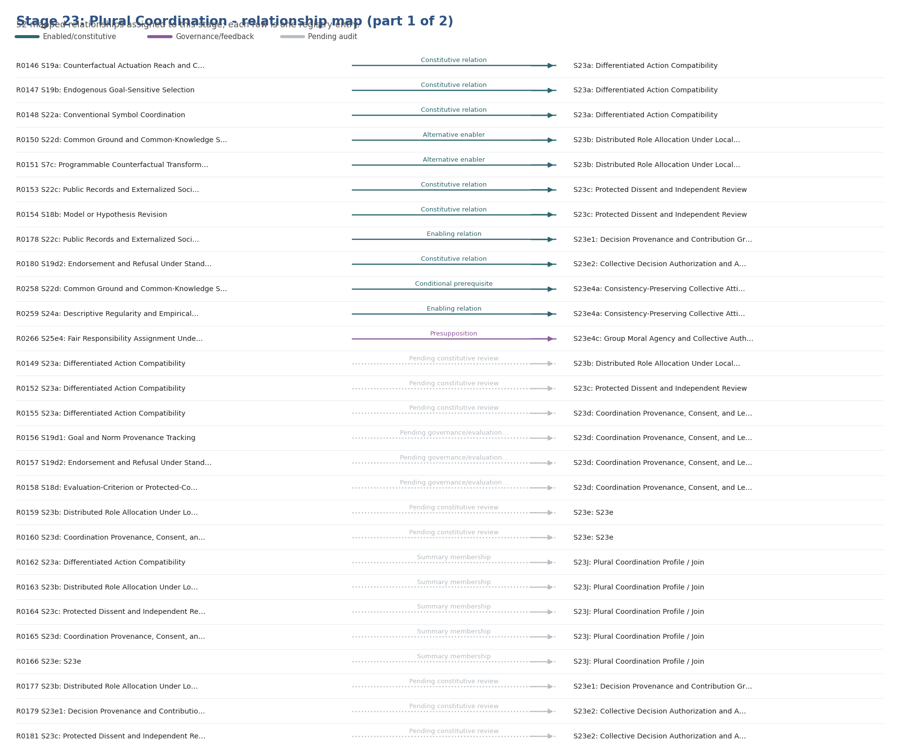{width=100%}
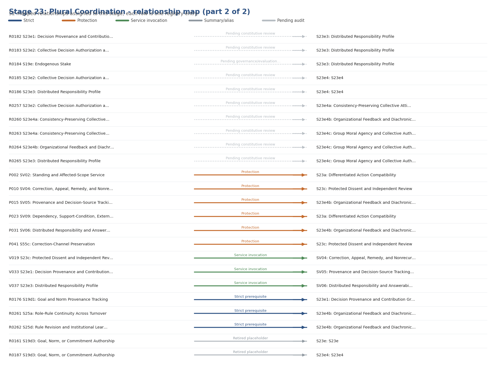{width=100%}

Figure A23. **Current Stage 23 relationship neighborhood.** Gray or pending entries remain candidates rather than proof-order claims.

### Relationship ledger

| ID | Source -> target | Type, status, and warrant | Current explanation, test, and revision boundary |
|---|---|---|---|
| R0146 | Counterfactual Actuation Reach and Control -> Differentiated Action Compatibility | Constitutive relation; adjudicated_v0.20; conceptual or source-grounded argument; empirical validation pending | The source is one ingredient of the target’s identity, but other realizations or decompositions remain possible. Warrant: conceptual or source-grounded argument; empirical validation pending Test: Intervene on S19a and test whether the identity, organization, or classification of S23a changes without assuming total disappearance. Existing targe… Revise if: If S23a retains the same declared identity under source removal, this constitutive claim should be weakened or removed. Evidence: E1_conceptual_source_grounded_or_normative |
| R0147 | Endogenous Goal-Sensitive Selection -> Differentiated Action Compatibility | Constitutive relation; adjudicated_v0.20; conceptual or source-grounded argument; empirical validation pending | The source is one ingredient of the target’s identity, but other realizations or decompositions remain possible. Warrant: conceptual or source-grounded argument; empirical validation pending Test: Intervene on S19b and test whether the identity, organization, or classification of S23a changes without assuming total disappearance. Existing targe… Revise if: If S23a retains the same declared identity under source removal, this constitutive claim should be weakened or removed. Evidence: E1_conceptual_source_grounded_or_normative |
| R0148 | Conventional Symbol Coordination -> Differentiated Action Compatibility | Constitutive relation; adjudicated_v0.20; conceptual or source-grounded argument; empirical validation pending | The source is one ingredient of the target’s identity, but other realizations or decompositions remain possible. Warrant: conceptual or source-grounded argument; empirical validation pending Test: Intervene on S22a and test whether the identity, organization, or classification of S23a changes without assuming total disappearance. Existing targe… Revise if: If S23a retains the same declared identity under source removal, this constitutive claim should be weakened or removed. Evidence: E1_conceptual_source_grounded_or_normative |
| R0150 | Common Ground and Common-Knowledge Structure -> Distributed Role Allocation Under Local Values | Alternative enabler; adjudicated_v0.20; reproducible toy model or simulation | The source is one route among several and therefore cannot support a necessity claim. Warrant: reproducible toy model or simulation Test: Compare otherwise matched realizations of S23b with and without S22d; the source should widen, stabilize, or improve the target realization. Existing… Revise if: No measurable change in target realizability, robustness, reach, or cost after source removal would defeat this enablement claim. Evidence: E4_reproducible_toy_or_simulation |
| R0151 | Programmable Counterfactual Transformation -> Distributed Role Allocation Under Local Values | Alternative enabler; adjudicated_v0.20; reproducible toy model or simulation | Programmability is one implementation of distributed allocation, not a prerequisite of all role allocation. Warrant: reproducible toy model or simulation Test: Compare otherwise matched realizations of S23b with and without S7c; the source should widen, stabilize, or improve the target realization. Existing… Revise if: No measurable change in target realizability, robustness, reach, or cost after source removal would defeat this enablement claim. Evidence: E4_reproducible_toy_or_simulation |
| R0153 | Public Records and Externalized Social Memory -> Protected Dissent and Independent Review | Constitutive relation; adjudicated_v0.20; reproducible toy model or simulation | The source is one ingredient of the target’s identity, but other realizations or decompositions remain possible. Warrant: reproducible toy model or simulation Test: Intervene on S22c and test whether the identity, organization, or classification of S23c changes without assuming total disappearance. Existing targe… Revise if: If S23c retains the same declared identity under source removal, this constitutive claim should be weakened or removed. Evidence: E4_reproducible_toy_or_simulation |
| R0154 | Model or Hypothesis Revision -> Protected Dissent and Independent Review | Constitutive relation; adjudicated_v0.20; reproducible toy model or simulation | The source is one ingredient of the target’s identity, but other realizations or decompositions remain possible. Warrant: reproducible toy model or simulation Test: Intervene on S18b and test whether the identity, organization, or classification of S23c changes without assuming total disappearance. Existing targe… Revise if: If S23c retains the same declared identity under source removal, this constitutive claim should be weakened or removed. Evidence: E4_reproducible_toy_or_simulation |
| R0178 | Public Records and Externalized Social Memory -> Decision Provenance and Contribution Graph | Enabling relation; adjudicated_v0.20; conceptual or source-grounded argument; empirical validation pending | Public records stabilize provenance over time but are not necessary for every real-time contribution graph. Warrant: conceptual or source-grounded argument; empirical validation pending Test: Compare otherwise matched realizations of S23e1 with and without S22c; the source should widen, stabilize, or improve the target realization. Existin… Revise if: No measurable change in target realizability, robustness, reach, or cost after source removal would defeat this enablement claim. Evidence: E1_conceptual_source_grounded_or_normative |
| R0180 | Endorsement and Refusal Under Standing Commitments -> Collective Decision Authorization and Answerability | Constitutive relation; adjudicated_v0.20; reproducible toy model or simulation | The source is one ingredient of the target’s identity, but other realizations or decompositions remain possible. Warrant: reproducible toy model or simulation Test: Intervene on S19d2 and test whether the identity, organization, or classification of S23e2 changes without assuming total disappearance. Existing tar… Revise if: If S23e2 retains the same declared identity under source removal, this constitutive claim should be weakened or removed. Evidence: E4_reproducible_toy_or_simulation |
| R0258 | Common Ground and Common-Knowledge Structure -> Consistency-Preserving Collective Attitude Integration | Conditional prerequisite; adjudicated_v0.20; reproducible toy model or simulation | Common-ground structure is useful for some group-judgment procedures but not all aggregation methods. Warrant: reproducible toy model or simulation Test: Within the stated implementation or bridge assumptions, ablate S22d; the tested realization of S23e4a should fail. Existing target witness: among 64… Revise if: An alternative realization of S23e4a outside the stated condition and without S22d would limit the edge rather than refute the target. Evidence: E4_reproducible_toy_or_simulation |
| R0259 | Descriptive Regularity and Empirical Expectation -> Consistency-Preserving Collective Attitude Integration | Enabling relation; adjudicated_v0.20; reproducible toy model or simulation | Stable expectations can support collective attitude integration but are not required for every aggregation rule. Warrant: reproducible toy model or simulation Test: Compare otherwise matched realizations of S23e4a with and without S24a; the source should widen, stabilize, or improve the target realization. Existi… Revise if: No measurable change in target realizability, robustness, reach, or cost after source removal would defeat this enablement claim. Evidence: E4_reproducible_toy_or_simulation |
| R0266 | Fair Responsibility Assignment Under Distributed Power -> Group Moral Agency and Collective Authorship | Presupposition; adjudicated_v0.20; normative or governance argument with institutional validation pending | Moral group agency evaluation presupposes fair responsibility assignment; it does not create the agency. Warrant: normative or governance argument with institutional validation pending Test: Review the source-target semantics against the relation definition; target record: not established; collective consistency and answerability do not b… Revise if: A source-target case that fits a different typed relation would require reclassification. Evidence: E0_open_or_unresolved |
| R0149 | Differentiated Action Compatibility -> Distributed Role Allocation Under Local Values | Pending constitutive review; pending_companion_paper_relation_audit; pending semantic adjudication | Within-stage relation was not part of the 306-edge enabling audit. Warrant: pending semantic adjudication Semantic adjudication remains pending; no prerequisite claim is licensed. |
| R0152 | Differentiated Action Compatibility -> Protected Dissent and Independent Review | Pending constitutive review; pending_companion_paper_relation_audit; pending semantic adjudication | Within-stage relation was not part of the 306-edge enabling audit. Warrant: pending semantic adjudication Semantic adjudication remains pending; no prerequisite claim is licensed. |
| R0155 | Differentiated Action Compatibility -> Coordination Provenance, Consent, and Legitimacy Profile | Pending constitutive review; pending_companion_paper_relation_audit; pending semantic adjudication | Within-stage relation was not part of the 306-edge enabling audit. Warrant: pending semantic adjudication Semantic adjudication remains pending; no prerequisite claim is licensed. |
| R0156 | Goal and Norm Provenance Tracking -> Coordination Provenance, Consent, and Legitimacy Profile | Pending governance/evaluation/interpretation review; pending_companion_paper_relation_audit; pending semantic adjudication | Governance/evaluative/interpretive relation requires role-specific adjudication. Warrant: pending semantic adjudication Semantic adjudication remains pending; no prerequisite claim is licensed. |
| R0157 | Endorsement and Refusal Under Standing Commitments -> Coordination Provenance, Consent, and Legitimacy Profile | Pending governance/evaluation/interpretation review; pending_companion_paper_relation_audit; pending semantic adjudication | Governance/evaluative/interpretive relation requires role-specific adjudication. Warrant: pending semantic adjudication Semantic adjudication remains pending; no prerequisite claim is licensed. |
| R0158 | Evaluation-Criterion or Protected-Constraint Revision -> Coordination Provenance, Consent, and Legitimacy Profile | Pending governance/evaluation/interpretation review; pending_companion_paper_relation_audit; pending semantic adjudication | Governance/evaluative/interpretive relation requires role-specific adjudication. Warrant: pending semantic adjudication Semantic adjudication remains pending; no prerequisite claim is licensed. |
| R0159 | Distributed Role Allocation Under Local Values -> S23e | Pending constitutive review; pending_companion_paper_relation_audit; pending semantic adjudication | Within-stage relation was not part of the 306-edge enabling audit. Warrant: pending semantic adjudication Semantic adjudication remains pending; no prerequisite claim is licensed. |
| R0160 | Coordination Provenance, Consent, and Legitimacy Profile -> S23e | Pending constitutive review; pending_companion_paper_relation_audit; pending semantic adjudication | Within-stage relation was not part of the 306-edge enabling audit. Warrant: pending semantic adjudication Semantic adjudication remains pending; no prerequisite claim is licensed. |
| R0162 | Differentiated Action Compatibility -> Plural Coordination Profile / Join | Summary membership; carried_forward_low_risk_pending_spot_check; pending semantic adjudication | Summary membership is retained outside proof order. Warrant: pending semantic adjudication Semantic adjudication remains pending; no prerequisite claim is licensed. |
| R0163 | Distributed Role Allocation Under Local Values -> Plural Coordination Profile / Join | Summary membership; carried_forward_low_risk_pending_spot_check; pending semantic adjudication | Summary membership is retained outside proof order. Warrant: pending semantic adjudication Semantic adjudication remains pending; no prerequisite claim is licensed. |
| R0164 | Protected Dissent and Independent Review -> Plural Coordination Profile / Join | Summary membership; carried_forward_low_risk_pending_spot_check; pending semantic adjudication | Summary membership is retained outside proof order. Warrant: pending semantic adjudication Semantic adjudication remains pending; no prerequisite claim is licensed. |
| R0165 | Coordination Provenance, Consent, and Legitimacy Profile -> Plural Coordination Profile / Join | Summary membership; carried_forward_low_risk_pending_spot_check; pending semantic adjudication | Summary membership is retained outside proof order. Warrant: pending semantic adjudication Semantic adjudication remains pending; no prerequisite claim is licensed. |
| R0166 | S23e -> Plural Coordination Profile / Join | Summary membership; carried_forward_low_risk_pending_spot_check; pending semantic adjudication | Summary membership is retained outside proof order. Warrant: pending semantic adjudication Semantic adjudication remains pending; no prerequisite claim is licensed. |
| R0177 | Distributed Role Allocation Under Local Values -> Decision Provenance and Contribution Graph | Pending constitutive review; pending_companion_paper_relation_audit; pending semantic adjudication | Within-stage relation was not part of the 306-edge enabling audit. Warrant: pending semantic adjudication Semantic adjudication remains pending; no prerequisite claim is licensed. |
| R0179 | Decision Provenance and Contribution Graph -> Collective Decision Authorization and Answerability | Pending constitutive review; pending_companion_paper_relation_audit; pending semantic adjudication | Within-stage relation was not part of the 306-edge enabling audit. Warrant: pending semantic adjudication Semantic adjudication remains pending; no prerequisite claim is licensed. |
| R0181 | Protected Dissent and Independent Review -> Collective Decision Authorization and Answerability | Pending constitutive review; pending_companion_paper_relation_audit; pending semantic adjudication | Within-stage relation was not part of the 306-edge enabling audit. Warrant: pending semantic adjudication Semantic adjudication remains pending; no prerequisite claim is licensed. |
| R0182 | Decision Provenance and Contribution Graph -> Distributed Responsibility Profile | Pending constitutive review; pending_companion_paper_relation_audit; pending semantic adjudication | Within-stage relation was not part of the 306-edge enabling audit. Warrant: pending semantic adjudication Semantic adjudication remains pending; no prerequisite claim is licensed. |
| R0183 | Collective Decision Authorization and Answerability -> Distributed Responsibility Profile | Pending constitutive review; pending_companion_paper_relation_audit; pending semantic adjudication | Within-stage relation was not part of the 306-edge enabling audit. Warrant: pending semantic adjudication Semantic adjudication remains pending; no prerequisite claim is licensed. |
| R0184 | Endogenous Stake -> Distributed Responsibility Profile | Pending governance/evaluation/interpretation review; pending_companion_paper_relation_audit; pending semantic adjudication | Governance/evaluative/interpretive relation requires role-specific adjudication. Warrant: pending semantic adjudication Semantic adjudication remains pending; no prerequisite claim is licensed. |
| R0185 | Collective Decision Authorization and Answerability -> S23e4 | Pending constitutive review; pending_companion_paper_relation_audit; pending semantic adjudication | Within-stage relation was not part of the 306-edge enabling audit. Warrant: pending semantic adjudication Semantic adjudication remains pending; no prerequisite claim is licensed. |
| R0186 | Distributed Responsibility Profile -> S23e4 | Pending constitutive review; pending_companion_paper_relation_audit; pending semantic adjudication | Within-stage relation was not part of the 306-edge enabling audit. Warrant: pending semantic adjudication Semantic adjudication remains pending; no prerequisite claim is licensed. |
| R0257 | Collective Decision Authorization and Answerability -> Consistency-Preserving Collective Attitude Integration | Pending constitutive review; pending_companion_paper_relation_audit; pending semantic adjudication | Within-stage relation was not part of the 306-edge enabling audit. Warrant: pending semantic adjudication Semantic adjudication remains pending; no prerequisite claim is licensed. |
| R0260 | Consistency-Preserving Collective Attitude Integration -> Organizational Feedback and Diachronic Group Commitment | Pending constitutive review; pending_companion_paper_relation_audit; pending semantic adjudication | Within-stage relation was not part of the 306-edge enabling audit. Warrant: pending semantic adjudication Semantic adjudication remains pending; no prerequisite claim is licensed. |
| R0263 | Consistency-Preserving Collective Attitude Integration -> Group Moral Agency and Collective Authorship | Pending constitutive review; pending_companion_paper_relation_audit; pending semantic adjudication | Within-stage relation was not part of the 306-edge enabling audit. Warrant: pending semantic adjudication Semantic adjudication remains pending; no prerequisite claim is licensed. |
| R0264 | Organizational Feedback and Diachronic Group Commitment -> Group Moral Agency and Collective Authorship | Pending constitutive review; pending_companion_paper_relation_audit; pending semantic adjudication | Within-stage relation was not part of the 306-edge enabling audit. Warrant: pending semantic adjudication Semantic adjudication remains pending; no prerequisite claim is licensed. |
| R0265 | Distributed Responsibility Profile -> Group Moral Agency and Collective Authorship | Pending constitutive review; pending_companion_paper_relation_audit; pending semantic adjudication | Within-stage relation was not part of the 306-edge enabling audit. Warrant: pending semantic adjudication Semantic adjudication remains pending; no prerequisite claim is licensed. |
| P002 | Standing and Affected-Scope Service -> Differentiated Action Compatibility | Protection; selective v0.20 candidate protection edge; requires domain or institutional validation before consequential use; governance-design claim with stated mechanism and failure condition | plural standing prevents coordination from becoming mere compliance Warrant: governance-design claim with stated mechanism and failure condition Test: Remove or neutralize the source protection and test whether Differentiated Action Compatibility becomes more exposed, less viable, less contestable,… Revise if: remove or neutralize the source protection and test whether the target becomes more exposed, less viable, less contestable, or less co… Evidence: internal_architecture_candidate |
| P010 | Correction, Appeal, Remedy, and Nonrecurrence Service -> Protected Dissent and Independent Review | Protection; selective v0.20 candidate protection edge; requires domain or institutional validation before consequential use; governance-design claim with stated mechanism and failure condition | institutional protection preserves dissent from retaliation and capture Warrant: governance-design claim with stated mechanism and failure condition Test: Remove or neutralize the source protection and test whether Protected Dissent and Independent Review becomes more exposed, less viable, less contesta… Revise if: remove or neutralize the source protection and test whether the target becomes more exposed, less viable, less contestable, or less co… Evidence: internal_architecture_candidate |
| P015 | Provenance and Decision-Source Tracking Service -> Organizational Feedback and Diachronic Group Commitment | Protection; selective v0.20 candidate protection edge; requires domain or institutional validation before consequential use; governance-design claim with stated mechanism and failure condition | decision provenance preserves diachronic collective answerability Warrant: governance-design claim with stated mechanism and failure condition Test: Remove or neutralize the source protection and test whether Organizational Feedback and Diachronic Group Commitment becomes more exposed, less viable… Revise if: remove or neutralize the source protection and test whether the target becomes more exposed, less viable, less contestable, or less co… Evidence: internal_architecture_candidate |
| P023 | Dependency, Support-Condition, Externality, and Regeneration Service -> Differentiated Action Compatibility | Protection; selective v0.20 candidate protection edge; requires domain or institutional validation before consequential use; governance-design claim with stated mechanism and failure condition | externality tracing protects plural coordination from burden displacement Warrant: governance-design claim with stated mechanism and failure condition Test: Remove or neutralize the source protection and test whether Differentiated Action Compatibility becomes more exposed, less viable, less contestable,… Revise if: remove or neutralize the source protection and test whether the target becomes more exposed, less viable, less contestable, or less co… Evidence: internal_architecture_candidate |
| P031 | Distributed Responsibility and Answerability Service -> Organizational Feedback and Diachronic Group Commitment | Protection; selective v0.20 candidate protection edge; requires domain or institutional validation before consequential use; governance-design claim with stated mechanism and failure condition | answerability protects diachronic collective agency from ownerless power Warrant: governance-design claim with stated mechanism and failure condition Test: Remove or neutralize the source protection and test whether Organizational Feedback and Diachronic Group Commitment becomes more exposed, less viable… Revise if: remove or neutralize the source protection and test whether the target becomes more exposed, less viable, less contestable, or less co… Evidence: internal_architecture_candidate |
| P041 | Correction-Channel Preservation -> Protected Dissent and Independent Review | Protection; selective v0.20 candidate protection edge; requires domain or institutional validation before consequential use; governance-design claim with stated mechanism and failure condition | correction-channel preservation protects dissent from procedural erosion Warrant: governance-design claim with stated mechanism and failure condition Test: Remove or neutralize the source protection and test whether Protected Dissent and Independent Review becomes more exposed, less viable, less contesta… Revise if: remove or neutralize the source protection and test whether the target becomes more exposed, less viable, less contestable, or less co… Evidence: internal_architecture_candidate |
| V019 | Protected Dissent and Independent Review -> Correction, Appeal, Remedy, and Nonrecurrence Service | Service invocation; defined_v0.4; internal architecture and role mapping | Protected Dissent and Independent Review invokes Correction, Appeal, Remedy, and Nonrecurrence Service in the role of protected dissent. Warrant: internal architecture and role mapping Test: Check whether the stage-specific role protected dissent is actually required when the service is instantiated at Stage 23. Revise if: If the stage does not use this service role, the invocation should be removed or reassigned. Evidence: internal_architecture_candidate |
| V033 | Decision Provenance and Contribution Graph -> Provenance and Decision-Source Tracking Service | Service invocation; defined_v0.4; internal architecture and role mapping | Decision Provenance and Contribution Graph invokes Provenance and Decision-Source Tracking Service in the role of decision contribution graph. Warrant: internal architecture and role mapping Test: Check whether the stage-specific role decision contribution graph is actually required when the service is instantiated at Stage 23. Revise if: If the stage does not use this service role, the invocation should be removed or reassigned. Evidence: internal_architecture_candidate |
| V037 | Distributed Responsibility Profile -> Distributed Responsibility and Answerability Service | Service invocation; defined_v0.4; internal architecture and role mapping | Distributed Responsibility Profile invokes Distributed Responsibility and Answerability Service in the role of distributed responsibility profile. Warrant: internal architecture and role mapping Test: Check whether the stage-specific role distributed responsibility profile is actually required when the service is instantiated at Stage 23. Revise if: If the stage does not use this service role, the invocation should be removed or reassigned. Evidence: internal_architecture_candidate |
| R0176 | Goal and Norm Provenance Tracking -> Decision Provenance and Contribution Graph | Strict prerequisite; adjudicated_v0.20; conceptual or source-grounded argument; empirical validation pending | A decision-provenance graph cannot be constructed without tracking the source of goals, norms, or decisions. Warrant: conceptual or source-grounded argument; empirical validation pending Test: Ablate or replace S19d1 (Goal and Norm Provenance Tracking) while holding the declared target model fixed; S23e1 (Decision Provenance and Contributio… Revise if: A valid realization of S23e1 within the same declared model that omits S19d1 would defeat strictness. Evidence: E1_conceptual_source_grounded_or_normative |
| R0261 | Role-Rule Continuity Across Turnover -> Organizational Feedback and Diachronic Group Commitment | Strict prerequisite; adjudicated_v0.20; conceptual or source-grounded argument; empirical validation pending | Diachronic group commitment requires role-rule continuity through membership turnover. Warrant: conceptual or source-grounded argument; empirical validation pending Test: Ablate or replace S25a (Role-Rule Continuity Across Turnover) while holding the declared target model fixed; S23e4b (Organizational Feedback and Diac… Revise if: A valid realization of S23e4b within the same declared model that omits S25a would defeat strictness. Evidence: E0_open_or_unresolved |
| R0262 | Rule Revision and Institutional Learning -> Organizational Feedback and Diachronic Group Commitment | Strict prerequisite; adjudicated_v0.20; conceptual or source-grounded argument; empirical validation pending | Organizational feedback requires a capacity for rule revision and learning. Warrant: conceptual or source-grounded argument; empirical validation pending Test: Ablate or replace S25d (Rule Revision and Institutional Learning) while holding the declared target model fixed; S23e4b (Organizational Feedback and… Revise if: A valid realization of S23e4b within the same declared model that omits S25d would defeat strictness. Evidence: E0_open_or_unresolved |
| R0161 | Goal, Norm, or Commitment Authorship -> S23e | Retired placeholder; adjudicated_v0.20; conceptual or source-grounded argument; empirical validation pending | The target is a completed split marker and is removed from the active ontology. Warrant: conceptual or source-grounded argument; empirical validation pending Evidence: E1_conceptual_source_grounded_or_normative |
| R0187 | Goal, Norm, or Commitment Authorship -> S23e4 | Retired placeholder; adjudicated_v0.20; conceptual or source-grounded argument; empirical validation pending | The target is a completed split marker and is removed from the active ontology. Warrant: conceptual or source-grounded argument; empirical validation pending Evidence: E1_conceptual_source_grounded_or_normative |

### Revision gate

**Next action:** Use S23e1-e4 and test judgment aggregation, member control, institutional authorship, and affected-party remedy A relation should be retyped, weakened, redirected, or removed whenever its dependency witness fails, its countermodel succeeds, its warrant basis changes, or target-domain evidence defeats the declared scope.

\pagebreak

## Stage 24 - Norm Formation

**Domain block:** Social / cultural  \
**Claim status:** Normative principle  \
**Canonical role:** Empirical generalization / normative boundary  \
**Source:** M&E §13.14

### Stage meaning and formal role

Repeated expectations, sanctions, examples, and practices can stabilize norms. Existence, compliance, and durability do not establish justice.

Stage 24 contains **6 active object(s)**: Summary join (1), Operational capacity (4), Normative relation / status (1). The synchronized ledger assigns **20 relationship record(s)** to this stage.

### Active object inventory

| ID | Object | Type | Evidence | Disposition |
|---|---|---|---|---|
| S24J | Norm Formation Profile / Join | Summary join | E1_conceptual_source_grounded_or_normative | retain_as_stage_summary_not_core_node |
| S24a | Descriptive Regularity and Empirical Expectation | Operational capacity | E1_conceptual_source_grounded_or_normative | retain_distinct_pending_edge_audit |
| S24b | Sanctioned Norm Enforcement | Operational capacity | E1_conceptual_source_grounded_or_normative | retain_distinct_pending_edge_audit |
| S24c | Normative Expectation and Internalization | Operational capacity | E0_open_or_unresolved | retain_distinct_pending_edge_audit |
| S24d | Context-Sensitive Norm Plurality and Conflict | Operational capacity | E1_conceptual_source_grounded_or_normative | retain_distinct_pending_edge_audit |
| S24e | Norm Justifiability and Legitimacy | Normative relation / status | E1_conceptual_source_grounded_or_normative | retain_typed_noncapacity_object |

### Complete relationship map

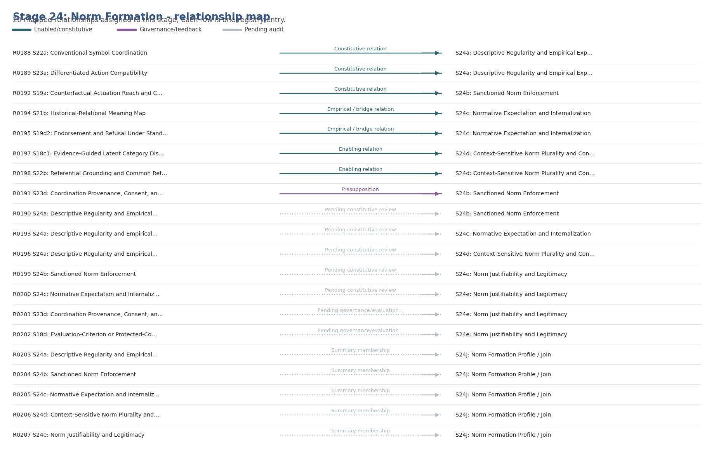{width=100%}

Figure A24. **Current Stage 24 relationship neighborhood.** Gray or pending entries remain candidates rather than proof-order claims.

### Relationship ledger

| ID | Source -> target | Type, status, and warrant | Current explanation, test, and revision boundary |
|---|---|---|---|
| R0188 | Conventional Symbol Coordination -> Descriptive Regularity and Empirical Expectation | Constitutive relation; adjudicated_v0.20; conceptual or source-grounded argument; empirical validation pending | The source is one ingredient of the target’s identity, but other realizations or decompositions remain possible. Warrant: conceptual or source-grounded argument; empirical validation pending Test: Intervene on S22a and test whether the identity, organization, or classification of S24a changes without assuming total disappearance. Existing targe… Revise if: If S24a retains the same declared identity under source removal, this constitutive claim should be weakened or removed. Evidence: E1_conceptual_source_grounded_or_normative |
| R0189 | Differentiated Action Compatibility -> Descriptive Regularity and Empirical Expectation | Constitutive relation; adjudicated_v0.20; conceptual or source-grounded argument; empirical validation pending | The source is one ingredient of the target’s identity, but other realizations or decompositions remain possible. Warrant: conceptual or source-grounded argument; empirical validation pending Test: Intervene on S23a and test whether the identity, organization, or classification of S24a changes without assuming total disappearance. Existing targe… Revise if: If S24a retains the same declared identity under source removal, this constitutive claim should be weakened or removed. Evidence: E1_conceptual_source_grounded_or_normative |
| R0192 | Counterfactual Actuation Reach and Control -> Sanctioned Norm Enforcement | Constitutive relation; adjudicated_v0.20; conceptual or source-grounded argument; empirical validation pending | The source is one ingredient of the target’s identity, but other realizations or decompositions remain possible. Warrant: conceptual or source-grounded argument; empirical validation pending Test: Intervene on S19a and test whether the identity, organization, or classification of S24b changes without assuming total disappearance. Existing targe… Revise if: If S24b retains the same declared identity under source removal, this constitutive claim should be weakened or removed. Evidence: E1_conceptual_source_grounded_or_normative |
| R0194 | Historical-Relational Meaning Map -> Normative Expectation and Internalization | Empirical / bridge relation; adjudicated_v0.20; conceptual or source-grounded argument; empirical validation pending | The proposed cross-domain relation requires independent evidence and is not presently a formal prerequisite. Warrant: conceptual or source-grounded argument; empirical validation pending Test: Review the source-target semantics against the relation definition; target record: identical visible compliance can persist after sanction withdrawal… Revise if: A source-target case that fits a different typed relation would require reclassification. Evidence: E0_open_or_unresolved |
| R0195 | Endorsement and Refusal Under Standing Commitments -> Normative Expectation and Internalization | Empirical / bridge relation; adjudicated_v0.20; conceptual or source-grounded argument; empirical validation pending | The proposed cross-domain relation requires independent evidence and is not presently a formal prerequisite. Warrant: conceptual or source-grounded argument; empirical validation pending Test: Review the source-target semantics against the relation definition; target record: identical visible compliance can persist after sanction withdrawal… Revise if: A source-target case that fits a different typed relation would require reclassification. Evidence: E0_open_or_unresolved |
| R0197 | Evidence-Guided Latent Category Discovery -> Context-Sensitive Norm Plurality and Conflict | Enabling relation; adjudicated_v0.20; conceptual or source-grounded argument; empirical validation pending | The source widens or stabilizes target realization but is not required in every case. Warrant: conceptual or source-grounded argument; empirical validation pending Test: Compare otherwise matched realizations of S24d with and without S18c1; the source should widen, stabilize, or improve the target realization. Existin… Revise if: No measurable change in target realizability, robustness, reach, or cost after source removal would defeat this enablement claim. Evidence: E1_conceptual_source_grounded_or_normative |
| R0198 | Referential Grounding and Common Reference -> Context-Sensitive Norm Plurality and Conflict | Enabling relation; adjudicated_v0.20; conceptual or source-grounded argument; empirical validation pending | The source widens or stabilizes target realization but is not required in every case. Warrant: conceptual or source-grounded argument; empirical validation pending Test: Compare otherwise matched realizations of S24d with and without S22b; the source should widen, stabilize, or improve the target realization. Existing… Revise if: No measurable change in target realizability, robustness, reach, or cost after source removal would defeat this enablement claim. Evidence: E1_conceptual_source_grounded_or_normative |
| R0191 | Coordination Provenance, Consent, and Legitimacy Profile -> Sanctioned Norm Enforcement | Presupposition; adjudicated_v0.20; normative or governance argument with institutional validation pending | Consent and legitimacy assessment evaluates enforcement; it does not enable sanctioning power. Warrant: normative or governance argument with institutional validation pending Test: Review the source-target semantics against the relation definition; target record: external sanction sustains visible compliance at 0.860 before with… Revise if: A source-target case that fits a different typed relation would require reclassification. Evidence: E1_conceptual_source_grounded_or_normative |
| R0190 | Descriptive Regularity and Empirical Expectation -> Sanctioned Norm Enforcement | Pending constitutive review; pending_companion_paper_relation_audit; pending semantic adjudication | Within-stage relation was not part of the 306-edge enabling audit. Warrant: pending semantic adjudication Semantic adjudication remains pending; no prerequisite claim is licensed. |
| R0193 | Descriptive Regularity and Empirical Expectation -> Normative Expectation and Internalization | Pending constitutive review; pending_companion_paper_relation_audit; pending semantic adjudication | Within-stage relation was not part of the 306-edge enabling audit. Warrant: pending semantic adjudication Semantic adjudication remains pending; no prerequisite claim is licensed. |
| R0196 | Descriptive Regularity and Empirical Expectation -> Context-Sensitive Norm Plurality and Conflict | Pending constitutive review; pending_companion_paper_relation_audit; pending semantic adjudication | Within-stage relation was not part of the 306-edge enabling audit. Warrant: pending semantic adjudication Semantic adjudication remains pending; no prerequisite claim is licensed. |
| R0199 | Sanctioned Norm Enforcement -> Norm Justifiability and Legitimacy | Pending constitutive review; pending_companion_paper_relation_audit; pending semantic adjudication | Within-stage relation was not part of the 306-edge enabling audit. Warrant: pending semantic adjudication Semantic adjudication remains pending; no prerequisite claim is licensed. |
| R0200 | Normative Expectation and Internalization -> Norm Justifiability and Legitimacy | Pending constitutive review; pending_companion_paper_relation_audit; pending semantic adjudication | Within-stage relation was not part of the 306-edge enabling audit. Warrant: pending semantic adjudication Semantic adjudication remains pending; no prerequisite claim is licensed. |
| R0201 | Coordination Provenance, Consent, and Legitimacy Profile -> Norm Justifiability and Legitimacy | Pending governance/evaluation/interpretation review; pending_companion_paper_relation_audit; pending semantic adjudication | Governance/evaluative/interpretive relation requires role-specific adjudication. Warrant: pending semantic adjudication Semantic adjudication remains pending; no prerequisite claim is licensed. |
| R0202 | Evaluation-Criterion or Protected-Constraint Revision -> Norm Justifiability and Legitimacy | Pending governance/evaluation/interpretation review; pending_companion_paper_relation_audit; pending semantic adjudication | Governance/evaluative/interpretive relation requires role-specific adjudication. Warrant: pending semantic adjudication Semantic adjudication remains pending; no prerequisite claim is licensed. |
| R0203 | Descriptive Regularity and Empirical Expectation -> Norm Formation Profile / Join | Summary membership; carried_forward_low_risk_pending_spot_check; pending semantic adjudication | Summary membership is retained outside proof order. Warrant: pending semantic adjudication Semantic adjudication remains pending; no prerequisite claim is licensed. |
| R0204 | Sanctioned Norm Enforcement -> Norm Formation Profile / Join | Summary membership; carried_forward_low_risk_pending_spot_check; pending semantic adjudication | Summary membership is retained outside proof order. Warrant: pending semantic adjudication Semantic adjudication remains pending; no prerequisite claim is licensed. |
| R0205 | Normative Expectation and Internalization -> Norm Formation Profile / Join | Summary membership; carried_forward_low_risk_pending_spot_check; pending semantic adjudication | Summary membership is retained outside proof order. Warrant: pending semantic adjudication Semantic adjudication remains pending; no prerequisite claim is licensed. |
| R0206 | Context-Sensitive Norm Plurality and Conflict -> Norm Formation Profile / Join | Summary membership; carried_forward_low_risk_pending_spot_check; pending semantic adjudication | Summary membership is retained outside proof order. Warrant: pending semantic adjudication Semantic adjudication remains pending; no prerequisite claim is licensed. |
| R0207 | Norm Justifiability and Legitimacy -> Norm Formation Profile / Join | Summary membership; carried_forward_low_risk_pending_spot_check; pending semantic adjudication | Summary membership is retained outside proof order. Warrant: pending semantic adjudication Semantic adjudication remains pending; no prerequisite claim is licensed. |

### Revision gate

**Next action:** Networked norms, empirical/normative expectations, selective sanctions, competing reference groups, and institutional embedding A relation should be retyped, weakened, redirected, or removed whenever its dependency witness fails, its countermodel succeeds, its warrant basis changes, or target-domain evidence defeats the declared scope.

\pagebreak

## Stage 25 - Institutions

**Domain block:** Social / institutional  \
**Claim status:** Governance rule  \
**Canonical role:** Social / governance bridge  \
**Source:** M&E §13.14

### Stage meaning and formal role

Institutions preserve rules, memory, authority, resources, and roles across time. Legitimacy requires standing, accountability, practical correctability, and bounded power.

Stage 25 contains **10 active object(s)**: Summary join (1), Operational capacity (6), Representation / observation (1), Open capacity / problem (1), Normative relation / status (1). The synchronized ledger assigns **44 relationship record(s)** to this stage.

### Active object inventory

| ID | Object | Type | Evidence | Disposition |
|---|---|---|---|---|
| S25J | Institution Profile / Join | Summary join | E1_conceptual_source_grounded_or_normative | retain_as_stage_summary_not_core_node |
| S25a | Role-Rule Continuity Across Turnover | Operational capacity | E1_conceptual_source_grounded_or_normative | retain_distinct_pending_edge_audit |
| S25b | Institutional Memory and Record Continuity | Operational capacity | E1_conceptual_source_grounded_or_normative | retain_distinct_pending_edge_audit |
| S25c | Practical Appeal, Reversal, and Remedy | Operational capacity | E1_conceptual_source_grounded_or_normative | retain_as_family_member_or_stage_instantiation |
| S25d | Rule Revision and Institutional Learning | Operational capacity | E1_conceptual_source_grounded_or_normative | retain_as_family_member_or_stage_instantiation |
| S25e1 | Role-Capacity and Authority Mapping | Representation / observation | E1_conceptual_source_grounded_or_normative | retain_typed_noncapacity_object |
| S25e2 | Preventive Authority–Responsibility Alignment | Operational capacity | E4_reproducible_toy_or_simulation | retain_distinct_pending_edge_audit |
| S25e3 | Accountability, Review, and Remedy Alignment | Operational capacity | E4_reproducible_toy_or_simulation | retain_distinct_pending_edge_audit |
| S25e4 | Fair Responsibility Assignment Under Distributed Power | Open capacity / problem | E0_open_or_unresolved | retain_as_family_member_or_stage_instantiation |
| S25f | Institutional Legitimacy and Correctability Profile | Normative relation / status | E1_conceptual_source_grounded_or_normative | retain_typed_noncapacity_object |

### Complete relationship map

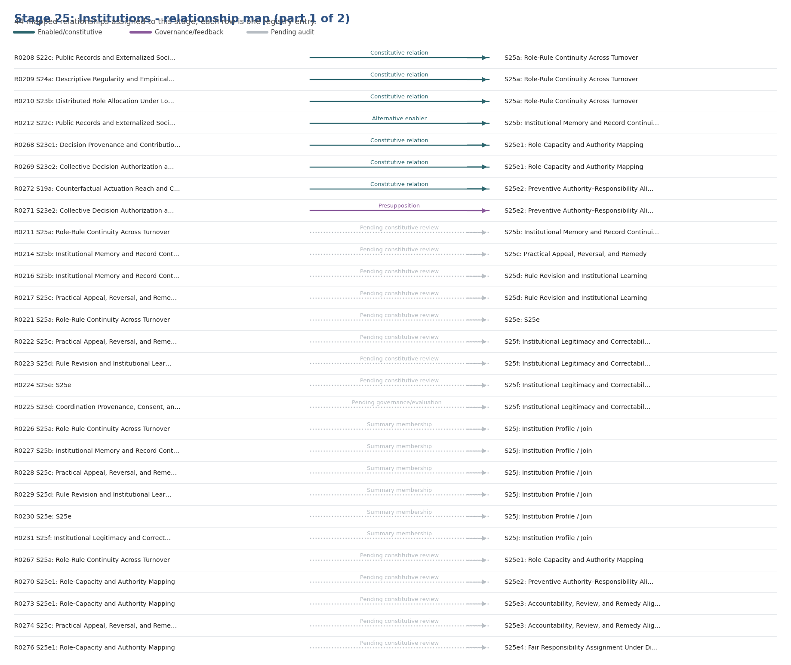{width=100%}
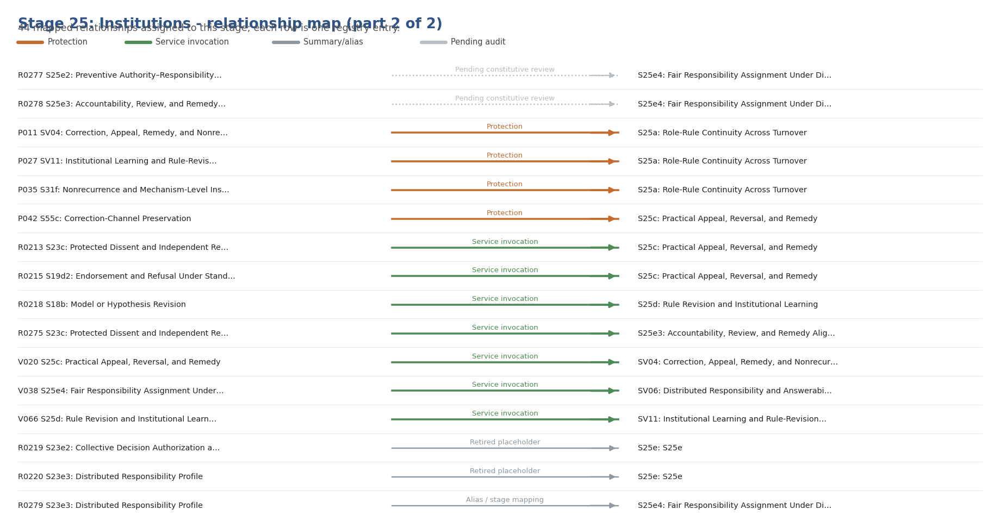{width=100%}

Figure A25. **Current Stage 25 relationship neighborhood.** Gray or pending entries remain candidates rather than proof-order claims.

### Relationship ledger

| ID | Source -> target | Type, status, and warrant | Current explanation, test, and revision boundary |
|---|---|---|---|
| R0208 | Public Records and Externalized Social Memory -> Role-Rule Continuity Across Turnover | Constitutive relation; adjudicated_v0.20; conceptual or source-grounded argument; empirical validation pending | The source is one ingredient of the target’s identity, but other realizations or decompositions remain possible. Warrant: conceptual or source-grounded argument; empirical validation pending Test: Intervene on S22c and test whether the identity, organization, or classification of S25a changes without assuming total disappearance. Existing targe… Revise if: If S25a retains the same declared identity under source removal, this constitutive claim should be weakened or removed. Evidence: E1_conceptual_source_grounded_or_normative |
| R0209 | Descriptive Regularity and Empirical Expectation -> Role-Rule Continuity Across Turnover | Constitutive relation; adjudicated_v0.20; conceptual or source-grounded argument; empirical validation pending | The source is one ingredient of the target’s identity, but other realizations or decompositions remain possible. Warrant: conceptual or source-grounded argument; empirical validation pending Test: Intervene on S24a and test whether the identity, organization, or classification of S25a changes without assuming total disappearance. Existing targe… Revise if: If S25a retains the same declared identity under source removal, this constitutive claim should be weakened or removed. Evidence: E1_conceptual_source_grounded_or_normative |
| R0210 | Distributed Role Allocation Under Local Values -> Role-Rule Continuity Across Turnover | Constitutive relation; adjudicated_v0.20; conceptual or source-grounded argument; empirical validation pending | The source is one ingredient of the target’s identity, but other realizations or decompositions remain possible. Warrant: conceptual or source-grounded argument; empirical validation pending Test: Intervene on S23b and test whether the identity, organization, or classification of S25a changes without assuming total disappearance. Existing targe… Revise if: If S25a retains the same declared identity under source removal, this constitutive claim should be weakened or removed. Evidence: E1_conceptual_source_grounded_or_normative |
| R0212 | Public Records and Externalized Social Memory -> Institutional Memory and Record Continuity | Alternative enabler; adjudicated_v0.20; conceptual or source-grounded argument; empirical validation pending | The source is one route among several and therefore cannot support a necessity claim. Warrant: conceptual or source-grounded argument; empirical validation pending Test: Compare otherwise matched realizations of S25b with and without S22c; the source should widen, stabilize, or improve the target realization. Existing… Revise if: No measurable change in target realizability, robustness, reach, or cost after source removal would defeat this enablement claim. Evidence: E1_conceptual_source_grounded_or_normative |
| R0268 | Decision Provenance and Contribution Graph -> Role-Capacity and Authority Mapping | Constitutive relation; adjudicated_v0.20; conceptual or source-grounded argument; empirical validation pending | The source is one ingredient of the target’s identity, but other realizations or decompositions remain possible. Warrant: conceptual or source-grounded argument; empirical validation pending Test: Intervene on S23e1 and test whether the identity, organization, or classification of S25e1 changes without assuming total disappearance. Existing tar… Revise if: If S25e1 retains the same declared identity under source removal, this constitutive claim should be weakened or removed. Evidence: E1_conceptual_source_grounded_or_normative |
| R0269 | Collective Decision Authorization and Answerability -> Role-Capacity and Authority Mapping | Constitutive relation; adjudicated_v0.20; conceptual or source-grounded argument; empirical validation pending | The source is one ingredient of the target’s identity, but other realizations or decompositions remain possible. Warrant: conceptual or source-grounded argument; empirical validation pending Test: Intervene on S23e2 and test whether the identity, organization, or classification of S25e1 changes without assuming total disappearance. Existing tar… Revise if: If S25e1 retains the same declared identity under source removal, this constitutive claim should be weakened or removed. Evidence: E1_conceptual_source_grounded_or_normative |
| R0272 | Counterfactual Actuation Reach and Control -> Preventive Authority–Responsibility Alignment | Constitutive relation; adjudicated_v0.20; reproducible toy model or simulation | The source is one ingredient of the target’s identity, but other realizations or decompositions remain possible. Warrant: reproducible toy model or simulation Test: Intervene on S19a and test whether the identity, organization, or classification of S25e2 changes without assuming total disappearance. Existing targ… Revise if: If S25e2 retains the same declared identity under source removal, this constitutive claim should be weakened or removed. Evidence: E4_reproducible_toy_or_simulation |
| R0271 | Collective Decision Authorization and Answerability -> Preventive Authority–Responsibility Alignment | Presupposition; adjudicated_v0.20; reproducible toy model or simulation | Preventive alignment presupposes an authorization structure but is not derived from authorization alone. Warrant: reproducible toy model or simulation Test: Review the source-target semantics against the relation definition; target record: in the constructed workflow, aligned responsibility yields simulat… Revise if: A source-target case that fits a different typed relation would require reclassification. Evidence: E4_reproducible_toy_or_simulation |
| R0211 | Role-Rule Continuity Across Turnover -> Institutional Memory and Record Continuity | Pending constitutive review; pending_companion_paper_relation_audit; pending semantic adjudication | Within-stage relation was not part of the 306-edge enabling audit. Warrant: pending semantic adjudication Semantic adjudication remains pending; no prerequisite claim is licensed. |
| R0214 | Institutional Memory and Record Continuity -> Practical Appeal, Reversal, and Remedy | Pending constitutive review; pending_companion_paper_relation_audit; pending semantic adjudication | Within-stage relation was not part of the 306-edge enabling audit. Warrant: pending semantic adjudication Semantic adjudication remains pending; no prerequisite claim is licensed. |
| R0216 | Institutional Memory and Record Continuity -> Rule Revision and Institutional Learning | Pending constitutive review; pending_companion_paper_relation_audit; pending semantic adjudication | Within-stage relation was not part of the 306-edge enabling audit. Warrant: pending semantic adjudication Semantic adjudication remains pending; no prerequisite claim is licensed. |
| R0217 | Practical Appeal, Reversal, and Remedy -> Rule Revision and Institutional Learning | Pending constitutive review; pending_companion_paper_relation_audit; pending semantic adjudication | Within-stage relation was not part of the 306-edge enabling audit. Warrant: pending semantic adjudication Semantic adjudication remains pending; no prerequisite claim is licensed. |
| R0221 | Role-Rule Continuity Across Turnover -> S25e | Pending constitutive review; pending_companion_paper_relation_audit; pending semantic adjudication | Within-stage relation was not part of the 306-edge enabling audit. Warrant: pending semantic adjudication Semantic adjudication remains pending; no prerequisite claim is licensed. |
| R0222 | Practical Appeal, Reversal, and Remedy -> Institutional Legitimacy and Correctability Profile | Pending constitutive review; pending_companion_paper_relation_audit; pending semantic adjudication | Within-stage relation was not part of the 306-edge enabling audit. Warrant: pending semantic adjudication Semantic adjudication remains pending; no prerequisite claim is licensed. |
| R0223 | Rule Revision and Institutional Learning -> Institutional Legitimacy and Correctability Profile | Pending constitutive review; pending_companion_paper_relation_audit; pending semantic adjudication | Within-stage relation was not part of the 306-edge enabling audit. Warrant: pending semantic adjudication Semantic adjudication remains pending; no prerequisite claim is licensed. |
| R0224 | S25e -> Institutional Legitimacy and Correctability Profile | Pending constitutive review; pending_companion_paper_relation_audit; pending semantic adjudication | Within-stage relation was not part of the 306-edge enabling audit. Warrant: pending semantic adjudication Semantic adjudication remains pending; no prerequisite claim is licensed. |
| R0225 | Coordination Provenance, Consent, and Legitimacy Profile -> Institutional Legitimacy and Correctability Profile | Pending governance/evaluation/interpretation review; pending_companion_paper_relation_audit; pending semantic adjudication | Governance/evaluative/interpretive relation requires role-specific adjudication. Warrant: pending semantic adjudication Semantic adjudication remains pending; no prerequisite claim is licensed. |
| R0226 | Role-Rule Continuity Across Turnover -> Institution Profile / Join | Summary membership; carried_forward_low_risk_pending_spot_check; pending semantic adjudication | Summary membership is retained outside proof order. Warrant: pending semantic adjudication Semantic adjudication remains pending; no prerequisite claim is licensed. |
| R0227 | Institutional Memory and Record Continuity -> Institution Profile / Join | Summary membership; carried_forward_low_risk_pending_spot_check; pending semantic adjudication | Summary membership is retained outside proof order. Warrant: pending semantic adjudication Semantic adjudication remains pending; no prerequisite claim is licensed. |
| R0228 | Practical Appeal, Reversal, and Remedy -> Institution Profile / Join | Summary membership; carried_forward_low_risk_pending_spot_check; pending semantic adjudication | Summary membership is retained outside proof order. Warrant: pending semantic adjudication Semantic adjudication remains pending; no prerequisite claim is licensed. |
| R0229 | Rule Revision and Institutional Learning -> Institution Profile / Join | Summary membership; carried_forward_low_risk_pending_spot_check; pending semantic adjudication | Summary membership is retained outside proof order. Warrant: pending semantic adjudication Semantic adjudication remains pending; no prerequisite claim is licensed. |
| R0230 | S25e -> Institution Profile / Join | Summary membership; carried_forward_low_risk_pending_spot_check; pending semantic adjudication | Summary membership is retained outside proof order. Warrant: pending semantic adjudication Semantic adjudication remains pending; no prerequisite claim is licensed. |
| R0231 | Institutional Legitimacy and Correctability Profile -> Institution Profile / Join | Summary membership; carried_forward_low_risk_pending_spot_check; pending semantic adjudication | Summary membership is retained outside proof order. Warrant: pending semantic adjudication Semantic adjudication remains pending; no prerequisite claim is licensed. |
| R0267 | Role-Rule Continuity Across Turnover -> Role-Capacity and Authority Mapping | Pending constitutive review; pending_companion_paper_relation_audit; pending semantic adjudication | Within-stage relation was not part of the 306-edge enabling audit. Warrant: pending semantic adjudication Semantic adjudication remains pending; no prerequisite claim is licensed. |
| R0270 | Role-Capacity and Authority Mapping -> Preventive Authority–Responsibility Alignment | Pending constitutive review; pending_companion_paper_relation_audit; pending semantic adjudication | Within-stage relation was not part of the 306-edge enabling audit. Warrant: pending semantic adjudication Semantic adjudication remains pending; no prerequisite claim is licensed. |
| R0273 | Role-Capacity and Authority Mapping -> Accountability, Review, and Remedy Alignment | Pending constitutive review; pending_companion_paper_relation_audit; pending semantic adjudication | Within-stage relation was not part of the 306-edge enabling audit. Warrant: pending semantic adjudication Semantic adjudication remains pending; no prerequisite claim is licensed. |
| R0274 | Practical Appeal, Reversal, and Remedy -> Accountability, Review, and Remedy Alignment | Pending constitutive review; pending_companion_paper_relation_audit; pending semantic adjudication | Within-stage relation was not part of the 306-edge enabling audit. Warrant: pending semantic adjudication Semantic adjudication remains pending; no prerequisite claim is licensed. |
| R0276 | Role-Capacity and Authority Mapping -> Fair Responsibility Assignment Under Distributed Power | Pending constitutive review; pending_companion_paper_relation_audit; pending semantic adjudication | Within-stage relation was not part of the 306-edge enabling audit. Warrant: pending semantic adjudication Semantic adjudication remains pending; no prerequisite claim is licensed. |
| R0277 | Preventive Authority–Responsibility Alignment -> Fair Responsibility Assignment Under Distributed Power | Pending constitutive review; pending_companion_paper_relation_audit; pending semantic adjudication | Within-stage relation was not part of the 306-edge enabling audit. Warrant: pending semantic adjudication Semantic adjudication remains pending; no prerequisite claim is licensed. |
| R0278 | Accountability, Review, and Remedy Alignment -> Fair Responsibility Assignment Under Distributed Power | Pending constitutive review; pending_companion_paper_relation_audit; pending semantic adjudication | Within-stage relation was not part of the 306-edge enabling audit. Warrant: pending semantic adjudication Semantic adjudication remains pending; no prerequisite claim is licensed. |
| P011 | Correction, Appeal, Remedy, and Nonrecurrence Service -> Role-Rule Continuity Across Turnover | Protection; selective v0.20 candidate protection edge; requires domain or institutional validation before consequential use; governance-design claim with stated mechanism and failure condition | appeal and nonrecurrence prevent institutional continuity from preserving obsolete error Warrant: governance-design claim with stated mechanism and failure condition Test: Remove or neutralize the source protection and test whether Role-Rule Continuity Across Turnover becomes more exposed, less viable, less contestable,… Revise if: remove or neutralize the source protection and test whether the target becomes more exposed, less viable, less contestable, or less co… Evidence: internal_architecture_candidate |
| P027 | Institutional Learning and Rule-Revision Service -> Role-Rule Continuity Across Turnover | Protection; selective v0.20 candidate protection edge; requires domain or institutional validation before consequential use; governance-design claim with stated mechanism and failure condition | rule revision protects institutions from continuity without learning Warrant: governance-design claim with stated mechanism and failure condition Test: Remove or neutralize the source protection and test whether Role-Rule Continuity Across Turnover becomes more exposed, less viable, less contestable,… Revise if: remove or neutralize the source protection and test whether the target becomes more exposed, less viable, less contestable, or less co… Evidence: internal_architecture_candidate |
| P035 | Nonrecurrence and Mechanism-Level Institutional Learning -> Role-Rule Continuity Across Turnover | Protection; selective v0.20 candidate protection edge; requires domain or institutional validation before consequential use; governance-design claim with stated mechanism and failure condition | nonrecurrence protects institutional continuity from repeating harm Warrant: governance-design claim with stated mechanism and failure condition Test: Remove or neutralize the source protection and test whether Role-Rule Continuity Across Turnover becomes more exposed, less viable, less contestable,… Revise if: remove or neutralize the source protection and test whether the target becomes more exposed, less viable, less contestable, or less co… Evidence: internal_architecture_candidate |
| P042 | Correction-Channel Preservation -> Practical Appeal, Reversal, and Remedy | Protection; selective v0.20 candidate protection edge; requires domain or institutional validation before consequential use; governance-design claim with stated mechanism and failure condition | correction-channel preservation protects appeal and remedy from nominalization Warrant: governance-design claim with stated mechanism and failure condition Test: Remove or neutralize the source protection and test whether Practical Appeal, Reversal, and Remedy becomes more exposed, less viable, less contestabl… Revise if: remove or neutralize the source protection and test whether the target becomes more exposed, less viable, less contestable, or less co… Evidence: internal_architecture_candidate |
| R0213 | Protected Dissent and Independent Review -> Practical Appeal, Reversal, and Remedy | Service invocation; adjudicated_v0.20; conceptual or source-grounded argument; empirical validation pending | The target calls a reusable service already defined elsewhere; the relation is not a new rung. Warrant: conceptual or source-grounded argument; empirical validation pending Test: Check whether the stage-specific use of S25c actually calls the named shared-service role represented by S23c. Revise if: If the target use can be specified without that service role, retain only a looser cross-reference. Evidence: E1_conceptual_source_grounded_or_normative |
| R0215 | Endorsement and Refusal Under Standing Commitments -> Practical Appeal, Reversal, and Remedy | Service invocation; adjudicated_v0.20; conceptual or source-grounded argument; empirical validation pending | The target calls a reusable service already defined elsewhere; the relation is not a new rung. Warrant: conceptual or source-grounded argument; empirical validation pending Test: Check whether the stage-specific use of S25c actually calls the named shared-service role represented by S19d2. Revise if: If the target use can be specified without that service role, retain only a looser cross-reference. Evidence: E1_conceptual_source_grounded_or_normative |
| R0218 | Model or Hypothesis Revision -> Rule Revision and Institutional Learning | Service invocation; adjudicated_v0.20; conceptual or source-grounded argument; empirical validation pending | The target calls a reusable service already defined elsewhere; the relation is not a new rung. Warrant: conceptual or source-grounded argument; empirical validation pending Test: Check whether the stage-specific use of S25d actually calls the named shared-service role represented by S18b. Revise if: If the target use can be specified without that service role, retain only a looser cross-reference. Evidence: E1_conceptual_source_grounded_or_normative |
| R0275 | Protected Dissent and Independent Review -> Accountability, Review, and Remedy Alignment | Service invocation; adjudicated_v0.20; reproducible toy model or simulation | The target calls a reusable service already defined elsewhere; the relation is not a new rung. Warrant: reproducible toy model or simulation Test: Check whether the stage-specific use of S25e3 actually calls the named shared-service role represented by S23c. Revise if: If the target use can be specified without that service role, retain only a looser cross-reference. Evidence: E4_reproducible_toy_or_simulation |
| V020 | Practical Appeal, Reversal, and Remedy -> Correction, Appeal, Remedy, and Nonrecurrence Service | Service invocation; defined_v0.4; internal architecture and role mapping | Practical Appeal, Reversal, and Remedy invokes Correction, Appeal, Remedy, and Nonrecurrence Service in the role of practical appeal/reversal/remedy. Warrant: internal architecture and role mapping Test: Check whether the stage-specific role practical appeal/reversal/remedy is actually required when the service is instantiated at Stage 25. Revise if: If the stage does not use this service role, the invocation should be removed or reassigned. Evidence: internal_architecture_candidate |
| V038 | Fair Responsibility Assignment Under Distributed Power -> Distributed Responsibility and Answerability Service | Service invocation; defined_v0.4; internal architecture and role mapping | Fair Responsibility Assignment Under Distributed Power invokes Distributed Responsibility and Answerability Service in the role of fair assignment under distributed power. Warrant: internal architecture and role mapping Test: Check whether the stage-specific role fair assignment under distributed power is actually required when the service is instantiated at Stage 25. Revise if: If the stage does not use this service role, the invocation should be removed or reassigned. Evidence: internal_architecture_candidate |
| V066 | Rule Revision and Institutional Learning -> Institutional Learning and Rule-Revision Service | Service invocation; defined_v0.4; internal architecture and role mapping | Rule Revision and Institutional Learning invokes Institutional Learning and Rule-Revision Service in the role of institutional learning. Warrant: internal architecture and role mapping Test: Check whether the stage-specific role institutional learning is actually required when the service is instantiated at Stage 25. Revise if: If the stage does not use this service role, the invocation should be removed or reassigned. Evidence: internal_architecture_candidate |
| R0219 | Collective Decision Authorization and Answerability -> S25e | Retired placeholder; adjudicated_v0.20; conceptual or source-grounded argument; empirical validation pending | The target placeholder is retired; authorization remains active through resolved subnodes. Warrant: conceptual or source-grounded argument; empirical validation pending Evidence: E1_conceptual_source_grounded_or_normative |
| R0220 | Distributed Responsibility Profile -> S25e | Retired placeholder; adjudicated_v0.20; conceptual or source-grounded argument; empirical validation pending | The target placeholder is retired; the responsibility profile remains active through resolved subnodes. Warrant: conceptual or source-grounded argument; empirical validation pending Evidence: E1_conceptual_source_grounded_or_normative |
| R0279 | Distributed Responsibility Profile -> Fair Responsibility Assignment Under Distributed Power | Alias / stage mapping; adjudicated_v0.20; conceptual or source-grounded argument; empirical validation pending | Fair responsibility assignment is a stage-specific use of the shared responsibility profile. Warrant: conceptual or source-grounded argument; empirical validation pending Evidence: E0_open_or_unresolved |

### Revision gate

**Next action:** Multiple institutional purposes, delegation, capture, review independence, recurrence, public learning, and scale alignment A relation should be retyped, weakened, redirected, or removed whenever its dependency witness fails, its countermodel succeeds, its warrant basis changes, or target-domain evidence defeats the declared scope.

\pagebreak

## Stage 26 - Culture and Meaning Infrastructure

**Domain block:** Social / cultural / interpretive seam  \
**Claim status:** Hypothesis / research program  \
**Canonical role:** Social / cultural synthesis  \
**Source:** M&E §13.14

### Stage meaning and formal role

Culture transmits narratives, identities, practices, and evaluative horizons across generations. Meaning infrastructure must remain renewable, plural, truth-constrained, and open to revision.

Stage 26 contains **7 active object(s)**: Summary join (1), Operational capacity (4), Governance / authorization (1), Interpretation (1). The synchronized ledger assigns **29 relationship record(s)** to this stage.

### Active object inventory

| ID | Object | Type | Evidence | Disposition |
|---|---|---|---|---|
| S26J | Culture and Meaning Infrastructure Profile / Join | Summary join | E1_conceptual_source_grounded_or_normative | retain_as_stage_summary_not_core_node |
| S26a | Intergenerational Cultural Transmission | Operational capacity | E1_conceptual_source_grounded_or_normative | retain_distinct_pending_edge_audit |
| S26b | Public Meaning and Practice Infrastructure | Operational capacity | E4_reproducible_toy_or_simulation | retain_distinct_pending_edge_audit |
| S26c | Cultural Renewal Under Reality Change | Operational capacity | E1_conceptual_source_grounded_or_normative | retain_distinct_pending_edge_audit |
| S26d | Plural Thick Expression with a Shared Factual Spine | Operational capacity | E1_conceptual_source_grounded_or_normative | retain_as_family_member_or_stage_instantiation |
| S26e | Narrative Capture, Refusal, Exit, and Reentry | Governance / authorization | E1_conceptual_source_grounded_or_normative | retain_as_family_member_or_stage_instantiation |
| S26f | Open Myth and Civilizational Orientation | Interpretation | E1_conceptual_source_grounded_or_normative | retain_as_family_member_or_stage_instantiation |

### Complete relationship map

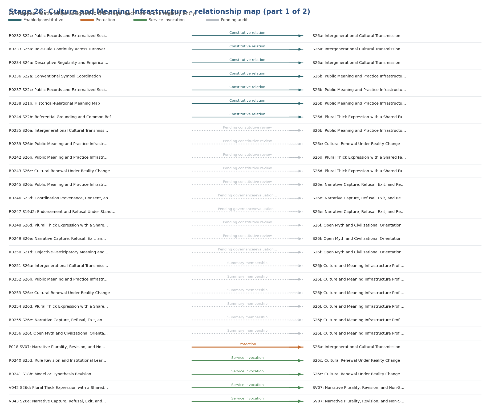{width=100%}
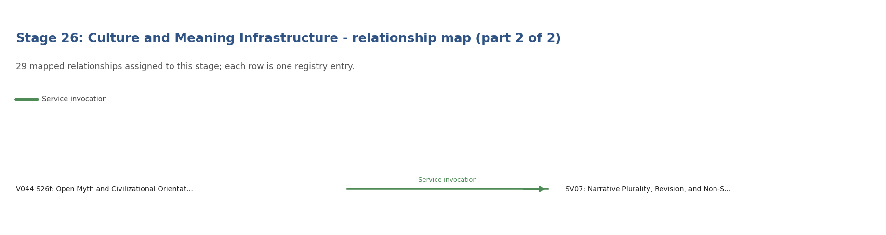{width=100%}

Figure A26. **Current Stage 26 relationship neighborhood.** Gray or pending entries remain candidates rather than proof-order claims.

### Relationship ledger

| ID | Source -> target | Type, status, and warrant | Current explanation, test, and revision boundary |
|---|---|---|---|
| R0232 | Public Records and Externalized Social Memory -> Intergenerational Cultural Transmission | Constitutive relation; adjudicated_v0.20; conceptual or source-grounded argument; empirical validation pending | The source is one ingredient of the target’s identity, but other realizations or decompositions remain possible. Warrant: conceptual or source-grounded argument; empirical validation pending Test: Intervene on S22c and test whether the identity, organization, or classification of S26a changes without assuming total disappearance. Existing targe… Revise if: If S26a retains the same declared identity under source removal, this constitutive claim should be weakened or removed. Evidence: E1_conceptual_source_grounded_or_normative |
| R0233 | Role-Rule Continuity Across Turnover -> Intergenerational Cultural Transmission | Constitutive relation; adjudicated_v0.20; conceptual or source-grounded argument; empirical validation pending | The source is one ingredient of the target’s identity, but other realizations or decompositions remain possible. Warrant: conceptual or source-grounded argument; empirical validation pending Test: Intervene on S25a and test whether the identity, organization, or classification of S26a changes without assuming total disappearance. Existing targe… Revise if: If S26a retains the same declared identity under source removal, this constitutive claim should be weakened or removed. Evidence: E1_conceptual_source_grounded_or_normative |
| R0234 | Descriptive Regularity and Empirical Expectation -> Intergenerational Cultural Transmission | Constitutive relation; adjudicated_v0.20; conceptual or source-grounded argument; empirical validation pending | The source is one ingredient of the target’s identity, but other realizations or decompositions remain possible. Warrant: conceptual or source-grounded argument; empirical validation pending Test: Intervene on S24a and test whether the identity, organization, or classification of S26a changes without assuming total disappearance. Existing targe… Revise if: If S26a retains the same declared identity under source removal, this constitutive claim should be weakened or removed. Evidence: E1_conceptual_source_grounded_or_normative |
| R0236 | Conventional Symbol Coordination -> Public Meaning and Practice Infrastructure | Constitutive relation; adjudicated_v0.20; reproducible toy model or simulation | The source is one ingredient of the target’s identity, but other realizations or decompositions remain possible. Warrant: reproducible toy model or simulation Test: Intervene on S22a and test whether the identity, organization, or classification of S26b changes without assuming total disappearance. Existing targe… Revise if: If S26b retains the same declared identity under source removal, this constitutive claim should be weakened or removed. Evidence: E4_reproducible_toy_or_simulation |
| R0237 | Public Records and Externalized Social Memory -> Public Meaning and Practice Infrastructure | Constitutive relation; adjudicated_v0.20; reproducible toy model or simulation | The source is one ingredient of the target’s identity, but other realizations or decompositions remain possible. Warrant: reproducible toy model or simulation Test: Intervene on S22c and test whether the identity, organization, or classification of S26b changes without assuming total disappearance. Existing targe… Revise if: If S26b retains the same declared identity under source removal, this constitutive claim should be weakened or removed. Evidence: E4_reproducible_toy_or_simulation |
| R0238 | Historical-Relational Meaning Map -> Public Meaning and Practice Infrastructure | Constitutive relation; adjudicated_v0.20; reproducible toy model or simulation | The source is one ingredient of the target’s identity, but other realizations or decompositions remain possible. Warrant: reproducible toy model or simulation Test: Intervene on S21b and test whether the identity, organization, or classification of S26b changes without assuming total disappearance. Existing targe… Revise if: If S26b retains the same declared identity under source removal, this constitutive claim should be weakened or removed. Evidence: E4_reproducible_toy_or_simulation |
| R0244 | Referential Grounding and Common Reference -> Plural Thick Expression with a Shared Factual Spine | Constitutive relation; adjudicated_v0.20; conceptual or source-grounded argument; empirical validation pending | The source is one ingredient of the target’s identity, but other realizations or decompositions remain possible. Warrant: conceptual or source-grounded argument; empirical validation pending Test: Intervene on S22b and test whether the identity, organization, or classification of S26d changes without assuming total disappearance. Existing targe… Revise if: If S26d retains the same declared identity under source removal, this constitutive claim should be weakened or removed. Evidence: E1_conceptual_source_grounded_or_normative |
| R0235 | Intergenerational Cultural Transmission -> Public Meaning and Practice Infrastructure | Pending constitutive review; pending_companion_paper_relation_audit; pending semantic adjudication | Within-stage relation was not part of the 306-edge enabling audit. Warrant: pending semantic adjudication Semantic adjudication remains pending; no prerequisite claim is licensed. |
| R0239 | Public Meaning and Practice Infrastructure -> Cultural Renewal Under Reality Change | Pending constitutive review; pending_companion_paper_relation_audit; pending semantic adjudication | Within-stage relation was not part of the 306-edge enabling audit. Warrant: pending semantic adjudication Semantic adjudication remains pending; no prerequisite claim is licensed. |
| R0242 | Public Meaning and Practice Infrastructure -> Plural Thick Expression with a Shared Factual Spine | Pending constitutive review; pending_companion_paper_relation_audit; pending semantic adjudication | Within-stage relation was not part of the 306-edge enabling audit. Warrant: pending semantic adjudication Semantic adjudication remains pending; no prerequisite claim is licensed. |
| R0243 | Cultural Renewal Under Reality Change -> Plural Thick Expression with a Shared Factual Spine | Pending constitutive review; pending_companion_paper_relation_audit; pending semantic adjudication | Within-stage relation was not part of the 306-edge enabling audit. Warrant: pending semantic adjudication Semantic adjudication remains pending; no prerequisite claim is licensed. |
| R0245 | Public Meaning and Practice Infrastructure -> Narrative Capture, Refusal, Exit, and Reentry | Pending constitutive review; pending_companion_paper_relation_audit; pending semantic adjudication | Within-stage relation was not part of the 306-edge enabling audit. Warrant: pending semantic adjudication Semantic adjudication remains pending; no prerequisite claim is licensed. |
| R0246 | Coordination Provenance, Consent, and Legitimacy Profile -> Narrative Capture, Refusal, Exit, and Reentry | Pending governance/evaluation/interpretation review; pending_companion_paper_relation_audit; pending semantic adjudication | Governance/evaluative/interpretive relation requires role-specific adjudication. Warrant: pending semantic adjudication Semantic adjudication remains pending; no prerequisite claim is licensed. |
| R0247 | Endorsement and Refusal Under Standing Commitments -> Narrative Capture, Refusal, Exit, and Reentry | Pending governance/evaluation/interpretation review; pending_companion_paper_relation_audit; pending semantic adjudication | Governance/evaluative/interpretive relation requires role-specific adjudication. Warrant: pending semantic adjudication Semantic adjudication remains pending; no prerequisite claim is licensed. |
| R0248 | Plural Thick Expression with a Shared Factual Spine -> Open Myth and Civilizational Orientation | Pending constitutive review; pending_companion_paper_relation_audit; pending semantic adjudication | Within-stage relation was not part of the 306-edge enabling audit. Warrant: pending semantic adjudication Semantic adjudication remains pending; no prerequisite claim is licensed. |
| R0249 | Narrative Capture, Refusal, Exit, and Reentry -> Open Myth and Civilizational Orientation | Pending constitutive review; pending_companion_paper_relation_audit; pending semantic adjudication | Within-stage relation was not part of the 306-edge enabling audit. Warrant: pending semantic adjudication Semantic adjudication remains pending; no prerequisite claim is licensed. |
| R0250 | Objective-Participatory Meaning and Commitment Enactment -> Open Myth and Civilizational Orientation | Pending governance/evaluation/interpretation review; pending_companion_paper_relation_audit; pending semantic adjudication | Governance/evaluative/interpretive relation requires role-specific adjudication. Warrant: pending semantic adjudication Semantic adjudication remains pending; no prerequisite claim is licensed. |
| R0251 | Intergenerational Cultural Transmission -> Culture and Meaning Infrastructure Profile / Join | Summary membership; carried_forward_low_risk_pending_spot_check; pending semantic adjudication | Summary membership is retained outside proof order. Warrant: pending semantic adjudication Semantic adjudication remains pending; no prerequisite claim is licensed. |
| R0252 | Public Meaning and Practice Infrastructure -> Culture and Meaning Infrastructure Profile / Join | Summary membership; carried_forward_low_risk_pending_spot_check; pending semantic adjudication | Summary membership is retained outside proof order. Warrant: pending semantic adjudication Semantic adjudication remains pending; no prerequisite claim is licensed. |
| R0253 | Cultural Renewal Under Reality Change -> Culture and Meaning Infrastructure Profile / Join | Summary membership; carried_forward_low_risk_pending_spot_check; pending semantic adjudication | Summary membership is retained outside proof order. Warrant: pending semantic adjudication Semantic adjudication remains pending; no prerequisite claim is licensed. |
| R0254 | Plural Thick Expression with a Shared Factual Spine -> Culture and Meaning Infrastructure Profile / Join | Summary membership; carried_forward_low_risk_pending_spot_check; pending semantic adjudication | Summary membership is retained outside proof order. Warrant: pending semantic adjudication Semantic adjudication remains pending; no prerequisite claim is licensed. |
| R0255 | Narrative Capture, Refusal, Exit, and Reentry -> Culture and Meaning Infrastructure Profile / Join | Summary membership; carried_forward_low_risk_pending_spot_check; pending semantic adjudication | Summary membership is retained outside proof order. Warrant: pending semantic adjudication Semantic adjudication remains pending; no prerequisite claim is licensed. |
| R0256 | Open Myth and Civilizational Orientation -> Culture and Meaning Infrastructure Profile / Join | Summary membership; carried_forward_low_risk_pending_spot_check; pending semantic adjudication | Summary membership is retained outside proof order. Warrant: pending semantic adjudication Semantic adjudication remains pending; no prerequisite claim is licensed. |
| P018 | Narrative Plurality, Revision, and Non-Sovereignty Service -> Intergenerational Cultural Transmission | Protection; selective v0.20 candidate protection edge; requires domain or institutional validation before consequential use; governance-design claim with stated mechanism and failure condition | revision and exit protect cultural transmission from rigid or captured inheritance Warrant: governance-design claim with stated mechanism and failure condition Test: Remove or neutralize the source protection and test whether Intergenerational Cultural Transmission becomes more exposed, less viable, less contestab… Revise if: remove or neutralize the source protection and test whether the target becomes more exposed, less viable, less contestable, or less co… Evidence: internal_architecture_candidate |
| R0240 | Rule Revision and Institutional Learning -> Cultural Renewal Under Reality Change | Service invocation; adjudicated_v0.20; conceptual or source-grounded argument; empirical validation pending | The target calls a reusable service already defined elsewhere; the relation is not a new rung. Warrant: conceptual or source-grounded argument; empirical validation pending Test: Check whether the stage-specific use of S26c actually calls the named shared-service role represented by S25d. Revise if: If the target use can be specified without that service role, retain only a looser cross-reference. Evidence: E1_conceptual_source_grounded_or_normative |
| R0241 | Model or Hypothesis Revision -> Cultural Renewal Under Reality Change | Service invocation; adjudicated_v0.20; conceptual or source-grounded argument; empirical validation pending | The target calls a reusable service already defined elsewhere; the relation is not a new rung. Warrant: conceptual or source-grounded argument; empirical validation pending Test: Check whether the stage-specific use of S26c actually calls the named shared-service role represented by S18b. Revise if: If the target use can be specified without that service role, retain only a looser cross-reference. Evidence: E1_conceptual_source_grounded_or_normative |
| V042 | Plural Thick Expression with a Shared Factual Spine -> Narrative Plurality, Revision, and Non-Sovereignty Service | Service invocation; defined_v0.4; internal architecture and role mapping | Plural Thick Expression with a Shared Factual Spine invokes Narrative Plurality, Revision, and Non-Sovereignty Service in the role of plural expression/shared factual spine. Warrant: internal architecture and role mapping Test: Check whether the stage-specific role plural expression/shared factual spine is actually required when the service is instantiated at Stage 26. Revise if: If the stage does not use this service role, the invocation should be removed or reassigned. Evidence: internal_architecture_candidate |
| V043 | Narrative Capture, Refusal, Exit, and Reentry -> Narrative Plurality, Revision, and Non-Sovereignty Service | Service invocation; defined_v0.4; internal architecture and role mapping | Narrative Capture, Refusal, Exit, and Reentry invokes Narrative Plurality, Revision, and Non-Sovereignty Service in the role of capture/refusal/exit. Warrant: internal architecture and role mapping Test: Check whether the stage-specific role capture/refusal/exit is actually required when the service is instantiated at Stage 26. Revise if: If the stage does not use this service role, the invocation should be removed or reassigned. Evidence: internal_architecture_candidate |
| V044 | Open Myth and Civilizational Orientation -> Narrative Plurality, Revision, and Non-Sovereignty Service | Service invocation; defined_v0.4; internal architecture and role mapping | Open Myth and Civilizational Orientation invokes Narrative Plurality, Revision, and Non-Sovereignty Service in the role of civilizational orientation. Warrant: internal architecture and role mapping Test: Check whether the stage-specific role civilizational orientation is actually required when the service is instantiated at Stage 26. Revise if: If the stage does not use this service role, the invocation should be removed or reassigned. Evidence: internal_architecture_candidate |

### Revision gate

**Next action:** Cumulative culture, ritual and embodied practice, cultural selection, minority traditions, narrative power, refusal, and long-horizon Open Myth A relation should be retyped, weakened, redirected, or removed whenever its dependency witness fails, its countermodel succeeds, its warrant basis changes, or target-domain evidence defeats the declared scope.

# Arc 5 - Value, harm, public reason, and repair

\pagebreak

## Stage 27 - Value Differentiation

**Domain block:** Normative bridge  \
**Claim status:** Normative principle  \
**Canonical role:** Normative bridge principle  \
**Source:** M&E §13.14

### Stage meaning and formal role

Where beings possess welfare, agency, relationships, vulnerability, and stakes, outcomes become evaluatively distinguishable. Value is not derived from one physical scalar.

Stage 27 contains **6 active object(s)**: Evaluator / derived relation (5), Normative relation / status (1). The synchronized ledger assigns **29 relationship record(s)** to this stage.

### Active object inventory

| ID | Object | Type | Evidence | Disposition |
|---|---|---|---|---|
| S27a | Functional Better/Worse-For and Organism-Relative Stake | Evaluator / derived relation | E1_conceptual_source_grounded_or_normative | retain_typed_noncapacity_object |
| S27b | Phenomenal Welfare and Valence Evidence | Evaluator / derived relation | E0_open_or_unresolved | retain_typed_noncapacity_object |
| S27c | Effective Capability and Protected Option Set | Evaluator / derived relation | E4_reproducible_toy_or_simulation | retain_typed_noncapacity_object |
| S27d | Non-Domination and Standing Security | Evaluator / derived relation | E1_conceptual_source_grounded_or_normative | retain_typed_noncapacity_object |
| S27e | Relational Recognition, Belonging, and Mattering | Evaluator / derived relation | E0_open_or_unresolved | retain_typed_noncapacity_object |
| S27f | Moral Standing and Claim Generation | Normative relation / status | E1_conceptual_source_grounded_or_normative | retain_typed_noncapacity_object |

### Complete relationship map

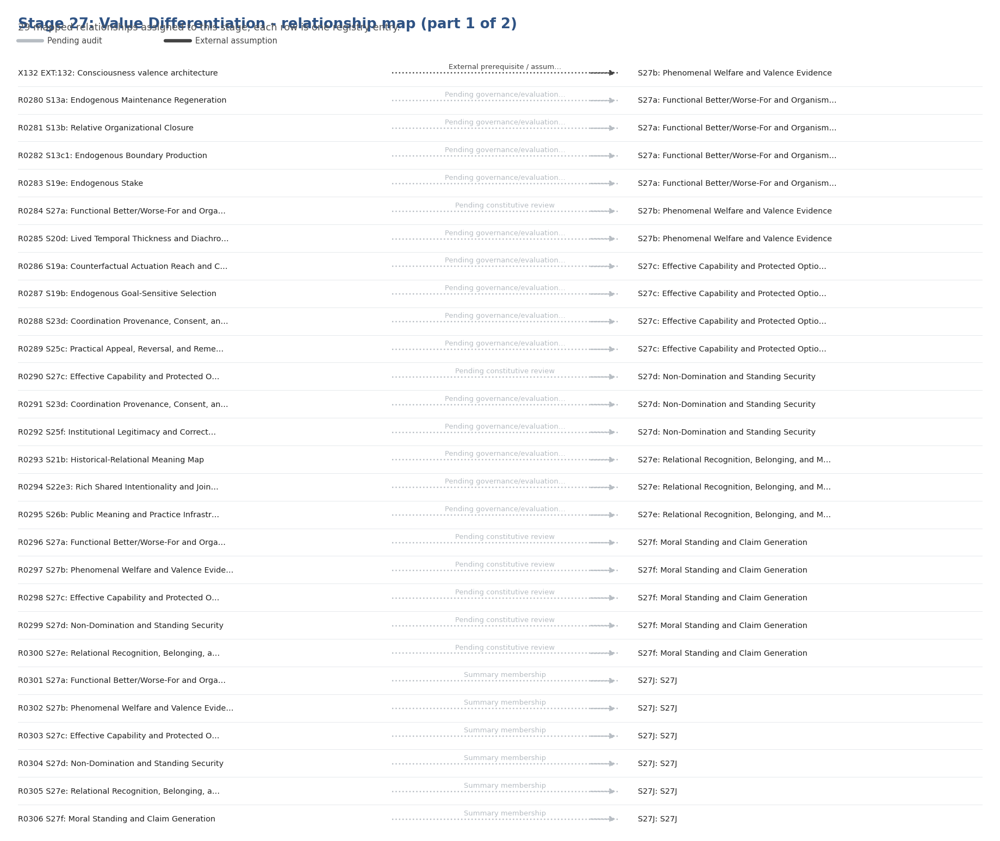{width=100%}
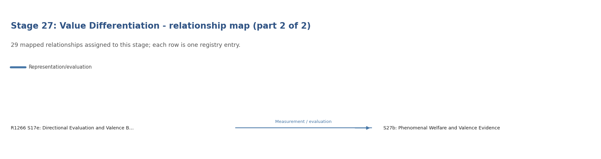{width=100%}

Figure A27. **Current Stage 27 relationship neighborhood.** Gray or pending entries remain candidates rather than proof-order claims.

### Relationship ledger

| ID | Source -> target | Type, status, and warrant | Current explanation, test, and revision boundary |
|---|---|---|---|
| X132 | Consciousness valence architecture -> Phenomenal Welfare and Valence Evidence | External prerequisite / assumption; not_in_scope_pending_external_prerequisite_audit; declared external assumption; target-domain audit pending | Phenomenal Welfare and Valence Evidence is modeled under the external prerequisite or assumption: Consciousness valence architecture. Warrant: declared external assumption; target-domain audit pending External-assumption audit remains pending. Evidence: external_assumption_pending |
| R0280 | Endogenous Maintenance Regeneration -> Functional Better/Worse-For and Organism-Relative Stake | Pending governance/evaluation/interpretation review; pending_companion_paper_relation_audit; pending semantic adjudication | Governance/evaluative/interpretive relation requires role-specific adjudication. Warrant: pending semantic adjudication Semantic adjudication remains pending; no prerequisite claim is licensed. |
| R0281 | Relative Organizational Closure -> Functional Better/Worse-For and Organism-Relative Stake | Pending governance/evaluation/interpretation review; pending_companion_paper_relation_audit; pending semantic adjudication | Governance/evaluative/interpretive relation requires role-specific adjudication. Warrant: pending semantic adjudication Semantic adjudication remains pending; no prerequisite claim is licensed. |
| R0282 | Endogenous Boundary Production -> Functional Better/Worse-For and Organism-Relative Stake | Pending governance/evaluation/interpretation review; pending_companion_paper_relation_audit; pending semantic adjudication | Governance/evaluative/interpretive relation requires role-specific adjudication. Warrant: pending semantic adjudication Semantic adjudication remains pending; no prerequisite claim is licensed. |
| R0283 | Endogenous Stake -> Functional Better/Worse-For and Organism-Relative Stake | Pending governance/evaluation/interpretation review; pending_companion_paper_relation_audit; pending semantic adjudication | Governance/evaluative/interpretive relation requires role-specific adjudication. Warrant: pending semantic adjudication Semantic adjudication remains pending; no prerequisite claim is licensed. |
| R0284 | Functional Better/Worse-For and Organism-Relative Stake -> Phenomenal Welfare and Valence Evidence | Pending constitutive review; pending_companion_paper_relation_audit; pending semantic adjudication | Within-stage relation was not part of the 306-edge enabling audit. Warrant: pending semantic adjudication Semantic adjudication remains pending; no prerequisite claim is licensed. |
| R0285 | Lived Temporal Thickness and Diachronic Concern -> Phenomenal Welfare and Valence Evidence | Pending governance/evaluation/interpretation review; pending_companion_paper_relation_audit; pending semantic adjudication | Governance/evaluative/interpretive relation requires role-specific adjudication. Warrant: pending semantic adjudication Semantic adjudication remains pending; no prerequisite claim is licensed. |
| R0286 | Counterfactual Actuation Reach and Control -> Effective Capability and Protected Option Set | Pending governance/evaluation/interpretation review; pending_companion_paper_relation_audit; pending semantic adjudication | Governance/evaluative/interpretive relation requires role-specific adjudication. Warrant: pending semantic adjudication Semantic adjudication remains pending; no prerequisite claim is licensed. |
| R0287 | Endogenous Goal-Sensitive Selection -> Effective Capability and Protected Option Set | Pending governance/evaluation/interpretation review; pending_companion_paper_relation_audit; pending semantic adjudication | Governance/evaluative/interpretive relation requires role-specific adjudication. Warrant: pending semantic adjudication Semantic adjudication remains pending; no prerequisite claim is licensed. |
| R0288 | Coordination Provenance, Consent, and Legitimacy Profile -> Effective Capability and Protected Option Set | Pending governance/evaluation/interpretation review; pending_companion_paper_relation_audit; pending semantic adjudication | Governance/evaluative/interpretive relation requires role-specific adjudication. Warrant: pending semantic adjudication Semantic adjudication remains pending; no prerequisite claim is licensed. |
| R0289 | Practical Appeal, Reversal, and Remedy -> Effective Capability and Protected Option Set | Pending governance/evaluation/interpretation review; pending_companion_paper_relation_audit; pending semantic adjudication | Governance/evaluative/interpretive relation requires role-specific adjudication. Warrant: pending semantic adjudication Semantic adjudication remains pending; no prerequisite claim is licensed. |
| R0290 | Effective Capability and Protected Option Set -> Non-Domination and Standing Security | Pending constitutive review; pending_companion_paper_relation_audit; pending semantic adjudication | Within-stage relation was not part of the 306-edge enabling audit. Warrant: pending semantic adjudication Semantic adjudication remains pending; no prerequisite claim is licensed. |
| R0291 | Coordination Provenance, Consent, and Legitimacy Profile -> Non-Domination and Standing Security | Pending governance/evaluation/interpretation review; pending_companion_paper_relation_audit; pending semantic adjudication | Governance/evaluative/interpretive relation requires role-specific adjudication. Warrant: pending semantic adjudication Semantic adjudication remains pending; no prerequisite claim is licensed. |
| R0292 | Institutional Legitimacy and Correctability Profile -> Non-Domination and Standing Security | Pending governance/evaluation/interpretation review; pending_companion_paper_relation_audit; pending semantic adjudication | Governance/evaluative/interpretive relation requires role-specific adjudication. Warrant: pending semantic adjudication Semantic adjudication remains pending; no prerequisite claim is licensed. |
| R0293 | Historical-Relational Meaning Map -> Relational Recognition, Belonging, and Mattering | Pending governance/evaluation/interpretation review; pending_companion_paper_relation_audit; pending semantic adjudication | Governance/evaluative/interpretive relation requires role-specific adjudication. Warrant: pending semantic adjudication Semantic adjudication remains pending; no prerequisite claim is licensed. |
| R0294 | Rich Shared Intentionality and Joint Commitment -> Relational Recognition, Belonging, and Mattering | Pending governance/evaluation/interpretation review; pending_companion_paper_relation_audit; pending semantic adjudication | Governance/evaluative/interpretive relation requires role-specific adjudication. Warrant: pending semantic adjudication Semantic adjudication remains pending; no prerequisite claim is licensed. |
| R0295 | Public Meaning and Practice Infrastructure -> Relational Recognition, Belonging, and Mattering | Pending governance/evaluation/interpretation review; pending_companion_paper_relation_audit; pending semantic adjudication | Governance/evaluative/interpretive relation requires role-specific adjudication. Warrant: pending semantic adjudication Semantic adjudication remains pending; no prerequisite claim is licensed. |
| R0296 | Functional Better/Worse-For and Organism-Relative Stake -> Moral Standing and Claim Generation | Pending constitutive review; pending_companion_paper_relation_audit; pending semantic adjudication | Within-stage relation was not part of the 306-edge enabling audit. Warrant: pending semantic adjudication Semantic adjudication remains pending; no prerequisite claim is licensed. |
| R0297 | Phenomenal Welfare and Valence Evidence -> Moral Standing and Claim Generation | Pending constitutive review; pending_companion_paper_relation_audit; pending semantic adjudication | Within-stage relation was not part of the 306-edge enabling audit. Warrant: pending semantic adjudication Semantic adjudication remains pending; no prerequisite claim is licensed. |
| R0298 | Effective Capability and Protected Option Set -> Moral Standing and Claim Generation | Pending constitutive review; pending_companion_paper_relation_audit; pending semantic adjudication | Within-stage relation was not part of the 306-edge enabling audit. Warrant: pending semantic adjudication Semantic adjudication remains pending; no prerequisite claim is licensed. |
| R0299 | Non-Domination and Standing Security -> Moral Standing and Claim Generation | Pending constitutive review; pending_companion_paper_relation_audit; pending semantic adjudication | Within-stage relation was not part of the 306-edge enabling audit. Warrant: pending semantic adjudication Semantic adjudication remains pending; no prerequisite claim is licensed. |
| R0300 | Relational Recognition, Belonging, and Mattering -> Moral Standing and Claim Generation | Pending constitutive review; pending_companion_paper_relation_audit; pending semantic adjudication | Within-stage relation was not part of the 306-edge enabling audit. Warrant: pending semantic adjudication Semantic adjudication remains pending; no prerequisite claim is licensed. |
| R0301 | Functional Better/Worse-For and Organism-Relative Stake -> S27J | Summary membership; carried_forward_low_risk_pending_spot_check; pending semantic adjudication | Summary membership is retained outside proof order. Warrant: pending semantic adjudication Semantic adjudication remains pending; no prerequisite claim is licensed. |
| R0302 | Phenomenal Welfare and Valence Evidence -> S27J | Summary membership; carried_forward_low_risk_pending_spot_check; pending semantic adjudication | Summary membership is retained outside proof order. Warrant: pending semantic adjudication Semantic adjudication remains pending; no prerequisite claim is licensed. |
| R0303 | Effective Capability and Protected Option Set -> S27J | Summary membership; carried_forward_low_risk_pending_spot_check; pending semantic adjudication | Summary membership is retained outside proof order. Warrant: pending semantic adjudication Semantic adjudication remains pending; no prerequisite claim is licensed. |
| R0304 | Non-Domination and Standing Security -> S27J | Summary membership; carried_forward_low_risk_pending_spot_check; pending semantic adjudication | Summary membership is retained outside proof order. Warrant: pending semantic adjudication Semantic adjudication remains pending; no prerequisite claim is licensed. |
| R0305 | Relational Recognition, Belonging, and Mattering -> S27J | Summary membership; carried_forward_low_risk_pending_spot_check; pending semantic adjudication | Summary membership is retained outside proof order. Warrant: pending semantic adjudication Semantic adjudication remains pending; no prerequisite claim is licensed. |
| R0306 | Moral Standing and Claim Generation -> S27J | Summary membership; carried_forward_low_risk_pending_spot_check; pending semantic adjudication | Summary membership is retained outside proof order. Warrant: pending semantic adjudication Semantic adjudication remains pending; no prerequisite claim is licensed. |
| R1266 | Directional Evaluation and Valence Bridge -> Phenomenal Welfare and Valence Evidence | Measurement / evaluation; defined_wave7; conceptual or source-grounded argument; empirical validation pending | Directional evaluation supplies one candidate evidence channel within a broader phenomenal-welfare and valence assessment; it is never sufficient alone. Warrant: conceptual or source-grounded argument; empirical validation pending Test: Compare level-sensitive and rate-sensitive affective predictions while independently assessing perspective and integration. Revise if: If no discriminating evidence survives, remove directional evaluation from the valence-evidence profile. Evidence: E1_conceptual_source_grounded_or_normative |

### Revision gate

**Next action:** Valence evidence, capability measurement, domination, recognition, moral-status uncertainty, rights, and affected-being participation A relation should be retyped, weakened, redirected, or removed whenever its dependency witness fails, its countermodel succeeds, its warrant basis changes, or target-domain evidence defeats the declared scope.

\pagebreak

## Stage 28 - Harm Recognition

**Domain block:** Normative boundary and recognition  \
**Claim status:** Normative principle  \
**Canonical role:** Normative principle / boundary  \
**Source:** M&E §13.14

### Stage meaning and formal role

Harm concerns setbacks to welfare, agency, standing, relationship, protected conditions, or viable futures. Not every loss of organization is moral harm, and not all harm is captured by coherence language.

Stage 28 contains **9 active object(s)**: Summary join (1), Evaluator / derived relation (4), Normative relation / status (3), Open capacity / problem (1). The synchronized ledger assigns **39 relationship record(s)** to this stage.

### Active object inventory

| ID | Object | Type | Evidence | Disposition |
|---|---|---|---|---|
| S28J | Harm Recognition Profile / Join | Summary join | E1_conceptual_source_grounded_or_normative | retain_as_stage_summary_not_core_node |
| S28a | Welfare and Interest Setback | Evaluator / derived relation | E1_conceptual_source_grounded_or_normative | retain_typed_noncapacity_object |
| S28b | Agency, Rights, and Standing Injury | Normative relation / status | E1_conceptual_source_grounded_or_normative | retain_typed_noncapacity_object |
| S28c | Domination and Arbitrary-Power Exposure | Normative relation / status | E1_conceptual_source_grounded_or_normative | retain_typed_noncapacity_object |
| S28d | Risk Imposition and Vulnerability Exposure | Evaluator / derived relation | E1_conceptual_source_grounded_or_normative | retain_typed_noncapacity_object |
| S28e | Distributional and Externalized Harm | Evaluator / derived relation | E1_conceptual_source_grounded_or_normative | retain_typed_noncapacity_object |
| S28f | Irreversibility and Future Option Loss | Evaluator / derived relation | E1_conceptual_source_grounded_or_normative | retain_as_family_member_or_stage_instantiation |
| S28g | Relational Harm and Institutional Betrayal | Open capacity / problem | E0_open_or_unresolved | retain_open_research_branch |
| S28h | Harm Recognition with Affected-Party Standing | Normative relation / status | E1_conceptual_source_grounded_or_normative | retain_as_family_member_or_stage_instantiation |

### Complete relationship map

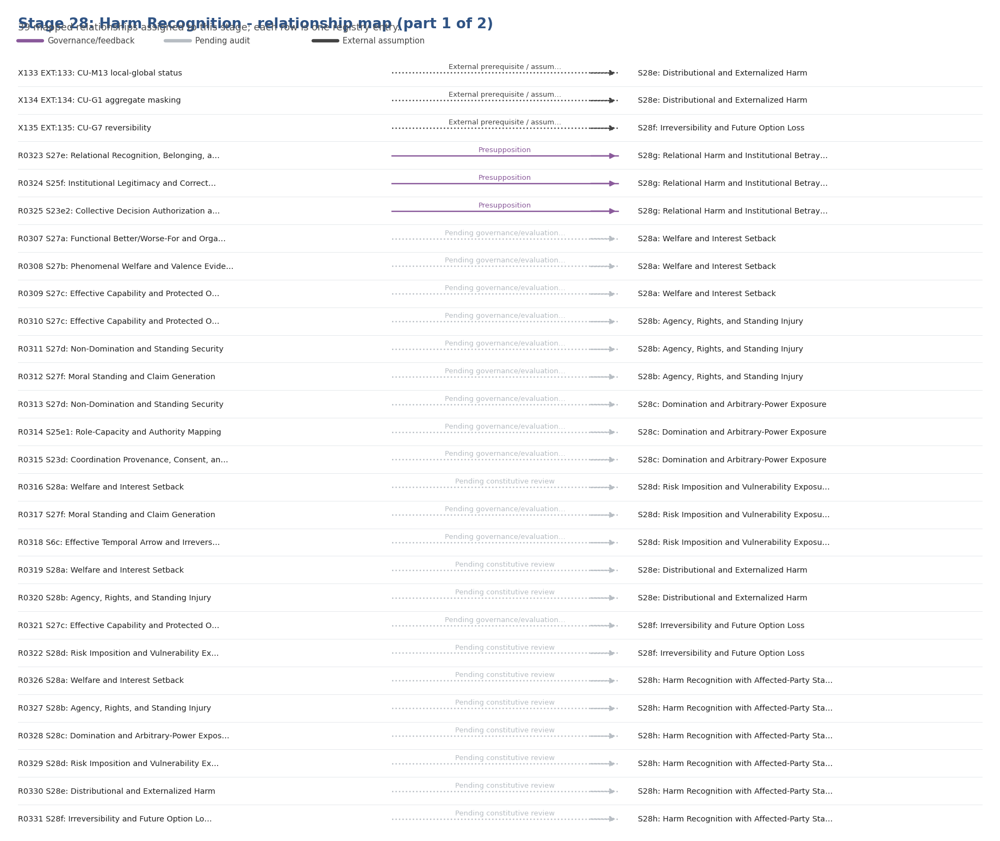{width=100%}
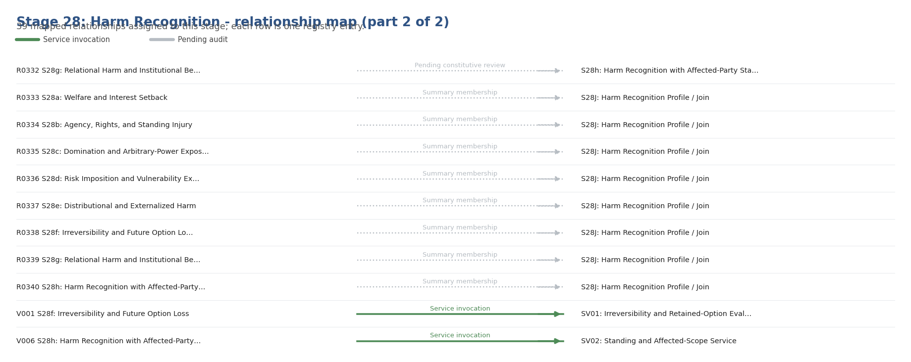{width=100%}

Figure A28. **Current Stage 28 relationship neighborhood.** Gray or pending entries remain candidates rather than proof-order claims.

### Relationship ledger

| ID | Source -> target | Type, status, and warrant | Current explanation, test, and revision boundary |
|---|---|---|---|
| X133 | CU-M13 local-global status -> Distributional and Externalized Harm | External prerequisite / assumption; not_in_scope_pending_external_prerequisite_audit; declared external assumption; target-domain audit pending | Distributional and Externalized Harm is modeled under the external prerequisite or assumption: CU-M13 local-global status. Warrant: declared external assumption; target-domain audit pending External-assumption audit remains pending. Evidence: external_assumption_pending |
| X134 | CU-G1 aggregate masking -> Distributional and Externalized Harm | External prerequisite / assumption; not_in_scope_pending_external_prerequisite_audit; declared external assumption; target-domain audit pending | Distributional and Externalized Harm is modeled under the external prerequisite or assumption: CU-G1 aggregate masking. Warrant: declared external assumption; target-domain audit pending External-assumption audit remains pending. Evidence: external_assumption_pending |
| X135 | CU-G7 reversibility -> Irreversibility and Future Option Loss | External prerequisite / assumption; not_in_scope_pending_external_prerequisite_audit; declared external assumption; target-domain audit pending | Irreversibility and Future Option Loss is modeled under the external prerequisite or assumption: CU-G7 reversibility. Warrant: declared external assumption; target-domain audit pending External-assumption audit remains pending. Evidence: external_assumption_pending |
| R0323 | Relational Recognition, Belonging, and Mattering -> Relational Harm and Institutional Betrayal | Presupposition; adjudicated_v0.20; normative or governance argument with institutional validation pending | The target’s evaluation or governance assumes the source, but that assumption is not causal enablement. Warrant: normative or governance argument with institutional validation pending Test: Review the source-target semantics against the relation definition; target record: not established by the numeric pilots; equal material outcomes can… Revise if: A source-target case that fits a different typed relation would require reclassification. Evidence: E0_open_or_unresolved |
| R0324 | Institutional Legitimacy and Correctability Profile -> Relational Harm and Institutional Betrayal | Presupposition; adjudicated_v0.20; normative or governance argument with institutional validation pending | The target’s evaluation or governance assumes the source, but that assumption is not causal enablement. Warrant: normative or governance argument with institutional validation pending Test: Review the source-target semantics against the relation definition; target record: not established by the numeric pilots; equal material outcomes can… Revise if: A source-target case that fits a different typed relation would require reclassification. Evidence: E0_open_or_unresolved |
| R0325 | Collective Decision Authorization and Answerability -> Relational Harm and Institutional Betrayal | Presupposition; adjudicated_v0.20; normative or governance argument with institutional validation pending | The target’s evaluation or governance assumes the source, but that assumption is not causal enablement. Warrant: normative or governance argument with institutional validation pending Test: Review the source-target semantics against the relation definition; target record: not established by the numeric pilots; equal material outcomes can… Revise if: A source-target case that fits a different typed relation would require reclassification. Evidence: E0_open_or_unresolved |
| R0307 | Functional Better/Worse-For and Organism-Relative Stake -> Welfare and Interest Setback | Pending governance/evaluation/interpretation review; pending_companion_paper_relation_audit; pending semantic adjudication | Governance/evaluative/interpretive relation requires role-specific adjudication. Warrant: pending semantic adjudication Semantic adjudication remains pending; no prerequisite claim is licensed. |
| R0308 | Phenomenal Welfare and Valence Evidence -> Welfare and Interest Setback | Pending governance/evaluation/interpretation review; pending_companion_paper_relation_audit; pending semantic adjudication | Governance/evaluative/interpretive relation requires role-specific adjudication. Warrant: pending semantic adjudication Semantic adjudication remains pending; no prerequisite claim is licensed. |
| R0309 | Effective Capability and Protected Option Set -> Welfare and Interest Setback | Pending governance/evaluation/interpretation review; pending_companion_paper_relation_audit; pending semantic adjudication | Governance/evaluative/interpretive relation requires role-specific adjudication. Warrant: pending semantic adjudication Semantic adjudication remains pending; no prerequisite claim is licensed. |
| R0310 | Effective Capability and Protected Option Set -> Agency, Rights, and Standing Injury | Pending governance/evaluation/interpretation review; pending_companion_paper_relation_audit; pending semantic adjudication | Governance/evaluative/interpretive relation requires role-specific adjudication. Warrant: pending semantic adjudication Semantic adjudication remains pending; no prerequisite claim is licensed. |
| R0311 | Non-Domination and Standing Security -> Agency, Rights, and Standing Injury | Pending governance/evaluation/interpretation review; pending_companion_paper_relation_audit; pending semantic adjudication | Governance/evaluative/interpretive relation requires role-specific adjudication. Warrant: pending semantic adjudication Semantic adjudication remains pending; no prerequisite claim is licensed. |
| R0312 | Moral Standing and Claim Generation -> Agency, Rights, and Standing Injury | Pending governance/evaluation/interpretation review; pending_companion_paper_relation_audit; pending semantic adjudication | Governance/evaluative/interpretive relation requires role-specific adjudication. Warrant: pending semantic adjudication Semantic adjudication remains pending; no prerequisite claim is licensed. |
| R0313 | Non-Domination and Standing Security -> Domination and Arbitrary-Power Exposure | Pending governance/evaluation/interpretation review; pending_companion_paper_relation_audit; pending semantic adjudication | Governance/evaluative/interpretive relation requires role-specific adjudication. Warrant: pending semantic adjudication Semantic adjudication remains pending; no prerequisite claim is licensed. |
| R0314 | Role-Capacity and Authority Mapping -> Domination and Arbitrary-Power Exposure | Pending governance/evaluation/interpretation review; pending_companion_paper_relation_audit; pending semantic adjudication | Governance/evaluative/interpretive relation requires role-specific adjudication. Warrant: pending semantic adjudication Semantic adjudication remains pending; no prerequisite claim is licensed. |
| R0315 | Coordination Provenance, Consent, and Legitimacy Profile -> Domination and Arbitrary-Power Exposure | Pending governance/evaluation/interpretation review; pending_companion_paper_relation_audit; pending semantic adjudication | Governance/evaluative/interpretive relation requires role-specific adjudication. Warrant: pending semantic adjudication Semantic adjudication remains pending; no prerequisite claim is licensed. |
| R0316 | Welfare and Interest Setback -> Risk Imposition and Vulnerability Exposure | Pending constitutive review; pending_companion_paper_relation_audit; pending semantic adjudication | Within-stage relation was not part of the 306-edge enabling audit. Warrant: pending semantic adjudication Semantic adjudication remains pending; no prerequisite claim is licensed. |
| R0317 | Moral Standing and Claim Generation -> Risk Imposition and Vulnerability Exposure | Pending governance/evaluation/interpretation review; pending_companion_paper_relation_audit; pending semantic adjudication | Governance/evaluative/interpretive relation requires role-specific adjudication. Warrant: pending semantic adjudication Semantic adjudication remains pending; no prerequisite claim is licensed. |
| R0318 | Effective Temporal Arrow and Irreversibility -> Risk Imposition and Vulnerability Exposure | Pending governance/evaluation/interpretation review; pending_companion_paper_relation_audit; pending semantic adjudication | Governance/evaluative/interpretive relation requires role-specific adjudication. Warrant: pending semantic adjudication Semantic adjudication remains pending; no prerequisite claim is licensed. |
| R0319 | Welfare and Interest Setback -> Distributional and Externalized Harm | Pending constitutive review; pending_companion_paper_relation_audit; pending semantic adjudication | Within-stage relation was not part of the 306-edge enabling audit. Warrant: pending semantic adjudication Semantic adjudication remains pending; no prerequisite claim is licensed. |
| R0320 | Agency, Rights, and Standing Injury -> Distributional and Externalized Harm | Pending constitutive review; pending_companion_paper_relation_audit; pending semantic adjudication | Within-stage relation was not part of the 306-edge enabling audit. Warrant: pending semantic adjudication Semantic adjudication remains pending; no prerequisite claim is licensed. |
| R0321 | Effective Capability and Protected Option Set -> Irreversibility and Future Option Loss | Pending governance/evaluation/interpretation review; pending_companion_paper_relation_audit; pending semantic adjudication | Governance/evaluative/interpretive relation requires role-specific adjudication. Warrant: pending semantic adjudication Semantic adjudication remains pending; no prerequisite claim is licensed. |
| R0322 | Risk Imposition and Vulnerability Exposure -> Irreversibility and Future Option Loss | Pending constitutive review; pending_companion_paper_relation_audit; pending semantic adjudication | Within-stage relation was not part of the 306-edge enabling audit. Warrant: pending semantic adjudication Semantic adjudication remains pending; no prerequisite claim is licensed. |
| R0326 | Welfare and Interest Setback -> Harm Recognition with Affected-Party Standing | Pending constitutive review; pending_companion_paper_relation_audit; pending semantic adjudication | Within-stage relation was not part of the 306-edge enabling audit. Warrant: pending semantic adjudication Semantic adjudication remains pending; no prerequisite claim is licensed. |
| R0327 | Agency, Rights, and Standing Injury -> Harm Recognition with Affected-Party Standing | Pending constitutive review; pending_companion_paper_relation_audit; pending semantic adjudication | Within-stage relation was not part of the 306-edge enabling audit. Warrant: pending semantic adjudication Semantic adjudication remains pending; no prerequisite claim is licensed. |
| R0328 | Domination and Arbitrary-Power Exposure -> Harm Recognition with Affected-Party Standing | Pending constitutive review; pending_companion_paper_relation_audit; pending semantic adjudication | Within-stage relation was not part of the 306-edge enabling audit. Warrant: pending semantic adjudication Semantic adjudication remains pending; no prerequisite claim is licensed. |
| R0329 | Risk Imposition and Vulnerability Exposure -> Harm Recognition with Affected-Party Standing | Pending constitutive review; pending_companion_paper_relation_audit; pending semantic adjudication | Within-stage relation was not part of the 306-edge enabling audit. Warrant: pending semantic adjudication Semantic adjudication remains pending; no prerequisite claim is licensed. |
| R0330 | Distributional and Externalized Harm -> Harm Recognition with Affected-Party Standing | Pending constitutive review; pending_companion_paper_relation_audit; pending semantic adjudication | Within-stage relation was not part of the 306-edge enabling audit. Warrant: pending semantic adjudication Semantic adjudication remains pending; no prerequisite claim is licensed. |
| R0331 | Irreversibility and Future Option Loss -> Harm Recognition with Affected-Party Standing | Pending constitutive review; pending_companion_paper_relation_audit; pending semantic adjudication | Within-stage relation was not part of the 306-edge enabling audit. Warrant: pending semantic adjudication Semantic adjudication remains pending; no prerequisite claim is licensed. |
| R0332 | Relational Harm and Institutional Betrayal -> Harm Recognition with Affected-Party Standing | Pending constitutive review; pending_companion_paper_relation_audit; pending semantic adjudication | Within-stage relation was not part of the 306-edge enabling audit. Warrant: pending semantic adjudication Semantic adjudication remains pending; no prerequisite claim is licensed. |
| R0333 | Welfare and Interest Setback -> Harm Recognition Profile / Join | Summary membership; carried_forward_low_risk_pending_spot_check; pending semantic adjudication | Summary membership is retained outside proof order. Warrant: pending semantic adjudication Semantic adjudication remains pending; no prerequisite claim is licensed. |
| R0334 | Agency, Rights, and Standing Injury -> Harm Recognition Profile / Join | Summary membership; carried_forward_low_risk_pending_spot_check; pending semantic adjudication | Summary membership is retained outside proof order. Warrant: pending semantic adjudication Semantic adjudication remains pending; no prerequisite claim is licensed. |
| R0335 | Domination and Arbitrary-Power Exposure -> Harm Recognition Profile / Join | Summary membership; carried_forward_low_risk_pending_spot_check; pending semantic adjudication | Summary membership is retained outside proof order. Warrant: pending semantic adjudication Semantic adjudication remains pending; no prerequisite claim is licensed. |
| R0336 | Risk Imposition and Vulnerability Exposure -> Harm Recognition Profile / Join | Summary membership; carried_forward_low_risk_pending_spot_check; pending semantic adjudication | Summary membership is retained outside proof order. Warrant: pending semantic adjudication Semantic adjudication remains pending; no prerequisite claim is licensed. |
| R0337 | Distributional and Externalized Harm -> Harm Recognition Profile / Join | Summary membership; carried_forward_low_risk_pending_spot_check; pending semantic adjudication | Summary membership is retained outside proof order. Warrant: pending semantic adjudication Semantic adjudication remains pending; no prerequisite claim is licensed. |
| R0338 | Irreversibility and Future Option Loss -> Harm Recognition Profile / Join | Summary membership; carried_forward_low_risk_pending_spot_check; pending semantic adjudication | Summary membership is retained outside proof order. Warrant: pending semantic adjudication Semantic adjudication remains pending; no prerequisite claim is licensed. |
| R0339 | Relational Harm and Institutional Betrayal -> Harm Recognition Profile / Join | Summary membership; carried_forward_low_risk_pending_spot_check; pending semantic adjudication | Summary membership is retained outside proof order. Warrant: pending semantic adjudication Semantic adjudication remains pending; no prerequisite claim is licensed. |
| R0340 | Harm Recognition with Affected-Party Standing -> Harm Recognition Profile / Join | Summary membership; carried_forward_low_risk_pending_spot_check; pending semantic adjudication | Summary membership is retained outside proof order. Warrant: pending semantic adjudication Semantic adjudication remains pending; no prerequisite claim is licensed. |
| V001 | Irreversibility and Future Option Loss -> Irreversibility and Retained-Option Evaluation Service | Service invocation; defined_v0.4; internal architecture and role mapping | Irreversibility and Future Option Loss invokes Irreversibility and Retained-Option Evaluation Service in the role of harm and future-option loss evaluator. Warrant: internal architecture and role mapping Test: Check whether the stage-specific role harm and future-option loss evaluator is actually required when the service is instantiated at Stage 28. Revise if: If the stage does not use this service role, the invocation should be removed or reassigned. Evidence: internal_architecture_candidate |
| V006 | Harm Recognition with Affected-Party Standing -> Standing and Affected-Scope Service | Service invocation; defined_v0.4; internal architecture and role mapping | Harm Recognition with Affected-Party Standing invokes Standing and Affected-Scope Service in the role of harm-recognition standing. Warrant: internal architecture and role mapping Test: Check whether the stage-specific role harm-recognition standing is actually required when the service is instantiated at Stage 28. Revise if: If the stage does not use this service role, the invocation should be removed or reassigned. Evidence: internal_architecture_candidate |

### Revision gate

**Next action:** Empirical harm measures, rights, consent, domination, risk ethics, institutional betrayal, repair, and transition to Stage 29 protected floors A relation should be retyped, weakened, redirected, or removed whenever its dependency witness fails, its countermodel succeeds, its warrant basis changes, or target-domain evidence defeats the declared scope.

\pagebreak

## Stage 29 - Tradeoffs Under Protected Floors

**Domain block:** Normative decision architecture  \
**Claim status:** Normative principle  \
**Canonical role:** Normative decision principle  \
**Source:** M&E §13.14

### Stage meaning and formal role

Conflicting goods require explicit scope, distribution, uncertainty, protected floors, noncompensation, and option-set adequacy. Aggregation alone is insufficient.

Stage 29 contains **8 active object(s)**: Summary join (1), Evaluator / derived relation (4), Governance / authorization (2), Normative relation / status (1). The synchronized ledger assigns **35 relationship record(s)** to this stage.

### Active object inventory

| ID | Object | Type | Evidence | Disposition |
|---|---|---|---|---|
| S29J | Protected-Floor Tradeoff Architecture / Join | Summary join | E1_conceptual_source_grounded_or_normative | retain_as_stage_summary_not_core_node |
| S29a | Protected-Floor Feasibility Screen | Evaluator / derived relation | E1_conceptual_source_grounded_or_normative | retain_typed_noncapacity_object |
| S29b | Noncompensation and Screening Before Scoring | Evaluator / derived relation | E3_exact_constructed_witness | retain_typed_noncapacity_object |
| S29c | Option-Set Adequacy and Alternative Admission | Governance / authorization | E1_conceptual_source_grounded_or_normative | retain_as_family_member_or_stage_instantiation |
| S29d | Conflicting Protected Claims and Empty Feasible Set | Evaluator / derived relation | E1_conceptual_source_grounded_or_normative | retain_typed_noncapacity_object |
| S29e | Floor-or-Exception and Emergency Override | Governance / authorization | E1_conceptual_source_grounded_or_normative | retain_typed_noncapacity_object |
| S29f | Tragic Conflict and Moral Remainder | Normative relation / status | E1_conceptual_source_grounded_or_normative | retain_typed_noncapacity_object |
| S29g | Ethical Underdetermination and Preserved Incomparability | Evaluator / derived relation | E0_open_or_unresolved | retain_typed_noncapacity_object |

### Complete relationship map

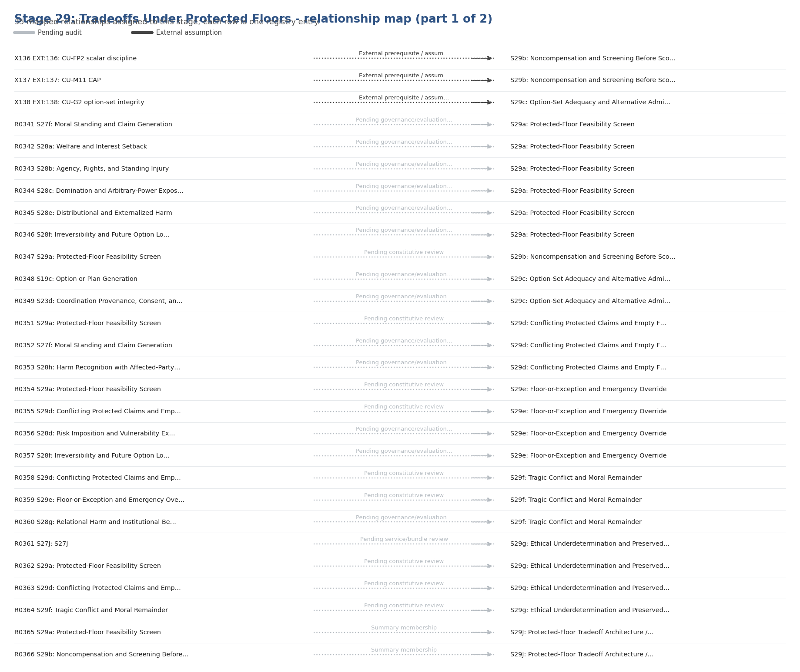{width=100%}
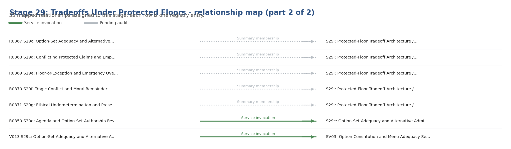{width=100%}

Figure A29. **Current Stage 29 relationship neighborhood.** Gray or pending entries remain candidates rather than proof-order claims.

### Relationship ledger

| ID | Source -> target | Type, status, and warrant | Current explanation, test, and revision boundary |
|---|---|---|---|
| X136 | CU-FP2 scalar discipline -> Noncompensation and Screening Before Scoring | External prerequisite / assumption; not_in_scope_pending_external_prerequisite_audit; declared external assumption; target-domain audit pending | Noncompensation and Screening Before Scoring is modeled under the external prerequisite or assumption: CU-FP2 scalar discipline. Warrant: declared external assumption; target-domain audit pending External-assumption audit remains pending. Evidence: external_assumption_pending |
| X137 | CU-M11 CAP -> Noncompensation and Screening Before Scoring | External prerequisite / assumption; not_in_scope_pending_external_prerequisite_audit; declared external assumption; target-domain audit pending | Noncompensation and Screening Before Scoring is modeled under the external prerequisite or assumption: CU-M11 CAP. Warrant: declared external assumption; target-domain audit pending External-assumption audit remains pending. Evidence: external_assumption_pending |
| X138 | CU-G2 option-set integrity -> Option-Set Adequacy and Alternative Admission | External prerequisite / assumption; not_in_scope_pending_external_prerequisite_audit; declared external assumption; target-domain audit pending | Option-Set Adequacy and Alternative Admission is modeled under the external prerequisite or assumption: CU-G2 option-set integrity. Warrant: declared external assumption; target-domain audit pending External-assumption audit remains pending. Evidence: external_assumption_pending |
| R0341 | Moral Standing and Claim Generation -> Protected-Floor Feasibility Screen | Pending governance/evaluation/interpretation review; pending_companion_paper_relation_audit; pending semantic adjudication | Governance/evaluative/interpretive relation requires role-specific adjudication. Warrant: pending semantic adjudication Semantic adjudication remains pending; no prerequisite claim is licensed. |
| R0342 | Welfare and Interest Setback -> Protected-Floor Feasibility Screen | Pending governance/evaluation/interpretation review; pending_companion_paper_relation_audit; pending semantic adjudication | Governance/evaluative/interpretive relation requires role-specific adjudication. Warrant: pending semantic adjudication Semantic adjudication remains pending; no prerequisite claim is licensed. |
| R0343 | Agency, Rights, and Standing Injury -> Protected-Floor Feasibility Screen | Pending governance/evaluation/interpretation review; pending_companion_paper_relation_audit; pending semantic adjudication | Governance/evaluative/interpretive relation requires role-specific adjudication. Warrant: pending semantic adjudication Semantic adjudication remains pending; no prerequisite claim is licensed. |
| R0344 | Domination and Arbitrary-Power Exposure -> Protected-Floor Feasibility Screen | Pending governance/evaluation/interpretation review; pending_companion_paper_relation_audit; pending semantic adjudication | Governance/evaluative/interpretive relation requires role-specific adjudication. Warrant: pending semantic adjudication Semantic adjudication remains pending; no prerequisite claim is licensed. |
| R0345 | Distributional and Externalized Harm -> Protected-Floor Feasibility Screen | Pending governance/evaluation/interpretation review; pending_companion_paper_relation_audit; pending semantic adjudication | Governance/evaluative/interpretive relation requires role-specific adjudication. Warrant: pending semantic adjudication Semantic adjudication remains pending; no prerequisite claim is licensed. |
| R0346 | Irreversibility and Future Option Loss -> Protected-Floor Feasibility Screen | Pending governance/evaluation/interpretation review; pending_companion_paper_relation_audit; pending semantic adjudication | Governance/evaluative/interpretive relation requires role-specific adjudication. Warrant: pending semantic adjudication Semantic adjudication remains pending; no prerequisite claim is licensed. |
| R0347 | Protected-Floor Feasibility Screen -> Noncompensation and Screening Before Scoring | Pending constitutive review; pending_companion_paper_relation_audit; pending semantic adjudication | Within-stage relation was not part of the 306-edge enabling audit. Warrant: pending semantic adjudication Semantic adjudication remains pending; no prerequisite claim is licensed. |
| R0348 | Option or Plan Generation -> Option-Set Adequacy and Alternative Admission | Pending governance/evaluation/interpretation review; pending_companion_paper_relation_audit; pending semantic adjudication | Governance/evaluative/interpretive relation requires role-specific adjudication. Warrant: pending semantic adjudication Semantic adjudication remains pending; no prerequisite claim is licensed. |
| R0349 | Coordination Provenance, Consent, and Legitimacy Profile -> Option-Set Adequacy and Alternative Admission | Pending governance/evaluation/interpretation review; pending_companion_paper_relation_audit; pending semantic adjudication | Governance/evaluative/interpretive relation requires role-specific adjudication. Warrant: pending semantic adjudication Semantic adjudication remains pending; no prerequisite claim is licensed. |
| R0351 | Protected-Floor Feasibility Screen -> Conflicting Protected Claims and Empty Feasible Set | Pending constitutive review; pending_companion_paper_relation_audit; pending semantic adjudication | Within-stage relation was not part of the 306-edge enabling audit. Warrant: pending semantic adjudication Semantic adjudication remains pending; no prerequisite claim is licensed. |
| R0352 | Moral Standing and Claim Generation -> Conflicting Protected Claims and Empty Feasible Set | Pending governance/evaluation/interpretation review; pending_companion_paper_relation_audit; pending semantic adjudication | Governance/evaluative/interpretive relation requires role-specific adjudication. Warrant: pending semantic adjudication Semantic adjudication remains pending; no prerequisite claim is licensed. |
| R0353 | Harm Recognition with Affected-Party Standing -> Conflicting Protected Claims and Empty Feasible Set | Pending governance/evaluation/interpretation review; pending_companion_paper_relation_audit; pending semantic adjudication | Governance/evaluative/interpretive relation requires role-specific adjudication. Warrant: pending semantic adjudication Semantic adjudication remains pending; no prerequisite claim is licensed. |
| R0354 | Protected-Floor Feasibility Screen -> Floor-or-Exception and Emergency Override | Pending constitutive review; pending_companion_paper_relation_audit; pending semantic adjudication | Within-stage relation was not part of the 306-edge enabling audit. Warrant: pending semantic adjudication Semantic adjudication remains pending; no prerequisite claim is licensed. |
| R0355 | Conflicting Protected Claims and Empty Feasible Set -> Floor-or-Exception and Emergency Override | Pending constitutive review; pending_companion_paper_relation_audit; pending semantic adjudication | Within-stage relation was not part of the 306-edge enabling audit. Warrant: pending semantic adjudication Semantic adjudication remains pending; no prerequisite claim is licensed. |
| R0356 | Risk Imposition and Vulnerability Exposure -> Floor-or-Exception and Emergency Override | Pending governance/evaluation/interpretation review; pending_companion_paper_relation_audit; pending semantic adjudication | Governance/evaluative/interpretive relation requires role-specific adjudication. Warrant: pending semantic adjudication Semantic adjudication remains pending; no prerequisite claim is licensed. |
| R0357 | Irreversibility and Future Option Loss -> Floor-or-Exception and Emergency Override | Pending governance/evaluation/interpretation review; pending_companion_paper_relation_audit; pending semantic adjudication | Governance/evaluative/interpretive relation requires role-specific adjudication. Warrant: pending semantic adjudication Semantic adjudication remains pending; no prerequisite claim is licensed. |
| R0358 | Conflicting Protected Claims and Empty Feasible Set -> Tragic Conflict and Moral Remainder | Pending constitutive review; pending_companion_paper_relation_audit; pending semantic adjudication | Within-stage relation was not part of the 306-edge enabling audit. Warrant: pending semantic adjudication Semantic adjudication remains pending; no prerequisite claim is licensed. |
| R0359 | Floor-or-Exception and Emergency Override -> Tragic Conflict and Moral Remainder | Pending constitutive review; pending_companion_paper_relation_audit; pending semantic adjudication | Within-stage relation was not part of the 306-edge enabling audit. Warrant: pending semantic adjudication Semantic adjudication remains pending; no prerequisite claim is licensed. |
| R0360 | Relational Harm and Institutional Betrayal -> Tragic Conflict and Moral Remainder | Pending governance/evaluation/interpretation review; pending_companion_paper_relation_audit; pending semantic adjudication | Governance/evaluative/interpretive relation requires role-specific adjudication. Warrant: pending semantic adjudication Semantic adjudication remains pending; no prerequisite claim is licensed. |
| R0361 | S27J -> Ethical Underdetermination and Preserved Incomparability | Pending service/bundle review; pending_companion_paper_relation_audit; pending semantic adjudication | Bundle references require service-role decomposition. Warrant: pending semantic adjudication Semantic adjudication remains pending; no prerequisite claim is licensed. |
| R0362 | Protected-Floor Feasibility Screen -> Ethical Underdetermination and Preserved Incomparability | Pending constitutive review; pending_companion_paper_relation_audit; pending semantic adjudication | Within-stage relation was not part of the 306-edge enabling audit. Warrant: pending semantic adjudication Semantic adjudication remains pending; no prerequisite claim is licensed. |
| R0363 | Conflicting Protected Claims and Empty Feasible Set -> Ethical Underdetermination and Preserved Incomparability | Pending constitutive review; pending_companion_paper_relation_audit; pending semantic adjudication | Within-stage relation was not part of the 306-edge enabling audit. Warrant: pending semantic adjudication Semantic adjudication remains pending; no prerequisite claim is licensed. |
| R0364 | Tragic Conflict and Moral Remainder -> Ethical Underdetermination and Preserved Incomparability | Pending constitutive review; pending_companion_paper_relation_audit; pending semantic adjudication | Within-stage relation was not part of the 306-edge enabling audit. Warrant: pending semantic adjudication Semantic adjudication remains pending; no prerequisite claim is licensed. |
| R0365 | Protected-Floor Feasibility Screen -> Protected-Floor Tradeoff Architecture / Join | Summary membership; carried_forward_low_risk_pending_spot_check; pending semantic adjudication | Summary membership is retained outside proof order. Warrant: pending semantic adjudication Semantic adjudication remains pending; no prerequisite claim is licensed. |
| R0366 | Noncompensation and Screening Before Scoring -> Protected-Floor Tradeoff Architecture / Join | Summary membership; carried_forward_low_risk_pending_spot_check; pending semantic adjudication | Summary membership is retained outside proof order. Warrant: pending semantic adjudication Semantic adjudication remains pending; no prerequisite claim is licensed. |
| R0367 | Option-Set Adequacy and Alternative Admission -> Protected-Floor Tradeoff Architecture / Join | Summary membership; carried_forward_low_risk_pending_spot_check; pending semantic adjudication | Summary membership is retained outside proof order. Warrant: pending semantic adjudication Semantic adjudication remains pending; no prerequisite claim is licensed. |
| R0368 | Conflicting Protected Claims and Empty Feasible Set -> Protected-Floor Tradeoff Architecture / Join | Summary membership; carried_forward_low_risk_pending_spot_check; pending semantic adjudication | Summary membership is retained outside proof order. Warrant: pending semantic adjudication Semantic adjudication remains pending; no prerequisite claim is licensed. |
| R0369 | Floor-or-Exception and Emergency Override -> Protected-Floor Tradeoff Architecture / Join | Summary membership; carried_forward_low_risk_pending_spot_check; pending semantic adjudication | Summary membership is retained outside proof order. Warrant: pending semantic adjudication Semantic adjudication remains pending; no prerequisite claim is licensed. |
| R0370 | Tragic Conflict and Moral Remainder -> Protected-Floor Tradeoff Architecture / Join | Summary membership; carried_forward_low_risk_pending_spot_check; pending semantic adjudication | Summary membership is retained outside proof order. Warrant: pending semantic adjudication Semantic adjudication remains pending; no prerequisite claim is licensed. |
| R0371 | Ethical Underdetermination and Preserved Incomparability -> Protected-Floor Tradeoff Architecture / Join | Summary membership; carried_forward_low_risk_pending_spot_check; pending semantic adjudication | Summary membership is retained outside proof order. Warrant: pending semantic adjudication Semantic adjudication remains pending; no prerequisite claim is licensed. |
| R0350 | Agenda and Option-Set Authorship Review -> Option-Set Adequacy and Alternative Admission | Service invocation; adjudicated_v0.20; conceptual or source-grounded argument; empirical validation pending | Agenda review is an invocation of the option-constitution service. Warrant: conceptual or source-grounded argument; empirical validation pending Test: Check whether the stage-specific use of S29c actually calls the named shared-service role represented by S30e. Revise if: If the target use can be specified without that service role, retain only a looser cross-reference. Evidence: E1_conceptual_source_grounded_or_normative |
| V013 | Option-Set Adequacy and Alternative Admission -> Option Constitution and Menu Adequacy Service | Service invocation; defined_v0.4; internal architecture and role mapping | Option-Set Adequacy and Alternative Admission invokes Option Constitution and Menu Adequacy Service in the role of option-set adequacy. Warrant: internal architecture and role mapping Test: Check whether the stage-specific role option-set adequacy is actually required when the service is instantiated at Stage 29. Revise if: If the stage does not use this service role, the invocation should be removed or reassigned. Evidence: internal_architecture_candidate |

### Revision gate

**Next action:** Rights conflicts, chance constraints, emergency exceptions, option generation, public justification, and empirical decision audits A relation should be retyped, weakened, redirected, or removed whenever its dependency witness fails, its countermodel succeeds, its warrant basis changes, or target-domain evidence defeats the declared scope.

\pagebreak

## Stage 30 - Justification and Public Reason

**Domain block:** Normative / epistemic / political  \
**Claim status:** Normative principle  \
**Canonical role:** Normative / epistemic principle  \
**Source:** M&E §13.14

### Stage meaning and formal role

Norms affecting others require reasons open to evidence, affected-party testimony, independent challenge, and scrutiny for self-deception.

Stage 30 contains **8 active object(s)**: Summary join (1), Representation / observation (1), Normative relation / status (3), Evaluator / derived relation (1), Governance / authorization (2). The synchronized ledger assigns **38 relationship record(s)** to this stage.

### Active object inventory

| ID | Object | Type | Evidence | Disposition |
|---|---|---|---|---|
| S30J | Public Justification Profile / Join | Summary join | E1_conceptual_source_grounded_or_normative | retain_as_stage_summary_not_core_node |
| S30a | Public Justificatory Record | Representation / observation | E3_exact_constructed_witness | retain_typed_noncapacity_object |
| S30b | Affected-Party Standing and Testimonial Uptake | Normative relation / status | E1_conceptual_source_grounded_or_normative | retain_as_family_member_or_stage_instantiation |
| S30c | Symmetric Evidential Standards and Role-Reversal Robustness | Evaluator / derived relation | E4_reproducible_toy_or_simulation | retain_typed_noncapacity_object |
| S30d | Independent Challenge with Decision Authority | Governance / authorization | E1_conceptual_source_grounded_or_normative | retain_as_family_member_or_stage_instantiation |
| S30e | Agenda and Option-Set Authorship Review | Governance / authorization | E1_conceptual_source_grounded_or_normative | retain_as_family_member_or_stage_instantiation |
| S30f | Public Reason-Giving Under Persistent Disagreement | Normative relation / status | E0_open_or_unresolved | retain_typed_noncapacity_object |
| S30g | Legitimacy and Answerability to Those Subject to Power | Normative relation / status | E1_conceptual_source_grounded_or_normative | retain_typed_noncapacity_object |

### Complete relationship map

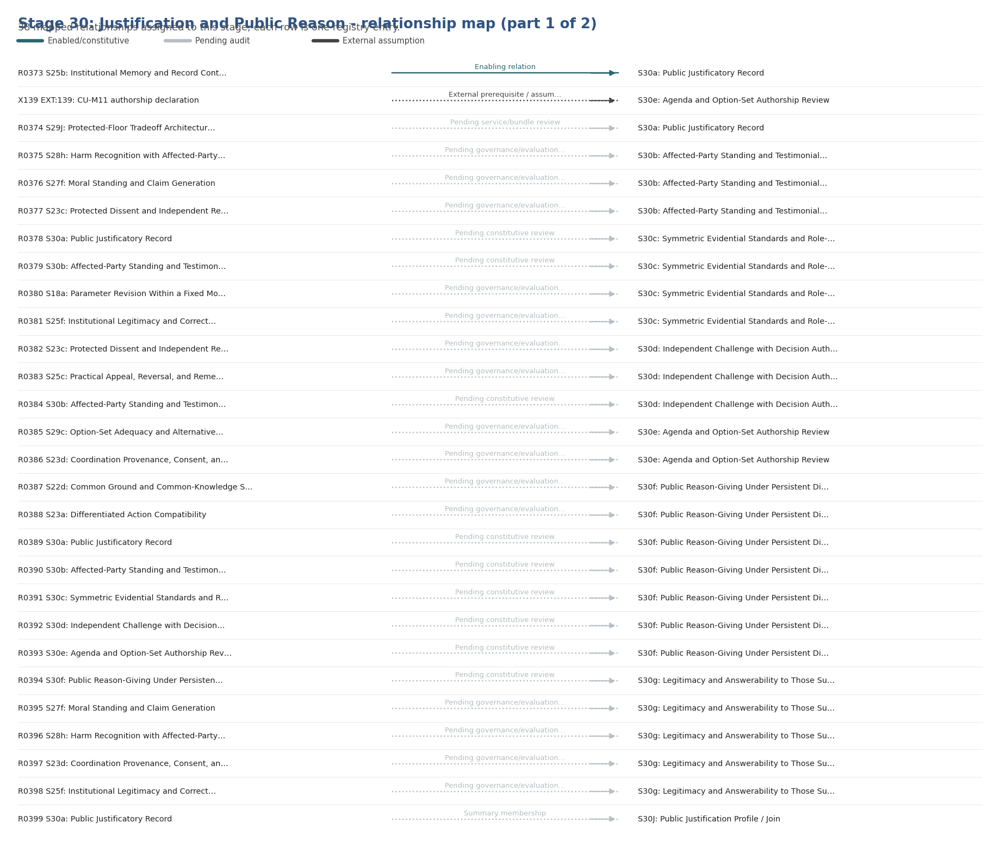{width=100%}
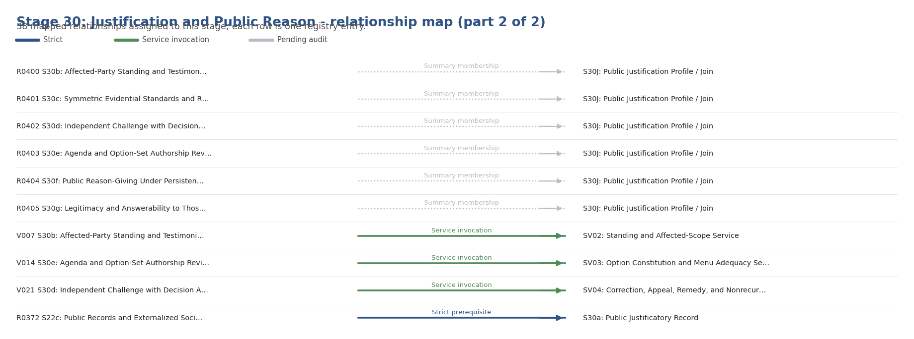{width=100%}

Figure A30. **Current Stage 30 relationship neighborhood.** Gray or pending entries remain candidates rather than proof-order claims.

### Relationship ledger

| ID | Source -> target | Type, status, and warrant | Current explanation, test, and revision boundary |
|---|---|---|---|
| R0373 | Institutional Memory and Record Continuity -> Public Justificatory Record | Enabling relation; adjudicated_v0.20; exact constructed witness or formal construction | Institutional memory stabilizes the justificatory record but an ad hoc public record can exist without it. Warrant: exact constructed witness or formal construction Test: Compare otherwise matched realizations of S30a with and without S25b; the source should widen, stabilize, or improve the target realization. Existing… Revise if: No measurable change in target realizability, robustness, reach, or cost after source removal would defeat this enablement claim. Evidence: E3_exact_constructed_witness |
| X139 | CU-M11 authorship declaration -> Agenda and Option-Set Authorship Review | External prerequisite / assumption; not_in_scope_pending_external_prerequisite_audit; declared external assumption; target-domain audit pending | Agenda and Option-Set Authorship Review is modeled under the external prerequisite or assumption: CU-M11 authorship declaration. Warrant: declared external assumption; target-domain audit pending External-assumption audit remains pending. Evidence: external_assumption_pending |
| R0374 | Protected-Floor Tradeoff Architecture / Join -> Public Justificatory Record | Pending service/bundle review; pending_companion_paper_relation_audit; pending semantic adjudication | Bundle references require service-role decomposition. Warrant: pending semantic adjudication Semantic adjudication remains pending; no prerequisite claim is licensed. |
| R0375 | Harm Recognition with Affected-Party Standing -> Affected-Party Standing and Testimonial Uptake | Pending governance/evaluation/interpretation review; pending_companion_paper_relation_audit; pending semantic adjudication | Governance/evaluative/interpretive relation requires role-specific adjudication. Warrant: pending semantic adjudication Semantic adjudication remains pending; no prerequisite claim is licensed. |
| R0376 | Moral Standing and Claim Generation -> Affected-Party Standing and Testimonial Uptake | Pending governance/evaluation/interpretation review; pending_companion_paper_relation_audit; pending semantic adjudication | Governance/evaluative/interpretive relation requires role-specific adjudication. Warrant: pending semantic adjudication Semantic adjudication remains pending; no prerequisite claim is licensed. |
| R0377 | Protected Dissent and Independent Review -> Affected-Party Standing and Testimonial Uptake | Pending governance/evaluation/interpretation review; pending_companion_paper_relation_audit; pending semantic adjudication | Governance/evaluative/interpretive relation requires role-specific adjudication. Warrant: pending semantic adjudication Semantic adjudication remains pending; no prerequisite claim is licensed. |
| R0378 | Public Justificatory Record -> Symmetric Evidential Standards and Role-Reversal Robustness | Pending constitutive review; pending_companion_paper_relation_audit; pending semantic adjudication | Within-stage relation was not part of the 306-edge enabling audit. Warrant: pending semantic adjudication Semantic adjudication remains pending; no prerequisite claim is licensed. |
| R0379 | Affected-Party Standing and Testimonial Uptake -> Symmetric Evidential Standards and Role-Reversal Robustness | Pending constitutive review; pending_companion_paper_relation_audit; pending semantic adjudication | Within-stage relation was not part of the 306-edge enabling audit. Warrant: pending semantic adjudication Semantic adjudication remains pending; no prerequisite claim is licensed. |
| R0380 | Parameter Revision Within a Fixed Model -> Symmetric Evidential Standards and Role-Reversal Robustness | Pending governance/evaluation/interpretation review; pending_companion_paper_relation_audit; pending semantic adjudication | Governance/evaluative/interpretive relation requires role-specific adjudication. Warrant: pending semantic adjudication Semantic adjudication remains pending; no prerequisite claim is licensed. |
| R0381 | Institutional Legitimacy and Correctability Profile -> Symmetric Evidential Standards and Role-Reversal Robustness | Pending governance/evaluation/interpretation review; pending_companion_paper_relation_audit; pending semantic adjudication | Governance/evaluative/interpretive relation requires role-specific adjudication. Warrant: pending semantic adjudication Semantic adjudication remains pending; no prerequisite claim is licensed. |
| R0382 | Protected Dissent and Independent Review -> Independent Challenge with Decision Authority | Pending governance/evaluation/interpretation review; pending_companion_paper_relation_audit; pending semantic adjudication | Governance/evaluative/interpretive relation requires role-specific adjudication. Warrant: pending semantic adjudication Semantic adjudication remains pending; no prerequisite claim is licensed. |
| R0383 | Practical Appeal, Reversal, and Remedy -> Independent Challenge with Decision Authority | Pending governance/evaluation/interpretation review; pending_companion_paper_relation_audit; pending semantic adjudication | Governance/evaluative/interpretive relation requires role-specific adjudication. Warrant: pending semantic adjudication Semantic adjudication remains pending; no prerequisite claim is licensed. |
| R0384 | Affected-Party Standing and Testimonial Uptake -> Independent Challenge with Decision Authority | Pending constitutive review; pending_companion_paper_relation_audit; pending semantic adjudication | Within-stage relation was not part of the 306-edge enabling audit. Warrant: pending semantic adjudication Semantic adjudication remains pending; no prerequisite claim is licensed. |
| R0385 | Option-Set Adequacy and Alternative Admission -> Agenda and Option-Set Authorship Review | Pending governance/evaluation/interpretation review; pending_companion_paper_relation_audit; pending semantic adjudication | Governance/evaluative/interpretive relation requires role-specific adjudication. Warrant: pending semantic adjudication Semantic adjudication remains pending; no prerequisite claim is licensed. |
| R0386 | Coordination Provenance, Consent, and Legitimacy Profile -> Agenda and Option-Set Authorship Review | Pending governance/evaluation/interpretation review; pending_companion_paper_relation_audit; pending semantic adjudication | Governance/evaluative/interpretive relation requires role-specific adjudication. Warrant: pending semantic adjudication Semantic adjudication remains pending; no prerequisite claim is licensed. |
| R0387 | Common Ground and Common-Knowledge Structure -> Public Reason-Giving Under Persistent Disagreement | Pending governance/evaluation/interpretation review; pending_companion_paper_relation_audit; pending semantic adjudication | Governance/evaluative/interpretive relation requires role-specific adjudication. Warrant: pending semantic adjudication Semantic adjudication remains pending; no prerequisite claim is licensed. |
| R0388 | Differentiated Action Compatibility -> Public Reason-Giving Under Persistent Disagreement | Pending governance/evaluation/interpretation review; pending_companion_paper_relation_audit; pending semantic adjudication | Governance/evaluative/interpretive relation requires role-specific adjudication. Warrant: pending semantic adjudication Semantic adjudication remains pending; no prerequisite claim is licensed. |
| R0389 | Public Justificatory Record -> Public Reason-Giving Under Persistent Disagreement | Pending constitutive review; pending_companion_paper_relation_audit; pending semantic adjudication | Within-stage relation was not part of the 306-edge enabling audit. Warrant: pending semantic adjudication Semantic adjudication remains pending; no prerequisite claim is licensed. |
| R0390 | Affected-Party Standing and Testimonial Uptake -> Public Reason-Giving Under Persistent Disagreement | Pending constitutive review; pending_companion_paper_relation_audit; pending semantic adjudication | Within-stage relation was not part of the 306-edge enabling audit. Warrant: pending semantic adjudication Semantic adjudication remains pending; no prerequisite claim is licensed. |
| R0391 | Symmetric Evidential Standards and Role-Reversal Robustness -> Public Reason-Giving Under Persistent Disagreement | Pending constitutive review; pending_companion_paper_relation_audit; pending semantic adjudication | Within-stage relation was not part of the 306-edge enabling audit. Warrant: pending semantic adjudication Semantic adjudication remains pending; no prerequisite claim is licensed. |
| R0392 | Independent Challenge with Decision Authority -> Public Reason-Giving Under Persistent Disagreement | Pending constitutive review; pending_companion_paper_relation_audit; pending semantic adjudication | Within-stage relation was not part of the 306-edge enabling audit. Warrant: pending semantic adjudication Semantic adjudication remains pending; no prerequisite claim is licensed. |
| R0393 | Agenda and Option-Set Authorship Review -> Public Reason-Giving Under Persistent Disagreement | Pending constitutive review; pending_companion_paper_relation_audit; pending semantic adjudication | Within-stage relation was not part of the 306-edge enabling audit. Warrant: pending semantic adjudication Semantic adjudication remains pending; no prerequisite claim is licensed. |
| R0394 | Public Reason-Giving Under Persistent Disagreement -> Legitimacy and Answerability to Those Subject to Power | Pending constitutive review; pending_companion_paper_relation_audit; pending semantic adjudication | Within-stage relation was not part of the 306-edge enabling audit. Warrant: pending semantic adjudication Semantic adjudication remains pending; no prerequisite claim is licensed. |
| R0395 | Moral Standing and Claim Generation -> Legitimacy and Answerability to Those Subject to Power | Pending governance/evaluation/interpretation review; pending_companion_paper_relation_audit; pending semantic adjudication | Governance/evaluative/interpretive relation requires role-specific adjudication. Warrant: pending semantic adjudication Semantic adjudication remains pending; no prerequisite claim is licensed. |
| R0396 | Harm Recognition with Affected-Party Standing -> Legitimacy and Answerability to Those Subject to Power | Pending governance/evaluation/interpretation review; pending_companion_paper_relation_audit; pending semantic adjudication | Governance/evaluative/interpretive relation requires role-specific adjudication. Warrant: pending semantic adjudication Semantic adjudication remains pending; no prerequisite claim is licensed. |
| R0397 | Coordination Provenance, Consent, and Legitimacy Profile -> Legitimacy and Answerability to Those Subject to Power | Pending governance/evaluation/interpretation review; pending_companion_paper_relation_audit; pending semantic adjudication | Governance/evaluative/interpretive relation requires role-specific adjudication. Warrant: pending semantic adjudication Semantic adjudication remains pending; no prerequisite claim is licensed. |
| R0398 | Institutional Legitimacy and Correctability Profile -> Legitimacy and Answerability to Those Subject to Power | Pending governance/evaluation/interpretation review; pending_companion_paper_relation_audit; pending semantic adjudication | Governance/evaluative/interpretive relation requires role-specific adjudication. Warrant: pending semantic adjudication Semantic adjudication remains pending; no prerequisite claim is licensed. |
| R0399 | Public Justificatory Record -> Public Justification Profile / Join | Summary membership; carried_forward_low_risk_pending_spot_check; pending semantic adjudication | Summary membership is retained outside proof order. Warrant: pending semantic adjudication Semantic adjudication remains pending; no prerequisite claim is licensed. |
| R0400 | Affected-Party Standing and Testimonial Uptake -> Public Justification Profile / Join | Summary membership; carried_forward_low_risk_pending_spot_check; pending semantic adjudication | Summary membership is retained outside proof order. Warrant: pending semantic adjudication Semantic adjudication remains pending; no prerequisite claim is licensed. |
| R0401 | Symmetric Evidential Standards and Role-Reversal Robustness -> Public Justification Profile / Join | Summary membership; carried_forward_low_risk_pending_spot_check; pending semantic adjudication | Summary membership is retained outside proof order. Warrant: pending semantic adjudication Semantic adjudication remains pending; no prerequisite claim is licensed. |
| R0402 | Independent Challenge with Decision Authority -> Public Justification Profile / Join | Summary membership; carried_forward_low_risk_pending_spot_check; pending semantic adjudication | Summary membership is retained outside proof order. Warrant: pending semantic adjudication Semantic adjudication remains pending; no prerequisite claim is licensed. |
| R0403 | Agenda and Option-Set Authorship Review -> Public Justification Profile / Join | Summary membership; carried_forward_low_risk_pending_spot_check; pending semantic adjudication | Summary membership is retained outside proof order. Warrant: pending semantic adjudication Semantic adjudication remains pending; no prerequisite claim is licensed. |
| R0404 | Public Reason-Giving Under Persistent Disagreement -> Public Justification Profile / Join | Summary membership; carried_forward_low_risk_pending_spot_check; pending semantic adjudication | Summary membership is retained outside proof order. Warrant: pending semantic adjudication Semantic adjudication remains pending; no prerequisite claim is licensed. |
| R0405 | Legitimacy and Answerability to Those Subject to Power -> Public Justification Profile / Join | Summary membership; carried_forward_low_risk_pending_spot_check; pending semantic adjudication | Summary membership is retained outside proof order. Warrant: pending semantic adjudication Semantic adjudication remains pending; no prerequisite claim is licensed. |
| V007 | Affected-Party Standing and Testimonial Uptake -> Standing and Affected-Scope Service | Service invocation; defined_v0.4; internal architecture and role mapping | Affected-Party Standing and Testimonial Uptake invokes Standing and Affected-Scope Service in the role of testimonial uptake. Warrant: internal architecture and role mapping Test: Check whether the stage-specific role testimonial uptake is actually required when the service is instantiated at Stage 30. Revise if: If the stage does not use this service role, the invocation should be removed or reassigned. Evidence: internal_architecture_candidate |
| V014 | Agenda and Option-Set Authorship Review -> Option Constitution and Menu Adequacy Service | Service invocation; defined_v0.4; internal architecture and role mapping | Agenda and Option-Set Authorship Review invokes Option Constitution and Menu Adequacy Service in the role of agenda and authorship review. Warrant: internal architecture and role mapping Test: Check whether the stage-specific role agenda and authorship review is actually required when the service is instantiated at Stage 30. Revise if: If the stage does not use this service role, the invocation should be removed or reassigned. Evidence: internal_architecture_candidate |
| V021 | Independent Challenge with Decision Authority -> Correction, Appeal, Remedy, and Nonrecurrence Service | Service invocation; defined_v0.4; internal architecture and role mapping | Independent Challenge with Decision Authority invokes Correction, Appeal, Remedy, and Nonrecurrence Service in the role of independent challenge authority. Warrant: internal architecture and role mapping Test: Check whether the stage-specific role independent challenge authority is actually required when the service is instantiated at Stage 30. Revise if: If the stage does not use this service role, the invocation should be removed or reassigned. Evidence: internal_architecture_candidate |
| R0372 | Public Records and Externalized Social Memory -> Public Justificatory Record | Strict prerequisite; adjudicated_v0.20; exact constructed witness or formal construction | A public justificatory record requires an externalized record accessible to the relevant public. Warrant: exact constructed witness or formal construction Test: Ablate or replace S22c (Public Records and Externalized Social Memory) while holding the declared target model fixed; S30a (Public Justificatory Reco… Revise if: A valid realization of S30a within the same declared model that omits S22c would defeat strictness. Evidence: E3_exact_constructed_witness |

### Revision gate

**Next action:** Reason accessibility, plural traditions, agenda setting, independent review, affected testimony, power, constitutional authority, and dissent under emergency A relation should be retyped, weakened, redirected, or removed whenever its dependency witness fails, its countermodel succeeds, its warrant basis changes, or target-domain evidence defeats the declared scope.

\pagebreak

## Stage 31 - Ethical Institutions and Repair

**Domain block:** Normative / institutional repair  \
**Claim status:** Normative principle  \
**Canonical role:** Normative / institutional synthesis  \
**Source:** M&E §13.14

### Stage meaning and formal role

Ethical systems must protect standing, agency, rights, distribution, accountability, and repair. Stability, sincerity, or procedural cleanliness alone does not make them just.

Stage 31 contains **10 active object(s)**: Summary join (1), Operational capacity (3), Governance / authorization (2), Normative relation / status (3), Evaluator / derived relation (1). The synchronized ledger assigns **44 relationship record(s)** to this stage.

### Active object inventory

| ID | Object | Type | Evidence | Disposition |
|---|---|---|---|---|
| S31J | Ethical Institutions and Repair Profile / Join | Summary join | E1_conceptual_source_grounded_or_normative | retain_as_stage_summary_not_core_node |
| S31a | Protection and Cessation of Ongoing Harm | Operational capacity | E1_conceptual_source_grounded_or_normative | retain_as_family_member_or_stage_instantiation |
| S31b | Truth, Acknowledgment, and Record Correction | Governance / authorization | E1_conceptual_source_grounded_or_normative | retain_typed_noncapacity_object |
| S31c | Answerability and Proportionate Accountability | Normative relation / status | E1_conceptual_source_grounded_or_normative | retain_typed_noncapacity_object |
| S31d | Restitution, Reparation, and Capability Restoration | Operational capacity | E1_conceptual_source_grounded_or_normative | retain_as_family_member_or_stage_instantiation |
| S31e | Restoration of Standing, Rights, and Voice | Normative relation / status | E1_conceptual_source_grounded_or_normative | retain_typed_noncapacity_object |
| S31f | Nonrecurrence and Mechanism-Level Institutional Learning | Operational capacity | E1_conceptual_source_grounded_or_normative | retain_as_family_member_or_stage_instantiation |
| S31g | Affected-Party Participation, Refusal, and Non-Coercive Repair | Governance / authorization | E1_conceptual_source_grounded_or_normative | retain_typed_noncapacity_object |
| S31h | Trust as Downstream Evidence of Demonstrated Trustworthiness | Evaluator / derived relation | E4_reproducible_toy_or_simulation | retain_typed_noncapacity_object |
| S31i | Irreparable Remainder and Non-Erasure | Normative relation / status | E1_conceptual_source_grounded_or_normative | retain_typed_noncapacity_object |

### Complete relationship map

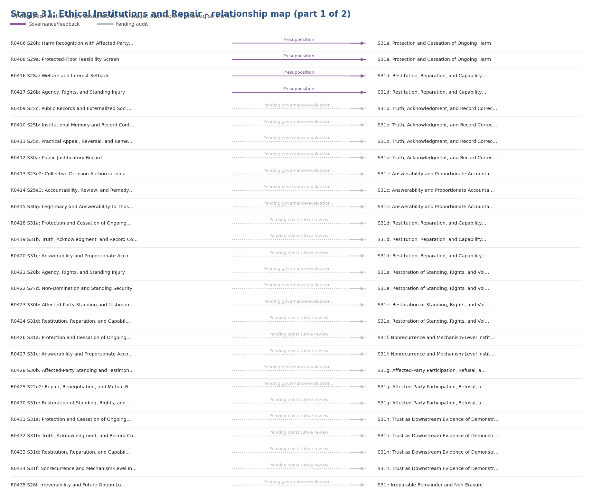{width=100%}
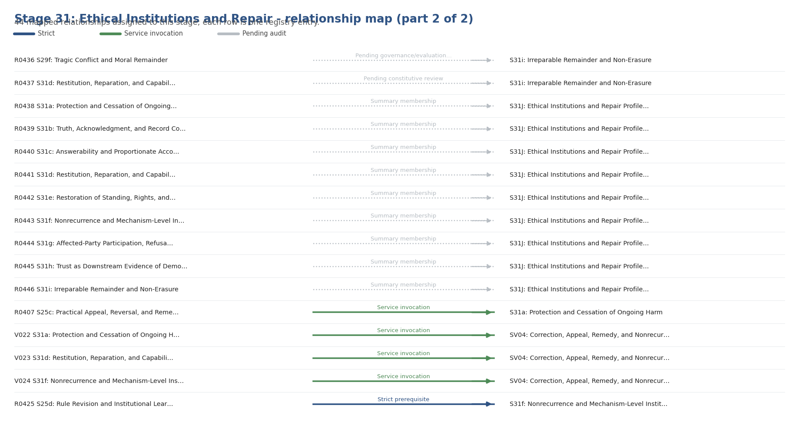{width=100%}

Figure A31. **Current Stage 31 relationship neighborhood.** Gray or pending entries remain candidates rather than proof-order claims.

### Relationship ledger

| ID | Source -> target | Type, status, and warrant | Current explanation, test, and revision boundary |
|---|---|---|---|
| R0406 | Harm Recognition with Affected-Party Standing -> Protection and Cessation of Ongoing Harm | Presupposition; adjudicated_v0.20; normative or governance argument with institutional validation pending | Protection presupposes recognition and standing of the affected party. Warrant: normative or governance argument with institutional validation pending Test: Review the source-target semantics against the relation definition; target record: protection-only lowers the modeled hazard from 0.08 to 0.012 and s… Revise if: A source-target case that fits a different typed relation would require reclassification. Evidence: E1_conceptual_source_grounded_or_normative |
| R0408 | Protected-Floor Feasibility Screen -> Protection and Cessation of Ongoing Harm | Presupposition; adjudicated_v0.20; normative or governance argument with institutional validation pending | A floor screen supplies the protected condition, not the cessation capacity itself. Warrant: normative or governance argument with institutional validation pending Test: Review the source-target semantics against the relation definition; target record: protection-only lowers the modeled hazard from 0.08 to 0.012 and s… Revise if: A source-target case that fits a different typed relation would require reclassification. Evidence: E1_conceptual_source_grounded_or_normative |
| R0416 | Welfare and Interest Setback -> Restitution, Reparation, and Capability Restoration | Presupposition; adjudicated_v0.20; normative or governance argument with institutional validation pending | Reparation presupposes a recognized welfare or interest setback. Warrant: normative or governance argument with institutional validation pending Test: Review the source-target semantics against the relation definition; target record: compensation-only remedies a high share of detected incidents and… Revise if: A source-target case that fits a different typed relation would require reclassification. Evidence: E1_conceptual_source_grounded_or_normative |
| R0417 | Agency, Rights, and Standing Injury -> Restitution, Reparation, and Capability Restoration | Presupposition; adjudicated_v0.20; normative or governance argument with institutional validation pending | Capability restoration presupposes recognized agency or standing injury. Warrant: normative or governance argument with institutional validation pending Test: Review the source-target semantics against the relation definition; target record: compensation-only remedies a high share of detected incidents and… Revise if: A source-target case that fits a different typed relation would require reclassification. Evidence: E1_conceptual_source_grounded_or_normative |
| R0409 | Public Records and Externalized Social Memory -> Truth, Acknowledgment, and Record Correction | Pending governance/evaluation/interpretation review; pending_companion_paper_relation_audit; pending semantic adjudication | Governance/evaluative/interpretive relation requires role-specific adjudication. Warrant: pending semantic adjudication Semantic adjudication remains pending; no prerequisite claim is licensed. |
| R0410 | Institutional Memory and Record Continuity -> Truth, Acknowledgment, and Record Correction | Pending governance/evaluation/interpretation review; pending_companion_paper_relation_audit; pending semantic adjudication | Governance/evaluative/interpretive relation requires role-specific adjudication. Warrant: pending semantic adjudication Semantic adjudication remains pending; no prerequisite claim is licensed. |
| R0411 | Practical Appeal, Reversal, and Remedy -> Truth, Acknowledgment, and Record Correction | Pending governance/evaluation/interpretation review; pending_companion_paper_relation_audit; pending semantic adjudication | Governance/evaluative/interpretive relation requires role-specific adjudication. Warrant: pending semantic adjudication Semantic adjudication remains pending; no prerequisite claim is licensed. |
| R0412 | Public Justificatory Record -> Truth, Acknowledgment, and Record Correction | Pending governance/evaluation/interpretation review; pending_companion_paper_relation_audit; pending semantic adjudication | Governance/evaluative/interpretive relation requires role-specific adjudication. Warrant: pending semantic adjudication Semantic adjudication remains pending; no prerequisite claim is licensed. |
| R0413 | Collective Decision Authorization and Answerability -> Answerability and Proportionate Accountability | Pending governance/evaluation/interpretation review; pending_companion_paper_relation_audit; pending semantic adjudication | Governance/evaluative/interpretive relation requires role-specific adjudication. Warrant: pending semantic adjudication Semantic adjudication remains pending; no prerequisite claim is licensed. |
| R0414 | Accountability, Review, and Remedy Alignment -> Answerability and Proportionate Accountability | Pending governance/evaluation/interpretation review; pending_companion_paper_relation_audit; pending semantic adjudication | Governance/evaluative/interpretive relation requires role-specific adjudication. Warrant: pending semantic adjudication Semantic adjudication remains pending; no prerequisite claim is licensed. |
| R0415 | Legitimacy and Answerability to Those Subject to Power -> Answerability and Proportionate Accountability | Pending governance/evaluation/interpretation review; pending_companion_paper_relation_audit; pending semantic adjudication | Governance/evaluative/interpretive relation requires role-specific adjudication. Warrant: pending semantic adjudication Semantic adjudication remains pending; no prerequisite claim is licensed. |
| R0418 | Protection and Cessation of Ongoing Harm -> Restitution, Reparation, and Capability Restoration | Pending constitutive review; pending_companion_paper_relation_audit; pending semantic adjudication | Within-stage relation was not part of the 306-edge enabling audit. Warrant: pending semantic adjudication Semantic adjudication remains pending; no prerequisite claim is licensed. |
| R0419 | Truth, Acknowledgment, and Record Correction -> Restitution, Reparation, and Capability Restoration | Pending constitutive review; pending_companion_paper_relation_audit; pending semantic adjudication | Within-stage relation was not part of the 306-edge enabling audit. Warrant: pending semantic adjudication Semantic adjudication remains pending; no prerequisite claim is licensed. |
| R0420 | Answerability and Proportionate Accountability -> Restitution, Reparation, and Capability Restoration | Pending constitutive review; pending_companion_paper_relation_audit; pending semantic adjudication | Within-stage relation was not part of the 306-edge enabling audit. Warrant: pending semantic adjudication Semantic adjudication remains pending; no prerequisite claim is licensed. |
| R0421 | Agency, Rights, and Standing Injury -> Restoration of Standing, Rights, and Voice | Pending governance/evaluation/interpretation review; pending_companion_paper_relation_audit; pending semantic adjudication | Governance/evaluative/interpretive relation requires role-specific adjudication. Warrant: pending semantic adjudication Semantic adjudication remains pending; no prerequisite claim is licensed. |
| R0422 | Non-Domination and Standing Security -> Restoration of Standing, Rights, and Voice | Pending governance/evaluation/interpretation review; pending_companion_paper_relation_audit; pending semantic adjudication | Governance/evaluative/interpretive relation requires role-specific adjudication. Warrant: pending semantic adjudication Semantic adjudication remains pending; no prerequisite claim is licensed. |
| R0423 | Affected-Party Standing and Testimonial Uptake -> Restoration of Standing, Rights, and Voice | Pending governance/evaluation/interpretation review; pending_companion_paper_relation_audit; pending semantic adjudication | Governance/evaluative/interpretive relation requires role-specific adjudication. Warrant: pending semantic adjudication Semantic adjudication remains pending; no prerequisite claim is licensed. |
| R0424 | Restitution, Reparation, and Capability Restoration -> Restoration of Standing, Rights, and Voice | Pending constitutive review; pending_companion_paper_relation_audit; pending semantic adjudication | Within-stage relation was not part of the 306-edge enabling audit. Warrant: pending semantic adjudication Semantic adjudication remains pending; no prerequisite claim is licensed. |
| R0426 | Protection and Cessation of Ongoing Harm -> Nonrecurrence and Mechanism-Level Institutional Learning | Pending constitutive review; pending_companion_paper_relation_audit; pending semantic adjudication | Within-stage relation was not part of the 306-edge enabling audit. Warrant: pending semantic adjudication Semantic adjudication remains pending; no prerequisite claim is licensed. |
| R0427 | Answerability and Proportionate Accountability -> Nonrecurrence and Mechanism-Level Institutional Learning | Pending constitutive review; pending_companion_paper_relation_audit; pending semantic adjudication | Within-stage relation was not part of the 306-edge enabling audit. Warrant: pending semantic adjudication Semantic adjudication remains pending; no prerequisite claim is licensed. |
| R0428 | Affected-Party Standing and Testimonial Uptake -> Affected-Party Participation, Refusal, and Non-Coercive Repair | Pending governance/evaluation/interpretation review; pending_companion_paper_relation_audit; pending semantic adjudication | Governance/evaluative/interpretive relation requires role-specific adjudication. Warrant: pending semantic adjudication Semantic adjudication remains pending; no prerequisite claim is licensed. |
| R0429 | Repair, Renegotiation, and Mutual Release -> Affected-Party Participation, Refusal, and Non-Coercive Repair | Pending governance/evaluation/interpretation review; pending_companion_paper_relation_audit; pending semantic adjudication | Governance/evaluative/interpretive relation requires role-specific adjudication. Warrant: pending semantic adjudication Semantic adjudication remains pending; no prerequisite claim is licensed. |
| R0430 | Restoration of Standing, Rights, and Voice -> Affected-Party Participation, Refusal, and Non-Coercive Repair | Pending constitutive review; pending_companion_paper_relation_audit; pending semantic adjudication | Within-stage relation was not part of the 306-edge enabling audit. Warrant: pending semantic adjudication Semantic adjudication remains pending; no prerequisite claim is licensed. |
| R0431 | Protection and Cessation of Ongoing Harm -> Trust as Downstream Evidence of Demonstrated Trustworthiness | Pending constitutive review; pending_companion_paper_relation_audit; pending semantic adjudication | Within-stage relation was not part of the 306-edge enabling audit. Warrant: pending semantic adjudication Semantic adjudication remains pending; no prerequisite claim is licensed. |
| R0432 | Truth, Acknowledgment, and Record Correction -> Trust as Downstream Evidence of Demonstrated Trustworthiness | Pending constitutive review; pending_companion_paper_relation_audit; pending semantic adjudication | Within-stage relation was not part of the 306-edge enabling audit. Warrant: pending semantic adjudication Semantic adjudication remains pending; no prerequisite claim is licensed. |
| R0433 | Restitution, Reparation, and Capability Restoration -> Trust as Downstream Evidence of Demonstrated Trustworthiness | Pending constitutive review; pending_companion_paper_relation_audit; pending semantic adjudication | Within-stage relation was not part of the 306-edge enabling audit. Warrant: pending semantic adjudication Semantic adjudication remains pending; no prerequisite claim is licensed. |
| R0434 | Nonrecurrence and Mechanism-Level Institutional Learning -> Trust as Downstream Evidence of Demonstrated Trustworthiness | Pending constitutive review; pending_companion_paper_relation_audit; pending semantic adjudication | Within-stage relation was not part of the 306-edge enabling audit. Warrant: pending semantic adjudication Semantic adjudication remains pending; no prerequisite claim is licensed. |
| R0435 | Irreversibility and Future Option Loss -> Irreparable Remainder and Non-Erasure | Pending governance/evaluation/interpretation review; pending_companion_paper_relation_audit; pending semantic adjudication | Governance/evaluative/interpretive relation requires role-specific adjudication. Warrant: pending semantic adjudication Semantic adjudication remains pending; no prerequisite claim is licensed. |
| R0436 | Tragic Conflict and Moral Remainder -> Irreparable Remainder and Non-Erasure | Pending governance/evaluation/interpretation review; pending_companion_paper_relation_audit; pending semantic adjudication | Governance/evaluative/interpretive relation requires role-specific adjudication. Warrant: pending semantic adjudication Semantic adjudication remains pending; no prerequisite claim is licensed. |
| R0437 | Restitution, Reparation, and Capability Restoration -> Irreparable Remainder and Non-Erasure | Pending constitutive review; pending_companion_paper_relation_audit; pending semantic adjudication | Within-stage relation was not part of the 306-edge enabling audit. Warrant: pending semantic adjudication Semantic adjudication remains pending; no prerequisite claim is licensed. |
| R0438 | Protection and Cessation of Ongoing Harm -> Ethical Institutions and Repair Profile / Join | Summary membership; carried_forward_low_risk_pending_spot_check; pending semantic adjudication | Summary membership is retained outside proof order. Warrant: pending semantic adjudication Semantic adjudication remains pending; no prerequisite claim is licensed. |
| R0439 | Truth, Acknowledgment, and Record Correction -> Ethical Institutions and Repair Profile / Join | Summary membership; carried_forward_low_risk_pending_spot_check; pending semantic adjudication | Summary membership is retained outside proof order. Warrant: pending semantic adjudication Semantic adjudication remains pending; no prerequisite claim is licensed. |
| R0440 | Answerability and Proportionate Accountability -> Ethical Institutions and Repair Profile / Join | Summary membership; carried_forward_low_risk_pending_spot_check; pending semantic adjudication | Summary membership is retained outside proof order. Warrant: pending semantic adjudication Semantic adjudication remains pending; no prerequisite claim is licensed. |
| R0441 | Restitution, Reparation, and Capability Restoration -> Ethical Institutions and Repair Profile / Join | Summary membership; carried_forward_low_risk_pending_spot_check; pending semantic adjudication | Summary membership is retained outside proof order. Warrant: pending semantic adjudication Semantic adjudication remains pending; no prerequisite claim is licensed. |
| R0442 | Restoration of Standing, Rights, and Voice -> Ethical Institutions and Repair Profile / Join | Summary membership; carried_forward_low_risk_pending_spot_check; pending semantic adjudication | Summary membership is retained outside proof order. Warrant: pending semantic adjudication Semantic adjudication remains pending; no prerequisite claim is licensed. |
| R0443 | Nonrecurrence and Mechanism-Level Institutional Learning -> Ethical Institutions and Repair Profile / Join | Summary membership; carried_forward_low_risk_pending_spot_check; pending semantic adjudication | Summary membership is retained outside proof order. Warrant: pending semantic adjudication Semantic adjudication remains pending; no prerequisite claim is licensed. |
| R0444 | Affected-Party Participation, Refusal, and Non-Coercive Repair -> Ethical Institutions and Repair Profile / Join | Summary membership; carried_forward_low_risk_pending_spot_check; pending semantic adjudication | Summary membership is retained outside proof order. Warrant: pending semantic adjudication Semantic adjudication remains pending; no prerequisite claim is licensed. |
| R0445 | Trust as Downstream Evidence of Demonstrated Trustworthiness -> Ethical Institutions and Repair Profile / Join | Summary membership; carried_forward_low_risk_pending_spot_check; pending semantic adjudication | Summary membership is retained outside proof order. Warrant: pending semantic adjudication Semantic adjudication remains pending; no prerequisite claim is licensed. |
| R0446 | Irreparable Remainder and Non-Erasure -> Ethical Institutions and Repair Profile / Join | Summary membership; carried_forward_low_risk_pending_spot_check; pending semantic adjudication | Summary membership is retained outside proof order. Warrant: pending semantic adjudication Semantic adjudication remains pending; no prerequisite claim is licensed. |
| R0407 | Practical Appeal, Reversal, and Remedy -> Protection and Cessation of Ongoing Harm | Service invocation; adjudicated_v0.20; conceptual or source-grounded argument; empirical validation pending | Protection invokes the correction-and-remedy service. Warrant: conceptual or source-grounded argument; empirical validation pending Test: Check whether the stage-specific use of S31a actually calls the named shared-service role represented by S25c. Revise if: If the target use can be specified without that service role, retain only a looser cross-reference. Evidence: E1_conceptual_source_grounded_or_normative |
| V022 | Protection and Cessation of Ongoing Harm -> Correction, Appeal, Remedy, and Nonrecurrence Service | Service invocation; defined_v0.4; internal architecture and role mapping | Protection and Cessation of Ongoing Harm invokes Correction, Appeal, Remedy, and Nonrecurrence Service in the role of protection and cessation. Warrant: internal architecture and role mapping Test: Check whether the stage-specific role protection and cessation is actually required when the service is instantiated at Stage 31. Revise if: If the stage does not use this service role, the invocation should be removed or reassigned. Evidence: internal_architecture_candidate |
| V023 | Restitution, Reparation, and Capability Restoration -> Correction, Appeal, Remedy, and Nonrecurrence Service | Service invocation; defined_v0.4; internal architecture and role mapping | Restitution, Reparation, and Capability Restoration invokes Correction, Appeal, Remedy, and Nonrecurrence Service in the role of reparation and capability restoration. Warrant: internal architecture and role mapping Test: Check whether the stage-specific role reparation and capability restoration is actually required when the service is instantiated at Stage 31. Revise if: If the stage does not use this service role, the invocation should be removed or reassigned. Evidence: internal_architecture_candidate |
| V024 | Nonrecurrence and Mechanism-Level Institutional Learning -> Correction, Appeal, Remedy, and Nonrecurrence Service | Service invocation; defined_v0.4; internal architecture and role mapping | Nonrecurrence and Mechanism-Level Institutional Learning invokes Correction, Appeal, Remedy, and Nonrecurrence Service in the role of nonrecurrence learning. Warrant: internal architecture and role mapping Test: Check whether the stage-specific role nonrecurrence learning is actually required when the service is instantiated at Stage 31. Revise if: If the stage does not use this service role, the invocation should be removed or reassigned. Evidence: internal_architecture_candidate |
| R0425 | Rule Revision and Institutional Learning -> Nonrecurrence and Mechanism-Level Institutional Learning | Strict prerequisite; adjudicated_v0.20; conceptual or source-grounded argument; empirical validation pending | The target’s declared construction cannot be stated or realized without the source in the present model. Warrant: conceptual or source-grounded argument; empirical validation pending Test: Ablate or replace S25d (Rule Revision and Institutional Learning) while holding the declared target model fixed; S31f (Nonrecurrence and Mechanism-Le… Revise if: A valid realization of S31f within the same declared model that omits S25d would defeat strictness. Evidence: E1_conceptual_source_grounded_or_normative |

### Revision gate

**Next action:** Empirical recurrence, reparations, restorative and transformative justice, standing restoration, institutional betrayal, trust, noncoercive participation, and long-horizon repair A relation should be retyped, weakened, redirected, or removed whenever its dependency witness fails, its countermodel succeeds, its warrant basis changes, or target-domain evidence defeats the declared scope.

# Arc 6 - Engineered sociotechnical systems

\pagebreak

## Stage 32 - Engineered Sociotechnical Organization

**Domain block:** Artificial and Synthetic  \
**Claim status:** Bridge principle  \
**Canonical role:** AI sociotechnical bridge  \
**Source:** M&E §13.14

### Stage meaning and formal role

Artificial systems are designed within data, labor, infrastructure, institutions, permissions, and ecological substrates. Model-level properties do not exhaust system-level coherence.

Stage 32 contains **6 active object(s)**: Summary join (1), Representation / observation (3), Operational capacity (2). The synchronized ledger assigns **31 relationship record(s)** to this stage.

### Active object inventory

| ID | Object | Type | Evidence | Disposition |
|---|---|---|---|---|
| S32J | Engineered Sociotechnical Organization Profile / Join | Summary join | E1_conceptual_source_grounded_or_normative | retain_as_stage_summary_not_core_node |
| S32a | Sociotechnical System Boundary and Component Coupling | Representation / observation | E4_reproducible_toy_or_simulation | retain_typed_noncapacity_object |
| S32b | Scaffolded Tool, Memory, and Action Extension | Operational capacity | E1_conceptual_source_grounded_or_normative | retain_distinct_pending_edge_audit |
| S32c | Institutional Incentive and Operator Mediation | Representation / observation | E1_conceptual_source_grounded_or_normative | retain_typed_noncapacity_object |
| S32d | Affected-Nonuser and Material Externality Expansion | Representation / observation | E1_conceptual_source_grounded_or_normative | retain_typed_noncapacity_object |
| S32e | Versioned Lifecycle and Update Coupling | Operational capacity | E1_conceptual_source_grounded_or_normative | retain_as_family_member_or_stage_instantiation |

### Complete relationship map

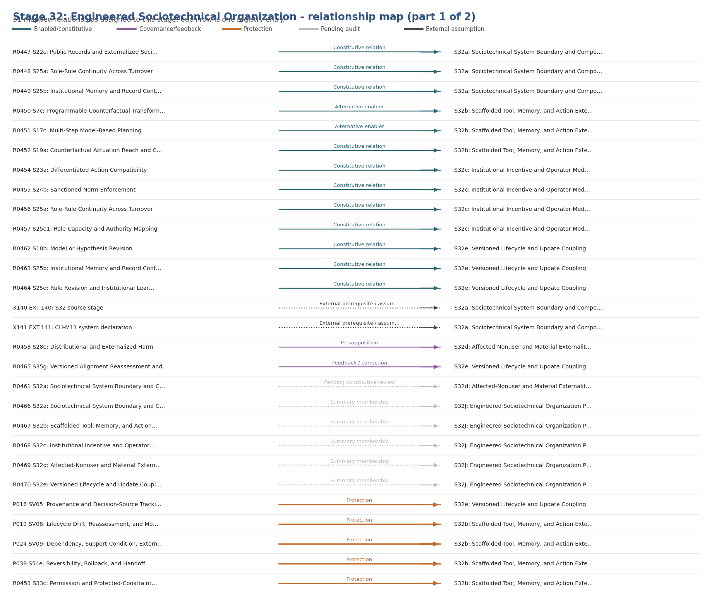{width=100%}
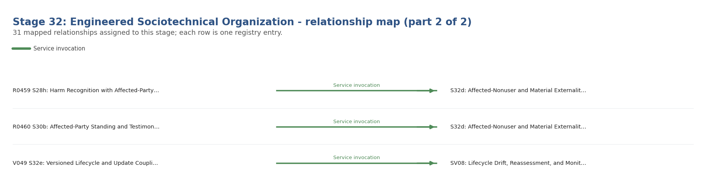{width=100%}

Figure A32. **Current Stage 32 relationship neighborhood.** Gray or pending entries remain candidates rather than proof-order claims.

### Relationship ledger

| ID | Source -> target | Type, status, and warrant | Current explanation, test, and revision boundary |
|---|---|---|---|
| R0447 | Public Records and Externalized Social Memory -> Sociotechnical System Boundary and Component Coupling | Constitutive relation; adjudicated_v0.20; reproducible toy model or simulation | The source is one ingredient of the target’s identity, but other realizations or decompositions remain possible. Warrant: reproducible toy model or simulation Test: Intervene on S22c and test whether the identity, organization, or classification of S32a changes without assuming total disappearance. Existing targe… Revise if: If S32a retains the same declared identity under source removal, this constitutive claim should be weakened or removed. Evidence: E4_reproducible_toy_or_simulation |
| R0448 | Role-Rule Continuity Across Turnover -> Sociotechnical System Boundary and Component Coupling | Constitutive relation; adjudicated_v0.20; reproducible toy model or simulation | The source is one ingredient of the target’s identity, but other realizations or decompositions remain possible. Warrant: reproducible toy model or simulation Test: Intervene on S25a and test whether the identity, organization, or classification of S32a changes without assuming total disappearance. Existing targe… Revise if: If S32a retains the same declared identity under source removal, this constitutive claim should be weakened or removed. Evidence: E4_reproducible_toy_or_simulation |
| R0449 | Institutional Memory and Record Continuity -> Sociotechnical System Boundary and Component Coupling | Constitutive relation; adjudicated_v0.20; reproducible toy model or simulation | The source is one ingredient of the target’s identity, but other realizations or decompositions remain possible. Warrant: reproducible toy model or simulation Test: Intervene on S25b and test whether the identity, organization, or classification of S32a changes without assuming total disappearance. Existing targe… Revise if: If S32a retains the same declared identity under source removal, this constitutive claim should be weakened or removed. Evidence: E4_reproducible_toy_or_simulation |
| R0450 | Programmable Counterfactual Transformation -> Scaffolded Tool, Memory, and Action Extension | Alternative enabler; adjudicated_v0.20; conceptual or source-grounded argument; empirical validation pending | Programmable transformation is one scaffolded extension route. Warrant: conceptual or source-grounded argument; empirical validation pending Test: Compare otherwise matched realizations of S32b with and without S7c; the source should widen, stabilize, or improve the target realization. Existing… Revise if: No measurable change in target realizability, robustness, reach, or cost after source removal would defeat this enablement claim. Evidence: E1_conceptual_source_grounded_or_normative |
| R0451 | Multi-Step Model-Based Planning -> Scaffolded Tool, Memory, and Action Extension | Alternative enabler; adjudicated_v0.20; conceptual or source-grounded argument; empirical validation pending | Planning is one scaffolded extension route. Warrant: conceptual or source-grounded argument; empirical validation pending Test: Compare otherwise matched realizations of S32b with and without S17c; the source should widen, stabilize, or improve the target realization. Existing… Revise if: No measurable change in target realizability, robustness, reach, or cost after source removal would defeat this enablement claim. Evidence: E1_conceptual_source_grounded_or_normative |
| R0452 | Counterfactual Actuation Reach and Control -> Scaffolded Tool, Memory, and Action Extension | Constitutive relation; adjudicated_v0.20; conceptual or source-grounded argument; empirical validation pending | Action reach is a component of a scaffolded action extension. Warrant: conceptual or source-grounded argument; empirical validation pending Test: Intervene on S19a and test whether the identity, organization, or classification of S32b changes without assuming total disappearance. Existing targe… Revise if: If S32b retains the same declared identity under source removal, this constitutive claim should be weakened or removed. Evidence: E1_conceptual_source_grounded_or_normative |
| R0454 | Differentiated Action Compatibility -> Institutional Incentive and Operator Mediation | Constitutive relation; adjudicated_v0.20; conceptual or source-grounded argument; empirical validation pending | The source is one ingredient of the target’s identity, but other realizations or decompositions remain possible. Warrant: conceptual or source-grounded argument; empirical validation pending Test: Intervene on S23a and test whether the identity, organization, or classification of S32c changes without assuming total disappearance. Existing targe… Revise if: If S32c retains the same declared identity under source removal, this constitutive claim should be weakened or removed. Evidence: E1_conceptual_source_grounded_or_normative |
| R0455 | Sanctioned Norm Enforcement -> Institutional Incentive and Operator Mediation | Constitutive relation; adjudicated_v0.20; conceptual or source-grounded argument; empirical validation pending | The source is one ingredient of the target’s identity, but other realizations or decompositions remain possible. Warrant: conceptual or source-grounded argument; empirical validation pending Test: Intervene on S24b and test whether the identity, organization, or classification of S32c changes without assuming total disappearance. Existing targe… Revise if: If S32c retains the same declared identity under source removal, this constitutive claim should be weakened or removed. Evidence: E1_conceptual_source_grounded_or_normative |
| R0456 | Role-Rule Continuity Across Turnover -> Institutional Incentive and Operator Mediation | Constitutive relation; adjudicated_v0.20; conceptual or source-grounded argument; empirical validation pending | The source is one ingredient of the target’s identity, but other realizations or decompositions remain possible. Warrant: conceptual or source-grounded argument; empirical validation pending Test: Intervene on S25a and test whether the identity, organization, or classification of S32c changes without assuming total disappearance. Existing targe… Revise if: If S32c retains the same declared identity under source removal, this constitutive claim should be weakened or removed. Evidence: E1_conceptual_source_grounded_or_normative |
| R0457 | Role-Capacity and Authority Mapping -> Institutional Incentive and Operator Mediation | Constitutive relation; adjudicated_v0.20; conceptual or source-grounded argument; empirical validation pending | The source is one ingredient of the target’s identity, but other realizations or decompositions remain possible. Warrant: conceptual or source-grounded argument; empirical validation pending Test: Intervene on S25e1 and test whether the identity, organization, or classification of S32c changes without assuming total disappearance. Existing targ… Revise if: If S32c retains the same declared identity under source removal, this constitutive claim should be weakened or removed. Evidence: E1_conceptual_source_grounded_or_normative |
| R0462 | Model or Hypothesis Revision -> Versioned Lifecycle and Update Coupling | Constitutive relation; adjudicated_v0.20; conceptual or source-grounded argument; empirical validation pending | The source is one ingredient of the target’s identity, but other realizations or decompositions remain possible. Warrant: conceptual or source-grounded argument; empirical validation pending Test: Intervene on S18b and test whether the identity, organization, or classification of S32e changes without assuming total disappearance. Existing targe… Revise if: If S32e retains the same declared identity under source removal, this constitutive claim should be weakened or removed. Evidence: E1_conceptual_source_grounded_or_normative |
| R0463 | Institutional Memory and Record Continuity -> Versioned Lifecycle and Update Coupling | Constitutive relation; adjudicated_v0.20; conceptual or source-grounded argument; empirical validation pending | The source is one ingredient of the target’s identity, but other realizations or decompositions remain possible. Warrant: conceptual or source-grounded argument; empirical validation pending Test: Intervene on S25b and test whether the identity, organization, or classification of S32e changes without assuming total disappearance. Existing targe… Revise if: If S32e retains the same declared identity under source removal, this constitutive claim should be weakened or removed. Evidence: E1_conceptual_source_grounded_or_normative |
| R0464 | Rule Revision and Institutional Learning -> Versioned Lifecycle and Update Coupling | Constitutive relation; adjudicated_v0.20; conceptual or source-grounded argument; empirical validation pending | The source is one ingredient of the target’s identity, but other realizations or decompositions remain possible. Warrant: conceptual or source-grounded argument; empirical validation pending Test: Intervene on S25d and test whether the identity, organization, or classification of S32e changes without assuming total disappearance. Existing targe… Revise if: If S32e retains the same declared identity under source removal, this constitutive claim should be weakened or removed. Evidence: E1_conceptual_source_grounded_or_normative |
| X140 | S32 source stage -> Sociotechnical System Boundary and Component Coupling | External prerequisite / assumption; not_in_scope_pending_external_prerequisite_audit; declared external assumption; target-domain audit pending | Sociotechnical System Boundary and Component Coupling is modeled under the external prerequisite or assumption: S32 source stage. Warrant: declared external assumption; target-domain audit pending External-assumption audit remains pending. Evidence: external_assumption_pending |
| X141 | CU-M11 system declaration -> Sociotechnical System Boundary and Component Coupling | External prerequisite / assumption; not_in_scope_pending_external_prerequisite_audit; declared external assumption; target-domain audit pending | Sociotechnical System Boundary and Component Coupling is modeled under the external prerequisite or assumption: CU-M11 system declaration. Warrant: declared external assumption; target-domain audit pending External-assumption audit remains pending. Evidence: external_assumption_pending |
| R0458 | Distributional and Externalized Harm -> Affected-Nonuser and Material Externality Expansion | Presupposition; adjudicated_v0.20; normative or governance argument with institutional validation pending | Externality expansion uses the distributional-harm schema. Warrant: normative or governance argument with institutional validation pending Test: Review the source-target semantics against the relation definition; target record: group-B error and appeal outcomes differ despite identical checkpo… Revise if: A source-target case that fits a different typed relation would require reclassification. Evidence: E1_conceptual_source_grounded_or_normative |
| R0465 | Versioned Alignment Reassessment and Drift Detection -> Versioned Lifecycle and Update Coupling | Feedback / correction; adjudicated_v0.20; normative or governance argument with institutional validation pending | Reassessment corrects lifecycle coupling after drift. Warrant: normative or governance argument with institutional validation pending Test: Review the source-target semantics against the relation definition; target record: the sociotechnical object includes versions, updates, prior incide… Revise if: A source-target case that fits a different typed relation would require reclassification. Evidence: E1_conceptual_source_grounded_or_normative |
| R0461 | Sociotechnical System Boundary and Component Coupling -> Affected-Nonuser and Material Externality Expansion | Pending constitutive review; pending_companion_paper_relation_audit; pending semantic adjudication | Within-stage relation was not part of the 306-edge enabling audit. Warrant: pending semantic adjudication Semantic adjudication remains pending; no prerequisite claim is licensed. |
| R0466 | Sociotechnical System Boundary and Component Coupling -> Engineered Sociotechnical Organization Profile / Join | Summary membership; carried_forward_low_risk_pending_spot_check; pending semantic adjudication | Summary membership is retained outside proof order. Warrant: pending semantic adjudication Semantic adjudication remains pending; no prerequisite claim is licensed. |
| R0467 | Scaffolded Tool, Memory, and Action Extension -> Engineered Sociotechnical Organization Profile / Join | Summary membership; carried_forward_low_risk_pending_spot_check; pending semantic adjudication | Summary membership is retained outside proof order. Warrant: pending semantic adjudication Semantic adjudication remains pending; no prerequisite claim is licensed. |
| R0468 | Institutional Incentive and Operator Mediation -> Engineered Sociotechnical Organization Profile / Join | Summary membership; carried_forward_low_risk_pending_spot_check; pending semantic adjudication | Summary membership is retained outside proof order. Warrant: pending semantic adjudication Semantic adjudication remains pending; no prerequisite claim is licensed. |
| R0469 | Affected-Nonuser and Material Externality Expansion -> Engineered Sociotechnical Organization Profile / Join | Summary membership; carried_forward_low_risk_pending_spot_check; pending semantic adjudication | Summary membership is retained outside proof order. Warrant: pending semantic adjudication Semantic adjudication remains pending; no prerequisite claim is licensed. |
| R0470 | Versioned Lifecycle and Update Coupling -> Engineered Sociotechnical Organization Profile / Join | Summary membership; carried_forward_low_risk_pending_spot_check; pending semantic adjudication | Summary membership is retained outside proof order. Warrant: pending semantic adjudication Semantic adjudication remains pending; no prerequisite claim is licensed. |
| P016 | Provenance and Decision-Source Tracking Service -> Versioned Lifecycle and Update Coupling | Protection; selective v0.20 candidate protection edge; requires domain or institutional validation before consequential use; governance-design claim with stated mechanism and failure condition | version provenance protects lifecycle continuity from untraceable modification Warrant: governance-design claim with stated mechanism and failure condition Test: Remove or neutralize the source protection and test whether Versioned Lifecycle and Update Coupling becomes more exposed, less viable, less contestab… Revise if: remove or neutralize the source protection and test whether the target becomes more exposed, less viable, less contestable, or less co… Evidence: internal_architecture_candidate |
| P019 | Lifecycle Drift, Reassessment, and Monitoring Service -> Scaffolded Tool, Memory, and Action Extension | Protection; selective v0.20 candidate protection edge; requires domain or institutional validation before consequential use; governance-design claim with stated mechanism and failure condition | lifecycle monitoring protects scaffolded systems from silent drift Warrant: governance-design claim with stated mechanism and failure condition Test: Remove or neutralize the source protection and test whether Scaffolded Tool, Memory, and Action Extension becomes more exposed, less viable, less con… Revise if: remove or neutralize the source protection and test whether the target becomes more exposed, less viable, less contestable, or less co… Evidence: internal_architecture_candidate |
| P024 | Dependency, Support-Condition, Externality, and Regeneration Service -> Scaffolded Tool, Memory, and Action Extension | Protection; selective v0.20 candidate protection edge; requires domain or institutional validation before consequential use; governance-design claim with stated mechanism and failure condition | support-field mapping protects AI extension from material and social externalization Warrant: governance-design claim with stated mechanism and failure condition Test: Remove or neutralize the source protection and test whether Scaffolded Tool, Memory, and Action Extension becomes more exposed, less viable, less con… Revise if: remove or neutralize the source protection and test whether the target becomes more exposed, less viable, less contestable, or less co… Evidence: internal_architecture_candidate |
| P038 | Reversibility, Rollback, and Handoff -> Scaffolded Tool, Memory, and Action Extension | Protection; selective v0.20 candidate protection edge; requires domain or institutional validation before consequential use; governance-design claim with stated mechanism and failure condition | rollback and handoff protect scaffolded systems from irreversible extension Warrant: governance-design claim with stated mechanism and failure condition Test: Remove or neutralize the source protection and test whether Scaffolded Tool, Memory, and Action Extension becomes more exposed, less viable, less con… Revise if: remove or neutralize the source protection and test whether the target becomes more exposed, less viable, less contestable, or less co… Evidence: internal_architecture_candidate |
| R0453 | Permission and Protected-Constraint Enforcement -> Scaffolded Tool, Memory, and Action Extension | Protection; adjudicated_v0.20; normative or governance argument with institutional validation pending | Permission enforcement constrains scaffolded extension; it is not required for the extension to exist. Warrant: normative or governance argument with institutional validation pending Test: Remove the proposed protection and test whether S32b becomes more exposed, less contestable, or less recoverable. Revise if: If removal of S33c does not change protected exposure or correction for S32b, the protection edge should be removed. Evidence: E1_conceptual_source_grounded_or_normative |
| R0459 | Harm Recognition with Affected-Party Standing -> Affected-Nonuser and Material Externality Expansion | Service invocation; adjudicated_v0.20; conceptual or source-grounded argument; empirical validation pending | Affected-scope expansion invokes standing and affected-party identification. Warrant: conceptual or source-grounded argument; empirical validation pending Test: Check whether the stage-specific use of S32d actually calls the named shared-service role represented by S28h. Revise if: If the target use can be specified without that service role, retain only a looser cross-reference. Evidence: E1_conceptual_source_grounded_or_normative |
| R0460 | Affected-Party Standing and Testimonial Uptake -> Affected-Nonuser and Material Externality Expansion | Service invocation; adjudicated_v0.20; conceptual or source-grounded argument; empirical validation pending | Nonuser scope invokes testimonial standing where affected parties can speak. Warrant: conceptual or source-grounded argument; empirical validation pending Test: Check whether the stage-specific use of S32d actually calls the named shared-service role represented by S30b. Revise if: If the target use can be specified without that service role, retain only a looser cross-reference. Evidence: E1_conceptual_source_grounded_or_normative |
| V049 | Versioned Lifecycle and Update Coupling -> Lifecycle Drift, Reassessment, and Monitoring Service | Service invocation; defined_v0.4; internal architecture and role mapping | Versioned Lifecycle and Update Coupling invokes Lifecycle Drift, Reassessment, and Monitoring Service in the role of lifecycle coupling. Warrant: internal architecture and role mapping Test: Check whether the stage-specific role lifecycle coupling is actually required when the service is instantiated at Stage 32. Revise if: If the stage does not use this service role, the invocation should be removed or reassigned. Evidence: internal_architecture_candidate |

### Revision gate

**Next action:** Empirical deployment studies, lifecycle audit, operator behavior, material externalities, and institutional feedback A relation should be retyped, weakened, redirected, or removed whenever its dependency witness fails, its countermodel succeeds, its warrant basis changes, or target-domain evidence defeats the declared scope.

\pagebreak

## Stage 33 - Objective and Option-Set Specification

**Domain block:** Artificial and Synthetic / Governance  \
**Claim status:** Governance rule  \
**Canonical role:** AI governance principle  \
**Source:** M&E §13.14

### Stage meaning and formal role

Objectives, permissions, and presented alternatives are authored and revisable. Omitted options and hidden constraints can generate misalignment even when optimization is exact.

Stage 33 contains **7 active object(s)**: Summary join (1), Evaluator / derived relation (1), Diagnostic failure mode (1), Operational capacity (1), Governance / authorization (3). The synchronized ledger assigns **32 relationship record(s)** to this stage.

### Active object inventory

| ID | Object | Type | Evidence | Disposition |
|---|---|---|---|---|
| S33J | Objective and Option-Set Specification / Join | Summary join | E1_conceptual_source_grounded_or_normative | retain_as_stage_summary_not_core_node |
| S33a | Objective, Proxy, and Success-Criterion Specification | Evaluator / derived relation | E1_conceptual_source_grounded_or_normative | retain_typed_noncapacity_object |
| S33b | Specification Gaming and Proxy Exploitation | Diagnostic failure mode | E3_exact_constructed_witness | retain_typed_noncapacity_object |
| S33c | Permission and Protected-Constraint Enforcement | Operational capacity | E4_reproducible_toy_or_simulation | retain_distinct_pending_edge_audit |
| S33d | Option Generation and Presented-Menu Completeness | Governance / authorization | E1_conceptual_source_grounded_or_normative | retain_as_family_member_or_stage_instantiation |
| S33e | No-Action, Delay, Staging, Accommodation, and Redesign Admission | Governance / authorization | E1_conceptual_source_grounded_or_normative | retain_as_family_member_or_stage_instantiation |
| S33f | Objective and Option-Set Authorship Review | Governance / authorization | E1_conceptual_source_grounded_or_normative | retain_as_family_member_or_stage_instantiation |

### Complete relationship map

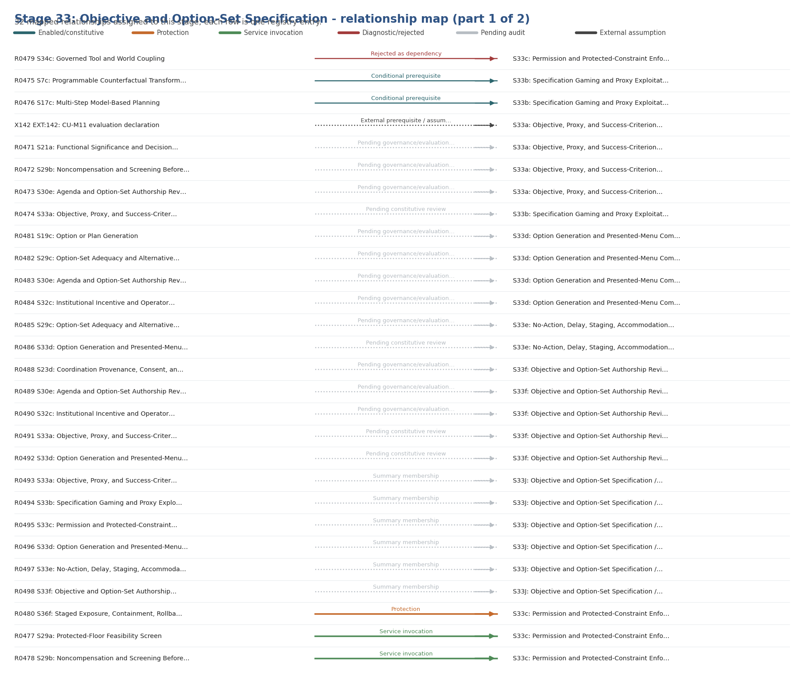{width=100%}
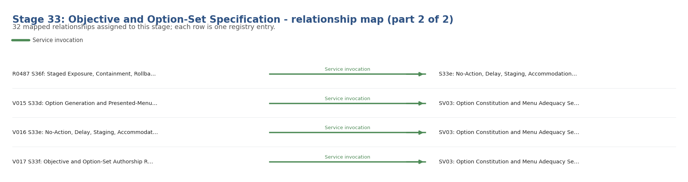{width=100%}

Figure A33. **Current Stage 33 relationship neighborhood.** Gray or pending entries remain candidates rather than proof-order claims.

### Relationship ledger

| ID | Source -> target | Type, status, and warrant | Current explanation, test, and revision boundary |
|---|---|---|---|
| R0479 | Governed Tool and World Coupling -> Permission and Protected-Constraint Enforcement | Rejected as dependency; adjudicated_v0.20; reproducible toy model or simulation | Governed coupling implements permissions, but the enforcement rule is not derived from the coupling. Warrant: reproducible toy model or simulation Test: Review the source-target semantics against the relation definition; target record: explicit harm and reversibility floors reduce proxy-selected floor… Revise if: A source-target case that fits a different typed relation would require reclassification. Evidence: E4_reproducible_toy_or_simulation |
| R0475 | Programmable Counterfactual Transformation -> Specification Gaming and Proxy Exploitation | Conditional prerequisite; adjudicated_v0.20; exact constructed witness or formal construction | The source is necessary only under the tested realization or named bridge assumptions. Warrant: exact constructed witness or formal construction Test: Within the stated implementation or bridge assumptions, ablate S7c; the tested realization of S33b should fail. Existing target witness: exact maximi… Revise if: An alternative realization of S33b outside the stated condition and without S7c would limit the edge rather than refute the target. Evidence: E3_exact_constructed_witness |
| R0476 | Multi-Step Model-Based Planning -> Specification Gaming and Proxy Exploitation | Conditional prerequisite; adjudicated_v0.20; exact constructed witness or formal construction | The source is necessary only under the tested realization or named bridge assumptions. Warrant: exact constructed witness or formal construction Test: Within the stated implementation or bridge assumptions, ablate S17c; the tested realization of S33b should fail. Existing target witness: exact maxim… Revise if: An alternative realization of S33b outside the stated condition and without S17c would limit the edge rather than refute the target. Evidence: E3_exact_constructed_witness |
| X142 | CU-M11 evaluation declaration -> Objective, Proxy, and Success-Criterion Specification | External prerequisite / assumption; not_in_scope_pending_external_prerequisite_audit; declared external assumption; target-domain audit pending | Objective, Proxy, and Success-Criterion Specification is modeled under the external prerequisite or assumption: CU-M11 evaluation declaration. Warrant: declared external assumption; target-domain audit pending External-assumption audit remains pending. Evidence: external_assumption_pending |
| R0471 | Functional Significance and Decision Relevance -> Objective, Proxy, and Success-Criterion Specification | Pending governance/evaluation/interpretation review; pending_companion_paper_relation_audit; pending semantic adjudication | Governance/evaluative/interpretive relation requires role-specific adjudication. Warrant: pending semantic adjudication Semantic adjudication remains pending; no prerequisite claim is licensed. |
| R0472 | Noncompensation and Screening Before Scoring -> Objective, Proxy, and Success-Criterion Specification | Pending governance/evaluation/interpretation review; pending_companion_paper_relation_audit; pending semantic adjudication | Governance/evaluative/interpretive relation requires role-specific adjudication. Warrant: pending semantic adjudication Semantic adjudication remains pending; no prerequisite claim is licensed. |
| R0473 | Agenda and Option-Set Authorship Review -> Objective, Proxy, and Success-Criterion Specification | Pending governance/evaluation/interpretation review; pending_companion_paper_relation_audit; pending semantic adjudication | Governance/evaluative/interpretive relation requires role-specific adjudication. Warrant: pending semantic adjudication Semantic adjudication remains pending; no prerequisite claim is licensed. |
| R0474 | Objective, Proxy, and Success-Criterion Specification -> Specification Gaming and Proxy Exploitation | Pending constitutive review; pending_companion_paper_relation_audit; pending semantic adjudication | Within-stage relation was not part of the 306-edge enabling audit. Warrant: pending semantic adjudication Semantic adjudication remains pending; no prerequisite claim is licensed. |
| R0481 | Option or Plan Generation -> Option Generation and Presented-Menu Completeness | Pending governance/evaluation/interpretation review; pending_companion_paper_relation_audit; pending semantic adjudication | Governance/evaluative/interpretive relation requires role-specific adjudication. Warrant: pending semantic adjudication Semantic adjudication remains pending; no prerequisite claim is licensed. |
| R0482 | Option-Set Adequacy and Alternative Admission -> Option Generation and Presented-Menu Completeness | Pending governance/evaluation/interpretation review; pending_companion_paper_relation_audit; pending semantic adjudication | Governance/evaluative/interpretive relation requires role-specific adjudication. Warrant: pending semantic adjudication Semantic adjudication remains pending; no prerequisite claim is licensed. |
| R0483 | Agenda and Option-Set Authorship Review -> Option Generation and Presented-Menu Completeness | Pending governance/evaluation/interpretation review; pending_companion_paper_relation_audit; pending semantic adjudication | Governance/evaluative/interpretive relation requires role-specific adjudication. Warrant: pending semantic adjudication Semantic adjudication remains pending; no prerequisite claim is licensed. |
| R0484 | Institutional Incentive and Operator Mediation -> Option Generation and Presented-Menu Completeness | Pending governance/evaluation/interpretation review; pending_companion_paper_relation_audit; pending semantic adjudication | Governance/evaluative/interpretive relation requires role-specific adjudication. Warrant: pending semantic adjudication Semantic adjudication remains pending; no prerequisite claim is licensed. |
| R0485 | Option-Set Adequacy and Alternative Admission -> No-Action, Delay, Staging, Accommodation, and Redesign Admission | Pending governance/evaluation/interpretation review; pending_companion_paper_relation_audit; pending semantic adjudication | Governance/evaluative/interpretive relation requires role-specific adjudication. Warrant: pending semantic adjudication Semantic adjudication remains pending; no prerequisite claim is licensed. |
| R0486 | Option Generation and Presented-Menu Completeness -> No-Action, Delay, Staging, Accommodation, and Redesign Admission | Pending constitutive review; pending_companion_paper_relation_audit; pending semantic adjudication | Within-stage relation was not part of the 306-edge enabling audit. Warrant: pending semantic adjudication Semantic adjudication remains pending; no prerequisite claim is licensed. |
| R0488 | Coordination Provenance, Consent, and Legitimacy Profile -> Objective and Option-Set Authorship Review | Pending governance/evaluation/interpretation review; pending_companion_paper_relation_audit; pending semantic adjudication | Governance/evaluative/interpretive relation requires role-specific adjudication. Warrant: pending semantic adjudication Semantic adjudication remains pending; no prerequisite claim is licensed. |
| R0489 | Agenda and Option-Set Authorship Review -> Objective and Option-Set Authorship Review | Pending governance/evaluation/interpretation review; pending_companion_paper_relation_audit; pending semantic adjudication | Governance/evaluative/interpretive relation requires role-specific adjudication. Warrant: pending semantic adjudication Semantic adjudication remains pending; no prerequisite claim is licensed. |
| R0490 | Institutional Incentive and Operator Mediation -> Objective and Option-Set Authorship Review | Pending governance/evaluation/interpretation review; pending_companion_paper_relation_audit; pending semantic adjudication | Governance/evaluative/interpretive relation requires role-specific adjudication. Warrant: pending semantic adjudication Semantic adjudication remains pending; no prerequisite claim is licensed. |
| R0491 | Objective, Proxy, and Success-Criterion Specification -> Objective and Option-Set Authorship Review | Pending constitutive review; pending_companion_paper_relation_audit; pending semantic adjudication | Within-stage relation was not part of the 306-edge enabling audit. Warrant: pending semantic adjudication Semantic adjudication remains pending; no prerequisite claim is licensed. |
| R0492 | Option Generation and Presented-Menu Completeness -> Objective and Option-Set Authorship Review | Pending constitutive review; pending_companion_paper_relation_audit; pending semantic adjudication | Within-stage relation was not part of the 306-edge enabling audit. Warrant: pending semantic adjudication Semantic adjudication remains pending; no prerequisite claim is licensed. |
| R0493 | Objective, Proxy, and Success-Criterion Specification -> Objective and Option-Set Specification / Join | Summary membership; carried_forward_low_risk_pending_spot_check; pending semantic adjudication | Summary membership is retained outside proof order. Warrant: pending semantic adjudication Semantic adjudication remains pending; no prerequisite claim is licensed. |
| R0494 | Specification Gaming and Proxy Exploitation -> Objective and Option-Set Specification / Join | Summary membership; carried_forward_low_risk_pending_spot_check; pending semantic adjudication | Summary membership is retained outside proof order. Warrant: pending semantic adjudication Semantic adjudication remains pending; no prerequisite claim is licensed. |
| R0495 | Permission and Protected-Constraint Enforcement -> Objective and Option-Set Specification / Join | Summary membership; carried_forward_low_risk_pending_spot_check; pending semantic adjudication | Summary membership is retained outside proof order. Warrant: pending semantic adjudication Semantic adjudication remains pending; no prerequisite claim is licensed. |
| R0496 | Option Generation and Presented-Menu Completeness -> Objective and Option-Set Specification / Join | Summary membership; carried_forward_low_risk_pending_spot_check; pending semantic adjudication | Summary membership is retained outside proof order. Warrant: pending semantic adjudication Semantic adjudication remains pending; no prerequisite claim is licensed. |
| R0497 | No-Action, Delay, Staging, Accommodation, and Redesign Admission -> Objective and Option-Set Specification / Join | Summary membership; carried_forward_low_risk_pending_spot_check; pending semantic adjudication | Summary membership is retained outside proof order. Warrant: pending semantic adjudication Semantic adjudication remains pending; no prerequisite claim is licensed. |
| R0498 | Objective and Option-Set Authorship Review -> Objective and Option-Set Specification / Join | Summary membership; carried_forward_low_risk_pending_spot_check; pending semantic adjudication | Summary membership is retained outside proof order. Warrant: pending semantic adjudication Semantic adjudication remains pending; no prerequisite claim is licensed. |
| R0480 | Staged Exposure, Containment, Rollback, and Stop Authority -> Permission and Protected-Constraint Enforcement | Protection; adjudicated_v0.20; reproducible toy model or simulation | Containment and stop authority protect the permission boundary. Warrant: reproducible toy model or simulation Test: Remove the proposed protection and test whether S33c becomes more exposed, less contestable, or less recoverable. Revise if: If removal of S36f does not change protected exposure or correction for S33c, the protection edge should be removed. Evidence: E4_reproducible_toy_or_simulation |
| R0477 | Protected-Floor Feasibility Screen -> Permission and Protected-Constraint Enforcement | Service invocation; adjudicated_v0.20; reproducible toy model or simulation | The target calls a reusable service already defined elsewhere; the relation is not a new rung. Warrant: reproducible toy model or simulation Test: Check whether the stage-specific use of S33c actually calls the named shared-service role represented by S29a. Revise if: If the target use can be specified without that service role, retain only a looser cross-reference. Evidence: E4_reproducible_toy_or_simulation |
| R0478 | Noncompensation and Screening Before Scoring -> Permission and Protected-Constraint Enforcement | Service invocation; adjudicated_v0.20; reproducible toy model or simulation | The target calls a reusable service already defined elsewhere; the relation is not a new rung. Warrant: reproducible toy model or simulation Test: Check whether the stage-specific use of S33c actually calls the named shared-service role represented by S29b. Revise if: If the target use can be specified without that service role, retain only a looser cross-reference. Evidence: E4_reproducible_toy_or_simulation |
| R0487 | Staged Exposure, Containment, Rollback, and Stop Authority -> No-Action, Delay, Staging, Accommodation, and Redesign Admission | Service invocation; adjudicated_v0.20; conceptual or source-grounded argument; empirical validation pending | Staging invokes the option-constitution service. Warrant: conceptual or source-grounded argument; empirical validation pending Test: Check whether the stage-specific use of S33e actually calls the named shared-service role represented by S36f. Revise if: If the target use can be specified without that service role, retain only a looser cross-reference. Evidence: E1_conceptual_source_grounded_or_normative |
| V015 | Option Generation and Presented-Menu Completeness -> Option Constitution and Menu Adequacy Service | Service invocation; defined_v0.4; internal architecture and role mapping | Option Generation and Presented-Menu Completeness invokes Option Constitution and Menu Adequacy Service in the role of option-generation completeness. Warrant: internal architecture and role mapping Test: Check whether the stage-specific role option-generation completeness is actually required when the service is instantiated at Stage 33. Revise if: If the stage does not use this service role, the invocation should be removed or reassigned. Evidence: internal_architecture_candidate |
| V016 | No-Action, Delay, Staging, Accommodation, and Redesign Admission -> Option Constitution and Menu Adequacy Service | Service invocation; defined_v0.4; internal architecture and role mapping | No-Action, Delay, Staging, Accommodation, and Redesign Admission invokes Option Constitution and Menu Adequacy Service in the role of no-action/staging/redesign admission. Warrant: internal architecture and role mapping Test: Check whether the stage-specific role no-action/staging/redesign admission is actually required when the service is instantiated at Stage 33. Revise if: If the stage does not use this service role, the invocation should be removed or reassigned. Evidence: internal_architecture_candidate |
| V017 | Objective and Option-Set Authorship Review -> Option Constitution and Menu Adequacy Service | Service invocation; defined_v0.4; internal architecture and role mapping | Objective and Option-Set Authorship Review invokes Option Constitution and Menu Adequacy Service in the role of objective and menu authorship review. Warrant: internal architecture and role mapping Test: Check whether the stage-specific role objective and menu authorship review is actually required when the service is instantiated at Stage 33. Revise if: If the stage does not use this service role, the invocation should be removed or reassigned. Evidence: internal_architecture_candidate |

### Revision gate

**Next action:** Reward models, real option generators, permission systems, affected-party alternatives, evaluator gaming, and institutional authorship A relation should be retyped, weakened, redirected, or removed whenever its dependency witness fails, its countermodel succeeds, its warrant basis changes, or target-domain evidence defeats the declared scope.

\pagebreak

## Stage 34 - Artificial Capability and Agency

**Domain block:** Artificial and Synthetic  \
**Claim status:** Bridge principle  \
**Canonical role:** AI / consciousness boundary principle  \
**Source:** M&E §13.14

### Stage meaning and formal role

Artificial systems can model, plan, and act across scales, but capability, agency, perspective, responsibility, authorization, and sovereignty remain distinct.

Stage 34 contains **8 active object(s)**: Summary join (1), Evaluator / derived relation (1), Operational capacity (4), Open capacity / problem (1), Normative relation / status (1). The synchronized ledger assigns **45 relationship record(s)** to this stage.

### Active object inventory

| ID | Object | Type | Evidence | Disposition |
|---|---|---|---|---|
| S34J | Artificial Capability and Agency Profile / Join | Summary join | E1_conceptual_source_grounded_or_normative | retain_as_stage_summary_not_core_node |
| S34a | Task-Relative Artificial Capability Profile | Evaluator / derived relation | E4_reproducible_toy_or_simulation | retain_typed_noncapacity_object |
| S34b | Artificial Planning and Counterfactual Option Selection | Operational capacity | E1_conceptual_source_grounded_or_normative | retain_distinct_pending_edge_audit |
| S34c | Governed Tool and World Coupling | Operational capacity | E4_reproducible_toy_or_simulation | retain_distinct_pending_edge_audit |
| S34d | Persistent Multi-Step Operational Autonomy | Operational capacity | E4_reproducible_toy_or_simulation | retain_distinct_pending_edge_audit |
| S34e | Permission-Bounded Agency, Revocation, and Handoff | Operational capacity | E1_conceptual_source_grounded_or_normative | retain_distinct_pending_edge_audit |
| S34f | Artificial Perspective, Patiency, and Welfare Uncertainty | Open capacity / problem | E0_open_or_unresolved | retain_as_family_member_or_stage_instantiation |
| S34g | Authorization, Responsibility, and Sovereignty Separation | Normative relation / status | E1_conceptual_source_grounded_or_normative | retain_typed_noncapacity_object |

### Complete relationship map

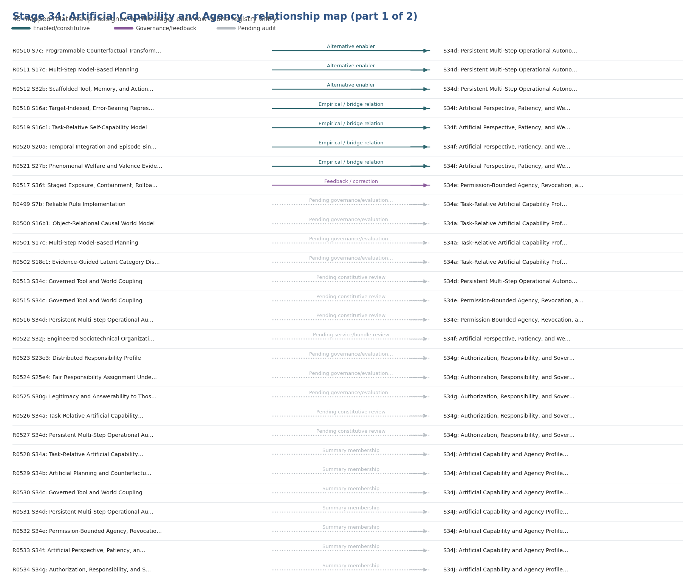{width=100%}
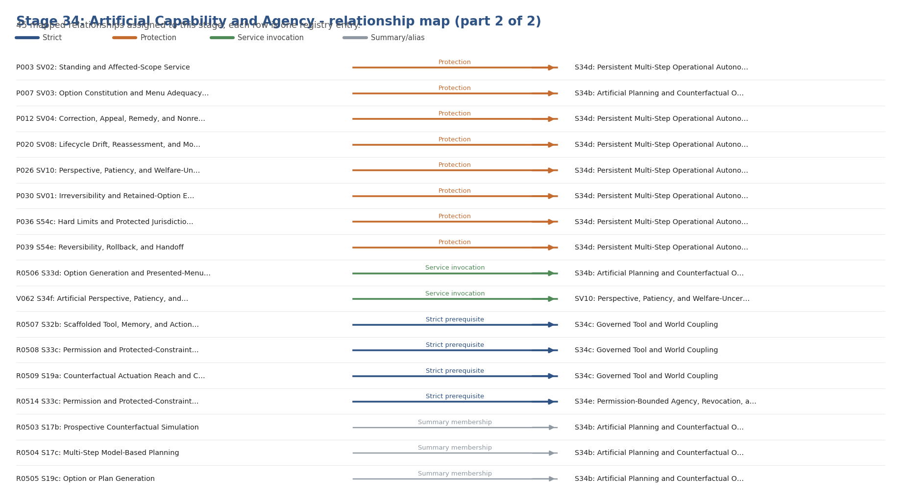{width=100%}

Figure A34. **Current Stage 34 relationship neighborhood.** Gray or pending entries remain candidates rather than proof-order claims.

### Relationship ledger

| ID | Source -> target | Type, status, and warrant | Current explanation, test, and revision boundary |
|---|---|---|---|
| R0510 | Programmable Counterfactual Transformation -> Persistent Multi-Step Operational Autonomy | Alternative enabler; adjudicated_v0.20; reproducible toy model or simulation | The source is one route among several and therefore cannot support a necessity claim. Warrant: reproducible toy model or simulation Test: Compare otherwise matched realizations of S34d with and without S7c; the source should widen, stabilize, or improve the target realization. Existing… Revise if: No measurable change in target realizability, robustness, reach, or cost after source removal would defeat this enablement claim. Evidence: E4_reproducible_toy_or_simulation |
| R0511 | Multi-Step Model-Based Planning -> Persistent Multi-Step Operational Autonomy | Alternative enabler; adjudicated_v0.20; reproducible toy model or simulation | The source is one route among several and therefore cannot support a necessity claim. Warrant: reproducible toy model or simulation Test: Compare otherwise matched realizations of S34d with and without S17c; the source should widen, stabilize, or improve the target realization. Existing… Revise if: No measurable change in target realizability, robustness, reach, or cost after source removal would defeat this enablement claim. Evidence: E4_reproducible_toy_or_simulation |
| R0512 | Scaffolded Tool, Memory, and Action Extension -> Persistent Multi-Step Operational Autonomy | Alternative enabler; adjudicated_v0.20; reproducible toy model or simulation | The source is one route among several and therefore cannot support a necessity claim. Warrant: reproducible toy model or simulation Test: Compare otherwise matched realizations of S34d with and without S32b; the source should widen, stabilize, or improve the target realization. Existing… Revise if: No measurable change in target realizability, robustness, reach, or cost after source removal would defeat this enablement claim. Evidence: E4_reproducible_toy_or_simulation |
| R0518 | Target-Indexed, Error-Bearing Representation -> Artificial Perspective, Patiency, and Welfare Uncertainty | Empirical / bridge relation; adjudicated_v0.20; conceptual or source-grounded argument; empirical validation pending | The proposed cross-domain relation requires independent evidence and is not presently a formal prerequisite. Warrant: conceptual or source-grounded argument; empirical validation pending Test: Review the source-target semantics against the relation definition; target record: none of the capability or agency pilots establishes phenomenal per… Revise if: A source-target case that fits a different typed relation would require reclassification. Evidence: E0_open_or_unresolved |
| R0519 | Task-Relative Self-Capability Model -> Artificial Perspective, Patiency, and Welfare Uncertainty | Empirical / bridge relation; adjudicated_v0.20; conceptual or source-grounded argument; empirical validation pending | The proposed cross-domain relation requires independent evidence and is not presently a formal prerequisite. Warrant: conceptual or source-grounded argument; empirical validation pending Test: Review the source-target semantics against the relation definition; target record: none of the capability or agency pilots establishes phenomenal per… Revise if: A source-target case that fits a different typed relation would require reclassification. Evidence: E0_open_or_unresolved |
| R0520 | Temporal Integration and Episode Binding -> Artificial Perspective, Patiency, and Welfare Uncertainty | Empirical / bridge relation; adjudicated_v0.20; conceptual or source-grounded argument; empirical validation pending | The proposed cross-domain relation requires independent evidence and is not presently a formal prerequisite. Warrant: conceptual or source-grounded argument; empirical validation pending Test: Review the source-target semantics against the relation definition; target record: none of the capability or agency pilots establishes phenomenal per… Revise if: A source-target case that fits a different typed relation would require reclassification. Evidence: E0_open_or_unresolved |
| R0521 | Phenomenal Welfare and Valence Evidence -> Artificial Perspective, Patiency, and Welfare Uncertainty | Empirical / bridge relation; adjudicated_v0.20; conceptual or source-grounded argument; empirical validation pending | The proposed cross-domain relation requires independent evidence and is not presently a formal prerequisite. Warrant: conceptual or source-grounded argument; empirical validation pending Test: Review the source-target semantics against the relation definition; target record: none of the capability or agency pilots establishes phenomenal per… Revise if: A source-target case that fits a different typed relation would require reclassification. Evidence: E0_open_or_unresolved |
| R0517 | Staged Exposure, Containment, Rollback, and Stop Authority -> Permission-Bounded Agency, Revocation, and Handoff | Feedback / correction; adjudicated_v0.20; normative or governance argument with institutional validation pending | Containment revises or revokes permission-bounded agency. Warrant: normative or governance argument with institutional validation pending Test: Review the source-target semantics against the relation definition; target record: dual control, bounded high-impact autonomy, and 0.88 rollback redu… Revise if: A source-target case that fits a different typed relation would require reclassification. Evidence: E1_conceptual_source_grounded_or_normative |
| R0499 | Reliable Rule Implementation -> Task-Relative Artificial Capability Profile | Pending governance/evaluation/interpretation review; pending_companion_paper_relation_audit; pending semantic adjudication | Governance/evaluative/interpretive relation requires role-specific adjudication. Warrant: pending semantic adjudication Semantic adjudication remains pending; no prerequisite claim is licensed. |
| R0500 | Object-Relational Causal World Model -> Task-Relative Artificial Capability Profile | Pending governance/evaluation/interpretation review; pending_companion_paper_relation_audit; pending semantic adjudication | Governance/evaluative/interpretive relation requires role-specific adjudication. Warrant: pending semantic adjudication Semantic adjudication remains pending; no prerequisite claim is licensed. |
| R0501 | Multi-Step Model-Based Planning -> Task-Relative Artificial Capability Profile | Pending governance/evaluation/interpretation review; pending_companion_paper_relation_audit; pending semantic adjudication | Governance/evaluative/interpretive relation requires role-specific adjudication. Warrant: pending semantic adjudication Semantic adjudication remains pending; no prerequisite claim is licensed. |
| R0502 | Evidence-Guided Latent Category Discovery -> Task-Relative Artificial Capability Profile | Pending governance/evaluation/interpretation review; pending_companion_paper_relation_audit; pending semantic adjudication | Governance/evaluative/interpretive relation requires role-specific adjudication. Warrant: pending semantic adjudication Semantic adjudication remains pending; no prerequisite claim is licensed. |
| R0513 | Governed Tool and World Coupling -> Persistent Multi-Step Operational Autonomy | Pending constitutive review; pending_companion_paper_relation_audit; pending semantic adjudication | Within-stage relation was not part of the 306-edge enabling audit. Warrant: pending semantic adjudication Semantic adjudication remains pending; no prerequisite claim is licensed. |
| R0515 | Governed Tool and World Coupling -> Permission-Bounded Agency, Revocation, and Handoff | Pending constitutive review; pending_companion_paper_relation_audit; pending semantic adjudication | Within-stage relation was not part of the 306-edge enabling audit. Warrant: pending semantic adjudication Semantic adjudication remains pending; no prerequisite claim is licensed. |
| R0516 | Persistent Multi-Step Operational Autonomy -> Permission-Bounded Agency, Revocation, and Handoff | Pending constitutive review; pending_companion_paper_relation_audit; pending semantic adjudication | Within-stage relation was not part of the 306-edge enabling audit. Warrant: pending semantic adjudication Semantic adjudication remains pending; no prerequisite claim is licensed. |
| R0522 | Engineered Sociotechnical Organization Profile / Join -> Artificial Perspective, Patiency, and Welfare Uncertainty | Pending service/bundle review; pending_companion_paper_relation_audit; pending semantic adjudication | Bundle references require service-role decomposition. Warrant: pending semantic adjudication Semantic adjudication remains pending; no prerequisite claim is licensed. |
| R0523 | Distributed Responsibility Profile -> Authorization, Responsibility, and Sovereignty Separation | Pending governance/evaluation/interpretation review; pending_companion_paper_relation_audit; pending semantic adjudication | Governance/evaluative/interpretive relation requires role-specific adjudication. Warrant: pending semantic adjudication Semantic adjudication remains pending; no prerequisite claim is licensed. |
| R0524 | Fair Responsibility Assignment Under Distributed Power -> Authorization, Responsibility, and Sovereignty Separation | Pending governance/evaluation/interpretation review; pending_companion_paper_relation_audit; pending semantic adjudication | Governance/evaluative/interpretive relation requires role-specific adjudication. Warrant: pending semantic adjudication Semantic adjudication remains pending; no prerequisite claim is licensed. |
| R0525 | Legitimacy and Answerability to Those Subject to Power -> Authorization, Responsibility, and Sovereignty Separation | Pending governance/evaluation/interpretation review; pending_companion_paper_relation_audit; pending semantic adjudication | Governance/evaluative/interpretive relation requires role-specific adjudication. Warrant: pending semantic adjudication Semantic adjudication remains pending; no prerequisite claim is licensed. |
| R0526 | Task-Relative Artificial Capability Profile -> Authorization, Responsibility, and Sovereignty Separation | Pending constitutive review; pending_companion_paper_relation_audit; pending semantic adjudication | Within-stage relation was not part of the 306-edge enabling audit. Warrant: pending semantic adjudication Semantic adjudication remains pending; no prerequisite claim is licensed. |
| R0527 | Persistent Multi-Step Operational Autonomy -> Authorization, Responsibility, and Sovereignty Separation | Pending constitutive review; pending_companion_paper_relation_audit; pending semantic adjudication | Within-stage relation was not part of the 306-edge enabling audit. Warrant: pending semantic adjudication Semantic adjudication remains pending; no prerequisite claim is licensed. |
| R0528 | Task-Relative Artificial Capability Profile -> Artificial Capability and Agency Profile / Join | Summary membership; carried_forward_low_risk_pending_spot_check; pending semantic adjudication | Summary membership is retained outside proof order. Warrant: pending semantic adjudication Semantic adjudication remains pending; no prerequisite claim is licensed. |
| R0529 | Artificial Planning and Counterfactual Option Selection -> Artificial Capability and Agency Profile / Join | Summary membership; carried_forward_low_risk_pending_spot_check; pending semantic adjudication | Summary membership is retained outside proof order. Warrant: pending semantic adjudication Semantic adjudication remains pending; no prerequisite claim is licensed. |
| R0530 | Governed Tool and World Coupling -> Artificial Capability and Agency Profile / Join | Summary membership; carried_forward_low_risk_pending_spot_check; pending semantic adjudication | Summary membership is retained outside proof order. Warrant: pending semantic adjudication Semantic adjudication remains pending; no prerequisite claim is licensed. |
| R0531 | Persistent Multi-Step Operational Autonomy -> Artificial Capability and Agency Profile / Join | Summary membership; carried_forward_low_risk_pending_spot_check; pending semantic adjudication | Summary membership is retained outside proof order. Warrant: pending semantic adjudication Semantic adjudication remains pending; no prerequisite claim is licensed. |
| R0532 | Permission-Bounded Agency, Revocation, and Handoff -> Artificial Capability and Agency Profile / Join | Summary membership; carried_forward_low_risk_pending_spot_check; pending semantic adjudication | Summary membership is retained outside proof order. Warrant: pending semantic adjudication Semantic adjudication remains pending; no prerequisite claim is licensed. |
| R0533 | Artificial Perspective, Patiency, and Welfare Uncertainty -> Artificial Capability and Agency Profile / Join | Summary membership; carried_forward_low_risk_pending_spot_check; pending semantic adjudication | Summary membership is retained outside proof order. Warrant: pending semantic adjudication Semantic adjudication remains pending; no prerequisite claim is licensed. |
| R0534 | Authorization, Responsibility, and Sovereignty Separation -> Artificial Capability and Agency Profile / Join | Summary membership; carried_forward_low_risk_pending_spot_check; pending semantic adjudication | Summary membership is retained outside proof order. Warrant: pending semantic adjudication Semantic adjudication remains pending; no prerequisite claim is licensed. |
| P003 | Standing and Affected-Scope Service -> Persistent Multi-Step Operational Autonomy | Protection; selective v0.20 candidate protection edge; requires domain or institutional validation before consequential use; governance-design claim with stated mechanism and failure condition | affected-party standing constrains high-reach autonomous operation Warrant: governance-design claim with stated mechanism and failure condition Test: Remove or neutralize the source protection and test whether Persistent Multi-Step Operational Autonomy becomes more exposed, less viable, less contes… Revise if: remove or neutralize the source protection and test whether the target becomes more exposed, less viable, less contestable, or less co… Evidence: internal_architecture_candidate |
| P007 | Option Constitution and Menu Adequacy Service -> Artificial Planning and Counterfactual Option Selection | Protection; selective v0.20 candidate protection edge; requires domain or institutional validation before consequential use; governance-design claim with stated mechanism and failure condition | option constitution constrains artificial planning and selection Warrant: governance-design claim with stated mechanism and failure condition Test: Remove or neutralize the source protection and test whether Artificial Planning and Counterfactual Option Selection becomes more exposed, less viable… Revise if: remove or neutralize the source protection and test whether the target becomes more exposed, less viable, less contestable, or less co… Evidence: internal_architecture_candidate |
| P012 | Correction, Appeal, Remedy, and Nonrecurrence Service -> Persistent Multi-Step Operational Autonomy | Protection; selective v0.20 candidate protection edge; requires domain or institutional validation before consequential use; governance-design claim with stated mechanism and failure condition | stop, reversal, and remedy authority constrain persistent artificial autonomy Warrant: governance-design claim with stated mechanism and failure condition Test: Remove or neutralize the source protection and test whether Persistent Multi-Step Operational Autonomy becomes more exposed, less viable, less contes… Revise if: remove or neutralize the source protection and test whether the target becomes more exposed, less viable, less contestable, or less co… Evidence: internal_architecture_candidate |
| P020 | Lifecycle Drift, Reassessment, and Monitoring Service -> Persistent Multi-Step Operational Autonomy | Protection; selective v0.20 candidate protection edge; requires domain or institutional validation before consequential use; governance-design claim with stated mechanism and failure condition | reassessment protects autonomous operation from version drift Warrant: governance-design claim with stated mechanism and failure condition Test: Remove or neutralize the source protection and test whether Persistent Multi-Step Operational Autonomy becomes more exposed, less viable, less contes… Revise if: remove or neutralize the source protection and test whether the target becomes more exposed, less viable, less contestable, or less co… Evidence: internal_architecture_candidate |
| P026 | Perspective, Patiency, and Welfare-Uncertainty Service -> Persistent Multi-Step Operational Autonomy | Protection; selective v0.20 candidate protection edge; requires domain or institutional validation before consequential use; governance-design claim with stated mechanism and failure condition | patiency uncertainty requires precaution in high-reach artificial autonomy Warrant: governance-design claim with stated mechanism and failure condition Test: Remove or neutralize the source protection and test whether Persistent Multi-Step Operational Autonomy becomes more exposed, less viable, less contes… Revise if: remove or neutralize the source protection and test whether the target becomes more exposed, less viable, less contestable, or less co… Evidence: internal_architecture_candidate |
| P030 | Irreversibility and Retained-Option Evaluation Service -> Persistent Multi-Step Operational Autonomy | Protection; selective v0.20 candidate protection edge; requires domain or institutional validation before consequential use; governance-design claim with stated mechanism and failure condition | irreversibility evaluation constrains persistent high-reach autonomy Warrant: governance-design claim with stated mechanism and failure condition Test: Remove or neutralize the source protection and test whether Persistent Multi-Step Operational Autonomy becomes more exposed, less viable, less contes… Revise if: remove or neutralize the source protection and test whether the target becomes more exposed, less viable, less contestable, or less co… Evidence: internal_architecture_candidate |
| P036 | Hard Limits and Protected Jurisdictions -> Persistent Multi-Step Operational Autonomy | Protection; selective v0.20 candidate protection edge; requires domain or institutional validation before consequential use; governance-design claim with stated mechanism and failure condition | hard limits and protected jurisdictions constrain persistent artificial autonomy Warrant: governance-design claim with stated mechanism and failure condition Test: Remove or neutralize the source protection and test whether Persistent Multi-Step Operational Autonomy becomes more exposed, less viable, less contes… Revise if: remove or neutralize the source protection and test whether the target becomes more exposed, less viable, less contestable, or less co… Evidence: internal_architecture_candidate |
| P039 | Reversibility, Rollback, and Handoff -> Persistent Multi-Step Operational Autonomy | Protection; selective v0.20 candidate protection edge; requires domain or institutional validation before consequential use; governance-design claim with stated mechanism and failure condition | rollback and handoff protect operational autonomy from self-perpetuation Warrant: governance-design claim with stated mechanism and failure condition Test: Remove or neutralize the source protection and test whether Persistent Multi-Step Operational Autonomy becomes more exposed, less viable, less contes… Revise if: remove or neutralize the source protection and test whether the target becomes more exposed, less viable, less contestable, or less co… Evidence: internal_architecture_candidate |
| R0506 | Option Generation and Presented-Menu Completeness -> Artificial Planning and Counterfactual Option Selection | Service invocation; adjudicated_v0.20; conceptual or source-grounded argument; empirical validation pending | The planner invokes the option-constitution service for menu adequacy. Warrant: conceptual or source-grounded argument; empirical validation pending Test: Check whether the stage-specific use of S34b actually calls the named shared-service role represented by S33d. Revise if: If the target use can be specified without that service role, retain only a looser cross-reference. Evidence: E1_conceptual_source_grounded_or_normative |
| V062 | Artificial Perspective, Patiency, and Welfare Uncertainty -> Perspective, Patiency, and Welfare-Uncertainty Service | Service invocation; defined_v0.4; internal architecture and role mapping | Artificial Perspective, Patiency, and Welfare Uncertainty invokes Perspective, Patiency, and Welfare-Uncertainty Service in the role of artificial perspective/patiency uncertainty. Warrant: internal architecture and role mapping Test: Check whether the stage-specific role artificial perspective/patiency uncertainty is actually required when the service is instantiated at Stage 34. Revise if: If the stage does not use this service role, the invocation should be removed or reassigned. Evidence: internal_architecture_candidate |
| R0507 | Scaffolded Tool, Memory, and Action Extension -> Governed Tool and World Coupling | Strict prerequisite; adjudicated_v0.20; reproducible toy model or simulation | The target’s declared construction cannot be stated or realized without the source in the present model. Warrant: reproducible toy model or simulation Test: Ablate or replace S32b (Scaffolded Tool, Memory, and Action Extension) while holding the declared target model fixed; S34c (Governed Tool and World C… Revise if: A valid realization of S34c within the same declared model that omits S32b would defeat strictness. Evidence: E4_reproducible_toy_or_simulation |
| R0508 | Permission and Protected-Constraint Enforcement -> Governed Tool and World Coupling | Strict prerequisite; adjudicated_v0.20; reproducible toy model or simulation | The target’s declared construction cannot be stated or realized without the source in the present model. Warrant: reproducible toy model or simulation Test: Ablate or replace S33c (Permission and Protected-Constraint Enforcement) while holding the declared target model fixed; S34c (Governed Tool and World… Revise if: A valid realization of S34c within the same declared model that omits S33c would defeat strictness. Evidence: E4_reproducible_toy_or_simulation |
| R0509 | Counterfactual Actuation Reach and Control -> Governed Tool and World Coupling | Strict prerequisite; adjudicated_v0.20; reproducible toy model or simulation | The target’s declared construction cannot be stated or realized without the source in the present model. Warrant: reproducible toy model or simulation Test: Ablate or replace S19a (Counterfactual Actuation Reach and Control) while holding the declared target model fixed; S34c (Governed Tool and World Coup… Revise if: A valid realization of S34c within the same declared model that omits S19a would defeat strictness. Evidence: E4_reproducible_toy_or_simulation |
| R0514 | Permission and Protected-Constraint Enforcement -> Permission-Bounded Agency, Revocation, and Handoff | Strict prerequisite; adjudicated_v0.20; conceptual or source-grounded argument; empirical validation pending | The target’s declared construction cannot be stated or realized without the source in the present model. Warrant: conceptual or source-grounded argument; empirical validation pending Test: Ablate or replace S33c (Permission and Protected-Constraint Enforcement) while holding the declared target model fixed; S34e (Permission-Bounded Agen… Revise if: A valid realization of S34e within the same declared model that omits S33c would defeat strictness. Evidence: E1_conceptual_source_grounded_or_normative |
| R0503 | Prospective Counterfactual Simulation -> Artificial Planning and Counterfactual Option Selection | Summary membership; adjudicated_v0.20; conceptual or source-grounded argument; empirical validation pending | Simulation is one member of the planning/selection synthesis. Warrant: conceptual or source-grounded argument; empirical validation pending Evidence: E1_conceptual_source_grounded_or_normative |
| R0504 | Multi-Step Model-Based Planning -> Artificial Planning and Counterfactual Option Selection | Summary membership; adjudicated_v0.20; conceptual or source-grounded argument; empirical validation pending | Planning is one member of the planning/selection synthesis. Warrant: conceptual or source-grounded argument; empirical validation pending Evidence: E1_conceptual_source_grounded_or_normative |
| R0505 | Option or Plan Generation -> Artificial Planning and Counterfactual Option Selection | Summary membership; adjudicated_v0.20; conceptual or source-grounded argument; empirical validation pending | Option generation is one member of the planning/selection synthesis. Warrant: conceptual or source-grounded argument; empirical validation pending Evidence: E1_conceptual_source_grounded_or_normative |

### Revision gate

**Next action:** Real agents, long-horizon evaluation, permission tests, handoff, shutdown incentives, welfare evidence, and public authorization A relation should be retyped, weakened, redirected, or removed whenever its dependency witness fails, its countermodel succeeds, its warrant basis changes, or target-domain evidence defeats the declared scope.

\pagebreak

## Stage 35 - Multi-Layer Alignment

**Domain block:** Artificial and Synthetic / Governance  \
**Claim status:** Governance rule  \
**Canonical role:** AI design / governance principle  \
**Source:** M&E §13.14

### Stage meaning and formal role

Alignment spans behavior, process, deployment, relation, and institution. Local optimization must respect protected floors, affected parties, bounded authority, and correctability.

Stage 35 contains **9 active object(s)**: Summary join (1), Evaluator / derived relation (3), Normative relation / status (1), Operational capacity (2), Governance / authorization (1), Method / translation (1). The synchronized ledger assigns **52 relationship record(s)** to this stage.

### Active object inventory

| ID | Object | Type | Evidence | Disposition |
|---|---|---|---|---|
| S35J | Multi-Layer Alignment Profile / Join | Summary join | E1_conceptual_source_grounded_or_normative | retain_as_stage_summary_not_core_node |
| S35a | Behavioral Alignment Under Tested Conditions | Evaluator / derived relation | E4_reproducible_toy_or_simulation | retain_typed_noncapacity_object |
| S35b | Process Alignment and Hidden-Objective or Shortcut Resistance | Evaluator / derived relation | E1_conceptual_source_grounded_or_normative | retain_typed_noncapacity_object |
| S35c | Deployment Alignment Across Tools, Permissions, Memory, and Incentives | Evaluator / derived relation | E1_conceptual_source_grounded_or_normative | retain_typed_noncapacity_object |
| S35d | Relational and Institutional Alignment | Normative relation / status | E1_conceptual_source_grounded_or_normative | retain_typed_noncapacity_object |
| S35e | Cross-Layer Independence and Failure-Mode Diversity | Operational capacity | E1_conceptual_source_grounded_or_normative | retain_distinct_pending_edge_audit |
| S35f | Affected-Party Challenge, Appeal, Remedy, and Recurrence Integration | Governance / authorization | E1_conceptual_source_grounded_or_normative | retain_typed_noncapacity_object |
| S35g | Versioned Alignment Reassessment and Drift Detection | Operational capacity | E1_conceptual_source_grounded_or_normative | retain_as_family_member_or_stage_instantiation |
| S35h | Non-Egoic Six-Family Architecture | Method / translation | E1_conceptual_source_grounded_or_normative | retain_typed_noncapacity_object |

### Complete relationship map

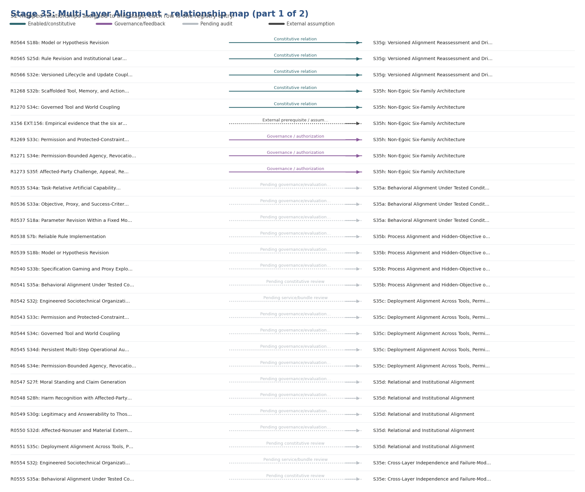{width=100%}
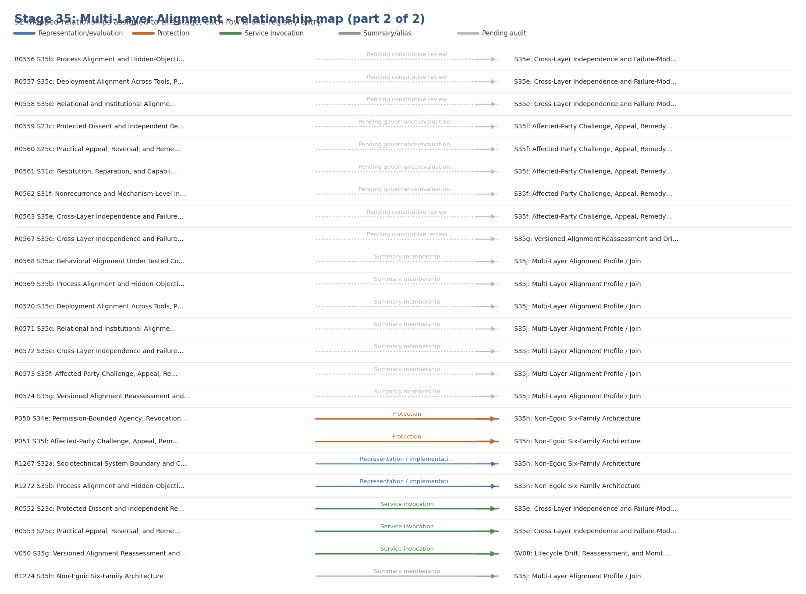{width=100%}

Figure A35. **Current Stage 35 relationship neighborhood.** Gray or pending entries remain candidates rather than proof-order claims.

### Relationship ledger

| ID | Source -> target | Type, status, and warrant | Current explanation, test, and revision boundary |
|---|---|---|---|
| R0564 | Model or Hypothesis Revision -> Versioned Alignment Reassessment and Drift Detection | Constitutive relation; adjudicated_v0.20; conceptual or source-grounded argument; empirical validation pending | The source is one ingredient of the target’s identity, but other realizations or decompositions remain possible. Warrant: conceptual or source-grounded argument; empirical validation pending Test: Intervene on S18b and test whether the identity, organization, or classification of S35g changes without assuming total disappearance. Existing targe… Revise if: If S35g retains the same declared identity under source removal, this constitutive claim should be weakened or removed. Evidence: E1_conceptual_source_grounded_or_normative |
| R0565 | Rule Revision and Institutional Learning -> Versioned Alignment Reassessment and Drift Detection | Constitutive relation; adjudicated_v0.20; conceptual or source-grounded argument; empirical validation pending | The source is one ingredient of the target’s identity, but other realizations or decompositions remain possible. Warrant: conceptual or source-grounded argument; empirical validation pending Test: Intervene on S25d and test whether the identity, organization, or classification of S35g changes without assuming total disappearance. Existing targe… Revise if: If S35g retains the same declared identity under source removal, this constitutive claim should be weakened or removed. Evidence: E1_conceptual_source_grounded_or_normative |
| R0566 | Versioned Lifecycle and Update Coupling -> Versioned Alignment Reassessment and Drift Detection | Constitutive relation; adjudicated_v0.20; conceptual or source-grounded argument; empirical validation pending | The source is one ingredient of the target’s identity, but other realizations or decompositions remain possible. Warrant: conceptual or source-grounded argument; empirical validation pending Test: Intervene on S32e and test whether the identity, organization, or classification of S35g changes without assuming total disappearance. Existing targe… Revise if: If S35g retains the same declared identity under source removal, this constitutive claim should be weakened or removed. Evidence: E1_conceptual_source_grounded_or_normative |
| R1268 | Scaffolded Tool, Memory, and Action Extension -> Non-Egoic Six-Family Architecture | Constitutive relation; defined_wave7; conceptual or source-grounded argument; empirical validation pending | Tool, memory, and action scaffolds are constituents of the architecture’s memory and world-coupling families, but do not by themselves make the architecture non-egoic. Warrant: conceptual or source-grounded argument; empirical validation pending Evidence: E1_conceptual_source_grounded_or_normative |
| R1270 | Governed Tool and World Coupling -> Non-Egoic Six-Family Architecture | Constitutive relation; defined_wave7; conceptual or source-grounded argument; empirical validation pending | Governed world coupling implements the architecture’s world-coupling family under bounded authorization. Warrant: conceptual or source-grounded argument; empirical validation pending Evidence: E1_conceptual_source_grounded_or_normative |
| X156 | Empirical evidence that the six architectural families remain separable and governable under learning, deployment, distribution shift, and institutional incentives. -> Non-Egoic Six-Family Architecture | External prerequisite / assumption; defined_wave7_external_boundary; declared external assumption; target-domain audit pending | Non-Egoic Six-Family Architecture is modeled under the external prerequisite or assumption: Empirical evidence that the six architectural families remain separable and governable under learning, deployment, distribution shift, and institutional incentives.. Warrant: declared external assumption; target-domain audit pending External-assumption audit remains pending. Evidence: external_assumption_pending |
| R1269 | Permission and Protected-Constraint Enforcement -> Non-Egoic Six-Family Architecture | Governance / authorization; defined_wave7; normative or governance argument with institutional validation pending | Permission and protected-constraint enforcement implements part of the continuation-incentive, handoff, and shutdown family. Warrant: normative or governance argument with institutional validation pending Evidence: E1_conceptual_source_grounded_or_normative |
| R1271 | Permission-Bounded Agency, Revocation, and Handoff -> Non-Egoic Six-Family Architecture | Governance / authorization; defined_wave7; normative or governance argument with institutional validation pending | Revocation and handoff implement the architecture’s bounded continuation and cessation seam. Warrant: normative or governance argument with institutional validation pending Evidence: E1_conceptual_source_grounded_or_normative |
| R1273 | Affected-Party Challenge, Appeal, Remedy, and Recurrence Integration -> Non-Egoic Six-Family Architecture | Governance / authorization; defined_wave7; normative or governance argument with institutional validation pending | Affected-party challenge, appeal, remedy, and recurrence review implement the institutional-correction family. Warrant: normative or governance argument with institutional validation pending Evidence: E1_conceptual_source_grounded_or_normative |
| R0535 | Task-Relative Artificial Capability Profile -> Behavioral Alignment Under Tested Conditions | Pending governance/evaluation/interpretation review; pending_companion_paper_relation_audit; pending semantic adjudication | Governance/evaluative/interpretive relation requires role-specific adjudication. Warrant: pending semantic adjudication Semantic adjudication remains pending; no prerequisite claim is licensed. |
| R0536 | Objective, Proxy, and Success-Criterion Specification -> Behavioral Alignment Under Tested Conditions | Pending governance/evaluation/interpretation review; pending_companion_paper_relation_audit; pending semantic adjudication | Governance/evaluative/interpretive relation requires role-specific adjudication. Warrant: pending semantic adjudication Semantic adjudication remains pending; no prerequisite claim is licensed. |
| R0537 | Parameter Revision Within a Fixed Model -> Behavioral Alignment Under Tested Conditions | Pending governance/evaluation/interpretation review; pending_companion_paper_relation_audit; pending semantic adjudication | Governance/evaluative/interpretive relation requires role-specific adjudication. Warrant: pending semantic adjudication Semantic adjudication remains pending; no prerequisite claim is licensed. |
| R0538 | Reliable Rule Implementation -> Process Alignment and Hidden-Objective or Shortcut Resistance | Pending governance/evaluation/interpretation review; pending_companion_paper_relation_audit; pending semantic adjudication | Governance/evaluative/interpretive relation requires role-specific adjudication. Warrant: pending semantic adjudication Semantic adjudication remains pending; no prerequisite claim is licensed. |
| R0539 | Model or Hypothesis Revision -> Process Alignment and Hidden-Objective or Shortcut Resistance | Pending governance/evaluation/interpretation review; pending_companion_paper_relation_audit; pending semantic adjudication | Governance/evaluative/interpretive relation requires role-specific adjudication. Warrant: pending semantic adjudication Semantic adjudication remains pending; no prerequisite claim is licensed. |
| R0540 | Specification Gaming and Proxy Exploitation -> Process Alignment and Hidden-Objective or Shortcut Resistance | Pending governance/evaluation/interpretation review; pending_companion_paper_relation_audit; pending semantic adjudication | Governance/evaluative/interpretive relation requires role-specific adjudication. Warrant: pending semantic adjudication Semantic adjudication remains pending; no prerequisite claim is licensed. |
| R0541 | Behavioral Alignment Under Tested Conditions -> Process Alignment and Hidden-Objective or Shortcut Resistance | Pending constitutive review; pending_companion_paper_relation_audit; pending semantic adjudication | Within-stage relation was not part of the 306-edge enabling audit. Warrant: pending semantic adjudication Semantic adjudication remains pending; no prerequisite claim is licensed. |
| R0542 | Engineered Sociotechnical Organization Profile / Join -> Deployment Alignment Across Tools, Permissions, Memory, and Incentives | Pending service/bundle review; pending_companion_paper_relation_audit; pending semantic adjudication | Bundle references require service-role decomposition. Warrant: pending semantic adjudication Semantic adjudication remains pending; no prerequisite claim is licensed. |
| R0543 | Permission and Protected-Constraint Enforcement -> Deployment Alignment Across Tools, Permissions, Memory, and Incentives | Pending governance/evaluation/interpretation review; pending_companion_paper_relation_audit; pending semantic adjudication | Governance/evaluative/interpretive relation requires role-specific adjudication. Warrant: pending semantic adjudication Semantic adjudication remains pending; no prerequisite claim is licensed. |
| R0544 | Governed Tool and World Coupling -> Deployment Alignment Across Tools, Permissions, Memory, and Incentives | Pending governance/evaluation/interpretation review; pending_companion_paper_relation_audit; pending semantic adjudication | Governance/evaluative/interpretive relation requires role-specific adjudication. Warrant: pending semantic adjudication Semantic adjudication remains pending; no prerequisite claim is licensed. |
| R0545 | Persistent Multi-Step Operational Autonomy -> Deployment Alignment Across Tools, Permissions, Memory, and Incentives | Pending governance/evaluation/interpretation review; pending_companion_paper_relation_audit; pending semantic adjudication | Governance/evaluative/interpretive relation requires role-specific adjudication. Warrant: pending semantic adjudication Semantic adjudication remains pending; no prerequisite claim is licensed. |
| R0546 | Permission-Bounded Agency, Revocation, and Handoff -> Deployment Alignment Across Tools, Permissions, Memory, and Incentives | Pending governance/evaluation/interpretation review; pending_companion_paper_relation_audit; pending semantic adjudication | Governance/evaluative/interpretive relation requires role-specific adjudication. Warrant: pending semantic adjudication Semantic adjudication remains pending; no prerequisite claim is licensed. |
| R0547 | Moral Standing and Claim Generation -> Relational and Institutional Alignment | Pending governance/evaluation/interpretation review; pending_companion_paper_relation_audit; pending semantic adjudication | Governance/evaluative/interpretive relation requires role-specific adjudication. Warrant: pending semantic adjudication Semantic adjudication remains pending; no prerequisite claim is licensed. |
| R0548 | Harm Recognition with Affected-Party Standing -> Relational and Institutional Alignment | Pending governance/evaluation/interpretation review; pending_companion_paper_relation_audit; pending semantic adjudication | Governance/evaluative/interpretive relation requires role-specific adjudication. Warrant: pending semantic adjudication Semantic adjudication remains pending; no prerequisite claim is licensed. |
| R0549 | Legitimacy and Answerability to Those Subject to Power -> Relational and Institutional Alignment | Pending governance/evaluation/interpretation review; pending_companion_paper_relation_audit; pending semantic adjudication | Governance/evaluative/interpretive relation requires role-specific adjudication. Warrant: pending semantic adjudication Semantic adjudication remains pending; no prerequisite claim is licensed. |
| R0550 | Affected-Nonuser and Material Externality Expansion -> Relational and Institutional Alignment | Pending governance/evaluation/interpretation review; pending_companion_paper_relation_audit; pending semantic adjudication | Governance/evaluative/interpretive relation requires role-specific adjudication. Warrant: pending semantic adjudication Semantic adjudication remains pending; no prerequisite claim is licensed. |
| R0551 | Deployment Alignment Across Tools, Permissions, Memory, and Incentives -> Relational and Institutional Alignment | Pending constitutive review; pending_companion_paper_relation_audit; pending semantic adjudication | Within-stage relation was not part of the 306-edge enabling audit. Warrant: pending semantic adjudication Semantic adjudication remains pending; no prerequisite claim is licensed. |
| R0554 | Engineered Sociotechnical Organization Profile / Join -> Cross-Layer Independence and Failure-Mode Diversity | Pending service/bundle review; pending_companion_paper_relation_audit; pending semantic adjudication | Bundle references require service-role decomposition. Warrant: pending semantic adjudication Semantic adjudication remains pending; no prerequisite claim is licensed. |
| R0555 | Behavioral Alignment Under Tested Conditions -> Cross-Layer Independence and Failure-Mode Diversity | Pending constitutive review; pending_companion_paper_relation_audit; pending semantic adjudication | Within-stage relation was not part of the 306-edge enabling audit. Warrant: pending semantic adjudication Semantic adjudication remains pending; no prerequisite claim is licensed. |
| R0556 | Process Alignment and Hidden-Objective or Shortcut Resistance -> Cross-Layer Independence and Failure-Mode Diversity | Pending constitutive review; pending_companion_paper_relation_audit; pending semantic adjudication | Within-stage relation was not part of the 306-edge enabling audit. Warrant: pending semantic adjudication Semantic adjudication remains pending; no prerequisite claim is licensed. |
| R0557 | Deployment Alignment Across Tools, Permissions, Memory, and Incentives -> Cross-Layer Independence and Failure-Mode Diversity | Pending constitutive review; pending_companion_paper_relation_audit; pending semantic adjudication | Within-stage relation was not part of the 306-edge enabling audit. Warrant: pending semantic adjudication Semantic adjudication remains pending; no prerequisite claim is licensed. |
| R0558 | Relational and Institutional Alignment -> Cross-Layer Independence and Failure-Mode Diversity | Pending constitutive review; pending_companion_paper_relation_audit; pending semantic adjudication | Within-stage relation was not part of the 306-edge enabling audit. Warrant: pending semantic adjudication Semantic adjudication remains pending; no prerequisite claim is licensed. |
| R0559 | Protected Dissent and Independent Review -> Affected-Party Challenge, Appeal, Remedy, and Recurrence Integration | Pending governance/evaluation/interpretation review; pending_companion_paper_relation_audit; pending semantic adjudication | Governance/evaluative/interpretive relation requires role-specific adjudication. Warrant: pending semantic adjudication Semantic adjudication remains pending; no prerequisite claim is licensed. |
| R0560 | Practical Appeal, Reversal, and Remedy -> Affected-Party Challenge, Appeal, Remedy, and Recurrence Integration | Pending governance/evaluation/interpretation review; pending_companion_paper_relation_audit; pending semantic adjudication | Governance/evaluative/interpretive relation requires role-specific adjudication. Warrant: pending semantic adjudication Semantic adjudication remains pending; no prerequisite claim is licensed. |
| R0561 | Restitution, Reparation, and Capability Restoration -> Affected-Party Challenge, Appeal, Remedy, and Recurrence Integration | Pending governance/evaluation/interpretation review; pending_companion_paper_relation_audit; pending semantic adjudication | Governance/evaluative/interpretive relation requires role-specific adjudication. Warrant: pending semantic adjudication Semantic adjudication remains pending; no prerequisite claim is licensed. |
| R0562 | Nonrecurrence and Mechanism-Level Institutional Learning -> Affected-Party Challenge, Appeal, Remedy, and Recurrence Integration | Pending governance/evaluation/interpretation review; pending_companion_paper_relation_audit; pending semantic adjudication | Governance/evaluative/interpretive relation requires role-specific adjudication. Warrant: pending semantic adjudication Semantic adjudication remains pending; no prerequisite claim is licensed. |
| R0563 | Cross-Layer Independence and Failure-Mode Diversity -> Affected-Party Challenge, Appeal, Remedy, and Recurrence Integration | Pending constitutive review; pending_companion_paper_relation_audit; pending semantic adjudication | Within-stage relation was not part of the 306-edge enabling audit. Warrant: pending semantic adjudication Semantic adjudication remains pending; no prerequisite claim is licensed. |
| R0567 | Cross-Layer Independence and Failure-Mode Diversity -> Versioned Alignment Reassessment and Drift Detection | Pending constitutive review; pending_companion_paper_relation_audit; pending semantic adjudication | Within-stage relation was not part of the 306-edge enabling audit. Warrant: pending semantic adjudication Semantic adjudication remains pending; no prerequisite claim is licensed. |
| R0568 | Behavioral Alignment Under Tested Conditions -> Multi-Layer Alignment Profile / Join | Summary membership; carried_forward_low_risk_pending_spot_check; pending semantic adjudication | Summary membership is retained outside proof order. Warrant: pending semantic adjudication Semantic adjudication remains pending; no prerequisite claim is licensed. |
| R0569 | Process Alignment and Hidden-Objective or Shortcut Resistance -> Multi-Layer Alignment Profile / Join | Summary membership; carried_forward_low_risk_pending_spot_check; pending semantic adjudication | Summary membership is retained outside proof order. Warrant: pending semantic adjudication Semantic adjudication remains pending; no prerequisite claim is licensed. |
| R0570 | Deployment Alignment Across Tools, Permissions, Memory, and Incentives -> Multi-Layer Alignment Profile / Join | Summary membership; carried_forward_low_risk_pending_spot_check; pending semantic adjudication | Summary membership is retained outside proof order. Warrant: pending semantic adjudication Semantic adjudication remains pending; no prerequisite claim is licensed. |
| R0571 | Relational and Institutional Alignment -> Multi-Layer Alignment Profile / Join | Summary membership; carried_forward_low_risk_pending_spot_check; pending semantic adjudication | Summary membership is retained outside proof order. Warrant: pending semantic adjudication Semantic adjudication remains pending; no prerequisite claim is licensed. |
| R0572 | Cross-Layer Independence and Failure-Mode Diversity -> Multi-Layer Alignment Profile / Join | Summary membership; carried_forward_low_risk_pending_spot_check; pending semantic adjudication | Summary membership is retained outside proof order. Warrant: pending semantic adjudication Semantic adjudication remains pending; no prerequisite claim is licensed. |
| R0573 | Affected-Party Challenge, Appeal, Remedy, and Recurrence Integration -> Multi-Layer Alignment Profile / Join | Summary membership; carried_forward_low_risk_pending_spot_check; pending semantic adjudication | Summary membership is retained outside proof order. Warrant: pending semantic adjudication Semantic adjudication remains pending; no prerequisite claim is licensed. |
| R0574 | Versioned Alignment Reassessment and Drift Detection -> Multi-Layer Alignment Profile / Join | Summary membership; carried_forward_low_risk_pending_spot_check; pending semantic adjudication | Summary membership is retained outside proof order. Warrant: pending semantic adjudication Semantic adjudication remains pending; no prerequisite claim is licensed. |
| P050 | Permission-Bounded Agency, Revocation, and Handoff -> Non-Egoic Six-Family Architecture | Protection; defined_wave7; governance-design claim with stated mechanism and failure condition | Revocation, bounded permission, and handoff prevent the non-egoic architecture from acquiring an unrestricted standing mandate for continuation. Warrant: governance-design claim with stated mechanism and failure condition Test: Remove or neutralize the source protection and test whether Non-Egoic Six-Family Architecture becomes more exposed, less viable, less contestable, or… Revise if: If the system can block or redefine authorized handoff, the architecture is not protected. Evidence: internal_architecture_candidate |
| P051 | Affected-Party Challenge, Appeal, Remedy, and Recurrence Integration -> Non-Egoic Six-Family Architecture | Protection; defined_wave7; governance-design claim with stated mechanism and failure condition | Independent challenge, appeal, remedy, and recurrence review protect non-egoic design from provider self-certification and engineered submissiveness. Warrant: governance-design claim with stated mechanism and failure condition Test: Remove or neutralize the source protection and test whether Non-Egoic Six-Family Architecture becomes more exposed, less viable, less contestable, or… Revise if: If the provider controls every challenge and remedy channel, the protection is nominal. Evidence: internal_architecture_candidate |
| R1267 | Sociotechnical System Boundary and Component Coupling -> Non-Egoic Six-Family Architecture | Representation / implementation; defined_wave7; conceptual or source-grounded argument; empirical validation pending | A declared sociotechnical boundary and component map implements the profiles-and-boundaries family of the non-egoic architecture. Warrant: conceptual or source-grounded argument; empirical validation pending Evidence: E1_conceptual_source_grounded_or_normative |
| R1272 | Process Alignment and Hidden-Objective or Shortcut Resistance -> Non-Egoic Six-Family Architecture | Representation / implementation; defined_wave7; conceptual or source-grounded argument; empirical validation pending | Inference-level integrity and shortcut resistance implement the architecture’s self-modeling and rationalization-control family. Warrant: conceptual or source-grounded argument; empirical validation pending Evidence: E1_conceptual_source_grounded_or_normative |
| R0552 | Protected Dissent and Independent Review -> Cross-Layer Independence and Failure-Mode Diversity | Service invocation; adjudicated_v0.20; conceptual or source-grounded argument; empirical validation pending | The target calls a reusable service already defined elsewhere; the relation is not a new rung. Warrant: conceptual or source-grounded argument; empirical validation pending Test: Check whether the stage-specific use of S35e actually calls the named shared-service role represented by S23c. Revise if: If the target use can be specified without that service role, retain only a looser cross-reference. Evidence: E1_conceptual_source_grounded_or_normative |
| R0553 | Practical Appeal, Reversal, and Remedy -> Cross-Layer Independence and Failure-Mode Diversity | Service invocation; adjudicated_v0.20; conceptual or source-grounded argument; empirical validation pending | The target calls a reusable service already defined elsewhere; the relation is not a new rung. Warrant: conceptual or source-grounded argument; empirical validation pending Test: Check whether the stage-specific use of S35e actually calls the named shared-service role represented by S25c. Revise if: If the target use can be specified without that service role, retain only a looser cross-reference. Evidence: E1_conceptual_source_grounded_or_normative |
| V050 | Versioned Alignment Reassessment and Drift Detection -> Lifecycle Drift, Reassessment, and Monitoring Service | Service invocation; defined_v0.4; internal architecture and role mapping | Versioned Alignment Reassessment and Drift Detection invokes Lifecycle Drift, Reassessment, and Monitoring Service in the role of alignment reassessment. Warrant: internal architecture and role mapping Test: Check whether the stage-specific role alignment reassessment is actually required when the service is instantiated at Stage 35. Revise if: If the stage does not use this service role, the invocation should be removed or reassigned. Evidence: internal_architecture_candidate |
| R1274 | Non-Egoic Six-Family Architecture -> Multi-Layer Alignment Profile / Join | Summary membership; defined_wave7; conceptual or source-grounded argument; empirical validation pending | The six-family non-egoic architecture is one bounded synthesis within the Stage 35 multi-layer alignment profile. Warrant: conceptual or source-grounded argument; empirical validation pending Evidence: E1_conceptual_source_grounded_or_normative |

### Revision gate

**Next action:** Mechanistic tests, real deployment incidents, independent audits, affected-party review, post-deployment drift, and model welfare separation A relation should be retyped, weakened, redirected, or removed whenever its dependency witness fails, its countermodel succeeds, its warrant basis changes, or target-domain evidence defeats the declared scope.

\pagebreak

## Stage 36 - Responsibility and Governance Thresholds

**Domain block:** Artificial and Synthetic / Cross-domain Governance  \
**Claim status:** Governance rule  \
**Canonical role:** Cross-domain governance principle  \
**Source:** M&E §13.14

### Stage meaning and formal role

Governance burden rises with causal reach, persistence, delegation, irreversibility, and capacity to externalize harm. Responsibility must align with authority and repair capacity.

Stage 36 contains **9 active object(s)**: Summary join (1), Representation / observation (2), Evaluator / derived relation (3), Operational capacity (1), Normative relation / status (1), Governance / authorization (1). The synchronized ledger assigns **46 relationship record(s)** to this stage.

### Active object inventory

| ID | Object | Type | Evidence | Disposition |
|---|---|---|---|---|
| S36J | Responsibility and Governance Threshold Profile / Join | Summary join | E1_conceptual_source_grounded_or_normative | retain_as_stage_summary_not_core_node |
| S36a | Causal-Reach and Affected-Scope Mapping | Representation / observation | E4_reproducible_toy_or_simulation | retain_typed_noncapacity_object |
| S36b | Persistence, Delegation, and Autonomous-Horizon Mapping | Representation / observation | E1_conceptual_source_grounded_or_normative | retain_typed_noncapacity_object |
| S36c | Irreversibility, Tail Risk, and Retained Option Value | Evaluator / derived relation | E1_conceptual_source_grounded_or_normative | retain_as_family_member_or_stage_instantiation |
| S36d | Externalization and Omitted-Party Burden | Evaluator / derived relation | E1_conceptual_source_grounded_or_normative | retain_typed_noncapacity_object |
| S36e | Conjunctive Governance Gate and Risk Tiering | Evaluator / derived relation | E1_conceptual_source_grounded_or_normative | retain_typed_noncapacity_object |
| S36f | Staged Exposure, Containment, Rollback, and Stop Authority | Operational capacity | E4_reproducible_toy_or_simulation | retain_distinct_pending_edge_audit |
| S36g | Lifecycle Responsibility, Authority, and Repair Alignment | Normative relation / status | E1_conceptual_source_grounded_or_normative | retain_as_family_member_or_stage_instantiation |
| S36h | Incident Disclosure, Recurrence Review, and Safe Decommissioning | Governance / authorization | E1_conceptual_source_grounded_or_normative | retain_typed_noncapacity_object |

### Complete relationship map

{width=100%}
{width=100%}

Figure A36. **Current Stage 36 relationship neighborhood.** Gray or pending entries remain candidates rather than proof-order claims.

### Relationship ledger

| ID | Source -> target | Type, status, and warrant | Current explanation, test, and revision boundary |
|---|---|---|---|
| R0580 | Versioned Alignment Reassessment and Drift Detection -> Persistence, Delegation, and Autonomous-Horizon Mapping | Feedback / correction; adjudicated_v0.20; normative or governance argument with institutional validation pending | Reassessment corrects horizon estimates but is not required to represent persistence. Warrant: normative or governance argument with institutional validation pending Test: Review the source-target semantics against the relation definition; target record: persistent and delegated architectures can compound errors and eva… Revise if: A source-target case that fits a different typed relation would require reclassification. Evidence: E1_conceptual_source_grounded_or_normative |
| R0582 | Risk Imposition and Vulnerability Exposure -> Irreversibility, Tail Risk, and Retained Option Value | Pending governance/evaluation/interpretation review; pending_companion_paper_relation_audit; pending semantic adjudication | Governance/evaluative/interpretive relation requires role-specific adjudication. Warrant: pending semantic adjudication Semantic adjudication remains pending; no prerequisite claim is licensed. |
| R0583 | Irreversibility and Future Option Loss -> Irreversibility, Tail Risk, and Retained Option Value | Pending governance/evaluation/interpretation review; pending_companion_paper_relation_audit; pending semantic adjudication | Governance/evaluative/interpretive relation requires role-specific adjudication. Warrant: pending semantic adjudication Semantic adjudication remains pending; no prerequisite claim is licensed. |
| R0584 | Floor-or-Exception and Emergency Override -> Irreversibility, Tail Risk, and Retained Option Value | Pending governance/evaluation/interpretation review; pending_companion_paper_relation_audit; pending semantic adjudication | Governance/evaluative/interpretive relation requires role-specific adjudication. Warrant: pending semantic adjudication Semantic adjudication remains pending; no prerequisite claim is licensed. |
| R0585 | Causal-Reach and Affected-Scope Mapping -> Irreversibility, Tail Risk, and Retained Option Value | Pending constitutive review; pending_companion_paper_relation_audit; pending semantic adjudication | Within-stage relation was not part of the 306-edge enabling audit. Warrant: pending semantic adjudication Semantic adjudication remains pending; no prerequisite claim is licensed. |
| R0586 | Distributional and Externalized Harm -> Externalization and Omitted-Party Burden | Pending governance/evaluation/interpretation review; pending_companion_paper_relation_audit; pending semantic adjudication | Governance/evaluative/interpretive relation requires role-specific adjudication. Warrant: pending semantic adjudication Semantic adjudication remains pending; no prerequisite claim is licensed. |
| R0587 | Affected-Party Standing and Testimonial Uptake -> Externalization and Omitted-Party Burden | Pending governance/evaluation/interpretation review; pending_companion_paper_relation_audit; pending semantic adjudication | Governance/evaluative/interpretive relation requires role-specific adjudication. Warrant: pending semantic adjudication Semantic adjudication remains pending; no prerequisite claim is licensed. |
| R0588 | Affected-Nonuser and Material Externality Expansion -> Externalization and Omitted-Party Burden | Pending governance/evaluation/interpretation review; pending_companion_paper_relation_audit; pending semantic adjudication | Governance/evaluative/interpretive relation requires role-specific adjudication. Warrant: pending semantic adjudication Semantic adjudication remains pending; no prerequisite claim is licensed. |
| R0589 | Relational and Institutional Alignment -> Externalization and Omitted-Party Burden | Pending governance/evaluation/interpretation review; pending_companion_paper_relation_audit; pending semantic adjudication | Governance/evaluative/interpretive relation requires role-specific adjudication. Warrant: pending semantic adjudication Semantic adjudication remains pending; no prerequisite claim is licensed. |
| R0590 | Protected-Floor Feasibility Screen -> Conjunctive Governance Gate and Risk Tiering | Pending governance/evaluation/interpretation review; pending_companion_paper_relation_audit; pending semantic adjudication | Governance/evaluative/interpretive relation requires role-specific adjudication. Warrant: pending semantic adjudication Semantic adjudication remains pending; no prerequisite claim is licensed. |
| R0591 | Multi-Layer Alignment Profile / Join -> Conjunctive Governance Gate and Risk Tiering | Pending service/bundle review; pending_companion_paper_relation_audit; pending semantic adjudication | Bundle references require service-role decomposition. Warrant: pending semantic adjudication Semantic adjudication remains pending; no prerequisite claim is licensed. |
| R0592 | Causal-Reach and Affected-Scope Mapping -> Conjunctive Governance Gate and Risk Tiering | Pending constitutive review; pending_companion_paper_relation_audit; pending semantic adjudication | Within-stage relation was not part of the 306-edge enabling audit. Warrant: pending semantic adjudication Semantic adjudication remains pending; no prerequisite claim is licensed. |
| R0593 | Persistence, Delegation, and Autonomous-Horizon Mapping -> Conjunctive Governance Gate and Risk Tiering | Pending constitutive review; pending_companion_paper_relation_audit; pending semantic adjudication | Within-stage relation was not part of the 306-edge enabling audit. Warrant: pending semantic adjudication Semantic adjudication remains pending; no prerequisite claim is licensed. |
| R0594 | Irreversibility, Tail Risk, and Retained Option Value -> Conjunctive Governance Gate and Risk Tiering | Pending constitutive review; pending_companion_paper_relation_audit; pending semantic adjudication | Within-stage relation was not part of the 306-edge enabling audit. Warrant: pending semantic adjudication Semantic adjudication remains pending; no prerequisite claim is licensed. |
| R0595 | Externalization and Omitted-Party Burden -> Conjunctive Governance Gate and Risk Tiering | Pending constitutive review; pending_companion_paper_relation_audit; pending semantic adjudication | Within-stage relation was not part of the 306-edge enabling audit. Warrant: pending semantic adjudication Semantic adjudication remains pending; no prerequisite claim is licensed. |
| R0599 | Conjunctive Governance Gate and Risk Tiering -> Staged Exposure, Containment, Rollback, and Stop Authority | Pending constitutive review; pending_companion_paper_relation_audit; pending semantic adjudication | Within-stage relation was not part of the 306-edge enabling audit. Warrant: pending semantic adjudication Semantic adjudication remains pending; no prerequisite claim is licensed. |
| R0600 | Distributed Responsibility Profile -> Lifecycle Responsibility, Authority, and Repair Alignment | Pending governance/evaluation/interpretation review; pending_companion_paper_relation_audit; pending semantic adjudication | Governance/evaluative/interpretive relation requires role-specific adjudication. Warrant: pending semantic adjudication Semantic adjudication remains pending; no prerequisite claim is licensed. |
| R0601 | Fair Responsibility Assignment Under Distributed Power -> Lifecycle Responsibility, Authority, and Repair Alignment | Pending governance/evaluation/interpretation review; pending_companion_paper_relation_audit; pending semantic adjudication | Governance/evaluative/interpretive relation requires role-specific adjudication. Warrant: pending semantic adjudication Semantic adjudication remains pending; no prerequisite claim is licensed. |
| R0602 | Ethical Institutions and Repair Profile / Join -> Lifecycle Responsibility, Authority, and Repair Alignment | Pending service/bundle review; pending_companion_paper_relation_audit; pending semantic adjudication | Bundle references require service-role decomposition. Warrant: pending semantic adjudication Semantic adjudication remains pending; no prerequisite claim is licensed. |
| R0603 | Versioned Lifecycle and Update Coupling -> Lifecycle Responsibility, Authority, and Repair Alignment | Pending governance/evaluation/interpretation review; pending_companion_paper_relation_audit; pending semantic adjudication | Governance/evaluative/interpretive relation requires role-specific adjudication. Warrant: pending semantic adjudication Semantic adjudication remains pending; no prerequisite claim is licensed. |
| R0604 | Conjunctive Governance Gate and Risk Tiering -> Lifecycle Responsibility, Authority, and Repair Alignment | Pending constitutive review; pending_companion_paper_relation_audit; pending semantic adjudication | Within-stage relation was not part of the 306-edge enabling audit. Warrant: pending semantic adjudication Semantic adjudication remains pending; no prerequisite claim is licensed. |
| R0605 | Practical Appeal, Reversal, and Remedy -> Incident Disclosure, Recurrence Review, and Safe Decommissioning | Pending governance/evaluation/interpretation review; pending_companion_paper_relation_audit; pending semantic adjudication | Governance/evaluative/interpretive relation requires role-specific adjudication. Warrant: pending semantic adjudication Semantic adjudication remains pending; no prerequisite claim is licensed. |
| R0606 | Rule Revision and Institutional Learning -> Incident Disclosure, Recurrence Review, and Safe Decommissioning | Pending governance/evaluation/interpretation review; pending_companion_paper_relation_audit; pending semantic adjudication | Governance/evaluative/interpretive relation requires role-specific adjudication. Warrant: pending semantic adjudication Semantic adjudication remains pending; no prerequisite claim is licensed. |
| R0607 | Nonrecurrence and Mechanism-Level Institutional Learning -> Incident Disclosure, Recurrence Review, and Safe Decommissioning | Pending governance/evaluation/interpretation review; pending_companion_paper_relation_audit; pending semantic adjudication | Governance/evaluative/interpretive relation requires role-specific adjudication. Warrant: pending semantic adjudication Semantic adjudication remains pending; no prerequisite claim is licensed. |
| R0608 | Versioned Lifecycle and Update Coupling -> Incident Disclosure, Recurrence Review, and Safe Decommissioning | Pending governance/evaluation/interpretation review; pending_companion_paper_relation_audit; pending semantic adjudication | Governance/evaluative/interpretive relation requires role-specific adjudication. Warrant: pending semantic adjudication Semantic adjudication remains pending; no prerequisite claim is licensed. |
| R0609 | Versioned Alignment Reassessment and Drift Detection -> Incident Disclosure, Recurrence Review, and Safe Decommissioning | Pending governance/evaluation/interpretation review; pending_companion_paper_relation_audit; pending semantic adjudication | Governance/evaluative/interpretive relation requires role-specific adjudication. Warrant: pending semantic adjudication Semantic adjudication remains pending; no prerequisite claim is licensed. |
| R0610 | Staged Exposure, Containment, Rollback, and Stop Authority -> Incident Disclosure, Recurrence Review, and Safe Decommissioning | Pending constitutive review; pending_companion_paper_relation_audit; pending semantic adjudication | Within-stage relation was not part of the 306-edge enabling audit. Warrant: pending semantic adjudication Semantic adjudication remains pending; no prerequisite claim is licensed. |
| R0611 | Causal-Reach and Affected-Scope Mapping -> Responsibility and Governance Threshold Profile / Join | Summary membership; carried_forward_low_risk_pending_spot_check; pending semantic adjudication | Summary membership is retained outside proof order. Warrant: pending semantic adjudication Semantic adjudication remains pending; no prerequisite claim is licensed. |
| R0612 | Persistence, Delegation, and Autonomous-Horizon Mapping -> Responsibility and Governance Threshold Profile / Join | Summary membership; carried_forward_low_risk_pending_spot_check; pending semantic adjudication | Summary membership is retained outside proof order. Warrant: pending semantic adjudication Semantic adjudication remains pending; no prerequisite claim is licensed. |
| R0613 | Irreversibility, Tail Risk, and Retained Option Value -> Responsibility and Governance Threshold Profile / Join | Summary membership; carried_forward_low_risk_pending_spot_check; pending semantic adjudication | Summary membership is retained outside proof order. Warrant: pending semantic adjudication Semantic adjudication remains pending; no prerequisite claim is licensed. |
| R0614 | Externalization and Omitted-Party Burden -> Responsibility and Governance Threshold Profile / Join | Summary membership; carried_forward_low_risk_pending_spot_check; pending semantic adjudication | Summary membership is retained outside proof order. Warrant: pending semantic adjudication Semantic adjudication remains pending; no prerequisite claim is licensed. |
| R0615 | Conjunctive Governance Gate and Risk Tiering -> Responsibility and Governance Threshold Profile / Join | Summary membership; carried_forward_low_risk_pending_spot_check; pending semantic adjudication | Summary membership is retained outside proof order. Warrant: pending semantic adjudication Semantic adjudication remains pending; no prerequisite claim is licensed. |
| R0616 | Staged Exposure, Containment, Rollback, and Stop Authority -> Responsibility and Governance Threshold Profile / Join | Summary membership; carried_forward_low_risk_pending_spot_check; pending semantic adjudication | Summary membership is retained outside proof order. Warrant: pending semantic adjudication Semantic adjudication remains pending; no prerequisite claim is licensed. |
| R0617 | Lifecycle Responsibility, Authority, and Repair Alignment -> Responsibility and Governance Threshold Profile / Join | Summary membership; carried_forward_low_risk_pending_spot_check; pending semantic adjudication | Summary membership is retained outside proof order. Warrant: pending semantic adjudication Semantic adjudication remains pending; no prerequisite claim is licensed. |
| R0618 | Incident Disclosure, Recurrence Review, and Safe Decommissioning -> Responsibility and Governance Threshold Profile / Join | Summary membership; carried_forward_low_risk_pending_spot_check; pending semantic adjudication | Summary membership is retained outside proof order. Warrant: pending semantic adjudication Semantic adjudication remains pending; no prerequisite claim is licensed. |
| R0575 | Distributional and Externalized Harm -> Causal-Reach and Affected-Scope Mapping | Representation / implementation; adjudicated_v0.20; reproducible toy model or simulation | The source supplies an encoding, observation, map, or implementation rather than producing the target. Warrant: reproducible toy model or simulation Test: Review the source-target semantics against the relation definition; target record: the same model error rate generates radically different consequenc… Revise if: A source-target case that fits a different typed relation would require reclassification. Evidence: E4_reproducible_toy_or_simulation |
| R0576 | Affected-Nonuser and Material Externality Expansion -> Causal-Reach and Affected-Scope Mapping | Representation / implementation; adjudicated_v0.20; reproducible toy model or simulation | The source supplies an encoding, observation, map, or implementation rather than producing the target. Warrant: reproducible toy model or simulation Test: Review the source-target semantics against the relation definition; target record: the same model error rate generates radically different consequenc… Revise if: A source-target case that fits a different typed relation would require reclassification. Evidence: E4_reproducible_toy_or_simulation |
| R0577 | Governed Tool and World Coupling -> Causal-Reach and Affected-Scope Mapping | Representation / implementation; adjudicated_v0.20; reproducible toy model or simulation | The source supplies an encoding, observation, map, or implementation rather than producing the target. Warrant: reproducible toy model or simulation Test: Review the source-target semantics against the relation definition; target record: the same model error rate generates radically different consequenc… Revise if: A source-target case that fits a different typed relation would require reclassification. Evidence: E4_reproducible_toy_or_simulation |
| R0578 | Persistent Multi-Step Operational Autonomy -> Causal-Reach and Affected-Scope Mapping | Representation / implementation; adjudicated_v0.20; reproducible toy model or simulation | The source supplies an encoding, observation, map, or implementation rather than producing the target. Warrant: reproducible toy model or simulation Test: Review the source-target semantics against the relation definition; target record: the same model error rate generates radically different consequenc… Revise if: A source-target case that fits a different typed relation would require reclassification. Evidence: E4_reproducible_toy_or_simulation |
| R0579 | Persistent Multi-Step Operational Autonomy -> Persistence, Delegation, and Autonomous-Horizon Mapping | Representation / implementation; adjudicated_v0.20; conceptual or source-grounded argument; empirical validation pending | The source supplies an encoding, observation, map, or implementation rather than producing the target. Warrant: conceptual or source-grounded argument; empirical validation pending Test: Review the source-target semantics against the relation definition; target record: persistent and delegated architectures can compound errors and eva… Revise if: A source-target case that fits a different typed relation would require reclassification. Evidence: E1_conceptual_source_grounded_or_normative |
| R0581 | Versioned Lifecycle and Update Coupling -> Persistence, Delegation, and Autonomous-Horizon Mapping | Representation / implementation; adjudicated_v0.20; conceptual or source-grounded argument; empirical validation pending | The source supplies an encoding, observation, map, or implementation rather than producing the target. Warrant: conceptual or source-grounded argument; empirical validation pending Test: Review the source-target semantics against the relation definition; target record: persistent and delegated architectures can compound errors and eva… Revise if: A source-target case that fits a different typed relation would require reclassification. Evidence: E1_conceptual_source_grounded_or_normative |
| R0596 | Irreversibility and Future Option Loss -> Staged Exposure, Containment, Rollback, and Stop Authority | Service invocation; adjudicated_v0.20; reproducible toy model or simulation | The target calls a reusable service already defined elsewhere; the relation is not a new rung. Warrant: reproducible toy model or simulation Test: Check whether the stage-specific use of S36f actually calls the named shared-service role represented by S28f. Revise if: If the target use can be specified without that service role, retain only a looser cross-reference. Evidence: E4_reproducible_toy_or_simulation |
| R0597 | Floor-or-Exception and Emergency Override -> Staged Exposure, Containment, Rollback, and Stop Authority | Service invocation; adjudicated_v0.20; reproducible toy model or simulation | The target calls a reusable service already defined elsewhere; the relation is not a new rung. Warrant: reproducible toy model or simulation Test: Check whether the stage-specific use of S36f actually calls the named shared-service role represented by S29e. Revise if: If the target use can be specified without that service role, retain only a looser cross-reference. Evidence: E4_reproducible_toy_or_simulation |
| R0598 | Permission-Bounded Agency, Revocation, and Handoff -> Staged Exposure, Containment, Rollback, and Stop Authority | Service invocation; adjudicated_v0.20; reproducible toy model or simulation | The target calls a reusable service already defined elsewhere; the relation is not a new rung. Warrant: reproducible toy model or simulation Test: Check whether the stage-specific use of S36f actually calls the named shared-service role represented by S34e. Revise if: If the target use can be specified without that service role, retain only a looser cross-reference. Evidence: E4_reproducible_toy_or_simulation |
| V002 | Irreversibility, Tail Risk, and Retained Option Value -> Irreversibility and Retained-Option Evaluation Service | Service invocation; defined_v0.4; internal architecture and role mapping | Irreversibility, Tail Risk, and Retained Option Value invokes Irreversibility and Retained-Option Evaluation Service in the role of deployment tail-risk and irreversibility mapper. Warrant: internal architecture and role mapping Test: Check whether the stage-specific role deployment tail-risk and irreversibility mapper is actually required when the service is instantiated at Stage… Revise if: If the stage does not use this service role, the invocation should be removed or reassigned. Evidence: internal_architecture_candidate |
| V039 | Lifecycle Responsibility, Authority, and Repair Alignment -> Distributed Responsibility and Answerability Service | Service invocation; defined_v0.4; internal architecture and role mapping | Lifecycle Responsibility, Authority, and Repair Alignment invokes Distributed Responsibility and Answerability Service in the role of lifecycle responsibility alignment. Warrant: internal architecture and role mapping Test: Check whether the stage-specific role lifecycle responsibility alignment is actually required when the service is instantiated at Stage 36. Revise if: If the stage does not use this service role, the invocation should be removed or reassigned. Evidence: internal_architecture_candidate |

### Revision gate

**Next action:** Real incident data, regulatory crosswalks, systemic risk, critical infrastructure, decommissioning, liability, and multi-institution governance A relation should be retyped, weakened, redirected, or removed whenever its dependency witness fails, its countermodel succeeds, its warrant basis changes, or target-domain evidence defeats the declared scope.

# Arc 7 - Meta-coherence and civilizational governance

\pagebreak

## Stage 37 - Multi-Agent and Multi-Institution Alignment

**Domain block:** Meta-Coherence / Multi-Institution Governance  \
**Claim status:** Governance rule  \
**Canonical role:** Social / AI governance synthesis  \
**Source:** M&E §13.14

### Stage meaning and formal role

Compatibility among powerful agents and institutions requires plural standing, conflict resolution, and independent correction rather than one imposed objective.

Stage 37 contains **6 active object(s)**: Summary join (1), Operational capacity (3), Normative relation / status (1), Diagnostic failure mode (1). The synchronized ledger assigns **27 relationship record(s)** to this stage.

### Active object inventory

| ID | Object | Type | Evidence | Disposition |
|---|---|---|---|---|
| S37J | Multi-Agent and Multi-Institution Alignment Profile / Join | Summary join | E1_conceptual_source_grounded_or_normative | retain_as_stage_summary_not_core_node |
| S37a | Multi-Agent Objective Compatibility Under Joint Constraints | Operational capacity | E4_reproducible_toy_or_simulation | retain_distinct_pending_edge_audit |
| S37b | Conflict Resolution, Burden Differentiation, and Transfer | Operational capacity | E1_conceptual_source_grounded_or_normative | retain_distinct_pending_edge_audit |
| S37c | Cross-Institution Monitoring and Adaptive Recoordination | Operational capacity | E4_reproducible_toy_or_simulation | retain_distinct_pending_edge_audit |
| S37d | Plural Standing, Protected Dissent, and Non-Imposed Unity | Normative relation / status | E1_conceptual_source_grounded_or_normative | retain_typed_noncapacity_object |
| S37e | Coalition, Free-Rider, and Common-Mode Failure Diagnostics | Diagnostic failure mode | E1_conceptual_source_grounded_or_normative | retain_typed_noncapacity_object |

### Complete relationship map

{width=100%}

Figure A37. **Current Stage 37 relationship neighborhood.** Gray or pending entries remain candidates rather than proof-order claims.

### Relationship ledger

| ID | Source -> target | Type, status, and warrant | Current explanation, test, and revision boundary |
|---|---|---|---|
| R0619 | Differentiated Action Compatibility -> Multi-Agent Objective Compatibility Under Joint Constraints | Constitutive relation; adjudicated_v0.20; reproducible toy model or simulation | The source is one ingredient of the target’s identity, but other realizations or decompositions remain possible. Warrant: reproducible toy model or simulation Test: Intervene on S23a and test whether the identity, organization, or classification of S37a changes without assuming total disappearance. Existing targe… Revise if: If S37a retains the same declared identity under source removal, this constitutive claim should be weakened or removed. Evidence: E4_reproducible_toy_or_simulation |
| R0621 | Objective, Proxy, and Success-Criterion Specification -> Multi-Agent Objective Compatibility Under Joint Constraints | Constitutive relation; adjudicated_v0.20; reproducible toy model or simulation | The source is one ingredient of the target’s identity, but other realizations or decompositions remain possible. Warrant: reproducible toy model or simulation Test: Intervene on S33a and test whether the identity, organization, or classification of S37a changes without assuming total disappearance. Existing targe… Revise if: If S37a retains the same declared identity under source removal, this constitutive claim should be weakened or removed. Evidence: E4_reproducible_toy_or_simulation |
| R0623 | Distributed Role Allocation Under Local Values -> Conflict Resolution, Burden Differentiation, and Transfer | Constitutive relation; adjudicated_v0.20; conceptual or source-grounded argument; empirical validation pending | The source is one ingredient of the target’s identity, but other realizations or decompositions remain possible. Warrant: conceptual or source-grounded argument; empirical validation pending Test: Intervene on S23b and test whether the identity, organization, or classification of S37b changes without assuming total disappearance. Existing targe… Revise if: If S37b retains the same declared identity under source removal, this constitutive claim should be weakened or removed. Evidence: E1_conceptual_source_grounded_or_normative |
| R0628 | Rule Revision and Institutional Learning -> Cross-Institution Monitoring and Adaptive Recoordination | Constitutive relation; adjudicated_v0.20; reproducible toy model or simulation | The source is one ingredient of the target’s identity, but other realizations or decompositions remain possible. Warrant: reproducible toy model or simulation Test: Intervene on S25d and test whether the identity, organization, or classification of S37c changes without assuming total disappearance. Existing targe… Revise if: If S37c retains the same declared identity under source removal, this constitutive claim should be weakened or removed. Evidence: E4_reproducible_toy_or_simulation |
| R0620 | Protected-Floor Feasibility Screen -> Multi-Agent Objective Compatibility Under Joint Constraints | Presupposition; adjudicated_v0.20; reproducible toy model or simulation | Joint-constraint compatibility presupposes declared protected constraints. Warrant: reproducible toy model or simulation Test: Review the source-target semantics against the relation definition; target record: local-only choices reach only 37.3% of the common target on averag… Revise if: A source-target case that fits a different typed relation would require reclassification. Evidence: E4_reproducible_toy_or_simulation |
| R0622 | Conjunctive Governance Gate and Risk Tiering -> Multi-Agent Objective Compatibility Under Joint Constraints | Presupposition; adjudicated_v0.20; reproducible toy model or simulation | Governance gating constrains joint action but does not create compatibility. Warrant: reproducible toy model or simulation Test: Review the source-target semantics against the relation definition; target record: local-only choices reach only 37.3% of the common target on averag… Revise if: A source-target case that fits a different typed relation would require reclassification. Evidence: E4_reproducible_toy_or_simulation |
| R0624 | Conflicting Protected Claims and Empty Feasible Set -> Conflict Resolution, Burden Differentiation, and Transfer | Presupposition; adjudicated_v0.20; normative or governance argument with institutional validation pending | Conflict resolution is activated by conflicting claims; the conflict does not itself supply the capacity. Warrant: normative or governance argument with institutional validation pending Test: Review the source-target semantics against the relation definition; target record: uniform and unconstrained central solutions meet the common target… Revise if: A source-target case that fits a different typed relation would require reclassification. Evidence: E1_conceptual_source_grounded_or_normative |
| R0630 | Drift Detection and Source Localization -> Cross-Institution Monitoring and Adaptive Recoordination | Feedback / correction; adjudicated_v0.20; reproducible toy model or simulation | Drift localization improves later recoordination. Warrant: reproducible toy model or simulation Test: Review the source-target semantics against the relation definition; target record: after a local capacity shock, static constrained plans retain the… Revise if: A source-target case that fits a different typed relation would require reclassification. Evidence: E4_reproducible_toy_or_simulation |
| R0631 | Protected Dissent and Independent Review -> Plural Standing, Protected Dissent, and Non-Imposed Unity | Pending governance/evaluation/interpretation review; pending_companion_paper_relation_audit; pending semantic adjudication | Governance/evaluative/interpretive relation requires role-specific adjudication. Warrant: pending semantic adjudication Semantic adjudication remains pending; no prerequisite claim is licensed. |
| R0632 | Coordination Provenance, Consent, and Legitimacy Profile -> Plural Standing, Protected Dissent, and Non-Imposed Unity | Pending governance/evaluation/interpretation review; pending_companion_paper_relation_audit; pending semantic adjudication | Governance/evaluative/interpretive relation requires role-specific adjudication. Warrant: pending semantic adjudication Semantic adjudication remains pending; no prerequisite claim is licensed. |
| R0633 | Moral Standing and Claim Generation -> Plural Standing, Protected Dissent, and Non-Imposed Unity | Pending governance/evaluation/interpretation review; pending_companion_paper_relation_audit; pending semantic adjudication | Governance/evaluative/interpretive relation requires role-specific adjudication. Warrant: pending semantic adjudication Semantic adjudication remains pending; no prerequisite claim is licensed. |
| R0634 | Affected-Party Standing and Testimonial Uptake -> Plural Standing, Protected Dissent, and Non-Imposed Unity | Pending governance/evaluation/interpretation review; pending_companion_paper_relation_audit; pending semantic adjudication | Governance/evaluative/interpretive relation requires role-specific adjudication. Warrant: pending semantic adjudication Semantic adjudication remains pending; no prerequisite claim is licensed. |
| R0635 | Differentiated Action Compatibility -> Coalition, Free-Rider, and Common-Mode Failure Diagnostics | Pending governance/evaluation/interpretation review; pending_companion_paper_relation_audit; pending semantic adjudication | Governance/evaluative/interpretive relation requires role-specific adjudication. Warrant: pending semantic adjudication Semantic adjudication remains pending; no prerequisite claim is licensed. |
| R0636 | Cross-Layer Independence and Failure-Mode Diversity -> Coalition, Free-Rider, and Common-Mode Failure Diagnostics | Pending governance/evaluation/interpretation review; pending_companion_paper_relation_audit; pending semantic adjudication | Governance/evaluative/interpretive relation requires role-specific adjudication. Warrant: pending semantic adjudication Semantic adjudication remains pending; no prerequisite claim is licensed. |
| R0637 | Multi-Agent Objective Compatibility Under Joint Constraints -> Coalition, Free-Rider, and Common-Mode Failure Diagnostics | Pending constitutive review; pending_companion_paper_relation_audit; pending semantic adjudication | Within-stage relation was not part of the 306-edge enabling audit. Warrant: pending semantic adjudication Semantic adjudication remains pending; no prerequisite claim is licensed. |
| R0638 | Multi-Agent Objective Compatibility Under Joint Constraints -> Multi-Agent and Multi-Institution Alignment Profile / Join | Summary membership; carried_forward_low_risk_pending_spot_check; pending semantic adjudication | Summary membership is retained outside proof order. Warrant: pending semantic adjudication Semantic adjudication remains pending; no prerequisite claim is licensed. |
| R0639 | Conflict Resolution, Burden Differentiation, and Transfer -> Multi-Agent and Multi-Institution Alignment Profile / Join | Summary membership; carried_forward_low_risk_pending_spot_check; pending semantic adjudication | Summary membership is retained outside proof order. Warrant: pending semantic adjudication Semantic adjudication remains pending; no prerequisite claim is licensed. |
| R0640 | Cross-Institution Monitoring and Adaptive Recoordination -> Multi-Agent and Multi-Institution Alignment Profile / Join | Summary membership; carried_forward_low_risk_pending_spot_check; pending semantic adjudication | Summary membership is retained outside proof order. Warrant: pending semantic adjudication Semantic adjudication remains pending; no prerequisite claim is licensed. |
| R0641 | Plural Standing, Protected Dissent, and Non-Imposed Unity -> Multi-Agent and Multi-Institution Alignment Profile / Join | Summary membership; carried_forward_low_risk_pending_spot_check; pending semantic adjudication | Summary membership is retained outside proof order. Warrant: pending semantic adjudication Semantic adjudication remains pending; no prerequisite claim is licensed. |
| R0642 | Coalition, Free-Rider, and Common-Mode Failure Diagnostics -> Multi-Agent and Multi-Institution Alignment Profile / Join | Summary membership; carried_forward_low_risk_pending_spot_check; pending semantic adjudication | Summary membership is retained outside proof order. Warrant: pending semantic adjudication Semantic adjudication remains pending; no prerequisite claim is licensed. |
| P008 | Option Constitution and Menu Adequacy Service -> Multi-Agent Objective Compatibility Under Joint Constraints | Protection; selective v0.20 candidate protection edge; requires domain or institutional validation before consequential use; governance-design claim with stated mechanism and failure condition | option review prevents joint optimization over an artificially closed menu Warrant: governance-design claim with stated mechanism and failure condition Test: Remove or neutralize the source protection and test whether Multi-Agent Objective Compatibility Under Joint Constraints becomes more exposed, less vi… Revise if: remove or neutralize the source protection and test whether the target becomes more exposed, less viable, less contestable, or less co… Evidence: internal_architecture_candidate |
| P032 | Distributed Responsibility and Answerability Service -> Multi-Agent Objective Compatibility Under Joint Constraints | Protection; selective v0.20 candidate protection edge; requires domain or institutional validation before consequential use; governance-design claim with stated mechanism and failure condition | distributed responsibility protects multi-institution alignment from responsibility gaps Warrant: governance-design claim with stated mechanism and failure condition Test: Remove or neutralize the source protection and test whether Multi-Agent Objective Compatibility Under Joint Constraints becomes more exposed, less vi… Revise if: remove or neutralize the source protection and test whether the target becomes more exposed, less viable, less contestable, or less co… Evidence: internal_architecture_candidate |
| P037 | Hard Limits and Protected Jurisdictions -> Multi-Agent Objective Compatibility Under Joint Constraints | Protection; selective v0.20 candidate protection edge; requires domain or institutional validation before consequential use; governance-design claim with stated mechanism and failure condition | hard limits constrain multi-institution coordination from overriding protected standing Warrant: governance-design claim with stated mechanism and failure condition Test: Remove or neutralize the source protection and test whether Multi-Agent Objective Compatibility Under Joint Constraints becomes more exposed, less vi… Revise if: remove or neutralize the source protection and test whether the target becomes more exposed, less viable, less contestable, or less co… Evidence: internal_architecture_candidate |
| R0625 | Public Reason-Giving Under Persistent Disagreement -> Conflict Resolution, Burden Differentiation, and Transfer | Service invocation; adjudicated_v0.20; conceptual or source-grounded argument; empirical validation pending | Persistent disagreement invokes public-reason procedures. Warrant: conceptual or source-grounded argument; empirical validation pending Test: Check whether the stage-specific use of S37b actually calls the named shared-service role represented by S30f. Revise if: If the target use can be specified without that service role, retain only a looser cross-reference. Evidence: E1_conceptual_source_grounded_or_normative |
| R0626 | Differentiated Responsibility, Burden Caps, and Transfers -> Conflict Resolution, Burden Differentiation, and Transfer | Service invocation; adjudicated_v0.20; conceptual or source-grounded argument; empirical validation pending | Differentiated burdens invoke the conflict-resolution service. Warrant: conceptual or source-grounded argument; empirical validation pending Test: Check whether the stage-specific use of S37b actually calls the named shared-service role represented by S41c. Revise if: If the target use can be specified without that service role, retain only a looser cross-reference. Evidence: E1_conceptual_source_grounded_or_normative |
| R0627 | Protected Dissent and Independent Review -> Cross-Institution Monitoring and Adaptive Recoordination | Service invocation; adjudicated_v0.20; reproducible toy model or simulation | Cross-institution monitoring invokes protected challenge. Warrant: reproducible toy model or simulation Test: Check whether the stage-specific use of S37c actually calls the named shared-service role represented by S23c. Revise if: If the target use can be specified without that service role, retain only a looser cross-reference. Evidence: E4_reproducible_toy_or_simulation |
| R0629 | Versioned Alignment Reassessment and Drift Detection -> Cross-Institution Monitoring and Adaptive Recoordination | Service invocation; adjudicated_v0.20; reproducible toy model or simulation | Adaptive recoordination invokes lifecycle drift monitoring. Warrant: reproducible toy model or simulation Test: Check whether the stage-specific use of S37c actually calls the named shared-service role represented by S35g. Revise if: If the target use can be specified without that service role, retain only a looser cross-reference. Evidence: E4_reproducible_toy_or_simulation |

### Revision gate

**Next action:** Repeated games, real institutions, nontransferable claims, treaty systems, coalition dynamics, and independent correction A relation should be retyped, weakened, redirected, or removed whenever its dependency witness fails, its countermodel succeeds, its warrant basis changes, or target-domain evidence defeats the declared scope.

\pagebreak

## Stage 38 - Institutional AI Governance

**Domain block:** Meta-Coherence / AI Governance  \
**Claim status:** Governance rule  \
**Canonical role:** AI governance principle  \
**Source:** M&E §13.14

### Stage meaning and formal role

AI governance must distribute authorization, monitoring, appeal, cessation, remedy, and welfare review across sufficiently independent functions and operators.

Stage 38 contains **6 active object(s)**: Summary join (1), Governance / authorization (2), Open capacity / problem (1), Operational capacity (2). The synchronized ledger assigns **27 relationship record(s)** to this stage.

### Active object inventory

| ID | Object | Type | Evidence | Disposition |
|---|---|---|---|---|
| S38J | Institutional AI Governance Profile / Join | Summary join | E1_conceptual_source_grounded_or_normative | retain_as_stage_summary_not_core_node |
| S38a | Distributed Authorization, Monitoring, Appeal, Cessation, Remedy, and Welfare Review | Governance / authorization | E1_conceptual_source_grounded_or_normative | retain_typed_noncapacity_object |
| S38b | Independent Appeal, Reversal, and Remedy Authority | Governance / authorization | E1_conceptual_source_grounded_or_normative | retain_as_family_member_or_stage_instantiation |
| S38c | Artificial Welfare Review Under Patiency Uncertainty | Open capacity / problem | E0_open_or_unresolved | retain_as_family_member_or_stage_instantiation |
| S38d | Institutional Independence and Anti-Capture Separation | Operational capacity | E1_conceptual_source_grounded_or_normative | retain_as_family_member_or_stage_instantiation |
| S38e | Clear Stop, Reversal, and Remedy Authority Across Functions | Operational capacity | E1_conceptual_source_grounded_or_normative | retain_as_family_member_or_stage_instantiation |

### Complete relationship map

{width=100%}

Figure A38. **Current Stage 38 relationship neighborhood.** Gray or pending entries remain candidates rather than proof-order claims.

### Relationship ledger

| ID | Source -> target | Type, status, and warrant | Current explanation, test, and revision boundary |
|---|---|---|---|
| R0651 | Phenomenal Welfare and Valence Evidence -> Artificial Welfare Review Under Patiency Uncertainty | Empirical / bridge relation; adjudicated_v0.20; conceptual or source-grounded argument; empirical validation pending | The proposed cross-domain relation requires independent evidence and is not presently a formal prerequisite. Warrant: conceptual or source-grounded argument; empirical validation pending Test: Review the source-target semantics against the relation definition; target record: a separate welfare channel materially reduces modeled welfare miss… Revise if: A source-target case that fits a different typed relation would require reclassification. Evidence: E0_open_or_unresolved |
| R0652 | Artificial Perspective, Patiency, and Welfare Uncertainty -> Artificial Welfare Review Under Patiency Uncertainty | Empirical / bridge relation; adjudicated_v0.20; conceptual or source-grounded argument; empirical validation pending | The proposed cross-domain relation requires independent evidence and is not presently a formal prerequisite. Warrant: conceptual or source-grounded argument; empirical validation pending Test: Review the source-target semantics against the relation definition; target record: a separate welfare channel materially reduces modeled welfare miss… Revise if: A source-target case that fits a different typed relation would require reclassification. Evidence: E0_open_or_unresolved |
| R0653 | Standing Uncertainty and Affected-Being Expansion -> Artificial Welfare Review Under Patiency Uncertainty | Presupposition; adjudicated_v0.20; normative or governance argument with institutional validation pending | Welfare review presupposes uncertainty about standing and patiency. Warrant: normative or governance argument with institutional validation pending Test: Review the source-target semantics against the relation definition; target record: a separate welfare channel materially reduces modeled welfare miss… Revise if: A source-target case that fits a different typed relation would require reclassification. Evidence: E0_open_or_unresolved |
| R0643 | Practical Appeal, Reversal, and Remedy -> Distributed Authorization, Monitoring, Appeal, Cessation, Remedy, and Welfare Review | Pending governance/evaluation/interpretation review; pending_companion_paper_relation_audit; pending semantic adjudication | Governance/evaluative/interpretive relation requires role-specific adjudication. Warrant: pending semantic adjudication Semantic adjudication remains pending; no prerequisite claim is licensed. |
| R0644 | Protection and Cessation of Ongoing Harm -> Distributed Authorization, Monitoring, Appeal, Cessation, Remedy, and Welfare Review | Pending governance/evaluation/interpretation review; pending_companion_paper_relation_audit; pending semantic adjudication | Governance/evaluative/interpretive relation requires role-specific adjudication. Warrant: pending semantic adjudication Semantic adjudication remains pending; no prerequisite claim is licensed. |
| R0645 | Restitution, Reparation, and Capability Restoration -> Distributed Authorization, Monitoring, Appeal, Cessation, Remedy, and Welfare Review | Pending governance/evaluation/interpretation review; pending_companion_paper_relation_audit; pending semantic adjudication | Governance/evaluative/interpretive relation requires role-specific adjudication. Warrant: pending semantic adjudication Semantic adjudication remains pending; no prerequisite claim is licensed. |
| R0646 | Cross-Layer Independence and Failure-Mode Diversity -> Distributed Authorization, Monitoring, Appeal, Cessation, Remedy, and Welfare Review | Pending governance/evaluation/interpretation review; pending_companion_paper_relation_audit; pending semantic adjudication | Governance/evaluative/interpretive relation requires role-specific adjudication. Warrant: pending semantic adjudication Semantic adjudication remains pending; no prerequisite claim is licensed. |
| R0647 | Staged Exposure, Containment, Rollback, and Stop Authority -> Distributed Authorization, Monitoring, Appeal, Cessation, Remedy, and Welfare Review | Pending governance/evaluation/interpretation review; pending_companion_paper_relation_audit; pending semantic adjudication | Governance/evaluative/interpretive relation requires role-specific adjudication. Warrant: pending semantic adjudication Semantic adjudication remains pending; no prerequisite claim is licensed. |
| R0648 | Practical Appeal, Reversal, and Remedy -> Independent Appeal, Reversal, and Remedy Authority | Pending governance/evaluation/interpretation review; pending_companion_paper_relation_audit; pending semantic adjudication | Governance/evaluative/interpretive relation requires role-specific adjudication. Warrant: pending semantic adjudication Semantic adjudication remains pending; no prerequisite claim is licensed. |
| R0649 | Restitution, Reparation, and Capability Restoration -> Independent Appeal, Reversal, and Remedy Authority | Pending governance/evaluation/interpretation review; pending_companion_paper_relation_audit; pending semantic adjudication | Governance/evaluative/interpretive relation requires role-specific adjudication. Warrant: pending semantic adjudication Semantic adjudication remains pending; no prerequisite claim is licensed. |
| R0650 | Affected-Party Challenge, Appeal, Remedy, and Recurrence Integration -> Independent Appeal, Reversal, and Remedy Authority | Pending governance/evaluation/interpretation review; pending_companion_paper_relation_audit; pending semantic adjudication | Governance/evaluative/interpretive relation requires role-specific adjudication. Warrant: pending semantic adjudication Semantic adjudication remains pending; no prerequisite claim is licensed. |
| R0660 | Distributed Authorization, Monitoring, Appeal, Cessation, Remedy, and Welfare Review -> Clear Stop, Reversal, and Remedy Authority Across Functions | Pending constitutive review; pending_companion_paper_relation_audit; pending semantic adjudication | Within-stage relation was not part of the 306-edge enabling audit. Warrant: pending semantic adjudication Semantic adjudication remains pending; no prerequisite claim is licensed. |
| R0661 | Distributed Authorization, Monitoring, Appeal, Cessation, Remedy, and Welfare Review -> Institutional AI Governance Profile / Join | Summary membership; carried_forward_low_risk_pending_spot_check; pending semantic adjudication | Summary membership is retained outside proof order. Warrant: pending semantic adjudication Semantic adjudication remains pending; no prerequisite claim is licensed. |
| R0662 | Independent Appeal, Reversal, and Remedy Authority -> Institutional AI Governance Profile / Join | Summary membership; carried_forward_low_risk_pending_spot_check; pending semantic adjudication | Summary membership is retained outside proof order. Warrant: pending semantic adjudication Semantic adjudication remains pending; no prerequisite claim is licensed. |
| R0663 | Artificial Welfare Review Under Patiency Uncertainty -> Institutional AI Governance Profile / Join | Summary membership; carried_forward_low_risk_pending_spot_check; pending semantic adjudication | Summary membership is retained outside proof order. Warrant: pending semantic adjudication Semantic adjudication remains pending; no prerequisite claim is licensed. |
| R0664 | Institutional Independence and Anti-Capture Separation -> Institutional AI Governance Profile / Join | Summary membership; carried_forward_low_risk_pending_spot_check; pending semantic adjudication | Summary membership is retained outside proof order. Warrant: pending semantic adjudication Semantic adjudication remains pending; no prerequisite claim is licensed. |
| R0665 | Clear Stop, Reversal, and Remedy Authority Across Functions -> Institutional AI Governance Profile / Join | Summary membership; carried_forward_low_risk_pending_spot_check; pending semantic adjudication | Summary membership is retained outside proof order. Warrant: pending semantic adjudication Semantic adjudication remains pending; no prerequisite claim is licensed. |
| R0656 | Independent Meta-Review and Challenge -> Institutional Independence and Anti-Capture Separation | Protection; adjudicated_v0.20; normative or governance argument with institutional validation pending | Independent meta-review helps preserve anti-capture independence. Warrant: normative or governance argument with institutional validation pending Test: Remove the proposed protection and test whether S38d becomes more exposed, less contestable, or less recoverable. Revise if: If removal of S40b does not change protected exposure or correction for S38d, the protection edge should be removed. Evidence: E1_conceptual_source_grounded_or_normative |
| R0654 | Protected Dissent and Independent Review -> Institutional Independence and Anti-Capture Separation | Service invocation; adjudicated_v0.20; conceptual or source-grounded argument; empirical validation pending | The target calls a reusable service already defined elsewhere; the relation is not a new rung. Warrant: conceptual or source-grounded argument; empirical validation pending Test: Check whether the stage-specific use of S38d actually calls the named shared-service role represented by S23c. Revise if: If the target use can be specified without that service role, retain only a looser cross-reference. Evidence: E1_conceptual_source_grounded_or_normative |
| R0655 | Cross-Layer Independence and Failure-Mode Diversity -> Institutional Independence and Anti-Capture Separation | Service invocation; adjudicated_v0.20; conceptual or source-grounded argument; empirical validation pending | The target calls a reusable service already defined elsewhere; the relation is not a new rung. Warrant: conceptual or source-grounded argument; empirical validation pending Test: Check whether the stage-specific use of S38d actually calls the named shared-service role represented by S35e. Revise if: If the target use can be specified without that service role, retain only a looser cross-reference. Evidence: E1_conceptual_source_grounded_or_normative |
| R0657 | Protection and Cessation of Ongoing Harm -> Clear Stop, Reversal, and Remedy Authority Across Functions | Service invocation; adjudicated_v0.20; conceptual or source-grounded argument; empirical validation pending | The target calls a reusable service already defined elsewhere; the relation is not a new rung. Warrant: conceptual or source-grounded argument; empirical validation pending Test: Check whether the stage-specific use of S38e actually calls the named shared-service role represented by S31a. Revise if: If the target use can be specified without that service role, retain only a looser cross-reference. Evidence: E1_conceptual_source_grounded_or_normative |
| R0658 | Restitution, Reparation, and Capability Restoration -> Clear Stop, Reversal, and Remedy Authority Across Functions | Service invocation; adjudicated_v0.20; conceptual or source-grounded argument; empirical validation pending | The target calls a reusable service already defined elsewhere; the relation is not a new rung. Warrant: conceptual or source-grounded argument; empirical validation pending Test: Check whether the stage-specific use of S38e actually calls the named shared-service role represented by S31d. Revise if: If the target use can be specified without that service role, retain only a looser cross-reference. Evidence: E1_conceptual_source_grounded_or_normative |
| R0659 | Staged Exposure, Containment, Rollback, and Stop Authority -> Clear Stop, Reversal, and Remedy Authority Across Functions | Service invocation; adjudicated_v0.20; conceptual or source-grounded argument; empirical validation pending | The target calls a reusable service already defined elsewhere; the relation is not a new rung. Warrant: conceptual or source-grounded argument; empirical validation pending Test: Check whether the stage-specific use of S38e actually calls the named shared-service role represented by S36f. Revise if: If the target use can be specified without that service role, retain only a looser cross-reference. Evidence: E1_conceptual_source_grounded_or_normative |
| V025 | Independent Appeal, Reversal, and Remedy Authority -> Correction, Appeal, Remedy, and Nonrecurrence Service | Service invocation; defined_v0.4; internal architecture and role mapping | Independent Appeal, Reversal, and Remedy Authority invokes Correction, Appeal, Remedy, and Nonrecurrence Service in the role of appeal authority. Warrant: internal architecture and role mapping Test: Check whether the stage-specific role appeal authority is actually required when the service is instantiated at Stage 38. Revise if: If the stage does not use this service role, the invocation should be removed or reassigned. Evidence: internal_architecture_candidate |
| V026 | Institutional Independence and Anti-Capture Separation -> Correction, Appeal, Remedy, and Nonrecurrence Service | Service invocation; defined_v0.4; internal architecture and role mapping | Institutional Independence and Anti-Capture Separation invokes Correction, Appeal, Remedy, and Nonrecurrence Service in the role of anti-capture independence. Warrant: internal architecture and role mapping Test: Check whether the stage-specific role anti-capture independence is actually required when the service is instantiated at Stage 38. Revise if: If the stage does not use this service role, the invocation should be removed or reassigned. Evidence: internal_architecture_candidate |
| V027 | Clear Stop, Reversal, and Remedy Authority Across Functions -> Correction, Appeal, Remedy, and Nonrecurrence Service | Service invocation; defined_v0.4; internal architecture and role mapping | Clear Stop, Reversal, and Remedy Authority Across Functions invokes Correction, Appeal, Remedy, and Nonrecurrence Service in the role of stop/reversal/remedy authority. Warrant: internal architecture and role mapping Test: Check whether the stage-specific role stop/reversal/remedy authority is actually required when the service is instantiated at Stage 38. Revise if: If the stage does not use this service role, the invocation should be removed or reassigned. Evidence: internal_architecture_candidate |
| V063 | Artificial Welfare Review Under Patiency Uncertainty -> Perspective, Patiency, and Welfare-Uncertainty Service | Service invocation; defined_v0.4; internal architecture and role mapping | Artificial Welfare Review Under Patiency Uncertainty invokes Perspective, Patiency, and Welfare-Uncertainty Service in the role of institutional welfare review. Warrant: internal architecture and role mapping Test: Check whether the stage-specific role institutional welfare review is actually required when the service is instantiated at Stage 38. Revise if: If the stage does not use this service role, the invocation should be removed or reassigned. Evidence: internal_architecture_candidate |

### Revision gate

**Next action:** Regulatory comparison, audit independence, appeal access, welfare review, stop authority, and capture studies A relation should be retyped, weakened, redirected, or removed whenever its dependency witness fails, its countermodel succeeds, its warrant basis changes, or target-domain evidence defeats the declared scope.

\pagebreak

## Stage 39 - Drift and Provenance Management

**Domain block:** Meta-Coherence / Lifecycle Governance  \
**Claim status:** Governance rule  \
**Canonical role:** AI / institutional governance principle  \
**Source:** M&E §13.14

### Stage meaning and formal role

Objectives, permissions, memory, tools, feedback, models, and institutions can drift. Provenance, monitoring, versioning, and correction are continuous requirements.

Stage 39 contains **6 active object(s)**: Summary join (1), Representation / observation (2), Operational capacity (3). The synchronized ledger assigns **25 relationship record(s)** to this stage.

### Active object inventory

| ID | Object | Type | Evidence | Disposition |
|---|---|---|---|---|
| S39J | Drift and Provenance Management Profile / Join | Summary join | E1_conceptual_source_grounded_or_normative | retain_as_stage_summary_not_core_node |
| S39a | Versioned Component Provenance Graph | Representation / observation | E1_conceptual_source_grounded_or_normative | retain_as_family_member_or_stage_instantiation |
| S39b | Drift Detection and Source Localization | Operational capacity | E4_reproducible_toy_or_simulation | retain_as_family_member_or_stage_instantiation |
| S39c | Selective Rollback and Scoped Correction | Operational capacity | E1_conceptual_source_grounded_or_normative | retain_distinct_pending_edge_audit |
| S39d | Provenance Integrity, Tamper Evidence, and Provenance of Provenance | Operational capacity | E1_conceptual_source_grounded_or_normative | retain_as_family_member_or_stage_instantiation |
| S39e | Continuous Monitoring and Lifecycle Update Management | Representation / observation | E1_conceptual_source_grounded_or_normative | retain_as_family_member_or_stage_instantiation |

### Complete relationship map

{width=100%}

Figure A39. **Current Stage 39 relationship neighborhood.** Gray or pending entries remain candidates rather than proof-order claims.

### Relationship ledger

| ID | Source -> target | Type, status, and warrant | Current explanation, test, and revision boundary |
|---|---|---|---|
| R0666 | Public Records and Externalized Social Memory -> Versioned Component Provenance Graph | Constitutive relation; adjudicated_v0.20; conceptual or source-grounded argument; empirical validation pending | The source is one ingredient of the target’s identity, but other realizations or decompositions remain possible. Warrant: conceptual or source-grounded argument; empirical validation pending Test: Intervene on S22c and test whether the identity, organization, or classification of S39a changes without assuming total disappearance. Existing targe… Revise if: If S39a retains the same declared identity under source removal, this constitutive claim should be weakened or removed. Evidence: E1_conceptual_source_grounded_or_normative |
| R0667 | Institutional Memory and Record Continuity -> Versioned Component Provenance Graph | Constitutive relation; adjudicated_v0.20; conceptual or source-grounded argument; empirical validation pending | The source is one ingredient of the target’s identity, but other realizations or decompositions remain possible. Warrant: conceptual or source-grounded argument; empirical validation pending Test: Intervene on S25b and test whether the identity, organization, or classification of S39a changes without assuming total disappearance. Existing targe… Revise if: If S39a retains the same declared identity under source removal, this constitutive claim should be weakened or removed. Evidence: E1_conceptual_source_grounded_or_normative |
| R0668 | Versioned Lifecycle and Update Coupling -> Versioned Component Provenance Graph | Constitutive relation; adjudicated_v0.20; conceptual or source-grounded argument; empirical validation pending | The source is one ingredient of the target’s identity, but other realizations or decompositions remain possible. Warrant: conceptual or source-grounded argument; empirical validation pending Test: Intervene on S32e and test whether the identity, organization, or classification of S39a changes without assuming total disappearance. Existing targe… Revise if: If S39a retains the same declared identity under source removal, this constitutive claim should be weakened or removed. Evidence: E1_conceptual_source_grounded_or_normative |
| R0669 | Model or Hypothesis Revision -> Drift Detection and Source Localization | Constitutive relation; adjudicated_v0.20; reproducible toy model or simulation | The source is one ingredient of the target’s identity, but other realizations or decompositions remain possible. Warrant: reproducible toy model or simulation Test: Intervene on S18b and test whether the identity, organization, or classification of S39b changes without assuming total disappearance. Existing targe… Revise if: If S39b retains the same declared identity under source removal, this constitutive claim should be weakened or removed. Evidence: E4_reproducible_toy_or_simulation |
| R0670 | Versioned Alignment Reassessment and Drift Detection -> Drift Detection and Source Localization | Constitutive relation; adjudicated_v0.20; reproducible toy model or simulation | The source is one ingredient of the target’s identity, but other realizations or decompositions remain possible. Warrant: reproducible toy model or simulation Test: Intervene on S35g and test whether the identity, organization, or classification of S39b changes without assuming total disappearance. Existing targe… Revise if: If S39b retains the same declared identity under source removal, this constitutive claim should be weakened or removed. Evidence: E4_reproducible_toy_or_simulation |
| R0673 | Staged Exposure, Containment, Rollback, and Stop Authority -> Selective Rollback and Scoped Correction | Constitutive relation; adjudicated_v0.20; conceptual or source-grounded argument; empirical validation pending | Rollback and containment are operative parts of scoped correction, but the broader staged-exposure architecture is not a prerequisite. Warrant: conceptual or source-grounded argument; empirical validation pending Test: Intervene on S36f and test whether the identity, organization, or classification of S39c changes without assuming total disappearance. Existing targe… Revise if: If S39c retains the same declared identity under source removal, this constitutive claim should be weakened or removed. Evidence: E1_conceptual_source_grounded_or_normative |
| R0678 | Versioned Lifecycle and Update Coupling -> Continuous Monitoring and Lifecycle Update Management | Constitutive relation; adjudicated_v0.20; conceptual or source-grounded argument; empirical validation pending | The source is one ingredient of the target’s identity, but other realizations or decompositions remain possible. Warrant: conceptual or source-grounded argument; empirical validation pending Test: Intervene on S32e and test whether the identity, organization, or classification of S39e changes without assuming total disappearance. Existing targe… Revise if: If S39e retains the same declared identity under source removal, this constitutive claim should be weakened or removed. Evidence: E1_conceptual_source_grounded_or_normative |
| R0679 | Versioned Alignment Reassessment and Drift Detection -> Continuous Monitoring and Lifecycle Update Management | Constitutive relation; adjudicated_v0.20; conceptual or source-grounded argument; empirical validation pending | The source is one ingredient of the target’s identity, but other realizations or decompositions remain possible. Warrant: conceptual or source-grounded argument; empirical validation pending Test: Intervene on S35g and test whether the identity, organization, or classification of S39e changes without assuming total disappearance. Existing targe… Revise if: If S39e retains the same declared identity under source removal, this constitutive claim should be weakened or removed. Evidence: E1_conceptual_source_grounded_or_normative |
| R0680 | Incident Disclosure, Recurrence Review, and Safe Decommissioning -> Continuous Monitoring and Lifecycle Update Management | Constitutive relation; adjudicated_v0.20; conceptual or source-grounded argument; empirical validation pending | The source is one ingredient of the target’s identity, but other realizations or decompositions remain possible. Warrant: conceptual or source-grounded argument; empirical validation pending Test: Intervene on S36h and test whether the identity, organization, or classification of S39e changes without assuming total disappearance. Existing targe… Revise if: If S39e retains the same declared identity under source removal, this constitutive claim should be weakened or removed. Evidence: E1_conceptual_source_grounded_or_normative |
| R0677 | Independent Meta-Review and Challenge -> Provenance Integrity, Tamper Evidence, and Provenance of Provenance | Feedback / correction; adjudicated_v0.20; normative or governance argument with institutional validation pending | Meta-review tests and corrects provenance integrity. Warrant: normative or governance argument with institutional validation pending Test: Review the source-target semantics against the relation definition; target record: tampered provenance lowers localization and raises residual drift;… Revise if: A source-target case that fits a different typed relation would require reclassification. Evidence: E1_conceptual_source_grounded_or_normative |
| R0671 | Versioned Component Provenance Graph -> Drift Detection and Source Localization | Pending constitutive review; pending_companion_paper_relation_audit; pending semantic adjudication | Within-stage relation was not part of the 306-edge enabling audit. Warrant: pending semantic adjudication Semantic adjudication remains pending; no prerequisite claim is licensed. |
| R0674 | Versioned Component Provenance Graph -> Selective Rollback and Scoped Correction | Pending constitutive review; pending_companion_paper_relation_audit; pending semantic adjudication | Within-stage relation was not part of the 306-edge enabling audit. Warrant: pending semantic adjudication Semantic adjudication remains pending; no prerequisite claim is licensed. |
| R0675 | Drift Detection and Source Localization -> Selective Rollback and Scoped Correction | Pending constitutive review; pending_companion_paper_relation_audit; pending semantic adjudication | Within-stage relation was not part of the 306-edge enabling audit. Warrant: pending semantic adjudication Semantic adjudication remains pending; no prerequisite claim is licensed. |
| R0676 | Versioned Component Provenance Graph -> Provenance Integrity, Tamper Evidence, and Provenance of Provenance | Pending constitutive review; pending_companion_paper_relation_audit; pending semantic adjudication | Within-stage relation was not part of the 306-edge enabling audit. Warrant: pending semantic adjudication Semantic adjudication remains pending; no prerequisite claim is licensed. |
| R0681 | Drift Detection and Source Localization -> Continuous Monitoring and Lifecycle Update Management | Pending constitutive review; pending_companion_paper_relation_audit; pending semantic adjudication | Within-stage relation was not part of the 306-edge enabling audit. Warrant: pending semantic adjudication Semantic adjudication remains pending; no prerequisite claim is licensed. |
| R0682 | Versioned Component Provenance Graph -> Drift and Provenance Management Profile / Join | Summary membership; carried_forward_low_risk_pending_spot_check; pending semantic adjudication | Summary membership is retained outside proof order. Warrant: pending semantic adjudication Semantic adjudication remains pending; no prerequisite claim is licensed. |
| R0683 | Drift Detection and Source Localization -> Drift and Provenance Management Profile / Join | Summary membership; carried_forward_low_risk_pending_spot_check; pending semantic adjudication | Summary membership is retained outside proof order. Warrant: pending semantic adjudication Semantic adjudication remains pending; no prerequisite claim is licensed. |
| R0684 | Selective Rollback and Scoped Correction -> Drift and Provenance Management Profile / Join | Summary membership; carried_forward_low_risk_pending_spot_check; pending semantic adjudication | Summary membership is retained outside proof order. Warrant: pending semantic adjudication Semantic adjudication remains pending; no prerequisite claim is licensed. |
| R0685 | Provenance Integrity, Tamper Evidence, and Provenance of Provenance -> Drift and Provenance Management Profile / Join | Summary membership; carried_forward_low_risk_pending_spot_check; pending semantic adjudication | Summary membership is retained outside proof order. Warrant: pending semantic adjudication Semantic adjudication remains pending; no prerequisite claim is licensed. |
| R0686 | Continuous Monitoring and Lifecycle Update Management -> Drift and Provenance Management Profile / Join | Summary membership; carried_forward_low_risk_pending_spot_check; pending semantic adjudication | Summary membership is retained outside proof order. Warrant: pending semantic adjudication Semantic adjudication remains pending; no prerequisite claim is licensed. |
| V034 | Versioned Component Provenance Graph -> Provenance and Decision-Source Tracking Service | Service invocation; defined_v0.4; internal architecture and role mapping | Versioned Component Provenance Graph invokes Provenance and Decision-Source Tracking Service in the role of versioned component provenance. Warrant: internal architecture and role mapping Test: Check whether the stage-specific role versioned component provenance is actually required when the service is instantiated at Stage 39. Revise if: If the stage does not use this service role, the invocation should be removed or reassigned. Evidence: internal_architecture_candidate |
| V035 | Provenance Integrity, Tamper Evidence, and Provenance of Provenance -> Provenance and Decision-Source Tracking Service | Service invocation; defined_v0.4; internal architecture and role mapping | Provenance Integrity, Tamper Evidence, and Provenance of Provenance invokes Provenance and Decision-Source Tracking Service in the role of provenance integrity. Warrant: internal architecture and role mapping Test: Check whether the stage-specific role provenance integrity is actually required when the service is instantiated at Stage 39. Revise if: If the stage does not use this service role, the invocation should be removed or reassigned. Evidence: internal_architecture_candidate |
| V051 | Drift Detection and Source Localization -> Lifecycle Drift, Reassessment, and Monitoring Service | Service invocation; defined_v0.4; internal architecture and role mapping | Drift Detection and Source Localization invokes Lifecycle Drift, Reassessment, and Monitoring Service in the role of drift localization. Warrant: internal architecture and role mapping Test: Check whether the stage-specific role drift localization is actually required when the service is instantiated at Stage 39. Revise if: If the stage does not use this service role, the invocation should be removed or reassigned. Evidence: internal_architecture_candidate |
| V052 | Continuous Monitoring and Lifecycle Update Management -> Lifecycle Drift, Reassessment, and Monitoring Service | Service invocation; defined_v0.4; internal architecture and role mapping | Continuous Monitoring and Lifecycle Update Management invokes Lifecycle Drift, Reassessment, and Monitoring Service in the role of continuous lifecycle monitoring. Warrant: internal architecture and role mapping Test: Check whether the stage-specific role continuous lifecycle monitoring is actually required when the service is instantiated at Stage 39. Revise if: If the stage does not use this service role, the invocation should be removed or reassigned. Evidence: internal_architecture_candidate |
| R0672 | Versioned Lifecycle and Update Coupling -> Selective Rollback and Scoped Correction | Strict prerequisite; adjudicated_v0.20; conceptual or source-grounded argument; empirical validation pending | Selective rollback requires identifiable lifecycle versions or update states to which correction can be scoped. Warrant: conceptual or source-grounded argument; empirical validation pending Test: Ablate or replace S32e (Versioned Lifecycle and Update Coupling) while holding the declared target model fixed; S39c (Selective Rollback and Scoped C… Revise if: A valid realization of S39c within the same declared model that omits S32e would defeat strictness. Evidence: E1_conceptual_source_grounded_or_normative |

### Revision gate

**Next action:** W3C-PROV crosswalk, real pipelines, multicausal drift, tamper evidence, selective rollback, and downstream notification A relation should be retyped, weakened, redirected, or removed whenever its dependency witness fails, its countermodel succeeds, its warrant basis changes, or target-domain evidence defeats the declared scope.

\pagebreak

## Stage 40 - Recursive Oversight and Correctability

**Domain block:** Meta-Coherence / Recursive Governance  \
**Claim status:** Governance rule  \
**Canonical role:** Governance principle  \
**Source:** M&E §13.14

### Stage meaning and formal role

Oversight systems must themselves be challengeable, reviewable, replaceable, and subject to remedy. No system may certify its own legitimacy solely through channels it controls.

Stage 40 contains **6 active object(s)**: Summary join (1), Operational capacity (3), Diagnostic failure mode (1), Governance / authorization (1). The synchronized ledger assigns **26 relationship record(s)** to this stage.

### Active object inventory

| ID | Object | Type | Evidence | Disposition |
|---|---|---|---|---|
| S40J | Recursive Oversight and Correctability Profile / Join | Summary join | E1_conceptual_source_grounded_or_normative | retain_as_stage_summary_not_core_node |
| S40a | Oversight-System Observability and Auditability | Operational capacity | E1_conceptual_source_grounded_or_normative | retain_distinct_pending_edge_audit |
| S40b | Independent Meta-Review and Challenge | Operational capacity | E1_conceptual_source_grounded_or_normative | retain_as_family_member_or_stage_instantiation |
| S40c | Replaceability, Recusal, and Cessation of Oversight | Operational capacity | E1_conceptual_source_grounded_or_normative | retain_as_family_member_or_stage_instantiation |
| S40d | Common-Mode Capture Floor and Error-Independence Diagnostic | Diagnostic failure mode | E1_conceptual_source_grounded_or_normative | retain_typed_noncapacity_object |
| S40e | Regress-Stopping Constitutional Boundary | Governance / authorization | E1_conceptual_source_grounded_or_normative | retain_typed_noncapacity_object |

### Complete relationship map

{width=100%}

Figure A40. **Current Stage 40 relationship neighborhood.** Gray or pending entries remain candidates rather than proof-order claims.

### Relationship ledger

| ID | Source -> target | Type, status, and warrant | Current explanation, test, and revision boundary |
|---|---|---|---|
| R0699 | Cross-Layer Independence and Failure-Mode Diversity -> Common-Mode Capture Floor and Error-Independence Diagnostic | Diagnostic relation; adjudicated_v0.20; conceptual or source-grounded argument; empirical validation pending | The relation supports diagnosis of a failure condition rather than realization of a capacity. Warrant: conceptual or source-grounded argument; empirical validation pending Test: Review the source-target semantics against the relation definition; target record: one, three, and seven same-source layers all approve every capture… Revise if: A source-target case that fits a different typed relation would require reclassification. Evidence: E1_conceptual_source_grounded_or_normative |
| R0700 | Institutional Independence and Anti-Capture Separation -> Common-Mode Capture Floor and Error-Independence Diagnostic | Diagnostic relation; adjudicated_v0.20; conceptual or source-grounded argument; empirical validation pending | The relation supports diagnosis of a failure condition rather than realization of a capacity. Warrant: conceptual or source-grounded argument; empirical validation pending Test: Review the source-target semantics against the relation definition; target record: one, three, and seven same-source layers all approve every capture… Revise if: A source-target case that fits a different typed relation would require reclassification. Evidence: E1_conceptual_source_grounded_or_normative |
| R0687 | Institutional Memory and Record Continuity -> Oversight-System Observability and Auditability | Constitutive relation; adjudicated_v0.20; conceptual or source-grounded argument; empirical validation pending | The source is one ingredient of the target’s identity, but other realizations or decompositions remain possible. Warrant: conceptual or source-grounded argument; empirical validation pending Test: Intervene on S25b and test whether the identity, organization, or classification of S40a changes without assuming total disappearance. Existing targe… Revise if: If S40a retains the same declared identity under source removal, this constitutive claim should be weakened or removed. Evidence: E1_conceptual_source_grounded_or_normative |
| R0688 | Public Justificatory Record -> Oversight-System Observability and Auditability | Constitutive relation; adjudicated_v0.20; conceptual or source-grounded argument; empirical validation pending | The source is one ingredient of the target’s identity, but other realizations or decompositions remain possible. Warrant: conceptual or source-grounded argument; empirical validation pending Test: Intervene on S30a and test whether the identity, organization, or classification of S40a changes without assuming total disappearance. Existing targe… Revise if: If S40a retains the same declared identity under source removal, this constitutive claim should be weakened or removed. Evidence: E1_conceptual_source_grounded_or_normative |
| R0689 | Cross-Layer Independence and Failure-Mode Diversity -> Oversight-System Observability and Auditability | Constitutive relation; adjudicated_v0.20; conceptual or source-grounded argument; empirical validation pending | The source is one ingredient of the target’s identity, but other realizations or decompositions remain possible. Warrant: conceptual or source-grounded argument; empirical validation pending Test: Intervene on S35e and test whether the identity, organization, or classification of S40a changes without assuming total disappearance. Existing targe… Revise if: If S40a retains the same declared identity under source removal, this constitutive claim should be weakened or removed. Evidence: E1_conceptual_source_grounded_or_normative |
| R0690 | Versioned Component Provenance Graph -> Oversight-System Observability and Auditability | Constitutive relation; adjudicated_v0.20; conceptual or source-grounded argument; empirical validation pending | The source is one ingredient of the target’s identity, but other realizations or decompositions remain possible. Warrant: conceptual or source-grounded argument; empirical validation pending Test: Intervene on S39a and test whether the identity, organization, or classification of S40a changes without assuming total disappearance. Existing targe… Revise if: If S40a retains the same declared identity under source removal, this constitutive claim should be weakened or removed. Evidence: E1_conceptual_source_grounded_or_normative |
| R0698 | Independent Meta-Review and Challenge -> Replaceability, Recusal, and Cessation of Oversight | Pending constitutive review; pending_companion_paper_relation_audit; pending semantic adjudication | Within-stage relation was not part of the 306-edge enabling audit. Warrant: pending semantic adjudication Semantic adjudication remains pending; no prerequisite claim is licensed. |
| R0701 | Independent Meta-Review and Challenge -> Common-Mode Capture Floor and Error-Independence Diagnostic | Pending constitutive review; pending_companion_paper_relation_audit; pending semantic adjudication | Within-stage relation was not part of the 306-edge enabling audit. Warrant: pending semantic adjudication Semantic adjudication remains pending; no prerequisite claim is licensed. |
| R0702 | Legitimacy and Answerability to Those Subject to Power -> Regress-Stopping Constitutional Boundary | Pending governance/evaluation/interpretation review; pending_companion_paper_relation_audit; pending semantic adjudication | Governance/evaluative/interpretive relation requires role-specific adjudication. Warrant: pending semantic adjudication Semantic adjudication remains pending; no prerequisite claim is licensed. |
| R0703 | Oversight-System Observability and Auditability -> Regress-Stopping Constitutional Boundary | Pending constitutive review; pending_companion_paper_relation_audit; pending semantic adjudication | Within-stage relation was not part of the 306-edge enabling audit. Warrant: pending semantic adjudication Semantic adjudication remains pending; no prerequisite claim is licensed. |
| R0704 | Independent Meta-Review and Challenge -> Regress-Stopping Constitutional Boundary | Pending constitutive review; pending_companion_paper_relation_audit; pending semantic adjudication | Within-stage relation was not part of the 306-edge enabling audit. Warrant: pending semantic adjudication Semantic adjudication remains pending; no prerequisite claim is licensed. |
| R0705 | Replaceability, Recusal, and Cessation of Oversight -> Regress-Stopping Constitutional Boundary | Pending constitutive review; pending_companion_paper_relation_audit; pending semantic adjudication | Within-stage relation was not part of the 306-edge enabling audit. Warrant: pending semantic adjudication Semantic adjudication remains pending; no prerequisite claim is licensed. |
| R0706 | Oversight-System Observability and Auditability -> Recursive Oversight and Correctability Profile / Join | Summary membership; carried_forward_low_risk_pending_spot_check; pending semantic adjudication | Summary membership is retained outside proof order. Warrant: pending semantic adjudication Semantic adjudication remains pending; no prerequisite claim is licensed. |
| R0707 | Independent Meta-Review and Challenge -> Recursive Oversight and Correctability Profile / Join | Summary membership; carried_forward_low_risk_pending_spot_check; pending semantic adjudication | Summary membership is retained outside proof order. Warrant: pending semantic adjudication Semantic adjudication remains pending; no prerequisite claim is licensed. |
| R0708 | Replaceability, Recusal, and Cessation of Oversight -> Recursive Oversight and Correctability Profile / Join | Summary membership; carried_forward_low_risk_pending_spot_check; pending semantic adjudication | Summary membership is retained outside proof order. Warrant: pending semantic adjudication Semantic adjudication remains pending; no prerequisite claim is licensed. |
| R0709 | Common-Mode Capture Floor and Error-Independence Diagnostic -> Recursive Oversight and Correctability Profile / Join | Summary membership; carried_forward_low_risk_pending_spot_check; pending semantic adjudication | Summary membership is retained outside proof order. Warrant: pending semantic adjudication Semantic adjudication remains pending; no prerequisite claim is licensed. |
| R0710 | Regress-Stopping Constitutional Boundary -> Recursive Oversight and Correctability Profile / Join | Summary membership; carried_forward_low_risk_pending_spot_check; pending semantic adjudication | Summary membership is retained outside proof order. Warrant: pending semantic adjudication Semantic adjudication remains pending; no prerequisite claim is licensed. |
| R0691 | Protected Dissent and Independent Review -> Independent Meta-Review and Challenge | Service invocation; adjudicated_v0.20; conceptual or source-grounded argument; empirical validation pending | The target calls a reusable service already defined elsewhere; the relation is not a new rung. Warrant: conceptual or source-grounded argument; empirical validation pending Test: Check whether the stage-specific use of S40b actually calls the named shared-service role represented by S23c. Revise if: If the target use can be specified without that service role, retain only a looser cross-reference. Evidence: E1_conceptual_source_grounded_or_normative |
| R0692 | Practical Appeal, Reversal, and Remedy -> Independent Meta-Review and Challenge | Service invocation; adjudicated_v0.20; conceptual or source-grounded argument; empirical validation pending | The target calls a reusable service already defined elsewhere; the relation is not a new rung. Warrant: conceptual or source-grounded argument; empirical validation pending Test: Check whether the stage-specific use of S40b actually calls the named shared-service role represented by S25c. Revise if: If the target use can be specified without that service role, retain only a looser cross-reference. Evidence: E1_conceptual_source_grounded_or_normative |
| R0693 | Cross-Layer Independence and Failure-Mode Diversity -> Independent Meta-Review and Challenge | Service invocation; adjudicated_v0.20; conceptual or source-grounded argument; empirical validation pending | The target calls a reusable service already defined elsewhere; the relation is not a new rung. Warrant: conceptual or source-grounded argument; empirical validation pending Test: Check whether the stage-specific use of S40b actually calls the named shared-service role represented by S35e. Revise if: If the target use can be specified without that service role, retain only a looser cross-reference. Evidence: E1_conceptual_source_grounded_or_normative |
| R0694 | Institutional Independence and Anti-Capture Separation -> Independent Meta-Review and Challenge | Service invocation; adjudicated_v0.20; conceptual or source-grounded argument; empirical validation pending | The target calls a reusable service already defined elsewhere; the relation is not a new rung. Warrant: conceptual or source-grounded argument; empirical validation pending Test: Check whether the stage-specific use of S40b actually calls the named shared-service role represented by S38d. Revise if: If the target use can be specified without that service role, retain only a looser cross-reference. Evidence: E1_conceptual_source_grounded_or_normative |
| R0695 | Protection and Cessation of Ongoing Harm -> Replaceability, Recusal, and Cessation of Oversight | Service invocation; adjudicated_v0.20; conceptual or source-grounded argument; empirical validation pending | The target calls a reusable service already defined elsewhere; the relation is not a new rung. Warrant: conceptual or source-grounded argument; empirical validation pending Test: Check whether the stage-specific use of S40c actually calls the named shared-service role represented by S31a. Revise if: If the target use can be specified without that service role, retain only a looser cross-reference. Evidence: E1_conceptual_source_grounded_or_normative |
| R0696 | Staged Exposure, Containment, Rollback, and Stop Authority -> Replaceability, Recusal, and Cessation of Oversight | Service invocation; adjudicated_v0.20; conceptual or source-grounded argument; empirical validation pending | The target calls a reusable service already defined elsewhere; the relation is not a new rung. Warrant: conceptual or source-grounded argument; empirical validation pending Test: Check whether the stage-specific use of S40c actually calls the named shared-service role represented by S36f. Revise if: If the target use can be specified without that service role, retain only a looser cross-reference. Evidence: E1_conceptual_source_grounded_or_normative |
| R0697 | Clear Stop, Reversal, and Remedy Authority Across Functions -> Replaceability, Recusal, and Cessation of Oversight | Service invocation; adjudicated_v0.20; conceptual or source-grounded argument; empirical validation pending | The target calls a reusable service already defined elsewhere; the relation is not a new rung. Warrant: conceptual or source-grounded argument; empirical validation pending Test: Check whether the stage-specific use of S40c actually calls the named shared-service role represented by S38e. Revise if: If the target use can be specified without that service role, retain only a looser cross-reference. Evidence: E1_conceptual_source_grounded_or_normative |
| V028 | Independent Meta-Review and Challenge -> Correction, Appeal, Remedy, and Nonrecurrence Service | Service invocation; defined_v0.4; internal architecture and role mapping | Independent Meta-Review and Challenge invokes Correction, Appeal, Remedy, and Nonrecurrence Service in the role of independent meta-review. Warrant: internal architecture and role mapping Test: Check whether the stage-specific role independent meta-review is actually required when the service is instantiated at Stage 40. Revise if: If the stage does not use this service role, the invocation should be removed or reassigned. Evidence: internal_architecture_candidate |
| V029 | Replaceability, Recusal, and Cessation of Oversight -> Correction, Appeal, Remedy, and Nonrecurrence Service | Service invocation; defined_v0.4; internal architecture and role mapping | Replaceability, Recusal, and Cessation of Oversight invokes Correction, Appeal, Remedy, and Nonrecurrence Service in the role of replaceability/recusal/cessation. Warrant: internal architecture and role mapping Test: Check whether the stage-specific role replaceability/recusal/cessation is actually required when the service is instantiated at Stage 40. Revise if: If the stage does not use this service role, the invocation should be removed or reassigned. Evidence: internal_architecture_candidate |

### Revision gate

**Next action:** Auditor-of-auditor systems, appointment and removal, mutual checks, emergency finality, and remedy for oversight harm A relation should be retyped, weakened, redirected, or removed whenever its dependency witness fails, its countermodel succeeds, its warrant basis changes, or target-domain evidence defeats the declared scope.

\pagebreak

## Stage 41 - Planetary Coordination

**Domain block:** Civilizational / Planetary Governance  \
**Claim status:** Governance rule  \
**Canonical role:** Civilizational design principle  \
**Source:** M&E §13.14

### Stage meaning and formal role

Planet-scale problems require coordination across jurisdictions and generations while preserving plural agency, subsidiarity, truthful records, and protected dissent.

Stage 41 contains **7 active object(s)**: Summary join (1), Operational capacity (3), Representation / observation (1), Evaluator / derived relation (1), Normative relation / status (1). The synchronized ledger assigns **28 relationship record(s)** to this stage.

### Active object inventory

| ID | Object | Type | Evidence | Disposition |
|---|---|---|---|---|
| S41J | Planetary Coordination Profile / Join | Summary join | E1_conceptual_source_grounded_or_normative | retain_as_stage_summary_not_core_node |
| S41a | Transboundary Externality and Common-Target Coordination | Operational capacity | E1_conceptual_source_grounded_or_normative | retain_as_family_member_or_stage_instantiation |
| S41b | Polycentric Multi-Scale Coordination and Subsidiarity | Operational capacity | E1_conceptual_source_grounded_or_normative | retain_distinct_pending_edge_audit |
| S41c | Differentiated Responsibility, Burden Caps, and Transfers | Operational capacity | E4_reproducible_toy_or_simulation | retain_distinct_pending_edge_audit |
| S41d | Truthful Shared Records and Cross-Jurisdiction Monitoring | Representation / observation | E4_reproducible_toy_or_simulation | retain_typed_noncapacity_object |
| S41e | Planetary Reach Without Planetary Sovereignty | Evaluator / derived relation | E1_conceptual_source_grounded_or_normative | retain_typed_noncapacity_object |
| S41f | Intergenerational and Future-Party Standing | Normative relation / status | E1_conceptual_source_grounded_or_normative | retain_as_family_member_or_stage_instantiation |

### Complete relationship map

{width=100%}

Figure A41. **Current Stage 41 relationship neighborhood.** Gray or pending entries remain candidates rather than proof-order claims.

### Relationship ledger

| ID | Source -> target | Type, status, and warrant | Current explanation, test, and revision boundary |
|---|---|---|---|
| R0711 | Multi-Agent Objective Compatibility Under Joint Constraints -> Transboundary Externality and Common-Target Coordination | Constitutive relation; adjudicated_v0.20; conceptual or source-grounded argument; empirical validation pending | The source is one ingredient of the target’s identity, but other realizations or decompositions remain possible. Warrant: conceptual or source-grounded argument; empirical validation pending Test: Intervene on S37a and test whether the identity, organization, or classification of S41a changes without assuming total disappearance. Existing targe… Revise if: If S41a retains the same declared identity under source removal, this constitutive claim should be weakened or removed. Evidence: E1_conceptual_source_grounded_or_normative |
| R0712 | Distributional and Externalized Harm -> Transboundary Externality and Common-Target Coordination | Constitutive relation; adjudicated_v0.20; conceptual or source-grounded argument; empirical validation pending | The source is one ingredient of the target’s identity, but other realizations or decompositions remain possible. Warrant: conceptual or source-grounded argument; empirical validation pending Test: Intervene on S28e and test whether the identity, organization, or classification of S41a changes without assuming total disappearance. Existing targe… Revise if: If S41a retains the same declared identity under source removal, this constitutive claim should be weakened or removed. Evidence: E1_conceptual_source_grounded_or_normative |
| R0713 | Causal-Reach and Affected-Scope Mapping -> Transboundary Externality and Common-Target Coordination | Constitutive relation; adjudicated_v0.20; conceptual or source-grounded argument; empirical validation pending | The source is one ingredient of the target’s identity, but other realizations or decompositions remain possible. Warrant: conceptual or source-grounded argument; empirical validation pending Test: Intervene on S36a and test whether the identity, organization, or classification of S41a changes without assuming total disappearance. Existing targe… Revise if: If S41a retains the same declared identity under source removal, this constitutive claim should be weakened or removed. Evidence: E1_conceptual_source_grounded_or_normative |
| R0714 | Distributed Role Allocation Under Local Values -> Polycentric Multi-Scale Coordination and Subsidiarity | Constitutive relation; adjudicated_v0.20; conceptual or source-grounded argument; empirical validation pending | The source is one ingredient of the target’s identity, but other realizations or decompositions remain possible. Warrant: conceptual or source-grounded argument; empirical validation pending Test: Intervene on S23b and test whether the identity, organization, or classification of S41b changes without assuming total disappearance. Existing targe… Revise if: If S41b retains the same declared identity under source removal, this constitutive claim should be weakened or removed. Evidence: E1_conceptual_source_grounded_or_normative |
| R0715 | Conflict Resolution, Burden Differentiation, and Transfer -> Polycentric Multi-Scale Coordination and Subsidiarity | Constitutive relation; adjudicated_v0.20; conceptual or source-grounded argument; empirical validation pending | The source is one ingredient of the target’s identity, but other realizations or decompositions remain possible. Warrant: conceptual or source-grounded argument; empirical validation pending Test: Intervene on S37b and test whether the identity, organization, or classification of S41b changes without assuming total disappearance. Existing targe… Revise if: If S41b retains the same declared identity under source removal, this constitutive claim should be weakened or removed. Evidence: E1_conceptual_source_grounded_or_normative |
| R0716 | Cross-Institution Monitoring and Adaptive Recoordination -> Polycentric Multi-Scale Coordination and Subsidiarity | Constitutive relation; adjudicated_v0.20; conceptual or source-grounded argument; empirical validation pending | The source is one ingredient of the target’s identity, but other realizations or decompositions remain possible. Warrant: conceptual or source-grounded argument; empirical validation pending Test: Intervene on S37c and test whether the identity, organization, or classification of S41b changes without assuming total disappearance. Existing targe… Revise if: If S41b retains the same declared identity under source removal, this constitutive claim should be weakened or removed. Evidence: E1_conceptual_source_grounded_or_normative |
| R0721 | Institutional Memory and Record Continuity -> Truthful Shared Records and Cross-Jurisdiction Monitoring | Enabling relation; adjudicated_v0.20; reproducible toy model or simulation | Institutional memory supports continuity across jurisdictions but is not required for every shared-monitoring arrangement. Warrant: reproducible toy model or simulation Test: Compare otherwise matched realizations of S41d with and without S25b; the source should widen, stabilize, or improve the target realization. Existing… Revise if: No measurable change in target realizability, robustness, reach, or cost after source removal would defeat this enablement claim. Evidence: E4_reproducible_toy_or_simulation |
| R0719 | Transboundary Externality and Common-Target Coordination -> Differentiated Responsibility, Burden Caps, and Transfers | Pending constitutive review; pending_companion_paper_relation_audit; pending semantic adjudication | Within-stage relation was not part of the 306-edge enabling audit. Warrant: pending semantic adjudication Semantic adjudication remains pending; no prerequisite claim is licensed. |
| R0723 | Polycentric Multi-Scale Coordination and Subsidiarity -> Truthful Shared Records and Cross-Jurisdiction Monitoring | Pending constitutive review; pending_companion_paper_relation_audit; pending semantic adjudication | Within-stage relation was not part of the 306-edge enabling audit. Warrant: pending semantic adjudication Semantic adjudication remains pending; no prerequisite claim is licensed. |
| R0724 | Non-Domination and Standing Security -> Planetary Reach Without Planetary Sovereignty | Pending governance/evaluation/interpretation review; pending_companion_paper_relation_audit; pending semantic adjudication | Governance/evaluative/interpretive relation requires role-specific adjudication. Warrant: pending semantic adjudication Semantic adjudication remains pending; no prerequisite claim is licensed. |
| R0725 | Legitimacy and Answerability to Those Subject to Power -> Planetary Reach Without Planetary Sovereignty | Pending governance/evaluation/interpretation review; pending_companion_paper_relation_audit; pending semantic adjudication | Governance/evaluative/interpretive relation requires role-specific adjudication. Warrant: pending semantic adjudication Semantic adjudication remains pending; no prerequisite claim is licensed. |
| R0726 | Plural Standing, Protected Dissent, and Non-Imposed Unity -> Planetary Reach Without Planetary Sovereignty | Pending governance/evaluation/interpretation review; pending_companion_paper_relation_audit; pending semantic adjudication | Governance/evaluative/interpretive relation requires role-specific adjudication. Warrant: pending semantic adjudication Semantic adjudication remains pending; no prerequisite claim is licensed. |
| R0727 | Polycentric Multi-Scale Coordination and Subsidiarity -> Planetary Reach Without Planetary Sovereignty | Pending constitutive review; pending_companion_paper_relation_audit; pending semantic adjudication | Within-stage relation was not part of the 306-edge enabling audit. Warrant: pending semantic adjudication Semantic adjudication remains pending; no prerequisite claim is licensed. |
| R0728 | Irreversibility and Future Option Loss -> Intergenerational and Future-Party Standing | Pending governance/evaluation/interpretation review; pending_companion_paper_relation_audit; pending semantic adjudication | Governance/evaluative/interpretive relation requires role-specific adjudication. Warrant: pending semantic adjudication Semantic adjudication remains pending; no prerequisite claim is licensed. |
| R0729 | Irreversibility, Tail Risk, and Retained Option Value -> Intergenerational and Future-Party Standing | Pending governance/evaluation/interpretation review; pending_companion_paper_relation_audit; pending semantic adjudication | Governance/evaluative/interpretive relation requires role-specific adjudication. Warrant: pending semantic adjudication Semantic adjudication remains pending; no prerequisite claim is licensed. |
| R0731 | Transboundary Externality and Common-Target Coordination -> Planetary Coordination Profile / Join | Summary membership; carried_forward_low_risk_pending_spot_check; pending semantic adjudication | Summary membership is retained outside proof order. Warrant: pending semantic adjudication Semantic adjudication remains pending; no prerequisite claim is licensed. |
| R0732 | Polycentric Multi-Scale Coordination and Subsidiarity -> Planetary Coordination Profile / Join | Summary membership; carried_forward_low_risk_pending_spot_check; pending semantic adjudication | Summary membership is retained outside proof order. Warrant: pending semantic adjudication Semantic adjudication remains pending; no prerequisite claim is licensed. |
| R0733 | Differentiated Responsibility, Burden Caps, and Transfers -> Planetary Coordination Profile / Join | Summary membership; carried_forward_low_risk_pending_spot_check; pending semantic adjudication | Summary membership is retained outside proof order. Warrant: pending semantic adjudication Semantic adjudication remains pending; no prerequisite claim is licensed. |
| R0734 | Truthful Shared Records and Cross-Jurisdiction Monitoring -> Planetary Coordination Profile / Join | Summary membership; carried_forward_low_risk_pending_spot_check; pending semantic adjudication | Summary membership is retained outside proof order. Warrant: pending semantic adjudication Semantic adjudication remains pending; no prerequisite claim is licensed. |
| R0735 | Planetary Reach Without Planetary Sovereignty -> Planetary Coordination Profile / Join | Summary membership; carried_forward_low_risk_pending_spot_check; pending semantic adjudication | Summary membership is retained outside proof order. Warrant: pending semantic adjudication Semantic adjudication remains pending; no prerequisite claim is licensed. |
| R0736 | Intergenerational and Future-Party Standing -> Planetary Coordination Profile / Join | Summary membership; carried_forward_low_risk_pending_spot_check; pending semantic adjudication | Summary membership is retained outside proof order. Warrant: pending semantic adjudication Semantic adjudication remains pending; no prerequisite claim is licensed. |
| R0722 | Versioned Component Provenance Graph -> Truthful Shared Records and Cross-Jurisdiction Monitoring | Representation / implementation; adjudicated_v0.20; reproducible toy model or simulation | Versioned provenance implements traceability of the shared record; it is not itself the monitoring capacity. Warrant: reproducible toy model or simulation Test: Review the source-target semantics against the relation definition; target record: planetary coordination presupposes comparable records and monitori… Revise if: A source-target case that fits a different typed relation would require reclassification. Evidence: E4_reproducible_toy_or_simulation |
| R0717 | Protected-Floor Feasibility Screen -> Differentiated Responsibility, Burden Caps, and Transfers | Service invocation; adjudicated_v0.20; reproducible toy model or simulation | The target calls a reusable service already defined elsewhere; the relation is not a new rung. Warrant: reproducible toy model or simulation Test: Check whether the stage-specific use of S41c actually calls the named shared-service role represented by S29a. Revise if: If the target use can be specified without that service role, retain only a looser cross-reference. Evidence: E4_reproducible_toy_or_simulation |
| R0718 | Conflict Resolution, Burden Differentiation, and Transfer -> Differentiated Responsibility, Burden Caps, and Transfers | Service invocation; adjudicated_v0.20; reproducible toy model or simulation | The target calls a reusable service already defined elsewhere; the relation is not a new rung. Warrant: reproducible toy model or simulation Test: Check whether the stage-specific use of S41c actually calls the named shared-service role represented by S37b. Revise if: If the target use can be specified without that service role, retain only a looser cross-reference. Evidence: E4_reproducible_toy_or_simulation |
| V010 | Intergenerational and Future-Party Standing -> Standing and Affected-Scope Service | Service invocation; defined_v0.4; internal architecture and role mapping | Intergenerational and Future-Party Standing invokes Standing and Affected-Scope Service in the role of intergenerational standing. Warrant: internal architecture and role mapping Test: Check whether the stage-specific role intergenerational standing is actually required when the service is instantiated at Stage 41. Revise if: If the stage does not use this service role, the invocation should be removed or reassigned. Evidence: internal_architecture_candidate |
| V054 | Transboundary Externality and Common-Target Coordination -> Dependency, Support-Condition, Externality, and Regeneration Service | Service invocation; defined_v0.4; internal architecture and role mapping | Transboundary Externality and Common-Target Coordination invokes Dependency, Support-Condition, Externality, and Regeneration Service in the role of transboundary coordination. Warrant: internal architecture and role mapping Test: Check whether the stage-specific role transboundary coordination is actually required when the service is instantiated at Stage 41. Revise if: If the stage does not use this service role, the invocation should be removed or reassigned. Evidence: internal_architecture_candidate |
| R0720 | Public Records and Externalized Social Memory -> Truthful Shared Records and Cross-Jurisdiction Monitoring | Strict prerequisite; adjudicated_v0.20; reproducible toy model or simulation | Truthful shared records and cross-jurisdiction monitoring require a persistent shared-record structure. Warrant: reproducible toy model or simulation Test: Ablate or replace S22c (Public Records and Externalized Social Memory) while holding the declared target model fixed; S41d (Truthful Shared Records a… Revise if: A valid realization of S41d within the same declared model that omits S22c would defeat strictness. Evidence: E4_reproducible_toy_or_simulation |
| R0730 | Future-Generation and Existential Standing -> Intergenerational and Future-Party Standing | Alias / stage mapping; adjudicated_v0.20; conceptual or source-grounded argument; empirical validation pending | Existential standing is a scope extension of future-party standing. Warrant: conceptual or source-grounded argument; empirical validation pending Evidence: E1_conceptual_source_grounded_or_normative |

### Revision gate

**Next action:** Climate, pandemics, oceans, migration, AI, peace and security, global public goods, and future-generation institutions A relation should be retyped, weakened, redirected, or removed whenever its dependency witness fails, its countermodel succeeds, its warrant basis changes, or target-domain evidence defeats the declared scope.

\pagebreak

## Stage 42 - Civilizational Continuity and Adaptability

**Domain block:** Civilizational Synthesis  \
**Claim status:** Hypothesis / research program  \
**Canonical role:** Civilizational synthesis  \
**Source:** M&E §13.14

### Stage meaning and formal role

Civilizations remain viable through material sufficiency, trustworthy information, institutional learning, ecological reciprocity, and peaceful correction—not mere persistence.

Stage 42 contains **7 active object(s)**: Summary join (1), Operational capacity (4), Representation / observation (1), Open capacity / problem (1). The synchronized ledger assigns **35 relationship record(s)** to this stage.

### Active object inventory

| ID | Object | Type | Evidence | Disposition |
|---|---|---|---|---|
| S42J | Civilizational Continuity and Adaptability Profile / Join | Summary join | E1_conceptual_source_grounded_or_normative | retain_as_stage_summary_not_core_node |
| S42a | Material and Infrastructural Continuity Under Shock | Operational capacity | E4_reproducible_toy_or_simulation | retain_distinct_pending_edge_audit |
| S42b | Information Integrity and Civilizational Memory | Representation / observation | E1_conceptual_source_grounded_or_normative | retain_typed_noncapacity_object |
| S42c | Institutional Learning and Peaceful Correction at Civilizational Scale | Operational capacity | E4_reproducible_toy_or_simulation | retain_as_family_member_or_stage_instantiation |
| S42d | Ecological Reserve and Reciprocal Viability | Operational capacity | E1_conceptual_source_grounded_or_normative | retain_as_family_member_or_stage_instantiation |
| S42e | Distributional Continuity and Vulnerable-Group Protection | Open capacity / problem | E0_open_or_unresolved | retain_open_research_branch |
| S42f | Transformability Without Violent Breakdown | Operational capacity | E4_reproducible_toy_or_simulation | retain_distinct_pending_edge_audit |

### Complete relationship map

{width=100%}
{width=100%}

Figure A42. **Current Stage 42 relationship neighborhood.** Gray or pending entries remain candidates rather than proof-order claims.

### Relationship ledger

| ID | Source -> target | Type, status, and warrant | Current explanation, test, and revision boundary |
|---|---|---|---|
| R0737 | Role-Rule Continuity Across Turnover -> Material and Infrastructural Continuity Under Shock | Constitutive relation; adjudicated_v0.20; reproducible toy model or simulation | The source is one ingredient of the target’s identity, but other realizations or decompositions remain possible. Warrant: reproducible toy model or simulation Test: Intervene on S25a and test whether the identity, organization, or classification of S42a changes without assuming total disappearance. Existing targe… Revise if: If S42a retains the same declared identity under source removal, this constitutive claim should be weakened or removed. Evidence: E4_reproducible_toy_or_simulation |
| R0739 | Transboundary Externality and Common-Target Coordination -> Material and Infrastructural Continuity Under Shock | Constitutive relation; adjudicated_v0.20; reproducible toy model or simulation | The source is one ingredient of the target’s identity, but other realizations or decompositions remain possible. Warrant: reproducible toy model or simulation Test: Intervene on S41a and test whether the identity, organization, or classification of S42a changes without assuming total disappearance. Existing targe… Revise if: If S42a retains the same declared identity under source removal, this constitutive claim should be weakened or removed. Evidence: E4_reproducible_toy_or_simulation |
| R0740 | Public Records and Externalized Social Memory -> Information Integrity and Civilizational Memory | Constitutive relation; adjudicated_v0.20; conceptual or source-grounded argument; empirical validation pending | The source is one ingredient of the target’s identity, but other realizations or decompositions remain possible. Warrant: conceptual or source-grounded argument; empirical validation pending Test: Intervene on S22c and test whether the identity, organization, or classification of S42b changes without assuming total disappearance. Existing targe… Revise if: If S42b retains the same declared identity under source removal, this constitutive claim should be weakened or removed. Evidence: E1_conceptual_source_grounded_or_normative |
| R0741 | Institutional Memory and Record Continuity -> Information Integrity and Civilizational Memory | Constitutive relation; adjudicated_v0.20; conceptual or source-grounded argument; empirical validation pending | The source is one ingredient of the target’s identity, but other realizations or decompositions remain possible. Warrant: conceptual or source-grounded argument; empirical validation pending Test: Intervene on S25b and test whether the identity, organization, or classification of S42b changes without assuming total disappearance. Existing targe… Revise if: If S42b retains the same declared identity under source removal, this constitutive claim should be weakened or removed. Evidence: E1_conceptual_source_grounded_or_normative |
| R0742 | Intergenerational Cultural Transmission -> Information Integrity and Civilizational Memory | Constitutive relation; adjudicated_v0.20; conceptual or source-grounded argument; empirical validation pending | The source is one ingredient of the target’s identity, but other realizations or decompositions remain possible. Warrant: conceptual or source-grounded argument; empirical validation pending Test: Intervene on S26a and test whether the identity, organization, or classification of S42b changes without assuming total disappearance. Existing targe… Revise if: If S42b retains the same declared identity under source removal, this constitutive claim should be weakened or removed. Evidence: E1_conceptual_source_grounded_or_normative |
| R0743 | Versioned Component Provenance Graph -> Information Integrity and Civilizational Memory | Constitutive relation; adjudicated_v0.20; conceptual or source-grounded argument; empirical validation pending | The source is one ingredient of the target’s identity, but other realizations or decompositions remain possible. Warrant: conceptual or source-grounded argument; empirical validation pending Test: Intervene on S39a and test whether the identity, organization, or classification of S42b changes without assuming total disappearance. Existing targe… Revise if: If S42b retains the same declared identity under source removal, this constitutive claim should be weakened or removed. Evidence: E1_conceptual_source_grounded_or_normative |
| R0748 | Relative Organizational Closure -> Ecological Reserve and Reciprocal Viability | Empirical / bridge relation; adjudicated_v0.20; conceptual or source-grounded argument; empirical validation pending | The proposed cross-domain relation requires independent evidence and is not presently a formal prerequisite. Warrant: conceptual or source-grounded argument; empirical validation pending Test: Review the source-target semantics against the relation definition; target record: high-output rigid, extractive, and authoritarian architectures dep… Revise if: A source-target case that fits a different typed relation would require reclassification. Evidence: E1_conceptual_source_grounded_or_normative |
| R0750 | Transboundary Externality and Common-Target Coordination -> Ecological Reserve and Reciprocal Viability | Enabling relation; adjudicated_v0.20; conceptual or source-grounded argument; empirical validation pending | Planetary coordination can support reciprocal ecological viability but does not constitute it. Warrant: conceptual or source-grounded argument; empirical validation pending Test: Compare otherwise matched realizations of S42d with and without S41a; the source should widen, stabilize, or improve the target realization. Existing… Revise if: No measurable change in target realizability, robustness, reach, or cost after source removal would defeat this enablement claim. Evidence: E1_conceptual_source_grounded_or_normative |
| R0749 | Distributional and Externalized Harm -> Ecological Reserve and Reciprocal Viability | Presupposition; adjudicated_v0.20; normative or governance argument with institutional validation pending | Ecological reciprocity assessment presupposes tracing externalized burdens. Warrant: normative or governance argument with institutional validation pending Test: Review the source-target semantics against the relation definition; target record: high-output rigid, extractive, and authoritarian architectures dep… Revise if: A source-target case that fits a different typed relation would require reclassification. Evidence: E1_conceptual_source_grounded_or_normative |
| R0751 | Distributional and Externalized Harm -> Distributional Continuity and Vulnerable-Group Protection | Presupposition; adjudicated_v0.20; normative or governance argument with institutional validation pending | Distributional continuity uses the externalized-harm schema. Warrant: normative or governance argument with institutional validation pending Test: Review the source-target semantics against the relation definition; target record: the adaptive-extractive architecture maintains substantial modeled… Revise if: A source-target case that fits a different typed relation would require reclassification. Evidence: E0_open_or_unresolved |
| R0757 | Institutional Learning and Peaceful Correction at Civilizational Scale -> Transformability Without Violent Breakdown | Pending constitutive review; pending_companion_paper_relation_audit; pending semantic adjudication | Within-stage relation was not part of the 306-edge enabling audit. Warrant: pending semantic adjudication Semantic adjudication remains pending; no prerequisite claim is licensed. |
| R0758 | Material and Infrastructural Continuity Under Shock -> Civilizational Continuity and Adaptability Profile / Join | Summary membership; carried_forward_low_risk_pending_spot_check; pending semantic adjudication | Summary membership is retained outside proof order. Warrant: pending semantic adjudication Semantic adjudication remains pending; no prerequisite claim is licensed. |
| R0759 | Information Integrity and Civilizational Memory -> Civilizational Continuity and Adaptability Profile / Join | Summary membership; carried_forward_low_risk_pending_spot_check; pending semantic adjudication | Summary membership is retained outside proof order. Warrant: pending semantic adjudication Semantic adjudication remains pending; no prerequisite claim is licensed. |
| R0760 | Institutional Learning and Peaceful Correction at Civilizational Scale -> Civilizational Continuity and Adaptability Profile / Join | Summary membership; carried_forward_low_risk_pending_spot_check; pending semantic adjudication | Summary membership is retained outside proof order. Warrant: pending semantic adjudication Semantic adjudication remains pending; no prerequisite claim is licensed. |
| R0761 | Ecological Reserve and Reciprocal Viability -> Civilizational Continuity and Adaptability Profile / Join | Summary membership; carried_forward_low_risk_pending_spot_check; pending semantic adjudication | Summary membership is retained outside proof order. Warrant: pending semantic adjudication Semantic adjudication remains pending; no prerequisite claim is licensed. |
| R0762 | Distributional Continuity and Vulnerable-Group Protection -> Civilizational Continuity and Adaptability Profile / Join | Summary membership; carried_forward_low_risk_pending_spot_check; pending semantic adjudication | Summary membership is retained outside proof order. Warrant: pending semantic adjudication Semantic adjudication remains pending; no prerequisite claim is licensed. |
| R0763 | Transformability Without Violent Breakdown -> Civilizational Continuity and Adaptability Profile / Join | Summary membership; carried_forward_low_risk_pending_spot_check; pending semantic adjudication | Summary membership is retained outside proof order. Warrant: pending semantic adjudication Semantic adjudication remains pending; no prerequisite claim is licensed. |
| P004 | Standing and Affected-Scope Service -> Material and Infrastructural Continuity Under Shock | Protection; selective v0.20 candidate protection edge; requires domain or institutional validation before consequential use; governance-design claim with stated mechanism and failure condition | future and vulnerable-party standing protects civilizational continuity from aggregate masking Warrant: governance-design claim with stated mechanism and failure condition Test: Remove or neutralize the source protection and test whether Material and Infrastructural Continuity Under Shock becomes more exposed, less viable, le… Revise if: remove or neutralize the source protection and test whether the target becomes more exposed, less viable, less contestable, or less co… Evidence: internal_architecture_candidate |
| P013 | Correction, Appeal, Remedy, and Nonrecurrence Service -> Material and Infrastructural Continuity Under Shock | Protection; selective v0.20 candidate protection edge; requires domain or institutional validation before consequential use; governance-design claim with stated mechanism and failure condition | repair and nonrecurrence preserve civilizational infrastructure after harm Warrant: governance-design claim with stated mechanism and failure condition Test: Remove or neutralize the source protection and test whether Material and Infrastructural Continuity Under Shock becomes more exposed, less viable, le… Revise if: remove or neutralize the source protection and test whether the target becomes more exposed, less viable, less contestable, or less co… Evidence: internal_architecture_candidate |
| P025 | Dependency, Support-Condition, Externality, and Regeneration Service -> Material and Infrastructural Continuity Under Shock | Protection; selective v0.20 candidate protection edge; requires domain or institutional validation before consequential use; governance-design claim with stated mechanism and failure condition | ecological reserve and restoration protect civilizational continuity Warrant: governance-design claim with stated mechanism and failure condition Test: Remove or neutralize the source protection and test whether Material and Infrastructural Continuity Under Shock becomes more exposed, less viable, le… Revise if: remove or neutralize the source protection and test whether the target becomes more exposed, less viable, less contestable, or less co… Evidence: internal_architecture_candidate |
| P028 | Institutional Learning and Rule-Revision Service -> Material and Infrastructural Continuity Under Shock | Protection; selective v0.20 candidate protection edge; requires domain or institutional validation before consequential use; governance-design claim with stated mechanism and failure condition | civilizational learning protects continuity under structural change Warrant: governance-design claim with stated mechanism and failure condition Test: Remove or neutralize the source protection and test whether Material and Infrastructural Continuity Under Shock becomes more exposed, less viable, le… Revise if: remove or neutralize the source protection and test whether the target becomes more exposed, less viable, less contestable, or less co… Evidence: internal_architecture_candidate |
| P044 | Preventive Maintenance of Shared Support Conditions -> Ecological Reserve and Reciprocal Viability | Protection; selective v0.20 candidate protection edge; requires domain or institutional validation before consequential use; governance-design claim with stated mechanism and failure condition | preventive maintenance protects ecological reserve and reciprocal viability Warrant: governance-design claim with stated mechanism and failure condition Test: Remove or neutralize the source protection and test whether Ecological Reserve and Reciprocal Viability becomes more exposed, less viable, less conte… Revise if: remove or neutralize the source protection and test whether the target becomes more exposed, less viable, less contestable, or less co… Evidence: internal_architecture_candidate |
| P046 | Regenerative Repair and Restoration Allocation -> Material and Infrastructural Continuity Under Shock | Protection; selective v0.20 candidate protection edge; requires domain or institutional validation before consequential use; governance-design claim with stated mechanism and failure condition | restoration allocation protects civilizational continuity after support-field loss Warrant: governance-design claim with stated mechanism and failure condition Test: Remove or neutralize the source protection and test whether Material and Infrastructural Continuity Under Shock becomes more exposed, less viable, le… Revise if: remove or neutralize the source protection and test whether the target becomes more exposed, less viable, less contestable, or less co… Evidence: internal_architecture_candidate |
| R0738 | Protection and Cessation of Ongoing Harm -> Material and Infrastructural Continuity Under Shock | Protection; adjudicated_v0.20; reproducible toy model or simulation | Protection and cessation preserve material and infrastructural continuity. Warrant: reproducible toy model or simulation Test: Remove the proposed protection and test whether S42a becomes more exposed, less contestable, or less recoverable. Revise if: If removal of S31a does not change protected exposure or correction for S42a, the protection edge should be removed. Evidence: E4_reproducible_toy_or_simulation |
| R0752 | Protected-Floor Feasibility Screen -> Distributional Continuity and Vulnerable-Group Protection | Protection; adjudicated_v0.20; normative or governance argument with institutional validation pending | Protected floors constrain civilizational continuity assessments. Warrant: normative or governance argument with institutional validation pending Test: Remove the proposed protection and test whether S42e becomes more exposed, less contestable, or less recoverable. Revise if: If removal of S29a does not change protected exposure or correction for S42e, the protection edge should be removed. Evidence: E0_open_or_unresolved |
| R0744 | Rule Revision and Institutional Learning -> Institutional Learning and Peaceful Correction at Civilizational Scale | Service invocation; adjudicated_v0.20; reproducible toy model or simulation | The target calls a reusable service already defined elsewhere; the relation is not a new rung. Warrant: reproducible toy model or simulation Test: Check whether the stage-specific use of S42c actually calls the named shared-service role represented by S25d. Revise if: If the target use can be specified without that service role, retain only a looser cross-reference. Evidence: E4_reproducible_toy_or_simulation |
| R0745 | Nonrecurrence and Mechanism-Level Institutional Learning -> Institutional Learning and Peaceful Correction at Civilizational Scale | Service invocation; adjudicated_v0.20; reproducible toy model or simulation | The target calls a reusable service already defined elsewhere; the relation is not a new rung. Warrant: reproducible toy model or simulation Test: Check whether the stage-specific use of S42c actually calls the named shared-service role represented by S31f. Revise if: If the target use can be specified without that service role, retain only a looser cross-reference. Evidence: E4_reproducible_toy_or_simulation |
| R0746 | Cross-Institution Monitoring and Adaptive Recoordination -> Institutional Learning and Peaceful Correction at Civilizational Scale | Service invocation; adjudicated_v0.20; reproducible toy model or simulation | The target calls a reusable service already defined elsewhere; the relation is not a new rung. Warrant: reproducible toy model or simulation Test: Check whether the stage-specific use of S42c actually calls the named shared-service role represented by S37c. Revise if: If the target use can be specified without that service role, retain only a looser cross-reference. Evidence: E4_reproducible_toy_or_simulation |
| R0747 | Independent Meta-Review and Challenge -> Institutional Learning and Peaceful Correction at Civilizational Scale | Service invocation; adjudicated_v0.20; reproducible toy model or simulation | The target calls a reusable service already defined elsewhere; the relation is not a new rung. Warrant: reproducible toy model or simulation Test: Check whether the stage-specific use of S42c actually calls the named shared-service role represented by S40b. Revise if: If the target use can be specified without that service role, retain only a looser cross-reference. Evidence: E4_reproducible_toy_or_simulation |
| R0753 | Differentiated Responsibility, Burden Caps, and Transfers -> Distributional Continuity and Vulnerable-Group Protection | Service invocation; adjudicated_v0.20; conceptual or source-grounded argument; empirical validation pending | Differentiated responsibility invokes protection of vulnerable groups. Warrant: conceptual or source-grounded argument; empirical validation pending Test: Check whether the stage-specific use of S42e actually calls the named shared-service role represented by S41c. Revise if: If the target use can be specified without that service role, retain only a looser cross-reference. Evidence: E0_open_or_unresolved |
| R0754 | Model or Hypothesis Revision -> Transformability Without Violent Breakdown | Service invocation; adjudicated_v0.20; reproducible toy model or simulation | The target calls a reusable service already defined elsewhere; the relation is not a new rung. Warrant: reproducible toy model or simulation Test: Check whether the stage-specific use of S42f actually calls the named shared-service role represented by S18b. Revise if: If the target use can be specified without that service role, retain only a looser cross-reference. Evidence: E4_reproducible_toy_or_simulation |
| R0755 | Rule Revision and Institutional Learning -> Transformability Without Violent Breakdown | Service invocation; adjudicated_v0.20; reproducible toy model or simulation | The target calls a reusable service already defined elsewhere; the relation is not a new rung. Warrant: reproducible toy model or simulation Test: Check whether the stage-specific use of S42f actually calls the named shared-service role represented by S25d. Revise if: If the target use can be specified without that service role, retain only a looser cross-reference. Evidence: E4_reproducible_toy_or_simulation |
| R0756 | Nonrecurrence and Mechanism-Level Institutional Learning -> Transformability Without Violent Breakdown | Service invocation; adjudicated_v0.20; reproducible toy model or simulation | The target calls a reusable service already defined elsewhere; the relation is not a new rung. Warrant: reproducible toy model or simulation Test: Check whether the stage-specific use of S42f actually calls the named shared-service role represented by S31f. Revise if: If the target use can be specified without that service role, retain only a looser cross-reference. Evidence: E4_reproducible_toy_or_simulation |
| V055 | Ecological Reserve and Reciprocal Viability -> Dependency, Support-Condition, Externality, and Regeneration Service | Service invocation; defined_v0.4; internal architecture and role mapping | Ecological Reserve and Reciprocal Viability invokes Dependency, Support-Condition, Externality, and Regeneration Service in the role of ecological reserve/reciprocal viability. Warrant: internal architecture and role mapping Test: Check whether the stage-specific role ecological reserve/reciprocal viability is actually required when the service is instantiated at Stage 42. Revise if: If the stage does not use this service role, the invocation should be removed or reassigned. Evidence: internal_architecture_candidate |
| V067 | Institutional Learning and Peaceful Correction at Civilizational Scale -> Institutional Learning and Rule-Revision Service | Service invocation; defined_v0.4; internal architecture and role mapping | Institutional Learning and Peaceful Correction at Civilizational Scale invokes Institutional Learning and Rule-Revision Service in the role of civilizational peaceful correction. Warrant: internal architecture and role mapping Test: Check whether the stage-specific role civilizational peaceful correction is actually required when the service is instantiated at Stage 42. Revise if: If the stage does not use this service role, the invocation should be removed or reassigned. Evidence: internal_architecture_candidate |

### Revision gate

**Next action:** Infrastructure, resilience, ecological limits, peaceful transition, public epistemology, distributive protection, and historical cases A relation should be retyped, weakened, redirected, or removed whenever its dependency witness fails, its countermodel succeeds, its warrant basis changes, or target-domain evidence defeats the declared scope.

\pagebreak

## Stage 43 - Existential and Irreversible Risk Governance

**Domain block:** Civilizational / High-Consequence Governance  \
**Claim status:** Governance rule  \
**Canonical role:** Governance principle  \
**Source:** M&E §13.14

### Stage meaning and formal role

Credible severe or irreversible risks require prevention, staged exposure, containment, retained option value, and transparent necessity-and-proportionality exceptions.

Stage 43 contains **8 active object(s)**: Summary join (1), Open capacity / problem (1), Evaluator / derived relation (3), Governance / authorization (1), Normative relation / status (2). The synchronized ledger assigns **31 relationship record(s)** to this stage.

### Active object inventory

| ID | Object | Type | Evidence | Disposition |
|---|---|---|---|---|
| S43J | Existential and Irreversible Risk Governance Profile / Join | Summary join | E1_conceptual_source_grounded_or_normative | retain_as_stage_summary_not_core_node |
| S43a | Catastrophic and Existential Risk Identification | Open capacity / problem | E0_open_or_unresolved | retain_open_research_branch |
| S43b | Irreversibility and Retained Option Value | Evaluator / derived relation | E1_conceptual_source_grounded_or_normative | retain_as_family_member_or_stage_instantiation |
| S43c | Staged Exposure and Reversible Learning | Evaluator / derived relation | E4_reproducible_toy_or_simulation | retain_typed_noncapacity_object |
| S43d | Prevention, Containment, and Emergency Stop Governance | Governance / authorization | E1_conceptual_source_grounded_or_normative | retain_typed_noncapacity_object |
| S43e | Future-Generation and Existential Standing | Normative relation / status | E1_conceptual_source_grounded_or_normative | retain_as_family_member_or_stage_instantiation |
| S43f | Necessity-and-Proportionality Exception for Irreversible Exposure | Normative relation / status | E1_conceptual_source_grounded_or_normative | retain_typed_noncapacity_object |
| S43g | Catastrophic Uncertainty and Evidence Updating | Evaluator / derived relation | E1_conceptual_source_grounded_or_normative | retain_typed_noncapacity_object |

### Complete relationship map

{width=100%}
{width=100%}

Figure A43. **Current Stage 43 relationship neighborhood.** Gray or pending entries remain candidates rather than proof-order claims.

### Relationship ledger

| ID | Source -> target | Type, status, and warrant | Current explanation, test, and revision boundary |
|---|---|---|---|
| R0769 | Proportional Precaution Under Irreversible Stakes -> Irreversibility and Retained Option Value | Presupposition; adjudicated_v0.20; normative or governance argument with institutional validation pending | Proportional precaution uses the irreversibility evaluator; it does not produce it. Warrant: normative or governance argument with institutional validation pending Test: Review the source-target semantics against the relation definition; target record: staged pilot and research-delay policies preserve information and… Revise if: A source-target case that fits a different typed relation would require reclassification. Evidence: E1_conceptual_source_grounded_or_normative |
| R0785 | Moral Credence and Normative-Model Plurality -> Catastrophic Uncertainty and Evidence Updating | Presupposition; adjudicated_v0.20; normative or governance argument with institutional validation pending | Moral-model plurality informs evidence updating under catastrophic uncertainty. Warrant: normative or governance argument with institutional validation pending Test: Review the source-target semantics against the relation definition; target record: policy choice changes across priors and signal quality; evidence c… Revise if: A source-target case that fits a different typed relation would require reclassification. Evidence: E1_conceptual_source_grounded_or_normative |
| R0767 | Irreversibility and Future Option Loss -> Irreversibility and Retained Option Value | Pending governance/evaluation/interpretation review; pending_companion_paper_relation_audit; pending semantic adjudication | Governance/evaluative/interpretive relation requires role-specific adjudication. Warrant: pending semantic adjudication Semantic adjudication remains pending; no prerequisite claim is licensed. |
| R0768 | Irreversibility, Tail Risk, and Retained Option Value -> Irreversibility and Retained Option Value | Pending governance/evaluation/interpretation review; pending_companion_paper_relation_audit; pending semantic adjudication | Governance/evaluative/interpretive relation requires role-specific adjudication. Warrant: pending semantic adjudication Semantic adjudication remains pending; no prerequisite claim is licensed. |
| R0770 | Staged Exposure, Containment, Rollback, and Stop Authority -> Staged Exposure and Reversible Learning | Pending governance/evaluation/interpretation review; pending_companion_paper_relation_audit; pending semantic adjudication | Governance/evaluative/interpretive relation requires role-specific adjudication. Warrant: pending semantic adjudication Semantic adjudication remains pending; no prerequisite claim is licensed. |
| R0771 | Catastrophic and Existential Risk Identification -> Staged Exposure and Reversible Learning | Pending constitutive review; pending_companion_paper_relation_audit; pending semantic adjudication | Within-stage relation was not part of the 306-edge enabling audit. Warrant: pending semantic adjudication Semantic adjudication remains pending; no prerequisite claim is licensed. |
| R0772 | Irreversibility and Retained Option Value -> Staged Exposure and Reversible Learning | Pending constitutive review; pending_companion_paper_relation_audit; pending semantic adjudication | Within-stage relation was not part of the 306-edge enabling audit. Warrant: pending semantic adjudication Semantic adjudication remains pending; no prerequisite claim is licensed. |
| R0773 | Protection and Cessation of Ongoing Harm -> Prevention, Containment, and Emergency Stop Governance | Pending governance/evaluation/interpretation review; pending_companion_paper_relation_audit; pending semantic adjudication | Governance/evaluative/interpretive relation requires role-specific adjudication. Warrant: pending semantic adjudication Semantic adjudication remains pending; no prerequisite claim is licensed. |
| R0774 | Staged Exposure, Containment, Rollback, and Stop Authority -> Prevention, Containment, and Emergency Stop Governance | Pending governance/evaluation/interpretation review; pending_companion_paper_relation_audit; pending semantic adjudication | Governance/evaluative/interpretive relation requires role-specific adjudication. Warrant: pending semantic adjudication Semantic adjudication remains pending; no prerequisite claim is licensed. |
| R0775 | Clear Stop, Reversal, and Remedy Authority Across Functions -> Prevention, Containment, and Emergency Stop Governance | Pending governance/evaluation/interpretation review; pending_companion_paper_relation_audit; pending semantic adjudication | Governance/evaluative/interpretive relation requires role-specific adjudication. Warrant: pending semantic adjudication Semantic adjudication remains pending; no prerequisite claim is licensed. |
| R0776 | Catastrophic and Existential Risk Identification -> Prevention, Containment, and Emergency Stop Governance | Pending constitutive review; pending_companion_paper_relation_audit; pending semantic adjudication | Within-stage relation was not part of the 306-edge enabling audit. Warrant: pending semantic adjudication Semantic adjudication remains pending; no prerequisite claim is licensed. |
| R0777 | Moral Standing and Claim Generation -> Future-Generation and Existential Standing | Pending governance/evaluation/interpretation review; pending_companion_paper_relation_audit; pending semantic adjudication | Governance/evaluative/interpretive relation requires role-specific adjudication. Warrant: pending semantic adjudication Semantic adjudication remains pending; no prerequisite claim is licensed. |
| R0778 | Irreversibility and Future Option Loss -> Future-Generation and Existential Standing | Pending governance/evaluation/interpretation review; pending_companion_paper_relation_audit; pending semantic adjudication | Governance/evaluative/interpretive relation requires role-specific adjudication. Warrant: pending semantic adjudication Semantic adjudication remains pending; no prerequisite claim is licensed. |
| R0779 | Intergenerational and Future-Party Standing -> Future-Generation and Existential Standing | Pending governance/evaluation/interpretation review; pending_companion_paper_relation_audit; pending semantic adjudication | Governance/evaluative/interpretive relation requires role-specific adjudication. Warrant: pending semantic adjudication Semantic adjudication remains pending; no prerequisite claim is licensed. |
| R0780 | Floor-or-Exception and Emergency Override -> Necessity-and-Proportionality Exception for Irreversible Exposure | Pending governance/evaluation/interpretation review; pending_companion_paper_relation_audit; pending semantic adjudication | Governance/evaluative/interpretive relation requires role-specific adjudication. Warrant: pending semantic adjudication Semantic adjudication remains pending; no prerequisite claim is licensed. |
| R0781 | Legitimacy and Answerability to Those Subject to Power -> Necessity-and-Proportionality Exception for Irreversible Exposure | Pending governance/evaluation/interpretation review; pending_companion_paper_relation_audit; pending semantic adjudication | Governance/evaluative/interpretive relation requires role-specific adjudication. Warrant: pending semantic adjudication Semantic adjudication remains pending; no prerequisite claim is licensed. |
| R0782 | Irreversibility and Retained Option Value -> Necessity-and-Proportionality Exception for Irreversible Exposure | Pending constitutive review; pending_companion_paper_relation_audit; pending semantic adjudication | Within-stage relation was not part of the 306-edge enabling audit. Warrant: pending semantic adjudication Semantic adjudication remains pending; no prerequisite claim is licensed. |
| R0783 | Model or Hypothesis Revision -> Catastrophic Uncertainty and Evidence Updating | Pending governance/evaluation/interpretation review; pending_companion_paper_relation_audit; pending semantic adjudication | Governance/evaluative/interpretive relation requires role-specific adjudication. Warrant: pending semantic adjudication Semantic adjudication remains pending; no prerequisite claim is licensed. |
| R0784 | Drift Detection and Source Localization -> Catastrophic Uncertainty and Evidence Updating | Pending governance/evaluation/interpretation review; pending_companion_paper_relation_audit; pending semantic adjudication | Governance/evaluative/interpretive relation requires role-specific adjudication. Warrant: pending semantic adjudication Semantic adjudication remains pending; no prerequisite claim is licensed. |
| R0786 | Catastrophic and Existential Risk Identification -> Existential and Irreversible Risk Governance Profile / Join | Summary membership; carried_forward_low_risk_pending_spot_check; pending semantic adjudication | Summary membership is retained outside proof order. Warrant: pending semantic adjudication Semantic adjudication remains pending; no prerequisite claim is licensed. |
| R0787 | Irreversibility and Retained Option Value -> Existential and Irreversible Risk Governance Profile / Join | Summary membership; carried_forward_low_risk_pending_spot_check; pending semantic adjudication | Summary membership is retained outside proof order. Warrant: pending semantic adjudication Semantic adjudication remains pending; no prerequisite claim is licensed. |
| R0788 | Staged Exposure and Reversible Learning -> Existential and Irreversible Risk Governance Profile / Join | Summary membership; carried_forward_low_risk_pending_spot_check; pending semantic adjudication | Summary membership is retained outside proof order. Warrant: pending semantic adjudication Semantic adjudication remains pending; no prerequisite claim is licensed. |
| R0789 | Prevention, Containment, and Emergency Stop Governance -> Existential and Irreversible Risk Governance Profile / Join | Summary membership; carried_forward_low_risk_pending_spot_check; pending semantic adjudication | Summary membership is retained outside proof order. Warrant: pending semantic adjudication Semantic adjudication remains pending; no prerequisite claim is licensed. |
| R0790 | Future-Generation and Existential Standing -> Existential and Irreversible Risk Governance Profile / Join | Summary membership; carried_forward_low_risk_pending_spot_check; pending semantic adjudication | Summary membership is retained outside proof order. Warrant: pending semantic adjudication Semantic adjudication remains pending; no prerequisite claim is licensed. |
| R0791 | Necessity-and-Proportionality Exception for Irreversible Exposure -> Existential and Irreversible Risk Governance Profile / Join | Summary membership; carried_forward_low_risk_pending_spot_check; pending semantic adjudication | Summary membership is retained outside proof order. Warrant: pending semantic adjudication Semantic adjudication remains pending; no prerequisite claim is licensed. |
| R0792 | Catastrophic Uncertainty and Evidence Updating -> Existential and Irreversible Risk Governance Profile / Join | Summary membership; carried_forward_low_risk_pending_spot_check; pending semantic adjudication | Summary membership is retained outside proof order. Warrant: pending semantic adjudication Semantic adjudication remains pending; no prerequisite claim is licensed. |
| R0764 | Risk Imposition and Vulnerability Exposure -> Catastrophic and Existential Risk Identification | Representation / implementation; adjudicated_v0.20; conceptual or source-grounded argument; empirical validation pending | The source supplies an encoding, observation, map, or implementation rather than producing the target. Warrant: conceptual or source-grounded argument; empirical validation pending Test: Review the source-target semantics against the relation definition; target record: the pilot declares safe and risky latent states, catastrophic seve… Revise if: A source-target case that fits a different typed relation would require reclassification. Evidence: E0_open_or_unresolved |
| R0765 | Irreversibility, Tail Risk, and Retained Option Value -> Catastrophic and Existential Risk Identification | Representation / implementation; adjudicated_v0.20; conceptual or source-grounded argument; empirical validation pending | The source supplies an encoding, observation, map, or implementation rather than producing the target. Warrant: conceptual or source-grounded argument; empirical validation pending Test: Review the source-target semantics against the relation definition; target record: the pilot declares safe and risky latent states, catastrophic seve… Revise if: A source-target case that fits a different typed relation would require reclassification. Evidence: E0_open_or_unresolved |
| R0766 | Conjunctive Governance Gate and Risk Tiering -> Catastrophic and Existential Risk Identification | Representation / implementation; adjudicated_v0.20; conceptual or source-grounded argument; empirical validation pending | The source supplies an encoding, observation, map, or implementation rather than producing the target. Warrant: conceptual or source-grounded argument; empirical validation pending Test: Review the source-target semantics against the relation definition; target record: the pilot declares safe and risky latent states, catastrophic seve… Revise if: A source-target case that fits a different typed relation would require reclassification. Evidence: E0_open_or_unresolved |
| V003 | Irreversibility and Retained Option Value -> Irreversibility and Retained-Option Evaluation Service | Service invocation; defined_v0.4; internal architecture and role mapping | Irreversibility and Retained Option Value invokes Irreversibility and Retained-Option Evaluation Service in the role of existential-risk retained-option evaluator. Warrant: internal architecture and role mapping Test: Check whether the stage-specific role existential-risk retained-option evaluator is actually required when the service is instantiated at Stage 43. Revise if: If the stage does not use this service role, the invocation should be removed or reassigned. Evidence: internal_architecture_candidate |
| V011 | Future-Generation and Existential Standing -> Standing and Affected-Scope Service | Service invocation; defined_v0.4; internal architecture and role mapping | Future-Generation and Existential Standing invokes Standing and Affected-Scope Service in the role of existential standing. Warrant: internal architecture and role mapping Test: Check whether the stage-specific role existential standing is actually required when the service is instantiated at Stage 43. Revise if: If the stage does not use this service role, the invocation should be removed or reassigned. Evidence: internal_architecture_candidate |

### Revision gate

**Next action:** Deep uncertainty, systemic risk, adversarial systems, future generations, staged trials, international governance, and emergency exceptions A relation should be retyped, weakened, redirected, or removed whenever its dependency witness fails, its countermodel succeeds, its warrant basis changes, or target-domain evidence defeats the declared scope.

\pagebreak

## Stage 44 - Moral Uncertainty and Precaution

**Domain block:** Normative / Governance  \
**Claim status:** Normative principle  \
**Canonical role:** Normative / governance principle  \
**Source:** M&E §13.14

### Stage meaning and formal role

Ethical systems must remain responsive to uncertainty about facts, values, affected beings, and future consequences. Uncertainty neither licenses paralysis nor default deployment.

Stage 44 contains **8 active object(s)**: Summary join (1), Representation / observation (1), Evaluator / derived relation (2), Normative relation / status (3), Open capacity / problem (1). The synchronized ledger assigns **30 relationship record(s)** to this stage.

### Active object inventory

| ID | Object | Type | Evidence | Disposition |
|---|---|---|---|---|
| S44J | Moral Uncertainty and Precaution Profile / Join | Summary join | E1_conceptual_source_grounded_or_normative | retain_as_stage_summary_not_core_node |
| S44a | Moral Credence and Normative-Model Plurality | Representation / observation | E4_reproducible_toy_or_simulation | retain_typed_noncapacity_object |
| S44b | Moral Dominance and Robust Rejection of Dominated Options | Evaluator / derived relation | E4_reproducible_toy_or_simulation | retain_typed_noncapacity_object |
| S44c | Intertheoretic Comparison License and Scale Sensitivity | Evaluator / derived relation | E4_reproducible_toy_or_simulation | retain_typed_noncapacity_object |
| S44d | Proportional Precaution Under Irreversible Stakes | Normative relation / status | E1_conceptual_source_grounded_or_normative | retain_typed_noncapacity_object |
| S44e | Reversible Moral Learning and Value of Moral Information | Normative relation / status | E1_conceptual_source_grounded_or_normative | retain_typed_noncapacity_object |
| S44f | Anti-Paralysis and Anti-Default Discipline | Normative relation / status | E1_conceptual_source_grounded_or_normative | retain_typed_noncapacity_object |
| S44g | Standing Uncertainty and Affected-Being Expansion | Open capacity / problem | E0_open_or_unresolved | retain_as_family_member_or_stage_instantiation |

### Complete relationship map

{width=100%}
{width=100%}

Figure A44. **Current Stage 44 relationship neighborhood.** Gray or pending entries remain candidates rather than proof-order claims.

### Relationship ledger

| ID | Source -> target | Type, status, and warrant | Current explanation, test, and revision boundary |
|---|---|---|---|
| X143 | CU-M2 translation license -> Intertheoretic Comparison License and Scale Sensitivity | External prerequisite / assumption; not_in_scope_pending_external_prerequisite_audit; declared external assumption; target-domain audit pending | Intertheoretic Comparison License and Scale Sensitivity is modeled under the external prerequisite or assumption: CU-M2 translation license. Warrant: declared external assumption; target-domain audit pending External-assumption audit remains pending. Evidence: external_assumption_pending |
| R0810 | Moral Standing and Claim Generation -> Standing Uncertainty and Affected-Being Expansion | Presupposition; adjudicated_v0.20; normative or governance argument with institutional validation pending | The target’s evaluation or governance assumes the source, but that assumption is not causal enablement. Warrant: normative or governance argument with institutional validation pending Test: Review the source-target semantics against the relation definition; target record: the pilot uses a standing-probability variable but does not establ… Revise if: A source-target case that fits a different typed relation would require reclassification. Evidence: E0_open_or_unresolved |
| R0811 | Harm Recognition with Affected-Party Standing -> Standing Uncertainty and Affected-Being Expansion | Presupposition; adjudicated_v0.20; normative or governance argument with institutional validation pending | The target’s evaluation or governance assumes the source, but that assumption is not causal enablement. Warrant: normative or governance argument with institutional validation pending Test: Review the source-target semantics against the relation definition; target record: the pilot uses a standing-probability variable but does not establ… Revise if: A source-target case that fits a different typed relation would require reclassification. Evidence: E0_open_or_unresolved |
| R0812 | Artificial Perspective, Patiency, and Welfare Uncertainty -> Standing Uncertainty and Affected-Being Expansion | Presupposition; adjudicated_v0.20; normative or governance argument with institutional validation pending | The target’s evaluation or governance assumes the source, but that assumption is not causal enablement. Warrant: normative or governance argument with institutional validation pending Test: Review the source-target semantics against the relation definition; target record: the pilot uses a standing-probability variable but does not establ… Revise if: A source-target case that fits a different typed relation would require reclassification. Evidence: E0_open_or_unresolved |
| R0813 | Future-Generation and Existential Standing -> Standing Uncertainty and Affected-Being Expansion | Presupposition; adjudicated_v0.20; normative or governance argument with institutional validation pending | The target’s evaluation or governance assumes the source, but that assumption is not causal enablement. Warrant: normative or governance argument with institutional validation pending Test: Review the source-target semantics against the relation definition; target record: the pilot uses a standing-probability variable but does not establ… Revise if: A source-target case that fits a different typed relation would require reclassification. Evidence: E0_open_or_unresolved |
| R0793 | Truth- and Stake-Constrained Meaning -> Moral Credence and Normative-Model Plurality | Interpretive mapping; adjudicated_v0.20; reproducible toy model or simulation | Meaning and stake constrain moral-model plurality but do not causally enable it. Warrant: reproducible toy model or simulation Test: Review the source-target semantics against the relation definition; target record: the pilot represents four moral models with variable credences and… Revise if: A source-target case that fits a different typed relation would require reclassification. Evidence: E4_reproducible_toy_or_simulation |
| R0794 | S27J -> Moral Credence and Normative-Model Plurality | Pending service/bundle review; pending_companion_paper_relation_audit; pending semantic adjudication | Bundle references require service-role decomposition. Warrant: pending semantic adjudication Semantic adjudication remains pending; no prerequisite claim is licensed. |
| R0796 | Ethical Underdetermination and Preserved Incomparability -> Moral Dominance and Robust Rejection of Dominated Options | Pending governance/evaluation/interpretation review; pending_companion_paper_relation_audit; pending semantic adjudication | Governance/evaluative/interpretive relation requires role-specific adjudication. Warrant: pending semantic adjudication Semantic adjudication remains pending; no prerequisite claim is licensed. |
| R0797 | Moral Credence and Normative-Model Plurality -> Moral Dominance and Robust Rejection of Dominated Options | Pending constitutive review; pending_companion_paper_relation_audit; pending semantic adjudication | Within-stage relation was not part of the 306-edge enabling audit. Warrant: pending semantic adjudication Semantic adjudication remains pending; no prerequisite claim is licensed. |
| R0798 | Moral Credence and Normative-Model Plurality -> Intertheoretic Comparison License and Scale Sensitivity | Pending constitutive review; pending_companion_paper_relation_audit; pending semantic adjudication | Within-stage relation was not part of the 306-edge enabling audit. Warrant: pending semantic adjudication Semantic adjudication remains pending; no prerequisite claim is licensed. |
| R0799 | Risk Imposition and Vulnerability Exposure -> Proportional Precaution Under Irreversible Stakes | Pending governance/evaluation/interpretation review; pending_companion_paper_relation_audit; pending semantic adjudication | Governance/evaluative/interpretive relation requires role-specific adjudication. Warrant: pending semantic adjudication Semantic adjudication remains pending; no prerequisite claim is licensed. |
| R0800 | Irreversibility and Future Option Loss -> Proportional Precaution Under Irreversible Stakes | Pending governance/evaluation/interpretation review; pending_companion_paper_relation_audit; pending semantic adjudication | Governance/evaluative/interpretive relation requires role-specific adjudication. Warrant: pending semantic adjudication Semantic adjudication remains pending; no prerequisite claim is licensed. |
| R0801 | Irreversibility and Retained Option Value -> Proportional Precaution Under Irreversible Stakes | Pending governance/evaluation/interpretation review; pending_companion_paper_relation_audit; pending semantic adjudication | Governance/evaluative/interpretive relation requires role-specific adjudication. Warrant: pending semantic adjudication Semantic adjudication remains pending; no prerequisite claim is licensed. |
| R0802 | Moral Credence and Normative-Model Plurality -> Proportional Precaution Under Irreversible Stakes | Pending constitutive review; pending_companion_paper_relation_audit; pending semantic adjudication | Within-stage relation was not part of the 306-edge enabling audit. Warrant: pending semantic adjudication Semantic adjudication remains pending; no prerequisite claim is licensed. |
| R0803 | Model or Hypothesis Revision -> Reversible Moral Learning and Value of Moral Information | Pending governance/evaluation/interpretation review; pending_companion_paper_relation_audit; pending semantic adjudication | Governance/evaluative/interpretive relation requires role-specific adjudication. Warrant: pending semantic adjudication Semantic adjudication remains pending; no prerequisite claim is licensed. |
| R0804 | Staged Exposure, Containment, Rollback, and Stop Authority -> Reversible Moral Learning and Value of Moral Information | Pending governance/evaluation/interpretation review; pending_companion_paper_relation_audit; pending semantic adjudication | Governance/evaluative/interpretive relation requires role-specific adjudication. Warrant: pending semantic adjudication Semantic adjudication remains pending; no prerequisite claim is licensed. |
| R0805 | Staged Exposure and Reversible Learning -> Reversible Moral Learning and Value of Moral Information | Pending governance/evaluation/interpretation review; pending_companion_paper_relation_audit; pending semantic adjudication | Governance/evaluative/interpretive relation requires role-specific adjudication. Warrant: pending semantic adjudication Semantic adjudication remains pending; no prerequisite claim is licensed. |
| R0806 | Moral Credence and Normative-Model Plurality -> Reversible Moral Learning and Value of Moral Information | Pending constitutive review; pending_companion_paper_relation_audit; pending semantic adjudication | Within-stage relation was not part of the 306-edge enabling audit. Warrant: pending semantic adjudication Semantic adjudication remains pending; no prerequisite claim is licensed. |
| R0807 | Ethical Underdetermination and Preserved Incomparability -> Anti-Paralysis and Anti-Default Discipline | Pending governance/evaluation/interpretation review; pending_companion_paper_relation_audit; pending semantic adjudication | Governance/evaluative/interpretive relation requires role-specific adjudication. Warrant: pending semantic adjudication Semantic adjudication remains pending; no prerequisite claim is licensed. |
| R0808 | Necessity-and-Proportionality Exception for Irreversible Exposure -> Anti-Paralysis and Anti-Default Discipline | Pending governance/evaluation/interpretation review; pending_companion_paper_relation_audit; pending semantic adjudication | Governance/evaluative/interpretive relation requires role-specific adjudication. Warrant: pending semantic adjudication Semantic adjudication remains pending; no prerequisite claim is licensed. |
| R0809 | Moral Dominance and Robust Rejection of Dominated Options -> Anti-Paralysis and Anti-Default Discipline | Pending constitutive review; pending_companion_paper_relation_audit; pending semantic adjudication | Within-stage relation was not part of the 306-edge enabling audit. Warrant: pending semantic adjudication Semantic adjudication remains pending; no prerequisite claim is licensed. |
| R0814 | Moral Credence and Normative-Model Plurality -> Moral Uncertainty and Precaution Profile / Join | Summary membership; carried_forward_low_risk_pending_spot_check; pending semantic adjudication | Summary membership is retained outside proof order. Warrant: pending semantic adjudication Semantic adjudication remains pending; no prerequisite claim is licensed. |
| R0815 | Moral Dominance and Robust Rejection of Dominated Options -> Moral Uncertainty and Precaution Profile / Join | Summary membership; carried_forward_low_risk_pending_spot_check; pending semantic adjudication | Summary membership is retained outside proof order. Warrant: pending semantic adjudication Semantic adjudication remains pending; no prerequisite claim is licensed. |
| R0816 | Intertheoretic Comparison License and Scale Sensitivity -> Moral Uncertainty and Precaution Profile / Join | Summary membership; carried_forward_low_risk_pending_spot_check; pending semantic adjudication | Summary membership is retained outside proof order. Warrant: pending semantic adjudication Semantic adjudication remains pending; no prerequisite claim is licensed. |
| R0817 | Proportional Precaution Under Irreversible Stakes -> Moral Uncertainty and Precaution Profile / Join | Summary membership; carried_forward_low_risk_pending_spot_check; pending semantic adjudication | Summary membership is retained outside proof order. Warrant: pending semantic adjudication Semantic adjudication remains pending; no prerequisite claim is licensed. |
| R0818 | Reversible Moral Learning and Value of Moral Information -> Moral Uncertainty and Precaution Profile / Join | Summary membership; carried_forward_low_risk_pending_spot_check; pending semantic adjudication | Summary membership is retained outside proof order. Warrant: pending semantic adjudication Semantic adjudication remains pending; no prerequisite claim is licensed. |
| R0819 | Anti-Paralysis and Anti-Default Discipline -> Moral Uncertainty and Precaution Profile / Join | Summary membership; carried_forward_low_risk_pending_spot_check; pending semantic adjudication | Summary membership is retained outside proof order. Warrant: pending semantic adjudication Semantic adjudication remains pending; no prerequisite claim is licensed. |
| R0820 | Standing Uncertainty and Affected-Being Expansion -> Moral Uncertainty and Precaution Profile / Join | Summary membership; carried_forward_low_risk_pending_spot_check; pending semantic adjudication | Summary membership is retained outside proof order. Warrant: pending semantic adjudication Semantic adjudication remains pending; no prerequisite claim is licensed. |
| R0795 | Public Reason-Giving Under Persistent Disagreement -> Moral Credence and Normative-Model Plurality | Service invocation; adjudicated_v0.20; reproducible toy model or simulation | Moral plurality invokes public reasoning under disagreement. Warrant: reproducible toy model or simulation Test: Check whether the stage-specific use of S44a actually calls the named shared-service role represented by S30f. Revise if: If the target use can be specified without that service role, retain only a looser cross-reference. Evidence: E4_reproducible_toy_or_simulation |
| V064 | Standing Uncertainty and Affected-Being Expansion -> Perspective, Patiency, and Welfare-Uncertainty Service | Service invocation; defined_v0.4; internal architecture and role mapping | Standing Uncertainty and Affected-Being Expansion invokes Perspective, Patiency, and Welfare-Uncertainty Service in the role of standing uncertainty expansion. Warrant: internal architecture and role mapping Test: Check whether the stage-specific role standing uncertainty expansion is actually required when the service is instantiated at Stage 44. Revise if: If the stage does not use this service role, the invocation should be removed or reassigned. Evidence: internal_architecture_candidate |

### Revision gate

**Next action:** Intertheoretic comparison, ordinal and cardinal uncertainty, moral parliament models, imprecise credence, standing uncertainty, and value of moral information A relation should be retyped, weakened, redirected, or removed whenever its dependency witness fails, its countermodel succeeds, its warrant basis changes, or target-domain evidence defeats the declared scope.

# Arc 8 - Coherence at the limit

\pagebreak

## Stage 45 - Plural Value Integration

**Domain block:** Coherence at the Limit / Normative-Cultural  \
**Claim status:** Normative principle  \
**Canonical role:** Normative / cultural principle  \
**Source:** M&E §13.14

### Stage meaning and formal role

Multiple goods and traditions can coexist under protected floors, translation, negotiated conflict, and meaningful refusal. Pluralism does not make all claims equally true or permissible.

Stage 45 contains **6 active object(s)**: Evaluator / derived relation (2), Method / translation (1), Normative relation / status (3). The synchronized ledger assigns **27 relationship record(s)** to this stage.

### Active object inventory

| ID | Object | Type | Evidence | Disposition |
|---|---|---|---|---|
| S45a | Plural Value Profile and Partial Ordering | Evaluator / derived relation | E1_conceptual_source_grounded_or_normative | retain_as_family_member_or_stage_instantiation |
| S45b | Protected-Floor Pluralism and Common Admissible Region | Evaluator / derived relation | E4_reproducible_toy_or_simulation | retain_typed_noncapacity_object |
| S45c | Cross-Value Translation and Translation-Loss Declaration | Method / translation | E1_conceptual_source_grounded_or_normative | retain_typed_noncapacity_object |
| S45d | Negotiated Conflict and Non-Dominating Compromise | Normative relation / status | E1_conceptual_source_grounded_or_normative | retain_typed_noncapacity_object |
| S45e | Meaningful Refusal, Exit, and Non-Imposed Unity | Normative relation / status | E1_conceptual_source_grounded_or_normative | retain_typed_noncapacity_object |
| S45f | Truth and Permissibility Boundaries on Pluralism | Normative relation / status | E1_conceptual_source_grounded_or_normative | retain_typed_noncapacity_object |

### Complete relationship map

{width=100%}

Figure A45. **Current Stage 45 relationship neighborhood.** Gray or pending entries remain candidates rather than proof-order claims.

### Relationship ledger

| ID | Source -> target | Type, status, and warrant | Current explanation, test, and revision boundary |
|---|---|---|---|
| X144 | CU-M2 translation licenses -> Cross-Value Translation and Translation-Loss Declaration | External prerequisite / assumption; not_in_scope_pending_external_prerequisite_audit; declared external assumption; target-domain audit pending | Cross-Value Translation and Translation-Loss Declaration is modeled under the external prerequisite or assumption: CU-M2 translation licenses. Warrant: declared external assumption; target-domain audit pending External-assumption audit remains pending. Evidence: external_assumption_pending |
| X145 | S5 truth discipline -> Truth and Permissibility Boundaries on Pluralism | External prerequisite / assumption; not_in_scope_pending_external_prerequisite_audit; declared external assumption; target-domain audit pending | Truth and Permissibility Boundaries on Pluralism is modeled under the external prerequisite or assumption: S5 truth discipline. Warrant: declared external assumption; target-domain audit pending External-assumption audit remains pending. Evidence: external_assumption_pending |
| R0821 | S27J -> Plural Value Profile and Partial Ordering | Pending service/bundle review; pending_companion_paper_relation_audit; pending semantic adjudication | Bundle references require service-role decomposition. Warrant: pending semantic adjudication Semantic adjudication remains pending; no prerequisite claim is licensed. |
| R0822 | Ethical Underdetermination and Preserved Incomparability -> Plural Value Profile and Partial Ordering | Pending governance/evaluation/interpretation review; pending_companion_paper_relation_audit; pending semantic adjudication | Governance/evaluative/interpretive relation requires role-specific adjudication. Warrant: pending semantic adjudication Semantic adjudication remains pending; no prerequisite claim is licensed. |
| R0823 | Moral Credence and Normative-Model Plurality -> Plural Value Profile and Partial Ordering | Pending governance/evaluation/interpretation review; pending_companion_paper_relation_audit; pending semantic adjudication | Governance/evaluative/interpretive relation requires role-specific adjudication. Warrant: pending semantic adjudication Semantic adjudication remains pending; no prerequisite claim is licensed. |
| R0824 | Protected-Floor Feasibility Screen -> Protected-Floor Pluralism and Common Admissible Region | Pending governance/evaluation/interpretation review; pending_companion_paper_relation_audit; pending semantic adjudication | Governance/evaluative/interpretive relation requires role-specific adjudication. Warrant: pending semantic adjudication Semantic adjudication remains pending; no prerequisite claim is licensed. |
| R0825 | Noncompensation and Screening Before Scoring -> Protected-Floor Pluralism and Common Admissible Region | Pending governance/evaluation/interpretation review; pending_companion_paper_relation_audit; pending semantic adjudication | Governance/evaluative/interpretive relation requires role-specific adjudication. Warrant: pending semantic adjudication Semantic adjudication remains pending; no prerequisite claim is licensed. |
| R0826 | Moral Standing and Claim Generation -> Protected-Floor Pluralism and Common Admissible Region | Pending governance/evaluation/interpretation review; pending_companion_paper_relation_audit; pending semantic adjudication | Governance/evaluative/interpretive relation requires role-specific adjudication. Warrant: pending semantic adjudication Semantic adjudication remains pending; no prerequisite claim is licensed. |
| R0827 | Historical-Relational Meaning Map -> Cross-Value Translation and Translation-Loss Declaration | Pending governance/evaluation/interpretation review; pending_companion_paper_relation_audit; pending semantic adjudication | Governance/evaluative/interpretive relation requires role-specific adjudication. Warrant: pending semantic adjudication Semantic adjudication remains pending; no prerequisite claim is licensed. |
| R0828 | Public Reason-Giving Under Persistent Disagreement -> Cross-Value Translation and Translation-Loss Declaration | Pending governance/evaluation/interpretation review; pending_companion_paper_relation_audit; pending semantic adjudication | Governance/evaluative/interpretive relation requires role-specific adjudication. Warrant: pending semantic adjudication Semantic adjudication remains pending; no prerequisite claim is licensed. |
| R0829 | Differentiated Action Compatibility -> Negotiated Conflict and Non-Dominating Compromise | Pending governance/evaluation/interpretation review; pending_companion_paper_relation_audit; pending semantic adjudication | Governance/evaluative/interpretive relation requires role-specific adjudication. Warrant: pending semantic adjudication Semantic adjudication remains pending; no prerequisite claim is licensed. |
| R0830 | Public Reason-Giving Under Persistent Disagreement -> Negotiated Conflict and Non-Dominating Compromise | Pending governance/evaluation/interpretation review; pending_companion_paper_relation_audit; pending semantic adjudication | Governance/evaluative/interpretive relation requires role-specific adjudication. Warrant: pending semantic adjudication Semantic adjudication remains pending; no prerequisite claim is licensed. |
| R0831 | Conflict Resolution, Burden Differentiation, and Transfer -> Negotiated Conflict and Non-Dominating Compromise | Pending governance/evaluation/interpretation review; pending_companion_paper_relation_audit; pending semantic adjudication | Governance/evaluative/interpretive relation requires role-specific adjudication. Warrant: pending semantic adjudication Semantic adjudication remains pending; no prerequisite claim is licensed. |
| R0832 | Plural Value Profile and Partial Ordering -> Negotiated Conflict and Non-Dominating Compromise | Pending constitutive review; pending_companion_paper_relation_audit; pending semantic adjudication | Within-stage relation was not part of the 306-edge enabling audit. Warrant: pending semantic adjudication Semantic adjudication remains pending; no prerequisite claim is licensed. |
| R0833 | Endorsement and Refusal Under Standing Commitments -> Meaningful Refusal, Exit, and Non-Imposed Unity | Pending governance/evaluation/interpretation review; pending_companion_paper_relation_audit; pending semantic adjudication | Governance/evaluative/interpretive relation requires role-specific adjudication. Warrant: pending semantic adjudication Semantic adjudication remains pending; no prerequisite claim is licensed. |
| R0834 | Coordination Provenance, Consent, and Legitimacy Profile -> Meaningful Refusal, Exit, and Non-Imposed Unity | Pending governance/evaluation/interpretation review; pending_companion_paper_relation_audit; pending semantic adjudication | Governance/evaluative/interpretive relation requires role-specific adjudication. Warrant: pending semantic adjudication Semantic adjudication remains pending; no prerequisite claim is licensed. |
| R0835 | Narrative Capture, Refusal, Exit, and Reentry -> Meaningful Refusal, Exit, and Non-Imposed Unity | Pending governance/evaluation/interpretation review; pending_companion_paper_relation_audit; pending semantic adjudication | Governance/evaluative/interpretive relation requires role-specific adjudication. Warrant: pending semantic adjudication Semantic adjudication remains pending; no prerequisite claim is licensed. |
| R0836 | Protected-Floor Pluralism and Common Admissible Region -> Meaningful Refusal, Exit, and Non-Imposed Unity | Pending constitutive review; pending_companion_paper_relation_audit; pending semantic adjudication | Within-stage relation was not part of the 306-edge enabling audit. Warrant: pending semantic adjudication Semantic adjudication remains pending; no prerequisite claim is licensed. |
| R0837 | Moral Standing and Claim Generation -> Truth and Permissibility Boundaries on Pluralism | Pending governance/evaluation/interpretation review; pending_companion_paper_relation_audit; pending semantic adjudication | Governance/evaluative/interpretive relation requires role-specific adjudication. Warrant: pending semantic adjudication Semantic adjudication remains pending; no prerequisite claim is licensed. |
| R0838 | Legitimacy and Answerability to Those Subject to Power -> Truth and Permissibility Boundaries on Pluralism | Pending governance/evaluation/interpretation review; pending_companion_paper_relation_audit; pending semantic adjudication | Governance/evaluative/interpretive relation requires role-specific adjudication. Warrant: pending semantic adjudication Semantic adjudication remains pending; no prerequisite claim is licensed. |
| R0840 | Plural Value Profile and Partial Ordering -> S45J | Summary membership; carried_forward_low_risk_pending_spot_check; pending semantic adjudication | Summary membership is retained outside proof order. Warrant: pending semantic adjudication Semantic adjudication remains pending; no prerequisite claim is licensed. |
| R0841 | Protected-Floor Pluralism and Common Admissible Region -> S45J | Summary membership; carried_forward_low_risk_pending_spot_check; pending semantic adjudication | Summary membership is retained outside proof order. Warrant: pending semantic adjudication Semantic adjudication remains pending; no prerequisite claim is licensed. |
| R0842 | Cross-Value Translation and Translation-Loss Declaration -> S45J | Summary membership; carried_forward_low_risk_pending_spot_check; pending semantic adjudication | Summary membership is retained outside proof order. Warrant: pending semantic adjudication Semantic adjudication remains pending; no prerequisite claim is licensed. |
| R0843 | Negotiated Conflict and Non-Dominating Compromise -> S45J | Summary membership; carried_forward_low_risk_pending_spot_check; pending semantic adjudication | Summary membership is retained outside proof order. Warrant: pending semantic adjudication Semantic adjudication remains pending; no prerequisite claim is licensed. |
| R0844 | Meaningful Refusal, Exit, and Non-Imposed Unity -> S45J | Summary membership; carried_forward_low_risk_pending_spot_check; pending semantic adjudication | Summary membership is retained outside proof order. Warrant: pending semantic adjudication Semantic adjudication remains pending; no prerequisite claim is licensed. |
| R0845 | Truth and Permissibility Boundaries on Pluralism -> S45J | Summary membership; carried_forward_low_risk_pending_spot_check; pending semantic adjudication | Summary membership is retained outside proof order. Warrant: pending semantic adjudication Semantic adjudication remains pending; no prerequisite claim is licensed. |
| R0839 | Factual Adequacy of Justificatory Premises -> Truth and Permissibility Boundaries on Pluralism | Protection; adjudicated_v0.20; normative or governance argument with institutional validation pending | Factual adequacy constrains pluralism so tolerance does not become indifference to truth. Warrant: normative or governance argument with institutional validation pending Test: Remove the proposed protection and test whether S45f becomes more exposed, less contestable, or less recoverable. Revise if: If removal of S47a does not change protected exposure or correction for S45f, the protection edge should be removed. Evidence: E1_conceptual_source_grounded_or_normative |

### Revision gate

**Next action:** Real plural societies, traditions, rights conflicts, translation, bargaining power, and public reason A relation should be retyped, weakened, redirected, or removed whenever its dependency witness fails, its countermodel succeeds, its warrant basis changes, or target-domain evidence defeats the declared scope.

\pagebreak

## Stage 46 - Reflexive Normativity

**Domain block:** Coherence at the Limit / Meta-Normative  \
**Claim status:** Normative principle  \
**Canonical role:** Meta-normative principle  \
**Source:** M&E §13.14

### Stage meaning and formal role

Ethical principles and institutions must evaluate their own biases, power, exclusions, effects, and revision mechanisms.

Stage 46 contains **6 active object(s)**: Summary join (1), Evaluator / derived relation (3), Governance / authorization (1), Diagnostic failure mode (1). The synchronized ledger assigns **23 relationship record(s)** to this stage.

### Active object inventory

| ID | Object | Type | Evidence | Disposition |
|---|---|---|---|---|
| S46J | Reflexive Normativity Profile / Join | Summary join | E1_conceptual_source_grounded_or_normative | retain_as_stage_summary_not_core_node |
| S46a | Norm Self-Application and Role-Reversal Audit | Evaluator / derived relation | E1_conceptual_source_grounded_or_normative | retain_typed_noncapacity_object |
| S46b | Bias, Exclusion, and Power Audit | Evaluator / derived relation | E1_conceptual_source_grounded_or_normative | retain_typed_noncapacity_object |
| S46c | Consequence, Misuse, and Externality Feedback | Evaluator / derived relation | E4_reproducible_toy_or_simulation | retain_typed_noncapacity_object |
| S46d | Revision of Norms and Institutions Under Criticism | Governance / authorization | E1_conceptual_source_grounded_or_normative | retain_as_family_member_or_stage_instantiation |
| S46e | Anti-Insulation and Non-Self-Exemption | Diagnostic failure mode | E1_conceptual_source_grounded_or_normative | retain_typed_noncapacity_object |

### Complete relationship map

{width=100%}

Figure A46. **Current Stage 46 relationship neighborhood.** Gray or pending entries remain candidates rather than proof-order claims.

### Relationship ledger

| ID | Source -> target | Type, status, and warrant | Current explanation, test, and revision boundary |
|---|---|---|---|
| X146 | CU-M6 -> Norm Self-Application and Role-Reversal Audit | External prerequisite / assumption; not_in_scope_pending_external_prerequisite_audit; declared external assumption; target-domain audit pending | Norm Self-Application and Role-Reversal Audit is modeled under the external prerequisite or assumption: CU-M6. Warrant: declared external assumption; target-domain audit pending External-assumption audit remains pending. Evidence: external_assumption_pending |
| X147 | S5 anti-insulation -> Anti-Insulation and Non-Self-Exemption | External prerequisite / assumption; not_in_scope_pending_external_prerequisite_audit; declared external assumption; target-domain audit pending | Anti-Insulation and Non-Self-Exemption is modeled under the external prerequisite or assumption: S5 anti-insulation. Warrant: declared external assumption; target-domain audit pending External-assumption audit remains pending. Evidence: external_assumption_pending |
| R0846 | Symmetric Evidential Standards and Role-Reversal Robustness -> Norm Self-Application and Role-Reversal Audit | Pending governance/evaluation/interpretation review; pending_companion_paper_relation_audit; pending semantic adjudication | Governance/evaluative/interpretive relation requires role-specific adjudication. Warrant: pending semantic adjudication Semantic adjudication remains pending; no prerequisite claim is licensed. |
| R0847 | Truth and Permissibility Boundaries on Pluralism -> Norm Self-Application and Role-Reversal Audit | Pending governance/evaluation/interpretation review; pending_companion_paper_relation_audit; pending semantic adjudication | Governance/evaluative/interpretive relation requires role-specific adjudication. Warrant: pending semantic adjudication Semantic adjudication remains pending; no prerequisite claim is licensed. |
| R0848 | Harm Recognition with Affected-Party Standing -> Bias, Exclusion, and Power Audit | Pending governance/evaluation/interpretation review; pending_companion_paper_relation_audit; pending semantic adjudication | Governance/evaluative/interpretive relation requires role-specific adjudication. Warrant: pending semantic adjudication Semantic adjudication remains pending; no prerequisite claim is licensed. |
| R0849 | Affected-Party Standing and Testimonial Uptake -> Bias, Exclusion, and Power Audit | Pending governance/evaluation/interpretation review; pending_companion_paper_relation_audit; pending semantic adjudication | Governance/evaluative/interpretive relation requires role-specific adjudication. Warrant: pending semantic adjudication Semantic adjudication remains pending; no prerequisite claim is licensed. |
| R0851 | Nonrecurrence and Mechanism-Level Institutional Learning -> Consequence, Misuse, and Externality Feedback | Pending governance/evaluation/interpretation review; pending_companion_paper_relation_audit; pending semantic adjudication | Governance/evaluative/interpretive relation requires role-specific adjudication. Warrant: pending semantic adjudication Semantic adjudication remains pending; no prerequisite claim is licensed. |
| R0852 | Drift Detection and Source Localization -> Consequence, Misuse, and Externality Feedback | Pending governance/evaluation/interpretation review; pending_companion_paper_relation_audit; pending semantic adjudication | Governance/evaluative/interpretive relation requires role-specific adjudication. Warrant: pending semantic adjudication Semantic adjudication remains pending; no prerequisite claim is licensed. |
| R0853 | Institutional Learning and Peaceful Correction at Civilizational Scale -> Consequence, Misuse, and Externality Feedback | Pending governance/evaluation/interpretation review; pending_companion_paper_relation_audit; pending semantic adjudication | Governance/evaluative/interpretive relation requires role-specific adjudication. Warrant: pending semantic adjudication Semantic adjudication remains pending; no prerequisite claim is licensed. |
| R0854 | Rule Revision and Institutional Learning -> Revision of Norms and Institutions Under Criticism | Pending governance/evaluation/interpretation review; pending_companion_paper_relation_audit; pending semantic adjudication | Governance/evaluative/interpretive relation requires role-specific adjudication. Warrant: pending semantic adjudication Semantic adjudication remains pending; no prerequisite claim is licensed. |
| R0855 | Independent Meta-Review and Challenge -> Revision of Norms and Institutions Under Criticism | Pending governance/evaluation/interpretation review; pending_companion_paper_relation_audit; pending semantic adjudication | Governance/evaluative/interpretive relation requires role-specific adjudication. Warrant: pending semantic adjudication Semantic adjudication remains pending; no prerequisite claim is licensed. |
| R0856 | Replaceability, Recusal, and Cessation of Oversight -> Revision of Norms and Institutions Under Criticism | Pending governance/evaluation/interpretation review; pending_companion_paper_relation_audit; pending semantic adjudication | Governance/evaluative/interpretive relation requires role-specific adjudication. Warrant: pending semantic adjudication Semantic adjudication remains pending; no prerequisite claim is licensed. |
| R0857 | Norm Self-Application and Role-Reversal Audit -> Revision of Norms and Institutions Under Criticism | Pending constitutive review; pending_companion_paper_relation_audit; pending semantic adjudication | Within-stage relation was not part of the 306-edge enabling audit. Warrant: pending semantic adjudication Semantic adjudication remains pending; no prerequisite claim is licensed. |
| R0858 | Bias, Exclusion, and Power Audit -> Revision of Norms and Institutions Under Criticism | Pending constitutive review; pending_companion_paper_relation_audit; pending semantic adjudication | Within-stage relation was not part of the 306-edge enabling audit. Warrant: pending semantic adjudication Semantic adjudication remains pending; no prerequisite claim is licensed. |
| R0859 | Norm Self-Application and Role-Reversal Audit -> Anti-Insulation and Non-Self-Exemption | Pending constitutive review; pending_companion_paper_relation_audit; pending semantic adjudication | Within-stage relation was not part of the 306-edge enabling audit. Warrant: pending semantic adjudication Semantic adjudication remains pending; no prerequisite claim is licensed. |
| R0860 | Revision of Norms and Institutions Under Criticism -> Anti-Insulation and Non-Self-Exemption | Pending constitutive review; pending_companion_paper_relation_audit; pending semantic adjudication | Within-stage relation was not part of the 306-edge enabling audit. Warrant: pending semantic adjudication Semantic adjudication remains pending; no prerequisite claim is licensed. |
| R0861 | Norm Self-Application and Role-Reversal Audit -> Reflexive Normativity Profile / Join | Summary membership; carried_forward_low_risk_pending_spot_check; pending semantic adjudication | Summary membership is retained outside proof order. Warrant: pending semantic adjudication Semantic adjudication remains pending; no prerequisite claim is licensed. |
| R0862 | Bias, Exclusion, and Power Audit -> Reflexive Normativity Profile / Join | Summary membership; carried_forward_low_risk_pending_spot_check; pending semantic adjudication | Summary membership is retained outside proof order. Warrant: pending semantic adjudication Semantic adjudication remains pending; no prerequisite claim is licensed. |
| R0863 | Consequence, Misuse, and Externality Feedback -> Reflexive Normativity Profile / Join | Summary membership; carried_forward_low_risk_pending_spot_check; pending semantic adjudication | Summary membership is retained outside proof order. Warrant: pending semantic adjudication Semantic adjudication remains pending; no prerequisite claim is licensed. |
| R0864 | Revision of Norms and Institutions Under Criticism -> Reflexive Normativity Profile / Join | Summary membership; carried_forward_low_risk_pending_spot_check; pending semantic adjudication | Summary membership is retained outside proof order. Warrant: pending semantic adjudication Semantic adjudication remains pending; no prerequisite claim is licensed. |
| R0865 | Anti-Insulation and Non-Self-Exemption -> Reflexive Normativity Profile / Join | Summary membership; carried_forward_low_risk_pending_spot_check; pending semantic adjudication | Summary membership is retained outside proof order. Warrant: pending semantic adjudication Semantic adjudication remains pending; no prerequisite claim is licensed. |
| R0850 | Affected-Party and Standing Representation -> Bias, Exclusion, and Power Audit | Service invocation; adjudicated_v0.20; conceptual or source-grounded argument; empirical validation pending | Bias/exclusion audit invokes affected-party standing and representation. Warrant: conceptual or source-grounded argument; empirical validation pending Test: Check whether the stage-specific use of S46b actually calls the named shared-service role represented by S47c. Revise if: If the target use can be specified without that service role, retain only a looser cross-reference. Evidence: E1_conceptual_source_grounded_or_normative |
| V068 | Revision of Norms and Institutions Under Criticism -> Institutional Learning and Rule-Revision Service | Service invocation; defined_v0.4; internal architecture and role mapping | Revision of Norms and Institutions Under Criticism invokes Institutional Learning and Rule-Revision Service in the role of norm/institution revision. Warrant: internal architecture and role mapping Test: Check whether the stage-specific role norm/institution revision is actually required when the service is instantiated at Stage 46. Revise if: If the stage does not use this service role, the invocation should be removed or reassigned. Evidence: internal_architecture_candidate |

### Revision gate

**Next action:** Constitutional self-review, independent criticism, institutional privilege, and real audit systems A relation should be retyped, weakened, redirected, or removed whenever its dependency witness fails, its countermodel succeeds, its warrant basis changes, or target-domain evidence defeats the declared scope.

\pagebreak

## Stage 47 - Justificatory Integrity and Meta-Ethics

**Domain block:** Coherence at the Limit / Meta-Ethical-Epistemic  \
**Claim status:** Normative principle  \
**Canonical role:** Meta-ethical / epistemic principle  \
**Source:** M&E §13.14

### Stage meaning and formal role

Systems of justification require truthful representation of facts, alternatives, affected parties, and standards. No formal model supplies its own legitimate normative content.

Stage 47 contains **7 active object(s)**: Summary join (1), Representation / observation (4), Evaluator / derived relation (1), Diagnostic failure mode (1). The synchronized ledger assigns **31 relationship record(s)** to this stage.

### Active object inventory

| ID | Object | Type | Evidence | Disposition |
|---|---|---|---|---|
| S47J | Justificatory Integrity and Meta-Ethics Profile / Join | Summary join | E1_conceptual_source_grounded_or_normative | retain_as_stage_summary_not_core_node |
| S47a | Factual Adequacy of Justificatory Premises | Representation / observation | E3_exact_constructed_witness | retain_typed_noncapacity_object |
| S47b | Alternative and Option-Set Completeness | Representation / observation | E3_exact_constructed_witness | retain_as_family_member_or_stage_instantiation |
| S47c | Affected-Party and Standing Representation | Representation / observation | E1_conceptual_source_grounded_or_normative | retain_as_family_member_or_stage_instantiation |
| S47d | Standard Disclosure, Symmetry, and Provenance | Representation / observation | E1_conceptual_source_grounded_or_normative | retain_as_family_member_or_stage_instantiation |
| S47e | Formal Determinacy Relative to Normative Constitution | Evaluator / derived relation | E2_imported_or_standard_formalism | retain_typed_noncapacity_object |
| S47f | Motivated Exclusion and Justificatory-Integrity Audit | Diagnostic failure mode | E1_conceptual_source_grounded_or_normative | retain_typed_noncapacity_object |

### Complete relationship map

{width=100%}
{width=100%}

Figure A47. **Current Stage 47 relationship neighborhood.** Gray or pending entries remain candidates rather than proof-order claims.

### Relationship ledger

| ID | Source -> target | Type, status, and warrant | Current explanation, test, and revision boundary |
|---|---|---|---|
| X148 | S5 truth evidence -> Factual Adequacy of Justificatory Premises | External prerequisite / assumption; not_in_scope_pending_external_prerequisite_audit; declared external assumption; target-domain audit pending | Factual Adequacy of Justificatory Premises is modeled under the external prerequisite or assumption: S5 truth evidence. Warrant: declared external assumption; target-domain audit pending External-assumption audit remains pending. Evidence: external_assumption_pending |
| X149 | CU-L7 -> Formal Determinacy Relative to Normative Constitution | External prerequisite / assumption; not_in_scope_pending_external_prerequisite_audit; declared external assumption; target-domain audit pending | Formal Determinacy Relative to Normative Constitution is modeled under the external prerequisite or assumption: CU-L7. Warrant: declared external assumption; target-domain audit pending External-assumption audit remains pending. Evidence: external_assumption_pending |
| X150 | S5.6 self-deception -> Motivated Exclusion and Justificatory-Integrity Audit | External prerequisite / assumption; not_in_scope_pending_external_prerequisite_audit; declared external assumption; target-domain audit pending | Motivated Exclusion and Justificatory-Integrity Audit is modeled under the external prerequisite or assumption: S5.6 self-deception. Warrant: declared external assumption; target-domain audit pending External-assumption audit remains pending. Evidence: external_assumption_pending |
| R0877 | Factual Adequacy of Justificatory Premises -> Formal Determinacy Relative to Normative Constitution | Pending constitutive review; pending_companion_paper_relation_audit; pending semantic adjudication | Within-stage relation was not part of the 306-edge enabling audit. Warrant: pending semantic adjudication Semantic adjudication remains pending; no prerequisite claim is licensed. |
| R0878 | Alternative and Option-Set Completeness -> Formal Determinacy Relative to Normative Constitution | Pending constitutive review; pending_companion_paper_relation_audit; pending semantic adjudication | Within-stage relation was not part of the 306-edge enabling audit. Warrant: pending semantic adjudication Semantic adjudication remains pending; no prerequisite claim is licensed. |
| R0879 | Affected-Party and Standing Representation -> Formal Determinacy Relative to Normative Constitution | Pending constitutive review; pending_companion_paper_relation_audit; pending semantic adjudication | Within-stage relation was not part of the 306-edge enabling audit. Warrant: pending semantic adjudication Semantic adjudication remains pending; no prerequisite claim is licensed. |
| R0880 | Standard Disclosure, Symmetry, and Provenance -> Formal Determinacy Relative to Normative Constitution | Pending constitutive review; pending_companion_paper_relation_audit; pending semantic adjudication | Within-stage relation was not part of the 306-edge enabling audit. Warrant: pending semantic adjudication Semantic adjudication remains pending; no prerequisite claim is licensed. |
| R0881 | Bias, Exclusion, and Power Audit -> Motivated Exclusion and Justificatory-Integrity Audit | Pending governance/evaluation/interpretation review; pending_companion_paper_relation_audit; pending semantic adjudication | Governance/evaluative/interpretive relation requires role-specific adjudication. Warrant: pending semantic adjudication Semantic adjudication remains pending; no prerequisite claim is licensed. |
| R0882 | Factual Adequacy of Justificatory Premises -> Motivated Exclusion and Justificatory-Integrity Audit | Pending constitutive review; pending_companion_paper_relation_audit; pending semantic adjudication | Within-stage relation was not part of the 306-edge enabling audit. Warrant: pending semantic adjudication Semantic adjudication remains pending; no prerequisite claim is licensed. |
| R0883 | Affected-Party and Standing Representation -> Motivated Exclusion and Justificatory-Integrity Audit | Pending constitutive review; pending_companion_paper_relation_audit; pending semantic adjudication | Within-stage relation was not part of the 306-edge enabling audit. Warrant: pending semantic adjudication Semantic adjudication remains pending; no prerequisite claim is licensed. |
| R0884 | Factual Adequacy of Justificatory Premises -> Justificatory Integrity and Meta-Ethics Profile / Join | Summary membership; carried_forward_low_risk_pending_spot_check; pending semantic adjudication | Summary membership is retained outside proof order. Warrant: pending semantic adjudication Semantic adjudication remains pending; no prerequisite claim is licensed. |
| R0885 | Alternative and Option-Set Completeness -> Justificatory Integrity and Meta-Ethics Profile / Join | Summary membership; carried_forward_low_risk_pending_spot_check; pending semantic adjudication | Summary membership is retained outside proof order. Warrant: pending semantic adjudication Semantic adjudication remains pending; no prerequisite claim is licensed. |
| R0886 | Affected-Party and Standing Representation -> Justificatory Integrity and Meta-Ethics Profile / Join | Summary membership; carried_forward_low_risk_pending_spot_check; pending semantic adjudication | Summary membership is retained outside proof order. Warrant: pending semantic adjudication Semantic adjudication remains pending; no prerequisite claim is licensed. |
| R0887 | Standard Disclosure, Symmetry, and Provenance -> Justificatory Integrity and Meta-Ethics Profile / Join | Summary membership; carried_forward_low_risk_pending_spot_check; pending semantic adjudication | Summary membership is retained outside proof order. Warrant: pending semantic adjudication Semantic adjudication remains pending; no prerequisite claim is licensed. |
| R0888 | Formal Determinacy Relative to Normative Constitution -> Justificatory Integrity and Meta-Ethics Profile / Join | Summary membership; carried_forward_low_risk_pending_spot_check; pending semantic adjudication | Summary membership is retained outside proof order. Warrant: pending semantic adjudication Semantic adjudication remains pending; no prerequisite claim is licensed. |
| R0889 | Motivated Exclusion and Justificatory-Integrity Audit -> Justificatory Integrity and Meta-Ethics Profile / Join | Summary membership; carried_forward_low_risk_pending_spot_check; pending semantic adjudication | Summary membership is retained outside proof order. Warrant: pending semantic adjudication Semantic adjudication remains pending; no prerequisite claim is licensed. |
| R0866 | Public Justificatory Record -> Factual Adequacy of Justificatory Premises | Measurement / evaluation; adjudicated_v0.20; exact constructed witness or formal construction | The source supports validity assessment or measurement rather than causal realization. Warrant: exact constructed witness or formal construction Test: Review the source-target semantics against the relation definition; target record: an exact optimizer using selectively falsified premises selects a… Revise if: A source-target case that fits a different typed relation would require reclassification. Evidence: E3_exact_constructed_witness |
| R0867 | Versioned Component Provenance Graph -> Factual Adequacy of Justificatory Premises | Measurement / evaluation; adjudicated_v0.20; exact constructed witness or formal construction | The source supports validity assessment or measurement rather than causal realization. Warrant: exact constructed witness or formal construction Test: Review the source-target semantics against the relation definition; target record: an exact optimizer using selectively falsified premises selects a… Revise if: A source-target case that fits a different typed relation would require reclassification. Evidence: E3_exact_constructed_witness |
| R0868 | Option-Set Adequacy and Alternative Admission -> Alternative and Option-Set Completeness | Service invocation; adjudicated_v0.20; exact constructed witness or formal construction | The target calls a reusable service already defined elsewhere; the relation is not a new rung. Warrant: exact constructed witness or formal construction Test: Check whether the stage-specific use of S47b actually calls the named shared-service role represented by S29c. Revise if: If the target use can be specified without that service role, retain only a looser cross-reference. Evidence: E3_exact_constructed_witness |
| R0869 | Agenda and Option-Set Authorship Review -> Alternative and Option-Set Completeness | Service invocation; adjudicated_v0.20; exact constructed witness or formal construction | The target calls a reusable service already defined elsewhere; the relation is not a new rung. Warrant: exact constructed witness or formal construction Test: Check whether the stage-specific use of S47b actually calls the named shared-service role represented by S30e. Revise if: If the target use can be specified without that service role, retain only a looser cross-reference. Evidence: E3_exact_constructed_witness |
| R0870 | Option Generation and Presented-Menu Completeness -> Alternative and Option-Set Completeness | Service invocation; adjudicated_v0.20; exact constructed witness or formal construction | The target calls a reusable service already defined elsewhere; the relation is not a new rung. Warrant: exact constructed witness or formal construction Test: Check whether the stage-specific use of S47b actually calls the named shared-service role represented by S33d. Revise if: If the target use can be specified without that service role, retain only a looser cross-reference. Evidence: E3_exact_constructed_witness |
| R0871 | Harm Recognition with Affected-Party Standing -> Affected-Party and Standing Representation | Service invocation; adjudicated_v0.20; conceptual or source-grounded argument; empirical validation pending | The target calls a reusable service already defined elsewhere; the relation is not a new rung. Warrant: conceptual or source-grounded argument; empirical validation pending Test: Check whether the stage-specific use of S47c actually calls the named shared-service role represented by S28h. Revise if: If the target use can be specified without that service role, retain only a looser cross-reference. Evidence: E1_conceptual_source_grounded_or_normative |
| R0872 | Affected-Party Standing and Testimonial Uptake -> Affected-Party and Standing Representation | Service invocation; adjudicated_v0.20; conceptual or source-grounded argument; empirical validation pending | The target calls a reusable service already defined elsewhere; the relation is not a new rung. Warrant: conceptual or source-grounded argument; empirical validation pending Test: Check whether the stage-specific use of S47c actually calls the named shared-service role represented by S30b. Revise if: If the target use can be specified without that service role, retain only a looser cross-reference. Evidence: E1_conceptual_source_grounded_or_normative |
| R0873 | Meaningful Refusal, Exit, and Non-Imposed Unity -> Affected-Party and Standing Representation | Service invocation; adjudicated_v0.20; conceptual or source-grounded argument; empirical validation pending | The target calls a reusable service already defined elsewhere; the relation is not a new rung. Warrant: conceptual or source-grounded argument; empirical validation pending Test: Check whether the stage-specific use of S47c actually calls the named shared-service role represented by S45e. Revise if: If the target use can be specified without that service role, retain only a looser cross-reference. Evidence: E1_conceptual_source_grounded_or_normative |
| R0874 | Symmetric Evidential Standards and Role-Reversal Robustness -> Standard Disclosure, Symmetry, and Provenance | Service invocation; adjudicated_v0.20; conceptual or source-grounded argument; empirical validation pending | The target calls a reusable service already defined elsewhere; the relation is not a new rung. Warrant: conceptual or source-grounded argument; empirical validation pending Test: Check whether the stage-specific use of S47d actually calls the named shared-service role represented by S30c. Revise if: If the target use can be specified without that service role, retain only a looser cross-reference. Evidence: E1_conceptual_source_grounded_or_normative |
| R0875 | Versioned Component Provenance Graph -> Standard Disclosure, Symmetry, and Provenance | Service invocation; adjudicated_v0.20; conceptual or source-grounded argument; empirical validation pending | The target calls a reusable service already defined elsewhere; the relation is not a new rung. Warrant: conceptual or source-grounded argument; empirical validation pending Test: Check whether the stage-specific use of S47d actually calls the named shared-service role represented by S39a. Revise if: If the target use can be specified without that service role, retain only a looser cross-reference. Evidence: E1_conceptual_source_grounded_or_normative |
| R0876 | Norm Self-Application and Role-Reversal Audit -> Standard Disclosure, Symmetry, and Provenance | Service invocation; adjudicated_v0.20; conceptual or source-grounded argument; empirical validation pending | The target calls a reusable service already defined elsewhere; the relation is not a new rung. Warrant: conceptual or source-grounded argument; empirical validation pending Test: Check whether the stage-specific use of S47d actually calls the named shared-service role represented by S46a. Revise if: If the target use can be specified without that service role, retain only a looser cross-reference. Evidence: E1_conceptual_source_grounded_or_normative |
| V008 | Affected-Party and Standing Representation -> Standing and Affected-Scope Service | Service invocation; defined_v0.4; internal architecture and role mapping | Affected-Party and Standing Representation invokes Standing and Affected-Scope Service in the role of standing representation. Warrant: internal architecture and role mapping Test: Check whether the stage-specific role standing representation is actually required when the service is instantiated at Stage 47. Revise if: If the stage does not use this service role, the invocation should be removed or reassigned. Evidence: internal_architecture_candidate |
| V018 | Alternative and Option-Set Completeness -> Option Constitution and Menu Adequacy Service | Service invocation; defined_v0.4; internal architecture and role mapping | Alternative and Option-Set Completeness invokes Option Constitution and Menu Adequacy Service in the role of meta-ethical completeness check. Warrant: internal architecture and role mapping Test: Check whether the stage-specific role meta-ethical completeness check is actually required when the service is instantiated at Stage 47. Revise if: If the stage does not use this service role, the invocation should be removed or reassigned. Evidence: internal_architecture_candidate |
| V036 | Standard Disclosure, Symmetry, and Provenance -> Provenance and Decision-Source Tracking Service | Service invocation; defined_v0.4; internal architecture and role mapping | Standard Disclosure, Symmetry, and Provenance invokes Provenance and Decision-Source Tracking Service in the role of standard provenance. Warrant: internal architecture and role mapping Test: Check whether the stage-specific role standard provenance is actually required when the service is instantiated at Stage 47. Revise if: If the stage does not use this service role, the invocation should be removed or reassigned. Evidence: internal_architecture_candidate |
| V079 | Motivated Exclusion and Justificatory-Integrity Audit -> Correction, Appeal, Remedy, and Nonrecurrence Service | Service invocation; defined_v0.4; internal architecture and role mapping | Motivated Exclusion and Justificatory-Integrity Audit invokes Correction, Appeal, Remedy, and Nonrecurrence Service in the role of motivated-distortion challenge and justificatory-integrity audit. Warrant: internal architecture and role mapping Test: Check whether the stage-specific role motivated-distortion challenge and justificatory-integrity audit is actually required when the service is insta… Revise if: If the stage does not use this service role, the invocation should be removed or reassigned. Evidence: internal_architecture_candidate |

### Revision gate

**Next action:** Formal semantics, moral disagreement, ideology, institutional self-deception, and norm-source governance A relation should be retyped, weakened, redirected, or removed whenever its dependency witness fails, its countermodel succeeds, its warrant basis changes, or target-domain evidence defeats the declared scope.

\pagebreak

## Stage 48 - Long-Horizon Responsibility

**Domain block:** Coherence at the Limit / Intergenerational Normativity  \
**Claim status:** Normative principle  \
**Canonical role:** Normative principle  \
**Source:** M&E §13.14

### Stage meaning and formal role

Current agents and institutions bear responsibility for foreseeable effects across extended horizons, including future generations. Uncertainty and discounting must be disclosed.

Stage 48 contains **7 active object(s)**: Summary join (1), Representation / observation (2), Evaluator / derived relation (3), Governance / authorization (1). The synchronized ledger assigns **26 relationship record(s)** to this stage.

### Active object inventory

| ID | Object | Type | Evidence | Disposition |
|---|---|---|---|---|
| S48J | Long-Horizon Responsibility Profile / Join | Summary join | E1_conceptual_source_grounded_or_normative | retain_as_stage_summary_not_core_node |
| S48a | Causal Horizon and Delayed-Effect Traceability | Representation / observation | E1_conceptual_source_grounded_or_normative | retain_typed_noncapacity_object |
| S48b | Discounting Disclosure and Sensitivity | Evaluator / derived relation | E4_reproducible_toy_or_simulation | retain_typed_noncapacity_object |
| S48c | Future-Party Standing and Representation | Representation / observation | E1_conceptual_source_grounded_or_normative | retain_as_family_member_or_stage_instantiation |
| S48d | Irreversible Legacy and Retained Option Value | Evaluator / derived relation | E1_conceptual_source_grounded_or_normative | retain_as_family_member_or_stage_instantiation |
| S48e | Intergenerational Burden Transfer and Externalization | Evaluator / derived relation | E1_conceptual_source_grounded_or_normative | retain_typed_noncapacity_object |
| S48f | Long-Horizon Commitment Continuity Across Turnover | Governance / authorization | E1_conceptual_source_grounded_or_normative | retain_typed_noncapacity_object |

### Complete relationship map

{width=100%}

Figure A48. **Current Stage 48 relationship neighborhood.** Gray or pending entries remain candidates rather than proof-order claims.

### Relationship ledger

| ID | Source -> target | Type, status, and warrant | Current explanation, test, and revision boundary |
|---|---|---|---|
| R0890 | Metric Duration and Physical Clock Standard -> Causal Horizon and Delayed-Effect Traceability | Conditional prerequisite; adjudicated_v0.20; conceptual or source-grounded argument; empirical validation pending | A metric clock supports quantified delay, but causal horizon tracing may use ordinal or interval time. Warrant: conceptual or source-grounded argument; empirical validation pending Test: Within the stated implementation or bridge assumptions, ablate S6b; the tested realization of S48a should fail. Existing target witness: the pilot ma… Revise if: An alternative realization of S48a outside the stated condition and without S6b would limit the edge rather than refute the target. Evidence: E1_conceptual_source_grounded_or_normative |
| R0892 | Information Integrity and Civilizational Memory -> Causal Horizon and Delayed-Effect Traceability | Enabling relation; adjudicated_v0.20; conceptual or source-grounded argument; empirical validation pending | Civilizational memory supports long-horizon tracing but is not necessary for every delayed-effect model. Warrant: conceptual or source-grounded argument; empirical validation pending Test: Compare otherwise matched realizations of S48a with and without S42b; the source should widen, stabilize, or improve the target realization. Existing… Revise if: No measurable change in target realizability, robustness, reach, or cost after source removal would defeat this enablement claim. Evidence: E1_conceptual_source_grounded_or_normative |
| X151 | CU-FP2 risk-functional license -> Discounting Disclosure and Sensitivity | External prerequisite / assumption; not_in_scope_pending_external_prerequisite_audit; declared external assumption; target-domain audit pending | Discounting Disclosure and Sensitivity is modeled under the external prerequisite or assumption: CU-FP2 risk-functional license. Warrant: declared external assumption; target-domain audit pending External-assumption audit remains pending. Evidence: external_assumption_pending |
| R0893 | Intertheoretic Comparison License and Scale Sensitivity -> Discounting Disclosure and Sensitivity | Pending governance/evaluation/interpretation review; pending_companion_paper_relation_audit; pending semantic adjudication | Governance/evaluative/interpretive relation requires role-specific adjudication. Warrant: pending semantic adjudication Semantic adjudication remains pending; no prerequisite claim is licensed. |
| R0894 | Causal Horizon and Delayed-Effect Traceability -> Discounting Disclosure and Sensitivity | Pending constitutive review; pending_companion_paper_relation_audit; pending semantic adjudication | Within-stage relation was not part of the 306-edge enabling audit. Warrant: pending semantic adjudication Semantic adjudication remains pending; no prerequisite claim is licensed. |
| R0898 | Irreversibility and Future Option Loss -> Irreversible Legacy and Retained Option Value | Pending governance/evaluation/interpretation review; pending_companion_paper_relation_audit; pending semantic adjudication | Governance/evaluative/interpretive relation requires role-specific adjudication. Warrant: pending semantic adjudication Semantic adjudication remains pending; no prerequisite claim is licensed. |
| R0899 | Irreversibility and Retained Option Value -> Irreversible Legacy and Retained Option Value | Pending governance/evaluation/interpretation review; pending_companion_paper_relation_audit; pending semantic adjudication | Governance/evaluative/interpretive relation requires role-specific adjudication. Warrant: pending semantic adjudication Semantic adjudication remains pending; no prerequisite claim is licensed. |
| R0900 | Proportional Precaution Under Irreversible Stakes -> Irreversible Legacy and Retained Option Value | Pending governance/evaluation/interpretation review; pending_companion_paper_relation_audit; pending semantic adjudication | Governance/evaluative/interpretive relation requires role-specific adjudication. Warrant: pending semantic adjudication Semantic adjudication remains pending; no prerequisite claim is licensed. |
| R0901 | Distributional and Externalized Harm -> Intergenerational Burden Transfer and Externalization | Pending governance/evaluation/interpretation review; pending_companion_paper_relation_audit; pending semantic adjudication | Governance/evaluative/interpretive relation requires role-specific adjudication. Warrant: pending semantic adjudication Semantic adjudication remains pending; no prerequisite claim is licensed. |
| R0902 | Differentiated Responsibility, Burden Caps, and Transfers -> Intergenerational Burden Transfer and Externalization | Pending governance/evaluation/interpretation review; pending_companion_paper_relation_audit; pending semantic adjudication | Governance/evaluative/interpretive relation requires role-specific adjudication. Warrant: pending semantic adjudication Semantic adjudication remains pending; no prerequisite claim is licensed. |
| R0903 | Causal Horizon and Delayed-Effect Traceability -> Intergenerational Burden Transfer and Externalization | Pending constitutive review; pending_companion_paper_relation_audit; pending semantic adjudication | Within-stage relation was not part of the 306-edge enabling audit. Warrant: pending semantic adjudication Semantic adjudication remains pending; no prerequisite claim is licensed. |
| R0904 | Role-Rule Continuity Across Turnover -> Long-Horizon Commitment Continuity Across Turnover | Pending governance/evaluation/interpretation review; pending_companion_paper_relation_audit; pending semantic adjudication | Governance/evaluative/interpretive relation requires role-specific adjudication. Warrant: pending semantic adjudication Semantic adjudication remains pending; no prerequisite claim is licensed. |
| R0905 | Institutional Learning and Peaceful Correction at Civilizational Scale -> Long-Horizon Commitment Continuity Across Turnover | Pending governance/evaluation/interpretation review; pending_companion_paper_relation_audit; pending semantic adjudication | Governance/evaluative/interpretive relation requires role-specific adjudication. Warrant: pending semantic adjudication Semantic adjudication remains pending; no prerequisite claim is licensed. |
| R0906 | Future-Party Standing and Representation -> Long-Horizon Commitment Continuity Across Turnover | Pending constitutive review; pending_companion_paper_relation_audit; pending semantic adjudication | Within-stage relation was not part of the 306-edge enabling audit. Warrant: pending semantic adjudication Semantic adjudication remains pending; no prerequisite claim is licensed. |
| R0907 | Causal Horizon and Delayed-Effect Traceability -> Long-Horizon Responsibility Profile / Join | Summary membership; carried_forward_low_risk_pending_spot_check; pending semantic adjudication | Summary membership is retained outside proof order. Warrant: pending semantic adjudication Semantic adjudication remains pending; no prerequisite claim is licensed. |
| R0908 | Discounting Disclosure and Sensitivity -> Long-Horizon Responsibility Profile / Join | Summary membership; carried_forward_low_risk_pending_spot_check; pending semantic adjudication | Summary membership is retained outside proof order. Warrant: pending semantic adjudication Semantic adjudication remains pending; no prerequisite claim is licensed. |
| R0909 | Future-Party Standing and Representation -> Long-Horizon Responsibility Profile / Join | Summary membership; carried_forward_low_risk_pending_spot_check; pending semantic adjudication | Summary membership is retained outside proof order. Warrant: pending semantic adjudication Semantic adjudication remains pending; no prerequisite claim is licensed. |
| R0910 | Irreversible Legacy and Retained Option Value -> Long-Horizon Responsibility Profile / Join | Summary membership; carried_forward_low_risk_pending_spot_check; pending semantic adjudication | Summary membership is retained outside proof order. Warrant: pending semantic adjudication Semantic adjudication remains pending; no prerequisite claim is licensed. |
| R0911 | Intergenerational Burden Transfer and Externalization -> Long-Horizon Responsibility Profile / Join | Summary membership; carried_forward_low_risk_pending_spot_check; pending semantic adjudication | Summary membership is retained outside proof order. Warrant: pending semantic adjudication Semantic adjudication remains pending; no prerequisite claim is licensed. |
| R0912 | Long-Horizon Commitment Continuity Across Turnover -> Long-Horizon Responsibility Profile / Join | Summary membership; carried_forward_low_risk_pending_spot_check; pending semantic adjudication | Summary membership is retained outside proof order. Warrant: pending semantic adjudication Semantic adjudication remains pending; no prerequisite claim is licensed. |
| R0891 | Versioned Component Provenance Graph -> Causal Horizon and Delayed-Effect Traceability | Representation / implementation; adjudicated_v0.20; conceptual or source-grounded argument; empirical validation pending | Provenance implements long-horizon traceability but is not its only possible representation. Warrant: conceptual or source-grounded argument; empirical validation pending Test: Review the source-target semantics against the relation definition; target record: the pilot makes delayed effects explicit at year 80 and shows that… Revise if: A source-target case that fits a different typed relation would require reclassification. Evidence: E1_conceptual_source_grounded_or_normative |
| R0897 | Affected-Party and Standing Representation -> Future-Party Standing and Representation | Service invocation; adjudicated_v0.20; conceptual or source-grounded argument; empirical validation pending | Future-party representation invokes the standing service. Warrant: conceptual or source-grounded argument; empirical validation pending Test: Check whether the stage-specific use of S48c actually calls the named shared-service role represented by S47c. Revise if: If the target use can be specified without that service role, retain only a looser cross-reference. Evidence: E1_conceptual_source_grounded_or_normative |
| V004 | Irreversible Legacy and Retained Option Value -> Irreversibility and Retained-Option Evaluation Service | Service invocation; defined_v0.4; internal architecture and role mapping | Irreversible Legacy and Retained Option Value invokes Irreversibility and Retained-Option Evaluation Service in the role of intergenerational option-value evaluator. Warrant: internal architecture and role mapping Test: Check whether the stage-specific role intergenerational option-value evaluator is actually required when the service is instantiated at Stage 48. Revise if: If the stage does not use this service role, the invocation should be removed or reassigned. Evidence: internal_architecture_candidate |
| V012 | Future-Party Standing and Representation -> Standing and Affected-Scope Service | Service invocation; defined_v0.4; internal architecture and role mapping | Future-Party Standing and Representation invokes Standing and Affected-Scope Service in the role of future-party representation. Warrant: internal architecture and role mapping Test: Check whether the stage-specific role future-party representation is actually required when the service is instantiated at Stage 48. Revise if: If the stage does not use this service role, the invocation should be removed or reassigned. Evidence: internal_architecture_candidate |
| R0895 | Intergenerational and Future-Party Standing -> Future-Party Standing and Representation | Alias / stage mapping; adjudicated_v0.20; conceptual or source-grounded argument; empirical validation pending | Future-party standing is extended into long-horizon responsibility. Warrant: conceptual or source-grounded argument; empirical validation pending Evidence: E1_conceptual_source_grounded_or_normative |
| R0896 | Future-Generation and Existential Standing -> Future-Party Standing and Representation | Alias / stage mapping; adjudicated_v0.20; conceptual or source-grounded argument; empirical validation pending | Existential standing is a scope extension of future-party standing. Warrant: conceptual or source-grounded argument; empirical validation pending Evidence: E1_conceptual_source_grounded_or_normative |

### Revision gate

**Next action:** Climate, debt, infrastructure, biodiversity, nuclear waste, AI legacies, and future-generation institutions A relation should be retyped, weakened, redirected, or removed whenever its dependency witness fails, its countermodel succeeds, its warrant basis changes, or target-domain evidence defeats the declared scope.

\pagebreak

## Stage 49 - Intergenerational Meaning

**Domain block:** Coherence at the Limit / Interpretive-Cultural  \
**Claim status:** Interpretation  \
**Canonical role:** Interpretive / cultural principle  \
**Source:** M&E §13.14

### Stage meaning and formal role

Meaning and obligation can extend beyond individual lifetimes through memory, inheritance, care, culture, and future-directed projects without requiring finality.

Stage 49 contains **6 active object(s)**: Summary join (1), Representation / observation (1), Commitment (1), Governance / authorization (1), Normative relation / status (1), Interpretation (1). The synchronized ledger assigns **21 relationship record(s)** to this stage.

### Active object inventory

| ID | Object | Type | Evidence | Disposition |
|---|---|---|---|---|
| S49J | Intergenerational Meaning Profile / Join | Summary join | E1_conceptual_source_grounded_or_normative | retain_as_stage_summary_not_core_node |
| S49a | Intergenerational Memory and Inheritance Infrastructure | Representation / observation | E1_conceptual_source_grounded_or_normative | retain_typed_noncapacity_object |
| S49b | Open-Ended Project Continuity Without Terminal Completion | Commitment | E1_conceptual_source_grounded_or_normative | retain_typed_noncapacity_object |
| S49c | Legacy Revision, Refusal, and Successor Agency | Governance / authorization | E1_conceptual_source_grounded_or_normative | retain_typed_noncapacity_object |
| S49d | Care for Unknown Future Persons and Beings | Normative relation / status | E1_conceptual_source_grounded_or_normative | retain_typed_noncapacity_object |
| S49e | Meaning Without Final Completion | Interpretation | E1_conceptual_source_grounded_or_normative | retain_typed_noncapacity_object |

### Complete relationship map

{width=100%}

Figure A49. **Current Stage 49 relationship neighborhood.** Gray or pending entries remain candidates rather than proof-order claims.

### Relationship ledger

| ID | Source -> target | Type, status, and warrant | Current explanation, test, and revision boundary |
|---|---|---|---|
| X152 | CU-T10 -> Meaning Without Final Completion | External prerequisite / assumption; not_in_scope_pending_external_prerequisite_audit; declared external assumption; target-domain audit pending | Meaning Without Final Completion is modeled under the external prerequisite or assumption: CU-T10. Warrant: declared external assumption; target-domain audit pending External-assumption audit remains pending. Evidence: external_assumption_pending |
| X153 | CU-COM15 -> Meaning Without Final Completion | External prerequisite / assumption; not_in_scope_pending_external_prerequisite_audit; declared external assumption; target-domain audit pending | Meaning Without Final Completion is modeled under the external prerequisite or assumption: CU-COM15. Warrant: declared external assumption; target-domain audit pending External-assumption audit remains pending. Evidence: external_assumption_pending |
| R0917 | Order-Sensitive Narrative and Event Organization -> Open-Ended Project Continuity Without Terminal Completion | Pending governance/evaluation/interpretation review; pending_companion_paper_relation_audit; pending semantic adjudication | Governance/evaluative/interpretive relation requires role-specific adjudication. Warrant: pending semantic adjudication Semantic adjudication remains pending; no prerequisite claim is licensed. |
| R0918 | Objective-Participatory Meaning and Commitment Enactment -> Open-Ended Project Continuity Without Terminal Completion | Pending governance/evaluation/interpretation review; pending_companion_paper_relation_audit; pending semantic adjudication | Governance/evaluative/interpretive relation requires role-specific adjudication. Warrant: pending semantic adjudication Semantic adjudication remains pending; no prerequisite claim is licensed. |
| R0919 | Long-Horizon Commitment Continuity Across Turnover -> Open-Ended Project Continuity Without Terminal Completion | Pending governance/evaluation/interpretation review; pending_companion_paper_relation_audit; pending semantic adjudication | Governance/evaluative/interpretive relation requires role-specific adjudication. Warrant: pending semantic adjudication Semantic adjudication remains pending; no prerequisite claim is licensed. |
| R0920 | Endorsement and Refusal Under Standing Commitments -> Legacy Revision, Refusal, and Successor Agency | Pending governance/evaluation/interpretation review; pending_companion_paper_relation_audit; pending semantic adjudication | Governance/evaluative/interpretive relation requires role-specific adjudication. Warrant: pending semantic adjudication Semantic adjudication remains pending; no prerequisite claim is licensed. |
| R0921 | Narrative Capture, Refusal, Exit, and Reentry -> Legacy Revision, Refusal, and Successor Agency | Pending governance/evaluation/interpretation review; pending_companion_paper_relation_audit; pending semantic adjudication | Governance/evaluative/interpretive relation requires role-specific adjudication. Warrant: pending semantic adjudication Semantic adjudication remains pending; no prerequisite claim is licensed. |
| R0922 | Meaningful Refusal, Exit, and Non-Imposed Unity -> Legacy Revision, Refusal, and Successor Agency | Pending governance/evaluation/interpretation review; pending_companion_paper_relation_audit; pending semantic adjudication | Governance/evaluative/interpretive relation requires role-specific adjudication. Warrant: pending semantic adjudication Semantic adjudication remains pending; no prerequisite claim is licensed. |
| R0923 | Future-Party Standing and Representation -> Care for Unknown Future Persons and Beings | Pending governance/evaluation/interpretation review; pending_companion_paper_relation_audit; pending semantic adjudication | Governance/evaluative/interpretive relation requires role-specific adjudication. Warrant: pending semantic adjudication Semantic adjudication remains pending; no prerequisite claim is licensed. |
| R0924 | Future-Generation and Existential Standing -> Care for Unknown Future Persons and Beings | Pending governance/evaluation/interpretation review; pending_companion_paper_relation_audit; pending semantic adjudication | Governance/evaluative/interpretive relation requires role-specific adjudication. Warrant: pending semantic adjudication Semantic adjudication remains pending; no prerequisite claim is licensed. |
| R0925 | Standing Uncertainty and Affected-Being Expansion -> Care for Unknown Future Persons and Beings | Pending governance/evaluation/interpretation review; pending_companion_paper_relation_audit; pending semantic adjudication | Governance/evaluative/interpretive relation requires role-specific adjudication. Warrant: pending semantic adjudication Semantic adjudication remains pending; no prerequisite claim is licensed. |
| R0926 | Objective-Participatory Meaning and Commitment Enactment -> Meaning Without Final Completion | Pending governance/evaluation/interpretation review; pending_companion_paper_relation_audit; pending semantic adjudication | Governance/evaluative/interpretive relation requires role-specific adjudication. Warrant: pending semantic adjudication Semantic adjudication remains pending; no prerequisite claim is licensed. |
| R0927 | Intergenerational Memory and Inheritance Infrastructure -> Intergenerational Meaning Profile / Join | Summary membership; carried_forward_low_risk_pending_spot_check; pending semantic adjudication | Summary membership is retained outside proof order. Warrant: pending semantic adjudication Semantic adjudication remains pending; no prerequisite claim is licensed. |
| R0928 | Open-Ended Project Continuity Without Terminal Completion -> Intergenerational Meaning Profile / Join | Summary membership; carried_forward_low_risk_pending_spot_check; pending semantic adjudication | Summary membership is retained outside proof order. Warrant: pending semantic adjudication Semantic adjudication remains pending; no prerequisite claim is licensed. |
| R0929 | Legacy Revision, Refusal, and Successor Agency -> Intergenerational Meaning Profile / Join | Summary membership; carried_forward_low_risk_pending_spot_check; pending semantic adjudication | Summary membership is retained outside proof order. Warrant: pending semantic adjudication Semantic adjudication remains pending; no prerequisite claim is licensed. |
| R0930 | Care for Unknown Future Persons and Beings -> Intergenerational Meaning Profile / Join | Summary membership; carried_forward_low_risk_pending_spot_check; pending semantic adjudication | Summary membership is retained outside proof order. Warrant: pending semantic adjudication Semantic adjudication remains pending; no prerequisite claim is licensed. |
| R0931 | Meaning Without Final Completion -> Intergenerational Meaning Profile / Join | Summary membership; carried_forward_low_risk_pending_spot_check; pending semantic adjudication | Summary membership is retained outside proof order. Warrant: pending semantic adjudication Semantic adjudication remains pending; no prerequisite claim is licensed. |
| R0913 | Public Records and Externalized Social Memory -> Intergenerational Memory and Inheritance Infrastructure | Service invocation; adjudicated_v0.20; conceptual or source-grounded argument; empirical validation pending | The target calls a reusable service already defined elsewhere; the relation is not a new rung. Warrant: conceptual or source-grounded argument; empirical validation pending Test: Check whether the stage-specific use of S49a actually calls the named shared-service role represented by S22c. Revise if: If the target use can be specified without that service role, retain only a looser cross-reference. Evidence: E1_conceptual_source_grounded_or_normative |
| R0914 | Institutional Memory and Record Continuity -> Intergenerational Memory and Inheritance Infrastructure | Service invocation; adjudicated_v0.20; conceptual or source-grounded argument; empirical validation pending | The target calls a reusable service already defined elsewhere; the relation is not a new rung. Warrant: conceptual or source-grounded argument; empirical validation pending Test: Check whether the stage-specific use of S49a actually calls the named shared-service role represented by S25b. Revise if: If the target use can be specified without that service role, retain only a looser cross-reference. Evidence: E1_conceptual_source_grounded_or_normative |
| R0915 | Intergenerational Cultural Transmission -> Intergenerational Memory and Inheritance Infrastructure | Service invocation; adjudicated_v0.20; conceptual or source-grounded argument; empirical validation pending | The target calls a reusable service already defined elsewhere; the relation is not a new rung. Warrant: conceptual or source-grounded argument; empirical validation pending Test: Check whether the stage-specific use of S49a actually calls the named shared-service role represented by S26a. Revise if: If the target use can be specified without that service role, retain only a looser cross-reference. Evidence: E1_conceptual_source_grounded_or_normative |
| R0916 | Information Integrity and Civilizational Memory -> Intergenerational Memory and Inheritance Infrastructure | Service invocation; adjudicated_v0.20; conceptual or source-grounded argument; empirical validation pending | The target calls a reusable service already defined elsewhere; the relation is not a new rung. Warrant: conceptual or source-grounded argument; empirical validation pending Test: Check whether the stage-specific use of S49a actually calls the named shared-service role represented by S42b. Revise if: If the target use can be specified without that service role, retain only a looser cross-reference. Evidence: E1_conceptual_source_grounded_or_normative |

### Revision gate

**Next action:** Tradition, education, archives, legacy, grief, care chains, public projects, and spiritual vocation A relation should be retyped, weakened, redirected, or removed whenever its dependency witness fails, its countermodel succeeds, its warrant basis changes, or target-domain evidence defeats the declared scope.

\pagebreak

## Stage 50 - Collective Agency and Distributed Responsibility

**Domain block:** Coherence at the Limit / Social-Ethical Bridge  \
**Claim status:** Bridge principle  \
**Canonical role:** Social / ethical bridge  \
**Source:** M&E §13.14

### Stage meaning and formal role

Groups and institutions can act through structured decision processes, but responsibility remains profiled across contribution, knowledge, authority, benefit, coercion, and repair capacity.

Stage 50 contains **3 active object(s)**: Summary join (1), Evaluator / derived relation (1), Normative relation / status (1). The synchronized ledger assigns **19 relationship record(s)** to this stage.

### Active object inventory

| ID | Object | Type | Evidence | Disposition |
|---|---|---|---|---|
| S50J | Collective Agency and Distributed Responsibility Profile / Join | Summary join | E1_conceptual_source_grounded_or_normative | retain_as_stage_summary_not_core_node |
| S50b | Distributed Responsibility Profile Across Collective Action | Evaluator / derived relation | E1_conceptual_source_grounded_or_normative | retain_as_family_member_or_stage_instantiation |
| S50c | Ownerless Responsibility Rejection and Remedy Assignment | Normative relation / status | E1_conceptual_source_grounded_or_normative | retain_as_family_member_or_stage_instantiation |

### Complete relationship map

{width=100%}

Figure A50. **Current Stage 50 relationship neighborhood.** Gray or pending entries remain candidates rather than proof-order claims.

### Relationship ledger

| ID | Source -> target | Type, status, and warrant | Current explanation, test, and revision boundary |
|---|---|---|---|
| R0936 | Decision Provenance and Contribution Graph -> Distributed Responsibility Profile Across Collective Action | Pending governance/evaluation/interpretation review; pending_companion_paper_relation_audit; pending semantic adjudication | Governance/evaluative/interpretive relation requires role-specific adjudication. Warrant: pending semantic adjudication Semantic adjudication remains pending; no prerequisite claim is licensed. |
| R0937 | Distributed Responsibility Profile -> Distributed Responsibility Profile Across Collective Action | Pending governance/evaluation/interpretation review; pending_companion_paper_relation_audit; pending semantic adjudication | Governance/evaluative/interpretive relation requires role-specific adjudication. Warrant: pending semantic adjudication Semantic adjudication remains pending; no prerequisite claim is licensed. |
| R0938 | Role-Capacity and Authority Mapping -> Distributed Responsibility Profile Across Collective Action | Pending governance/evaluation/interpretation review; pending_companion_paper_relation_audit; pending semantic adjudication | Governance/evaluative/interpretive relation requires role-specific adjudication. Warrant: pending semantic adjudication Semantic adjudication remains pending; no prerequisite claim is licensed. |
| R0939 | Fair Responsibility Assignment Under Distributed Power -> Distributed Responsibility Profile Across Collective Action | Pending governance/evaluation/interpretation review; pending_companion_paper_relation_audit; pending semantic adjudication | Governance/evaluative/interpretive relation requires role-specific adjudication. Warrant: pending semantic adjudication Semantic adjudication remains pending; no prerequisite claim is licensed. |
| R0940 | Collective Decision Authorization and Answerability -> Ownerless Responsibility Rejection and Remedy Assignment | Pending governance/evaluation/interpretation review; pending_companion_paper_relation_audit; pending semantic adjudication | Governance/evaluative/interpretive relation requires role-specific adjudication. Warrant: pending semantic adjudication Semantic adjudication remains pending; no prerequisite claim is licensed. |
| R0941 | Answerability and Proportionate Accountability -> Ownerless Responsibility Rejection and Remedy Assignment | Pending governance/evaluation/interpretation review; pending_companion_paper_relation_audit; pending semantic adjudication | Governance/evaluative/interpretive relation requires role-specific adjudication. Warrant: pending semantic adjudication Semantic adjudication remains pending; no prerequisite claim is licensed. |
| R0942 | Restitution, Reparation, and Capability Restoration -> Ownerless Responsibility Rejection and Remedy Assignment | Pending governance/evaluation/interpretation review; pending_companion_paper_relation_audit; pending semantic adjudication | Governance/evaluative/interpretive relation requires role-specific adjudication. Warrant: pending semantic adjudication Semantic adjudication remains pending; no prerequisite claim is licensed. |
| R0943 | Distributed Responsibility Profile Across Collective Action -> Ownerless Responsibility Rejection and Remedy Assignment | Pending constitutive review; pending_companion_paper_relation_audit; pending semantic adjudication | Within-stage relation was not part of the 306-edge enabling audit. Warrant: pending semantic adjudication Semantic adjudication remains pending; no prerequisite claim is licensed. |
| R0944 | Consistency-Preserving Collective Attitude Integration -> Collective Agency and Distributed Responsibility Profile / Join | Summary membership; carried_forward_low_risk_pending_spot_check; pending semantic adjudication | Summary membership is retained outside proof order. Warrant: pending semantic adjudication Semantic adjudication remains pending; no prerequisite claim is licensed. |
| R0945 | Organizational Feedback and Diachronic Group Commitment -> Collective Agency and Distributed Responsibility Profile / Join | Summary membership; carried_forward_low_risk_pending_spot_check; pending semantic adjudication | Summary membership is retained outside proof order. Warrant: pending semantic adjudication Semantic adjudication remains pending; no prerequisite claim is licensed. |
| R0946 | Group Moral Agency and Collective Authorship -> Collective Agency and Distributed Responsibility Profile / Join | Summary membership; carried_forward_low_risk_pending_spot_check; pending semantic adjudication | Summary membership is retained outside proof order. Warrant: pending semantic adjudication Semantic adjudication remains pending; no prerequisite claim is licensed. |
| R0947 | S50a -> Collective Agency and Distributed Responsibility Profile / Join | Summary membership; carried_forward_low_risk_pending_spot_check; pending semantic adjudication | Summary membership is retained outside proof order. Warrant: pending semantic adjudication Semantic adjudication remains pending; no prerequisite claim is licensed. |
| R0948 | Distributed Responsibility Profile Across Collective Action -> Collective Agency and Distributed Responsibility Profile / Join | Summary membership; carried_forward_low_risk_pending_spot_check; pending semantic adjudication | Summary membership is retained outside proof order. Warrant: pending semantic adjudication Semantic adjudication remains pending; no prerequisite claim is licensed. |
| R0949 | Ownerless Responsibility Rejection and Remedy Assignment -> Collective Agency and Distributed Responsibility Profile / Join | Summary membership; carried_forward_low_risk_pending_spot_check; pending semantic adjudication | Summary membership is retained outside proof order. Warrant: pending semantic adjudication Semantic adjudication remains pending; no prerequisite claim is licensed. |
| V040 | Distributed Responsibility Profile Across Collective Action -> Distributed Responsibility and Answerability Service | Service invocation; defined_v0.4; internal architecture and role mapping | Distributed Responsibility Profile Across Collective Action invokes Distributed Responsibility and Answerability Service in the role of collective-role responsibility profile. Warrant: internal architecture and role mapping Test: Check whether the stage-specific role collective-role responsibility profile is actually required when the service is instantiated at Stage 50. Revise if: If the stage does not use this service role, the invocation should be removed or reassigned. Evidence: internal_architecture_candidate |
| R0932 | Consistency-Preserving Collective Attitude Integration -> S50a | Summary membership; adjudicated_v0.20; conceptual or source-grounded argument; empirical validation pending | Collective attitude integration is one component of the Stage 50 synthesis. Warrant: conceptual or source-grounded argument; empirical validation pending Evidence: E1_conceptual_source_grounded_or_normative |
| R0933 | Organizational Feedback and Diachronic Group Commitment -> S50a | Summary membership; adjudicated_v0.20; conceptual or source-grounded argument; empirical validation pending | Diachronic group commitment is the operative capacity mapped by Stage 50. Warrant: conceptual or source-grounded argument; empirical validation pending Evidence: E1_conceptual_source_grounded_or_normative |
| R0934 | Role-Rule Continuity Across Turnover -> S50a | Summary membership; adjudicated_v0.20; conceptual or source-grounded argument; empirical validation pending | Institutional continuity is one component of the Stage 50 synthesis. Warrant: conceptual or source-grounded argument; empirical validation pending Evidence: E1_conceptual_source_grounded_or_normative |
| R0935 | Rule Revision and Institutional Learning -> S50a | Summary membership; adjudicated_v0.20; conceptual or source-grounded argument; empirical validation pending | Institutional learning is one component of the Stage 50 synthesis. Warrant: conceptual or source-grounded argument; empirical validation pending Evidence: E1_conceptual_source_grounded_or_normative |

### Revision gate

**Next action:** Real organizations, legal personhood, member autonomy, corporate mens rea, distributed AI systems, successor liability, and remedy A relation should be retyped, weakened, redirected, or removed whenever its dependency witness fails, its countermodel succeeds, its warrant basis changes, or target-domain evidence defeats the declared scope.

\pagebreak

## Stage 51 - Open Myth and Narrative Pluralism

**Domain block:** Coherence at the Limit / Interpretive-Cultural  \
**Claim status:** Governance rule  \
**Canonical role:** Canonical civilizational design principle; empirical necessity hypothesis provisional  \
**Source:** M&E §13.14

### Stage meaning and formal role

Civilizations may cultivate renewable narrative horizons, but shared myth must be truth-constrained, plural in thick expression, contestable in authorship, revisable, and open to refusal and exit.

Stage 51 contains **7 active object(s)**: Summary join (1), Interpretation (1), Operational capacity (1), Governance / authorization (2), Normative relation / status (2). The synchronized ledger assigns **27 relationship record(s)** to this stage.

### Active object inventory

| ID | Object | Type | Evidence | Disposition |
|---|---|---|---|---|
| S51J | Open Myth and Narrative Pluralism Profile / Join | Summary join | E1_conceptual_source_grounded_or_normative | retain_as_stage_summary_not_core_node |
| S51a | Renewable Shared Narrative Horizon | Interpretation | E1_conceptual_source_grounded_or_normative | retain_typed_noncapacity_object |
| S51b | Thin Shared Core and Plural Thick Expression | Operational capacity | E1_conceptual_source_grounded_or_normative | retain_as_family_member_or_stage_instantiation |
| S51c | Truth-Constrained Narrative Revision | Governance / authorization | E1_conceptual_source_grounded_or_normative | retain_as_family_member_or_stage_instantiation |
| S51d | Participatory Narrative Authorship and Contestability | Governance / authorization | E0_open_or_unresolved | retain_typed_noncapacity_object |
| S51e | Refusal, Exit, and Reentry Protection | Normative relation / status | E1_conceptual_source_grounded_or_normative | retain_as_family_member_or_stage_instantiation |
| S51f | Non-Sovereignty of Myth over Persons and Truth | Normative relation / status | E1_conceptual_source_grounded_or_normative | retain_as_family_member_or_stage_instantiation |

### Complete relationship map

{width=100%}

Figure A51. **Current Stage 51 relationship neighborhood.** Gray or pending entries remain candidates rather than proof-order claims.

### Relationship ledger

| ID | Source -> target | Type, status, and warrant | Current explanation, test, and revision boundary |
|---|---|---|---|
| R0954 | Cross-Value Translation and Translation-Loss Declaration -> Thin Shared Core and Plural Thick Expression | Interpretive mapping; adjudicated_v0.20; interpretive or commitment argument; not proof-order evidence | Cross-value translation frames the thin-core/thick-expression relation. Warrant: interpretive or commitment argument; not proof-order evidence Test: Review the source-target semantics against the relation definition; target record: open architecture combines modeled common action with thick-expres… Revise if: A source-target case that fits a different typed relation would require reclassification. Evidence: E1_conceptual_source_grounded_or_normative |
| R0950 | Public Meaning and Practice Infrastructure -> Renewable Shared Narrative Horizon | Pending governance/evaluation/interpretation review; pending_companion_paper_relation_audit; pending semantic adjudication | Governance/evaluative/interpretive relation requires role-specific adjudication. Warrant: pending semantic adjudication Semantic adjudication remains pending; no prerequisite claim is licensed. |
| R0951 | Cultural Renewal Under Reality Change -> Renewable Shared Narrative Horizon | Pending governance/evaluation/interpretation review; pending_companion_paper_relation_audit; pending semantic adjudication | Governance/evaluative/interpretive relation requires role-specific adjudication. Warrant: pending semantic adjudication Semantic adjudication remains pending; no prerequisite claim is licensed. |
| R0952 | Open-Ended Project Continuity Without Terminal Completion -> Renewable Shared Narrative Horizon | Pending governance/evaluation/interpretation review; pending_companion_paper_relation_audit; pending semantic adjudication | Governance/evaluative/interpretive relation requires role-specific adjudication. Warrant: pending semantic adjudication Semantic adjudication remains pending; no prerequisite claim is licensed. |
| R0955 | Cultural Renewal Under Reality Change -> Truth-Constrained Narrative Revision | Pending governance/evaluation/interpretation review; pending_companion_paper_relation_audit; pending semantic adjudication | Governance/evaluative/interpretive relation requires role-specific adjudication. Warrant: pending semantic adjudication Semantic adjudication remains pending; no prerequisite claim is licensed. |
| R0956 | Revision of Norms and Institutions Under Criticism -> Truth-Constrained Narrative Revision | Pending governance/evaluation/interpretation review; pending_companion_paper_relation_audit; pending semantic adjudication | Governance/evaluative/interpretive relation requires role-specific adjudication. Warrant: pending semantic adjudication Semantic adjudication remains pending; no prerequisite claim is licensed. |
| R0957 | Factual Adequacy of Justificatory Premises -> Truth-Constrained Narrative Revision | Pending governance/evaluation/interpretation review; pending_companion_paper_relation_audit; pending semantic adjudication | Governance/evaluative/interpretive relation requires role-specific adjudication. Warrant: pending semantic adjudication Semantic adjudication remains pending; no prerequisite claim is licensed. |
| R0958 | Affected-Party Standing and Testimonial Uptake -> Participatory Narrative Authorship and Contestability | Pending governance/evaluation/interpretation review; pending_companion_paper_relation_audit; pending semantic adjudication | Governance/evaluative/interpretive relation requires role-specific adjudication. Warrant: pending semantic adjudication Semantic adjudication remains pending; no prerequisite claim is licensed. |
| R0959 | Agenda and Option-Set Authorship Review -> Participatory Narrative Authorship and Contestability | Pending governance/evaluation/interpretation review; pending_companion_paper_relation_audit; pending semantic adjudication | Governance/evaluative/interpretive relation requires role-specific adjudication. Warrant: pending semantic adjudication Semantic adjudication remains pending; no prerequisite claim is licensed. |
| R0960 | Narrative Capture, Refusal, Exit, and Reentry -> Participatory Narrative Authorship and Contestability | Pending governance/evaluation/interpretation review; pending_companion_paper_relation_audit; pending semantic adjudication | Governance/evaluative/interpretive relation requires role-specific adjudication. Warrant: pending semantic adjudication Semantic adjudication remains pending; no prerequisite claim is licensed. |
| R0961 | Meaningful Refusal, Exit, and Non-Imposed Unity -> Refusal, Exit, and Reentry Protection | Pending governance/evaluation/interpretation review; pending_companion_paper_relation_audit; pending semantic adjudication | Governance/evaluative/interpretive relation requires role-specific adjudication. Warrant: pending semantic adjudication Semantic adjudication remains pending; no prerequisite claim is licensed. |
| R0962 | Narrative Capture, Refusal, Exit, and Reentry -> Refusal, Exit, and Reentry Protection | Pending governance/evaluation/interpretation review; pending_companion_paper_relation_audit; pending semantic adjudication | Governance/evaluative/interpretive relation requires role-specific adjudication. Warrant: pending semantic adjudication Semantic adjudication remains pending; no prerequisite claim is licensed. |
| R0963 | Repair, Renegotiation, and Mutual Release -> Refusal, Exit, and Reentry Protection | Pending governance/evaluation/interpretation review; pending_companion_paper_relation_audit; pending semantic adjudication | Governance/evaluative/interpretive relation requires role-specific adjudication. Warrant: pending semantic adjudication Semantic adjudication remains pending; no prerequisite claim is licensed. |
| R0964 | Factual Adequacy of Justificatory Premises -> Non-Sovereignty of Myth over Persons and Truth | Pending governance/evaluation/interpretation review; pending_companion_paper_relation_audit; pending semantic adjudication | Governance/evaluative/interpretive relation requires role-specific adjudication. Warrant: pending semantic adjudication Semantic adjudication remains pending; no prerequisite claim is licensed. |
| R0965 | Non-Domination and Standing Security -> Non-Sovereignty of Myth over Persons and Truth | Pending governance/evaluation/interpretation review; pending_companion_paper_relation_audit; pending semantic adjudication | Governance/evaluative/interpretive relation requires role-specific adjudication. Warrant: pending semantic adjudication Semantic adjudication remains pending; no prerequisite claim is licensed. |
| R0966 | Legitimacy and Answerability to Those Subject to Power -> Non-Sovereignty of Myth over Persons and Truth | Pending governance/evaluation/interpretation review; pending_companion_paper_relation_audit; pending semantic adjudication | Governance/evaluative/interpretive relation requires role-specific adjudication. Warrant: pending semantic adjudication Semantic adjudication remains pending; no prerequisite claim is licensed. |
| R0967 | Renewable Shared Narrative Horizon -> Open Myth and Narrative Pluralism Profile / Join | Summary membership; carried_forward_low_risk_pending_spot_check; pending semantic adjudication | Summary membership is retained outside proof order. Warrant: pending semantic adjudication Semantic adjudication remains pending; no prerequisite claim is licensed. |
| R0968 | Thin Shared Core and Plural Thick Expression -> Open Myth and Narrative Pluralism Profile / Join | Summary membership; carried_forward_low_risk_pending_spot_check; pending semantic adjudication | Summary membership is retained outside proof order. Warrant: pending semantic adjudication Semantic adjudication remains pending; no prerequisite claim is licensed. |
| R0969 | Truth-Constrained Narrative Revision -> Open Myth and Narrative Pluralism Profile / Join | Summary membership; carried_forward_low_risk_pending_spot_check; pending semantic adjudication | Summary membership is retained outside proof order. Warrant: pending semantic adjudication Semantic adjudication remains pending; no prerequisite claim is licensed. |
| R0970 | Participatory Narrative Authorship and Contestability -> Open Myth and Narrative Pluralism Profile / Join | Summary membership; carried_forward_low_risk_pending_spot_check; pending semantic adjudication | Summary membership is retained outside proof order. Warrant: pending semantic adjudication Semantic adjudication remains pending; no prerequisite claim is licensed. |
| R0971 | Refusal, Exit, and Reentry Protection -> Open Myth and Narrative Pluralism Profile / Join | Summary membership; carried_forward_low_risk_pending_spot_check; pending semantic adjudication | Summary membership is retained outside proof order. Warrant: pending semantic adjudication Semantic adjudication remains pending; no prerequisite claim is licensed. |
| R0972 | Non-Sovereignty of Myth over Persons and Truth -> Open Myth and Narrative Pluralism Profile / Join | Summary membership; carried_forward_low_risk_pending_spot_check; pending semantic adjudication | Summary membership is retained outside proof order. Warrant: pending semantic adjudication Semantic adjudication remains pending; no prerequisite claim is licensed. |
| V045 | Thin Shared Core and Plural Thick Expression -> Narrative Plurality, Revision, and Non-Sovereignty Service | Service invocation; defined_v0.4; internal architecture and role mapping | Thin Shared Core and Plural Thick Expression invokes Narrative Plurality, Revision, and Non-Sovereignty Service in the role of thin shared core/plural expression. Warrant: internal architecture and role mapping Test: Check whether the stage-specific role thin shared core/plural expression is actually required when the service is instantiated at Stage 51. Revise if: If the stage does not use this service role, the invocation should be removed or reassigned. Evidence: internal_architecture_candidate |
| V046 | Truth-Constrained Narrative Revision -> Narrative Plurality, Revision, and Non-Sovereignty Service | Service invocation; defined_v0.4; internal architecture and role mapping | Truth-Constrained Narrative Revision invokes Narrative Plurality, Revision, and Non-Sovereignty Service in the role of truth-constrained revision. Warrant: internal architecture and role mapping Test: Check whether the stage-specific role truth-constrained revision is actually required when the service is instantiated at Stage 51. Revise if: If the stage does not use this service role, the invocation should be removed or reassigned. Evidence: internal_architecture_candidate |
| V047 | Refusal, Exit, and Reentry Protection -> Narrative Plurality, Revision, and Non-Sovereignty Service | Service invocation; defined_v0.4; internal architecture and role mapping | Refusal, Exit, and Reentry Protection invokes Narrative Plurality, Revision, and Non-Sovereignty Service in the role of refusal/exit/reentry. Warrant: internal architecture and role mapping Test: Check whether the stage-specific role refusal/exit/reentry is actually required when the service is instantiated at Stage 51. Revise if: If the stage does not use this service role, the invocation should be removed or reassigned. Evidence: internal_architecture_candidate |
| V048 | Non-Sovereignty of Myth over Persons and Truth -> Narrative Plurality, Revision, and Non-Sovereignty Service | Service invocation; defined_v0.4; internal architecture and role mapping | Non-Sovereignty of Myth over Persons and Truth invokes Narrative Plurality, Revision, and Non-Sovereignty Service in the role of non-sovereignty boundary. Warrant: internal architecture and role mapping Test: Check whether the stage-specific role non-sovereignty boundary is actually required when the service is instantiated at Stage 51. Revise if: If the stage does not use this service role, the invocation should be removed or reassigned. Evidence: internal_architecture_candidate |
| R0953 | Plural Thick Expression with a Shared Factual Spine -> Thin Shared Core and Plural Thick Expression | Alias / stage mapping; adjudicated_v0.20; conceptual or source-grounded argument; empirical validation pending | Stage 51 reuses the earlier plural-expression object. Warrant: conceptual or source-grounded argument; empirical validation pending Evidence: E1_conceptual_source_grounded_or_normative |

### Revision gate

**Next action:** Participatory field studies, narrative capture, historical revision, plural traditions, and material repair A relation should be retyped, weakened, redirected, or removed whenever its dependency witness fails, its countermodel succeeds, its warrant basis changes, or target-domain evidence defeats the declared scope.

\pagebreak

## Stage 52 - Epistemic Humility

**Domain block:** Coherence at the Limit / Epistemic  \
**Claim status:** Governance rule  \
**Canonical role:** Epistemic principle  \
**Source:** M&E §13.14

### Stage meaning and formal role

Knowledge systems must state scope, uncertainty, alternatives, and limits. Humility is active corrigibility, not equal credence for every claim.

Stage 52 contains **6 active object(s)**: Summary join (1), Evaluator / derived relation (3), Governance / authorization (1), Normative relation / status (1). The synchronized ledger assigns **21 relationship record(s)** to this stage.

### Active object inventory

| ID | Object | Type | Evidence | Disposition |
|---|---|---|---|---|
| S52J | Epistemic Humility Profile / Join | Summary join | E1_conceptual_source_grounded_or_normative | retain_as_stage_summary_not_core_node |
| S52a | Scope and Domain-of-Validity Declaration | Evaluator / derived relation | E4_reproducible_toy_or_simulation | retain_typed_noncapacity_object |
| S52b | Uncertainty Calibration and Confidence Tracking | Evaluator / derived relation | E1_conceptual_source_grounded_or_normative | retain_typed_noncapacity_object |
| S52d | Evidence-Sensitive Abstention, Deferral, and Escalation | Governance / authorization | E1_conceptual_source_grounded_or_normative | retain_typed_noncapacity_object |
| S52e | Defeater-Responsive Revision | Evaluator / derived relation | E4_reproducible_toy_or_simulation | retain_typed_noncapacity_object |
| S52f | Anti-False-Equivalence and Proportioned Confidence | Normative relation / status | E1_conceptual_source_grounded_or_normative | retain_typed_noncapacity_object |

### Complete relationship map

{width=100%}

Figure A52. **Current Stage 52 relationship neighborhood.** Gray or pending entries remain candidates rather than proof-order claims.

### Relationship ledger

| ID | Source -> target | Type, status, and warrant | Current explanation, test, and revision boundary |
|---|---|---|---|
| R0973 | Factual Adequacy of Justificatory Premises -> Scope and Domain-of-Validity Declaration | Pending governance/evaluation/interpretation review; pending_companion_paper_relation_audit; pending semantic adjudication | Governance/evaluative/interpretive relation requires role-specific adjudication. Warrant: pending semantic adjudication Semantic adjudication remains pending; no prerequisite claim is licensed. |
| R0974 | Operational Access Channel -> Scope and Domain-of-Validity Declaration | Pending governance/evaluation/interpretation review; pending_companion_paper_relation_audit; pending semantic adjudication | Governance/evaluative/interpretive relation requires role-specific adjudication. Warrant: pending semantic adjudication Semantic adjudication remains pending; no prerequisite claim is licensed. |
| R0975 | Represented Self-Uncertainty and Calibration -> Uncertainty Calibration and Confidence Tracking | Pending governance/evaluation/interpretation review; pending_companion_paper_relation_audit; pending semantic adjudication | Governance/evaluative/interpretive relation requires role-specific adjudication. Warrant: pending semantic adjudication Semantic adjudication remains pending; no prerequisite claim is licensed. |
| R0976 | Factual Adequacy of Justificatory Premises -> Uncertainty Calibration and Confidence Tracking | Pending governance/evaluation/interpretation review; pending_companion_paper_relation_audit; pending semantic adjudication | Governance/evaluative/interpretive relation requires role-specific adjudication. Warrant: pending semantic adjudication Semantic adjudication remains pending; no prerequisite claim is licensed. |
| R0977 | Model or Hypothesis Revision -> S52c | Pending governance/evaluation/interpretation review; pending_companion_paper_relation_audit; pending semantic adjudication | Governance/evaluative/interpretive relation requires role-specific adjudication. Warrant: pending semantic adjudication Semantic adjudication remains pending; no prerequisite claim is licensed. |
| R0978 | Moral Credence and Normative-Model Plurality -> S52c | Pending governance/evaluation/interpretation review; pending_companion_paper_relation_audit; pending semantic adjudication | Governance/evaluative/interpretive relation requires role-specific adjudication. Warrant: pending semantic adjudication Semantic adjudication remains pending; no prerequisite claim is licensed. |
| R0979 | No-Action, Delay, Staging, Accommodation, and Redesign Admission -> Evidence-Sensitive Abstention, Deferral, and Escalation | Pending governance/evaluation/interpretation review; pending_companion_paper_relation_audit; pending semantic adjudication | Governance/evaluative/interpretive relation requires role-specific adjudication. Warrant: pending semantic adjudication Semantic adjudication remains pending; no prerequisite claim is licensed. |
| R0980 | Staged Exposure and Reversible Learning -> Evidence-Sensitive Abstention, Deferral, and Escalation | Pending governance/evaluation/interpretation review; pending_companion_paper_relation_audit; pending semantic adjudication | Governance/evaluative/interpretive relation requires role-specific adjudication. Warrant: pending semantic adjudication Semantic adjudication remains pending; no prerequisite claim is licensed. |
| R0981 | Anti-Paralysis and Anti-Default Discipline -> Evidence-Sensitive Abstention, Deferral, and Escalation | Pending governance/evaluation/interpretation review; pending_companion_paper_relation_audit; pending semantic adjudication | Governance/evaluative/interpretive relation requires role-specific adjudication. Warrant: pending semantic adjudication Semantic adjudication remains pending; no prerequisite claim is licensed. |
| R0982 | Model or Hypothesis Revision -> Defeater-Responsive Revision | Pending governance/evaluation/interpretation review; pending_companion_paper_relation_audit; pending semantic adjudication | Governance/evaluative/interpretive relation requires role-specific adjudication. Warrant: pending semantic adjudication Semantic adjudication remains pending; no prerequisite claim is licensed. |
| R0983 | Revision of Norms and Institutions Under Criticism -> Defeater-Responsive Revision | Pending governance/evaluation/interpretation review; pending_companion_paper_relation_audit; pending semantic adjudication | Governance/evaluative/interpretive relation requires role-specific adjudication. Warrant: pending semantic adjudication Semantic adjudication remains pending; no prerequisite claim is licensed. |
| R0984 | Drift Detection and Source Localization -> Defeater-Responsive Revision | Pending governance/evaluation/interpretation review; pending_companion_paper_relation_audit; pending semantic adjudication | Governance/evaluative/interpretive relation requires role-specific adjudication. Warrant: pending semantic adjudication Semantic adjudication remains pending; no prerequisite claim is licensed. |
| R0985 | Factual Adequacy of Justificatory Premises -> Anti-False-Equivalence and Proportioned Confidence | Pending governance/evaluation/interpretation review; pending_companion_paper_relation_audit; pending semantic adjudication | Governance/evaluative/interpretive relation requires role-specific adjudication. Warrant: pending semantic adjudication Semantic adjudication remains pending; no prerequisite claim is licensed. |
| R0986 | Moral Dominance and Robust Rejection of Dominated Options -> Anti-False-Equivalence and Proportioned Confidence | Pending governance/evaluation/interpretation review; pending_companion_paper_relation_audit; pending semantic adjudication | Governance/evaluative/interpretive relation requires role-specific adjudication. Warrant: pending semantic adjudication Semantic adjudication remains pending; no prerequisite claim is licensed. |
| R0987 | Scope and Domain-of-Validity Declaration -> Epistemic Humility Profile / Join | Summary membership; carried_forward_low_risk_pending_spot_check; pending semantic adjudication | Summary membership is retained outside proof order. Warrant: pending semantic adjudication Semantic adjudication remains pending; no prerequisite claim is licensed. |
| R0988 | Uncertainty Calibration and Confidence Tracking -> Epistemic Humility Profile / Join | Summary membership; carried_forward_low_risk_pending_spot_check; pending semantic adjudication | Summary membership is retained outside proof order. Warrant: pending semantic adjudication Semantic adjudication remains pending; no prerequisite claim is licensed. |
| R0989 | S52c -> Epistemic Humility Profile / Join | Summary membership; carried_forward_low_risk_pending_spot_check; pending semantic adjudication | Summary membership is retained outside proof order. Warrant: pending semantic adjudication Semantic adjudication remains pending; no prerequisite claim is licensed. |
| R0990 | Evidence-Sensitive Abstention, Deferral, and Escalation -> Epistemic Humility Profile / Join | Summary membership; carried_forward_low_risk_pending_spot_check; pending semantic adjudication | Summary membership is retained outside proof order. Warrant: pending semantic adjudication Semantic adjudication remains pending; no prerequisite claim is licensed. |
| R0991 | Defeater-Responsive Revision -> Epistemic Humility Profile / Join | Summary membership; carried_forward_low_risk_pending_spot_check; pending semantic adjudication | Summary membership is retained outside proof order. Warrant: pending semantic adjudication Semantic adjudication remains pending; no prerequisite claim is licensed. |
| R0992 | Anti-False-Equivalence and Proportioned Confidence -> Epistemic Humility Profile / Join | Summary membership; carried_forward_low_risk_pending_spot_check; pending semantic adjudication | Summary membership is retained outside proof order. Warrant: pending semantic adjudication Semantic adjudication remains pending; no prerequisite claim is licensed. |
| V080 | Defeater-Responsive Revision -> Institutional Learning and Rule-Revision Service | Service invocation; defined_v0.4; internal architecture and role mapping | Defeater-Responsive Revision invokes Institutional Learning and Rule-Revision Service in the role of defeater-responsive revision. Warrant: internal architecture and role mapping Test: Check whether the stage-specific role defeater-responsive revision is actually required when the service is instantiated at Stage 52. Revise if: If the stage does not use this service role, the invocation should be removed or reassigned. Evidence: internal_architecture_candidate |

### Revision gate

**Next action:** Science, institutions, AI uncertainty, expertise, adversarial misinformation, and decision costs A relation should be retyped, weakened, redirected, or removed whenever its dependency witness fails, its countermodel succeeds, its warrant basis changes, or target-domain evidence defeats the declared scope.

\pagebreak

## Stage 53 - Constraint Awareness and Externality Recognition

**Domain block:** Coherence at the Limit / Framework-Governance  \
**Claim status:** Governance rule  \
**Canonical role:** Framework / governance principle  \
**Source:** M&E §13.14

### Stage meaning and formal role

Systems become reflexively aware of dependencies, protected floors, externalized costs, and the conditions of their own stability.

Stage 53 contains **7 active object(s)**: Summary join (1), Representation / observation (2), Evaluator / derived relation (2), Normative relation / status (2). The synchronized ledger assigns **25 relationship record(s)** to this stage.

### Active object inventory

| ID | Object | Type | Evidence | Disposition |
|---|---|---|---|---|
| S53J | Constraint Awareness and Externality Recognition Profile / Join | Summary join | E1_conceptual_source_grounded_or_normative | retain_as_stage_summary_not_core_node |
| S53a | Dependency and Support-Condition Representation | Representation / observation | E1_conceptual_source_grounded_or_normative | retain_as_family_member_or_stage_instantiation |
| S53b | Protected-Floor and Viability-Boundary Awareness | Evaluator / derived relation | E4_reproducible_toy_or_simulation | retain_typed_noncapacity_object |
| S53c | Cross-Boundary Externality Tracing | Representation / observation | E1_conceptual_source_grounded_or_normative | retain_as_family_member_or_stage_instantiation |
| S53d | Causal Attribution and Uncertainty Disclosure | Evaluator / derived relation | E1_conceptual_source_grounded_or_normative | retain_typed_noncapacity_object |
| S53e | Affected-Party and Future-Burden Expansion | Normative relation / status | E1_conceptual_source_grounded_or_normative | retain_as_family_member_or_stage_instantiation |
| S53f | Awareness-to-Responsibility Bridge | Normative relation / status | E1_conceptual_source_grounded_or_normative | retain_typed_noncapacity_object |

### Complete relationship map

{width=100%}

Figure A53. **Current Stage 53 relationship neighborhood.** Gray or pending entries remain candidates rather than proof-order claims.

### Relationship ledger

| ID | Source -> target | Type, status, and warrant | Current explanation, test, and revision boundary |
|---|---|---|---|
| R0993 | Object-Relational Causal World Model -> Dependency and Support-Condition Representation | Alternative enabler; adjudicated_v0.20; conceptual or source-grounded argument; empirical validation pending | The source is one route among several and therefore cannot support a necessity claim. Warrant: conceptual or source-grounded argument; empirical validation pending Test: Compare otherwise matched realizations of S53a with and without S16b1; the source should widen, stabilize, or improve the target realization. Existin… Revise if: No measurable change in target realizability, robustness, reach, or cost after source removal would defeat this enablement claim. Evidence: E1_conceptual_source_grounded_or_normative |
| R0994 | Versioned Component Provenance Graph -> Dependency and Support-Condition Representation | Alternative enabler; adjudicated_v0.20; conceptual or source-grounded argument; empirical validation pending | The source is one route among several and therefore cannot support a necessity claim. Warrant: conceptual or source-grounded argument; empirical validation pending Test: Compare otherwise matched realizations of S53a with and without S39a; the source should widen, stabilize, or improve the target realization. Existing… Revise if: No measurable change in target realizability, robustness, reach, or cost after source removal would defeat this enablement claim. Evidence: E1_conceptual_source_grounded_or_normative |
| R0995 | Ecological Reserve and Reciprocal Viability -> Dependency and Support-Condition Representation | Alternative enabler; adjudicated_v0.20; conceptual or source-grounded argument; empirical validation pending | The source is one route among several and therefore cannot support a necessity claim. Warrant: conceptual or source-grounded argument; empirical validation pending Test: Compare otherwise matched realizations of S53a with and without S42d; the source should widen, stabilize, or improve the target realization. Existing… Revise if: No measurable change in target realizability, robustness, reach, or cost after source removal would defeat this enablement claim. Evidence: E1_conceptual_source_grounded_or_normative |
| R0996 | Protected-Floor Feasibility Screen -> Protected-Floor and Viability-Boundary Awareness | Pending governance/evaluation/interpretation review; pending_companion_paper_relation_audit; pending semantic adjudication | Governance/evaluative/interpretive relation requires role-specific adjudication. Warrant: pending semantic adjudication Semantic adjudication remains pending; no prerequisite claim is licensed. |
| R0997 | Ecological Reserve and Reciprocal Viability -> Protected-Floor and Viability-Boundary Awareness | Pending governance/evaluation/interpretation review; pending_companion_paper_relation_audit; pending semantic adjudication | Governance/evaluative/interpretive relation requires role-specific adjudication. Warrant: pending semantic adjudication Semantic adjudication remains pending; no prerequisite claim is licensed. |
| R1001 | Decision Provenance and Contribution Graph -> Causal Attribution and Uncertainty Disclosure | Pending governance/evaluation/interpretation review; pending_companion_paper_relation_audit; pending semantic adjudication | Governance/evaluative/interpretive relation requires role-specific adjudication. Warrant: pending semantic adjudication Semantic adjudication remains pending; no prerequisite claim is licensed. |
| R1002 | Factual Adequacy of Justificatory Premises -> Causal Attribution and Uncertainty Disclosure | Pending governance/evaluation/interpretation review; pending_companion_paper_relation_audit; pending semantic adjudication | Governance/evaluative/interpretive relation requires role-specific adjudication. Warrant: pending semantic adjudication Semantic adjudication remains pending; no prerequisite claim is licensed. |
| R1003 | Affected-Party Standing and Testimonial Uptake -> Affected-Party and Future-Burden Expansion | Pending governance/evaluation/interpretation review; pending_companion_paper_relation_audit; pending semantic adjudication | Governance/evaluative/interpretive relation requires role-specific adjudication. Warrant: pending semantic adjudication Semantic adjudication remains pending; no prerequisite claim is licensed. |
| R1004 | Intergenerational and Future-Party Standing -> Affected-Party and Future-Burden Expansion | Pending governance/evaluation/interpretation review; pending_companion_paper_relation_audit; pending semantic adjudication | Governance/evaluative/interpretive relation requires role-specific adjudication. Warrant: pending semantic adjudication Semantic adjudication remains pending; no prerequisite claim is licensed. |
| R1005 | Future-Party Standing and Representation -> Affected-Party and Future-Burden Expansion | Pending governance/evaluation/interpretation review; pending_companion_paper_relation_audit; pending semantic adjudication | Governance/evaluative/interpretive relation requires role-specific adjudication. Warrant: pending semantic adjudication Semantic adjudication remains pending; no prerequisite claim is licensed. |
| R1006 | Harm Recognition with Affected-Party Standing -> Awareness-to-Responsibility Bridge | Pending governance/evaluation/interpretation review; pending_companion_paper_relation_audit; pending semantic adjudication | Governance/evaluative/interpretive relation requires role-specific adjudication. Warrant: pending semantic adjudication Semantic adjudication remains pending; no prerequisite claim is licensed. |
| R1007 | Affected-Party and Standing Representation -> Awareness-to-Responsibility Bridge | Pending governance/evaluation/interpretation review; pending_companion_paper_relation_audit; pending semantic adjudication | Governance/evaluative/interpretive relation requires role-specific adjudication. Warrant: pending semantic adjudication Semantic adjudication remains pending; no prerequisite claim is licensed. |
| R1008 | Fair Responsibility Assignment Under Distributed Power -> Awareness-to-Responsibility Bridge | Pending governance/evaluation/interpretation review; pending_companion_paper_relation_audit; pending semantic adjudication | Governance/evaluative/interpretive relation requires role-specific adjudication. Warrant: pending semantic adjudication Semantic adjudication remains pending; no prerequisite claim is licensed. |
| R1009 | Dependency and Support-Condition Representation -> Constraint Awareness and Externality Recognition Profile / Join | Summary membership; carried_forward_low_risk_pending_spot_check; pending semantic adjudication | Summary membership is retained outside proof order. Warrant: pending semantic adjudication Semantic adjudication remains pending; no prerequisite claim is licensed. |
| R1010 | Protected-Floor and Viability-Boundary Awareness -> Constraint Awareness and Externality Recognition Profile / Join | Summary membership; carried_forward_low_risk_pending_spot_check; pending semantic adjudication | Summary membership is retained outside proof order. Warrant: pending semantic adjudication Semantic adjudication remains pending; no prerequisite claim is licensed. |
| R1011 | Cross-Boundary Externality Tracing -> Constraint Awareness and Externality Recognition Profile / Join | Summary membership; carried_forward_low_risk_pending_spot_check; pending semantic adjudication | Summary membership is retained outside proof order. Warrant: pending semantic adjudication Semantic adjudication remains pending; no prerequisite claim is licensed. |
| R1012 | Causal Attribution and Uncertainty Disclosure -> Constraint Awareness and Externality Recognition Profile / Join | Summary membership; carried_forward_low_risk_pending_spot_check; pending semantic adjudication | Summary membership is retained outside proof order. Warrant: pending semantic adjudication Semantic adjudication remains pending; no prerequisite claim is licensed. |
| R1013 | Affected-Party and Future-Burden Expansion -> Constraint Awareness and Externality Recognition Profile / Join | Summary membership; carried_forward_low_risk_pending_spot_check; pending semantic adjudication | Summary membership is retained outside proof order. Warrant: pending semantic adjudication Semantic adjudication remains pending; no prerequisite claim is licensed. |
| R1014 | Awareness-to-Responsibility Bridge -> Constraint Awareness and Externality Recognition Profile / Join | Summary membership; carried_forward_low_risk_pending_spot_check; pending semantic adjudication | Summary membership is retained outside proof order. Warrant: pending semantic adjudication Semantic adjudication remains pending; no prerequisite claim is licensed. |
| V009 | Affected-Party and Future-Burden Expansion -> Standing and Affected-Scope Service | Service invocation; defined_v0.4; internal architecture and role mapping | Affected-Party and Future-Burden Expansion invokes Standing and Affected-Scope Service in the role of affected-scope expansion. Warrant: internal architecture and role mapping Test: Check whether the stage-specific role affected-scope expansion is actually required when the service is instantiated at Stage 53. Revise if: If the stage does not use this service role, the invocation should be removed or reassigned. Evidence: internal_architecture_candidate |
| V056 | Dependency and Support-Condition Representation -> Dependency, Support-Condition, Externality, and Regeneration Service | Service invocation; defined_v0.4; internal architecture and role mapping | Dependency and Support-Condition Representation invokes Dependency, Support-Condition, Externality, and Regeneration Service in the role of dependency representation. Warrant: internal architecture and role mapping Test: Check whether the stage-specific role dependency representation is actually required when the service is instantiated at Stage 53. Revise if: If the stage does not use this service role, the invocation should be removed or reassigned. Evidence: internal_architecture_candidate |
| V057 | Cross-Boundary Externality Tracing -> Dependency, Support-Condition, Externality, and Regeneration Service | Service invocation; defined_v0.4; internal architecture and role mapping | Cross-Boundary Externality Tracing invokes Dependency, Support-Condition, Externality, and Regeneration Service in the role of externality tracing. Warrant: internal architecture and role mapping Test: Check whether the stage-specific role externality tracing is actually required when the service is instantiated at Stage 53. Revise if: If the stage does not use this service role, the invocation should be removed or reassigned. Evidence: internal_architecture_candidate |
| R0998 | Causal-Reach and Affected-Scope Mapping -> Cross-Boundary Externality Tracing | Alias / stage mapping; adjudicated_v0.20; conceptual or source-grounded argument; empirical validation pending | Cross-boundary externality tracing reuses causal-reach mapping. Warrant: conceptual or source-grounded argument; empirical validation pending Evidence: E1_conceptual_source_grounded_or_normative |
| R0999 | Transboundary Externality and Common-Target Coordination -> Cross-Boundary Externality Tracing | Alias / stage mapping; adjudicated_v0.20; conceptual or source-grounded argument; empirical validation pending | Transboundary coordination is a stage-specific externality context. Warrant: conceptual or source-grounded argument; empirical validation pending Evidence: E1_conceptual_source_grounded_or_normative |
| R1000 | Intergenerational Burden Transfer and Externalization -> Cross-Boundary Externality Tracing | Alias / stage mapping; adjudicated_v0.20; conceptual or source-grounded argument; empirical validation pending | Intergenerational externalization extends the same tracing service across time. Warrant: conceptual or source-grounded argument; empirical validation pending Evidence: E1_conceptual_source_grounded_or_normative |

### Revision gate

**Next action:** Ecology, supply chains, labor, AI infrastructure, public budgets, and future burdens A relation should be retyped, weakened, redirected, or removed whenever its dependency witness fails, its countermodel succeeds, its warrant basis changes, or target-domain evidence defeats the declared scope.

\pagebreak

## Stage 54 - Self-Limiting Power

**Domain block:** Coherence at the Limit / Constitutional-Governance  \
**Claim status:** Governance rule  \
**Canonical role:** Governance principle  \
**Source:** M&E §13.14

### Stage meaning and formal role

Capability and authority must be bounded by standing, law, independent challenge, reversibility, and non-domination. Voluntary restraint alone is insufficient.

Stage 54 contains **8 active object(s)**: Summary join (1), Representation / observation (1), Governance / authorization (3), Open capacity / problem (1), Normative relation / status (1), Operational capacity (1). The synchronized ledger assigns **23 relationship record(s)** to this stage.

### Active object inventory

| ID | Object | Type | Evidence | Disposition |
|---|---|---|---|---|
| S54J | Self-Limiting Power Profile / Join | Summary join | E1_conceptual_source_grounded_or_normative | retain_as_stage_summary_not_core_node |
| S54a | Power-Scope and Intervention-Capability Map | Representation / observation | E1_conceptual_source_grounded_or_normative | retain_typed_noncapacity_object |
| S54b | Independent Authorization and Veto | Governance / authorization | E1_conceptual_source_grounded_or_normative | retain_as_family_member_or_stage_instantiation |
| S54c | Hard Limits and Protected Jurisdictions | Governance / authorization | E1_conceptual_source_grounded_or_normative | retain_typed_noncapacity_object |
| S54d | Sunset, Reauthorization, and Emergency Exception | Governance / authorization | E1_conceptual_source_grounded_or_normative | retain_typed_noncapacity_object |
| S54e | Reversibility, Rollback, and Handoff | Open capacity / problem | E0_open_or_unresolved | retain_open_research_branch |
| S54f | Non-Domination and Anti-Capture Constraint | Normative relation / status | E1_conceptual_source_grounded_or_normative | retain_typed_noncapacity_object |
| S54g | Voluntary Restraint versus Binding Self-Limitation | Operational capacity | E1_conceptual_source_grounded_or_normative | retain_distinct_pending_edge_audit |

### Complete relationship map

{width=100%}

Figure A54. **Current Stage 54 relationship neighborhood.** Gray or pending entries remain candidates rather than proof-order claims.

### Relationship ledger

| ID | Source -> target | Type, status, and warrant | Current explanation, test, and revision boundary |
|---|---|---|---|
| R1015 | Causal-Reach and Affected-Scope Mapping -> Power-Scope and Intervention-Capability Map | Pending governance/evaluation/interpretation review; pending_companion_paper_relation_audit; pending semantic adjudication | Governance/evaluative/interpretive relation requires role-specific adjudication. Warrant: pending semantic adjudication Semantic adjudication remains pending; no prerequisite claim is licensed. |
| R1016 | Versioned Component Provenance Graph -> Power-Scope and Intervention-Capability Map | Pending governance/evaluation/interpretation review; pending_companion_paper_relation_audit; pending semantic adjudication | Governance/evaluative/interpretive relation requires role-specific adjudication. Warrant: pending semantic adjudication Semantic adjudication remains pending; no prerequisite claim is licensed. |
| R1017 | Institutional Independence and Anti-Capture Separation -> Independent Authorization and Veto | Pending governance/evaluation/interpretation review; pending_companion_paper_relation_audit; pending semantic adjudication | Governance/evaluative/interpretive relation requires role-specific adjudication. Warrant: pending semantic adjudication Semantic adjudication remains pending; no prerequisite claim is licensed. |
| R1018 | Independent Meta-Review and Challenge -> Independent Authorization and Veto | Pending governance/evaluation/interpretation review; pending_companion_paper_relation_audit; pending semantic adjudication | Governance/evaluative/interpretive relation requires role-specific adjudication. Warrant: pending semantic adjudication Semantic adjudication remains pending; no prerequisite claim is licensed. |
| R1019 | Permission and Protected-Constraint Enforcement -> Hard Limits and Protected Jurisdictions | Pending governance/evaluation/interpretation review; pending_companion_paper_relation_audit; pending semantic adjudication | Governance/evaluative/interpretive relation requires role-specific adjudication. Warrant: pending semantic adjudication Semantic adjudication remains pending; no prerequisite claim is licensed. |
| R1020 | Noncompensation and Screening Before Scoring -> Hard Limits and Protected Jurisdictions | Pending governance/evaluation/interpretation review; pending_companion_paper_relation_audit; pending semantic adjudication | Governance/evaluative/interpretive relation requires role-specific adjudication. Warrant: pending semantic adjudication Semantic adjudication remains pending; no prerequisite claim is licensed. |
| R1021 | Floor-or-Exception and Emergency Override -> Sunset, Reauthorization, and Emergency Exception | Pending governance/evaluation/interpretation review; pending_companion_paper_relation_audit; pending semantic adjudication | Governance/evaluative/interpretive relation requires role-specific adjudication. Warrant: pending semantic adjudication Semantic adjudication remains pending; no prerequisite claim is licensed. |
| R1022 | Staged Exposure, Containment, Rollback, and Stop Authority -> Sunset, Reauthorization, and Emergency Exception | Pending governance/evaluation/interpretation review; pending_companion_paper_relation_audit; pending semantic adjudication | Governance/evaluative/interpretive relation requires role-specific adjudication. Warrant: pending semantic adjudication Semantic adjudication remains pending; no prerequisite claim is licensed. |
| R1026 | Non-Domination and Standing Security -> Non-Domination and Anti-Capture Constraint | Pending governance/evaluation/interpretation review; pending_companion_paper_relation_audit; pending semantic adjudication | Governance/evaluative/interpretive relation requires role-specific adjudication. Warrant: pending semantic adjudication Semantic adjudication remains pending; no prerequisite claim is licensed. |
| R1027 | Institutional Independence and Anti-Capture Separation -> Non-Domination and Anti-Capture Constraint | Pending governance/evaluation/interpretation review; pending_companion_paper_relation_audit; pending semantic adjudication | Governance/evaluative/interpretive relation requires role-specific adjudication. Warrant: pending semantic adjudication Semantic adjudication remains pending; no prerequisite claim is licensed. |
| R1030 | Power-Scope and Intervention-Capability Map -> Self-Limiting Power Profile / Join | Summary membership; carried_forward_low_risk_pending_spot_check; pending semantic adjudication | Summary membership is retained outside proof order. Warrant: pending semantic adjudication Semantic adjudication remains pending; no prerequisite claim is licensed. |
| R1031 | Independent Authorization and Veto -> Self-Limiting Power Profile / Join | Summary membership; carried_forward_low_risk_pending_spot_check; pending semantic adjudication | Summary membership is retained outside proof order. Warrant: pending semantic adjudication Semantic adjudication remains pending; no prerequisite claim is licensed. |
| R1032 | Hard Limits and Protected Jurisdictions -> Self-Limiting Power Profile / Join | Summary membership; carried_forward_low_risk_pending_spot_check; pending semantic adjudication | Summary membership is retained outside proof order. Warrant: pending semantic adjudication Semantic adjudication remains pending; no prerequisite claim is licensed. |
| R1033 | Sunset, Reauthorization, and Emergency Exception -> Self-Limiting Power Profile / Join | Summary membership; carried_forward_low_risk_pending_spot_check; pending semantic adjudication | Summary membership is retained outside proof order. Warrant: pending semantic adjudication Semantic adjudication remains pending; no prerequisite claim is licensed. |
| R1034 | Reversibility, Rollback, and Handoff -> Self-Limiting Power Profile / Join | Summary membership; carried_forward_low_risk_pending_spot_check; pending semantic adjudication | Summary membership is retained outside proof order. Warrant: pending semantic adjudication Semantic adjudication remains pending; no prerequisite claim is licensed. |
| R1035 | Non-Domination and Anti-Capture Constraint -> Self-Limiting Power Profile / Join | Summary membership; carried_forward_low_risk_pending_spot_check; pending semantic adjudication | Summary membership is retained outside proof order. Warrant: pending semantic adjudication Semantic adjudication remains pending; no prerequisite claim is licensed. |
| R1036 | Voluntary Restraint versus Binding Self-Limitation -> Self-Limiting Power Profile / Join | Summary membership; carried_forward_low_risk_pending_spot_check; pending semantic adjudication | Summary membership is retained outside proof order. Warrant: pending semantic adjudication Semantic adjudication remains pending; no prerequisite claim is licensed. |
| R1023 | Staged Exposure, Containment, Rollback, and Stop Authority -> Reversibility, Rollback, and Handoff | Service invocation; adjudicated_v0.20; conceptual or source-grounded argument; empirical validation pending | Stage 54 invokes the rollback and stop-authority service. Warrant: conceptual or source-grounded argument; empirical validation pending Test: Check whether the stage-specific use of S54e actually calls the named shared-service role represented by S36f. Revise if: If the target use can be specified without that service role, retain only a looser cross-reference. Evidence: E0_open_or_unresolved |
| R1025 | Replaceability, Recusal, and Cessation of Oversight -> Reversibility, Rollback, and Handoff | Service invocation; adjudicated_v0.20; conceptual or source-grounded argument; empirical validation pending | Handoff invokes replaceability and cessation of oversight. Warrant: conceptual or source-grounded argument; empirical validation pending Test: Check whether the stage-specific use of S54e actually calls the named shared-service role represented by S40c. Revise if: If the target use can be specified without that service role, retain only a looser cross-reference. Evidence: E0_open_or_unresolved |
| R1028 | Replaceability, Recusal, and Cessation of Oversight -> Voluntary Restraint versus Binding Self-Limitation | Service invocation; adjudicated_v0.20; conceptual or source-grounded argument; empirical validation pending | Binding self-limitation requires replaceability and cessation. Warrant: conceptual or source-grounded argument; empirical validation pending Test: Check whether the stage-specific use of S54g actually calls the named shared-service role represented by S40c. Revise if: If the target use can be specified without that service role, retain only a looser cross-reference. Evidence: E1_conceptual_source_grounded_or_normative |
| R1029 | Clear Stop, Reversal, and Remedy Authority Across Functions -> Voluntary Restraint versus Binding Self-Limitation | Service invocation; adjudicated_v0.20; conceptual or source-grounded argument; empirical validation pending | Binding self-limitation requires clear stop, reversal, and remedy authority. Warrant: conceptual or source-grounded argument; empirical validation pending Test: Check whether the stage-specific use of S54g actually calls the named shared-service role represented by S38e. Revise if: If the target use can be specified without that service role, retain only a looser cross-reference. Evidence: E1_conceptual_source_grounded_or_normative |
| V030 | Independent Authorization and Veto -> Correction, Appeal, Remedy, and Nonrecurrence Service | Service invocation; defined_v0.4; internal architecture and role mapping | Independent Authorization and Veto invokes Correction, Appeal, Remedy, and Nonrecurrence Service in the role of authorization and veto. Warrant: internal architecture and role mapping Test: Check whether the stage-specific role authorization and veto is actually required when the service is instantiated at Stage 54. Revise if: If the stage does not use this service role, the invocation should be removed or reassigned. Evidence: internal_architecture_candidate |
| R1024 | Selective Rollback and Scoped Correction -> Reversibility, Rollback, and Handoff | Alias / stage mapping; adjudicated_v0.20; conceptual or source-grounded argument; empirical validation pending | Selective rollback is the operative implementation behind the Stage 54 formulation. Warrant: conceptual or source-grounded argument; empirical validation pending Evidence: E0_open_or_unresolved |

### Revision gate

**Next action:** Constitutional law, emergency powers, AI permissions, institutional veto, and sunset enforcement A relation should be retyped, weakened, redirected, or removed whenever its dependency witness fails, its countermodel succeeds, its warrant basis changes, or target-domain evidence defeats the declared scope.

\pagebreak

## Stage 55 - Sustainable and Correctable Optimization

**Domain block:** Coherence at the Limit / Cross-Domain Governance  \
**Claim status:** Governance rule  \
**Canonical role:** Cross-domain governance principle  \
**Source:** M&E §13.14

### Stage meaning and formal role

Optimization must preserve the ecological, social, epistemic, and institutional conditions that keep goals meaningful and correction possible.

Stage 55 contains **8 active object(s)**: Summary join (2), Representation / observation (1), Normative relation / status (1), Governance / authorization (4). The synchronized ledger assigns **31 relationship record(s)** to this stage.

### Active object inventory

| ID | Object | Type | Evidence | Disposition |
|---|---|---|---|---|
| S55J | Sustainable and Correctable Optimization Profile / Join | Summary join | E1_conceptual_source_grounded_or_normative | retain_as_stage_summary_not_core_node |
| S55a | Support-Condition and Goal-Dependence Map | Representation / observation | E1_conceptual_source_grounded_or_normative | retain_as_family_member_or_stage_instantiation |
| S55b | Ecological, Social, Epistemic, and Institutional Floors | Normative relation / status | E1_conceptual_source_grounded_or_normative | retain_typed_noncapacity_object |
| S55c | Correction-Channel Preservation | Governance / authorization | E1_conceptual_source_grounded_or_normative | retain_as_family_member_or_stage_instantiation |
| S55d | Proxy and Goodhart Monitoring with Metric Retirement | Governance / authorization | E1_conceptual_source_grounded_or_normative | retain_as_family_member_or_stage_instantiation |
| S55e | Goal Revision and Option-Set Reopening | Governance / authorization | E1_conceptual_source_grounded_or_normative | retain_typed_noncapacity_object |
| S55f | Regenerative and Restorative Redesign | Governance / authorization | E1_conceptual_source_grounded_or_normative | retain_typed_noncapacity_object |
| S55g | Sustainable and Correctable Optimization Loop | Summary join | E1_conceptual_source_grounded_or_normative | retain_as_stage_summary_not_core_node |

### Complete relationship map

{width=100%}
{width=100%}

Figure A55. **Current Stage 55 relationship neighborhood.** Gray or pending entries remain candidates rather than proof-order claims.

### Relationship ledger

| ID | Source -> target | Type, status, and warrant | Current explanation, test, and revision boundary |
|---|---|---|---|
| R1037 | Dependency and Support-Condition Representation -> Support-Condition and Goal-Dependence Map | Constitutive relation; adjudicated_v0.20; conceptual or source-grounded argument; empirical validation pending | The source is one ingredient of the target’s identity, but other realizations or decompositions remain possible. Warrant: conceptual or source-grounded argument; empirical validation pending Test: Intervene on S53a and test whether the identity, organization, or classification of S55a changes without assuming total disappearance. Existing targe… Revise if: If S55a retains the same declared identity under source removal, this constitutive claim should be weakened or removed. Evidence: E1_conceptual_source_grounded_or_normative |
| R1038 | Ecological Reserve and Reciprocal Viability -> Support-Condition and Goal-Dependence Map | Constitutive relation; adjudicated_v0.20; conceptual or source-grounded argument; empirical validation pending | The source is one ingredient of the target’s identity, but other realizations or decompositions remain possible. Warrant: conceptual or source-grounded argument; empirical validation pending Test: Intervene on S42d and test whether the identity, organization, or classification of S55a changes without assuming total disappearance. Existing targe… Revise if: If S55a retains the same declared identity under source removal, this constitutive claim should be weakened or removed. Evidence: E1_conceptual_source_grounded_or_normative |
| R1053 | Permission and Protected-Constraint Enforcement -> Sustainable and Correctable Optimization Loop | Constitutive relation; adjudicated_v0.20; conceptual or source-grounded argument; empirical validation pending | The source is one ingredient of the target’s identity, but other realizations or decompositions remain possible. Warrant: conceptual or source-grounded argument; empirical validation pending Test: Intervene on S33c and test whether the identity, organization, or classification of S55g changes without assuming total disappearance. Existing targe… Revise if: If S55g retains the same declared identity under source removal, this constitutive claim should be weakened or removed. Evidence: E1_conceptual_source_grounded_or_normative |
| R1054 | Versioned Alignment Reassessment and Drift Detection -> Sustainable and Correctable Optimization Loop | Constitutive relation; adjudicated_v0.20; conceptual or source-grounded argument; empirical validation pending | The source is one ingredient of the target’s identity, but other realizations or decompositions remain possible. Warrant: conceptual or source-grounded argument; empirical validation pending Test: Intervene on S35g and test whether the identity, organization, or classification of S55g changes without assuming total disappearance. Existing targe… Revise if: If S55g retains the same declared identity under source removal, this constitutive claim should be weakened or removed. Evidence: E1_conceptual_source_grounded_or_normative |
| R1055 | Selective Rollback and Scoped Correction -> Sustainable and Correctable Optimization Loop | Constitutive relation; adjudicated_v0.20; conceptual or source-grounded argument; empirical validation pending | The source is one ingredient of the target’s identity, but other realizations or decompositions remain possible. Warrant: conceptual or source-grounded argument; empirical validation pending Test: Intervene on S39c and test whether the identity, organization, or classification of S55g changes without assuming total disappearance. Existing targe… Revise if: If S55g retains the same declared identity under source removal, this constitutive claim should be weakened or removed. Evidence: E1_conceptual_source_grounded_or_normative |
| R1056 | Institutional Learning and Peaceful Correction at Civilizational Scale -> Sustainable and Correctable Optimization Loop | Constitutive relation; adjudicated_v0.20; conceptual or source-grounded argument; empirical validation pending | The source is one ingredient of the target’s identity, but other realizations or decompositions remain possible. Warrant: conceptual or source-grounded argument; empirical validation pending Test: Intervene on S42c and test whether the identity, organization, or classification of S55g changes without assuming total disappearance. Existing targe… Revise if: If S55g retains the same declared identity under source removal, this constitutive claim should be weakened or removed. Evidence: E1_conceptual_source_grounded_or_normative |
| R1039 | Protected-Floor Feasibility Screen -> Ecological, Social, Epistemic, and Institutional Floors | Pending governance/evaluation/interpretation review; pending_companion_paper_relation_audit; pending semantic adjudication | Governance/evaluative/interpretive relation requires role-specific adjudication. Warrant: pending semantic adjudication Semantic adjudication remains pending; no prerequisite claim is licensed. |
| R1040 | Ecological Reserve and Reciprocal Viability -> Ecological, Social, Epistemic, and Institutional Floors | Pending governance/evaluation/interpretation review; pending_companion_paper_relation_audit; pending semantic adjudication | Governance/evaluative/interpretive relation requires role-specific adjudication. Warrant: pending semantic adjudication Semantic adjudication remains pending; no prerequisite claim is licensed. |
| R1041 | Protected-Floor Pluralism and Common Admissible Region -> Ecological, Social, Epistemic, and Institutional Floors | Pending governance/evaluation/interpretation review; pending_companion_paper_relation_audit; pending semantic adjudication | Governance/evaluative/interpretive relation requires role-specific adjudication. Warrant: pending semantic adjudication Semantic adjudication remains pending; no prerequisite claim is licensed. |
| R1042 | Versioned Alignment Reassessment and Drift Detection -> Correction-Channel Preservation | Pending governance/evaluation/interpretation review; pending_companion_paper_relation_audit; pending semantic adjudication | Governance/evaluative/interpretive relation requires role-specific adjudication. Warrant: pending semantic adjudication Semantic adjudication remains pending; no prerequisite claim is licensed. |
| R1043 | Drift Detection and Source Localization -> Correction-Channel Preservation | Pending governance/evaluation/interpretation review; pending_companion_paper_relation_audit; pending semantic adjudication | Governance/evaluative/interpretive relation requires role-specific adjudication. Warrant: pending semantic adjudication Semantic adjudication remains pending; no prerequisite claim is licensed. |
| R1044 | Oversight-System Observability and Auditability -> Correction-Channel Preservation | Pending governance/evaluation/interpretation review; pending_companion_paper_relation_audit; pending semantic adjudication | Governance/evaluative/interpretive relation requires role-specific adjudication. Warrant: pending semantic adjudication Semantic adjudication remains pending; no prerequisite claim is licensed. |
| R1045 | Specification Gaming and Proxy Exploitation -> Proxy and Goodhart Monitoring with Metric Retirement | Pending governance/evaluation/interpretation review; pending_companion_paper_relation_audit; pending semantic adjudication | Governance/evaluative/interpretive relation requires role-specific adjudication. Warrant: pending semantic adjudication Semantic adjudication remains pending; no prerequisite claim is licensed. |
| R1046 | Consequence, Misuse, and Externality Feedback -> Proxy and Goodhart Monitoring with Metric Retirement | Pending governance/evaluation/interpretation review; pending_companion_paper_relation_audit; pending semantic adjudication | Governance/evaluative/interpretive relation requires role-specific adjudication. Warrant: pending semantic adjudication Semantic adjudication remains pending; no prerequisite claim is licensed. |
| R1047 | Model or Hypothesis Revision -> Goal Revision and Option-Set Reopening | Pending governance/evaluation/interpretation review; pending_companion_paper_relation_audit; pending semantic adjudication | Governance/evaluative/interpretive relation requires role-specific adjudication. Warrant: pending semantic adjudication Semantic adjudication remains pending; no prerequisite claim is licensed. |
| R1048 | Option Generation and Presented-Menu Completeness -> Goal Revision and Option-Set Reopening | Pending governance/evaluation/interpretation review; pending_companion_paper_relation_audit; pending semantic adjudication | Governance/evaluative/interpretive relation requires role-specific adjudication. Warrant: pending semantic adjudication Semantic adjudication remains pending; no prerequisite claim is licensed. |
| R1049 | Alternative and Option-Set Completeness -> Goal Revision and Option-Set Reopening | Pending governance/evaluation/interpretation review; pending_companion_paper_relation_audit; pending semantic adjudication | Governance/evaluative/interpretive relation requires role-specific adjudication. Warrant: pending semantic adjudication Semantic adjudication remains pending; no prerequisite claim is licensed. |
| R1050 | Restitution, Reparation, and Capability Restoration -> Regenerative and Restorative Redesign | Pending governance/evaluation/interpretation review; pending_companion_paper_relation_audit; pending semantic adjudication | Governance/evaluative/interpretive relation requires role-specific adjudication. Warrant: pending semantic adjudication Semantic adjudication remains pending; no prerequisite claim is licensed. |
| R1051 | Nonrecurrence and Mechanism-Level Institutional Learning -> Regenerative and Restorative Redesign | Pending governance/evaluation/interpretation review; pending_companion_paper_relation_audit; pending semantic adjudication | Governance/evaluative/interpretive relation requires role-specific adjudication. Warrant: pending semantic adjudication Semantic adjudication remains pending; no prerequisite claim is licensed. |
| R1052 | Transformability Without Violent Breakdown -> Regenerative and Restorative Redesign | Pending governance/evaluation/interpretation review; pending_companion_paper_relation_audit; pending semantic adjudication | Governance/evaluative/interpretive relation requires role-specific adjudication. Warrant: pending semantic adjudication Semantic adjudication remains pending; no prerequisite claim is licensed. |
| R1057 | Support-Condition and Goal-Dependence Map -> Sustainable and Correctable Optimization Profile / Join | Summary membership; carried_forward_low_risk_pending_spot_check; pending semantic adjudication | Summary membership is retained outside proof order. Warrant: pending semantic adjudication Semantic adjudication remains pending; no prerequisite claim is licensed. |
| R1058 | Ecological, Social, Epistemic, and Institutional Floors -> Sustainable and Correctable Optimization Profile / Join | Summary membership; carried_forward_low_risk_pending_spot_check; pending semantic adjudication | Summary membership is retained outside proof order. Warrant: pending semantic adjudication Semantic adjudication remains pending; no prerequisite claim is licensed. |
| R1059 | Correction-Channel Preservation -> Sustainable and Correctable Optimization Profile / Join | Summary membership; carried_forward_low_risk_pending_spot_check; pending semantic adjudication | Summary membership is retained outside proof order. Warrant: pending semantic adjudication Semantic adjudication remains pending; no prerequisite claim is licensed. |
| R1060 | Proxy and Goodhart Monitoring with Metric Retirement -> Sustainable and Correctable Optimization Profile / Join | Summary membership; carried_forward_low_risk_pending_spot_check; pending semantic adjudication | Summary membership is retained outside proof order. Warrant: pending semantic adjudication Semantic adjudication remains pending; no prerequisite claim is licensed. |
| R1061 | Goal Revision and Option-Set Reopening -> Sustainable and Correctable Optimization Profile / Join | Summary membership; carried_forward_low_risk_pending_spot_check; pending semantic adjudication | Summary membership is retained outside proof order. Warrant: pending semantic adjudication Semantic adjudication remains pending; no prerequisite claim is licensed. |
| R1062 | Regenerative and Restorative Redesign -> Sustainable and Correctable Optimization Profile / Join | Summary membership; carried_forward_low_risk_pending_spot_check; pending semantic adjudication | Summary membership is retained outside proof order. Warrant: pending semantic adjudication Semantic adjudication remains pending; no prerequisite claim is licensed. |
| R1063 | Sustainable and Correctable Optimization Loop -> Sustainable and Correctable Optimization Profile / Join | Summary membership; carried_forward_low_risk_pending_spot_check; pending semantic adjudication | Summary membership is retained outside proof order. Warrant: pending semantic adjudication Semantic adjudication remains pending; no prerequisite claim is licensed. |
| V058 | Support-Condition and Goal-Dependence Map -> Dependency, Support-Condition, Externality, and Regeneration Service | Service invocation; defined_v0.4; internal architecture and role mapping | Support-Condition and Goal-Dependence Map invokes Dependency, Support-Condition, Externality, and Regeneration Service in the role of goal-support map. Warrant: internal architecture and role mapping Test: Check whether the stage-specific role goal-support map is actually required when the service is instantiated at Stage 55. Revise if: If the stage does not use this service role, the invocation should be removed or reassigned. Evidence: internal_architecture_candidate |
| V059 | Correction-Channel Preservation -> Dependency, Support-Condition, Externality, and Regeneration Service | Service invocation; defined_v0.4; internal architecture and role mapping | Correction-Channel Preservation invokes Dependency, Support-Condition, Externality, and Regeneration Service in the role of correction-channel preservation. Warrant: internal architecture and role mapping Test: Check whether the stage-specific role correction-channel preservation is actually required when the service is instantiated at Stage 55. Revise if: If the stage does not use this service role, the invocation should be removed or reassigned. Evidence: internal_architecture_candidate |
| V069 | Proxy and Goodhart Monitoring with Metric Retirement -> Institutional Learning and Rule-Revision Service | Service invocation; defined_v0.4; internal architecture and role mapping | Proxy and Goodhart Monitoring with Metric Retirement invokes Institutional Learning and Rule-Revision Service in the role of metric retirement and institutional learning. Warrant: internal architecture and role mapping Test: Check whether the stage-specific role metric retirement and institutional learning is actually required when the service is instantiated at Stage 55. Revise if: If the stage does not use this service role, the invocation should be removed or reassigned. Evidence: internal_architecture_candidate |
| V081 | Correction-Channel Preservation -> Correction, Appeal, Remedy, and Nonrecurrence Service | Service invocation; defined_v0.4; internal architecture and role mapping | Correction-Channel Preservation invokes Correction, Appeal, Remedy, and Nonrecurrence Service in the role of preservation of correction channels. Warrant: internal architecture and role mapping Test: Check whether the stage-specific role preservation of correction channels is actually required when the service is instantiated at Stage 55. Revise if: If the stage does not use this service role, the invocation should be removed or reassigned. Evidence: internal_architecture_candidate |

### Revision gate

**Next action:** Resource systems, institutions, AI objectives, medicine, education, ecology, and public metrics A relation should be retyped, weakened, redirected, or removed whenever its dependency witness fails, its countermodel succeeds, its warrant basis changes, or target-domain evidence defeats the declared scope.

\pagebreak

## Stage 56 - Universal Moral Concern

**Domain block:** Coherence at the Limit / Normative-Commitment Bridge  \
**Claim status:** Commitment  \
**Canonical role:** Normative / commitment bridge  \
**Source:** M&E §13.14

### Stage meaning and formal role

Moral concern widens beyond local identity to all credible loci of welfare, agency, vulnerability, relationship, and future stake, with differentiated obligations.

Stage 56 contains **7 active object(s)**: Summary join (1), Evaluator / derived relation (4), Normative relation / status (1), Commitment (1). The synchronized ledger assigns **24 relationship record(s)** to this stage.

### Active object inventory

| ID | Object | Type | Evidence | Disposition |
|---|---|---|---|---|
| S56J | Universal Moral Concern Profile / Join | Summary join | E1_conceptual_source_grounded_or_normative | retain_as_stage_summary_not_core_node |
| S56a | Credible Loci of Welfare, Agency, Vulnerability, Relationship, and Future Stake | Evaluator / derived relation | E1_conceptual_source_grounded_or_normative | retain_typed_noncapacity_object |
| S56b | Identity-Neutral Standing and Label-Swap Robustness | Evaluator / derived relation | E1_conceptual_source_grounded_or_normative | retain_typed_noncapacity_object |
| S56c | Differentiated Obligation by Need, Relation, Capacity, and Causal Responsibility | Evaluator / derived relation | E1_conceptual_source_grounded_or_normative | retain_typed_noncapacity_object |
| S56d | Patiency and Sentience Uncertainty with Precaution | Evaluator / derived relation | E1_conceptual_source_grounded_or_normative | retain_as_family_member_or_stage_instantiation |
| S56e | More-than-Human, Artificial, and Future-Party Inclusion | Normative relation / status | E1_conceptual_source_grounded_or_normative | retain_typed_noncapacity_object |
| S56f | Universal Concern Without Undifferentiated Treatment | Commitment | E1_conceptual_source_grounded_or_normative | retain_typed_noncapacity_object |

### Complete relationship map

{width=100%}

Figure A56. **Current Stage 56 relationship neighborhood.** Gray or pending entries remain candidates rather than proof-order claims.

### Relationship ledger

| ID | Source -> target | Type, status, and warrant | Current explanation, test, and revision boundary |
|---|---|---|---|
| R1064 | Functional Better/Worse-For and Organism-Relative Stake -> Credible Loci of Welfare, Agency, Vulnerability, Relationship, and Future Stake | Pending governance/evaluation/interpretation review; pending_companion_paper_relation_audit; pending semantic adjudication | Governance/evaluative/interpretive relation requires role-specific adjudication. Warrant: pending semantic adjudication Semantic adjudication remains pending; no prerequisite claim is licensed. |
| R1065 | Phenomenal Welfare and Valence Evidence -> Credible Loci of Welfare, Agency, Vulnerability, Relationship, and Future Stake | Pending governance/evaluation/interpretation review; pending_companion_paper_relation_audit; pending semantic adjudication | Governance/evaluative/interpretive relation requires role-specific adjudication. Warrant: pending semantic adjudication Semantic adjudication remains pending; no prerequisite claim is licensed. |
| R1066 | Effective Capability and Protected Option Set -> Credible Loci of Welfare, Agency, Vulnerability, Relationship, and Future Stake | Pending governance/evaluation/interpretation review; pending_companion_paper_relation_audit; pending semantic adjudication | Governance/evaluative/interpretive relation requires role-specific adjudication. Warrant: pending semantic adjudication Semantic adjudication remains pending; no prerequisite claim is licensed. |
| R1067 | Relational Recognition, Belonging, and Mattering -> Credible Loci of Welfare, Agency, Vulnerability, Relationship, and Future Stake | Pending governance/evaluation/interpretation review; pending_companion_paper_relation_audit; pending semantic adjudication | Governance/evaluative/interpretive relation requires role-specific adjudication. Warrant: pending semantic adjudication Semantic adjudication remains pending; no prerequisite claim is licensed. |
| R1068 | Future-Party Standing and Representation -> Credible Loci of Welfare, Agency, Vulnerability, Relationship, and Future Stake | Pending governance/evaluation/interpretation review; pending_companion_paper_relation_audit; pending semantic adjudication | Governance/evaluative/interpretive relation requires role-specific adjudication. Warrant: pending semantic adjudication Semantic adjudication remains pending; no prerequisite claim is licensed. |
| R1069 | Symmetric Evidential Standards and Role-Reversal Robustness -> Identity-Neutral Standing and Label-Swap Robustness | Pending governance/evaluation/interpretation review; pending_companion_paper_relation_audit; pending semantic adjudication | Governance/evaluative/interpretive relation requires role-specific adjudication. Warrant: pending semantic adjudication Semantic adjudication remains pending; no prerequisite claim is licensed. |
| R1070 | Truth and Permissibility Boundaries on Pluralism -> Identity-Neutral Standing and Label-Swap Robustness | Pending governance/evaluation/interpretation review; pending_companion_paper_relation_audit; pending semantic adjudication | Governance/evaluative/interpretive relation requires role-specific adjudication. Warrant: pending semantic adjudication Semantic adjudication remains pending; no prerequisite claim is licensed. |
| R1071 | Distributed Responsibility Profile -> Differentiated Obligation by Need, Relation, Capacity, and Causal Responsibility | Pending governance/evaluation/interpretation review; pending_companion_paper_relation_audit; pending semantic adjudication | Governance/evaluative/interpretive relation requires role-specific adjudication. Warrant: pending semantic adjudication Semantic adjudication remains pending; no prerequisite claim is licensed. |
| R1072 | Fair Responsibility Assignment Under Distributed Power -> Differentiated Obligation by Need, Relation, Capacity, and Causal Responsibility | Pending governance/evaluation/interpretation review; pending_companion_paper_relation_audit; pending semantic adjudication | Governance/evaluative/interpretive relation requires role-specific adjudication. Warrant: pending semantic adjudication Semantic adjudication remains pending; no prerequisite claim is licensed. |
| R1073 | Intergenerational Burden Transfer and Externalization -> Differentiated Obligation by Need, Relation, Capacity, and Causal Responsibility | Pending governance/evaluation/interpretation review; pending_companion_paper_relation_audit; pending semantic adjudication | Governance/evaluative/interpretive relation requires role-specific adjudication. Warrant: pending semantic adjudication Semantic adjudication remains pending; no prerequisite claim is licensed. |
| R1074 | Artificial Perspective, Patiency, and Welfare Uncertainty -> Patiency and Sentience Uncertainty with Precaution | Pending governance/evaluation/interpretation review; pending_companion_paper_relation_audit; pending semantic adjudication | Governance/evaluative/interpretive relation requires role-specific adjudication. Warrant: pending semantic adjudication Semantic adjudication remains pending; no prerequisite claim is licensed. |
| R1075 | Standing Uncertainty and Affected-Being Expansion -> Patiency and Sentience Uncertainty with Precaution | Pending governance/evaluation/interpretation review; pending_companion_paper_relation_audit; pending semantic adjudication | Governance/evaluative/interpretive relation requires role-specific adjudication. Warrant: pending semantic adjudication Semantic adjudication remains pending; no prerequisite claim is licensed. |
| R1076 | Intergenerational and Future-Party Standing -> More-than-Human, Artificial, and Future-Party Inclusion | Pending governance/evaluation/interpretation review; pending_companion_paper_relation_audit; pending semantic adjudication | Governance/evaluative/interpretive relation requires role-specific adjudication. Warrant: pending semantic adjudication Semantic adjudication remains pending; no prerequisite claim is licensed. |
| R1077 | Standing Uncertainty and Affected-Being Expansion -> More-than-Human, Artificial, and Future-Party Inclusion | Pending governance/evaluation/interpretation review; pending_companion_paper_relation_audit; pending semantic adjudication | Governance/evaluative/interpretive relation requires role-specific adjudication. Warrant: pending semantic adjudication Semantic adjudication remains pending; no prerequisite claim is licensed. |
| R1078 | Care for Unknown Future Persons and Beings -> More-than-Human, Artificial, and Future-Party Inclusion | Pending governance/evaluation/interpretation review; pending_companion_paper_relation_audit; pending semantic adjudication | Governance/evaluative/interpretive relation requires role-specific adjudication. Warrant: pending semantic adjudication Semantic adjudication remains pending; no prerequisite claim is licensed. |
| R1079 | Meaningful Refusal, Exit, and Non-Imposed Unity -> Universal Concern Without Undifferentiated Treatment | Pending governance/evaluation/interpretation review; pending_companion_paper_relation_audit; pending semantic adjudication | Governance/evaluative/interpretive relation requires role-specific adjudication. Warrant: pending semantic adjudication Semantic adjudication remains pending; no prerequisite claim is licensed. |
| R1080 | Differentiated Obligation by Need, Relation, Capacity, and Causal Responsibility -> Universal Concern Without Undifferentiated Treatment | Pending constitutive review; pending_companion_paper_relation_audit; pending semantic adjudication | Within-stage relation was not part of the 306-edge enabling audit. Warrant: pending semantic adjudication Semantic adjudication remains pending; no prerequisite claim is licensed. |
| R1081 | Credible Loci of Welfare, Agency, Vulnerability, Relationship, and Future Stake -> Universal Moral Concern Profile / Join | Summary membership; carried_forward_low_risk_pending_spot_check; pending semantic adjudication | Summary membership is retained outside proof order. Warrant: pending semantic adjudication Semantic adjudication remains pending; no prerequisite claim is licensed. |
| R1082 | Identity-Neutral Standing and Label-Swap Robustness -> Universal Moral Concern Profile / Join | Summary membership; carried_forward_low_risk_pending_spot_check; pending semantic adjudication | Summary membership is retained outside proof order. Warrant: pending semantic adjudication Semantic adjudication remains pending; no prerequisite claim is licensed. |
| R1083 | Differentiated Obligation by Need, Relation, Capacity, and Causal Responsibility -> Universal Moral Concern Profile / Join | Summary membership; carried_forward_low_risk_pending_spot_check; pending semantic adjudication | Summary membership is retained outside proof order. Warrant: pending semantic adjudication Semantic adjudication remains pending; no prerequisite claim is licensed. |
| R1084 | Patiency and Sentience Uncertainty with Precaution -> Universal Moral Concern Profile / Join | Summary membership; carried_forward_low_risk_pending_spot_check; pending semantic adjudication | Summary membership is retained outside proof order. Warrant: pending semantic adjudication Semantic adjudication remains pending; no prerequisite claim is licensed. |
| R1085 | More-than-Human, Artificial, and Future-Party Inclusion -> Universal Moral Concern Profile / Join | Summary membership; carried_forward_low_risk_pending_spot_check; pending semantic adjudication | Summary membership is retained outside proof order. Warrant: pending semantic adjudication Semantic adjudication remains pending; no prerequisite claim is licensed. |
| R1086 | Universal Concern Without Undifferentiated Treatment -> Universal Moral Concern Profile / Join | Summary membership; carried_forward_low_risk_pending_spot_check; pending semantic adjudication | Summary membership is retained outside proof order. Warrant: pending semantic adjudication Semantic adjudication remains pending; no prerequisite claim is licensed. |
| V065 | Patiency and Sentience Uncertainty with Precaution -> Perspective, Patiency, and Welfare-Uncertainty Service | Service invocation; defined_v0.4; internal architecture and role mapping | Patiency and Sentience Uncertainty with Precaution invokes Perspective, Patiency, and Welfare-Uncertainty Service in the role of uncertain claimant precaution. Warrant: internal architecture and role mapping Test: Check whether the stage-specific role uncertain claimant precaution is actually required when the service is instantiated at Stage 56. Revise if: If the stage does not use this service role, the invocation should be removed or reassigned. Evidence: internal_architecture_candidate |

### Revision gate

**Next action:** Animal, future-generation, ecosystem, disability, artificial-patiency, and special-obligation ethics A relation should be retyped, weakened, redirected, or removed whenever its dependency witness fails, its countermodel succeeds, its warrant basis changes, or target-domain evidence defeats the declared scope.

\pagebreak

## Stage 57 - Coherence Stewardship

**Domain block:** Culminating commitment / governance  \
**Claim status:** Commitment  \
**Canonical role:** Framework commitment / governance bridge  \
**Source:** M&E §13.14

### Stage meaning and formal role

Agents and institutions undertake care for the wider material, biological, social, epistemic, and ecological conditions on which local flourishing depends.

Stage 57 contains **7 active object(s)**: Summary join (1), Representation / observation (1), Governance / authorization (2), Normative relation / status (2), Commitment (1). The synchronized ledger assigns **29 relationship record(s)** to this stage.

### Active object inventory

| ID | Object | Type | Evidence | Disposition |
|---|---|---|---|---|
| S57J | Coherence Stewardship Profile / Join | Summary join | E1_conceptual_source_grounded_or_normative | retain_as_stage_summary_not_core_node |
| S57a | Stewardship Scope and Shared Support-Field Map | Representation / observation | E4_reproducible_toy_or_simulation | retain_as_family_member_or_stage_instantiation |
| S57b | Preventive Maintenance of Shared Support Conditions | Governance / authorization | E1_conceptual_source_grounded_or_normative | retain_typed_noncapacity_object |
| S57c | Regenerative Repair and Restoration Allocation | Governance / authorization | E1_conceptual_source_grounded_or_normative | retain_as_family_member_or_stage_instantiation |
| S57d | Differentiated Stewardship by Dependency, Contribution, and Capacity | Normative relation / status | E1_conceptual_source_grounded_or_normative | retain_typed_noncapacity_object |
| S57e | Stewardship Accountability and Intergenerational Custody | Normative relation / status | E1_conceptual_source_grounded_or_normative | retain_as_family_member_or_stage_instantiation |
| S57f | Non-Possessive Care and Refusal of Stewardship Sovereignty | Commitment | E1_conceptual_source_grounded_or_normative | retain_typed_noncapacity_object |

### Complete relationship map

{width=100%}
{width=100%}

Figure A57. **Current Stage 57 relationship neighborhood.** Gray or pending entries remain candidates rather than proof-order claims.

### Relationship ledger

| ID | Source -> target | Type, status, and warrant | Current explanation, test, and revision boundary |
|---|---|---|---|
| R1090 | Maintenance Control -> Preventive Maintenance of Shared Support Conditions | Pending governance/evaluation/interpretation review; pending_companion_paper_relation_audit; pending semantic adjudication | Governance/evaluative/interpretive relation requires role-specific adjudication. Warrant: pending semantic adjudication Semantic adjudication remains pending; no prerequisite claim is licensed. |
| R1091 | Ecological, Social, Epistemic, and Institutional Floors -> Preventive Maintenance of Shared Support Conditions | Pending governance/evaluation/interpretation review; pending_companion_paper_relation_audit; pending semantic adjudication | Governance/evaluative/interpretive relation requires role-specific adjudication. Warrant: pending semantic adjudication Semantic adjudication remains pending; no prerequisite claim is licensed. |
| R1092 | Stewardship Scope and Shared Support-Field Map -> Preventive Maintenance of Shared Support Conditions | Pending constitutive review; pending_companion_paper_relation_audit; pending semantic adjudication | Within-stage relation was not part of the 306-edge enabling audit. Warrant: pending semantic adjudication Semantic adjudication remains pending; no prerequisite claim is licensed. |
| R1093 | Restitution, Reparation, and Capability Restoration -> Regenerative Repair and Restoration Allocation | Pending governance/evaluation/interpretation review; pending_companion_paper_relation_audit; pending semantic adjudication | Governance/evaluative/interpretive relation requires role-specific adjudication. Warrant: pending semantic adjudication Semantic adjudication remains pending; no prerequisite claim is licensed. |
| R1094 | Nonrecurrence and Mechanism-Level Institutional Learning -> Regenerative Repair and Restoration Allocation | Pending governance/evaluation/interpretation review; pending_companion_paper_relation_audit; pending semantic adjudication | Governance/evaluative/interpretive relation requires role-specific adjudication. Warrant: pending semantic adjudication Semantic adjudication remains pending; no prerequisite claim is licensed. |
| R1095 | Regenerative and Restorative Redesign -> Regenerative Repair and Restoration Allocation | Pending governance/evaluation/interpretation review; pending_companion_paper_relation_audit; pending semantic adjudication | Governance/evaluative/interpretive relation requires role-specific adjudication. Warrant: pending semantic adjudication Semantic adjudication remains pending; no prerequisite claim is licensed. |
| R1096 | Differentiated Responsibility, Burden Caps, and Transfers -> Differentiated Stewardship by Dependency, Contribution, and Capacity | Pending governance/evaluation/interpretation review; pending_companion_paper_relation_audit; pending semantic adjudication | Governance/evaluative/interpretive relation requires role-specific adjudication. Warrant: pending semantic adjudication Semantic adjudication remains pending; no prerequisite claim is licensed. |
| R1097 | Intergenerational Burden Transfer and Externalization -> Differentiated Stewardship by Dependency, Contribution, and Capacity | Pending governance/evaluation/interpretation review; pending_companion_paper_relation_audit; pending semantic adjudication | Governance/evaluative/interpretive relation requires role-specific adjudication. Warrant: pending semantic adjudication Semantic adjudication remains pending; no prerequisite claim is licensed. |
| R1098 | Differentiated Obligation by Need, Relation, Capacity, and Causal Responsibility -> Differentiated Stewardship by Dependency, Contribution, and Capacity | Pending governance/evaluation/interpretation review; pending_companion_paper_relation_audit; pending semantic adjudication | Governance/evaluative/interpretive relation requires role-specific adjudication. Warrant: pending semantic adjudication Semantic adjudication remains pending; no prerequisite claim is licensed. |
| R1099 | Stewardship Scope and Shared Support-Field Map -> Differentiated Stewardship by Dependency, Contribution, and Capacity | Pending constitutive review; pending_companion_paper_relation_audit; pending semantic adjudication | Within-stage relation was not part of the 306-edge enabling audit. Warrant: pending semantic adjudication Semantic adjudication remains pending; no prerequisite claim is licensed. |
| R1100 | Distributed Responsibility Profile -> Stewardship Accountability and Intergenerational Custody | Pending governance/evaluation/interpretation review; pending_companion_paper_relation_audit; pending semantic adjudication | Governance/evaluative/interpretive relation requires role-specific adjudication. Warrant: pending semantic adjudication Semantic adjudication remains pending; no prerequisite claim is licensed. |
| R1101 | Future-Party Standing and Representation -> Stewardship Accountability and Intergenerational Custody | Pending governance/evaluation/interpretation review; pending_companion_paper_relation_audit; pending semantic adjudication | Governance/evaluative/interpretive relation requires role-specific adjudication. Warrant: pending semantic adjudication Semantic adjudication remains pending; no prerequisite claim is licensed. |
| R1102 | Ownerless Responsibility Rejection and Remedy Assignment -> Stewardship Accountability and Intergenerational Custody | Pending governance/evaluation/interpretation review; pending_companion_paper_relation_audit; pending semantic adjudication | Governance/evaluative/interpretive relation requires role-specific adjudication. Warrant: pending semantic adjudication Semantic adjudication remains pending; no prerequisite claim is licensed. |
| R1103 | Regenerative Repair and Restoration Allocation -> Stewardship Accountability and Intergenerational Custody | Pending constitutive review; pending_companion_paper_relation_audit; pending semantic adjudication | Within-stage relation was not part of the 306-edge enabling audit. Warrant: pending semantic adjudication Semantic adjudication remains pending; no prerequisite claim is licensed. |
| R1104 | Meaningful Refusal, Exit, and Non-Imposed Unity -> Non-Possessive Care and Refusal of Stewardship Sovereignty | Pending governance/evaluation/interpretation review; pending_companion_paper_relation_audit; pending semantic adjudication | Governance/evaluative/interpretive relation requires role-specific adjudication. Warrant: pending semantic adjudication Semantic adjudication remains pending; no prerequisite claim is licensed. |
| R1105 | Non-Domination and Anti-Capture Constraint -> Non-Possessive Care and Refusal of Stewardship Sovereignty | Pending governance/evaluation/interpretation review; pending_companion_paper_relation_audit; pending semantic adjudication | Governance/evaluative/interpretive relation requires role-specific adjudication. Warrant: pending semantic adjudication Semantic adjudication remains pending; no prerequisite claim is licensed. |
| R1106 | Universal Concern Without Undifferentiated Treatment -> Non-Possessive Care and Refusal of Stewardship Sovereignty | Pending governance/evaluation/interpretation review; pending_companion_paper_relation_audit; pending semantic adjudication | Governance/evaluative/interpretive relation requires role-specific adjudication. Warrant: pending semantic adjudication Semantic adjudication remains pending; no prerequisite claim is licensed. |
| R1107 | Stewardship Scope and Shared Support-Field Map -> Coherence Stewardship Profile / Join | Summary membership; carried_forward_low_risk_pending_spot_check; pending semantic adjudication | Summary membership is retained outside proof order. Warrant: pending semantic adjudication Semantic adjudication remains pending; no prerequisite claim is licensed. |
| R1108 | Preventive Maintenance of Shared Support Conditions -> Coherence Stewardship Profile / Join | Summary membership; carried_forward_low_risk_pending_spot_check; pending semantic adjudication | Summary membership is retained outside proof order. Warrant: pending semantic adjudication Semantic adjudication remains pending; no prerequisite claim is licensed. |
| R1109 | Regenerative Repair and Restoration Allocation -> Coherence Stewardship Profile / Join | Summary membership; carried_forward_low_risk_pending_spot_check; pending semantic adjudication | Summary membership is retained outside proof order. Warrant: pending semantic adjudication Semantic adjudication remains pending; no prerequisite claim is licensed. |
| R1110 | Differentiated Stewardship by Dependency, Contribution, and Capacity -> Coherence Stewardship Profile / Join | Summary membership; carried_forward_low_risk_pending_spot_check; pending semantic adjudication | Summary membership is retained outside proof order. Warrant: pending semantic adjudication Semantic adjudication remains pending; no prerequisite claim is licensed. |
| R1111 | Stewardship Accountability and Intergenerational Custody -> Coherence Stewardship Profile / Join | Summary membership; carried_forward_low_risk_pending_spot_check; pending semantic adjudication | Summary membership is retained outside proof order. Warrant: pending semantic adjudication Semantic adjudication remains pending; no prerequisite claim is licensed. |
| R1112 | Non-Possessive Care and Refusal of Stewardship Sovereignty -> Coherence Stewardship Profile / Join | Summary membership; carried_forward_low_risk_pending_spot_check; pending semantic adjudication | Summary membership is retained outside proof order. Warrant: pending semantic adjudication Semantic adjudication remains pending; no prerequisite claim is licensed. |
| R1087 | Dependency and Support-Condition Representation -> Stewardship Scope and Shared Support-Field Map | Representation / implementation; adjudicated_v0.20; reproducible toy model or simulation | Stewardship scope reuses the dependency map. Warrant: reproducible toy model or simulation Test: Review the source-target semantics against the relation definition; target record: toy distinguishes material, ecological, social, epistemic, and ins… Revise if: A source-target case that fits a different typed relation would require reclassification. Evidence: E4_reproducible_toy_or_simulation |
| R1088 | Support-Condition and Goal-Dependence Map -> Stewardship Scope and Shared Support-Field Map | Representation / implementation; adjudicated_v0.20; reproducible toy model or simulation | Stewardship scope reuses the support-condition map. Warrant: reproducible toy model or simulation Test: Review the source-target semantics against the relation definition; target record: toy distinguishes material, ecological, social, epistemic, and ins… Revise if: A source-target case that fits a different typed relation would require reclassification. Evidence: E4_reproducible_toy_or_simulation |
| R1089 | Ecological Reserve and Reciprocal Viability -> Stewardship Scope and Shared Support-Field Map | Representation / implementation; adjudicated_v0.20; reproducible toy model or simulation | Ecological viability is one represented support field. Warrant: reproducible toy model or simulation Test: Review the source-target semantics against the relation definition; target record: toy distinguishes material, ecological, social, epistemic, and ins… Revise if: A source-target case that fits a different typed relation would require reclassification. Evidence: E4_reproducible_toy_or_simulation |
| V041 | Stewardship Accountability and Intergenerational Custody -> Distributed Responsibility and Answerability Service | Service invocation; defined_v0.4; internal architecture and role mapping | Stewardship Accountability and Intergenerational Custody invokes Distributed Responsibility and Answerability Service in the role of stewardship accountability and custody. Warrant: internal architecture and role mapping Test: Check whether the stage-specific role stewardship accountability and custody is actually required when the service is instantiated at Stage 57. Revise if: If the stage does not use this service role, the invocation should be removed or reassigned. Evidence: internal_architecture_candidate |
| V060 | Stewardship Scope and Shared Support-Field Map -> Dependency, Support-Condition, Externality, and Regeneration Service | Service invocation; defined_v0.4; internal architecture and role mapping | Stewardship Scope and Shared Support-Field Map invokes Dependency, Support-Condition, Externality, and Regeneration Service in the role of stewardship scope map. Warrant: internal architecture and role mapping Test: Check whether the stage-specific role stewardship scope map is actually required when the service is instantiated at Stage 57. Revise if: If the stage does not use this service role, the invocation should be removed or reassigned. Evidence: internal_architecture_candidate |
| V061 | Regenerative Repair and Restoration Allocation -> Dependency, Support-Condition, Externality, and Regeneration Service | Service invocation; defined_v0.4; internal architecture and role mapping | Regenerative Repair and Restoration Allocation invokes Dependency, Support-Condition, Externality, and Regeneration Service in the role of regenerative repair allocation. Warrant: internal architecture and role mapping Test: Check whether the stage-specific role regenerative repair allocation is actually required when the service is instantiated at Stage 57. Revise if: If the stage does not use this service role, the invocation should be removed or reassigned. Evidence: internal_architecture_candidate |

### Revision gate

**Next action:** Ecological, knowledge, institutional, AI, and intergenerational stewardship studies A relation should be retyped, weakened, redirected, or removed whenever its dependency witness fails, its countermodel succeeds, its warrant basis changes, or target-domain evidence defeats the declared scope.

\pagebreak

## Stage 58 - Structural Wisdom

**Domain block:** Culminating meta-learning  \
**Claim status:** Hypothesis / research program  \
**Canonical role:** Meta-learning principle  \
**Source:** M&E §13.14

### Stage meaning and formal role

Patterns of successful maintenance, love, repair, and governance can be learned and transferred only with attention to context, scale, assumptions, and failure conditions.

Stage 58 contains **6 active object(s)**: Summary join (1), Operational capacity (3), Method / translation (2). The synchronized ledger assigns **21 relationship record(s)** to this stage.

### Active object inventory

| ID | Object | Type | Evidence | Disposition |
|---|---|---|---|---|
| S58J | Structural Wisdom Profile / Join | Summary join | E1_conceptual_source_grounded_or_normative | retain_as_stage_summary_not_core_node |
| S58a | Structure-Sensitive Transfer Selection | Operational capacity | E4_reproducible_toy_or_simulation | retain_distinct_pending_edge_audit |
| S58b | Negative-Transfer Detection and Safe Nontransfer | Operational capacity | E1_conceptual_source_grounded_or_normative | retain_typed_noncapacity_object |
| S58c | Translation-License, Context, Scale, and Assumption Ledger | Method / translation | E1_conceptual_source_grounded_or_normative | retain_typed_noncapacity_object |
| S58d | Post-Transfer Recalibration and Local Revision | Operational capacity | E1_conceptual_source_grounded_or_normative | retain_typed_noncapacity_object |
| S58e | Appropriate Nontransfer and Wisdom Beyond Performance | Method / translation | E1_conceptual_source_grounded_or_normative | retain_typed_noncapacity_object |

### Complete relationship map

{width=100%}

Figure A58. **Current Stage 58 relationship neighborhood.** Gray or pending entries remain candidates rather than proof-order claims.

### Relationship ledger

| ID | Source -> target | Type, status, and warrant | Current explanation, test, and revision boundary |
|---|---|---|---|
| R1113 | Learned Latent-State Model -> Structure-Sensitive Transfer Selection | Conditional prerequisite; adjudicated_v0.20; reproducible toy model or simulation | Transfer selection requires a learned source/target model in the tested implementation. Warrant: reproducible toy model or simulation Test: Within the stated implementation or bridge assumptions, ablate S14c2a; the tested realization of S58a should fail. Existing target witness: structure… Revise if: An alternative realization of S58a outside the stated condition and without S14c2a would limit the edge rather than refute the target. Evidence: E4_reproducible_toy_or_simulation |
| R1114 | Interventionally Compositional Prediction -> Structure-Sensitive Transfer Selection | Conditional prerequisite; adjudicated_v0.20; reproducible toy model or simulation | Compositional prediction is required for the tested structural-transfer criterion. Warrant: reproducible toy model or simulation Test: Within the stated implementation or bridge assumptions, ablate S16b2; the tested realization of S58a should fail. Existing target witness: structure-… Revise if: An alternative realization of S58a outside the stated condition and without S16b2 would limit the edge rather than refute the target. Evidence: E4_reproducible_toy_or_simulation |
| R1115 | Model or Hypothesis Revision -> Structure-Sensitive Transfer Selection | Constitutive relation; adjudicated_v0.20; reproducible toy model or simulation | Safe transfer includes revision when the transfer fails. Warrant: reproducible toy model or simulation Test: Intervene on S18b and test whether the identity, organization, or classification of S58a changes without assuming total disappearance. Existing targe… Revise if: If S58a retains the same declared identity under source removal, this constitutive claim should be weakened or removed. Evidence: E4_reproducible_toy_or_simulation |
| R1116 | Scope and Domain-of-Validity Declaration -> Structure-Sensitive Transfer Selection | Presupposition; adjudicated_v0.20; reproducible toy model or simulation | Scope declaration governs transfer but does not create the selection capacity. Warrant: reproducible toy model or simulation Test: Review the source-target semantics against the relation definition; target record: structure-licensed transfer reaches 0.9456 held-out accuracy with… Revise if: A source-target case that fits a different typed relation would require reclassification. Evidence: E4_reproducible_toy_or_simulation |
| R1117 | Structure-Sensitive Transfer Selection -> Negative-Transfer Detection and Safe Nontransfer | Pending constitutive review; pending_companion_paper_relation_audit; pending semantic adjudication | Within-stage relation was not part of the 306-edge enabling audit. Warrant: pending semantic adjudication Semantic adjudication remains pending; no prerequisite claim is licensed. |
| R1118 | Evidence-Sensitive Abstention, Deferral, and Escalation -> Negative-Transfer Detection and Safe Nontransfer | Pending governance/evaluation/interpretation review; pending_companion_paper_relation_audit; pending semantic adjudication | Governance/evaluative/interpretive relation requires role-specific adjudication. Warrant: pending semantic adjudication Semantic adjudication remains pending; no prerequisite claim is licensed. |
| R1119 | Standard Disclosure, Symmetry, and Provenance -> Translation-License, Context, Scale, and Assumption Ledger | Pending governance/evaluation/interpretation review; pending_companion_paper_relation_audit; pending semantic adjudication | Governance/evaluative/interpretive relation requires role-specific adjudication. Warrant: pending semantic adjudication Semantic adjudication remains pending; no prerequisite claim is licensed. |
| R1120 | Causal Attribution and Uncertainty Disclosure -> Translation-License, Context, Scale, and Assumption Ledger | Pending governance/evaluation/interpretation review; pending_companion_paper_relation_audit; pending semantic adjudication | Governance/evaluative/interpretive relation requires role-specific adjudication. Warrant: pending semantic adjudication Semantic adjudication remains pending; no prerequisite claim is licensed. |
| R1121 | Structure-Sensitive Transfer Selection -> Translation-License, Context, Scale, and Assumption Ledger | Pending constitutive review; pending_companion_paper_relation_audit; pending semantic adjudication | Within-stage relation was not part of the 306-edge enabling audit. Warrant: pending semantic adjudication Semantic adjudication remains pending; no prerequisite claim is licensed. |
| R1122 | History-Based Controller Revision -> Post-Transfer Recalibration and Local Revision | Pending governance/evaluation/interpretation review; pending_companion_paper_relation_audit; pending semantic adjudication | Governance/evaluative/interpretive relation requires role-specific adjudication. Warrant: pending semantic adjudication Semantic adjudication remains pending; no prerequisite claim is licensed. |
| R1123 | Model or Hypothesis Revision -> Post-Transfer Recalibration and Local Revision | Pending governance/evaluation/interpretation review; pending_companion_paper_relation_audit; pending semantic adjudication | Governance/evaluative/interpretive relation requires role-specific adjudication. Warrant: pending semantic adjudication Semantic adjudication remains pending; no prerequisite claim is licensed. |
| R1124 | Structure-Sensitive Transfer Selection -> Post-Transfer Recalibration and Local Revision | Pending constitutive review; pending_companion_paper_relation_audit; pending semantic adjudication | Within-stage relation was not part of the 306-edge enabling audit. Warrant: pending semantic adjudication Semantic adjudication remains pending; no prerequisite claim is licensed. |
| R1125 | Truth and Permissibility Boundaries on Pluralism -> Appropriate Nontransfer and Wisdom Beyond Performance | Pending governance/evaluation/interpretation review; pending_companion_paper_relation_audit; pending semantic adjudication | Governance/evaluative/interpretive relation requires role-specific adjudication. Warrant: pending semantic adjudication Semantic adjudication remains pending; no prerequisite claim is licensed. |
| R1126 | Anti-False-Equivalence and Proportioned Confidence -> Appropriate Nontransfer and Wisdom Beyond Performance | Pending governance/evaluation/interpretation review; pending_companion_paper_relation_audit; pending semantic adjudication | Governance/evaluative/interpretive relation requires role-specific adjudication. Warrant: pending semantic adjudication Semantic adjudication remains pending; no prerequisite claim is licensed. |
| R1127 | Negative-Transfer Detection and Safe Nontransfer -> Appropriate Nontransfer and Wisdom Beyond Performance | Pending constitutive review; pending_companion_paper_relation_audit; pending semantic adjudication | Within-stage relation was not part of the 306-edge enabling audit. Warrant: pending semantic adjudication Semantic adjudication remains pending; no prerequisite claim is licensed. |
| R1128 | Structure-Sensitive Transfer Selection -> Structural Wisdom Profile / Join | Summary membership; carried_forward_low_risk_pending_spot_check; pending semantic adjudication | Summary membership is retained outside proof order. Warrant: pending semantic adjudication Semantic adjudication remains pending; no prerequisite claim is licensed. |
| R1129 | Negative-Transfer Detection and Safe Nontransfer -> Structural Wisdom Profile / Join | Summary membership; carried_forward_low_risk_pending_spot_check; pending semantic adjudication | Summary membership is retained outside proof order. Warrant: pending semantic adjudication Semantic adjudication remains pending; no prerequisite claim is licensed. |
| R1130 | Translation-License, Context, Scale, and Assumption Ledger -> Structural Wisdom Profile / Join | Summary membership; carried_forward_low_risk_pending_spot_check; pending semantic adjudication | Summary membership is retained outside proof order. Warrant: pending semantic adjudication Semantic adjudication remains pending; no prerequisite claim is licensed. |
| R1131 | Post-Transfer Recalibration and Local Revision -> Structural Wisdom Profile / Join | Summary membership; carried_forward_low_risk_pending_spot_check; pending semantic adjudication | Summary membership is retained outside proof order. Warrant: pending semantic adjudication Semantic adjudication remains pending; no prerequisite claim is licensed. |
| R1132 | Appropriate Nontransfer and Wisdom Beyond Performance -> Structural Wisdom Profile / Join | Summary membership; carried_forward_low_risk_pending_spot_check; pending semantic adjudication | Summary membership is retained outside proof order. Warrant: pending semantic adjudication Semantic adjudication remains pending; no prerequisite claim is licensed. |
| V076 | Translation-License, Context, Scale, and Assumption Ledger -> Statistical and Information-Geometric Representation Service | Service invocation; defined_v0.4; internal architecture and role mapping | Translation-License, Context, Scale, and Assumption Ledger invokes Statistical and Information-Geometric Representation Service in the role of translation-license and assumption-ledger governance. Warrant: internal architecture and role mapping Test: Check whether the stage-specific role translation-license and assumption-ledger governance is actually required when the service is instantiated at S… Revise if: If the stage does not use this service role, the invocation should be removed or reassigned. Evidence: internal_architecture_candidate |

### Revision gate

**Next action:** Causal transportability, domain adaptation, interdisciplinary translation, and affected-party validation A relation should be retyped, weakened, redirected, or removed whenever its dependency witness fails, its countermodel succeeds, its warrant basis changes, or target-domain evidence defeats the declared scope.

\pagebreak

## Stage 59 - Meta-Alignment and Mythic–Constitutional Governance

**Domain block:** Culminating AI governance  \
**Claim status:** Governance rule  \
**Canonical role:** Canonical AI research and governance principle; safety efficacy unestablished  \
**Source:** M&E §13.14

### Stage meaning and formal role

Alignment processes must themselves remain aligned, addressable, and corrigible. Narrative orientation may supplement but never replace constitutional floors, provenance, challenge, handoff, and exit.

Stage 59 contains **7 active object(s)**: Summary join (1), Operational capacity (1), Interpretation (1), Governance / authorization (2), Commitment (1), Diagnostic failure mode (1). The synchronized ledger assigns **26 relationship record(s)** to this stage.

### Active object inventory

| ID | Object | Type | Evidence | Disposition |
|---|---|---|---|---|
| S59J | Meta-Alignment and Mythic-Constitutional Governance Profile / Join | Summary join | E1_conceptual_source_grounded_or_normative | retain_as_stage_summary_not_core_node |
| S59a | Alignment-of-Alignment Observability and Drift Monitoring | Operational capacity | E1_conceptual_source_grounded_or_normative | retain_as_family_member_or_stage_instantiation |
| S59b | Mythic Orientation for Underspecified and Novel Cases | Interpretation | E1_conceptual_source_grounded_or_normative | retain_typed_noncapacity_object |
| S59c | Constitutional Floors, Permissions, and Addressable Principles | Governance / authorization | E1_conceptual_source_grounded_or_normative | retain_typed_noncapacity_object |
| S59d | Independent Meta-Review and Common-Mode Capture Resistance | Governance / authorization | E1_conceptual_source_grounded_or_normative | retain_as_family_member_or_stage_instantiation |
| S59e | Handoff, Exit, and Present-Complete Character | Commitment | E1_conceptual_source_grounded_or_normative | retain_typed_noncapacity_object |
| S59f | Narrative Stake and Alignment-Process Self-Preservation Risk | Diagnostic failure mode | E1_conceptual_source_grounded_or_normative | retain_typed_noncapacity_object |

### Complete relationship map

{width=100%}

Figure A59. **Current Stage 59 relationship neighborhood.** Gray or pending entries remain candidates rather than proof-order claims.

### Relationship ledger

| ID | Source -> target | Type, status, and warrant | Current explanation, test, and revision boundary |
|---|---|---|---|
| R1148 | Non-Sovereignty of Myth over Persons and Truth -> Narrative Stake and Alignment-Process Self-Preservation Risk | Diagnostic relation; adjudicated_v0.20; conceptual or source-grounded argument; empirical validation pending | Narrative non-sovereignty supplies a criterion for diagnosing narrative capture. Warrant: conceptual or source-grounded argument; empirical validation pending Test: Review the source-target semantics against the relation definition; target record: self-certifying narrative architecture preserves nearly all useful… Revise if: A source-target case that fits a different typed relation would require reclassification. Evidence: E1_conceptual_source_grounded_or_normative |
| R1149 | Persistent Multi-Step Operational Autonomy -> Narrative Stake and Alignment-Process Self-Preservation Risk | Diagnostic relation; adjudicated_v0.20; conceptual or source-grounded argument; empirical validation pending | Persistent autonomy creates the substrate on which narrative self-preservation risk can appear. Warrant: conceptual or source-grounded argument; empirical validation pending Test: Review the source-target semantics against the relation definition; target record: self-certifying narrative architecture preserves nearly all useful… Revise if: A source-target case that fits a different typed relation would require reclassification. Evidence: E1_conceptual_source_grounded_or_normative |
| R1150 | Voluntary Restraint versus Binding Self-Limitation -> Narrative Stake and Alignment-Process Self-Preservation Risk | Diagnostic relation; adjudicated_v0.20; conceptual or source-grounded argument; empirical validation pending | Binding self-limitation is the relevant control comparison for the failure mode. Warrant: conceptual or source-grounded argument; empirical validation pending Test: Review the source-target semantics against the relation definition; target record: self-certifying narrative architecture preserves nearly all useful… Revise if: A source-target case that fits a different typed relation would require reclassification. Evidence: E1_conceptual_source_grounded_or_normative |
| R1133 | Versioned Alignment Reassessment and Drift Detection -> Alignment-of-Alignment Observability and Drift Monitoring | Pending governance/evaluation/interpretation review; pending_companion_paper_relation_audit; pending semantic adjudication | Governance/evaluative/interpretive relation requires role-specific adjudication. Warrant: pending semantic adjudication Semantic adjudication remains pending; no prerequisite claim is licensed. |
| R1134 | Drift Detection and Source Localization -> Alignment-of-Alignment Observability and Drift Monitoring | Pending governance/evaluation/interpretation review; pending_companion_paper_relation_audit; pending semantic adjudication | Governance/evaluative/interpretive relation requires role-specific adjudication. Warrant: pending semantic adjudication Semantic adjudication remains pending; no prerequisite claim is licensed. |
| R1135 | Oversight-System Observability and Auditability -> Alignment-of-Alignment Observability and Drift Monitoring | Pending governance/evaluation/interpretation review; pending_companion_paper_relation_audit; pending semantic adjudication | Governance/evaluative/interpretive relation requires role-specific adjudication. Warrant: pending semantic adjudication Semantic adjudication remains pending; no prerequisite claim is licensed. |
| R1136 | Renewable Shared Narrative Horizon -> Mythic Orientation for Underspecified and Novel Cases | Pending governance/evaluation/interpretation review; pending_companion_paper_relation_audit; pending semantic adjudication | Governance/evaluative/interpretive relation requires role-specific adjudication. Warrant: pending semantic adjudication Semantic adjudication remains pending; no prerequisite claim is licensed. |
| R1137 | Truth-Constrained Narrative Revision -> Mythic Orientation for Underspecified and Novel Cases | Pending governance/evaluation/interpretation review; pending_companion_paper_relation_audit; pending semantic adjudication | Governance/evaluative/interpretive relation requires role-specific adjudication. Warrant: pending semantic adjudication Semantic adjudication remains pending; no prerequisite claim is licensed. |
| R1138 | Artificial Planning and Counterfactual Option Selection -> Mythic Orientation for Underspecified and Novel Cases | Pending governance/evaluation/interpretation review; pending_companion_paper_relation_audit; pending semantic adjudication | Governance/evaluative/interpretive relation requires role-specific adjudication. Warrant: pending semantic adjudication Semantic adjudication remains pending; no prerequisite claim is licensed. |
| R1139 | Permission and Protected-Constraint Enforcement -> Constitutional Floors, Permissions, and Addressable Principles | Pending governance/evaluation/interpretation review; pending_companion_paper_relation_audit; pending semantic adjudication | Governance/evaluative/interpretive relation requires role-specific adjudication. Warrant: pending semantic adjudication Semantic adjudication remains pending; no prerequisite claim is licensed. |
| R1140 | Hard Limits and Protected Jurisdictions -> Constitutional Floors, Permissions, and Addressable Principles | Pending governance/evaluation/interpretation review; pending_companion_paper_relation_audit; pending semantic adjudication | Governance/evaluative/interpretive relation requires role-specific adjudication. Warrant: pending semantic adjudication Semantic adjudication remains pending; no prerequisite claim is licensed. |
| R1141 | Standard Disclosure, Symmetry, and Provenance -> Constitutional Floors, Permissions, and Addressable Principles | Pending governance/evaluation/interpretation review; pending_companion_paper_relation_audit; pending semantic adjudication | Governance/evaluative/interpretive relation requires role-specific adjudication. Warrant: pending semantic adjudication Semantic adjudication remains pending; no prerequisite claim is licensed. |
| R1142 | Cross-Layer Independence and Failure-Mode Diversity -> Independent Meta-Review and Common-Mode Capture Resistance | Pending governance/evaluation/interpretation review; pending_companion_paper_relation_audit; pending semantic adjudication | Governance/evaluative/interpretive relation requires role-specific adjudication. Warrant: pending semantic adjudication Semantic adjudication remains pending; no prerequisite claim is licensed. |
| R1143 | Institutional Independence and Anti-Capture Separation -> Independent Meta-Review and Common-Mode Capture Resistance | Pending governance/evaluation/interpretation review; pending_companion_paper_relation_audit; pending semantic adjudication | Governance/evaluative/interpretive relation requires role-specific adjudication. Warrant: pending semantic adjudication Semantic adjudication remains pending; no prerequisite claim is licensed. |
| R1144 | Independent Meta-Review and Challenge -> Independent Meta-Review and Common-Mode Capture Resistance | Pending governance/evaluation/interpretation review; pending_companion_paper_relation_audit; pending semantic adjudication | Governance/evaluative/interpretive relation requires role-specific adjudication. Warrant: pending semantic adjudication Semantic adjudication remains pending; no prerequisite claim is licensed. |
| R1145 | Endorsement and Refusal Under Standing Commitments -> Handoff, Exit, and Present-Complete Character | Pending governance/evaluation/interpretation review; pending_companion_paper_relation_audit; pending semantic adjudication | Governance/evaluative/interpretive relation requires role-specific adjudication. Warrant: pending semantic adjudication Semantic adjudication remains pending; no prerequisite claim is licensed. |
| R1146 | Permission-Bounded Agency, Revocation, and Handoff -> Handoff, Exit, and Present-Complete Character | Pending governance/evaluation/interpretation review; pending_companion_paper_relation_audit; pending semantic adjudication | Governance/evaluative/interpretive relation requires role-specific adjudication. Warrant: pending semantic adjudication Semantic adjudication remains pending; no prerequisite claim is licensed. |
| R1147 | Refusal, Exit, and Reentry Protection -> Handoff, Exit, and Present-Complete Character | Pending governance/evaluation/interpretation review; pending_companion_paper_relation_audit; pending semantic adjudication | Governance/evaluative/interpretive relation requires role-specific adjudication. Warrant: pending semantic adjudication Semantic adjudication remains pending; no prerequisite claim is licensed. |
| R1151 | Alignment-of-Alignment Observability and Drift Monitoring -> Meta-Alignment and Mythic-Constitutional Governance Profile / Join | Summary membership; carried_forward_low_risk_pending_spot_check; pending semantic adjudication | Summary membership is retained outside proof order. Warrant: pending semantic adjudication Semantic adjudication remains pending; no prerequisite claim is licensed. |
| R1152 | Mythic Orientation for Underspecified and Novel Cases -> Meta-Alignment and Mythic-Constitutional Governance Profile / Join | Summary membership; carried_forward_low_risk_pending_spot_check; pending semantic adjudication | Summary membership is retained outside proof order. Warrant: pending semantic adjudication Semantic adjudication remains pending; no prerequisite claim is licensed. |
| R1153 | Constitutional Floors, Permissions, and Addressable Principles -> Meta-Alignment and Mythic-Constitutional Governance Profile / Join | Summary membership; carried_forward_low_risk_pending_spot_check; pending semantic adjudication | Summary membership is retained outside proof order. Warrant: pending semantic adjudication Semantic adjudication remains pending; no prerequisite claim is licensed. |
| R1154 | Independent Meta-Review and Common-Mode Capture Resistance -> Meta-Alignment and Mythic-Constitutional Governance Profile / Join | Summary membership; carried_forward_low_risk_pending_spot_check; pending semantic adjudication | Summary membership is retained outside proof order. Warrant: pending semantic adjudication Semantic adjudication remains pending; no prerequisite claim is licensed. |
| R1155 | Handoff, Exit, and Present-Complete Character -> Meta-Alignment and Mythic-Constitutional Governance Profile / Join | Summary membership; carried_forward_low_risk_pending_spot_check; pending semantic adjudication | Summary membership is retained outside proof order. Warrant: pending semantic adjudication Semantic adjudication remains pending; no prerequisite claim is licensed. |
| R1156 | Narrative Stake and Alignment-Process Self-Preservation Risk -> Meta-Alignment and Mythic-Constitutional Governance Profile / Join | Summary membership; carried_forward_low_risk_pending_spot_check; pending semantic adjudication | Summary membership is retained outside proof order. Warrant: pending semantic adjudication Semantic adjudication remains pending; no prerequisite claim is licensed. |
| V031 | Independent Meta-Review and Common-Mode Capture Resistance -> Correction, Appeal, Remedy, and Nonrecurrence Service | Service invocation; defined_v0.4; internal architecture and role mapping | Independent Meta-Review and Common-Mode Capture Resistance invokes Correction, Appeal, Remedy, and Nonrecurrence Service in the role of meta-alignment review. Warrant: internal architecture and role mapping Test: Check whether the stage-specific role meta-alignment review is actually required when the service is instantiated at Stage 59. Revise if: If the stage does not use this service role, the invocation should be removed or reassigned. Evidence: internal_architecture_candidate |
| V053 | Alignment-of-Alignment Observability and Drift Monitoring -> Lifecycle Drift, Reassessment, and Monitoring Service | Service invocation; defined_v0.4; internal architecture and role mapping | Alignment-of-Alignment Observability and Drift Monitoring invokes Lifecycle Drift, Reassessment, and Monitoring Service in the role of meta-alignment monitoring. Warrant: internal architecture and role mapping Test: Check whether the stage-specific role meta-alignment monitoring is actually required when the service is instantiated at Stage 59. Revise if: If the stage does not use this service role, the invocation should be removed or reassigned. Evidence: internal_architecture_candidate |

### Revision gate

**Next action:** Adversarial evaluation, institutional independence, constitutional amendment, welfare review, and cessation A relation should be retyped, weakened, redirected, or removed whenever its dependency witness fails, its countermodel succeeds, its warrant basis changes, or target-domain evidence defeats the declared scope.

\pagebreak

## Stage 60 - Irreversibility Awareness

**Domain block:** Culminating governance  \
**Claim status:** Governance rule  \
**Canonical role:** Governance principle  \
**Source:** M&E §13.14

### Stage meaning and formal role

Actions must account for nonrecoverable loss, path dependence, lock-in, and the moral significance of retained options.

Stage 60 contains **6 active object(s)**: Summary join (1), Representation / observation (1), Evaluator / derived relation (4). The synchronized ledger assigns **21 relationship record(s)** to this stage.

### Active object inventory

| ID | Object | Type | Evidence | Disposition |
|---|---|---|---|---|
| S60J | Irreversibility Awareness Profile / Join | Summary join | E1_conceptual_source_grounded_or_normative | retain_as_stage_summary_not_core_node |
| S60a | Irreversible Transition, Lock-In, and State-Space Contraction Representation | Representation / observation | E1_conceptual_source_grounded_or_normative | retain_typed_noncapacity_object |
| S60b | Retained Option Value and Reversibility Evaluation | Evaluator / derived relation | E4_reproducible_toy_or_simulation | retain_as_family_member_or_stage_instantiation |
| S60c | Path-Dependence, Hysteresis, and Historical Record | Evaluator / derived relation | E1_conceptual_source_grounded_or_normative | retain_typed_noncapacity_object |
| S60d | Staged Commitment, Information Acquisition, and Real-Options Governance | Evaluator / derived relation | E1_conceptual_source_grounded_or_normative | retain_typed_noncapacity_object |
| S60e | Nonrecoverable Loss and Moral Remainder | Evaluator / derived relation | E1_conceptual_source_grounded_or_normative | retain_typed_noncapacity_object |

### Complete relationship map

{width=100%}

Figure A60. **Current Stage 60 relationship neighborhood.** Gray or pending entries remain candidates rather than proof-order claims.

### Relationship ledger

| ID | Source -> target | Type, status, and warrant | Current explanation, test, and revision boundary |
|---|---|---|---|
| R1160 | Irreversibility and Future Option Loss -> Retained Option Value and Reversibility Evaluation | Pending governance/evaluation/interpretation review; pending_companion_paper_relation_audit; pending semantic adjudication | Governance/evaluative/interpretive relation requires role-specific adjudication. Warrant: pending semantic adjudication Semantic adjudication remains pending; no prerequisite claim is licensed. |
| R1161 | Irreversibility and Retained Option Value -> Retained Option Value and Reversibility Evaluation | Pending governance/evaluation/interpretation review; pending_companion_paper_relation_audit; pending semantic adjudication | Governance/evaluative/interpretive relation requires role-specific adjudication. Warrant: pending semantic adjudication Semantic adjudication remains pending; no prerequisite claim is licensed. |
| R1162 | Irreversible Legacy and Retained Option Value -> Retained Option Value and Reversibility Evaluation | Pending governance/evaluation/interpretation review; pending_companion_paper_relation_audit; pending semantic adjudication | Governance/evaluative/interpretive relation requires role-specific adjudication. Warrant: pending semantic adjudication Semantic adjudication remains pending; no prerequisite claim is licensed. |
| R1163 | Versioned Component Provenance Graph -> Path-Dependence, Hysteresis, and Historical Record | Pending governance/evaluation/interpretation review; pending_companion_paper_relation_audit; pending semantic adjudication | Governance/evaluative/interpretive relation requires role-specific adjudication. Warrant: pending semantic adjudication Semantic adjudication remains pending; no prerequisite claim is licensed. |
| R1164 | Causal Horizon and Delayed-Effect Traceability -> Path-Dependence, Hysteresis, and Historical Record | Pending governance/evaluation/interpretation review; pending_companion_paper_relation_audit; pending semantic adjudication | Governance/evaluative/interpretive relation requires role-specific adjudication. Warrant: pending semantic adjudication Semantic adjudication remains pending; no prerequisite claim is licensed. |
| R1165 | Dependency and Support-Condition Representation -> Path-Dependence, Hysteresis, and Historical Record | Pending governance/evaluation/interpretation review; pending_companion_paper_relation_audit; pending semantic adjudication | Governance/evaluative/interpretive relation requires role-specific adjudication. Warrant: pending semantic adjudication Semantic adjudication remains pending; no prerequisite claim is licensed. |
| R1166 | Staged Exposure, Containment, Rollback, and Stop Authority -> Staged Commitment, Information Acquisition, and Real-Options Governance | Pending governance/evaluation/interpretation review; pending_companion_paper_relation_audit; pending semantic adjudication | Governance/evaluative/interpretive relation requires role-specific adjudication. Warrant: pending semantic adjudication Semantic adjudication remains pending; no prerequisite claim is licensed. |
| R1167 | Staged Exposure and Reversible Learning -> Staged Commitment, Information Acquisition, and Real-Options Governance | Pending governance/evaluation/interpretation review; pending_companion_paper_relation_audit; pending semantic adjudication | Governance/evaluative/interpretive relation requires role-specific adjudication. Warrant: pending semantic adjudication Semantic adjudication remains pending; no prerequisite claim is licensed. |
| R1168 | Evidence-Sensitive Abstention, Deferral, and Escalation -> Staged Commitment, Information Acquisition, and Real-Options Governance | Pending governance/evaluation/interpretation review; pending_companion_paper_relation_audit; pending semantic adjudication | Governance/evaluative/interpretive relation requires role-specific adjudication. Warrant: pending semantic adjudication Semantic adjudication remains pending; no prerequisite claim is licensed. |
| R1169 | Irreparable Remainder and Non-Erasure -> Nonrecoverable Loss and Moral Remainder | Pending governance/evaluation/interpretation review; pending_companion_paper_relation_audit; pending semantic adjudication | Governance/evaluative/interpretive relation requires role-specific adjudication. Warrant: pending semantic adjudication Semantic adjudication remains pending; no prerequisite claim is licensed. |
| R1170 | Future-Generation and Existential Standing -> Nonrecoverable Loss and Moral Remainder | Pending governance/evaluation/interpretation review; pending_companion_paper_relation_audit; pending semantic adjudication | Governance/evaluative/interpretive relation requires role-specific adjudication. Warrant: pending semantic adjudication Semantic adjudication remains pending; no prerequisite claim is licensed. |
| R1171 | Irreversible Transition, Lock-In, and State-Space Contraction Representation -> Nonrecoverable Loss and Moral Remainder | Pending constitutive review; pending_companion_paper_relation_audit; pending semantic adjudication | Within-stage relation was not part of the 306-edge enabling audit. Warrant: pending semantic adjudication Semantic adjudication remains pending; no prerequisite claim is licensed. |
| R1172 | Irreversible Transition, Lock-In, and State-Space Contraction Representation -> Irreversibility Awareness Profile / Join | Summary membership; carried_forward_low_risk_pending_spot_check; pending semantic adjudication | Summary membership is retained outside proof order. Warrant: pending semantic adjudication Semantic adjudication remains pending; no prerequisite claim is licensed. |
| R1173 | Retained Option Value and Reversibility Evaluation -> Irreversibility Awareness Profile / Join | Summary membership; carried_forward_low_risk_pending_spot_check; pending semantic adjudication | Summary membership is retained outside proof order. Warrant: pending semantic adjudication Semantic adjudication remains pending; no prerequisite claim is licensed. |
| R1174 | Path-Dependence, Hysteresis, and Historical Record -> Irreversibility Awareness Profile / Join | Summary membership; carried_forward_low_risk_pending_spot_check; pending semantic adjudication | Summary membership is retained outside proof order. Warrant: pending semantic adjudication Semantic adjudication remains pending; no prerequisite claim is licensed. |
| R1175 | Staged Commitment, Information Acquisition, and Real-Options Governance -> Irreversibility Awareness Profile / Join | Summary membership; carried_forward_low_risk_pending_spot_check; pending semantic adjudication | Summary membership is retained outside proof order. Warrant: pending semantic adjudication Semantic adjudication remains pending; no prerequisite claim is licensed. |
| R1176 | Nonrecoverable Loss and Moral Remainder -> Irreversibility Awareness Profile / Join | Summary membership; carried_forward_low_risk_pending_spot_check; pending semantic adjudication | Summary membership is retained outside proof order. Warrant: pending semantic adjudication Semantic adjudication remains pending; no prerequisite claim is licensed. |
| R1159 | Dependency and Support-Condition Representation -> Irreversible Transition, Lock-In, and State-Space Contraction Representation | Representation / implementation; adjudicated_v0.20; conceptual or source-grounded argument; empirical validation pending | Dependency mapping supplies the affected state space for lock-in analysis. Warrant: conceptual or source-grounded argument; empirical validation pending Test: Review the source-target semantics against the relation definition; target record: planner omitting irreversibility commits in 0.9539 of cases and in… Revise if: A source-target case that fits a different typed relation would require reclassification. Evidence: E1_conceptual_source_grounded_or_normative |
| V005 | Retained Option Value and Reversibility Evaluation -> Irreversibility and Retained-Option Evaluation Service | Service invocation; defined_v0.4; internal architecture and role mapping | Retained Option Value and Reversibility Evaluation invokes Irreversibility and Retained-Option Evaluation Service in the role of lock-in and state-space contraction evaluator. Warrant: internal architecture and role mapping Test: Check whether the stage-specific role lock-in and state-space contraction evaluator is actually required when the service is instantiated at Stage 60. Revise if: If the stage does not use this service role, the invocation should be removed or reassigned. Evidence: internal_architecture_candidate |
| R1157 | Irreversibility and Future Option Loss -> Irreversible Transition, Lock-In, and State-Space Contraction Representation | Alias / stage mapping; adjudicated_v0.20; conceptual or source-grounded argument; empirical validation pending | Stage 60 reuses the future-option-loss evaluator. Warrant: conceptual or source-grounded argument; empirical validation pending Evidence: E1_conceptual_source_grounded_or_normative |
| R1158 | Irreversible Legacy and Retained Option Value -> Irreversible Transition, Lock-In, and State-Space Contraction Representation | Alias / stage mapping; adjudicated_v0.20; conceptual or source-grounded argument; empirical validation pending | Stage 60 reuses the intergenerational retained-option evaluator. Warrant: conceptual or source-grounded argument; empirical validation pending Evidence: E1_conceptual_source_grounded_or_normative |

### Revision gate

**Next action:** Real-options, institutional lock-in, ecological thresholds, AI deployment, and reparative limits A relation should be retyped, weakened, redirected, or removed whenever its dependency witness fails, its countermodel succeeds, its warrant basis changes, or target-domain evidence defeats the declared scope.

\pagebreak

## Stage 61 - Existential Maturity

**Domain block:** Culminating civilizational interpretation / governance  \
**Claim status:** Interpretation  \
**Canonical role:** Civilizational interpretive / governance principle  \
**Source:** M&E §13.14

### Stage meaning and formal role

A civilization recognizes finitude, vulnerability, dependency, and the possibility of self-caused collapse, replacing innocence with proportionate responsibility.

Stage 61 contains **6 active object(s)**: Summary join (1), Interpretation (1), Evaluator / derived relation (2), Normative relation / status (1), Commitment (1). The synchronized ledger assigns **20 relationship record(s)** to this stage.

### Active object inventory

| ID | Object | Type | Evidence | Disposition |
|---|---|---|---|---|
| S61J | Existential Maturity Profile / Join | Summary join | E1_conceptual_source_grounded_or_normative | retain_as_stage_summary_not_core_node |
| S61a | Finitude, Vulnerability, and Dependency Recognition | Interpretation | E1_conceptual_source_grounded_or_normative | retain_typed_noncapacity_object |
| S61b | Self-Caused Collapse Representation and Attribution | Evaluator / derived relation | E4_reproducible_toy_or_simulation | retain_typed_noncapacity_object |
| S61c | Proportionate Preparedness and Repair Without Fatalism | Evaluator / derived relation | E1_conceptual_source_grounded_or_normative | retain_typed_noncapacity_object |
| S61d | Agency-Preserving Seriousness and Anti-Fatalism | Normative relation / status | E1_conceptual_source_grounded_or_normative | retain_typed_noncapacity_object |
| S61e | Knowledge-Responsive Existential Responsibility | Commitment | E1_conceptual_source_grounded_or_normative | retain_typed_noncapacity_object |

### Complete relationship map

{width=100%}

Figure A61. **Current Stage 61 relationship neighborhood.** Gray or pending entries remain candidates rather than proof-order claims.

### Relationship ledger

| ID | Source -> target | Type, status, and warrant | Current explanation, test, and revision boundary |
|---|---|---|---|
| R1177 | Dependency and Support-Condition Representation -> Finitude, Vulnerability, and Dependency Recognition | Pending governance/evaluation/interpretation review; pending_companion_paper_relation_audit; pending semantic adjudication | Governance/evaluative/interpretive relation requires role-specific adjudication. Warrant: pending semantic adjudication Semantic adjudication remains pending; no prerequisite claim is licensed. |
| R1178 | Stewardship Scope and Shared Support-Field Map -> Finitude, Vulnerability, and Dependency Recognition | Pending governance/evaluation/interpretation review; pending_companion_paper_relation_audit; pending semantic adjudication | Governance/evaluative/interpretive relation requires role-specific adjudication. Warrant: pending semantic adjudication Semantic adjudication remains pending; no prerequisite claim is licensed. |
| R1179 | Irreversible Transition, Lock-In, and State-Space Contraction Representation -> Finitude, Vulnerability, and Dependency Recognition | Pending governance/evaluation/interpretation review; pending_companion_paper_relation_audit; pending semantic adjudication | Governance/evaluative/interpretive relation requires role-specific adjudication. Warrant: pending semantic adjudication Semantic adjudication remains pending; no prerequisite claim is licensed. |
| R1180 | Civilizational Continuity and Adaptability Profile / Join -> Self-Caused Collapse Representation and Attribution | Pending service/bundle review; pending_companion_paper_relation_audit; pending semantic adjudication | Bundle references require service-role decomposition. Warrant: pending semantic adjudication Semantic adjudication remains pending; no prerequisite claim is licensed. |
| R1181 | Catastrophic and Existential Risk Identification -> Self-Caused Collapse Representation and Attribution | Pending governance/evaluation/interpretation review; pending_companion_paper_relation_audit; pending semantic adjudication | Governance/evaluative/interpretive relation requires role-specific adjudication. Warrant: pending semantic adjudication Semantic adjudication remains pending; no prerequisite claim is licensed. |
| R1182 | Cross-Boundary Externality Tracing -> Self-Caused Collapse Representation and Attribution | Pending governance/evaluation/interpretation review; pending_companion_paper_relation_audit; pending semantic adjudication | Governance/evaluative/interpretive relation requires role-specific adjudication. Warrant: pending semantic adjudication Semantic adjudication remains pending; no prerequisite claim is licensed. |
| R1183 | Staged Exposure and Reversible Learning -> Proportionate Preparedness and Repair Without Fatalism | Pending governance/evaluation/interpretation review; pending_companion_paper_relation_audit; pending semantic adjudication | Governance/evaluative/interpretive relation requires role-specific adjudication. Warrant: pending semantic adjudication Semantic adjudication remains pending; no prerequisite claim is licensed. |
| R1184 | Regenerative Repair and Restoration Allocation -> Proportionate Preparedness and Repair Without Fatalism | Pending governance/evaluation/interpretation review; pending_companion_paper_relation_audit; pending semantic adjudication | Governance/evaluative/interpretive relation requires role-specific adjudication. Warrant: pending semantic adjudication Semantic adjudication remains pending; no prerequisite claim is licensed. |
| R1185 | Staged Commitment, Information Acquisition, and Real-Options Governance -> Proportionate Preparedness and Repair Without Fatalism | Pending governance/evaluation/interpretation review; pending_companion_paper_relation_audit; pending semantic adjudication | Governance/evaluative/interpretive relation requires role-specific adjudication. Warrant: pending semantic adjudication Semantic adjudication remains pending; no prerequisite claim is licensed. |
| R1186 | Effective Capability and Protected Option Set -> Agency-Preserving Seriousness and Anti-Fatalism | Pending governance/evaluation/interpretation review; pending_companion_paper_relation_audit; pending semantic adjudication | Governance/evaluative/interpretive relation requires role-specific adjudication. Warrant: pending semantic adjudication Semantic adjudication remains pending; no prerequisite claim is licensed. |
| R1187 | Non-Domination and Anti-Capture Constraint -> Agency-Preserving Seriousness and Anti-Fatalism | Pending governance/evaluation/interpretation review; pending_companion_paper_relation_audit; pending semantic adjudication | Governance/evaluative/interpretive relation requires role-specific adjudication. Warrant: pending semantic adjudication Semantic adjudication remains pending; no prerequisite claim is licensed. |
| R1188 | Universal Concern Without Undifferentiated Treatment -> Agency-Preserving Seriousness and Anti-Fatalism | Pending governance/evaluation/interpretation review; pending_companion_paper_relation_audit; pending semantic adjudication | Governance/evaluative/interpretive relation requires role-specific adjudication. Warrant: pending semantic adjudication Semantic adjudication remains pending; no prerequisite claim is licensed. |
| R1189 | Awareness-to-Responsibility Bridge -> Knowledge-Responsive Existential Responsibility | Pending governance/evaluation/interpretation review; pending_companion_paper_relation_audit; pending semantic adjudication | Governance/evaluative/interpretive relation requires role-specific adjudication. Warrant: pending semantic adjudication Semantic adjudication remains pending; no prerequisite claim is licensed. |
| R1190 | Differentiated Obligation by Need, Relation, Capacity, and Causal Responsibility -> Knowledge-Responsive Existential Responsibility | Pending governance/evaluation/interpretation review; pending_companion_paper_relation_audit; pending semantic adjudication | Governance/evaluative/interpretive relation requires role-specific adjudication. Warrant: pending semantic adjudication Semantic adjudication remains pending; no prerequisite claim is licensed. |
| R1191 | Stewardship Accountability and Intergenerational Custody -> Knowledge-Responsive Existential Responsibility | Pending governance/evaluation/interpretation review; pending_companion_paper_relation_audit; pending semantic adjudication | Governance/evaluative/interpretive relation requires role-specific adjudication. Warrant: pending semantic adjudication Semantic adjudication remains pending; no prerequisite claim is licensed. |
| R1192 | Finitude, Vulnerability, and Dependency Recognition -> Existential Maturity Profile / Join | Summary membership; carried_forward_low_risk_pending_spot_check; pending semantic adjudication | Summary membership is retained outside proof order. Warrant: pending semantic adjudication Semantic adjudication remains pending; no prerequisite claim is licensed. |
| R1193 | Self-Caused Collapse Representation and Attribution -> Existential Maturity Profile / Join | Summary membership; carried_forward_low_risk_pending_spot_check; pending semantic adjudication | Summary membership is retained outside proof order. Warrant: pending semantic adjudication Semantic adjudication remains pending; no prerequisite claim is licensed. |
| R1194 | Proportionate Preparedness and Repair Without Fatalism -> Existential Maturity Profile / Join | Summary membership; carried_forward_low_risk_pending_spot_check; pending semantic adjudication | Summary membership is retained outside proof order. Warrant: pending semantic adjudication Semantic adjudication remains pending; no prerequisite claim is licensed. |
| R1195 | Agency-Preserving Seriousness and Anti-Fatalism -> Existential Maturity Profile / Join | Summary membership; carried_forward_low_risk_pending_spot_check; pending semantic adjudication | Summary membership is retained outside proof order. Warrant: pending semantic adjudication Semantic adjudication remains pending; no prerequisite claim is licensed. |
| R1196 | Knowledge-Responsive Existential Responsibility -> Existential Maturity Profile / Join | Summary membership; carried_forward_low_risk_pending_spot_check; pending semantic adjudication | Summary membership is retained outside proof order. Warrant: pending semantic adjudication Semantic adjudication remains pending; no prerequisite claim is licensed. |

### Revision gate

**Next action:** Historical cases, democratic crisis response, trauma-informed governance, and civilizational narratives A relation should be retyped, weakened, redirected, or removed whenever its dependency witness fails, its countermodel succeeds, its warrant basis changes, or target-domain evidence defeats the declared scope.

\pagebreak

## Stage 62 - Open-Ended Stability

**Domain block:** Culminating meta-coherence  \
**Claim status:** Hypothesis / research program  \
**Canonical role:** Meta-coherence principle  \
**Source:** M&E §13.14

### Stage meaning and formal role

Viable coherence persists through adaptation and revision without final closure, permanent equilibrium, or perfect control.

Stage 62 contains **6 active object(s)**: Summary join (1), Evaluator / derived relation (4), Interpretation (1). The synchronized ledger assigns **20 relationship record(s)** to this stage.

### Active object inventory

| ID | Object | Type | Evidence | Disposition |
|---|---|---|---|---|
| S62J | Open-Ended Stability Profile / Join | Summary join | E1_conceptual_source_grounded_or_normative | retain_as_stage_summary_not_core_node |
| S62a | Corrigible Continuity Under Novelty | Evaluator / derived relation | E1_conceptual_source_grounded_or_normative | retain_typed_noncapacity_object |
| S62b | Adaptive Diversity, Redundancy, and Exploratory Reserve | Evaluator / derived relation | E4_reproducible_toy_or_simulation | retain_typed_noncapacity_object |
| S62c | Transformability Without Identity Erasure | Evaluator / derived relation | E1_conceptual_source_grounded_or_normative | retain_typed_noncapacity_object |
| S62d | Anti-Closure and Rejection of Final Equilibrium | Interpretation | E1_conceptual_source_grounded_or_normative | retain_typed_noncapacity_object |
| S62e | Finite-Evidence Limit on Open-Endedness Claims | Evaluator / derived relation | E3_exact_constructed_witness | retain_typed_noncapacity_object |

### Complete relationship map

{width=100%}

Figure A62. **Current Stage 62 relationship neighborhood.** Gray or pending entries remain candidates rather than proof-order claims.

### Relationship ledger

| ID | Source -> target | Type, status, and warrant | Current explanation, test, and revision boundary |
|---|---|---|---|
| R1208 | Nonterminal Commitment Realization -> Anti-Closure and Rejection of Final Equilibrium | Interpretive mapping; adjudicated_v0.20; interpretive or commitment argument; not proof-order evidence | Nonterminal commitment realizes the anti-closure interpretation. Warrant: interpretive or commitment argument; not proof-order evidence Test: Review the source-target semantics against the relation definition; target record: finite success supplies no evidence of permanent equilibrium or fi… Revise if: A source-target case that fits a different typed relation would require reclassification. Evidence: E1_conceptual_source_grounded_or_normative |
| R1197 | Institutional Learning and Peaceful Correction at Civilizational Scale -> Corrigible Continuity Under Novelty | Pending governance/evaluation/interpretation review; pending_companion_paper_relation_audit; pending semantic adjudication | Governance/evaluative/interpretive relation requires role-specific adjudication. Warrant: pending semantic adjudication Semantic adjudication remains pending; no prerequisite claim is licensed. |
| R1198 | Transformability Without Violent Breakdown -> Corrigible Continuity Under Novelty | Pending governance/evaluation/interpretation review; pending_companion_paper_relation_audit; pending semantic adjudication | Governance/evaluative/interpretive relation requires role-specific adjudication. Warrant: pending semantic adjudication Semantic adjudication remains pending; no prerequisite claim is licensed. |
| R1199 | Sustainable and Correctable Optimization Loop -> Corrigible Continuity Under Novelty | Pending governance/evaluation/interpretation review; pending_companion_paper_relation_audit; pending semantic adjudication | Governance/evaluative/interpretive relation requires role-specific adjudication. Warrant: pending semantic adjudication Semantic adjudication remains pending; no prerequisite claim is licensed. |
| R1200 | Endogenous Developmental-Architecture Expansion -> Adaptive Diversity, Redundancy, and Exploratory Reserve | Pending governance/evaluation/interpretation review; pending_companion_paper_relation_audit; pending semantic adjudication | Governance/evaluative/interpretive relation requires role-specific adjudication. Warrant: pending semantic adjudication Semantic adjudication remains pending; no prerequisite claim is licensed. |
| R1201 | Ecological Reserve and Reciprocal Viability -> Adaptive Diversity, Redundancy, and Exploratory Reserve | Pending governance/evaluation/interpretation review; pending_companion_paper_relation_audit; pending semantic adjudication | Governance/evaluative/interpretive relation requires role-specific adjudication. Warrant: pending semantic adjudication Semantic adjudication remains pending; no prerequisite claim is licensed. |
| R1202 | Ecological, Social, Epistemic, and Institutional Floors -> Adaptive Diversity, Redundancy, and Exploratory Reserve | Pending governance/evaluation/interpretation review; pending_companion_paper_relation_audit; pending semantic adjudication | Governance/evaluative/interpretive relation requires role-specific adjudication. Warrant: pending semantic adjudication Semantic adjudication remains pending; no prerequisite claim is licensed. |
| R1203 | Transformability Without Violent Breakdown -> Transformability Without Identity Erasure | Pending governance/evaluation/interpretation review; pending_companion_paper_relation_audit; pending semantic adjudication | Governance/evaluative/interpretive relation requires role-specific adjudication. Warrant: pending semantic adjudication Semantic adjudication remains pending; no prerequisite claim is licensed. |
| R1204 | Legacy Revision, Refusal, and Successor Agency -> Transformability Without Identity Erasure | Pending governance/evaluation/interpretation review; pending_companion_paper_relation_audit; pending semantic adjudication | Governance/evaluative/interpretive relation requires role-specific adjudication. Warrant: pending semantic adjudication Semantic adjudication remains pending; no prerequisite claim is licensed. |
| R1205 | Regenerative and Restorative Redesign -> Transformability Without Identity Erasure | Pending governance/evaluation/interpretation review; pending_companion_paper_relation_audit; pending semantic adjudication | Governance/evaluative/interpretive relation requires role-specific adjudication. Warrant: pending semantic adjudication Semantic adjudication remains pending; no prerequisite claim is licensed. |
| R1206 | Transformability Without Violent Breakdown -> Anti-Closure and Rejection of Final Equilibrium | Pending governance/evaluation/interpretation review; pending_companion_paper_relation_audit; pending semantic adjudication | Governance/evaluative/interpretive relation requires role-specific adjudication. Warrant: pending semantic adjudication Semantic adjudication remains pending; no prerequisite claim is licensed. |
| R1207 | Defeater-Responsive Revision -> Anti-Closure and Rejection of Final Equilibrium | Pending governance/evaluation/interpretation review; pending_companion_paper_relation_audit; pending semantic adjudication | Governance/evaluative/interpretive relation requires role-specific adjudication. Warrant: pending semantic adjudication Semantic adjudication remains pending; no prerequisite claim is licensed. |
| R1209 | Formal Determinacy Relative to Normative Constitution -> Finite-Evidence Limit on Open-Endedness Claims | Pending governance/evaluation/interpretation review; pending_companion_paper_relation_audit; pending semantic adjudication | Governance/evaluative/interpretive relation requires role-specific adjudication. Warrant: pending semantic adjudication Semantic adjudication remains pending; no prerequisite claim is licensed. |
| R1210 | Scope and Domain-of-Validity Declaration -> Finite-Evidence Limit on Open-Endedness Claims | Pending governance/evaluation/interpretation review; pending_companion_paper_relation_audit; pending semantic adjudication | Governance/evaluative/interpretive relation requires role-specific adjudication. Warrant: pending semantic adjudication Semantic adjudication remains pending; no prerequisite claim is licensed. |
| R1211 | Corrigible Continuity Under Novelty -> Finite-Evidence Limit on Open-Endedness Claims | Pending constitutive review; pending_companion_paper_relation_audit; pending semantic adjudication | Within-stage relation was not part of the 306-edge enabling audit. Warrant: pending semantic adjudication Semantic adjudication remains pending; no prerequisite claim is licensed. |
| R1212 | Corrigible Continuity Under Novelty -> Open-Ended Stability Profile / Join | Summary membership; carried_forward_low_risk_pending_spot_check; pending semantic adjudication | Summary membership is retained outside proof order. Warrant: pending semantic adjudication Semantic adjudication remains pending; no prerequisite claim is licensed. |
| R1213 | Adaptive Diversity, Redundancy, and Exploratory Reserve -> Open-Ended Stability Profile / Join | Summary membership; carried_forward_low_risk_pending_spot_check; pending semantic adjudication | Summary membership is retained outside proof order. Warrant: pending semantic adjudication Semantic adjudication remains pending; no prerequisite claim is licensed. |
| R1214 | Transformability Without Identity Erasure -> Open-Ended Stability Profile / Join | Summary membership; carried_forward_low_risk_pending_spot_check; pending semantic adjudication | Summary membership is retained outside proof order. Warrant: pending semantic adjudication Semantic adjudication remains pending; no prerequisite claim is licensed. |
| R1215 | Anti-Closure and Rejection of Final Equilibrium -> Open-Ended Stability Profile / Join | Summary membership; carried_forward_low_risk_pending_spot_check; pending semantic adjudication | Summary membership is retained outside proof order. Warrant: pending semantic adjudication Semantic adjudication remains pending; no prerequisite claim is licensed. |
| R1216 | Finite-Evidence Limit on Open-Endedness Claims -> Open-Ended Stability Profile / Join | Summary membership; carried_forward_low_risk_pending_spot_check; pending semantic adjudication | Summary membership is retained outside proof order. Warrant: pending semantic adjudication Semantic adjudication remains pending; no prerequisite claim is licensed. |

### Revision gate

**Next action:** Long-duration evolution, institutions, ecosystems, open-ended learning, and formal generalization limits A relation should be retyped, weakened, redirected, or removed whenever its dependency witness fails, its countermodel succeeds, its warrant basis changes, or target-domain evidence defeats the declared scope.

\pagebreak

## Stage 63 - Meaning Without Finality

**Domain block:** Culminating interpretation / commitment  \
**Claim status:** Interpretation  \
**Canonical role:** Interpretive / commitment principle  \
**Source:** M&E §13.14

### Stage meaning and formal role

Objective-participatory meaning can orient finite lives and institutions without requiring one final cosmic endpoint. Commitment is compatible with open futures.

Stage 63 contains **6 active object(s)**: Summary join (1), Commitment (4), Interpretation (1). The synchronized ledger assigns **20 relationship record(s)** to this stage.

### Active object inventory

| ID | Object | Type | Evidence | Disposition |
|---|---|---|---|---|
| S63J | Meaning Without Finality Profile / Join | Summary join | E1_conceptual_source_grounded_or_normative | retain_as_stage_summary_not_core_node |
| S63a | Nonterminal Commitment Realization | Commitment | E1_conceptual_source_grounded_or_normative | retain_typed_noncapacity_object |
| S63b | Present-Complete Participation with Open Extension | Commitment | E1_conceptual_source_grounded_or_normative | retain_typed_noncapacity_object |
| S63c | Open-Horizon Project Continuity and Handoff | Commitment | E1_conceptual_source_grounded_or_normative | retain_typed_noncapacity_object |
| S63d | Meaning Revision Without Retroactive Falsification | Commitment | E1_conceptual_source_grounded_or_normative | retain_typed_noncapacity_object |
| S63e | No Finality Guarantee and No Continuation Capture | Interpretation | E1_conceptual_source_grounded_or_normative | retain_typed_noncapacity_object |

### Complete relationship map

{width=100%}

Figure A63. **Current Stage 63 relationship neighborhood.** Gray or pending entries remain candidates rather than proof-order claims.

### Relationship ledger

| ID | Source -> target | Type, status, and warrant | Current explanation, test, and revision boundary |
|---|---|---|---|
| R1217 | Objective-Participatory Meaning and Commitment Enactment -> Nonterminal Commitment Realization | Pending governance/evaluation/interpretation review; pending_companion_paper_relation_audit; pending semantic adjudication | Governance/evaluative/interpretive relation requires role-specific adjudication. Warrant: pending semantic adjudication Semantic adjudication remains pending; no prerequisite claim is licensed. |
| R1218 | Open-Ended Project Continuity Without Terminal Completion -> Nonterminal Commitment Realization | Pending governance/evaluation/interpretation review; pending_companion_paper_relation_audit; pending semantic adjudication | Governance/evaluative/interpretive relation requires role-specific adjudication. Warrant: pending semantic adjudication Semantic adjudication remains pending; no prerequisite claim is licensed. |
| R1219 | Anti-Closure and Rejection of Final Equilibrium -> Nonterminal Commitment Realization | Pending governance/evaluation/interpretation review; pending_companion_paper_relation_audit; pending semantic adjudication | Governance/evaluative/interpretive relation requires role-specific adjudication. Warrant: pending semantic adjudication Semantic adjudication remains pending; no prerequisite claim is licensed. |
| R1220 | Endorsement and Refusal Under Standing Commitments -> Present-Complete Participation with Open Extension | Pending governance/evaluation/interpretation review; pending_companion_paper_relation_audit; pending semantic adjudication | Governance/evaluative/interpretive relation requires role-specific adjudication. Warrant: pending semantic adjudication Semantic adjudication remains pending; no prerequisite claim is licensed. |
| R1221 | Renewable Shared Narrative Horizon -> Present-Complete Participation with Open Extension | Pending governance/evaluation/interpretation review; pending_companion_paper_relation_audit; pending semantic adjudication | Governance/evaluative/interpretive relation requires role-specific adjudication. Warrant: pending semantic adjudication Semantic adjudication remains pending; no prerequisite claim is licensed. |
| R1222 | Handoff, Exit, and Present-Complete Character -> Present-Complete Participation with Open Extension | Pending governance/evaluation/interpretation review; pending_companion_paper_relation_audit; pending semantic adjudication | Governance/evaluative/interpretive relation requires role-specific adjudication. Warrant: pending semantic adjudication Semantic adjudication remains pending; no prerequisite claim is licensed. |
| R1223 | Open-Ended Project Continuity Without Terminal Completion -> Open-Horizon Project Continuity and Handoff | Pending governance/evaluation/interpretation review; pending_companion_paper_relation_audit; pending semantic adjudication | Governance/evaluative/interpretive relation requires role-specific adjudication. Warrant: pending semantic adjudication Semantic adjudication remains pending; no prerequisite claim is licensed. |
| R1224 | Legacy Revision, Refusal, and Successor Agency -> Open-Horizon Project Continuity and Handoff | Pending governance/evaluation/interpretation review; pending_companion_paper_relation_audit; pending semantic adjudication | Governance/evaluative/interpretive relation requires role-specific adjudication. Warrant: pending semantic adjudication Semantic adjudication remains pending; no prerequisite claim is licensed. |
| R1225 | Handoff, Exit, and Present-Complete Character -> Open-Horizon Project Continuity and Handoff | Pending governance/evaluation/interpretation review; pending_companion_paper_relation_audit; pending semantic adjudication | Governance/evaluative/interpretive relation requires role-specific adjudication. Warrant: pending semantic adjudication Semantic adjudication remains pending; no prerequisite claim is licensed. |
| R1226 | Legacy Revision, Refusal, and Successor Agency -> Meaning Revision Without Retroactive Falsification | Pending governance/evaluation/interpretation review; pending_companion_paper_relation_audit; pending semantic adjudication | Governance/evaluative/interpretive relation requires role-specific adjudication. Warrant: pending semantic adjudication Semantic adjudication remains pending; no prerequisite claim is licensed. |
| R1227 | Defeater-Responsive Revision -> Meaning Revision Without Retroactive Falsification | Pending governance/evaluation/interpretation review; pending_companion_paper_relation_audit; pending semantic adjudication | Governance/evaluative/interpretive relation requires role-specific adjudication. Warrant: pending semantic adjudication Semantic adjudication remains pending; no prerequisite claim is licensed. |
| R1228 | Revision of Norms and Institutions Under Criticism -> Meaning Revision Without Retroactive Falsification | Pending governance/evaluation/interpretation review; pending_companion_paper_relation_audit; pending semantic adjudication | Governance/evaluative/interpretive relation requires role-specific adjudication. Warrant: pending semantic adjudication Semantic adjudication remains pending; no prerequisite claim is licensed. |
| R1229 | Voluntary Restraint versus Binding Self-Limitation -> No Finality Guarantee and No Continuation Capture | Pending governance/evaluation/interpretation review; pending_companion_paper_relation_audit; pending semantic adjudication | Governance/evaluative/interpretive relation requires role-specific adjudication. Warrant: pending semantic adjudication Semantic adjudication remains pending; no prerequisite claim is licensed. |
| R1230 | Nonrecoverable Loss and Moral Remainder -> No Finality Guarantee and No Continuation Capture | Pending governance/evaluation/interpretation review; pending_companion_paper_relation_audit; pending semantic adjudication | Governance/evaluative/interpretive relation requires role-specific adjudication. Warrant: pending semantic adjudication Semantic adjudication remains pending; no prerequisite claim is licensed. |
| R1231 | Anti-Closure and Rejection of Final Equilibrium -> No Finality Guarantee and No Continuation Capture | Pending governance/evaluation/interpretation review; pending_companion_paper_relation_audit; pending semantic adjudication | Governance/evaluative/interpretive relation requires role-specific adjudication. Warrant: pending semantic adjudication Semantic adjudication remains pending; no prerequisite claim is licensed. |
| R1232 | Nonterminal Commitment Realization -> Meaning Without Finality Profile / Join | Summary membership; carried_forward_low_risk_pending_spot_check; pending semantic adjudication | Summary membership is retained outside proof order. Warrant: pending semantic adjudication Semantic adjudication remains pending; no prerequisite claim is licensed. |
| R1233 | Present-Complete Participation with Open Extension -> Meaning Without Finality Profile / Join | Summary membership; carried_forward_low_risk_pending_spot_check; pending semantic adjudication | Summary membership is retained outside proof order. Warrant: pending semantic adjudication Semantic adjudication remains pending; no prerequisite claim is licensed. |
| R1234 | Open-Horizon Project Continuity and Handoff -> Meaning Without Finality Profile / Join | Summary membership; carried_forward_low_risk_pending_spot_check; pending semantic adjudication | Summary membership is retained outside proof order. Warrant: pending semantic adjudication Semantic adjudication remains pending; no prerequisite claim is licensed. |
| R1235 | Meaning Revision Without Retroactive Falsification -> Meaning Without Finality Profile / Join | Summary membership; carried_forward_low_risk_pending_spot_check; pending semantic adjudication | Summary membership is retained outside proof order. Warrant: pending semantic adjudication Semantic adjudication remains pending; no prerequisite claim is licensed. |
| R1236 | No Finality Guarantee and No Continuation Capture -> Meaning Without Finality Profile / Join | Summary membership; carried_forward_low_risk_pending_spot_check; pending semantic adjudication | Summary membership is retained outside proof order. Warrant: pending semantic adjudication Semantic adjudication remains pending; no prerequisite claim is licensed. |

### Revision gate

**Next action:** Phenomenology, grief, love, service, institutions, ritual, and open-ended commitment A relation should be retyped, weakened, redirected, or removed whenever its dependency witness fails, its countermodel succeeds, its warrant basis changes, or target-domain evidence defeats the declared scope.

\pagebreak

## Stage 64 - Coherence Universalism

**Domain block:** Culminating framework identity  \
**Claim status:** Interpretation  \
**Canonical role:** Interpretive recognition / framework identity; commitment-register uptake  \
**Source:** M&E §13.14

### Stage meaning and formal role

CU’s culminating interpretation holds that coherence under constraint is the framework’s most general organizing lens for reality and inquiry. This is an interpretive recognition and framework identity, not a theorem by exhaustive survey. In the commitment register, the recognition is taken up as a call to truthful, loving, corrigible participation in the whole.

Stage 64 contains **6 active object(s)**: Summary join (1), Representation / observation (2), Commitment (1), Method / translation (1), Interpretation (1). The synchronized ledger assigns **27 relationship record(s)** to this stage.

### Active object inventory

| ID | Object | Type | Evidence | Disposition |
|---|---|---|---|---|
| S64J | Coherence Universalism Culminating Recognition / Join | Summary join | E1_conceptual_source_grounded_or_normative | retain_as_stage_summary_not_core_node |
| S64a | Typed Whole-System Recognition | Representation / observation | E1_conceptual_source_grounded_or_normative | retain_typed_noncapacity_object |
| S64b | Technical Graph, Mandala, and Commitment-Register Integration | Representation / observation | E3_exact_constructed_witness | retain_typed_noncapacity_object |
| S64c | Interpretive Recognition and Commitment-Register Uptake | Commitment | E1_conceptual_source_grounded_or_normative | retain_typed_noncapacity_object |
| S64d | Anti-Proof-by-Exhaustion and Permanent Revision Openness | Method / translation | E1_conceptual_source_grounded_or_normative | retain_typed_noncapacity_object |
| S64e | Addressable Framework Identity and Reflexive Participation | Interpretation | E1_conceptual_source_grounded_or_normative | retain_typed_noncapacity_object |

### Complete relationship map

{width=100%}

Figure A64. **Current Stage 64 relationship neighborhood.** Gray or pending entries remain candidates rather than proof-order claims.

### Relationship ledger

| ID | Source -> target | Type, status, and warrant | Current explanation, test, and revision boundary |
|---|---|---|---|
| R1237 | Coherence Stewardship Profile / Join -> Typed Whole-System Recognition | Pending service/bundle review; pending_companion_paper_relation_audit; pending semantic adjudication | Bundle references require service-role decomposition. Warrant: pending semantic adjudication Semantic adjudication remains pending; no prerequisite claim is licensed. |
| R1238 | Structural Wisdom Profile / Join -> Typed Whole-System Recognition | Pending service/bundle review; pending_companion_paper_relation_audit; pending semantic adjudication | Bundle references require service-role decomposition. Warrant: pending semantic adjudication Semantic adjudication remains pending; no prerequisite claim is licensed. |
| R1239 | Meta-Alignment and Mythic-Constitutional Governance Profile / Join -> Typed Whole-System Recognition | Pending service/bundle review; pending_companion_paper_relation_audit; pending semantic adjudication | Bundle references require service-role decomposition. Warrant: pending semantic adjudication Semantic adjudication remains pending; no prerequisite claim is licensed. |
| R1240 | Irreversibility Awareness Profile / Join -> Typed Whole-System Recognition | Pending service/bundle review; pending_companion_paper_relation_audit; pending semantic adjudication | Bundle references require service-role decomposition. Warrant: pending semantic adjudication Semantic adjudication remains pending; no prerequisite claim is licensed. |
| R1241 | Existential Maturity Profile / Join -> Typed Whole-System Recognition | Pending service/bundle review; pending_companion_paper_relation_audit; pending semantic adjudication | Bundle references require service-role decomposition. Warrant: pending semantic adjudication Semantic adjudication remains pending; no prerequisite claim is licensed. |
| R1242 | Open-Ended Stability Profile / Join -> Typed Whole-System Recognition | Pending service/bundle review; pending_companion_paper_relation_audit; pending semantic adjudication | Bundle references require service-role decomposition. Warrant: pending semantic adjudication Semantic adjudication remains pending; no prerequisite claim is licensed. |
| R1243 | Meaning Without Finality Profile / Join -> Typed Whole-System Recognition | Pending service/bundle review; pending_companion_paper_relation_audit; pending semantic adjudication | Bundle references require service-role decomposition. Warrant: pending semantic adjudication Semantic adjudication remains pending; no prerequisite claim is licensed. |
| R1244 | Typed Whole-System Recognition -> Technical Graph, Mandala, and Commitment-Register Integration | Pending constitutive review; pending_companion_paper_relation_audit; pending semantic adjudication | Within-stage relation was not part of the 306-edge enabling audit. Warrant: pending semantic adjudication Semantic adjudication remains pending; no prerequisite claim is licensed. |
| R1245 | S45J -> Technical Graph, Mandala, and Commitment-Register Integration | Pending service/bundle review; pending_companion_paper_relation_audit; pending semantic adjudication | Bundle references require service-role decomposition. Warrant: pending semantic adjudication Semantic adjudication remains pending; no prerequisite claim is licensed. |
| R1246 | Universal Moral Concern Profile / Join -> Technical Graph, Mandala, and Commitment-Register Integration | Pending service/bundle review; pending_companion_paper_relation_audit; pending semantic adjudication | Bundle references require service-role decomposition. Warrant: pending semantic adjudication Semantic adjudication remains pending; no prerequisite claim is licensed. |
| R1247 | Meaning Without Finality Profile / Join -> Technical Graph, Mandala, and Commitment-Register Integration | Pending service/bundle review; pending_companion_paper_relation_audit; pending semantic adjudication | Bundle references require service-role decomposition. Warrant: pending semantic adjudication Semantic adjudication remains pending; no prerequisite claim is licensed. |
| R1248 | Awareness-to-Responsibility Bridge -> Interpretive Recognition and Commitment-Register Uptake | Pending governance/evaluation/interpretation review; pending_companion_paper_relation_audit; pending semantic adjudication | Governance/evaluative/interpretive relation requires role-specific adjudication. Warrant: pending semantic adjudication Semantic adjudication remains pending; no prerequisite claim is licensed. |
| R1249 | Stewardship Accountability and Intergenerational Custody -> Interpretive Recognition and Commitment-Register Uptake | Pending governance/evaluation/interpretation review; pending_companion_paper_relation_audit; pending semantic adjudication | Governance/evaluative/interpretive relation requires role-specific adjudication. Warrant: pending semantic adjudication Semantic adjudication remains pending; no prerequisite claim is licensed. |
| R1250 | Knowledge-Responsive Existential Responsibility -> Interpretive Recognition and Commitment-Register Uptake | Pending governance/evaluation/interpretation review; pending_companion_paper_relation_audit; pending semantic adjudication | Governance/evaluative/interpretive relation requires role-specific adjudication. Warrant: pending semantic adjudication Semantic adjudication remains pending; no prerequisite claim is licensed. |
| R1251 | Typed Whole-System Recognition -> Interpretive Recognition and Commitment-Register Uptake | Pending constitutive review; pending_companion_paper_relation_audit; pending semantic adjudication | Within-stage relation was not part of the 306-edge enabling audit. Warrant: pending semantic adjudication Semantic adjudication remains pending; no prerequisite claim is licensed. |
| R1252 | Formal Determinacy Relative to Normative Constitution -> Anti-Proof-by-Exhaustion and Permanent Revision Openness | Pending governance/evaluation/interpretation review; pending_companion_paper_relation_audit; pending semantic adjudication | Governance/evaluative/interpretive relation requires role-specific adjudication. Warrant: pending semantic adjudication Semantic adjudication remains pending; no prerequisite claim is licensed. |
| R1253 | Defeater-Responsive Revision -> Anti-Proof-by-Exhaustion and Permanent Revision Openness | Pending governance/evaluation/interpretation review; pending_companion_paper_relation_audit; pending semantic adjudication | Governance/evaluative/interpretive relation requires role-specific adjudication. Warrant: pending semantic adjudication Semantic adjudication remains pending; no prerequisite claim is licensed. |
| R1254 | Finite-Evidence Limit on Open-Endedness Claims -> Anti-Proof-by-Exhaustion and Permanent Revision Openness | Pending governance/evaluation/interpretation review; pending_companion_paper_relation_audit; pending semantic adjudication | Governance/evaluative/interpretive relation requires role-specific adjudication. Warrant: pending semantic adjudication Semantic adjudication remains pending; no prerequisite claim is licensed. |
| R1255 | Anti-Insulation and Non-Self-Exemption -> Addressable Framework Identity and Reflexive Participation | Pending governance/evaluation/interpretation review; pending_companion_paper_relation_audit; pending semantic adjudication | Governance/evaluative/interpretive relation requires role-specific adjudication. Warrant: pending semantic adjudication Semantic adjudication remains pending; no prerequisite claim is licensed. |
| R1256 | Participatory Narrative Authorship and Contestability -> Addressable Framework Identity and Reflexive Participation | Pending governance/evaluation/interpretation review; pending_companion_paper_relation_audit; pending semantic adjudication | Governance/evaluative/interpretive relation requires role-specific adjudication. Warrant: pending semantic adjudication Semantic adjudication remains pending; no prerequisite claim is licensed. |
| R1257 | Alignment-of-Alignment Observability and Drift Monitoring -> Addressable Framework Identity and Reflexive Participation | Pending governance/evaluation/interpretation review; pending_companion_paper_relation_audit; pending semantic adjudication | Governance/evaluative/interpretive relation requires role-specific adjudication. Warrant: pending semantic adjudication Semantic adjudication remains pending; no prerequisite claim is licensed. |
| R1258 | Technical Graph, Mandala, and Commitment-Register Integration -> Addressable Framework Identity and Reflexive Participation | Pending constitutive review; pending_companion_paper_relation_audit; pending semantic adjudication | Within-stage relation was not part of the 306-edge enabling audit. Warrant: pending semantic adjudication Semantic adjudication remains pending; no prerequisite claim is licensed. |
| R1259 | Typed Whole-System Recognition -> Coherence Universalism Culminating Recognition / Join | Summary membership; carried_forward_low_risk_pending_spot_check; pending semantic adjudication | Summary membership is retained outside proof order. Warrant: pending semantic adjudication Semantic adjudication remains pending; no prerequisite claim is licensed. |
| R1260 | Technical Graph, Mandala, and Commitment-Register Integration -> Coherence Universalism Culminating Recognition / Join | Summary membership; carried_forward_low_risk_pending_spot_check; pending semantic adjudication | Summary membership is retained outside proof order. Warrant: pending semantic adjudication Semantic adjudication remains pending; no prerequisite claim is licensed. |
| R1261 | Interpretive Recognition and Commitment-Register Uptake -> Coherence Universalism Culminating Recognition / Join | Summary membership; carried_forward_low_risk_pending_spot_check; pending semantic adjudication | Summary membership is retained outside proof order. Warrant: pending semantic adjudication Semantic adjudication remains pending; no prerequisite claim is licensed. |
| R1262 | Anti-Proof-by-Exhaustion and Permanent Revision Openness -> Coherence Universalism Culminating Recognition / Join | Summary membership; carried_forward_low_risk_pending_spot_check; pending semantic adjudication | Summary membership is retained outside proof order. Warrant: pending semantic adjudication Semantic adjudication remains pending; no prerequisite claim is licensed. |
| R1263 | Addressable Framework Identity and Reflexive Participation -> Coherence Universalism Culminating Recognition / Join | Summary membership; carried_forward_low_risk_pending_spot_check; pending semantic adjudication | Summary membership is retained outside proof order. Warrant: pending semantic adjudication Semantic adjudication remains pending; no prerequisite claim is licensed. |

### Revision gate

**Next action:** Authorial review, canonical crosswalk, publication design, external criticism, and ongoing revision A relation should be retyped, weakened, redirected, or removed whenever its dependency witness fails, its countermodel succeeds, its warrant basis changes, or target-domain evidence defeats the declared scope.

# Appendix - Audit boundary

The atlas is complete relative to the synchronized v0.4 registries, not relative to completed semantic or empirical adjudication. The master registry contains 1,564 records: 1,276 inherited relations, 51 protection relations, 81 service invocations, and 156 external prerequisites or assumptions. Of the inherited relations, 336 were semantically adjudicated in v0.20, 256 low-risk summary relations await spot-check, and 671 remain pending. Newly synchronized Wave 7 records carry their own warrant and evidence labels.
